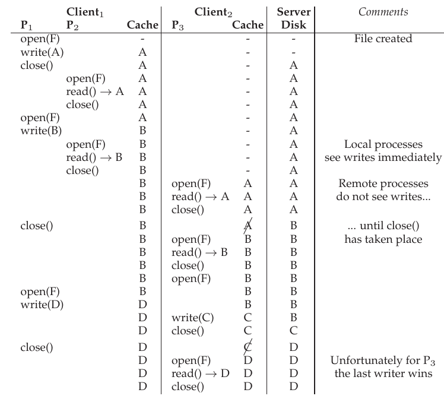

# 49 Andrew File System (AFS)

Andrew File System được các nhà nghiên cứu tại Đại học Carnegie-Mellon (CMU) giới thiệu vào những năm 1980 [H+88]. Dưới sự dẫn dắt của Giáo sư well-known M. Satyanarayanan thuộc Đại học Carnegie-Mellon (gọi tắt là “Satya”), mục tiêu chính của dự án rất đơn giản: scale. Cụ thể, làm thế nào thiết kế distributed file system để một server hỗ trợ được nhiều client nhất có thể?

Điều thú vị là có nhiều khía cạnh thiết kế và triển khai ảnh hưởng đến scalability. Quan trọng nhất là thiết kế protocol giữa client và server. Chẳng hạn, trong NFS, protocol buộc client định kỳ kiểm tra với server để xác định nội dung cache đã thay đổi chưa; vì mỗi lần kiểm tra sử dụng tài nguyên server (gồm CPU và network bandwidth), kiểm tra thường xuyên như vậy giới hạn số client mà server có thể phản hồi, do đó giới hạn scalability.

AFS còn khác NFS ở chỗ ngay từ đầu, hành vi user-visible hợp lý đã là mối quan tâm first-class. Trong NFS, cache consistency khó mô tả vì phụ thuộc trực tiếp vào chi tiết triển khai low-level, gồm khoảng timeout của cache client-side. Trong AFS, cache consistency đơn giản và dễ hiểu: khi file được mở, client thường nhận bản sao nhất quán mới nhất từ server.

## 49.1 AFS phiên bản 1

Ta sẽ thảo luận hai phiên bản AFS [H+88, S+85]. Phiên bản đầu tiên (ta gọi là AFSv1, nhưng hệ thống ban đầu thực ra có tên ITC distributed file system [S+85]) đã có một phần thiết kế cơ bản, nhưng không mở rộng như mong muốn, dẫn tới một lần re-design và protocol cuối cùng (ta gọi là AFSv2, hoặc chỉ AFS) [H+88]. Bây giờ, ta thảo luận phiên bản đầu tiên.

Một nguyên tắc cơ bản của mọi phiên bản AFS là caching whole-file trên local disk của máy client đang truy cập file. Khi bạn open() một file, toàn bộ file (nếu tồn tại) được lấy từ server và lưu thành file trên local disk. Những operation read() và write() tiếp theo của ứng dụng được chuyển hướng tới local file system nơi file được lưu; vì thế, chúng không cần giao tiếp qua network và diễn ra nhanh. Cuối cùng, khi close(), file được flush về server nếu đã được sửa. Chú ý khác biệt rõ ràng với NFS: NFS cache block (không phải toàn bộ file, dù dĩ nhiên có thể cache mọi block của cả file) và lưu trong client memory (không phải local disk).

```
TestAuth      Test whether a file has changed
              (used to validate cached entries)
GetFileStat   Get the stat info for a file
Fetch         Fetch the contents of file
Store         Store this file on the server
SetFileStat   Set the stat info for a file
ListDir       List the contents of a directory
```

Hình 49.1: Những điểm chính của AFSv1 protocol

Hãy đi vào chi tiết hơn một chút. Khi client application lần đầu gọi open(), code AFS client-side (được các nhà thiết kế AFS gọi là Venus) gửi Fetch protocol message tới server. Fetch protocol message truyền toàn bộ pathname của file mong muốn (chẳng hạn /home/remzi/notes.txt) tới file server (nhóm file server được họ gọi là Vice), sau đó file server duyệt pathname, tìm file mong muốn và chuyển toàn bộ file về client. Tiếp theo, code client-side cache file trên local disk của client (bằng cách ghi xuống local disk). Như đã nói, các system call read() và write() tiếp theo hoàn toàn cục bộ trong AFS (không có giao tiếp với server); chúng chỉ được chuyển hướng tới bản sao file cục bộ. Vì các call read() và write() hoạt động như call tới local file system, khi một block được truy cập, nó cũng có thể được cache trong client memory. Vì thế, AFS cũng dùng client memory để cache bản sao của những block nằm trên local disk. Cuối cùng, khi hoàn tất, AFS client kiểm tra file đã được sửa hay chưa (tức đã được mở để ghi); nếu có, nó flush phiên bản mới về server bằng Store protocol message, gửi toàn bộ file và pathname để server lưu bền vững.

Lần truy cập file tiếp theo, AFSv1 thực hiện hiệu quả hơn nhiều. Cụ thể, code client-side trước tiên liên hệ server (bằng TestAuth protocol message) để xác định file đã thay đổi chưa. Nếu chưa, client dùng bản sao locally-cached, cải thiện performance bằng cách tránh truyền qua network. Hình trên trình bày một số protocol message của AFSv1. Lưu ý phiên bản protocol đời đầu này chỉ cache nội dung file; chẳng hạn, directory chỉ được giữ tại server.

## 49.2 Các vấn đề của phiên bản 1

Một vài vấn đề then chốt của phiên bản AFS đầu tiên khiến các nhà thiết kế phải suy nghĩ lại về file system. Để nghiên cứu chi tiết, họ dành rất nhiều thời gian đo prototype hiện có nhằm tìm ra điều chưa ổn. Thực nghiệm như vậy rất tốt; đo lường là chìa khóa để hiểu hệ thống hoạt động thế nào và cải thiện ra sao. Số liệu thực tế giúp biến trực giác thành một ngành khoa học cụ thể về phân tích hệ thống. Trong nghiên cứu, các tác giả tìm thấy hai vấn đề chính của AFSv1:

> MẸO: ĐO LƯỜNG RỒI MỚI XÂY DỰNG (ĐỊNH LUẬT PATTERSON)
>
> Một người hướng dẫn của chúng tôi, David Patterson (nổi tiếng với RISC và RAID), luôn khuyến khích đo hệ thống và chứng minh có vấn đề trước khi xây dựng hệ thống mới để khắc phục. Bằng bằng chứng thực nghiệm thay vì cảm tính, bạn có thể biến quá trình xây dựng hệ thống thành công việc khoa học hơn. Điều này còn có lợi ích phụ là khiến bạn nghĩ chính xác cách đo hệ thống trước khi phát triển phiên bản cải tiến. Khi cuối cùng bắt tay xây dựng hệ thống mới, có hai điều tốt hơn: thứ nhất, bạn có bằng chứng cho thấy đang giải quyết vấn đề thực sự; thứ hai, đã có sẵn cách đo hệ thống mới để chỉ ra nó thực sự cải thiện so với trình độ hiện tại. Vì thế, ta gọi đây là Định luật Patterson.

• Chi phí Path-traversal quá cao: khi thực hiện Fetch hoặc Store protocol request, client truyền toàn bộ pathname (chẳng hạn /home/remzi/notes.txt) tới server. Để truy cập file, server phải duyệt đầy đủ pathname, trước tiên tìm trong root directory để thấy home, rồi trong home để thấy remzi, v.v., đi hết path cho đến khi tìm được file mong muốn. Khi nhiều client đồng thời truy cập server, các nhà thiết kế AFS nhận thấy server dành phần lớn CPU time chỉ để duyệt directory path.

• Client gửi quá nhiều TestAuth protocol message: giống NFS với quá nhiều GETATTR protocol message, AFSv1 tạo lượng traffic lớn để kiểm tra bằng TestAuth protocol message xem local file (hoặc stat information của nó) còn hợp lệ không. Vì thế, server dành phần lớn thời gian báo cho client liệu có thể dùng bản sao file trong cache. Phần lớn thời gian, câu trả lời là file chưa thay đổi.

Thực ra còn hai vấn đề khác với AFSv1: tải không cân bằng giữa các server, và server sử dụng một process riêng cho mỗi client, gây context switching cùng overhead khác. Load imbalance được giải quyết bằng cách đưa vào volume, cho phép administrator di chuyển giữa các server để cân bằng tải; context-switch problem được giải quyết trong AFSv2 bằng cách xây dựng server với thread thay cho process. Tuy nhiên, để tiết kiệm chỗ, ở đây ta tập trung vào hai vấn đề protocol chính ở trên làm giới hạn scale của hệ thống.

## 49.3 Cải thiện protocol

Hai vấn đề trên giới hạn scalability của AFS; server CPU trở thành bottleneck của hệ thống, và mỗi server chỉ phục vụ được 20 client mà không quá tải. Server nhận quá nhiều TestAuth message, còn khi nhận Fetch hoặc Store message, chúng mất quá nhiều thời gian duyệt directory hierarchy. Vì thế, các nhà thiết kế AFS đối mặt với vấn đề:

> VẤN ĐỀ CỐT LÕI: CÁCH THIẾT KẾ FILE PROTOCOL CÓ KHẢ NĂNG MỞ RỘNG
>
> Nên thiết kế lại protocol như thế nào để giảm thiểu số lần tương tác với server, tức làm thế nào giảm số TestAuth message? Hơn nữa, làm thế nào thiết kế protocol để những tương tác ấy hiệu quả? Giải quyết cả hai vấn đề sẽ tạo ra protocol mới cho phiên bản AFS có scalability cao hơn nhiều.

## 49.4 AFS phiên bản 2

AFSv2 đưa ra khái niệm callback để giảm số lần tương tác client/server. Callback chỉ là lời hứa của server với client rằng server sẽ báo khi file mà client đang cache được sửa. Bằng cách thêm state này vào server, client không còn cần liên hệ server để biết cached file còn hợp lệ không. Thay vào đó, nó giả định file hợp lệ cho tới khi server báo điều ngược lại; hãy chèn phép ví von giữa polling và interrupt vào đây.

AFSv2 còn đưa ra khái niệm file identifier (FID) (tương tự NFS file handle) thay cho pathname để chỉ định file mà client quan tâm. FID trong AFS gồm volume identifier, file identifier và “uniquifier” (cho phép tái sử dụng volume ID và file ID khi file bị xóa). Vì thế, thay vì gửi toàn bộ pathname tới server rồi để server duyệt pathname tìm file mong muốn, client tự duyệt từng phần pathname, cache kết quả và nhờ đó hy vọng giảm tải cho server.

Chẳng hạn, nếu client truy cập file /home/remzi/notes.txt và home là AFS directory được mount vào / (tức / là local root directory, còn home và các mục con nằm trong AFS), trước tiên client Fetch nội dung directory home, đưa vào cache local-disk và thiết lập callback cho home. Tiếp theo, client Fetch directory remzi, đưa vào cache local-disk và thiết lập callback trên server cho remzi. Cuối cùng, client Fetch notes.txt, cache regular file này trên local disk, thiết lập callback rồi trả file descriptor cho ứng dụng gọi. Xem Hình 49.2 để có tóm tắt.

Tuy nhiên, khác biệt then chốt với NFS là mỗi khi fetch directory hoặc file, AFS client thiết lập callback với server, bảo đảm server báo cho client khi cached state thay đổi. Lợi ích rõ ràng: dù lần truy cập đầu tới /home/remzi/notes.txt tạo nhiều message client-server (như mô tả ở trên), nó còn thiết lập callback cho mọi directory và file notes.txt, nên các lần truy cập sau hoàn toàn cục bộ, không cần tương tác server. Vì vậy, trong trường hợp phổ biến file được cache tại client, AFS hoạt động gần như giống hệt local file system disk-based. Nếu truy cập file nhiều hơn một lần, lần thứ hai phải nhanh như truy cập file cục bộ.

| Client (C<sub>1</sub>) | Server |
|---|---|
| fd = open(“/home/remzi/notes.txt”, ...); |  |
| Gửi Fetch (home FID, “remzi”) |  |
|  | Nhận Fetch request |
|  | Tìm remzi trong directory home |
|  | Thiết lập callback(C<sub>1</sub>) cho remzi |
|  | Trả về nội dung và FID của remzi |
| Nhận Fetch reply |  |
| Ghi remzi vào local disk cache |  |
| Ghi nhận callback status của remzi |  |
| Gửi Fetch (remzi FID, “notes.txt”) |  |
|  | Nhận Fetch request |
|  | Tìm notes.txt trong directory remzi |
|  | Thiết lập callback(C<sub>1</sub>) cho notes.txt |
|  | Trả về nội dung và FID của notes.txt |
| Nhận Fetch reply |  |
| Ghi notes.txt vào local disk cache |  |
| Ghi nhận callback status của notes.txt |  |
| Thực hiện open() cục bộ trên notes.txt đã cache |  |
| Trả file descriptor cho ứng dụng |  |
| read(fd, buffer, MAX); |  |
| Thực hiện read() cục bộ trên bản sao đã cache |  |
| close(fd); |  |
| Thực hiện close() cục bộ trên bản sao đã cache |  |
| Nếu file đã thay đổi, flush tới server |  |
| fd = open(“/home/remzi/notes.txt”, ...); |  |
| Foreach dir (home, remzi) |  |
| if (callback(dir) == VALID) |  |
| Dùng bản sao cục bộ cho lookup(dir) |  |
| else |  |
| Fetch (như trên) |  |
| if (callback(notes.txt) == VALID) |  |
| Mở bản sao đã cache cục bộ |  |
| Trả file descriptor tới bản sao đó |  |
| else |  |
| Fetch (như trên), rồi mở và trả về fd |  |

Hình 49.2: Đọc file: Thao tác Client-side và thao tác của file server

> BÊN LỀ: CACHE CONSISTENCY KHÔNG PHẢI THUỐC CHỮA BÁCH BỆNH
>
> Khi thảo luận distributed file system, người ta rất chú trọng cache consistency mà file system cung cấp. Tuy nhiên, mức consistency cơ bản này không giải quyết mọi vấn đề liên quan đến truy cập file từ nhiều client. Chẳng hạn, nếu xây dựng code repository, với nhiều client thực hiện check-ins và check-outs của code, bạn không thể chỉ dựa vào file system bên dưới làm hết mọi việc; thay vào đó, phải dùng locking file-level tường minh để bảo đảm điều “đúng” diễn ra khi có những concurrent access như vậy. Thực tế, mọi ứng dụng thực sự quan tâm concurrent update đều bổ sung cơ chế xử lý xung đột. Mức consistency cơ bản mô tả trong chương này và chương trước chủ yếu hữu ích cho sử dụng thông thường, tức khi user đăng nhập client khác, họ kỳ vọng thấy phiên bản hợp lý nào đó của file của mình ở đó. Mong đợi nhiều hơn từ những protocol này là tự chuốc lấy thất bại, thất vọng và bực bội tear-filled.

## 49.5 Cache consistency

Khi thảo luận NFS, ta xét hai khía cạnh cache consistency: update visibility và cache staleness. Với update visibility, câu hỏi là: khi nào server được cập nhật bằng phiên bản file mới? Với cache staleness, câu hỏi là: khi server có phiên bản mới, mất bao lâu client mới thấy nó thay vì bản sao cũ trong cache?

Nhờ callback và caching whole-file, cache consistency do AFS cung cấp dễ mô tả và dễ hiểu. Có hai trường hợp quan trọng cần xét: consistency giữa các process trên những máy khác nhau và consistency giữa các process trên cùng máy.

Giữa các máy khác nhau, AFS làm cập nhật hiển thị tại server và invalidate các bản sao đã cache đúng cùng thời điểm: khi file được cập nhật đóng lại. Client mở file rồi ghi vào đó (có thể nhiều lần). Khi cuối cùng file được đóng, file mới được flush tới server (nên trở nên hiển thị); sau đó server hủy callback của mọi client có bản sao đã cache, bảo đảm client không còn đọc bản sao cũ của file; những lần mở tiếp theo trên các client đó đòi hỏi re-fetch phiên bản file mới từ server.

AFS có ngoại lệ đối với mô hình đơn giản này giữa các process trên cùng máy. Trong trường hợp đó, những lần ghi vào file hiển thị ngay với local process khác (tức process không cần chờ file đóng mới thấy cập nhật mới nhất). Điều này khiến việc sử dụng một máy hoạt động đúng như mong đợi, vì hành vi dựa trên UNIX semantics điển hình. Chỉ khi chuyển sang máy khác mới có thể nhận thấy cơ chế consistency tổng quát hơn của AFS.

Có một trường hợp cross-machine thú vị đáng bàn thêm. Cụ thể, trong trường hợp hiếm process trên những máy khác nhau sửa cùng file đồng thời, AFS tự nhiên dùng cách gọi là last writer wins (có lẽ nên gọi last closer wins). Cụ thể, client nào gọi close() cuối cùng sẽ cập nhật toàn bộ file trên server cuối cùng, nên file của nó “thắng”, tức là file còn lại trên server cho người khác thấy. Kết quả là file được tạo toàn bộ bởi client này hoặc client kia. Chú ý khác biệt với protocol block-based như NFS: trong NFS, các lần ghi từng block có thể được flush tới server khi mỗi client cập nhật file, nên file cuối trên server có thể là hỗn hợp cập nhật của cả hai client. Trong nhiều trường hợp, file hỗn hợp như vậy không có nhiều ý nghĩa; chẳng hạn, hình dung ảnh JPEG được hai client sửa từng phần, hỗn hợp những lần ghi thu được khó có thể tạo thành JPEG hợp lệ.



Hình 49.3: Timeline của cache consistency

Hình 49.3 trình bày timeline của một vài kịch bản khác nhau này. Các cột cho thấy hành vi của hai process (P<sub>1</sub> và P<sub>2</sub>) trên Client<sub>1</sub> cùng cache state của nó, một process (P<sub>3</sub>) trên Client<sub>2</sub> cùng cache state của nó, và server (Server), tất cả thao tác trên một file duy nhất mang cái tên đầy sáng tạo F. Với server, hình chỉ thể hiện nội dung file sau khi operation bên trái hoàn tất. Hãy đọc và xem có hiểu vì sao mỗi lần read trả về kết quả như vậy không. Cột bình luận bên phải sẽ giúp nếu bạn vướng mắc.

## 49.6 Crash recovery

Từ mô tả trên, có lẽ bạn cảm thấy crash recovery phức tạp hơn NFS. Bạn đúng. Chẳng hạn, hình dung có một khoảng ngắn server (S) không thể liên hệ client (C1), ví dụ khi client C1 đang reboot. Trong lúc C1 không khả dụng, S có thể đã cố gửi một hoặc nhiều callback recall message; chẳng hạn, hình dung C1 đã cache file F trên local disk, rồi C2 (client khác) cập nhật F, khiến S gửi message tới mọi client đang cache file để loại nó khỏi local cache. Vì C1 có thể bỏ lỡ các message quan trọng này khi reboot, lúc gia nhập lại hệ thống, C1 phải xem mọi nội dung cache là đáng ngờ. Vì thế, ở lần truy cập file F tiếp theo, trước tiên C1 hỏi server (bằng TestAuth protocol message) xem bản sao file F trong cache còn hợp lệ không; nếu có, C1 dùng nó; nếu không, C1 lấy phiên bản mới hơn từ server.

Server recovery sau crash cũng phức tạp hơn. Vấn đề là callback được giữ trong memory; vì thế, khi server reboot, nó không biết máy client nào giữ file nào. Do đó, khi server khởi động lại, mỗi client của server phải nhận ra server đã crash, xem mọi nội dung cache là đáng ngờ và, như trên, xác lập lại tính hợp lệ của file trước khi dùng. Vì vậy, server crash là sự kiện lớn: phải bảo đảm mỗi client biết về crash kịp thời, nếu không có nguy cơ client truy cập file cũ. Có nhiều cách triển khai recovery như vậy; chẳng hạn để server gửi message (“đừng tin nội dung cache của bạn!”) tới từng client khi hoạt động trở lại, hoặc để client định kỳ kiểm tra server còn hoạt động không (bằng thứ gọi là heartbeat message). Như bạn thấy, xây dựng mô hình caching có scalability cao hơn và hợp lý hơn có cái giá của nó; với NFS, client gần như không nhận thấy server crash.

## 49.7 Scale và performance của AFSv2

Sau khi có protocol mới, các phép đo AFSv2 cho thấy scalability cao hơn phiên bản ban đầu rất nhiều. Thực vậy, mỗi server hỗ trợ khoảng 50 client (thay vì chỉ 20). Lợi ích nữa là performance client-side thường khá gần performance cục bộ, vì trong trường hợp phổ biến, mọi file access đều cục bộ; các lần đọc file thường tới local disk cache (và có thể local memory). Chỉ khi client tạo file mới hoặc ghi vào file hiện có mới cần gửi Store message tới server để cập nhật file bằng nội dung mới.

Hãy nhìn AFS performance từ góc độ khác bằng cách so sánh các kịch bản truy cập file-system phổ biến với NFS. Hình 49.4 (trang 9) thể hiện kết quả so sánh định tính.

Trong hình, ta phân tích các read pattern và write pattern điển hình với file có kích thước khác nhau. File nhỏ có N<sub>s</sub> block; file vừa có N<sub>m</sub> block; file lớn có N<sub>L</sub> block. Ta giả sử file nhỏ và vừa nằm vừa trong memory của client; file lớn nằm vừa trên local disk nhưng không vừa client memory.

| Workload | NFS | AFS | AFS/NFS |
|---|---|---|---|
| 1. File nhỏ, đọc tuần tự | N<sub>s</sub> · L<sub>net</sub> | N<sub>s</sub> · L<sub>net</sub> | 1 |
| 2. File nhỏ, re-read tuần tự | N<sub>s</sub> · L<sub>mem</sub> | N<sub>s</sub> · L<sub>mem</sub> | 1 |
| 3. File vừa, đọc tuần tự | N<sub>m</sub> · L<sub>net</sub> | N<sub>m</sub> · L<sub>net</sub> | 1 |
| 4. File vừa, re-read tuần tự | N<sub>m</sub> · L<sub>mem</sub> | N<sub>m</sub> · L<sub>mem</sub> | 1 |
| 5. File lớn, đọc tuần tự | N<sub>L</sub> · L<sub>net</sub> | N<sub>L</sub> · L<sub>net</sub> | 1 |
| 6. File lớn, re-read tuần tự | N<sub>L</sub> · L<sub>net</sub> | N<sub>L</sub> · L<sub>disk</sub> | L<sub>disk</sub>/L<sub>net</sub> |
| 7. File lớn, một lần đọc | L<sub>net</sub> | N<sub>L</sub> · L<sub>net</sub> | N<sub>L</sub> |
| 8. File nhỏ, ghi tuần tự | N<sub>s</sub> · L<sub>net</sub> | N<sub>s</sub> · L<sub>net</sub> | 1 |
| 9. File lớn, ghi tuần tự | N<sub>L</sub> · L<sub>net</sub> | N<sub>L</sub> · L<sub>net</sub> | 1 |
| 10. File lớn, ghi đè tuần tự | N<sub>L</sub> · L<sub>net</sub> | 2 · N<sub>L</sub> · L<sub>net</sub> | 2 |
| 11. File lớn, một lần ghi | L<sub>net</sub> | 2 · N<sub>L</sub> · L<sub>net</sub> | 2 · N<sub>L</sub> |

Hình 49.4: So sánh AFS với NFS

Để phân tích, ta còn giả sử truy cập qua network tới remote server để lấy một file block mất L<sub>net</sub> đơn vị thời gian. Truy cập local memory mất L<sub>mem</sub>, còn truy cập local disk mất L<sub>disk</sub>. Giả định chung là L<sub>net</sub> > L<sub>disk</sub> > L<sub>mem</sub>.

Cuối cùng, ta giả sử lần truy cập file đầu tiên không hit trong cache nào. Với các lần truy cập file sau (tức “re-reads”), ta giả sử sẽ hit trong cache nếu cache tương ứng đủ dung lượng chứa file.

Các cột trong hình cho thấy thời gian xấp xỉ để thực hiện operation cụ thể (chẳng hạn đọc tuần tự file nhỏ) trên NFS hoặc AFS. Cột ngoài cùng bên phải thể hiện tỷ lệ thời gian AFS so với NFS.

Ta có những nhận xét sau. Thứ nhất, trong nhiều trường hợp, performance của mỗi hệ thống gần tương đương. Chẳng hạn, khi đọc file lần đầu (ví dụ Workload 1, 3, 5), thời gian lấy file từ remote server chiếm ưu thế và tương tự trên cả hai hệ thống. Có thể bạn nghĩ AFS chậm hơn vì phải ghi file xuống local disk; tuy nhiên, những lần ghi đó được giữ trong cache buffer của local file system (client-side), nên chi phí có lẽ được che giấu. Tương tự, có thể bạn nghĩ AFS đọc bản sao cache cục bộ chậm hơn, cũng vì lưu bản sao trên disk. Nhưng AFS lại được lợi từ local file system caching; các lần đọc trong AFS có khả năng hit trong memory cache client-side, nên performance tương tự NFS.

Thứ hai, có khác biệt thú vị khi thực hiện re-read tuần tự với một large-file (Workload 6). Vì AFS có local disk cache lớn, nó truy cập file từ đó khi file được truy cập lại. Ngược lại, NFS chỉ cache block trong client memory; vì thế, nếu file lớn (tức lớn hơn local memory) được re-read, NFS client phải re-fetch toàn bộ file từ remote server. Do đó, trong trường hợp này, AFS nhanh hơn NFS theo hệ số L<sub>net</sub>/L<sub>disk</sub>, giả sử remote access thực sự chậm hơn local disk. Ta còn lưu ý rằng NFS làm tăng server load trong trường hợp này, cũng ảnh hưởng tới scale.

Thứ ba, ghi tuần tự file mới phải có performance tương tự trên cả hai hệ thống (Workload 8, 9). AFS ghi file vào bản sao cache cục bộ; khi file đóng, AFS client buộc ghi tới server theo protocol. NFS giữ các lần ghi trong client memory buffer, có thể buộc một số block tới server do áp lực memory client-side, nhưng chắc chắn ghi tới server khi file đóng để duy trì consistency flush-on-close của NFS. Có thể bạn nghĩ AFS chậm hơn vì ghi mọi data xuống local disk. Tuy nhiên, cần hiểu rằng nó ghi tới local file system; những lần ghi này trước tiên được commit vào page cache, chỉ sau đó mới xuống disk ở nền, nên AFS tận dụng hạ tầng OS memory caching client-side để cải thiện performance.

Thứ tư, AFS có performance kém hơn khi ghi đè file tuần tự (Workload 10). Đến đây, ta đã giả sử workload ghi cũng tạo file mới; trong trường hợp này, file đã tồn tại rồi được over-written. Ghi đè có thể là trường hợp đặc biệt bất lợi cho AFS, vì client trước tiên lấy toàn bộ file cũ chỉ để sau đó ghi đè nó. Ngược lại, NFS chỉ ghi đè các block, tránh lần đọc ban đầu vô ích[^1].

Cuối cùng, workload chỉ truy cập một tập con data nhỏ trong file lớn có performance tốt hơn nhiều trên NFS so với AFS (Workload 7, 11). Trong những trường hợp này, AFS protocol lấy toàn bộ file khi mở; đáng tiếc là chỉ có lần đọc hoặc ghi nhỏ được thực hiện. Tệ hơn nữa, nếu file bị sửa, toàn bộ file được ghi trở lại server, làm ảnh hưởng performance tăng gấp đôi. Vì là protocol block-based, NFS thực hiện I/O tỷ lệ với kích thước lần đọc hoặc ghi.

Nhìn chung, ta thấy NFS và AFS có những giả định khác nhau, nên không ngạc nhiên khi đạt kết quả performance khác nhau. Những khác biệt này có quan trọng không, như thường lệ, phụ thuộc workload.

## 49.8 AFS: Những cải tiến khác

Giống như khi Berkeley FFS ra đời (bổ sung symbolic link và nhiều tính năng khác), các nhà thiết kế AFS tận dụng cơ hội xây dựng hệ thống để thêm tính năng giúp dễ dùng và quản lý hơn. Chẳng hạn, AFS cung cấp global namespace thực sự cho client, bảo đảm mọi file được đặt tên giống nhau trên mọi máy client. Ngược lại, NFS cho phép mỗi client mount NFS server theo bất cứ cách nào họ muốn, nên chỉ nhờ quy ước (và rất nhiều công sức quản trị), file mới có tên tương tự giữa các client.

> BÊN LỀ: TẦM QUAN TRỌNG CỦA WORKLOAD
>
> Một thách thức khi đánh giá hệ thống bất kỳ là chọn workload. Vì hệ thống máy tính được dùng theo rất nhiều cách, có vô số workload để lựa chọn. Nhà thiết kế storage system nên quyết định workload nào quan trọng như thế nào để có quyết định thiết kế hợp lý?
>
> Các nhà thiết kế AFS, dựa trên kinh nghiệm đo cách file system được sử dụng, đưa ra một số giả định về workload; cụ thể, họ giả sử phần lớn file không thường xuyên được chia sẻ và được truy cập tuần tự toàn bộ. Với những giả định đó, thiết kế AFS hoàn toàn hợp lý.
>
> Tuy nhiên, chúng không phải lúc nào cũng đúng. Chẳng hạn, hình dung ứng dụng định kỳ nối thêm thông tin vào log. Những lần ghi log nhỏ này thêm ít data vào file lớn hiện có, rất bất lợi với AFS. Còn nhiều workload khó khác, như cập nhật ngẫu nhiên trong transaction database.
>
> Một nguồn thông tin về các loại workload phổ biến là những nghiên cứu đã được thực hiện. Xem bất kỳ nghiên cứu nào sau đây để có ví dụ tốt về phân tích workload [B+91, H+11, R+00, V99], bao gồm bài nhìn lại AFS [H+88].

AFS còn coi trọng security và tích hợp cơ chế authenticate user, bảo đảm có thể giữ riêng tư một tập file nếu user muốn. Ngược lại, NFS chỉ hỗ trợ security khá sơ khai trong nhiều năm.

AFS còn có công cụ cho access control user-managed linh hoạt. Vì vậy, khi dùng AFS, user kiểm soát rất nhiều về chính xác ai được truy cập file nào. NFS, như phần lớn UNIX file system, hỗ trợ kiểu chia sẻ này ít hơn nhiều.

Cuối cùng, như đã nói, AFS thêm công cụ giúp administrator quản lý server đơn giản hơn. Về tư duy quản trị hệ thống, AFS đã đi trước cả lĩnh vực rất xa.

## 49.9 Tổng kết

AFS cho thấy có thể xây dựng distributed file system rất khác với những gì đã thấy trong NFS. Thiết kế protocol của AFS đặc biệt quan trọng; bằng cách giảm thiểu tương tác server (qua caching whole-file và callback), mỗi server hỗ trợ nhiều client, nhờ đó giảm số server cần để quản lý một site cụ thể. Nhiều tính năng khác, gồm namespace duy nhất, security và access-control list, khiến AFS khá dễ dùng. Consistency model do AFS cung cấp dễ hiểu và dễ suy luận, không dẫn đến hành vi kỳ lạ đôi khi quan sát thấy ở NFS.

Có lẽ đáng tiếc là AFS nhiều khả năng đang suy giảm. Vì NFS trở thành open standard, nhiều vendor hỗ trợ nó, và cùng CIFS (distributed file system protocol Windows-based), NFS thống trị thị trường. Dù thỉnh thoảng vẫn gặp hệ thống AFS được triển khai (chẳng hạn tại nhiều cơ sở giáo dục, gồm Wisconsin), ảnh hưởng lâu dài có lẽ chỉ đến từ các ý tưởng AFS hơn là bản thân hệ thống thực tế. Thực vậy, NFSv4 giờ bổ sung server state (chẳng hạn “open” protocol message), nên ngày càng giống AFS protocol cơ bản.

## Tài liệu tham khảo

[B+91] “Measurements of a Distributed File System”

Mary Baker, John Hartman, Martin Kupfer, Ken Shirriff, John Ousterhout

SOSP ’91, Pacific Grove, California, tháng Mười 1991

Một bài báo ban đầu đo cách người ta sử dụng distributed file system. Phù hợp với nhiều trực giác có trong AFS.

[H+11] “A File is Not a File: Understanding the I/O Behavior of Apple Desktop Applications” Tyler Harter, Chris Dragga, Michael Vaughn,

Andrea C. Arpaci-Dusseau, Remzi H. Arpaci-Dusseau

SOSP ’11, New York, New York, tháng Mười 2011

Bài báo của chúng tôi nghiên cứu hành vi của Apple Desktop workload; hóa ra chúng hơi khác nhiều workload server-based mà cộng đồng nghiên cứu hệ thống thường tập trung. Cũng là tài liệu tham khảo gần đây tốt, dẫn tới nhiều công trình liên quan.

[H+88] “Scale and Performance in a Distributed File System”

John H. Howard, Michael L. Kazar, Sherri G. Menees, David A. Nichols, M. Satyanarayanan, Robert N. Sidebotham, Michael J. West

ACM Transactions on Computing Systems (ACM TOCS), trang 51-81, Tập 6, Số 1, tháng Hai 1988

Phiên bản dài đăng tạp chí về hệ thống AFS nổi tiếng, vẫn được dùng ở nhiều nơi trên thế giới, và có lẽ cũng là tư duy rõ ràng sớm nhất về cách xây dựng distributed file system. Một sự kết hợp tuyệt vời giữa khoa học đo lường và kỹ thuật có nguyên tắc.

[R+00] “A Comparison of File System Workloads”

Drew Roselli, Jacob R. Lorch, Thomas E. Anderson

USENIX ’00, San Diego, California, tháng Sáu 2000

Một tập trace gần đây hơn so với bài của Baker [B+91], với một số điểm khác biệt thú vị.

[S+85] “The ITC Distributed File System: Principles and Design”

M. Satyanarayanan, J.H. Howard, D.A. Nichols, R.N. Sidebotham, A. Spector, M.J. West

SOSP ’85, Orcas Island, Washington, tháng Mười Hai 1985

Bài báo cũ hơn về distributed file system. Phần lớn thiết kế cơ bản của AFS đã có trong hệ thống cũ này, nhưng chưa có các cải tiến cho scale.

[V99] “File system usage in Windows NT 4.0”

Werner Vogels

SOSP ’99, Kiawah Island Resort, South Carolina, tháng Mười Hai 1999

Một nghiên cứu thú vị về Windows workload, vốn khác nhiều nghiên cứu UNIX-based đã thực hiện trước đó.

## Bài tập

Phần này giới thiệu afs.py, một AFS simulator đơn giản để củng cố kiến thức về cách Andrew File System hoạt động. Đọc file README để biết thêm chi tiết.

### Câu hỏi

1. Chạy vài trường hợp đơn giản để bảo đảm bạn dự đoán được những giá trị client sẽ đọc. Thay đổi random seed flag (-s) và xem có lần theo trace để dự đoán cả giá trị trung gian lẫn giá trị cuối lưu trong file không. Cũng thay đổi số file (-f), số client (-C) và read ratio (-r, từ 0 đến 1) để tăng độ khó một chút. Bạn cũng có thể tạo trace dài hơn đôi chút để có tương tác thú vị hơn, chẳng hạn (-n 2 hoặc cao hơn).

2. Bây giờ làm tương tự và xem có dự đoán được mỗi callback do AFS server khởi tạo không. Thử các random seed khác nhau và nhớ dùng mức phản hồi chi tiết cao (chẳng hạn -d 3) để thấy callback xảy ra lúc nào khi cho chương trình tính đáp án (với -c). Bạn có đoán chính xác thời điểm từng callback xảy ra không? Điều kiện chính xác để một callback xảy ra là gì?

3. Tương tự trên, chạy với một số random seed khác và xem có dự đoán chính xác cache state ở mỗi bước không. Có thể quan sát cache state bằng cách chạy với -c và -d 7.

4. Bây giờ, hãy tạo một số workload cụ thể. Chạy simulation với flag -A oa1:w1:c1,oa1:r1:c1. Client 1 có thể quan sát những giá trị khác nhau nào khi đọc file a, nếu chạy bằng random scheduler? (Thử các random seed khác nhau để thấy những kết quả khác nhau)? Trong mọi cách xen kẽ lịch thực thi operation của hai client, có bao nhiêu cách khiến client 1 đọc giá trị 1, và bao nhiêu cách đọc giá trị 0?

5. Bây giờ, hãy tạo một số schedule cụ thể. Khi chạy với flag -A oa1:w1:c1,oa1:r1:c1, hãy chạy thêm với những schedule sau: -S 01, -S 100011, -S 011100 và các schedule khác bạn nghĩ ra. Client 1 sẽ đọc giá trị nào?

6. Giờ chạy với workload này: -A oa1:w1:c1,oa1:w1:c1, và thay đổi schedule như trên. Điều gì xảy ra khi chạy với -S 011100? Còn khi chạy với -S 010011 thì sao? Yếu tố nào quan trọng để xác định giá trị cuối của file?

---

[^1]: Ở đây, ta giả sử các lần đọc NFS là block-sized và block-aligned; nếu không, NFS client cũng phải đọc block trước. Ta còn giả sử file không được mở với flag O_TRUNC; nếu có, lần open ban đầu trong AFS sẽ không lấy nội dung file sắp bị truncate.
