# Chương 1: Mã hóa (Encryption)

Encryption là ứng dụng chủ yếu của cryptography; nó làm cho dữ liệu trở nên không thể hiểu được để bảo đảm tính bí mật (confidentiality) của dữ liệu. Encryption dùng một algorithm gọi là cipher và một giá trị bí mật gọi là key. Nếu không biết secret key, bạn không thể giải mã, cũng không thể biết được bất kỳ bit thông tin nào về message đã mã hóa—và bất kỳ kẻ tấn công nào cũng vậy.

Chương này tập trung vào symmetric encryption, loại encryption đơn giản nhất. Trong symmetric encryption, key giải mã giống với key mã hóa (khác với asymmetric encryption, hay public-key encryption, trong đó các key là khác nhau). Bạn sẽ bắt đầu bằng việc tìm hiểu các dạng symmetric encryption yếu nhất, những classical cipher chỉ an toàn trước những kẻ tấn công kém hiểu biết nhất, rồi sau đó chúng ta sẽ chuyển sang những dạng mạnh nhất, an toàn mãi mãi.

## Những điều cơ bản (The Basics)

Khi mã hóa một message, plaintext là message chưa mã hóa còn ciphertext là message đã mã hóa. Vì vậy, một cipher gồm hai function: encryption biến một plaintext thành một ciphertext, và decryption biến một ciphertext trở lại thành một plaintext. Nhưng chúng ta sẽ thường nói “cipher” khi thực ra muốn nói “encryption”. Ví dụ, Hình 1-1 cho thấy một cipher, E, được biểu diễn dưới dạng một hộp nhận đầu vào là một plaintext, P, và một key, K, rồi tạo ra một ciphertext, C, ở đầu ra. Tôi sẽ viết quan hệ này là C = E(K, P). Tương tự, khi cipher ở chế độ decryption, tôi sẽ viết D(K, C).

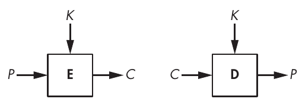

Hình 1-1: Encryption và decryption cơ bản

> **LƯU Ý** Với một số cipher, ciphertext có cùng kích thước với plaintext; với những cipher khác, ciphertext dài hơn một chút. Tuy nhiên, ciphertext không bao giờ có thể ngắn hơn plaintext.

## Các classical cipher (Classical Ciphers)

Classical cipher ra đời trước máy tính và vì thế làm việc trên các chữ cái chứ không phải trên các bit, khiến chúng đơn giản hơn nhiều so với một cipher hiện đại như Data Encryption Standard. Ví dụ, ở La Mã cổ đại hay trong Thế chiến thứ nhất, bạn không thể dùng sức mạnh của một con chip máy tính để xáo trộn một message; bạn phải làm mọi thứ chỉ với bút và giấy. Có nhiều classical cipher, nhưng nổi tiếng nhất là Caesar cipher và Vigenère cipher.

### Caesar Cipher (The Caesar Cipher)

Caesar cipher được gọi như vậy vì nhà sử học La Mã Suetonius ghi lại rằng Julius Caesar đã dùng nó. Nó mã hóa một message bằng cách dịch mỗi chữ cái xuống ba vị trí trong bảng chữ cái, quay vòng trở lại A nếu phép dịch đến Z. Ví dụ, ZOO được mã hóa thành CRR, FDHVDU được giải mã thành CAESAR, v.v., như trong Hình 1-2. Giá trị 3 không có gì đặc biệt; chỉ là nó dễ tính nhẩm hơn 11 hay 23.

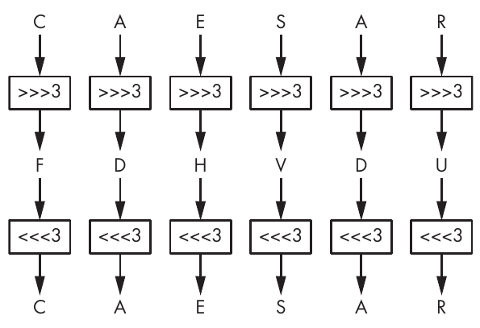

Hình 1-2: Caesar cipher

Caesar cipher cực kỳ dễ phá: để giải mã một ciphertext cho trước, chỉ cần dịch các chữ cái lùi lại ba vị trí là lấy lại được plaintext. Dù vậy, Caesar cipher có thể đã đủ mạnh vào thời của Crassus và Cicero. Vì không có secret key nào tham gia (nó luôn là 3), những người dùng cipher của Caesar đã giả định rằng kẻ tấn công không biết chữ hoặc quá thiếu học để hiểu ra nó—một giả định kém thực tế hơn nhiều ngày nay. (Thực tế, năm 2006, cảnh sát Ý đã bắt giữ một trùm mafia sau khi giải mã được những message viết trên các mẩu giấy nhỏ, được mã hóa bằng một biến thể của Caesar cipher: chẳng hạn, ABC được mã hóa thành 456 thay vì DEF.)

Có thể làm cho Caesar cipher an toàn hơn không? Bạn có thể hình dung một phiên bản dùng một giá trị dịch bí mật thay vì luôn dùng 3, nhưng điều đó cũng chẳng giúp được mấy, vì kẻ tấn công có thể thử cả 25 giá trị dịch có thể có cho đến khi message được giải mã có nghĩa.

### Vigenère Cipher (The Vigenère Cipher)

Phải mất khoảng 1,500 năm mới thấy được một cải tiến đáng kể của Caesar cipher dưới dạng Vigenère cipher, được tạo ra vào thế kỷ 16 bởi một người Ý tên là Giovan Battista Bellaso. Cái tên Vigenère đến từ người Pháp Blaise de Vigenère, người đã phát minh một cipher khác vào thế kỷ 16, nhưng do sự nhầm lẫn lịch sử về tác giả, tên của Vigenère đã gắn luôn với nó. Dù sao thì Vigenère cipher đã trở nên phổ biến và sau đó được dùng, chẳng hạn, bởi lực lượng Liên minh miền Nam (Confederate) trong Nội chiến Mỹ và bởi Quân đội Thụy Sĩ trong Thế chiến thứ nhất (WWI).

Vigenère cipher tương tự Caesar cipher, ngoại trừ việc các chữ cái không bị dịch ba vị trí mà được dịch theo các giá trị do một key xác định, key này là một tập hợp các chữ cái biểu diễn các con số dựa trên vị trí của chúng trong bảng chữ cái. Ví dụ, nếu key là DUH, các chữ cái trong plaintext được dịch bằng các giá trị 3, 20, 7 vì D đứng sau A ba chữ cái, U đứng sau A 20 chữ cái, và H đứng sau A bảy chữ cái. Mẫu 3, 20, 7 lặp lại cho đến khi bạn mã hóa xong toàn bộ plaintext. Ví dụ, từ CRYPTO sẽ được mã hóa thành FLFSNV khi dùng DUH làm key: C được dịch ba vị trí thành F, R được dịch 20 vị trí thành L, v.v. Hình 1-3 minh họa nguyên lý này khi mã hóa câu THEY DRINK THE TEA.

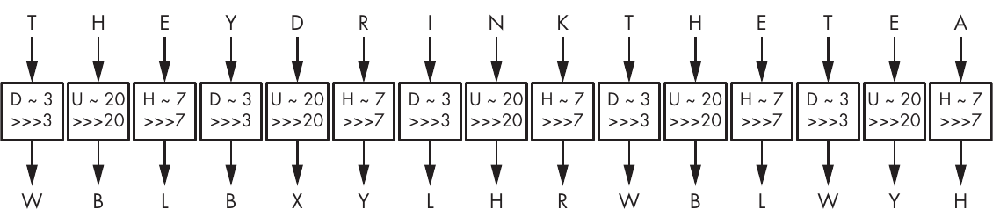

Hình 1-3: Vigenère cipher

Vigenère cipher rõ ràng an toàn hơn Caesar cipher, nhưng nó vẫn khá dễ phá. Bước đầu tiên để giải mã nó là tìm ra độ dài của key. Lấy ví dụ trong Hình 1-3, trong đó THEY DRINK THE TEA được mã hóa thành WBLBXYLHRWBLWYH với key DUH. (Dấu cách thường được bỏ đi để che giấu ranh giới giữa các từ.) Hãy để ý rằng trong ciphertext WBLBXYLHRWBLWYH, nhóm ba chữ cái WBL xuất hiện hai lần trong ciphertext, cách nhau những khoảng nine-letter. Điều này gợi ý rằng cùng một từ three-letter đã được mã hóa bằng cùng các giá trị dịch, mỗi lần đều tạo ra WBL. Khi đó, một cryptanalyst có thể suy ra rằng độ dài của key hoặc là chín, hoặc là một giá trị chia hết chín (tức là ba). Hơn nữa, họ có thể đoán rằng từ three-letter lặp lại này là THE và từ đó xác định DUH là một encryption key khả dĩ.

Bước thứ hai để phá Vigenère cipher là xác định key thực sự bằng một phương pháp gọi là frequency analysis, phương pháp này khai thác sự phân bố không đồng đều của các chữ cái trong các ngôn ngữ. Ví dụ, trong tiếng Anh, E là chữ cái phổ biến nhất, vì vậy nếu bạn thấy X là chữ cái phổ biến nhất trong một ciphertext, thì giá trị plaintext có khả năng cao nhất tại vị trí này là E.

Dù tương đối yếu, Vigenère cipher có thể đã đủ tốt để mã hóa message một cách an toàn vào thời của nó. Frequency analysis bị hạn chế ở chỗ nó cần đến vài câu văn, nghĩa là nó sẽ không hiệu quả nếu cipher được dùng để mã hóa các message ngắn. Ngoài ra, phần lớn message chỉ cần giữ bí mật trong những khoảng thời gian ngắn, nên việc kẻ thù cuối cùng giải mã được ciphertext cũng không quan trọng. (Cryptographer 19th-century Auguste Kerckhoffs ước tính rằng phần lớn message thời chiến được mã hóa chỉ cần giữ bí mật trong ba đến bốn giờ.)

## Cipher hoạt động như thế nào (How Ciphers Work)

Dựa trên Caesar cipher và Vigenère cipher đơn giản, chúng ta có thể thử trừu tượng hóa cách hoạt động của một cipher bằng cách xác định hai thành phần chính của nó: một permutation và một mode of operation. Permutation là một function biến đổi một phần tử (trong cryptography, đó là một chữ cái hoặc một nhóm bit) sao cho mỗi phần tử có một inverse duy nhất (ví dụ, phép dịch three-letter của Caesar cipher). Mode of operation là một algorithm dùng một permutation để xử lý các message có kích thước tùy ý. Mode của Caesar cipher rất tầm thường—nó chỉ lặp lại cùng một permutation cho mỗi chữ cái—nhưng như bạn đã thấy, Vigenère cipher có một mode phức tạp hơn, trong đó các chữ cái ở các vị trí khác nhau trải qua các permutation khác nhau.

Trong các mục sau, tôi sẽ thảo luận chi tiết hơn các thành phần này là gì và chúng liên quan thế nào đến security của một cipher. Tôi dùng từng thành phần để cho thấy vì sao classical cipher chắc chắn không an toàn, khác với các cipher hiện đại chạy trên những máy tính high-speed.

### Permutation (The Permutation)

Phần lớn classical cipher hoạt động bằng cách thay mỗi chữ cái bằng một chữ cái khác—nói cách khác, bằng cách thực hiện một substitution. Trong Caesar cipher và Vigenère cipher, substitution là một phép dịch trong bảng chữ cái, dù bảng chữ cái hay tập ký hiệu có thể thay đổi: thay vì bảng chữ cái tiếng Anh, nó có thể là bảng chữ cái Ả Rập; thay vì chữ cái, nó có thể là từ, số hoặc chữ tượng hình chẳng hạn. Cách biểu diễn hay encoding thông tin là một vấn đề riêng, phần lớn không liên quan đến security. (Chúng ta xét chữ cái Latin vì đó là thứ classical cipher sử dụng.)

Substitution của một cipher không thể là một substitution bất kỳ. Nó phải là một permutation, tức là một cách sắp xếp lại các chữ cái từ A đến Z sao cho mỗi chữ cái có một inverse duy nhất. Ví dụ, một substitution biến các chữ cái A, B, C và D lần lượt thành C, A, D và B là một permutation, vì mỗi chữ cái ánh xạ sang một chữ cái duy nhất khác. Nhưng một substitution biến A, B, C, D thành D, A, A, C thì không phải là permutation, vì cả B và C đều ánh xạ sang A. Với một permutation, mỗi chữ cái có đúng một inverse.

Tuy vậy, không phải permutation nào cũng an toàn. Để an toàn, permutation của một cipher phải thỏa mãn ba tiêu chí:

**Permutation phải được xác định bởi key** Điều này giữ cho permutation bí mật chừng nào key còn bí mật. Trong Vigenère cipher, nếu không biết key, bạn không biết permutation nào trong số 26 permutation đã được dùng; do đó, bạn không thể dễ dàng giải mã.

**Các key khác nhau phải cho ra các permutation khác nhau** Nếu không, việc giải mã mà không cần key sẽ trở nên dễ hơn: nếu các key khác nhau cho ra các permutation giống hệt nhau, điều đó có nghĩa là số key phân biệt ít hơn số permutation phân biệt, và do đó có ít khả năng hơn cần thử khi giải mã mà không có key. Trong Vigenère cipher, mỗi chữ cái của key xác định một substitution; có 26 chữ cái phân biệt và cũng chừng ấy permutation phân biệt.

**Permutation phải trông ngẫu nhiên, nói một cách đại khái** Không được có mẫu (pattern) nào trong ciphertext sau khi thực hiện một permutation, vì các pattern khiến permutation trở nên dễ đoán đối với kẻ tấn công và do đó kém an toàn hơn. Ví dụ, substitution của Vigenère cipher khá dễ đoán: với một offset cho trước, nếu bạn xác định được A được mã hóa thành F, bạn có thể kết luận rằng giá trị dịch là 5, và bạn cũng sẽ biết rằng B được mã hóa thành G, C được mã hóa thành H, v.v. Tuy nhiên, với một permutation được chọn ngẫu nhiên, việc biết A được mã hóa thành F chỉ cho bạn biết rằng B không được mã hóa thành F.

Chúng ta sẽ gọi một permutation thỏa mãn các tiêu chí này là một secure permutation. Như bạn sẽ thấy tiếp theo, một secure permutation là cần thiết nhưng tự nó không đủ để xây dựng một secure cipher. Một cipher còn cần một mode of operation để hỗ trợ các message có độ dài bất kỳ.

### Mode of Operation (The Mode of Operation)

Giả sử chúng ta có một secure permutation biến A thành X, B thành M, và N thành L chẳng hạn. Khi đó, từ BANANA được mã hóa thành MXLXLX, trong đó mỗi lần xuất hiện của A đều được thay bằng một X. Vì vậy, việc dùng cùng một permutation cho mọi chữ cái trong plaintext sẽ để lộ mọi chữ cái trùng lặp. Bằng cách phân tích các chữ cái trùng lặp này, bạn có thể không biết được toàn bộ message, nhưng bạn sẽ biết được điều gì đó về nó. Trong ví dụ BANANA, bạn không cần key để đoán rằng ba vị trí X trong plaintext có chung một chữ cái và một chữ cái khác được dùng chung ở hai vị trí L. Nếu biết message là tên một loại trái cây, bạn có thể xác định đó là BANANA chứ không phải CHERRY, LYCHEE hay một loại trái cây six-letter nào khác.

Mode of operation (hay mode) của một cipher làm giảm việc để lộ các chữ cái trùng lặp trong plaintext bằng cách dùng các permutation khác nhau cho các chữ cái trùng lặp. Mode của Vigenère cipher giải quyết điều này một phần: nếu key dài N chữ cái, thì N permutation khác nhau sẽ được dùng cho mỗi N chữ cái liên tiếp. Tuy nhiên, điều này vẫn có thể tạo ra các pattern trong ciphertext, vì cứ mỗi chữ cái thứ N của message lại dùng cùng một permutation. Đó là lý do frequency analysis có tác dụng để phá Vigenère cipher.

Frequency analysis có thể bị vô hiệu hóa nếu Vigenère cipher chỉ mã hóa những plaintext có cùng độ dài với key. Nhưng ngay cả khi đó vẫn còn một vấn đề khác: dùng lại cùng một key nhiều lần sẽ để lộ những điểm giống nhau giữa các plaintext. Ví dụ, với key KYN, các từ TIE và PIE lần lượt được mã hóa thành DGR và ZGR. Cả hai đều kết thúc bằng cùng hai chữ cái (GR), cho thấy hai plaintext cũng có chung hai chữ cái cuối. Với một secure cipher, lẽ ra không thể tìm thấy những pattern như vậy.

Để xây dựng một secure cipher, bạn phải kết hợp một secure permutation với một secure mode. Lý tưởng nhất, sự kết hợp này ngăn kẻ tấn công biết được bất cứ điều gì về một message ngoài độ dài của nó.

### Vì sao classical cipher không an toàn (Why Classical Ciphers Are Insecure)

Classical cipher chắc chắn không an toàn vì chúng bị giới hạn ở những phép toán bạn có thể làm trong đầu hoặc trên một tờ giấy. Chúng thiếu sức mạnh tính toán của máy tính và dễ dàng bị phá bởi những chương trình máy tính đơn giản. Hãy xem lý do căn bản vì sao sự đơn giản đó khiến chúng không an toàn trong thế giới ngày nay.

Hãy nhớ rằng permutation của một cipher phải trông ngẫu nhiên thì mới an toàn. Tất nhiên, cách tốt nhất để trông ngẫu nhiên là thực sự ngẫu nhiên—tức là chọn mỗi permutation một cách ngẫu nhiên từ tập hợp tất cả các permutation. Và có rất nhiều permutation để chọn. Trong trường hợp bảng chữ cái tiếng Anh 26-letter, có xấp xỉ 288 permutation:

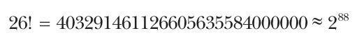

Ở đây, dấu chấm than (!) là ký hiệu giai thừa (factorial), được định nghĩa như sau:

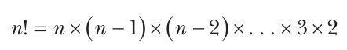

(Để thấy vì sao ta có được con số này, hãy đếm các permutation như những danh sách các chữ cái được sắp xếp lại: có 26 lựa chọn cho chữ cái đầu tiên, rồi 25 khả năng cho chữ cái thứ hai, 24 cho chữ cái thứ ba, v.v.) Con số này rất lớn: nó cùng bậc độ lớn với số nguyên tử trong cơ thể người. Nhưng classical cipher chỉ có thể dùng một phần nhỏ trong số các permutation đó—cụ thể là những permutation chỉ cần các phép toán đơn giản (chẳng hạn phép dịch) và có mô tả ngắn (như một algorithm ngắn hoặc một lookup table nhỏ). Vấn đề là một secure permutation không thể đáp ứng cả hai giới hạn này.

Bạn có thể có được secure permutation chỉ bằng các phép toán đơn giản bằng cách chọn một permutation ngẫu nhiên, biểu diễn nó dưới dạng một bảng 25 chữ cái (đủ để biểu diễn một permutation của 26 chữ cái, với chữ cái thứ 26 bị bỏ đi), và áp dụng nó bằng cách tra các chữ cái trong bảng này. Nhưng khi đó bạn sẽ không có được một mô tả ngắn. Ví dụ, cần 250 chữ cái để mô tả 10 permutation khác nhau, thay vì chỉ 10 chữ cái như trong Vigenère cipher.

Bạn cũng có thể tạo ra secure permutation có mô tả ngắn. Thay vì chỉ dịch bảng chữ cái, bạn có thể dùng những phép toán phức tạp hơn như phép cộng và phép nhân. Đây là cách các cipher hiện đại hoạt động: với một key thường dài 128 hoặc 256 bit, chúng thực hiện hàng trăm phép toán bit để mã hóa một chữ cái duy nhất. Quá trình này nhanh trên một máy tính có thể thực hiện hàng tỷ phép toán bit mỗi giây, nhưng sẽ mất hàng giờ nếu làm bằng tay và vẫn dễ bị frequency analysis tấn công.

## Cipher hoàn hảo: One-Time Pad

Về bản chất, một classical cipher không thể an toàn trừ khi nó đi kèm một key cực lớn, nhưng mã hóa với một key cực lớn thì không thực tế. Tuy nhiên, one-time pad chính là một cipher như vậy, và nó là cipher an toàn nhất. Thực tế, nó bảo đảm perfect secrecy: ngay cả khi kẻ tấn công có sức mạnh tính toán không giới hạn, cũng không thể biết được bất cứ điều gì về plaintext ngoại trừ độ dài của nó.

Trong các mục tiếp theo, tôi sẽ cho bạn thấy one-time pad hoạt động như thế nào và sau đó đưa ra phác thảo chứng minh security của nó.

### Encryption và decryption (Encryption and Decryption)

Cho trước một plaintext, P, và một key ngẫu nhiên, K, có cùng độ dài với P, one-time pad sẽ nhận chúng và tạo ra một ciphertext, C, được định nghĩa là

C = P ⊕ K

trong đó C, P và K là các bit string có cùng độ dài và ⊕ là phép toán exclusive OR theo bit (XOR), được định nghĩa là 0 ⊕ 0 = 0, 0 ⊕ 1 = 1, 1 ⊕ 0 = 1, 1 ⊕ 1 = 0.

> **LƯU Ý** Tôi trình bày one-time pad ở dạng thông thường của nó, tức là làm việc trên các bit, nhưng nó có thể được điều chỉnh cho các ký hiệu khác. Ví dụ, với chữ cái, bạn sẽ có được một biến thể của Caesar cipher với một chỉ số dịch được chọn ngẫu nhiên cho mỗi chữ cái.

Decryption của one-time pad giống hệt encryption; nó chỉ là một phép XOR: P = C ⊕ K. Thật vậy, ta có thể kiểm chứng C ⊕ K = P ⊕ K ⊕ K = P vì XOR K với chính nó cho ra chuỗi all-zero 000 . . . 000. Chỉ có vậy—thậm chí còn đơn giản hơn Caesar cipher.

Ví dụ, nếu P = 01101101 và K = 10110100, thì ta có thể tính như sau:

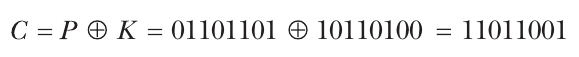

Decryption lấy lại P bằng cách tính như sau:

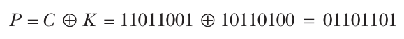

Điều quan trọng là một one-time pad chỉ có thể được dùng một lần: mỗi key K chỉ nên được dùng một lần duy nhất. Nếu cùng một K được dùng để mã hóa P1 và P2 thành C1 và C2, thì một kẻ nghe lén (eavesdropper) có thể tính như sau:

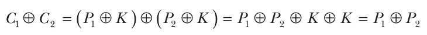

Như vậy, kẻ nghe lén sẽ biết được XOR difference của P1 và P2, thông tin lẽ ra phải được giữ bí mật. Hơn nữa, nếu biết một trong hai plaintext message, thì có thể khôi phục message còn lại.

Sử dụng one-time pad cực kỳ bất tiện vì nó cần một key dài bằng plaintext và một key ngẫu nhiên mới cho mỗi message hoặc nhóm dữ liệu mới. Để mã hóa một ổ cứng 1TB, bạn sẽ cần thêm một ổ 1TB nữa để lưu key! Dù vậy, one-time pad vẫn đã được dùng xuyên suốt lịch sử—bởi British Special Operations Executive trong Thế chiến thứ hai, bởi các điệp viên Liên Xô, bởi National Security Agency (NSA)—và đến nay vẫn được dùng trong một số bối cảnh đặc thù. (Tôi từng nghe về những nhân viên ngân hàng Thụy Sĩ không thể thống nhất được một cipher mà cả hai bên cùng tin tưởng và cuối cùng đã dùng one-time pad, nhưng tôi không khuyên bạn làm điều này.)

### Vì sao One-Time Pad an toàn?

Dù one-time pad không thực tế, việc hiểu điều gì khiến nó an toàn vẫn rất quan trọng. Vào những năm 1940, nhà toán học người Mỹ Claude Shannon đã chứng minh rằng key của one-time pad phải dài ít nhất bằng message thì mới đạt được perfect secrecy. Ý tưởng của chứng minh khá đơn giản. Bạn giả định rằng kẻ tấn công có sức mạnh không giới hạn và vì vậy có thể thử mọi key. Mục tiêu là mã hóa sao cho, khi có một ciphertext nào đó, kẻ tấn công không thể loại trừ bất kỳ plaintext khả dĩ nào.

Trực giác đằng sau perfect secrecy của one-time pad như sau: nếu K là ngẫu nhiên, thì C thu được trông ngẫu nhiên y như K đối với kẻ tấn công, vì XOR của một chuỗi ngẫu nhiên với bất kỳ chuỗi cố định nào cũng cho ra một chuỗi ngẫu nhiên. Để thấy điều này, hãy xét xác suất bit đầu tiên của một chuỗi ngẫu nhiên là 0 (xác suất 1/2). Xác suất để một bit ngẫu nhiên được XOR với bit thứ hai cho ra 0 là bao nhiêu? Đúng vậy, lại là 1/2. Lập luận tương tự có thể được lặp lại với các bit string có độ dài bất kỳ. Vì vậy, ciphertext C trông ngẫu nhiên đối với một kẻ tấn công không biết K, nên theo đúng nghĩa đen là không thể biết được bất cứ điều gì về P khi có C, ngay cả với một kẻ tấn công có thời gian và sức mạnh không giới hạn. Nói cách khác, biết ciphertext không cho bất kỳ thông tin nào về plaintext ngoại trừ độ dài của nó—gần như chính là định nghĩa của một secure cipher.

Ví dụ, nếu một ciphertext dài 128 bit (nghĩa là plaintext cũng dài 128 bit), thì có 2128 ciphertext khả dĩ; do đó, từ góc nhìn của kẻ tấn công, phải có 2128 plaintext khả dĩ. Nhưng nếu có ít hơn 2128 key khả dĩ, kẻ tấn công có thể loại trừ một số plaintext. Ví dụ, nếu key chỉ dài 64 bit, kẻ tấn công có thể xác định 264 plaintext khả dĩ và loại trừ tuyệt đại đa số các chuỗi 128-bit. Kẻ tấn công sẽ không biết plaintext là gì, nhưng họ sẽ biết plaintext không phải là gì, điều này khiến tính bí mật của encryption không còn hoàn hảo.

Bạn phải có một key dài bằng plaintext để đạt được perfect security, nhưng điều này nhanh chóng trở nên không thực tế cho việc sử dụng real-world. Tiếp theo, tôi sẽ thảo luận các cách tiếp cận được dùng trong encryption modern-day để đạt được mức security tốt nhất vừa khả thi vừa thực tế.

> **XÁC SUẤT TRONG CRYPTOGRAPHY (PROBABILITY IN CRYPTOGRAPHY)**

> Xác suất là một con số biểu thị khả năng, hay cơ hội, để một sự kiện nào đó xảy ra. Nó được biểu diễn bằng một số nằm giữa 0 và 1, trong đó 0 nghĩa là “không bao giờ” và 1 nghĩa là “luôn luôn”. Xác suất càng cao thì cơ hội càng lớn. Nhiều cách giải thích về xác suất dùng ví dụ những quả bóng trắng và bóng đỏ trong một cái túi và xác suất nhặt được một quả bóng có màu này hay màu kia.

> Cryptography thường dùng xác suất để đo khả năng thành công của một attack, bằng cách trước tiên đếm số sự kiện thành công (ví dụ, sự kiện “tìm ra đúng secret key”) và sau đó đếm tổng số sự kiện có thể xảy ra (ví dụ, tổng số key là 2n nếu ta làm việc với các key n-bit). Trong ví dụ này, xác suất để một key được chọn ngẫu nhiên là key đúng là 1/2n, hay số sự kiện thành công (1 secret key) và số sự kiện có thể xảy ra (2n key khả dĩ). Con số 1/2n nhỏ đến mức không đáng kể với các độ dài key thông dụng như 128 và 256.

> Xác suất để một sự kiện không xảy ra là 1 – p, trong đó p là xác suất của sự kiện đó. Do đó, trong ví dụ của chúng ta, xác suất lấy phải một key sai là 1 – 1/2n, một con số rất gần với 1, nghĩa là gần như chắc chắn.

## Security của encryption (Encryption Security)

Classical cipher không an toàn, nhưng một cipher an toàn hoàn hảo như one-time pad lại không thực tế. Vì vậy, chúng ta sẽ phải nhượng bộ một chút về security nếu muốn có các cipher vừa an toàn vừa dùng được. Nhưng an toàn thực sự có nghĩa là gì, ngoài định nghĩa hiển nhiên và không chính thức “kẻ nghe lén không thể giải mã các message an toàn”?

Một cipher là an toàn nếu, ngay cả khi có một số lượng lớn cặp plaintext–ciphertext, cũng không thể biết được gì về hành vi của cipher khi được áp dụng cho các plaintext hoặc ciphertext khác. Điều này mở ra những câu hỏi mới:

• Kẻ tấn công có được những cặp này bằng cách nào? “Số lượng lớn” là lớn đến mức nào? Tất cả những điều này được xác định bởi attack model, tức là các giả định về những gì kẻ tấn công có thể và không thể làm.

• Có thể “biết được” điều gì, và chúng ta đang nói về “hành vi của cipher” nào? Điều này được xác định bởi security goal, tức là các mô tả về những gì được coi là một attack thành công.

Attack model và security goal phải đi đôi với nhau; bạn không thể khẳng định một hệ thống là an toàn mà không giải thích nó an toàn trước ai hoặc trước điều gì. Security notion là sự kết hợp của một security goal với một attack model. Chúng ta sẽ nói rằng một cipher đạt được một security notion nhất định nếu bất kỳ kẻ tấn công nào hoạt động trong một model cho trước đều không thể phá được security goal.

### Các attack model (Attack Models)

Attack model là một tập hợp các giả định về cách kẻ tấn công có thể tương tác với một cipher và những gì họ có thể và không thể làm. Các mục tiêu của một attack model như sau:

• Đặt ra yêu cầu cho các cryptographer thiết kế cipher, để họ biết cần bảo vệ trước những kẻ tấn công nào và những loại attack nào.

• Đưa ra hướng dẫn cho người dùng về việc một cipher có an toàn để sử dụng trong môi trường của họ hay không.

• Cung cấp manh mối cho các cryptanalyst đang tìm cách phá cipher, để họ biết một attack cho trước có hợp lệ hay không. Một attack chỉ hợp lệ nếu nó thực hiện được trong model đang xét.

Attack model không cần khớp hoàn toàn với thực tế; chúng là một sự xấp xỉ. Như nhà thống kê George E. P. Box từng nói: “Mọi model đều sai; câu hỏi thực tế là chúng phải sai đến mức nào thì mới không còn hữu ích.” Để hữu ích trong cryptography, attack model ít nhất phải bao quát được những gì kẻ tấn công thực sự có thể làm để tấn công một cipher. Sẽ có lợi nếu một model đánh giá quá cao khả năng của kẻ tấn công, vì điều đó giúp lường trước các kỹ thuật tấn công trong tương lai—chỉ những cryptographer đa nghi mới sống sót. Một model tồi sẽ đánh giá thấp kẻ tấn công và tạo ra sự tin tưởng sai lầm vào một cipher bằng cách khiến nó có vẻ an toàn trên lý thuyết trong khi thực tế lại không an toàn.

#### Nguyên lý Kerckhoffs (Kerckhoffs’s Principle)

Một giả định được đưa ra trong mọi model là nguyên lý Kerckhoffs (Kerckhoffs’s principle), phát biểu rằng security của một cipher chỉ nên dựa vào tính bí mật của key chứ không phải vào tính bí mật của cipher. Ngày nay điều này nghe có vẻ hiển nhiên, khi các cipher và protocol được đặc tả công khai và được mọi người sử dụng. Nhưng về mặt lịch sử, nhà ngôn ngữ học người Hà Lan Auguste Kerckhoffs khi đó đang nói đến những máy mã hóa quân sự được thiết kế riêng cho một quân đội hoặc một sư đoàn cụ thể. Trích từ bài luận năm 1883 của ông, “La Cryptographie Militaire”, trong đó ông liệt kê sáu yêu cầu của một hệ thống mã hóa quân sự: “Hệ thống không được đòi hỏi phải giữ bí mật và có thể bị kẻ thù đánh cắp mà không gây ra rắc rối.”

#### Black-Box Models

Hãy xét một số attack model hữu ích được biểu diễn theo những gì kẻ tấn công có thể quan sát và những query họ có thể gửi đến cipher. Ở đây, query là thao tác gửi một giá trị đầu vào đến một function nào đó và nhận lại đầu ra, mà không làm lộ chi tiết của function đó. Ví dụ, một encryption query nhận một plaintext và trả về ciphertext tương ứng, mà không để lộ secret key.

Chúng ta gọi đây là các black-box model vì kẻ tấn công chỉ thấy những gì đi vào và đi ra khỏi cipher. Ví dụ, một số chip smart card bảo vệ an toàn phần bên trong của cipher cũng như các key của nó, nhưng bạn vẫn được phép kết nối với chip và yêu cầu nó giải mã bất kỳ ciphertext nào. Khi đó, kẻ tấn công sẽ nhận được plaintext tương ứng, điều này có thể giúp họ xác định key. Đó là một ví dụ thực tế trong đó có thể thực hiện decryption query.

Có một số black-box attack model khác nhau. Ở đây, tôi liệt kê chúng theo thứ tự từ yếu nhất đến mạnh nhất, mô tả khả năng của kẻ tấn công trong từng model:

**Ciphertext-only attackers (COAs)** Quan sát các ciphertext nhưng không biết các plaintext tương ứng hay các plaintext đã được chọn như thế nào. Kẻ tấn công trong model COA là thụ động và không thể thực hiện encryption query hay decryption query.

**Known-plaintext attackers (KPAs)** Quan sát các ciphertext và có biết các plaintext tương ứng. Vì vậy, kẻ tấn công trong model KPA có được một danh sách các cặp plaintext–ciphertext, trong đó các plaintext được giả định là được chọn ngẫu nhiên. KPA là một attacker model thụ động.

**Chosen-plaintext attackers (CPAs)** Có thể thực hiện encryption query với những plaintext do họ chọn và quan sát các ciphertext thu được. Model này mô tả những tình huống trong đó kẻ tấn công có thể chọn toàn bộ hoặc một phần các plaintext được mã hóa rồi xem được các ciphertext. Khác với COA hay KPA, vốn là các model thụ động, CPA là những kẻ tấn công chủ động vì họ tác động lên quá trình mã hóa chứ không chỉ nghe lén một cách thụ động.

**Chosen-ciphertext attackers (CCAs)** Có thể vừa mã hóa vừa giải mã; tức là họ được thực hiện cả encryption query lẫn decryption query (với các ciphertext khác với ciphertext mục tiêu). Ban đầu model CCA có thể nghe có vẻ vô lý—nếu đã giải mã được thì còn cần gì nữa?—nhưng cũng như model CPA, nó nhằm biểu diễn những tình huống trong đó kẻ tấn công có thể có chút ảnh hưởng lên ciphertext và sau đó có được quyền truy cập vào plaintext. Hơn nữa, decryption không phải lúc nào cũng đủ để phá một hệ thống. Ví dụ, một số thiết bị video-protection cho phép kẻ tấn công thực hiện encryption query và decryption query bằng chip của thiết bị, nhưng trong bối cảnh đó, kẻ tấn công quan tâm đến key để phân phối lại nó; trong trường hợp này, việc có thể giải mã “miễn phí” là không đủ để phá hệ thống.

Trong các model nói trên, các ciphertext được quan sát cũng như được query đều không miễn phí. Mỗi ciphertext đến từ việc tính toán encryption function. Điều này có nghĩa là, chẳng hạn, việc tạo 2N cặp plaintext–ciphertext thông qua encryption query tốn khối lượng tính toán xấp xỉ như việc thử 2N key. Chi phí của các query cần được tính đến khi tính chi phí của một attack.

#### Gray-Box Models

Trong một gray-box model, kẻ tấn công có quyền truy cập vào implementation của cipher. Điều này khiến gray-box model thực tế hơn black-box model đối với các ứng dụng như smart card, embedded system và hệ thống ảo hóa, vì kẻ tấn công thường có quyền truy cập vật lý vào chúng và do đó có thể can thiệp vào phần bên trong của các algorithm. Cũng vì lý do đó, gray-box model khó định nghĩa hơn black-box model vì chúng phụ thuộc vào các tính chất vật lý, analog chứ không chỉ vào đầu vào và đầu ra của một algorithm, và lý thuyết crypto thường không trừu tượng hóa được sự phức tạp của thế giới thực.

Side-channel attack là một họ attack thuộc các gray-box model. Side channel là một nguồn thông tin phụ thuộc vào implementation của cipher, dù là trong software hay hardware. Side-channel attacker quan sát hoặc đo các đặc tính analog của implementation của một cipher nhưng không làm thay đổi tính toàn vẹn của nó; họ là noninvasive (không xâm nhập). Với các implementation thuần software, các side channel điển hình là thời gian thực thi và hành vi của hệ thống bao quanh cipher, chẳng hạn các thông báo lỗi, giá trị trả về và các nhánh rẽ (branch). Ví dụ, trong trường hợp implementation trên smart card, kẻ tấn công side-channel điển hình đo mức tiêu thụ điện, bức xạ điện từ hoặc tiếng ồn âm thanh.

Invasive attack là một họ attack nhắm vào implementation của cipher, mạnh hơn side-channel attack và đắt đỏ hơn vì chúng thường đòi hỏi thiết bị tinh vi. Bạn có thể thực hiện các side-channel attack cơ bản với một PC thông thường và một oscilloscope off-the-shelf, nhưng invasive attack có thể cần đến những công cụ như kính hiển vi high-resolution và một phòng thí nghiệm hóa học. Invasive attack bao gồm cả một tập hợp kỹ thuật và quy trình, như dùng axit nitric để loại bỏ lớp vỏ của chip, thu ảnh hiển vi, reverse engineering một phần, và thay đổi hành vi của chip bằng các kỹ thuật như laser fault injection và electromagnetic injection.

### Các security goal (Security Goals)

Tôi đã định nghĩa một cách không chính thức mục tiêu của security là “không thể biết được gì về hành vi của cipher”. Để biến ý tưởng này thành một định nghĩa toán học chặt chẽ, các cryptographer định nghĩa hai security goal tương ứng với những ý tưởng khác nhau về việc biết được hành vi của một cipher nghĩa là gì:

**Indistinguishability (IND)** Các ciphertext phải không thể phân biệt được với các chuỗi ngẫu nhiên. Điều này thường được minh họa bằng một trò chơi giả định: nếu một kẻ tấn công chọn hai plaintext và sau đó nhận được ciphertext của một trong hai (được chọn ngẫu nhiên), họ sẽ không thể biết plaintext nào đã được mã hóa, ngay cả khi thực hiện encryption query với hai plaintext đó (và decryption query, nếu model là CCA thay vì CPA).

**Nonmalleability (NM)** Cho một ciphertext C1 = E(K, P1), phải không thể tạo ra một ciphertext khác, C2, mà plaintext tương ứng của nó, P2, có liên hệ với P1 theo một cách có ý nghĩa (ví dụ, tạo ra một P2 bằng P1 ⊕ 1 hoặc bằng P1 ⊕ X với một giá trị X đã biết nào đó). Đáng ngạc nhiên là one-time pad lại malleable: cho một ciphertext C1 = P1 ⊕ K, bạn có thể định nghĩa C2 = C1 ⊕ 1, đây là một ciphertext hợp lệ của P2 = P1 ⊕ 1 với cùng key K. Ối, thế là xong cái cipher hoàn hảo của chúng ta.

Tiếp theo, tôi sẽ thảo luận các security goal này trong bối cảnh của các attack model khác nhau.

### Các security notion (Security Notions)

Security goal chỉ hữu ích khi được kết hợp với một attack model. Quy ước là viết một security notion dưới dạng GOAL-MODEL. Ví dụ, IND-CPA ký hiệu indistinguishability đối với kẻ tấn công chosen-plaintext, NM-CCA ký hiệu nonmalleability đối với kẻ tấn công chosen-ciphertext, v.v. Hãy bắt đầu với các security goal đối với một kẻ tấn công.

#### Semantic security và randomized encryption: IND-CPA

Security notion quan trọng nhất là IND-CPA, còn gọi là semantic security. Nó nắm bắt trực giác rằng ciphertext không được làm rò rỉ bất kỳ thông tin nào về plaintext chừng nào key còn bí mật. Để đạt được security IND-CPA, encryption phải trả về các ciphertext khác nhau nếu được gọi hai lần trên cùng một plaintext; nếu không, kẻ tấn công có thể nhận ra các plaintext trùng lặp từ ciphertext của chúng, mâu thuẫn với định nghĩa rằng ciphertext không được để lộ bất kỳ thông tin nào. Nhưng lưu ý rằng ngay cả scheme IND-CPA-secure cũng chắc chắn sẽ làm rò rỉ một mẩu thông tin về plaintext: độ dài của nó, hoặc ít nhất là độ dài xấp xỉ. Đây là lý do việc mã hóa dữ liệu đã nén nói chung không phải là ý hay, vì kích thước của dữ liệu đã nén có thể để lộ thông tin về dữ liệu gốc.

Một cách để đạt được security IND-CPA là dùng randomized encryption. Như tên gọi gợi ý, nó ngẫu nhiên hóa quá trình mã hóa và trả về các ciphertext khác nhau khi cùng một plaintext được mã hóa hai lần. Khi đó, encryption có thể được biểu diễn là C = E(K, R, P), trong đó R là các bit ngẫu nhiên mới. Tuy nhiên, decryption vẫn mang tính tất định (deterministic), vì với D(K, R, C), bạn phải luôn nhận được P, bất kể giá trị của R.

Điều gì xảy ra nếu encryption không được ngẫu nhiên hóa? Trong IND game được giới thiệu ở mục “Security Goals” ở trang trước, kẻ tấn công chọn hai plaintext, P1 và P2, và nhận được ciphertext của một trong hai nhưng không biết ciphertext đó tương ứng với plaintext nào. Tức là họ nhận được Ci = E(K, Pi) và phải đoán i là 1 hay 2. Trong model CPA, kẻ tấn công có thể thực hiện encryption query để xác định cả C1 = E(K, P1) lẫn C2 = E(K, P2). Nếu encryption không được ngẫu nhiên hóa, chỉ cần xem Ci bằng C1 hay bằng C2 là đủ để xác định plaintext nào đã được mã hóa và nhờ đó thắng IND game. Vì vậy, randomization là then chốt đối với notion IND-CPA.

Nếu không có pseudorandom generator, bạn vẫn có thể đạt được security IND-CPA bằng cách dùng một encryption scheme yêu cầu một nonce (number used only once—số chỉ dùng một lần), thay vì một giá trị ngẫu nhiên, không thể đoán trước. Nonce phải là duy nhất cho mỗi lần gọi mã hóa mới. Một counter đơn thuần (1, 2, 3, . . .) là đủ. Ví dụ, AES-CTR (block cipher AES được dùng ở CTR mode) là IND-CPA nếu đầu vào bổ sung của nó, tức nonce, là duy nhất. Khác với một số randomized encryption scheme chỉ dùng tính ngẫu nhiên như một phần của quá trình mã hóa, nonce là cần thiết để giải mã với các algorithm dùng nonce.

> **LƯU Ý** Với randomized encryption, ciphertext phải dài hơn plaintext một chút để cho phép có nhiều hơn một ciphertext khả dĩ cho mỗi plaintext. Ví dụ, nếu có 264 ciphertext khả dĩ cho mỗi plaintext, ciphertext phải dài hơn plaintext ít nhất 64 bit.

#### Semantically secure encryption (Semantically Secure Encryption)

Một trong những cách xây dựng đơn giản nhất của một semantically secure cipher dùng một deterministic random bit generator (DRBG), một algorithm trả về các bit random-looking khi được cho một giá trị bí mật nào đó:

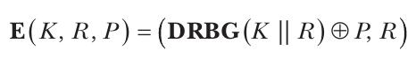

Ở đây, R là một chuỗi được chọn ngẫu nhiên cho mỗi lần mã hóa mới và được đưa vào DRBG cùng với key (K || R ký hiệu chuỗi gồm K theo sau là R). Cách tiếp cận này gợi nhớ đến one-time pad: thay vì chọn một key ngẫu nhiên có cùng độ dài với message, chúng ta tận dụng một random bit generator để có được một chuỗi random-looking.

Chứng minh rằng cipher này là IND-CPA secure khá đơn giản, nếu ta giả định rằng DRBG tạo ra các bit ngẫu nhiên. Chứng minh dùng phương pháp phản chứng (ad absurdum): nếu bạn có thể phân biệt ciphertext với các chuỗi ngẫu nhiên, nghĩa là bạn có thể phân biệt DRBG(K || R) ⊕ P với ngẫu nhiên, thì điều này có nghĩa là bạn có thể phân biệt DRBG(K || R) với ngẫu nhiên. Hãy nhớ rằng model CPA cho phép bạn có được ciphertext với các giá trị P do bạn chọn, vì vậy bạn có thể XOR P vào DRBG(K || R) ⊕ P và thu được DRBG(K || R). Nhưng giờ chúng ta có một mâu thuẫn, vì ta đã bắt đầu bằng giả định rằng DRBG(K || R) không thể phân biệt được với ngẫu nhiên, tức là tạo ra các chuỗi ngẫu nhiên. Vì vậy, ta kết luận rằng ciphertext không thể phân biệt được với các chuỗi ngẫu nhiên và do đó cipher là an toàn.

> **LƯU Ý** Như một bài tập, hãy thử xác định những security notion nào khác được thỏa mãn bởi cipher E(K, R, P) = (DRBG(K || R) ⊕ P, R). Nó có là NM-CPA không? IND-CCA? Bạn sẽ tìm thấy câu trả lời trong mục tiếp theo.

#### So sánh các security notion (Security Notions Comparisons)

Bạn đã biết rằng các attack model như CPA và CCA được kết hợp với các security goal như NM và IND để tạo thành các security notion NM-CPA, NM-CCA, IND-CPA và IND-CCA. Các notion này liên quan với nhau như thế nào? Liệu ta có thể chứng minh rằng thỏa mãn notion X kéo theo thỏa mãn notion Y không?

Một số quan hệ là hiển nhiên: IND-CCA kéo theo IND-CPA, và NM-CCA kéo theo NM-CPA, vì bất cứ điều gì một kẻ tấn công CPA làm được thì một kẻ tấn công CCA cũng làm được. Tức là nếu bạn không thể phá một cipher bằng cách thực hiện các query chosen-ciphertext và chosen-plaintext, thì bạn cũng không thể phá nó chỉ bằng các query chosen-plaintext.

Một quan hệ kém hiển nhiên hơn là IND-CPA không kéo theo NM-CPA. Để hiểu điều này, hãy để ý rằng cách xây dựng IND-CPA trước đó (DRBG(K, R) ⊕ P, R) không phải là NM-CPA: cho một ciphertext (X, R), bạn có thể tạo ra ciphertext (X ⊕ 1, R), đây là một ciphertext hợp lệ của P ⊕ 1, do đó mâu thuẫn với notion nonmalleability.

Nhưng quan hệ ngược lại thì đúng: NM-CPA kéo theo IND-CPA. Trực giác là IND-CPA encryption giống như cho các món đồ vào một cái túi: bạn không nhìn thấy chúng, nhưng bạn có thể sắp xếp lại vị trí của chúng trong túi bằng cách lắc túi lên xuống. NM-CPA giống một cái két sắt hơn: một khi đã ở bên trong, bạn không thể tác động lên những gì bạn đã đặt vào đó. Phép so sánh này không áp dụng được cho IND-CCA và NM-CCA, vốn là những notion tương đương, mỗi notion kéo theo sự hiện diện của notion kia. Tôi sẽ không trình bày chứng minh, vì nó khá nặng về kỹ thuật.

> **HAI LOẠI ỨNG DỤNG ENCRYPTION (TWO TYPES OF ENCRYPTION APPLICATIONS)**

> Có hai loại ứng dụng encryption chính. In-transit encryption bảo vệ dữ liệu được gửi từ máy này sang máy khác: dữ liệu được mã hóa trước khi gửi và được giải mã sau khi nhận, như trong các kết nối được mã hóa tới các website e-commerce. At-rest encryption bảo vệ dữ liệu được lưu trữ trên một hệ thống thông tin. Dữ liệu được mã hóa trước khi được ghi vào memory và được giải mã trước khi được đọc. Các ví dụ bao gồm các hệ thống disk encryption trên laptop cũng như virtual machine encryption cho các cloud virtual instance. Các security notion chúng ta đã thấy áp dụng cho cả hai loại ứng dụng, nhưng notion phù hợp để xem xét có thể tùy thuộc vào ứng dụng.

## Asymmetric Encryption

Cho đến giờ, chúng ta mới chỉ xét symmetric encryption, trong đó hai bên dùng chung một key. Trong asymmetric encryption, có hai key: một key để mã hóa và key kia để giải mã. Key mã hóa được gọi là public key và thường được coi là công khai cho bất kỳ ai muốn gửi cho bạn các message đã mã hóa. Tuy nhiên, key giải mã phải được giữ bí mật và được gọi là private key.

Public key có thể được tính từ private key, nhưng private key không thể được tính từ public key. Nói cách khác, việc tính toán dễ dàng theo một chiều nhưng không dễ theo chiều kia—và đó chính là điểm mấu chốt của public-key cryptography, mà các function của nó dễ tính theo một chiều nhưng thực tế không thể đảo ngược.

Attack model và security goal cho asymmetric encryption gần giống như cho symmetric encryption, ngoại trừ việc, vì key mã hóa là công khai, bất kỳ kẻ tấn công nào cũng có thể thực hiện encryption query bằng cách dùng public key để mã hóa. Vì vậy, model mặc định cho asymmetric encryption là kẻ tấn công chosen-plaintext.

Symmetric encryption và asymmetric encryption là hai loại encryption chính, và chúng thường được kết hợp để xây dựng các hệ thống truyền thông an toàn. Chúng cũng là nền tảng của những scheme phức tạp hơn, như bạn sẽ thấy tiếp theo.

## Khi cipher làm nhiều hơn encryption (When Ciphers Do More Than Encryption)

Encryption cơ bản biến plaintext thành ciphertext và ciphertext thành plaintext, không có yêu cầu nào khác ngoài security. Tuy nhiên, một số ứng dụng thường cần nhiều hơn thế, có thể là các tính năng security bổ sung hoặc các chức năng khác. Đó là lý do các cryptographer tạo ra những biến thể của symmetric encryption và asymmetric encryption. Một số được hiểu rõ, hiệu quả và được triển khai rộng rãi, trong khi những biến thể khác còn mang tính thử nghiệm, hầu như không được dùng và có hiệu năng kém.

### Authenticated Encryption

Authenticated encryption (AE) là một loại symmetric encryption trả về một authentication tag ngoài ciphertext. Hình 1-4 cho thấy authenticated encryption thiết lập AE(K, P) = (C, T), trong đó authentication tag T là một chuỗi ngắn không thể đoán được nếu không có key. Decryption nhận K, C và T và chỉ trả về plaintext P nếu nó xác minh được rằng T là một tag hợp lệ cho cặp plaintext–ciphertext đó; nếu không, nó dừng lại và trả về một lỗi nào đó.

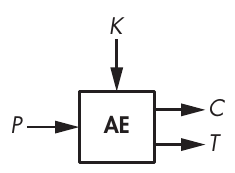

Hình 1-4: Authenticated encryption

Tag bảo đảm tính toàn vẹn của message và là bằng chứng cho thấy ciphertext nhận được giống hệt ciphertext được gửi ngay từ đầu bởi một bên hợp lệ biết key K. Khi K chỉ được chia sẻ với duy nhất một bên khác, tag còn bảo đảm rằng message đã được gửi bởi bên đó; tức là nó ngầm xác thực người gửi được mong đợi chính là người thực sự tạo ra message.

> **LƯU Ý** Ở đây tôi dùng “người tạo” (creator) chứ không phải “người gửi” (sender) vì một kẻ nghe lén có thể ghi lại một số cặp (C, T) do bên A gửi cho bên B rồi gửi lại chúng cho B, giả mạo là A. Đây được gọi là replay attack, và có thể ngăn chặn nó—chẳng hạn, bằng cách đưa một số counter vào message. Khi một message được giải mã, counter i của nó tăng thêm một: i + 1. Bằng cách này, người ta có thể kiểm tra counter để xem một message có bị gửi hai lần hay không, điều cho thấy một kẻ tấn công đang thử replay attack bằng cách gửi lại message. Điều này cũng cho phép phát hiện các message bị mất.

Authenticated encryption with associated data (AEAD) là một phần mở rộng của authenticated encryption, nhận thêm một số dữ liệu cleartext, không được mã hóa, và dùng nó để tạo authentication tag AEAD(K, P, A) = (C, A, T). Một ứng dụng điển hình của AEAD là bảo vệ các datagram của protocol có header ở dạng cleartext và payload được mã hóa. Trong những trường hợp như vậy, ít nhất một phần dữ liệu header phải ở dạng rõ; ví dụ, địa chỉ đích phải ở dạng rõ để định tuyến các network packet.

Để biết thêm về authenticated encryption, hãy chuyển đến Chương 8.

### Format-Preserving Encryption

Một cipher cơ bản nhận các bit và trả về các bit; nó không quan tâm các bit biểu diễn văn bản, hình ảnh hay một tài liệu PDF. Đến lượt mình, ciphertext có thể được encode dưới dạng raw byte, ký tự hexadecimal, base64 và các định dạng khác. Nhưng nếu bạn cần ciphertext có cùng định dạng với plaintext thì sao, như đôi khi được yêu cầu bởi các hệ thống database chỉ có thể ghi dữ liệu theo một định dạng quy định?

Format-preserving encryption (FPE) giải quyết vấn đề này. Nó có thể tạo ra các ciphertext có cùng định dạng với plaintext. Ví dụ, FPE có thể mã hóa địa chỉ IP thành địa chỉ IP (như trong Hình 1-5), mã ZIP thành mã ZIP, số thẻ tín dụng thành số thẻ tín dụng với checksum hợp lệ, v.v.

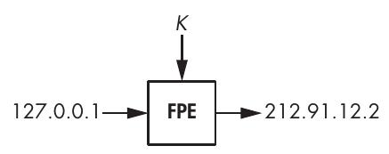

Hình 1-5: Format-preserving encryption cho địa chỉ IP

### Fully Homomorphic Encryption

Fully homomorphic encryption (FHE) là chén thánh đối với các cryptographer: nó cho phép người dùng thay một ciphertext, C = E(K, P), bằng một ciphertext khác, C′ = E(K, F(P)), trong đó F(P) có thể là bất kỳ function nào của P, mà không bao giờ phải giải mã ciphertext ban đầu, C. Ví dụ, P có thể là một văn bản và F có thể là việc sửa đổi một phần của văn bản. Hãy tưởng tượng một ứng dụng cloud lưu trữ dữ liệu đã mã hóa của bạn, nhưng nhà cung cấp cloud không biết dữ liệu đó là gì hay loại thay đổi nào được thực hiện khi bạn sửa đổi dữ liệu đó. Nghe thật tuyệt vời, phải không?

Nhưng có một mặt trái: loại encryption này chậm—chậm đến mức ngay cả phép toán cơ bản nhất cũng mất một khoảng thời gian dài không thể chấp nhận được. FHE scheme đầu tiên được tạo ra năm 2009, và kể từ đó đã xuất hiện những biến thể hiệu quả hơn, nhưng vẫn chưa rõ liệu FHE có bao giờ đủ nhanh để trở nên hữu ích hay không. Tuy nhiên, các use case application-specific của homomorphic encryption (một phần) đã tỏ ra hiệu quả hơn đối với những thao tác như đánh giá các model machine learning.

### Searchable Encryption

Searchable encryption cho phép tìm kiếm trên một database đã mã hóa mà không làm rò rỉ các từ khóa được tìm, bằng cách mã hóa chính search query. Giống như fully homomorphic encryption, searchable encryption có thể tăng cường quyền riêng tư của nhiều ứng dụng cloud-based bằng cách che giấu các lần tìm kiếm của bạn khỏi nhà cung cấp cloud. Một số giải pháp thương mại tuyên bố cung cấp searchable encryption, dù phần lớn chúng dựa trên cryptography tiêu chuẩn cùng vài thủ thuật để cho phép tìm kiếm một phần. Tuy nhiên, tại thời điểm viết sách này, searchable encryption vẫn còn mang tính thử nghiệm trong cộng đồng nghiên cứu.

### Tweakable Encryption

Tweakable encryption (TE) tương tự encryption cơ bản, ngoại trừ một tham số bổ sung gọi là tweak, nhằm mô phỏng các phiên bản khác nhau của một cipher (xem Hình 1-6). Tweak có thể là một giá trị per-customer duy nhất để bảo đảm rằng cipher của một khách hàng không thể bị sao chép bởi các bên khác dùng cùng sản phẩm, nhưng ứng dụng chính của TE là disk encryption. Tuy nhiên, TE không bị gắn với một ứng dụng duy nhất và là một loại encryption lower-level được dùng để xây dựng các scheme khác, chẳng hạn các authentication encryption mode.

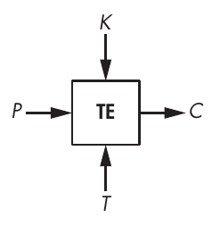

Hình 1-6: Tweakable encryption

Trong disk encryption, TE mã hóa nội dung của các thiết bị lưu trữ như ổ cứng (hard drive) hoặc ổ solid-state. (Không thể dùng randomized encryption vì nó làm tăng kích thước dữ liệu, điều không thể chấp nhận được đối với các file trên phương tiện lưu trữ.) Để làm cho encryption không thể đoán trước, TE dùng một giá trị tweak phụ thuộc vào vị trí của dữ liệu được mã hóa, thường là một số sector hoặc một chỉ số block.

## Những gì có thể sai (How Things Can Go Wrong)

Các encryption algorithm hoặc implementation của chúng có thể thất bại trong việc bảo vệ tính bí mật theo nhiều cách. Điều này có thể do không đáp ứng được các yêu cầu security (chẳng hạn “phải IND-CPA secure”) hoặc do không đặt ra các yêu cầu khớp với thực tế (nếu bạn chỉ nhắm tới security IND-CPA trong khi kẻ tấn công thực sự có thể thực hiện các query chosen-ciphertext). Đáng tiếc là nhiều engineer thậm chí không nghĩ đến các yêu cầu cryptographic security và muốn “an toàn” mà không hiểu điều đó thực sự có nghĩa là gì. Đó thường là công thức dẫn đến thảm họa. Hãy xem hai ví dụ.

### Cipher yếu (Weak Cipher)

Ví dụ đầu tiên của chúng ta liên quan đến những cipher có thể bị tấn công bằng các kỹ thuật cryptanalysis, như đã xảy ra với tiêu chuẩn truyền thông di động 2G. Encryption trong điện thoại di động 2G dùng một cipher gọi là A5/1, hóa ra yếu hơn dự kiến, cho phép bất kỳ ai có đúng kỹ năng và công cụ chặn nghe các cuộc gọi. Các nhà mạng viễn thông đã phải tìm cách khắc phục tạm thời để ngăn chặn attack này.

> **LƯU Ý** Tiêu chuẩn 2G cũng định nghĩa A5/2, một cipher dành cho các khu vực ngoài Liên minh châu Âu và Hoa Kỳ. A5/2 được cố tình làm yếu hơn để ngăn việc sử dụng encryption mạnh ở mọi nơi.

Dù vậy, tấn công A5/1 không hề đơn giản, và các nhà nghiên cứu đã mất hơn 10 năm mới đưa ra được một phương pháp cryptanalysis hiệu quả. Hơn nữa, attack này là một time-memory trade-off (TMTO), một loại phương pháp trước tiên chạy các phép tính trong nhiều ngày hoặc nhiều tuần để xây dựng các lookup table lớn, sau đó được dùng cho attack thực sự. Với A5/1, các bảng tính trước có kích thước cỡ 1TB. Các tiêu chuẩn mã hóa di động sau này, như 3G và LTE, quy định các cipher mạnh hơn, nhưng điều đó không có nghĩa là encryption của chúng sẽ không bị xâm phạm; nó chỉ có nghĩa là encryption sẽ không bị xâm phạm bằng cách phá symmetric cipher là một phần của hệ thống.

### Model sai (Wrong Model)

Ví dụ tiếp theo liên quan đến một attack model không hợp lệ đã bỏ qua một số side channel.

Nhiều communication protocol dùng encryption bảo đảm rằng chúng dùng các cipher được coi là an toàn trong model CPA hoặc CCA. Tuy nhiên, một số attack không cần encryption query như trong model CPA, cũng không cần decryption query như trong model CCA. Chúng chỉ cần các validity query để biết một ciphertext có hợp lệ hay không, và các query này thường được gửi đến hệ thống chịu trách nhiệm giải mã ciphertext. Padding oracle attack là một ví dụ về những attack như vậy, trong đó kẻ tấn công biết được một ciphertext có tuân theo định dạng yêu cầu hay không.

Cụ thể, trong trường hợp padding oracle attack, một ciphertext chỉ hợp lệ nếu plaintext của nó có padding đúng, tức là một chuỗi byte được nối vào plaintext để đơn giản hóa việc mã hóa. Decryption thất bại nếu padding không đúng, và kẻ tấn công thường có thể phát hiện các lần giải mã thất bại và tìm cách khai thác chúng. Ví dụ, sự xuất hiện của Java exception javax.crypto.BadPaddingException cho thấy đã quan sát được một padding không đúng.

Năm 2010, các nhà nghiên cứu đã tìm thấy padding oracle attack trong một số web application server. Các validity query bao gồm việc gửi một ciphertext đến một hệ thống nào đó và quan sát xem nó có báo lỗi hay không. Nhờ những query này, họ có thể giải mã những ciphertext otherwise-secure mà không cần biết key.

Các cryptographer thường bỏ qua những attack như padding oracle attack vì chúng thường phụ thuộc vào hành vi của ứng dụng và vào cách người dùng có thể tương tác với ứng dụng. Nhưng nếu bạn không lường trước những attack như vậy và không đưa chúng vào model khi thiết kế và triển khai cryptography, bạn có thể gặp phải những bất ngờ khó chịu.

## Đọc thêm (Further Reading)

Chúng ta sẽ thảo luận chi tiết hơn về encryption và các dạng khác nhau của nó xuyên suốt cuốn sách này, đặc biệt là cách các cipher hiện đại, an toàn hoạt động. Dù vậy, tôi không thể đề cập hết mọi thứ và đã bỏ qua nhiều chủ đề hấp dẫn. Ví dụ, để tìm hiểu nền tảng lý thuyết của encryption và hiểu sâu hơn notion indistinguishability, hãy đọc bài báo năm 1982 đã giới thiệu ý tưởng semantic security, “Probabilistic Encryption and How to Play Mental Poker Keeping Secret All Partial Information” của Goldwasser và Micali. Nếu bạn quan tâm đến các physical attack và cryptographic hardware, kỷ yếu của hội nghị Cryptographic Hardware and Embedded Systems (CHES) là tài liệu tham khảo chính.

Còn có nhiều loại encryption khác ngoài những loại được trình bày trong chương này, bao gồm attribute-based encryption, broadcast encryption, functional encryption, identity-based encryption, message-locked encryption và proxy reencryption, chỉ kể ra một vài loại. Để theo dõi những nghiên cứu mới nhất về các chủ đề đó, hãy xem https://eprint.iacr.org, một kho lưu trữ điện tử các bài báo nghiên cứu về cryptography.
