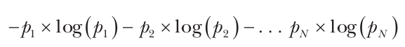
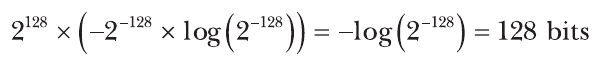
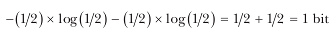
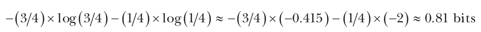
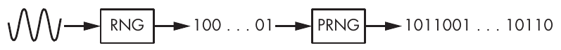
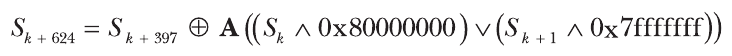

# Chương 2: Tính ngẫu nhiên (Randomness)

Randomness có mặt ở khắp nơi trong cryptography: trong việc tạo secret key, trong các encryption scheme, và thậm chí trong các attack nhắm vào cryptosystem. Không có randomness, cryptography sẽ là bất khả thi vì mọi thao tác đều trở nên có thể đoán trước và do đó không an toàn.

Chương này giới thiệu khái niệm randomness trong bối cảnh cryptography và các ứng dụng của nó. Chúng ta sẽ thảo luận về pseudorandom number generator và cách các hệ điều hành có thể tạo ra randomness đáng tin cậy, và kết thúc bằng các ví dụ thực tế cho thấy randomness có lỗi có thể ảnh hưởng đến security như thế nào.

## Ngẫu nhiên hay không ngẫu nhiên? (Random or Nonrandom?)

Có lẽ bạn đã từng nghe cụm từ bit ngẫu nhiên (random bits), nhưng nói một cách chặt chẽ, không có thứ gì gọi là một chuỗi bit ngẫu nhiên. Thứ ngẫu nhiên là algorithm, hay quá trình, tạo ra một chuỗi bit ngẫu nhiên; vì vậy, khi nói “bit ngẫu nhiên”, thực ra chúng ta muốn nói các bit được tạo ra một cách ngẫu nhiên.

Bit ngẫu nhiên trông như thế nào? Ví dụ, chuỗi 8-bit 11010110 có thể trông ngẫu nhiên hơn 00000000, dù cả hai có cùng cơ hội được tạo ra (cụ thể là 1/256). Giá trị 11010110 trông ngẫu nhiên hơn 00000000 vì nó có những dấu hiệu điển hình của một giá trị được tạo ngẫu nhiên. Tức là 11010110 không có pattern rõ ràng nào.

Khi thấy chuỗi 11010110, bộ não của chúng ta ghi nhận rằng nó có 3 số không và 5 số một, giống như 55 chuỗi 8-bit khác (11111000, 11110100, 11110010, v.v.), nhưng chỉ có một chuỗi 8-bit có 8 số không. Vì pattern 3-zeros-and-5-ones có khả năng xuất hiện cao hơn pattern 8-zeros, chúng ta nhận định 11010110 là ngẫu nhiên và 00000000 là không ngẫu nhiên, ngay cả khi chúng không phải vậy.

Ví dụ này minh họa hai loại sai lầm mà người ta thường mắc phải khi nhận định tính ngẫu nhiên:

**Nhầm cái không ngẫu nhiên là ngẫu nhiên (Mistaking nonrandomness for randomness)** Cho rằng một đối tượng được tạo ra ngẫu nhiên chỉ vì nó trông ngẫu nhiên

**Nhầm cái ngẫu nhiên là không ngẫu nhiên (Mistaking randomness for nonrandomness)** Cho rằng những pattern xuất hiện một cách tình cờ là có mặt vì một lý do nào đó khác ngoài sự tình cờ

Sự phân biệt giữa random-looking và thực sự ngẫu nhiên là rất quan trọng. Thật vậy, trong crypto, sự không ngẫu nhiên thường đồng nghĩa với sự không an toàn.

Câu nói “nó xảy ra một cách tình cờ” phản ánh tính chất rằng từ một hệ thống phức tạp (trong trường hợp này là vũ trụ của chúng ta, tuân theo các định luật vật lý, tất định ở cấp độ vĩ mô và thực sự ngẫu nhiên ở cấp độ hạ nguyên tử, lượng tử) có thể nảy sinh những pattern cụ thể, chẳng hạn chuỗi 00000000. Theo luật số lớn, nếu có nhiều sự kiện xảy ra, một số sự kiện sẽ trông không ngẫu nhiên—chẳng hạn một dãy số liên tiếp trong một lần quay xổ số. Nhiều ngụy khoa học và hệ thống niềm tin thực ra là những trường hợp nhầm cái ngẫu nhiên là không ngẫu nhiên.

## Randomness như một phân phối xác suất (Randomness as a Probability Distribution)

Mọi quá trình ngẫu nhiên đều được đặc trưng bởi một phân phối xác suất (probability distribution), thứ cho biết mọi điều cần biết về tính ngẫu nhiên của quá trình đó. Một probability distribution, hay gọi tắt là distribution, liệt kê các kết quả của một quá trình ngẫu nhiên, trong đó mỗi kết quả được gán một xác suất.

Xác suất đo khả năng một sự kiện xảy ra. Nó được biểu diễn bằng một số thực nằm giữa 0 và 1, trong đó xác suất 0 nghĩa là không thể xảy ra và xác suất 1 nghĩa là chắc chắn. Ví dụ, khi tung một đồng xu two-sided, mỗi mặt có xác suất 1/2 (hay 0.5) ngửa lên, còn việc đồng xu đứng trên cạnh của nó có xác suất gần bằng 0.

Một probability distribution phải bao gồm mọi kết quả có thể có sao cho tổng của mọi xác suất bằng 1. Cụ thể, nếu có N sự kiện có thể xảy ra, thì có N xác suất p<sub>1</sub>, p<sub>2</sub>, . . . , p<sub>N</sub> với p<sub>1</sub> + p<sub>2</sub> + . . . + p<sub>N</sub> = 1. Trong trường hợp tung đồng xu, distribution là 1/2 cho mặt ngửa và 1/2 cho mặt sấp. Tổng của hai xác suất bằng 1/2 + 1/2 = 1, vì đồng xu sẽ rơi xuống một trong hai mặt của nó.

Uniform distribution (phân phối đều) xảy ra khi mọi xác suất trong distribution đều bằng nhau, nghĩa là mọi kết quả đều có khả năng xảy ra như nhau. Nếu có N sự kiện, thì mỗi sự kiện có xác suất 1/N. Ví dụ, nếu một key 128-bit được chọn ngẫu nhiên một cách đều—tức là theo một uniform distribution—thì mỗi key trong số 2<sup>128</sup> key khả dĩ phải có xác suất 1/2<sup>128</sup>.

Ngược lại, khi một distribution là nonuniform, các xác suất không bằng nhau hết. Một lần tung đồng xu với nonuniform distribution được gọi là bị lệch (biased), và chẳng hạn có thể cho ra mặt ngửa với xác suất 1/4 và mặt sấp với xác suất 3/4.

> **LƯU Ý** Có thể gian lận bằng một con xúc xắc bị đổ chì, khiến xác suất của mỗi mặt trong sáu mặt không còn là 1/6; tuy nhiên, người ta không thể làm lệch một đồng xu. Những lần tung đồng xu chỉ có thể bị lệch nếu “đồng xu được phép nảy hoặc xoay thay vì chỉ đơn giản được tung lên không trung”, như được mô tả trong bài báo “You Can Load a Die but You Can’t Bias a Coin” (có tại https://www.stat.berkeley.edu/~nolan/Papers/dice.pdf).

## Entropy: thước đo độ bất định (Entropy: A Measure of Uncertainty)

Entropy là thước đo độ bất định, hay độ hỗn loạn, trong một hệ thống. Entropy càng cao thì kết quả của một quá trình ngẫu nhiên càng kém chắc chắn.

Chúng ta có thể tính entropy của một probability distribution. Nếu distribution của bạn gồm các xác suất p<sub>1</sub>, p<sub>2</sub>, . . . , p<sub>N</sub>, thì entropy của nó là tổng âm của mọi xác suất nhân với logarit của chúng, như trong biểu thức sau:



Ở đây, function log là logarit nhị phân, hay logarit cơ số hai. Khác với logarit tự nhiên, logarit nhị phân biểu diễn thông tin theo bit và cho ra các giá trị nguyên khi các xác suất là lũy thừa của hai. Ví dụ, log(1/2) = –1, log(1/4) = –2, và tổng quát hơn log(1/2<sup>n</sup>) = –n. (Thực ra chúng ta lấy tổng âm để cuối cùng nhận được một số dương.) Vì vậy, các key 128-bit ngẫu nhiên được tạo ra bằng một uniform distribution có entropy như sau:



Nếu bạn thay 128 bằng một số nguyên n bất kỳ, entropy của một chuỗi n-bit có phân phối đều sẽ là n bit.

Entropy đạt cực đại khi distribution là đều, vì một uniform distribution làm cực đại độ bất định: không có kết quả nào có khả năng xảy ra cao hơn các kết quả khác. Vì vậy, các giá trị n-bit không thể có nhiều hơn n bit entropy.

Cũng vì lý do đó, khi distribution không đều, entropy thấp hơn. Hãy xét ví dụ tung đồng xu. Entropy của một lần tung công bằng là như sau:



Điều gì xảy ra nếu một mặt của đồng xu có xác suất ngửa lên cao hơn mặt kia? Giả sử mặt ngửa có xác suất 1/4 và mặt sấp là 3/4. (Hãy nhớ rằng tổng của mọi xác suất phải bằng 1.)

Entropy của một lần tung bị lệch như vậy là:



Việc 0.81 nhỏ hơn entropy 1-bit của một lần tung công bằng cho chúng ta biết rằng đồng xu càng bị lệch, distribution càng kém đều và entropy càng thấp. Đi xa hơn với ví dụ này, nếu mặt ngửa có xác suất 1/10, entropy là 0.469; nếu xác suất giảm xuống 1/100, entropy giảm xuống 0.081.

> **LƯU Ý** Entropy cũng có thể được xem là một thước đo thông tin. Ví dụ, kết quả của một lần tung đồng xu công bằng cho bạn đúng 1 bit thông tin—ngửa hoặc sấp—và bạn không thể đoán trước kết quả của lần tung. Trong trường hợp lần tung đồng xu không công bằng, bạn biết trước rằng mặt sấp có xác suất cao hơn, nên bạn có thể đoán kết quả. Kết quả của lần tung đồng xu không công bằng cho bạn thông tin cần thiết để đoán kết quả một cách chắc chắn.

## Random number generator và pseudorandom number generator (Random and Pseudorandom Number Generators)

Các cryptosystem cần randomness để an toàn và vì vậy cần một thành phần để lấy randomness. Nhiệm vụ của thành phần này là trả về các bit ngẫu nhiên khi được yêu cầu. Để tạo ra randomness này, bạn cần hai thứ:

• Một nguồn entropy, được cung cấp bởi các random number generator.

• Một cryptographic algorithm để tạo ra các bit ngẫu nhiên high-quality từ nguồn entropy. Thứ này có trong các pseudorandom number generator.

Dùng cả random number generator lẫn pseudorandom number generator là chìa khóa để làm cho cryptography vừa thực tế vừa an toàn. Hãy xem sơ qua cách random number generator hoạt động trước khi tìm hiểu sâu về pseudorandom number generator.

Randomness đến từ môi trường, vốn mang tính analog, hỗn loạn, bất định và do đó không thể đoán trước. Randomness không thể được tạo ra chỉ bằng các algorithm computer-based. Trong cryptography, randomness thường đến từ các random number generator (RNG), là các thành phần software hoặc hardware tận dụng entropy trong thế giới analog để tạo ra các bit không thể đoán trước trong một hệ thống số. Ví dụ, một RNG có thể lấy mẫu bit trực tiếp từ các phép đo nhiệt độ, tiếng ồn âm thanh, nhiễu loạn không khí hoặc tĩnh điện. Đáng tiếc là những nguồn entropy analog như vậy không phải lúc nào cũng có sẵn, và entropy của chúng thường khó ước lượng.

RNG cũng có thể thu thập entropy trong một hệ điều hành đang chạy bằng cách lấy dữ liệu từ các cảm biến được gắn vào, các thiết bị I/O, hoạt động network hoặc ổ đĩa, system log, các process đang chạy, và các hoạt động của người dùng như nhấn phím và di chuyển chuột. Những hoạt động system- và human-generated như vậy có thể là một nguồn entropy tốt, nhưng chúng có thể mong manh và bị kẻ tấn công thao túng. Ngoài ra, chúng tạo ra bit ngẫu nhiên khá chậm.

> **LƯU Ý** Quantum random number generator (QRNG) là một loại RNG dựa vào tính ngẫu nhiên nảy sinh từ các hiện tượng cơ học lượng tử, chẳng hạn phân rã phóng xạ, phân cực photon hoặc nhiễu nhiệt. Những hiện tượng này, vì không được mô tả bởi các phương trình xác định trạng thái tương lai từ trạng thái hiện tại, là ngẫu nhiên theo nghĩa tuyệt đối. Tuy nhiên, trong thực tế, các bit thô được trích xuất từ một QRNG có thể bị lệch và thường được tạo ra chậm. Giống như các nguồn entropy đã nêu trước đó, chúng cần được xử lý hậu kỳ (postprocessing) để tạo ra các bit đáng tin cậy ở tốc độ cao.

Pseudorandom number generator (PRNG) giải quyết thách thức trong việc tạo randomness bằng cách tạo ra một cách đáng tin cậy nhiều bit ngẫu nhiên nhân tạo từ một vài bit thực sự ngẫu nhiên. Ví dụ, một RNG chuyển các chuyển động chuột thành bit ngẫu nhiên sẽ ngừng hoạt động nếu bạn ngừng di chuyển chuột, trong khi một PRNG luôn trả về các bit pseudorandom khi được yêu cầu.

PRNG dựa vào RNG nhưng hoạt động khác: RNG tạo ra các bit thực sự ngẫu nhiên tương đối chậm từ các nguồn analog, theo cách không tất định, và không bảo đảm phân phối đều hay entropy cao trên mỗi bit. Ngược lại, PRNG tạo ra các bit random-looking nhanh chóng từ các nguồn số, theo cách tất định, có phân phối đều, và với entropy được bảo đảm đủ cao cho các ứng dụng cryptography. Về bản chất, PRNG biến một vài bit ngẫu nhiên không đáng tin cậy thành một dòng dài các bit pseudorandom đáng tin cậy, phù hợp cho các ứng dụng crypto, như Hình 2-1 cho thấy.



Hình 2-1: RNG tạo ra ít bit không đáng tin cậy từ các nguồn analog, trong khi PRNG mở rộng những bit đó thành một dòng dài các bit đáng tin cậy.

### PRNG hoạt động như thế nào (How PRNGs Work)

Một PRNG nhận các bit ngẫu nhiên từ một RNG theo những khoảng thời gian đều đặn và dùng chúng để cập nhật nội dung của một memory buffer lớn, gọi là entropy pool. Entropy pool là nguồn entropy của PRNG, giống như môi trường vật lý là nguồn entropy của RNG. Khi PRNG cập nhật entropy pool, nó trộn các bit của pool với nhau để giúp loại bỏ mọi độ lệch thống kê.

Để tạo ra các bit pseudorandom, PRNG chạy một algorithm deterministic random bit generator (DRBG) mở rộng một số bit từ entropy pool thành một chuỗi dài hơn nhiều. Như tên gọi gợi ý, DRBG là tất định chứ không ngẫu nhiên: với một đầu vào, bạn sẽ luôn nhận được cùng một đầu ra. PRNG bảo đảm rằng DRBG của nó không bao giờ nhận cùng một đầu vào hai lần để nó có thể tạo ra các chuỗi pseudorandom duy nhất.

Trong quá trình làm việc, PRNG thực hiện ba thao tác:

init() Khởi tạo entropy pool và internal state của PRNG

refresh(R) Cập nhật entropy pool bằng một số dữ liệu, R, thường lấy từ một RNG

next(N) Trả về N bit pseudorandom và cập nhật entropy pool

Thao tác init đặt lại PRNG về một trạng thái mới, khởi tạo lại entropy pool về một giá trị mặc định nào đó, và khởi tạo mọi biến hoặc memory buffer được PRNG dùng để thực hiện các thao tác refresh và next.

Thao tác refresh thường được gọi là reseeding, và đối số R của nó được gọi là seed. Khi không có RNG nào, seed có thể là các giá trị duy nhất được hardcode trong hệ thống. Thao tác refresh thường được hệ điều hành gọi, trong khi next thường được các ứng dụng gọi hoặc yêu cầu. Thao tác next chạy DRBG và sửa đổi entropy pool để bảo đảm rằng lần gọi tiếp theo sẽ cho ra các bit pseudorandom khác.

### Các mối lo ngại về security (Security Concerns)

Hãy nói sơ qua về cách PRNG giải quyết các mối lo ngại security high-level. Cụ thể, PRNG phải bảo đảm backtracking resistance và prediction resistance. Backtracking resistance (còn gọi là forward secrecy) nghĩa là không thể khôi phục các bit đã được tạo ra trước đó, trong khi prediction resistance (backward secrecy) nghĩa là phải không thể đoán được các bit trong tương lai.

Để đạt được backtracking resistance, PRNG phải bảo đảm rằng các phép biến đổi được thực hiện khi cập nhật state thông qua các thao tác refresh và next là không thể đảo ngược. Bằng cách này, nếu một kẻ tấn công xâm phạm hệ thống và lấy được giá trị của entropy pool, họ không thể xác định các giá trị trước đó của pool hay các bit đã được tạo ra trước đó. Để đạt được prediction resistance, PRNG phải gọi refresh đều đặn với các giá trị R mà kẻ tấn công không biết và khó đoán, nhờ đó ngăn kẻ tấn công xác định các giá trị tương lai của entropy pool, ngay cả khi toàn bộ pool bị xâm phạm. (Nếu danh sách các giá trị R đã bị biết, bạn sẽ cần biết thứ tự thực hiện các lần gọi refresh và next để tái dựng pool.)

### PRNG Fortuna (The PRNG Fortuna)

Fortuna là một cấu trúc PRNG được dùng trong Windows, ban đầu được Niels Ferguson và Bruce Schneier thiết kế vào năm 2003. Fortuna đã thay thế Yarrow, một thiết kế năm 1998 của John Kelsey và Bruce Schneier từng được dùng trong thời gian dài trong các hệ điều hành macOS và iOS và đã được Fortuna thay thế. Tôi sẽ không đưa ra đặc tả của Fortuna ở đây hay chỉ cho bạn cách hiện thực nó, nhưng tôi sẽ cố gắng giải thích cách nó hoạt động. Bạn sẽ tìm thấy mô tả đầy đủ về Fortuna trong Chương 9 của Cryptography Engineering của Ferguson, Schneier và Kohno (Wiley, 2010).

Memory bên trong của Fortuna bao gồm:

• Thirty-two entropy pool, P<sub>1</sub>, P<sub>2</sub>, . . . , P<sub>32</sub>, sao cho P<sub>i</sub> được dùng cứ mỗi 2<sup>i</sup> lần reseed.

• Một key, K, và một counter, C (cả hai đều 16 byte). Chúng tạo thành internal state của DRBG của Fortuna.

Nói một cách đơn giản nhất, Fortuna hoạt động như sau:

• init() đặt K và C bằng không và làm rỗng 32 entropy pool P<sub>i</sub>, với i = 1 . . . 32.

• refresh(R) nối dữ liệu, R, vào một trong các entropy pool. Hệ thống chọn các RNG được dùng để tạo ra các giá trị R, và nó phải gọi refresh đều đặn.

• next(N) cập nhật K bằng dữ liệu từ một hoặc nhiều entropy pool, trong đó việc chọn entropy pool chủ yếu phụ thuộc vào số lần cập nhật K đã được thực hiện. Sau đó, N bit được yêu cầu được tạo ra bằng cách mã hóa C với K làm key. Nếu mã hóa C là không đủ, Fortuna mã hóa C + 1, rồi C + 2, v.v., để có đủ bit.

Dù các thao tác của Fortuna trông khá đơn giản, hiện thực chúng một cách đúng đắn lại rất khó. Trước hết, bạn cần làm đúng mọi chi tiết của algorithm—cách chọn entropy pool, loại cipher được dùng trong next, cách xử lý khi không nhận được entropy nào, v.v. Dù các đặc tả định nghĩa phần lớn các chi tiết, chúng không có một bộ test toàn diện để kiểm tra một implementation có đúng hay không, điều này khiến khó bảo đảm rằng implementation Fortuna của bạn sẽ hoạt động như mong đợi.

Ngay cả khi Fortuna được hiện thực đúng, các lỗi security vẫn có thể xảy ra vì những lý do khác ngoài việc dùng một algorithm sai. Ví dụ, Fortuna có thể không nhận ra nếu các RNG không tạo ra đủ bit ngẫu nhiên, và kết quả là Fortuna sẽ tạo ra các bit pseudorandom lower-quality, hoặc nó có thể ngừng cung cấp bit pseudorandom hoàn toàn.

Một rủi ro khác vốn có trong các implementation của Fortuna nằm ở khả năng để lộ các seed file liên quan cho kẻ tấn công. Dữ liệu trong các seed file của Fortuna được dùng để cung cấp entropy cho Fortuna thông qua các lần gọi refresh khi chưa có RNG ngay—ví dụ, ngay sau khi khởi động lại hệ thống và trước khi các RNG của hệ thống ghi nhận được bất kỳ sự kiện không thể đoán trước nào. Tuy nhiên, nếu cùng một seed file được dùng hai lần, Fortuna sẽ tạo ra cùng một chuỗi bit hai lần. Vì vậy, các seed file nên được xóa sau khi dùng để bảo đảm chúng không bị dùng lại.

Cuối cùng, nếu hai instance Fortuna ở cùng một state vì chúng dùng chung một seed file (nghĩa là có cùng dữ liệu trong các entropy pool, kể cả C và K), thì thao tác next sẽ trả về cùng các bit trong cả hai instance.

### PRNG cryptographic so với noncryptographic (Cryptographic vs. Noncryptographic PRNGs)

Có các PRNG cryptographic và noncryptographic. Các PRNG noncrypto được thiết kế để tạo ra các uniform distribution cho các ứng dụng như mô phỏng khoa học hoặc trò chơi điện tử. Tuy nhiên, bạn không bao giờ được dùng PRNG noncrypto trong các ứng dụng crypto, vì chúng không an toàn; chúng chỉ quan tâm đến chất lượng của probability distribution của các bit chứ không quan tâm đến khả năng bị đoán trước của chúng. Mặt khác, các PRNG crypto không thể đoán trước vì chúng còn quan tâm đến độ mạnh của các phép toán bên dưới được dùng để cung cấp các bit well-distributed.

Đáng tiếc là phần lớn PRNG được các ngôn ngữ lập trình cung cấp—như rand và drand48 của libc, rand và mt_rand của PHP, module random của Python và class java.util.Random của Java—đều là noncryptographic. Mặc định dùng một PRNG noncrypto là công thức dẫn đến thảm họa vì nó thường bị dùng trong các ứng dụng crypto, vì vậy hãy chắc chắn chỉ dùng PRNG crypto khi tạo randomness liên quan đến các ứng dụng cryptography hoặc security.

#### Một PRNG noncrypto phổ biến: Mersenne Twister (A Popular Noncrypto PRNG: Mersenne Twister)

Algorithm Mersenne Twister (MT) là một PRNG noncryptographic được dùng (tại thời điểm viết sách này) trong PHP, Python, R, Ruby và nhiều hệ thống khác. Nó thậm chí đã từng được dùng (thật đáng tiếc) trong các bộ tạo key cho blockchain wallet. MT tạo ra các bit ngẫu nhiên phân phối đều, không có độ lệch thống kê, nhưng nó có thể đoán trước được: khi có một vài bit do MT tạo ra, người ta có thể đoán được những bit nào sẽ theo sau.

Hãy nhìn vào bên trong để xem điều gì khiến Mersenne Twister không an toàn. Algorithm MT đơn giản hơn nhiều so với các PRNG crypto: internal state của nó là một mảng, S, gồm 624 word 32-bit. Mảng này ban đầu được đặt là S<sub>1</sub>, S<sub>2</sub>, . . . , S<sub>624</sub> và tiến triển thành S<sub>2</sub>, . . . , S<sub>625</sub>, rồi S<sub>3</sub>, . . . , S<sub>626</sub>, v.v., theo phương trình sau:



Ở đây, ⊕ ký hiệu phép XOR theo bit (^ trong ngôn ngữ lập trình C), ∧ ký hiệu phép AND theo bit (& trong C), ∨ ký hiệu phép OR theo bit (| trong C), và A là một function biến một word 32-bit nào đó, x, thành (x >> 1) nếu bit có trọng số cao nhất của x là 0, hoặc thành (x >> 1) ⊕ 0x9908b0df trong trường hợp ngược lại.

Trong phương trình này, các bit của S chỉ tương tác với nhau thông qua các phép XOR. Các toán tử ∧ và ∨ không bao giờ kết hợp 2 bit của S với nhau mà thay vào đó kết hợp các bit của S với các bit từ các hằng số 0x80000000 và 0x7fffffff. Bằng cách này, bất kỳ bit nào của S<sub>625</sub> cũng có thể được biểu diễn dưới dạng XOR của các bit từ S<sub>398</sub>, S<sub>1</sub> và S<sub>2</sub>, và bất kỳ bit nào từ bất kỳ state tương lai nào cũng có thể được biểu diễn dưới dạng một tổ hợp XOR của các bit từ state ban đầu S<sub>1</sub>, . . . , S<sub>624</sub>. (Khi bạn biểu diễn, chẳng hạn, S<sub>228 + 624</sub> = S<sub>852</sub> như một function của S<sub>625</sub>, S<sub>228</sub> và S<sub>229</sub>, đến lượt mình bạn có thể thay S<sub>625</sub> bằng biểu thức của nó theo S<sub>398</sub>, S<sub>1</sub> và S<sub>2</sub>.)

Vì có đúng 624 × 32 = 19,968 bit trong state ban đầu (hay 624 word 32-bit), bất kỳ bit đầu ra nào cũng có thể được biểu diễn dưới dạng một phương trình có tối đa 19,969 số hạng (19,968 bit cộng một bit hằng). Đó là khoảng 2.5KB dữ liệu. Điều ngược lại cũng đúng: các bit từ state ban đầu có thể được biểu diễn dưới dạng XOR của các bit đầu ra.

#### Sự không an toàn của tính tuyến tính (Linearity Insecurity)

Chúng ta gọi một tổ hợp XOR của các bit là một tổ hợp tuyến tính (linear combination). Ví dụ, nếu X, Y và Z là các bit, thì biểu thức X ⊕ Y ⊕ Z là một linear combination, trong khi (X ∧ Y) ⊕ Z thì không phải, vì có một phép AND (∧). Nếu bạn lật một bit của X trong X ⊕ Y ⊕ Z, thì kết quả cũng thay đổi, bất kể giá trị của Y và Z. Ngược lại, nếu bạn lật một bit của X trong (X ∧ Y) ⊕ Z, kết quả chỉ thay đổi nếu bit của Y ở cùng vị trí là 1. Điểm mấu chốt là các linear combination có thể đoán trước được, vì bạn không cần biết giá trị của các bit để đoán được một thay đổi trong giá trị của chúng sẽ ảnh hưởng đến kết quả như thế nào.

Để so sánh, nếu algorithm MT mạnh về mặt cryptography, các phương trình của nó sẽ là phi tuyến và sẽ bao gồm không chỉ các bit đơn lẻ mà còn cả các tổ hợp AND (tích) của các bit, chẳng hạn S<sub>1</sub>S<sub>15</sub>S<sub>182</sub> hoặc S<sub>17</sub>S<sub>256</sub>S<sub>257</sub>S<sub>354</sub>S<sub>498</sub>S<sub>601</sub>.

Trong khi các linear combination của những bit đó chứa tối đa 624 biến, các tổ hợp phi tuyến cho phép tới 2<sup>624</sup> biến. Sẽ không thể giải, chứ đừng nói đến viết ra, toàn bộ các phương trình này. (Lưu ý rằng 2<sup>305</sup>, một con số nhỏ hơn nhiều, là dung lượng thông tin ước tính của vũ trụ quan sát được.)

Điểm then chốt ở đây là các phép biến đổi tuyến tính dẫn đến các phương trình ngắn (có kích thước tương đương số biến), dễ giải, trong khi các phép biến đổi phi tuyến tạo ra các phương trình có kích thước hàm mũ, thực tế không thể giải được. Vì vậy, trò chơi của các cryptographer là thiết kế các algorithm PRNG mô phỏng những phép biến đổi phi tuyến phức tạp như vậy chỉ bằng một số ít phép toán đơn giản.

> **LƯU Ý** Tính tuyến tính chỉ là một trong nhiều tiêu chí security. Dù cần thiết, chỉ riêng tính phi tuyến không làm cho một PRNG an toàn về mặt cryptography.

### Sự vô dụng của các statistical test (The Uselessness of Statistical Tests)

Các bộ statistical test như TestU01, Diehard, hay bộ test của National Institute of Standards and Technology (NIST) là một cách để kiểm tra chất lượng của các bit pseudorandom. Các test này lấy một mẫu bit pseudorandom do một PRNG tạo ra (chẳng hạn, lượng dữ liệu cỡ 1MB), tính một số đại lượng thống kê về sự phân bố của một số pattern nhất định trong các bit, và so sánh kết quả với các kết quả điển hình thu được cho một uniform distribution. Ví dụ, một số test đếm số bit 1 so với số bit 0, hoặc sự phân bố của các pattern 8-bit. Nhưng statistical test phần lớn không liên quan đến cryptographic security, và có thể thiết kế một PRNG yếu về mặt cryptography mà vẫn đánh lừa được bất kỳ statistical test nào.

Khi chạy statistical test trên dữ liệu được tạo ngẫu nhiên, bạn thường sẽ thấy kết quả là một loạt chỉ số thống kê. Đó thường là các p-values, một chỉ số thống kê phổ biến. Những kết quả này không phải lúc nào cũng dễ diễn giải vì chúng hiếm khi đơn giản là đạt hay không đạt. Nếu những kết quả đầu tiên của bạn có vẻ bất thường, đừng lo: chúng có thể là kết quả của một sai lệch tình cờ nào đó, hoặc có thể bạn đang test quá ít mẫu. Để bảo đảm rằng kết quả bạn thấy là bình thường, hãy so sánh chúng với kết quả thu được trên một mẫu đáng tin cậy có cùng kích thước—ví dụ, một mẫu được tạo bằng bộ công cụ OpenSSL với lệnh sau:

```
$ openssl rand <number of bytes> -out <output file>
```

## Các PRNG Real-World

Hãy chuyển sự chú ý sang việc hiện thực PRNG trong thế giới thực. Bạn sẽ tìm thấy các PRNG crypto trong hệ điều hành (OS) của phần lớn các nền tảng, từ máy để bàn và laptop đến các embedded system như router và set-top box, cũng như máy ảo, điện thoại di động, v.v. Phần lớn các PRNG này dựa trên software, nhưng những PRNG thuần hardware được dùng bởi các ứng dụng chạy trên OS và đôi khi bởi các PRNG khác chạy trên các cryptographic library hoặc ứng dụng.

Tiếp theo, chúng ta sẽ xem xét những PRNG được triển khai rộng rãi nhất: cho Linux, Android và nhiều hệ thống Unix-based khác; trong Windows; và trong các bộ vi xử lý Intel gần đây, mà PRNG của chúng dựa trên hardware.

### Bit ngẫu nhiên trong Linux (Random Bits in Linux)

Device file /dev/urandom là interface userland tới PRNG crypto trong các hệ điều hành dựa trên Linux kernel. Bạn thường sẽ dùng nó để tạo ra các bit ngẫu nhiên đáng tin cậy. Vì nó là một device file, bạn yêu cầu bit ngẫu nhiên từ /dev/urandom bằng cách đọc nó như một file. Ví dụ, lệnh sau dùng /dev/urandom để ghi 10MB bit ngẫu nhiên vào một file:

```
$ dd if=/dev/urandom of=<output file> bs=1M count=10
```

#### Cách dùng /dev/urandom sai (The Wrong Way to Use /dev/urandom)

Bạn có thể viết một chương trình C ngây thơ và không an toàn như chương trình trong Listing 2-1 để đọc các bit ngẫu nhiên và hy vọng mọi chuyện ổn, nhưng đó sẽ là một ý tồi.

```
int random_bytes_insecure(void *buf, size_t len)
{
    int fd = open("/dev/urandom", O_RDONLY);
    read(fd, buf, len);
    close(fd);
    return 0;
}
```

Listing 2-1: Một cách dùng /dev/urandom không an toàn

Code này không an toàn; nó thậm chí không kiểm tra giá trị trả về của open() và read(), nghĩa là buffer ngẫu nhiên mà bạn mong đợi có thể bị lấp đầy bằng các số không hoặc vẫn giữ nguyên không đổi.

#### Một cách dùng /dev/urandom an toàn hơn (A Safer Way to Use /dev/urandom)

Listing 2-2, được sao chép từ thư viện LibreSSL, cho thấy một cách dùng /dev/urandom an toàn hơn.

```
int random_bytes_safer(void *buf, size_t len)
{
    struct stat st;
    size_t i;
    int fd, cnt, flags;
    int save_errno = errno;

start:
    flags = O_RDONLY;
#ifdef O_NOFOLLOW
    flags |= O_NOFOLLOW;
#endif
#ifdef O_CLOEXEC
    flags |= O_CLOEXEC;
#endif
  ❶ fd = open("/dev/urandom", flags, 0);
    if (fd == -1) {
        if (errno == EINTR)
            goto start;
        goto nodevrandom;
    }
#ifndef O_CLOEXEC
    fcntl(fd, F_SETFD, fcntl(fd, F_GETFD) | FD_CLOEXEC);
#endif

    /* Lightly verify that the device node looks sane. */
    if (fstat(fd, &st) == -1 || !S_ISCHR(st.st_mode)) {
        close(fd);
        goto nodevrandom;
    }
    if (ioctl(fd, RNDGETENTCNT, &cnt) == -1) {
        close(fd);
        goto nodevrandom;
    }
    for (i = 0; i < len; ) {
        size_t wanted = len - i;
      ❷ ssize_t ret = read(fd, (char *)buf + i, wanted);

        if (ret == -1) {
            if (errno == EAGAIN || errno == EINTR)
                continue;
            close(fd);
            goto nodevrandom;
        }
        i += ret;
    }
    close(fd);
    if (gotdata(buf, len) == 0) {
        errno = save_errno;
        return 0; /* Satisfied */
    }
nodevrandom:
    errno = EIO;
    return -1;
}
```

Listing 2-2: Một cách dùng /dev/urandom an toàn

Khác với Listing 2-1, Listing 2-2 thực hiện một số kiểm tra tính hợp lý (sanity check). Chẳng hạn, hãy so sánh các lời gọi open() ❶ và read() ❷ với những lời gọi trong Listing 2-1: code an toàn hơn kiểm tra giá trị trả về của các function đó và, khi thất bại, đóng file descriptor và trả về –1.

#### Khác biệt giữa /dev/urandom và /dev/random, trước năm 2022

Linux PRNG, được định nghĩa trong drivers/char/random.c trong Linux kernel, đã trải qua những thay đổi lớn vào năm 2022 (kể từ kernel phiên bản 5.17).

Trước hết, cấu trúc chung của PRNG, vốn tương tự nhau ở phiên bản cũ và mới, dựa trên việc thu thập entropy từ nhiều nguồn khác nhau (bao gồm hoạt động hệ thống, như bàn phím, chuột và các lần truy cập đĩa), cũng như từ một entropy pool có thể được xem như một mảng lớn, được lấp đầy bằng cách hash dữ liệu thu thập từ các nguồn entropy. Tiếp đó, một DRBG chịu trách nhiệm tạo ra các dòng dữ liệu pseudorandom được trả về khi /dev/random hoặc /dev/urandom được đọc hoặc khi system call getrandom() được gọi.

Về mặt lịch sử, trước kernel phiên bản 5.17, Linux PRNG hoạt động như sau: khác với /dev/urandom, interface /dev/random là blocking; nếu kernel ước tính rằng PRNG không có đủ mức entropy, thì /dev/random sẽ ngừng trả về byte (“block”) khi được đọc, cho đến khi kernel ước tính được một mức entropy đủ. Đây không phải là một ý hay. Trước hết, các bộ ước lượng entropy nổi tiếng là không đáng tin cậy và có thể bị kẻ tấn công đánh lừa (đó là một lý do khiến Fortuna bỏ cơ chế ước lượng entropy của Yarrow). Hơn nữa, /dev/random cạn entropy ước tính khá nhanh, điều này có thể gây ra tình trạng denial-of-service, làm chậm các ứng dụng buộc phải chờ thêm entropy. Kết cục là trong thực tế, /dev/random chẳng tốt hơn /dev/urandom và gây ra nhiều vấn đề hơn là giải quyết.

#### Khác biệt giữa /dev/urandom và /dev/random, từ năm 2022

Trong các phiên bản Linux kernel từ năm 2022 (5.17 trở đi), một số cải tiến đã được đưa vào. Trước hết, hash function SHA-1 đã được thay bằng BLAKE2 khi tạo nội dung của pool. Thay đổi lớn nhất là việc sửa đổi hành vi tương đối giữa /dev/random và /dev/urandom; thậm chí đã có đề xuất loại bỏ hoàn toàn sự khác biệt giữa chúng. Tại thời điểm viết sách này, trên phần lớn các nền tảng, cả hai interface đều sẽ phát hiện nếu không có đủ entropy, nhưng /dev/urandom sẽ tiếp tục tạo ra các bit pseudorandom nếu kernel không thu thập được đủ entropy, trong khi /dev/random sẽ block.

Ngoài ra, logic ước lượng entropy của kernel đã được cải thiện đáng kể: thay vì cho rằng entropy giảm đi khi các bit PRNG được đọc (một điều vô lý về mặt cryptography), kernel chỉ tìm thời điểm khi đã thu thập đủ độ bất định (tức là entropy)—ví dụ, lúc khởi động hệ thống.

Bạn có thể đọc giá trị entropy của một hệ thống Linux trong file /proc/sys/kernel/random/entropy_avail. Trong các phiên bản kernel cũ hơn, giá trị này tối đa là 4,096 bit và giảm dần khi các bit PRNG được tạo ra. Trong các kernel mới, giá trị này được giới hạn ở 256 bit và vì vậy không còn giảm nữa.

### Function CryptGenRandom() trong Windows (The CryptGenRandom() Function in Windows)

Trong Windows, interface userland cũ (legacy) tới PRNG của hệ thống là function CryptGenRandom() từ Cryptography application programming interface (API). Các phiên bản Windows gần đây thay function CryptGenRandom() bằng function BcryptGenRandom() trong Cryptography API: Next Generation (CNG). Windows PRNG lấy entropy từ kernel mode driver cng.sys (trước đây là ksecdd.sys), mà bộ thu thập entropy của nó dựa một cách lỏng lẻo trên Fortuna. Như thường thấy trong Windows, quy trình này khá phức tạp.

Listing 2-3 cho thấy một lời gọi C++ điển hình tới CryptGenRandom() với các kiểm tra cần thiết.

```
int random_bytes(unsigned char *out, size_t outlen)
{
    static HCRYPTPROV handle = 0; /* Only freed when the program ends */
    if(!handle) {
        if(!CryptAcquireContext(&handle, 0, 0, PROV_RSA_FULL,
                                CRYPT_VERIFYCONTEXT | CRYPT_SILENT)) {
            return -1;
        }
    }
    while(outlen > 0) {
        const DWORD len = outlen > 1048576UL ? 1048576UL : outlen;
        if(!CryptGenRandom(handle, len, out)) {
            return -2;
        }
        out    += len;
        outlen -= len;
    }
    return 0;
}
```

Listing 2-3: Dùng interface PRNG CryptGenRandom() của Windows

Trước khi gọi PRNG thực sự, bạn cần khai báo một cryptographic service provider (HCRYPTPROV) rồi lấy một cryptographic context bằng CryptAcquireContext(), điều này làm tăng khả năng xảy ra sự cố. Chẳng hạn, phiên bản cuối cùng của phần mềm mã hóa TrueCrypt đã bị phát hiện gọi CryptAcquireContext() theo cách có thể thất bại một cách im lặng, dẫn đến randomness kém tối ưu mà không thông báo cho người dùng. May thay, interface BCryptGenRandom() mới hơn và đơn giản hơn cho Windows không yêu cầu code phải mở handle một cách tường minh (hoặc ít nhất là giúp việc dùng nó mà không cần handle dễ dàng hơn nhiều).

### Một PRNG Hardware-Based: Intel Secure Key

Cho đến giờ chúng ta mới chỉ thảo luận về các PRNG software, vì vậy hãy xem một PRNG hardware. Intel Digital Random Number Generator, hay Intel Secure Key, là một PRNG hardware được giới thiệu năm 2012 trong microarchitecture Ivy Bridge của Intel. Nó dựa trên các hướng dẫn SP 800-90 của NIST với Advanced Encryption Standard (AES) ở chế độ CTR_DRBG. PRNG của Intel được truy cập thông qua assembly instruction RDRAND, cung cấp một interface độc lập với hệ điều hành và về nguyên tắc nhanh hơn các PRNG software.

Trong khi các PRNG software cố gắng thu thập entropy từ các nguồn không thể đoán trước, Intel Secure Key có một nguồn entropy duy nhất cung cấp một dòng dữ liệu entropy nối tiếp dưới dạng các số không và số một. Theo thuật ngữ kỹ thuật hardware, nguồn entropy này là một dual differential jamb latch with feedback—về cơ bản là một mạch hardware nhỏ nhảy qua lại giữa hai trạng thái (0 hoặc 1) tùy thuộc vào các dao động nhiễu nhiệt, ở tần số 3 GHz. Điều này thường khá đáng tin cậy.

Assembly instruction RDRAND nhận một register 16, 32 hoặc 64 bit làm đối số rồi ghi một giá trị ngẫu nhiên vào đó. Khi được gọi, RDRAND đặt carry flag thành 1 nếu dữ liệu được đặt vào register đích là một giá trị ngẫu nhiên hợp lệ, và thành 0 trong trường hợp ngược lại; hãy chắc chắn kiểm tra flag CF nếu bạn viết code assembly trực tiếp. Lưu ý rằng các C intrinsic có trong các compiler thông dụng không kiểm tra flag CF nhưng có trả về giá trị của nó.

> **LƯU Ý** Framework PRNG của Intel cung cấp một assembly instruction khác ngoài RDRAND: assembly instruction RDSEED trả về các bit ngẫu nhiên trực tiếp từ nguồn entropy, sau một số bước conditioning hoặc xử lý cryptography. Nó được dùng để có thể seed các PRNG khác.

Intel Secure Key chỉ được tài liệu hóa một phần, nhưng nó được xây dựng trên các tiêu chuẩn đã biết và đã được công ty well-regarded Cryptography Research kiểm định (xem báo cáo của họ có tựa đề “Analysis of Intel’s Ivy Bridge Digital Random Number Generator”). Dù vậy, đã có một số lo ngại về security của nó, đặc biệt là sau những tiết lộ của Edward Snowden về các cryptographic backdoor: PRNG thực sự là mục tiêu hoàn hảo cho việc phá hoại. Nếu bạn lo ngại nhưng vẫn muốn dùng RDRAND hoặc RDSEED, hãy trộn chúng với các nguồn entropy khác. Làm như vậy sẽ ngăn chặn việc khai thác hiệu quả một backdoor giả định trong hardware của Intel Secure Key hoặc trong microcode liên quan, trong tất cả trừ những kịch bản far-fetched nhất.

## Những gì có thể sai (How Things Can Go Wrong)

Để kết thúc, tôi sẽ trình bày một vài ví dụ về những thất bại của randomness. Có vô số ví dụ để lựa chọn, nhưng tôi đã chọn bốn ví dụ đủ đơn giản để hiểu và minh họa những vấn đề khác nhau.

### Nguồn entropy kém (Poor Entropy Sources)

Năm 1996, implementation SSL của trình duyệt Netscape tính các PRNG seed 128-bit theo pseudocode trong Listing 2-4, được sao chép từ trang của Goldberg và Wagner tại https://www.cs.berkeley.edu/~daw/papers/ddj-netscape.html.

```
global variable seed;

RNG_CreateContext()
    (seconds, microseconds) = time of day; /* Time elapsed since 1970 */
    pid = process ID;  ppid = parent process ID;
    a = mklcpr(microseconds);
  ❶ b = mklcpr(pid + seconds + (ppid << 12));
    seed = MD5(a, b); /* Derivation of a 128-bit value using the hash MD5 */

mklcpr(x) /* Not cryptographically significant; shown for completeness */
    return ((0xDEECE66D * x + 0x2BBB62DC) >> 1);

MD5() /* A very good standard mixing function, source omitted */
```

Listing 2-4: Pseudocode cho việc tạo các PRNG seed 128-bit của trình duyệt Netscape

Vấn đề ở đây là các PID và giá trị microsecond là những giá trị có thể đoán được. Giả sử bạn có thể đoán được giá trị của seconds, thì microseconds chỉ có 10<sup>6</sup> giá trị khả dĩ và do đó có entropy là log(10<sup>6</sup>), hay khoảng 20 bit. Process ID (PID) và parent process ID (PPID) là các giá trị 15-bit, nên bạn sẽ kỳ vọng có thêm 15 + 15 = 30 bit entropy. Nhưng nhìn vào cách b được tính ❶ cho thấy phần chồng lấp 3 bit cho ra entropy khoảng 15 + 12 = 27 bit, tổng entropy chỉ còn 47 bit, trong khi một seed 128-bit lẽ ra phải có 128 bit entropy.

### Không đủ entropy lúc khởi động (Insufficient Entropy at Boot Time)

Năm 2012, các nhà nghiên cứu đã quét internet và thu thập public key từ các TLS certificate và các SSH host. Họ phát hiện rằng một số ít hệ thống có public key giống hệt nhau, và trong một số trường hợp có các key rất giống nhau (cụ thể là các RSA key có chung prime factor)—nói ngắn gọn, hai số, n = pq và n′ = p′q′, với p = p′, trong khi bình thường mọi p và q phải khác nhau trong các giá trị modulus phân biệt.

Hóa ra nhiều thiết bị đã tạo public key của chúng từ rất sớm, ngay lần khởi động đầu tiên, trước khi thu thập đủ entropy, dù đang dùng một PRNG otherwise-decent (thường là /dev/urandom). Các PRNG trong những hệ thống khác nhau tạo ra các bit ngẫu nhiên giống hệt nhau do có cùng nguồn entropy (ví dụ, một seed được hardcode).

Ở mức tổng quát, sự xuất hiện của các key giống hệt nhau là do các scheme key-generation như sau, viết bằng pseudocode:

```
prng.seed(seed)
p = prng.generate_random_prime()
q = prng.generate_random_prime()
n = p*q
```

Nếu hai hệ thống chạy code này với cùng một seed, chúng sẽ tạo ra cùng p, cùng q, và do đó cùng n.

Sự xuất hiện của các số nguyên tố dùng chung trong các key khác nhau là do các scheme key-generation trong đó entropy bổ sung được đưa vào giữa quá trình, như được minh họa ở đây:

```
prng.seed(seed)
p = prng.generate_random_prime()
prng.add_entropy()
q = prng.generate_random_prime()
n = p*q
```

Nếu hai hệ thống chạy code này với cùng một seed, chúng sẽ tạo ra cùng p, nhưng việc đưa entropy vào thông qua prng.add_entropy() sẽ bảo đảm các q khác nhau.

Vấn đề với các prime factor dùng chung là khi có n = pq và n′ = pq′, việc khôi phục p dùng chung là chuyện tầm thường bằng cách tính ước chung lớn nhất (greatest common divisor, GCD) của n và n′. Để biết chi tiết, hãy xem bài báo “Mining Your Ps and Qs” của Heninger, Durumeric, Wustrow và Halderman, có tại https://factorable.net.

### PRNG noncryptographic (Noncryptographic PRNG)

Trước đó chúng ta đã thảo luận về sự khác biệt giữa các PRNG crypto và noncrypto, và vì sao loại sau không bao giờ được dùng cho các ứng dụng crypto. Đáng tiếc là nhiều hệ thống bỏ qua chi tiết đó, vì vậy chúng ta sẽ xem một ví dụ như vậy.

Ứng dụng MediaWiki phổ biến chạy trên Wikipedia và nhiều wiki khác. Nó dùng randomness để tạo ra những thứ như security token và mật khẩu tạm thời, vốn phải không thể đoán trước. Đáng tiếc là một phiên bản MediaWiki nay đã lỗi thời từng dùng một PRNG noncrypto, Mersenne Twister, để tạo các token và mật khẩu này. Đây là một đoạn trích từ source code MediaWiki có lỗ hổng; hãy tìm function được gọi để lấy một bit ngẫu nhiên, và đọc các comment:

```
        /**
         * Generate a hex-y looking random token for various uses.
         * Could be made more cryptographically sure if someone cares.
         * @return string
         */
function generateToken( $salt = '' ) {
    $token = dechex(mt_rand()).dechex(mt_rand());
    return md5( $token . $salt );
}
```

Bạn có để ý thấy mt_rand() trong đoạn code trên không? Ở đây, mt là viết tắt của Mersenne Twister. Năm 2012, các nhà nghiên cứu đã chỉ ra cách khai thác khả năng bị đoán trước của Mersenne Twister để đoán các token và mật khẩu tạm thời trong tương lai, khi có một vài security token. MediaWiki đã được vá để dùng một PRNG crypto.

### Sampling bug với randomness mạnh (Sampling Bug with Strong Randomness)

Bug tiếp theo cho thấy ngay cả một PRNG crypto mạnh với đủ entropy vẫn có thể tạo ra một distribution bị lệch. Chương trình chat Cryptocat được thiết kế để cung cấp kênh liên lạc an toàn. Nó dùng một function cố gắng tạo ra một chuỗi chữ số thập phân phân phối đều—tức là các số trong khoảng từ 0 đến 9. Tuy nhiên, chỉ lấy các byte ngẫu nhiên modulo 10 không cho ra một uniform distribution; khi lấy mọi số từ 0 đến 255 và rút gọn chúng modulo 10, bạn không nhận được số lượng giá trị bằng nhau trong khoảng 0 đến 9.

Cryptocat đã làm như sau để giải quyết vấn đề đó và có được một uniform distribution:

```
Cryptocat.random = function() {
    var x, o = '';
    while (o.length < 16) {
        x = state.getBytes(1);
        if (x[0] <= 250) {
            o += x[0] % 10;
        }
    }
    return parseFloat('0.' + o)
}
```

Và cách đó gần như hoàn hảo. Bằng cách chỉ lấy các số tới một bội số của 10 và loại bỏ các số khác, bạn sẽ kỳ vọng có một uniform distribution của các chữ số từ 0 đến 9. Đáng tiếc là có một lỗi off-by-one trong điều kiện if. Tôi sẽ để lại chi tiết cho bạn như một bài tập. Bạn sẽ thấy có một độ lệch thống kê nhỏ nghiêng về index 0 (gợi ý: <= lẽ ra phải là <).

## Đọc thêm (Further Reading)

Tôi chỉ mới chạm vào bề mặt của randomness trong cryptography. Còn nhiều điều để học về lý thuyết randomness, bao gồm các notion entropy khác nhau, randomness extractor, và thậm chí cả sức mạnh của randomization và derandomization trong complexity theory. Để tìm hiểu thêm về PRNG và security của chúng, hãy đọc bài báo kinh điển năm 1998 “Cryptanalytic Attacks on Pseudorandom Number Generators” của Kelsey, Schneier, Wagner và Hall. Sau đó, hãy xem implementation của PRNG trong các ứng dụng yêu thích của bạn và thử tìm ra điểm yếu của chúng. (Hãy tìm kiếm trên mạng với từ khóa “random generator bug” để thấy rất nhiều ví dụ.)

Tuy vậy, chúng ta chưa xong với randomness. Chúng ta sẽ gặp lại nó nhiều lần xuyên suốt cuốn sách này, và bạn sẽ khám phá nhiều cách nó giúp xây dựng các hệ thống an toàn.
