# Chương 4: Block Cipher (Block Ciphers)

Trong Chiến tranh Lạnh, Hoa Kỳ và Liên Xô đã phát triển các cipher của riêng mình. Chính phủ Hoa Kỳ tạo ra Data Encryption Standard (DES), được chấp nhận làm tiêu chuẩn liên bang từ năm 1979 đến 2005, trong khi KGB phát triển GOST 28147-89, một algorithm được giữ bí mật cho đến năm 1990 và đến nay vẫn còn được dùng. Năm 2000, National Institute of Standards and Technology (NIST) US-based đã chọn ra người kế nhiệm của DES, Advanced Encryption Standard (AES), một algorithm được phát triển ở Bỉ và hiện có mặt trong phần lớn các thiết bị điện tử. AES, DES và GOST 28147-89 đều là block cipher, một loại cipher kết hợp một core algorithm làm việc trên các block dữ liệu với một mode of operation, tức là một kỹ thuật để xử lý các chuỗi block dữ liệu.

Chương này xem xét các core algorithm làm nền tảng cho block cipher, thảo luận về các mode of operation của chúng, và giải thích cách tất cả phối hợp với nhau. Chương cũng thảo luận cách AES hoạt động và kết thúc bằng phần trình bày về một công cụ tấn công kinh điển từ những năm 1970, meet-in-the-middle attack, và một kỹ thuật tấn công được ưa chuộng của những năm 2000—padding oracle.

## Block cipher là gì? (What Is a Block Cipher?)

Một block cipher gồm một encryption algorithm và một decryption algorithm:

• Encryption algorithm (E) nhận một key, K, và một plaintext block, P, rồi tạo ra một ciphertext block, C. Chúng ta viết một phép mã hóa là C = E(K, P).

• Decryption algorithm (D) là nghịch đảo của encryption algorithm và giải mã một message về plaintext ban đầu, P. Chúng ta viết phép toán này là P = D(K, C).

Vì chúng là nghịch đảo của nhau, encryption algorithm và decryption algorithm thường bao gồm các phép toán tương tự nhau.

### Các security goal (Security Goals)

Nếu bạn đã theo dõi các phần thảo luận trước về encryption, randomness và indistinguishability, thì định nghĩa về một secure block cipher sẽ không có gì bất ngờ. Chúng ta sẽ tiếp tục định nghĩa security như là tính random-looking-ness, có thể nói như vậy.

Để một block cipher an toàn, nó phải là một pseudorandom permutation (PRP), nghĩa là chừng nào key còn bí mật, kẻ tấn công sẽ không thể tính được đầu ra của block cipher từ bất kỳ đầu vào nào. Tức là chừng nào K còn bí mật và ngẫu nhiên từ góc nhìn của kẻ tấn công, họ sẽ không có chút manh mối nào về việc E(K, P) trông như thế nào, với bất kỳ P cho trước nào.

Tổng quát hơn, kẻ tấn công phải không thể phát hiện ra bất kỳ pattern nào trong các giá trị đầu vào/đầu ra của một block cipher. Nói cách khác, phải không thể phân biệt một block cipher với một permutation thực sự ngẫu nhiên, khi có quyền truy cập black-box vào các encryption function và decryption function với một key cố định và chưa biết nào đó. Cũng vì lý do đó, kẻ tấn công phải không thể khôi phục secret key của một secure block cipher; nếu không, họ có thể dùng key đó để phân biệt block cipher với một permutation ngẫu nhiên. Điều này ngụ ý rằng kẻ tấn công không thể đoán được plaintext tương ứng với một ciphertext cho trước mà block cipher tạo ra.

### Block size

Hai giá trị đặc trưng cho một block cipher: block size và key size. Security phụ thuộc vào cả hai giá trị này. Phần lớn block cipher có block 64-bit hoặc 128-bit—block của DES có 64 (2<sup>6</sup>) bit, và block của AES có 128 (2<sup>7</sup>) bit. Trong tính toán, các độ dài thường được đo bằng lũy thừa của hai giúp đơn giản hóa việc xử lý, lưu trữ và định địa chỉ dữ liệu. Nhưng vì sao lại là 2<sup>6</sup> và 2<sup>7</sup> mà không phải 2<sup>4</sup> hay 2<sup>16</sup> bit?

Điều quan trọng là các block của một block cipher không được quá lớn, để giảm thiểu cả độ dài ciphertext lẫn memory footprint. Block cipher trước tiên biến dữ liệu đầu vào thành một chuỗi block, nghĩa là để mã hóa một message 16-bit khi block dài 128 bit, bạn cần chuyển message thành một block 128-bit để block cipher xử lý nó và trả về một ciphertext 128-bit. Block càng rộng thì chi phí phụ trội (overhead) này càng lớn. Để xử lý một block 128-bit, bạn cần ít nhất 128 bit memory. Các block 64, 128 hay thậm chí 512 bit đủ ngắn để vừa với các register của phần lớn CPU hoặc để triển khai bằng các mạch hardware chuyên dụng, cho phép có các implementation hiệu quả trong phần lớn trường hợp. Nhưng các block lớn hơn (ví dụ, dài vài kilobyte) có thể có tác động đáng kể đến chi phí và hiệu năng của implementation.

Khi độ dài ciphertext hoặc memory footprint là yếu tố then chốt, bạn có thể phải dùng block 64-bit vì chúng tạo ra ciphertext ngắn hơn và tiêu tốn ít memory hơn. Nếu không, block 128-bit hoặc lớn hơn sẽ tốt hơn, chủ yếu vì các CPU hiện đại thường có thể xử lý block 128-bit hiệu quả hơn block 64-bit và chúng an toàn hơn (xem attack “Sweet32”, tại https://sweet32.info). Đặc biệt, CPU có thể tận dụng các instruction để xử lý hiệu quả một hoặc nhiều block 128-bit song song—ví dụ, họ instruction Advanced Vector Extensions (AVX) trong các CPU Intel.

### Codebook attack (The Codebook Attack)

Dù block không nên quá lớn, chúng cũng không nên quá nhỏ; nếu không, chúng có thể dễ bị codebook attack, là các attack nhắm vào block cipher chỉ hiệu quả khi dùng các block nhỏ hơn. Với block 16-bit, codebook attack hoạt động như sau:

1. Lấy 65,536 (2<sup>16</sup>) ciphertext tương ứng với mỗi plaintext block 16-bit.

2. Xây dựng một lookup table—tức codebook—ánh xạ mỗi ciphertext block tới plaintext block tương ứng của nó.

3. Để giải mã một ciphertext block chưa biết, hãy tra plaintext block tương ứng của nó trong bảng.

Khi dùng block 16-bit, lookup table chỉ cần 2<sup>16</sup>× 16 = 2<sup>20</sup> bit memory, tức 128 kilobyte. Với block 32-bit, memory cần tăng lên 16 gigabyte, vẫn còn quản lý được. Nhưng với block 64-bit, bạn sẽ phải lưu 2<sup>70</sup> bit (một zettabit, hay 128 exabyte), nên hãy quên chuyện đó đi. Vì vậy, codebook attack không phải là vấn đề đối với các block lớn hơn, từ 128 bit trở lên.

## Cách xây dựng block cipher (How to Construct Block Ciphers)

Có hàng trăm block cipher nhưng chỉ có một số ít kỹ thuật để xây dựng chúng. Trong thực tế, một block cipher không phải là một algorithm khổng lồ mà là sự lặp lại của các round, mỗi round là một chuỗi phép toán ngắn, tự thân thì yếu nhưng mạnh khi có số lượng nhiều. Có hai kỹ thuật chính để xây dựng một round: substitution–permutation network (như trong AES) và Feistel scheme (như trong DES). Trong mục này, bạn sẽ xem xét các kỹ thuật này sau khi xem một attack có hiệu quả khi mọi round đều giống hệt nhau.

### Các round của một block cipher (A Block Cipher’s Rounds)

Tính toán một block cipher rốt cuộc là tính một chuỗi các round. Trong một block cipher, một round là một phép biến đổi cơ bản, đơn giản để đặc tả và triển khai, và được lặp lại nhiều lần để tạo thành algorithm của block cipher. Cấu trúc này, gồm một thành phần nhỏ được lặp lại nhiều lần, dễ triển khai và phân tích hơn một cấu trúc gồm một algorithm khổng lồ duy nhất.

Ví dụ, một block cipher có ba round mã hóa một plaintext bằng cách tính C = R<sub>3</sub>(R<sub>2</sub>(R<sub>1</sub>(P))), trong đó các round là R<sub>1</sub>, R<sub>2</sub> và R<sub>3</sub>, và P là một plaintext. Mỗi round cũng phải có một inverse để bên nhận có thể tính ngược trở lại plaintext. Cụ thể, P = iR<sub>1</sub>(iR<sub>2</sub>(iR<sub>3</sub>(C))), trong đó iR<sub>1</sub> là inverse của R<sub>1</sub>, v.v.

Các round function—R<sub>1</sub>, R<sub>2</sub>, v.v.—thường là những algorithm giống hệt nhau, nhưng chúng được tham số hóa bởi một giá trị mà chúng ta gọi là round key. Hai round function với hai round key khác nhau sẽ hoạt động khác nhau và do đó sẽ tạo ra các đầu ra khác nhau nếu được đưa vào cùng một đầu vào.

Chúng ta suy ra các round key từ main key, K, bằng một key schedule algorithm. Ví dụ, R<sub>1</sub> nhận round key K<sub>1</sub>, R<sub>2</sub> nhận round key K<sub>2</sub>, v.v.

Các round key phải khác nhau ở mỗi round. Cũng vậy, các round key không được phép đều bằng key K; nếu không, mọi round sẽ giống hệt nhau, và block cipher sẽ kém an toàn hơn, như tôi sẽ mô tả tiếp theo.

### Slide attack và round key (The Slide Attack and Round Keys)

Trong một block cipher, không round nào được giống hệt round khác, để tránh slide attack. Như Hình 4-1 cho thấy, slide attack tìm hai cặp plaintext/ciphertext (P<sub>1</sub>, C<sub>1</sub>) và (P<sub>2</sub>, C<sub>2</sub>), trong đó P<sub>2</sub> = R(P<sub>1</sub>) nếu R là round của cipher. Khi các round giống hệt nhau, quan hệ giữa hai plaintext, P<sub>2</sub> = R(P<sub>1</sub>), kéo theo quan hệ C<sub>2</sub>= R(C<sub>1</sub>) giữa các ciphertext tương ứng của chúng. Hình 4-1 cho thấy ba round, nhưng quan hệ C<sub>2</sub>= R(C<sub>1</sub>) sẽ đúng bất kể số round là bao nhiêu, dù là 3, 10 hay 100. Vấn đề là biết đầu vào và đầu ra của một round duy nhất thường giúp khôi phục được key. (Để biết chi tiết, hãy đọc bài báo năm 1999 “Advanced Slide Attacks” của Alex Biryukov và David Wagner, có tại https://www.iacr.org/archive/eurocrypt2000/1807/18070595-new.pdf.)

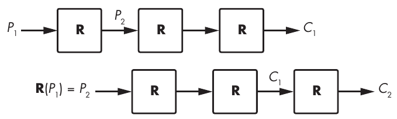

Hình 4-1: Nguyên lý của slide attack nhắm vào các block cipher có các round giống hệt nhau

Dùng các round key khác nhau làm tham số bảo đảm rằng các round sẽ hoạt động khác nhau và do đó vô hiệu hóa slide attack.

> **LƯU Ý** Một sản phẩm phụ và lợi ích tiềm năng của việc dùng round key là khả năng bảo vệ trước side-channel attack, tức các attack khai thác thông tin bị rò rỉ từ implementation của một cipher (ví dụ, bức xạ điện từ). Nếu phép biến đổi từ main key, K, sang một round key, K<sub>i</sub>, không khả nghịch, thì nếu kẻ tấn công tìm ra K<sub>i</sub>, họ không thể dùng key đó để tìm K. Đáng tiếc là ít block cipher có key schedule one-way. Chẳng hạn, key schedule của AES cho phép kẻ tấn công tính K từ bất kỳ round key nào, K<sub>i</sub>.

### Substitution–Permutation Network (Substitution–Permutation Networks)

Nếu đã đọc sách giáo khoa về cryptography, có lẽ bạn đã gặp confusion và diffusion. Confusion nghĩa là đầu vào (plaintext và encryption key) trải qua những phép biến đổi phức tạp, còn diffusion nghĩa là những phép biến đổi này phụ thuộc như nhau vào mọi bit của đầu vào. Nói một cách tổng quát, confusion liên quan đến chiều sâu, còn diffusion liên quan đến chiều rộng. Trong thiết kế một block cipher, confusion và diffusion có dạng các phép toán substitution và permutation, mà chúng ta kết hợp trong các substitution–permutation network (SPN).

Substitution thường xuất hiện dưới dạng S-boxes, hay substitution box, là các lookup table nhỏ biến đổi các mẩu 4 hoặc 8 bit. Ví dụ, cái đầu tiên trong số tám S-boxes của block cipher Serpent gồm 16 phần tử (3 8 f 1 a 6 5 b e d 4 2 7 0 9 c), trong đó mỗi phần tử biểu diễn một nibble 4-bit. S-box cụ thể này ánh xạ nibble 4-bit 0000 thành 3 (0011), nibble 4-bit 0101 (5 trong hệ thập phân) thành 6 (0110), v.v.

> **LƯU Ý** S-boxes phải được chọn cẩn thận để mạnh về mặt cryptography: chúng phải càng phi tuyến càng tốt (đầu vào và đầu ra phải liên hệ với nhau bằng các phương trình phức tạp) và không có độ lệch thống kê (chẳng hạn, nghĩa là lật một bit đầu vào phải có khả năng ảnh hưởng đến bất kỳ bit đầu ra nào).

Permutation trong một substitution–permutation network có thể đơn giản như việc thay đổi thứ tự các bit, điều này dễ triển khai nhưng không trộn các bit với nhau được nhiều. Thay vì sắp xếp lại các bit, một số cipher dùng đại số tuyến tính cơ bản và phép nhân ma trận để trộn các bit: chúng thực hiện một loạt phép nhân với các giá trị cố định (các hệ số của ma trận) rồi cộng các kết quả lại. Những phép toán như vậy có thể nhanh chóng tạo ra sự phụ thuộc giữa mọi bit bên trong một cipher và do đó bảo đảm diffusion mạnh. Ví dụ, block cipher FOX biến một vector 4-byte (a, b, c, d) thành (a′, b′, c′, d′), mà chúng ta định nghĩa như sau:

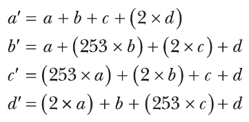

Trong các phương trình này, chúng ta hiểu các số 2 và 253 là các đa thức nhị phân chứ không phải số nguyên; do đó, chúng ta định nghĩa phép cộng và phép nhân hơi khác so với những gì chúng ta quen thuộc. Ví dụ, thay vì 2 + 2 = 4, ta có 2 + 2 = 0. Dù sao thì mỗi byte trong state ban đầu đều ảnh hưởng đến cả 4 byte trong state cuối cùng.

### Feistel Scheme (Feistel Schemes)

Vào những năm 1970, kỹ sư IBM Horst Feistel đã thiết kế một block cipher, Lucifer, hoạt động như sau:

1. Chia block 64-bit thành hai nửa 32-bit, L và R.

2. Đặt L bằng L ⊕ F(R), trong đó F là một round substitution–permutation.

3. Hoán đổi giá trị của L và R.

4. Quay lại bước 2 và lặp lại 15 lần.

5. Gộp L và R thành block đầu ra 64-bit.

Cấu trúc này là một Feistel scheme, như Hình 4-2 cho thấy. Phía bên trái là scheme như vừa mô tả; phía bên phải là một cách biểu diễn tương đương về chức năng, trong đó, thay vì hoán đổi L và R, các round luân phiên thực hiện các phép toán L = L ⊕ F(R) và R = R ⊕ F(L).

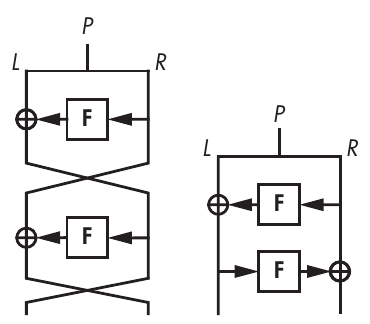

Hình 4-2: Cấu trúc block cipher theo Feistel scheme ở hai dạng tương đương

Tôi đã bỏ các key khỏi Hình 4-2 để đơn giản hóa sơ đồ, nhưng lưu ý rằng F thứ nhất nhận một round key, K<sub>1</sub>, và F thứ hai nhận một round key khác, K<sub>2</sub>. Trong DES, các function F nhận một round key 48-bit, được suy ra từ key 56-bit, K.

Trong một Feistel scheme, function F có thể là một pseudorandom permutation (PRP) hoặc một pseudorandom function (PRF). Một PRP cho ra các đầu ra khác nhau với bất kỳ hai đầu vào khác nhau nào, trong khi một PRF sẽ có những giá trị X và Y mà F(X) = F(Y). Nhưng trong một Feistel scheme, khác biệt đó không quan trọng chừng nào F mạnh về mặt cryptography.

Một Feistel scheme nên có bao nhiêu round? Chà, DES thực hiện 16 round, trong khi GOST 28147-89 thực hiện 32 round. Nếu function F mạnh nhất có thể, về lý thuyết bốn round là đủ, nhưng các cipher thực tế dùng nhiều round hơn để phòng ngừa những điểm yếu tiềm ẩn trong F.

## Advanced Encryption Standard (The Advanced Encryption Standard)

AES là cipher most-used trên thế giới. Trước khi AES được chấp nhận, cipher tiêu chuẩn đang được dùng là DES, với mức security 56-bit lố bịch của nó, cũng như phiên bản nâng cấp của DES được gọi là Triple DES, hay 3DES. Dù 3DES cung cấp mức security cao hơn (security 112-bit), nó lại kém hiệu quả vì key cần dài 168 bit để có được security 112-bit, và nó chậm trong software (DES được tạo ra để nhanh trong mạch tích hợp, không phải trên các CPU phổ thông). AES khắc phục cả hai vấn đề này.

NIST chuẩn hóa AES vào năm 2000 để thay thế DES, và từ đó nó trở thành tiêu chuẩn mã hóa de facto của thế giới. Phần lớn các sản phẩm mã hóa thương mại ngày nay đều hỗ trợ AES, và NSA đã chấp thuận nó để bảo vệ thông tin top-secret. (Một số quốc gia thực sự thích dùng các cipher của riêng họ hơn, phần lớn vì họ không muốn dùng một tiêu chuẩn của Hoa Kỳ, nhưng thực ra AES mang tính Bỉ nhiều hơn là Mỹ.)

> **LƯU Ý** AES từng mang tên Rijndael (một từ ghép từ tên của những người phát minh ra nó, Rijmen và Daemen, phát âm giống “rain-dull”) khi nó là một trong 15 ứng viên trong cuộc thi AES, quy trình do NIST tổ chức từ năm 1997 đến 2000 để chọn ra “một encryption algorithm không mật, được công bố công khai, có khả năng bảo vệ thông tin nhạy cảm của chính phủ cho đến tận thế kỷ tiếp theo,” như được nêu trong thông báo năm 1997 về cuộc thi trên Federal Register. Cuộc thi AES là một kiểu cuộc thi “Got Talent” dành cho các cryptographer, nơi bất kỳ ai cũng có thể tham gia bằng cách nộp một cipher hoặc phá cipher của các thí sinh khác.

### Bên trong AES (AES Internals)

AES xử lý các block 128 bit bằng một secret key 128, 192 hoặc 256 bit, trong đó key 128-bit là phổ biến nhất vì nó làm encryption nhanh hơn một chút và vì khác biệt giữa security 128- và 256-bit là không có ý nghĩa đối với phần lớn ứng dụng.

Trong khi một số cipher làm việc với từng bit riêng lẻ hoặc các word 64-bit, AES thao tác trên các byte. Nó xem một plaintext 16-byte như một mảng two-dimensional các byte (s = s<sub>0</sub>, s<sub>1</sub>, . . . , s<sub>15</sub>), như Hình 4-3 minh họa. (Chúng ta dùng chữ s vì mảng này là internal state, hay chỉ gọi là state.) AES biến đổi các byte, cột và hàng của mảng này để tạo ra một giá trị cuối cùng là ciphertext.

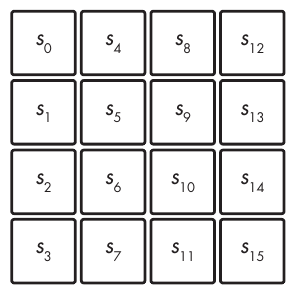

Hình 4-3: Internal state của AES dưới dạng một mảng 4×4 gồm 16 byte

Để biến đổi state của mình, AES dùng một cấu trúc SPN như trong Hình 4-4, với 10 round cho key 128-bit, 12 round cho key 192-bit và 14 round cho key 256-bit.

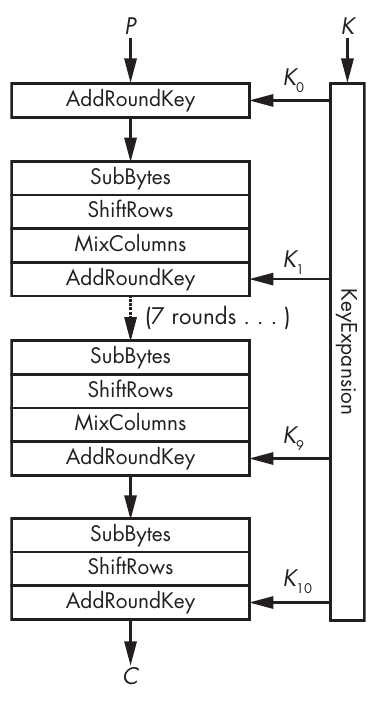

Hình 4-4: Các phép toán bên trong của AES

Hình 4-4 cho thấy bốn thành phần cơ bản của một round AES (lưu ý rằng mọi round trừ round cuối đều là một chuỗi gồm SubBytes, ShiftRows, MixColumns và AddRoundKey):

**AddRoundKey** XOR một round key vào internal state.

**SubBytes** Thay mỗi byte (s<sub>0</sub>, s<sub>1</sub> . . . , s<sub>15</sub>) bằng một byte khác theo một S-box. Trong ví dụ này, S-box là một lookup table gồm 256 phần tử.

**ShiftRows** Dịch hàng thứ i đi i vị trí, với i từ 0 đến 3 (xem Hình 4-5).

**MixColumns** Áp dụng cùng một phép biến đổi tuyến tính cho mỗi cột trong bốn cột của state (tức là mỗi nhóm ô có cùng sắc độ xám, như ở phía bên trái của Hình 4-5).

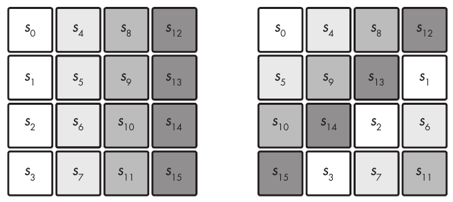

Hình 4-5: ShiftRows xoay vòng các byte trong mỗi hàng của internal state.

Hãy nhớ rằng trong một SPN, S là viết tắt của substitution và P là viết tắt của permutation. Ở đây, substitution layer là SubBytes, và permutation layer là sự kết hợp của ShiftRows và MixColumns.

Function key schedule KeyExpansion, như Hình 4-4 cho thấy, là key schedule algorithm của AES. Phép mở rộng này tạo ra 11 round key (K<sub>0</sub>, K<sub>1</sub>, . . . , K<sub>10</sub>), mỗi key 16 byte, từ key 16-byte, dùng cùng S-box như SubBytes và một tổ hợp các phép XOR. Một tính chất quan trọng của KeyExpansion là khi có bất kỳ round key nào, K<sub>i</sub>, kẻ tấn công có thể xác định mọi round key khác cũng như main key, K, bằng cách đảo ngược algorithm. Khả năng lấy được key từ bất kỳ round key nào làm giảm khả năng chống chịu của cipher trước side-channel attack, trong đó kẻ tấn công có thể dễ dàng khôi phục một round key.

Không có những phép toán này, AES sẽ hoàn toàn không an toàn. Mỗi phép toán đóng góp vào security của AES theo một cách cụ thể:

• Không có KeyExpansion, mọi round sẽ dùng cùng một key, K, và AES sẽ dễ bị slide attack.

• Không có AddRoundKey, encryption sẽ không phụ thuộc vào key; do đó, bất kỳ ai cũng có thể giải mã bất kỳ ciphertext nào mà không cần key.

• SubBytes mang lại các phép toán phi tuyến, giúp tăng độ mạnh cryptography. Không có nó, AES sẽ chỉ là một hệ phương trình tuyến tính lớn có thể giải bằng đại số phổ thông (cụ thể là phép khử Gauss).

• Không có ShiftRows, các thay đổi trong một cột cho trước sẽ không bao giờ ảnh hưởng đến các cột khác, nghĩa là bạn có thể phá AES bằng cách xây dựng bốn codebook 2<sup>32</sup>-element cho mỗi cột. (Hãy nhớ rằng trong một secure block cipher, việc lật một bit ở đầu vào phải ảnh hưởng đến mọi bit đầu ra.)

• Không có MixColumns, các thay đổi trong một byte sẽ không ảnh hưởng đến bất kỳ byte nào khác của state. Khi đó, một kẻ tấn công chosen-plaintext có thể giải mã bất kỳ ciphertext nào sau khi lưu 16 lookup table, mỗi bảng 256 byte, chứa các giá trị đã mã hóa của mỗi giá trị khả dĩ của một byte.

Hãy để ý trong Hình 4-4 rằng round cuối cùng của AES không bao gồm phép toán MixColumns. Phép toán đó được bỏ đi để tiết kiệm tính toán vô ích: vì MixColumns là tuyến tính, bạn có thể triệt tiêu tác dụng của nó trong round cuối cùng bằng cách kết hợp các bit theo một cách không phụ thuộc vào giá trị của chúng hay vào key. Tuy nhiên, chúng ta không thể đảo ngược SubBytes nếu không biết giá trị của state trước AddRoundKey.

Để giải mã một ciphertext, AES tháo gỡ từng phép toán bằng cách lấy inverse function của nó: lookup table nghịch đảo của SubBytes đảo ngược phép biến đổi SubBytes, ShiftRow dịch theo hướng ngược lại, inverse của MixColumns được áp dụng (như ma trận nghịch đảo của ma trận mã hóa phép toán đó), và phép XOR của AddRoundKey giữ nguyên vì inverse của một phép XOR là một phép XOR khác.

### AES trong thực tế (AES in Action)

Như một bài tập, bạn có thể dùng thư viện cryptography của Python để mã hóa và giải mã một block dữ liệu bằng AES, như trong Listing 4-1.

```
from cryptography.hazmat.primitives.ciphers import Cipher, algorithms, modes
from os import urandom

BLOCK_SIZE = 16
KEY_SIZE = 16

# Pick a random 16-byte key using Python's crypto PRNG.
k = urandom(KEY_SIZE)
print(f"k = {k.hex()}")

# Create an instance of AES-128.
aes = Cipher(algorithms.AES(k), modes.ECB())
aes_ecb_encryptor = aes.encryptor()

# Set plaintext p to the all-zero string.
p = bytes([0x00] * BLOCK_SIZE)

# Encrypt plaintext p to ciphertext c.
c = aes_ecb_encryptor.update(p) + aes_ecb_encryptor.finalize()
print(f"enc({p.hex()}) = {c.hex()}")

# Decrypt ciphertext c to plaintext p.
aes_ecb_decryptor = aes.decryptor()
p = aes_ecb_decryptor.update(c) + aes_ecb_decryptor.finalize()
print(f"dec({c.hex()}) = {p.hex()}")
```

Listing 4-1: Mã hóa và giải mã một block bằng AES trong Python

Chạy script này sẽ cho ra kết quả tương tự như sau:

```
$ ./aes_block.py
k = 2c6202f9a582668aa96d511862d8a279
enc(00000000000000000000000000000000) = 12b620bb5eddcde9a07523e59292a6d7
dec(12b620bb5eddcde9a07523e59292a6d7) = 00000000000000000000000000000000
```

Bạn sẽ nhận được kết quả khác vì key được tạo ngẫu nhiên ở mỗi lần thực thi mới.

## Cách triển khai AES (How to Implement AES)

Software AES thực tế hoạt động khác với algorithm trong Hình 4-4. Bạn sẽ không thấy code AES production-level gọi một function SubBytes(), rồi một function ShiftRows(), rồi một function MixColumns(), vì làm vậy sẽ kém hiệu quả. Thay vào đó, software AES nhanh dùng các implementation table-based và native instruction.

### Các implementation Table-Based

Table-based implementation của AES thay chuỗi SubBytes-ShiftRows-MixColumns bằng một tổ hợp các phép XOR và các lần tra cứu trong những bảng được hardcode vào chương trình và được nạp vào memory lúc thực thi. Điều này khả thi vì MixColumns tương đương với việc XOR bốn giá trị 32-bit, trong đó mỗi giá trị phụ thuộc vào một byte duy nhất từ state và vào SubBytes. Vì vậy, bạn có thể xây dựng bốn bảng, mỗi bảng 256 mục, một mục cho mỗi giá trị byte, và triển khai chuỗi SubBytes-MixColumns bằng cách tra bốn giá trị 32-bit và XOR chúng với nhau.

Ví dụ, implementation C table-based trong bộ công cụ OpenSSL trông như Listing 4-2.

```
 /* Round 1: */
 t0 = Te0[s0 >> 24] ^ Te1[(s1 >> 16) & 0xff] ^ Te2[(s2 >> 8) & 0xff] ^ Te3[s3 & 0xff] ^ rk[ 4];
 t1 = Te0[s1 >> 24] ^ Te1[(s2 >> 16) & 0xff] ^ Te2[(s3 >> 8) & 0xff] ^ Te3[s0 & 0xff] ^ rk[ 5];
 t2 = Te0[s2 >> 24] ^ Te1[(s3 >> 16) & 0xff] ^ Te2[(s0 >> 8) & 0xff] ^ Te3[s1 & 0xff] ^ rk[ 6];
 t3 = Te0[s3 >> 24] ^ Te1[(s0 >> 16) & 0xff] ^ Te2[(s1 >> 8) & 0xff] ^ Te3[s2 & 0xff] ^ rk[ 7];
 /* Round 2: */
 s0 = Te0[t0 >> 24] ^ Te1[(t1 >> 16) & 0xff] ^ Te2[(t2 >> 8) & 0xff] ^ Te3[t3 & 0xff] ^ rk[ 8];
 s1 = Te0[t1 >> 24] ^ Te1[(t2 >> 16) & 0xff] ^ Te2[(t3 >> 8) & 0xff] ^ Te3[t0 & 0xff] ^ rk[ 9];
 s2 = Te0[t2 >> 24] ^ Te1[(t3 >> 16) & 0xff] ^ Te2[(t0 >> 8) & 0xff] ^ Te3[t1 & 0xff] ^ rk[10];
 s3 = Te0[t3 >> 24] ^ Te1[(t0 >> 16) & 0xff] ^ Te2[(t1 >> 8) & 0xff] ^ Te3[t2 & 0xff] ^ rk[11];
--snip--
```

Listing 4-2: Một đoạn trích từ implementation C table-based của AES trong OpenSSL

Một implementation table-based cơ bản cho AES encryption cần lượng bảng cỡ bốn 4KB vì mỗi bảng lưu 256 giá trị 32-bit, chiếm 256 × 32 = 8,192 bit, tức 1KB. Decryption cần thêm bốn bảng nữa và do đó thêm 4KB. Nhưng có những thủ thuật để giảm dung lượng lưu trữ từ 4KB xuống 1, hoặc thậm chí ít hơn.

Đáng tiếc là các implementation table-based dễ bị cache-timing attack, loại attack khai thác sự khác biệt về thời gian khi một chương trình đọc hoặc ghi các phần tử trong cache memory. Thời gian truy cập thay đổi tùy theo vị trí tương đối trong cache memory của các phần tử được truy cập. Vì vậy, thời gian làm rò rỉ thông tin về phần tử được truy cập, điều này đến lượt nó lại làm rò rỉ thông tin về các bí mật liên quan.

Cache-timing attack rất khó tránh. Một giải pháp hiển nhiên là bỏ hẳn lookup table bằng cách viết một chương trình có thời gian thực thi không phụ thuộc vào đầu vào của nó, nhưng điều đó gần như không thể làm được mà vẫn giữ nguyên tốc độ, vì vậy các nhà sản xuất chip đã chọn một giải pháp triệt để: thay vì dựa vào software có khả năng có lỗ hổng, họ dựa vào hardware.

### Native instruction (Native Instructions)

AES native instructions (AES-NI) giải quyết vấn đề cache-timing attack đối với các implementation software của AES. Để hiểu AES-NI hoạt động ra sao, hãy nghĩ về cách software chạy trên hardware: để chạy một chương trình, bộ vi xử lý dịch mã nhị phân thành một chuỗi instruction mà các thành phần mạch tích hợp thực thi. Ví dụ, một assembly instruction MUL giữa hai giá trị 32-bit sẽ kích hoạt các transistor triển khai một bộ nhân 32-bit trong bộ vi xử lý. Để triển khai một crypto algorithm, chúng ta thường biểu diễn một tổ hợp các phép toán cơ bản—phép cộng, phép nhân, XOR, v.v.—và bộ vi xử lý kích hoạt các bộ cộng, bộ nhân và mạch XOR của nó theo thứ tự quy định.

AES native instruction đưa điều này lên một tầm cao mới bằng cách cung cấp cho developer các assembly instruction chuyên dụng để tính AES. Thay vì viết code một round AES dưới dạng một chuỗi assembly instruction, khi dùng AES-NI, bạn chỉ cần gọi instruction AESENC, và chip sẽ tính round đó cho bạn. Native instruction cho phép bạn yêu cầu bộ xử lý chạy một round AES thay vì buộc bạn phải lập trình các round như một tổ hợp các phép toán cơ bản.

Một implementation assembly điển hình của AES dùng native instruction trông như Listing 4-3.

```
PXOR       %xmm5,  %xmm0
AESENC     %xmm6,  %xmm0
AESENC     %xmm7,  %xmm0
AESENC     %xmm8,  %xmm0
AESENC     %xmm9,  %xmm0
AESENC     %xmm10, %xmm0
AESENC     %xmm11, %xmm0
AESENC     %xmm12, %xmm0
AESENC     %xmm13, %xmm0
AESENC     %xmm14, %xmm0
AESENCLAST %xmm15, %xmm0
```

Listing 4-3: Một implementation của AES-128 dùng AES native instructions

Code này mã hóa plaintext 128-bit nằm ban đầu trong register xmm0, giả định rằng các register từ xmm5 đến xmm15 chứa các round key đã được tính trước, với mỗi instruction ghi kết quả của nó vào xmm0. Instruction PXOR ban đầu XOR round key đầu tiên trước khi tính round đầu tiên, và instruction AESENCLAST cuối cùng thực hiện round cuối hơi khác so với các round khác (MixColumns bị bỏ qua).

> **LƯU Ý** AES nhanh hơn khoảng 10 lần trên các nền tảng có triển khai native instruction, mà tại thời điểm tôi viết những dòng này, bao gồm hầu như mọi bộ vi xử lý laptop, máy để bàn và server, cũng như phần lớn điện thoại di động và máy tính bảng. Dù Intel ban đầu đề xuất các instruction AES vào năm 2008, chúng cũng có trong các bộ xử lý AMD, và phần lớn các kiến trúc ngoài x86 cũng có các instruction tương đương triển khai AES trong hardware. Ví dụ, instruction set Armv8 chứa các instruction AESSE (tính SubBytes và ShiftRows) và AESMS (tính MixColumns).

> Trên microarchitecture Ice Lake của Intel, instruction AESENC có latency ba chu kỳ với reciprocal throughput là nửa chu kỳ, nghĩa là một lời gọi AESENC mất ba chu kỳ để hoàn thành, và chúng ta có thể thực hiện hai lời gọi mới tới instruction này trong mỗi chu kỳ. Thực tế, cấu trúc bên trong của các micro-operations thực hiện phép toán AESENC cho phép một lần tính instruction mới bắt đầu trước khi lần trước kết thúc. Hơn nữa, kiến trúc Ice Lake dùng một phiên bản vector hóa của các instruction AES, cho phép khởi tạo nhiều instruction cùng lúc. Để biết thêm chi tiết, hãy xem bài viết “Making AES Great Again” của Nir Drucker, Shay Gueron và Vlad Krasnov, có tại https://eprint.iacr.org/2018/392.

> Để mã hóa một loạt block nối tiếp nhau, cần 3 × 10 = 30 chu kỳ để hoàn thành 10 round, tức 30 / 16 = 1.875 chu kỳ mỗi byte. Ở tần số 2 GHz (2 × 10<sup>9</sup> chu kỳ mỗi giây), điều này cho throughput tối đa theo lý thuyết khoảng 1GBps. Nếu bạn có thể xử lý các block song song, thì bạn không cần một lời gọi AESENC hoàn tất trước khi bắt đầu lời gọi khác. Trong trường hợp này, bạn có thể thực hiện hai lời gọi AESENC mỗi chu kỳ và nhận được hai kết quả mỗi chu kỳ, cho throughput lý thuyết cao hơn nhiều (lên tới hơn 10GBps, ở 2 GHz), tùy thuộc vào kích thước dữ liệu và mode of operation.

### Security của AES (AES Security)

AES an toàn đến mức một block cipher có thể an toàn, và nó sẽ không bao giờ bị phá. Về cơ bản, AES an toàn vì mọi bit đầu ra phụ thuộc vào mọi bit đầu vào theo một cách phức tạp, pseudorandom nào đó. Để đạt được điều này, những người thiết kế AES đã chọn cẩn thận từng thành phần vì một lý do cụ thể—MixColumns vì các tính chất diffusion tối đa của nó và SubBytes vì tính phi tuyến tối ưu của nó. Sự kết hợp này bảo vệ AES trước nhiều lớp cryptanalytic attack.

Nhưng không có chứng minh nào rằng AES miễn nhiễm trước mọi attack khả dĩ. Trước hết, chúng ta không biết tất cả các attack khả dĩ là gì, và không phải lúc nào chúng ta cũng biết cách chứng minh một cipher an toàn trước một attack cho trước. Cách duy nhất để thực sự có được sự tin tưởng vào security của AES là huy động cộng đồng tấn công (crowdsource): để nhiều người giỏi cố gắng phá AES và, lý tưởng nhất là, thất bại.

Sau hơn 15 năm và hàng trăm công bố nghiên cứu, chúng ta mới chỉ chạm vào bề mặt của security lý thuyết của AES. Năm 2011, các cryptanalyst đã tìm ra một cách khôi phục key AES-128 bằng cách thực hiện khoảng 2<sup>126</sup> phép toán thay vì 2<sup>128</sup>, tăng tốc 4 lần. Nhưng “attack” này cần một số lượng lớn cặp plaintext–ciphertext—lượng dữ liệu cỡ 2<sup>88</sup> bit. Đó là một phát hiện hay nhưng không phải điều bạn cần lo lắng.

Bạn nên quan tâm đến cả triệu thứ khi triển khai và triển khai crypto, nhưng security của AES không phải là một trong số đó. Mối đe dọa lớn nhất đối với block cipher không nằm ở core algorithm của chúng mà ở mode of operation. Nếu bạn chọn sai mode hoặc dùng sai mode đúng, ngay cả một cipher mạnh như AES cũng không cứu được bạn.

## Mode of operation (Modes of Operation)

Trong Chương 1, tôi đã giải thích cách các encryption scheme kết hợp một permutation với một mode of operation để xử lý các message có độ dài bất kỳ. Trong mục này, tôi sẽ trình bày các mode of operation chính mà block cipher sử dụng, các tính chất security và chức năng của chúng, và cách (không) dùng chúng. Tôi sẽ bắt đầu với mode ngớ ngẩn nhất: electronic codebook.

### Electronic Codebook Mode

Mode mã hóa đơn giản nhất trong các block cipher encryption mode là electronic codebook (ECB), hầu như không thể coi là một mode of operation. ECB nhận các plaintext block P<sub>1</sub>, P<sub>2</sub>, . . . , P<sub>N</sub> và xử lý từng block một cách độc lập bằng cách tính C<sub>1</sub> = E(K, P<sub>1</sub>), C<sub>2</sub>= E(K, P<sub>2</sub>), v.v., như Hình 4-6 cho thấy. Đó là một thao tác đơn giản nhưng cũng không an toàn—ECB không an toàn, và bạn không nên dùng nó.

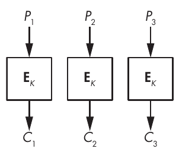

Hình 4-6: ECB mode

Marsh Ray, một cryptographer tại Microsoft, từng nói: “Ai cũng biết ECB mode tệ vì chúng ta có thể nhìn thấy con chim cánh cụt.” Ông đang nói đến một minh họa nổi tiếng về sự không an toàn của ECB, dùng hình ảnh linh vật của Linux, Tux, như trong Hình 4-7.

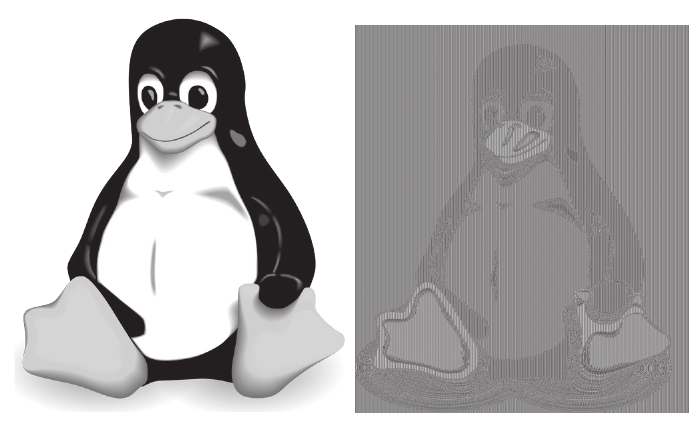

Hình 4-7: Hình ảnh gốc (bên trái) và hình ảnh ECB-encrypted (bên phải)

Hình ảnh gốc của Tux nằm bên trái, và hình ảnh ECB-encrypted dùng AES (dù cipher bên dưới không quan trọng) nằm bên phải. Rất dễ nhận ra hình dạng con chim cánh cụt trong phiên bản đã mã hóa vì ECB mã hóa mọi block có cùng một sắc độ xám trong hình gốc thành cùng một sắc độ xám mới trong hình mới; nói cách khác, ECB encryption cho bạn cùng một hình ảnh với màu sắc khác.

Chương trình Python trong Listing 4-4 cũng cho thấy sự không an toàn của ECB. Nó chọn một key pseudorandom và mã hóa một message 32-byte p chứa hai block gồm toàn byte null. Hãy để ý rằng encryption cho ra hai block giống hệt nhau và việc lặp lại encryption với cùng key và cùng plaintext lại cho ra đúng hai block đó.

```
#!/usr/bin/env python

from cryptography.hazmat.primitives.ciphers import Cipher, algorithms, modes
from os import urandom

BLOCK_SIZE = 16
KEY_SIZE = 16

# The blocks() function splits a data string into space-separated blocks.
def blocks(data):
    split = [data[i:i+BLOCK_SIZE].hex() for i in range(0, len(data), BLOCK_SIZE)]
    return ' '.join(split)

k = urandom(KEY_SIZE)
print(f"k = {k.hex()}")

# Create an instance of AES-128 to encrypt and decrypt.
aes = Cipher(algorithms.AES(k), modes.ECB())
aes_ecb_encryptor = aes.encryptor()

# Set plaintext p as two blocks of zeros.
p = bytes([0x00] * 2 * BLOCK_SIZE)
# Encrypt plaintext p to ciphertext c.
c = aes_ecb_encryptor.update(p) + aes_ecb_encryptor.finalize()
print(f"enc({blocks(p)}) = {blocks(c)}")
```

Listing 4-4: Dùng AES ở ECB mode trong Python

Chạy script này cho ra các ciphertext block như ví dụ sau:

```
$ ./aes_ecb.py
k = 50a0ebeff8001250e87d31d72a86e46d
enc(00000000000000000000000000000000 00000000000000000000000000000000) =
5eb4b7af094ef7aca472bbd3cd72f1ed 5eb4b7af094ef7aca472bbd3cd72f1ed
```

Khi dùng ECB mode, các ciphertext block giống hệt nhau để lộ cho kẻ tấn công các plaintext block giống hệt nhau, dù đó là các block trong cùng một ciphertext hay trong các ciphertext khác nhau. Điều này cho thấy block cipher ở ECB mode không semantically secure.

Một vấn đề khác của ECB là nó chỉ nhận các block dữ liệu hoàn chỉnh, vì vậy nếu block dài 16 byte, như trong AES, bạn chỉ có thể mã hóa các mẩu 16 byte, 32 byte, 48 byte, hoặc bất kỳ bội số nào khác của 16 byte. Có một vài cách để xử lý điều này, như bạn sẽ thấy với mode tiếp theo, CBC. (Tôi sẽ không nói cho bạn biết các thủ thuật này hoạt động thế nào với ECB, vì ngay từ đầu bạn đã không nên dùng ECB.)

### Cipher Block Chaining Mode

Cipher block chaining (CBC) giống ECB nhưng có một biến đổi nhỏ tạo nên khác biệt lớn: thay vì mã hóa block thứ i, P<sub>i</sub>, thành C<sub>i</sub>= E(K, P<sub>i</sub>), CBC đặt C<sub>i</sub> = E(K, P<sub>i</sub> ⊕ C<sub>i</sub> <sub>−</sub> <sub>1</sub>), trong đó C<sub>i</sub> <sub>−</sub> <sub>1</sub> là ciphertext block trước đó—nhờ đó xâu chuỗi (chaining) các block C<sub>i</sub> <sub>−</sub> <sub>1</sub> và C<sub>i</sub>. Khi mã hóa block đầu tiên, P<sub>1</sub>, không có ciphertext block trước đó để dùng, vì vậy CBC lấy một giá trị khởi tạo ngẫu nhiên (initial value, IV), như Hình 4-8 minh họa.

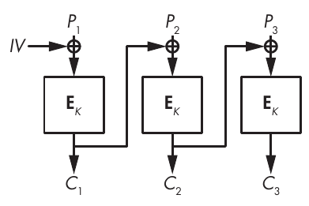

Hình 4-8: CBC mode

CBC mode làm cho mỗi ciphertext block phụ thuộc vào mọi block trước đó và bảo đảm rằng các plaintext block giống hệt nhau sẽ không thành các ciphertext block giống hệt nhau. Initial value ngẫu nhiên bảo đảm rằng hai plaintext giống hệt nhau sẽ được mã hóa thành các ciphertext khác nhau khi gọi cipher hai lần với hai initial value khác nhau.

Listing 4-5 minh họa hai lợi ích này. Chương trình này nhận một message all-zero, 32-byte (giống message trong Listing 4-4), mã hóa nó hai lần bằng CBC, và in ra hai ciphertext. Dòng in đậm iv = urandom(BLOCK_SIZE) chọn một IV ngẫu nhiên mới cho mỗi lần mã hóa mới.

```
#!/usr/bin/env python

from cryptography.hazmat.primitives.ciphers import Cipher, algorithms, modes
from os import urandom

BLOCK_SIZE = 16
KEY_SIZE = 16

# The blocks() function splits a data string into space-separated blocks.
def blocks(data):
    split = [data[i:i+BLOCK_SIZE].hex() for i in range(0, len(data), BLOCK_SIZE)]
    return ' '.join(split)

# Pick a random key.
k = urandom(KEY_SIZE)
print(f"k  = {k.hex()}")

# Pick a random IV.
iv = urandom(BLOCK_SIZE)
print(f"iv = {iv.hex()}")

# Pick an instance of AES in CBC mode.
aes_cbc_encryptor = Cipher(algorithms.AES(k), modes.CBC(iv)).encryptor()

# Set plaintext p as two blocks of zeros.
p = bytes([0x00] * 2 * BLOCK_SIZE)

c = aes_cbc_encryptor.update(p) + aes_cbc_encryptor.finalize()
print(f"enc({blocks(p)}) = {blocks(c)}")

# Now with a different IV and the same key
iv = urandom(BLOCK_SIZE)
print(f"iv = {iv.hex()}")

aes_cbc_encryptor = Cipher(algorithms.AES(k), modes.CBC(iv)).encryptor()
c = aes_cbc_encryptor.update(p) + aes_cbc_encryptor.finalize()
print(f"enc({blocks(p)}) = {blocks(c)}")
```

Listing 4-5: Dùng AES ở CBC mode

Hai plaintext giống nhau (hai block all-zero), nhưng các block đã mã hóa phải khác nhau, như trong lần chạy ví dụ sau:

```
$ ./aes_cbc.py
k = 9cf0d31ad2df24f3cbbefc1e6933c872
iv = 0a75c4283b4539c094fc262aff0d17af
enc(00000000000000000000000000000000 00000000000000000000000000000000) =
370404dcab6e9ecbc3d24ca5573d2920 3b9e5d70e597db225609541f6ae9804a
iv = a6016a6698c3996be13e8739d9e793e2
enc(00000000000000000000000000000000 00000000000000000000000000000000) =
655e1bb3e74ee8cf9ec1540afd8b2204 b59db5ac28de43b25612dfd6f031087a
```

Đáng tiếc là chúng ta thường dùng CBC với một IV cố định thay vì một IV ngẫu nhiên, điều này để lộ các plaintext giống hệt nhau và các plaintext bắt đầu bằng các block giống hệt nhau. Ví dụ, giả sử CBC mã hóa plaintext two-block P<sub>1</sub> || P<sub>2</sub> thành ciphertext two-block C<sub>1</sub> || C<sub>2</sub>. Nếu CBC mã hóa P<sub>1</sub> || P<sub>2</sub>′ với cùng IV, trong đó P<sub>2</sub>′ là một block nào đó khác P<sub>2</sub>, thì ciphertext sẽ có dạng C<sub>1</sub> || C<sub>2</sub>′, với C<sub>2</sub>′ khác C<sub>2</sub> nhưng có cùng block đầu tiên C<sub>1</sub>. Do đó, kẻ tấn công có thể đoán rằng block đầu tiên giống nhau ở cả hai plaintext, dù họ chỉ thấy các ciphertext.

> **LƯU Ý** Ở CBC mode, decryption cần biết IV được dùng để mã hóa, vì vậy IV được gửi kèm ciphertext, ở dạng rõ.

Với CBC, decryption có thể nhanh hơn nhiều so với encryption nhờ khả năng song song. Trong khi việc mã hóa một block mới, P<sub>i</sub>, cần chờ block trước đó, C<sub>i</sub> <sub>−</sub> <sub>1</sub>, thì việc giải mã một block tính P<sub>i</sub>= D(K, C<sub>i</sub>) ⊕ C<sub>i</sub> <sub>−</sub> <sub>1</sub>, trong đó không cần plaintext block trước đó, P<sub>i</sub> <sub>−</sub> <sub>1</sub>. Điều này có nghĩa là bạn có thể giải mã mọi block song song cùng lúc, chừng nào bạn biết ciphertext block trước đó, điều mà thường là bạn biết.

### Mã hóa message ở CBC mode (Message Encryption in CBC Mode)

Hãy quay lại vấn đề kết thúc block và xem cách xử lý một plaintext có độ dài không phải là bội số của độ dài block. Ví dụ, bạn sẽ mã hóa một plaintext 18-byte bằng AES-CBC như thế nào khi block dài 16 byte? Bạn làm gì với 2 byte còn lại? Bạn sẽ xem xét hai kỹ thuật được dùng rộng rãi để xử lý vấn đề này. Kỹ thuật thứ nhất, padding, làm ciphertext dài hơn plaintext một chút, còn kỹ thuật thứ hai, ciphertext stealing, tạo ra một ciphertext có cùng độ dài với plaintext.

#### Message padding (Message Padding)

Padding là một kỹ thuật cho phép bạn mã hóa một message có độ dài bất kỳ, ngay cả một message nhỏ hơn một block duy nhất. Tiêu chuẩn PKCS#7 và RFC 5652 quy định padding cho block cipher, thứ mà chúng ta dùng gần như ở mọi nơi dùng CBC.

Chúng ta dùng padding để mở rộng một message cho đầy một block hoàn chỉnh bằng cách thêm các byte phụ vào plaintext. Sau đây là các quy tắc padding cho block 16-byte:

• Nếu còn lại 1 byte—ví dụ, nếu plaintext dài 1 byte, 17 byte hoặc 33 byte—hãy pad message bằng 15 byte 0f (15 trong hệ thập phân).

• Nếu còn lại 2 byte, hãy pad message bằng 14 byte 0e (14 trong hệ thập phân).

• Nếu còn lại 3 byte, hãy pad message bằng 13 byte 0d (13 trong hệ thập phân).

Nếu có 15 byte plaintext và còn thiếu một byte để đầy một block, padding thêm một byte 01 duy nhất. Nếu plaintext đã là bội số của 16, tức độ dài block, hãy thêm 16 byte 10 (16 trong hệ thập phân). Thủ thuật này tổng quát hóa được cho bất kỳ độ dài block nào tới 255 byte (với các block lớn hơn, một byte là quá nhỏ để mã hóa các giá trị lớn hơn 255).

Việc giải mã một message đã được pad diễn ra như sau:

1. Giải mã mọi block như với CBC không có padding.

2. Bảo đảm rằng các byte cuối của block cuối tuân theo quy tắc padding: chúng kết thúc bằng ít nhất một byte 01, ít nhất hai byte 02, hoặc ít nhất ba byte 03, v.v. Nếu padding không hợp lệ—ví dụ, nếu các byte cuối là 01 02 03—message bị từ chối. Nếu không, decryption loại bỏ các byte padding và trả về các byte plaintext còn lại.

Một nhược điểm của padding là nó làm ciphertext dài hơn ít nhất 1 byte và tối đa một block.

#### Ciphertext Stealing

Ciphertext stealing là một thủ thuật khác mà chúng ta dùng để mã hóa một message có độ dài không phải là bội số của block size. Ciphertext stealing phức tạp hơn và ít phổ biến hơn padding, nhưng nó mang lại một vài lợi ích:

• Plaintext có thể có độ dài bit bất kỳ, không chỉ là byte. Ví dụ, bạn có thể mã hóa một message 131 bit.

• Ciphertext có độ dài chính xác bằng plaintext.

• Ciphertext stealing không dễ bị padding oracle attack, loại attack mạnh đôi khi có hiệu quả với CBC có padding (như bạn sẽ thấy trong “Padding Oracle Attacks” ở trang 83).

Ở CBC mode, ciphertext stealing mở rộng plaintext block cuối cùng chưa hoàn chỉnh bằng các bit từ ciphertext block trước đó rồi mã hóa block thu được. Ciphertext block cuối cùng, chưa hoàn chỉnh, được tạo thành từ các bit đầu tiên của ciphertext block trước đó—tức là những bit chưa được nối vào plaintext block cuối cùng.

Trong Hình 4-9, chúng ta có ba block, trong đó block cuối, P<sub>3</sub>, chưa hoàn chỉnh (được biểu diễn bằng một số không). Nếu P<sub>3</sub> dài 3 byte, chúng ta XOR nó với 12 bit cuối từ ciphertext block trước đó E(K, P<sub>2</sub>) và trả về kết quả đã mã hóa là C<sub>2</sub>. Khi đó, ciphertext block cuối cùng, C<sub>3</sub>, gồm 4 byte đầu tiên của E(K, P<sub>2</sub>). Decryption đơn giản là phép ngược của thao tác này.

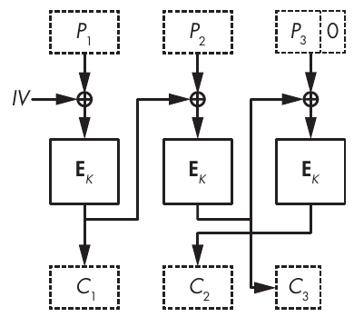

Hình 4-9: Ciphertext stealing cho encryption CBC-mode

Ciphertext stealing không có vấn đề lớn nào, nhưng nó kém thanh lịch và khó làm đúng, đặc biệt khi tiêu chuẩn của NIST quy định ba cách khác nhau để triển khai nó (xem Special Publication 800-38A).

### Counter Mode

Để tránh những rắc rối mà vẫn giữ được lợi ích của ciphertext stealing, hãy dùng counter mode (CTR). CTR hầu như không phải là một block cipher mode: nó biến một block cipher thành một stream cipher chỉ nhận bit vào và nhả bit ra, và không tự làm khó mình với khái niệm block. (Tôi sẽ thảo luận chi tiết về stream cipher trong Chương 5.)

Ở CTR mode (xem Hình 4-10), block cipher algorithm sẽ không biến đổi dữ liệu plaintext. Thay vào đó, nó mã hóa các block gồm một counter và một nonce. Counter là một số nguyên được tăng lên cho mỗi block. Không có hai block nào trong một message được dùng cùng một counter, nhưng các message khác nhau có thể dùng cùng một dãy giá trị counter (1, 2, 3, . . .). Nonce là một số mà chúng ta chỉ dùng một lần. Nó giống nhau cho mọi block trong một message, nhưng không có hai message nào được dùng cùng một nonce.

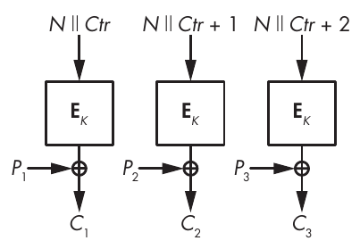

Hình 4-10: CTR mode

Hình 4-10 cho thấy rằng ở CTR mode, encryption XOR plaintext với dòng (stream) thu được từ việc “mã hóa” nonce, N, và counter, Ctr. Decryption cũng giống vậy, vì vậy bạn chỉ cần encryption algorithm cho cả encryption lẫn decryption. Script Python trong Listing 4-6 cho bạn một ví dụ hands-on.

```
#!/usr/bin/env python

from cryptography.hazmat.primitives.ciphers import Cipher, algorithms, modes
from os import urandom

BLOCK_SIZE = 16
KEY_SIZE = 16

# Pick a random key.
k = urandom(KEY_SIZE)
print(f"k  = {k.hex()}")

# And a random nonce
# (careful with random nonces, see discussion below).
n = urandom(BLOCK_SIZE)
print(f"nonce  = {n.hex()}")

# Create a 7-byte plaintext p.
p = bytes([0x00] * 7)

# Encrypt the plaintext p with AES-CTR.
aes_ctr_encryptor = Cipher(algorithms.AES(k), modes.CTR(n)).encryptor()

c = aes_ctr_encryptor.update(p) + aes_ctr_encryptor.finalize()
print(f"enc({p.hex()}) = {c.hex()}")

# Decrypt the ciphertext c.
aes_ctr_decryptor = Cipher(algorithms.AES(k), modes.CTR(n)).decryptor()
p = aes_ctr_decryptor.update(c) + aes_ctr_decryptor.finalize()
print(f"dec({c.hex()}) = {p.hex()}")

# Decrypt the ciphertext c using the encryption function.
aes_ctr_encryptor = Cipher(algorithms.AES(k), modes.CTR(n)).encryptor()
p = aes_ctr_encryptor.update(c) + aes_ctr_encryptor.finalize()
print(f"enc({c.hex()}) = {p.hex()}")
```

Listing 4-6: Dùng AES ở CTR mode

Lần chạy ví dụ mã hóa một plaintext 4-byte và nhận được một ciphertext 4-byte. Sau đó nó giải mã ciphertext đó bằng encryption function:

```
$ ./aes_ctr.py
k = 130a1aa77fa58335272156421cb2a3ea
enc(00010203) = b23d284e
enc(b23d284e) = 00010203
```

Cũng như initial value trong CBC, bên mã hóa cung cấp nonce của CTR và gửi nó kèm ciphertext ở dạng rõ. Nhưng khác với initial value của CBC, nonce của CTR không cần ngẫu nhiên; nó chỉ cần duy nhất. Nonce phải duy nhất vì cùng lý do mà chúng ta không nên dùng lại one-time pad: khi gọi dòng pseudorandom, S, nếu bạn mã hóa P<sub>1</sub> thành C<sub>1</sub>= P<sub>1</sub> ⊕ S và P<sub>2</sub> thành C<sub>2</sub>= P<sub>2</sub> ⊕ S với cùng một nonce, thì C<sub>1</sub> ⊕ C<sub>2</sub> sẽ để lộ P<sub>1</sub> ⊕ P<sub>2</sub>.

Một nonce ngẫu nhiên chỉ có tác dụng nếu nó đủ dài; ví dụ, nếu nonce dài n bit, nhiều khả năng sau 2<sup>n/2</sup> lần mã hóa và chừng ấy nonce, bạn sẽ gặp các giá trị trùng lặp. Sixty-four bit là không đủ cho một nonce ngẫu nhiên, vì bạn có thể kỳ vọng một lần lặp lại sau xấp xỉ 2<sup>32</sup> nonce, một con số thấp không thể chấp nhận được.

Counter được bảo đảm là duy nhất nếu nó được tăng lên cho mỗi plaintext mới, và nếu nó đủ dài—ví dụ, một counter 64-bit.

Một lợi ích đặc biệt của CTR là nó có thể nhanh hơn bất kỳ mode nào khác. Không chỉ có thể song song hóa, bạn còn có thể bắt đầu mã hóa ngay cả trước khi biết message, bằng cách chọn một nonce và tính trước dòng mà sau này bạn sẽ XOR với plaintext.

> **LƯU Ý** Tùy thuộc vào phiên bản CTR mà chúng ta triển khai, chúng ta có thể nối nonce mà API dùng làm đối số với một counter (như trong Hình 4-10) hoặc trực tiếp xem counter có độ rộng bằng một block.

## Những gì có thể sai (How Things Can Go Wrong)

Có hai attack must-know nhắm vào block cipher: meet-in-the-middle attack, một kỹ thuật được phát hiện từ những năm 1970 nhưng vẫn được dùng trong nhiều cryptanalytic attack (không nên nhầm với man-in-the-middle attack), và padding oracle attack, một lớp attack được các cryptographer học thuật phát hiện vào năm 2002, sau đó phần lớn bị phớt lờ, và cuối cùng được phát hiện lại một thập kỷ sau cùng với nhiều ứng dụng có lỗ hổng.

### Meet-in-the-Middle Attacks

Block cipher 3DES là một phiên bản nâng cấp của tiêu chuẩn DES từ những năm 1970, nhận một key dài 56 × 3 = 168 bit (một cải tiến so với key 56-bit của DES). Nhưng security level của 3DES là 112 bit thay vì 168 bit do meet-in-the-middle (MitM) attack.

Hình 4-11 cho thấy 3DES mã hóa một block bằng các encryption function và decryption function của DES: đầu tiên là mã hóa với một key, K<sub>1</sub>; sau đó giải mã với một key, K<sub>2</sub>; và cuối cùng mã hóa với một key khác, K<sub>3</sub>. Nếu K<sub>1</sub> = K<sub>2</sub>, hai lời gọi đầu tiên triệt tiêu lẫn nhau, và 3DES rút gọn thành một DES đơn với key K<sub>3</sub>. 3DES thực hiện encrypt-decrypt-encrypt thay vì mã hóa ba lần để cho phép các hệ thống mô phỏng DES khi cần thông qua interface 3DES mới.

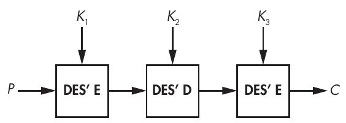

Hình 4-11: Cấu trúc block cipher 3DES

Vì sao lại dùng triple DES mà không chỉ dùng double DES—tức là vì sao không mã hóa một plaintext P thành E(K<sub>2</sub>, E(K<sub>1</sub>, P))? Hóa ra MitM attack khiến double DES chỉ an toàn ngang single DES. Hình 4-12 cho thấy MitM attack khi được thực hiện.

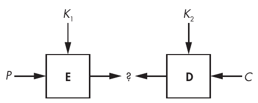

Hình 4-12: MitM attack

MitM attack hoạt động như sau để tấn công double DES:

1. Giả sử bạn có P và C = E(K<sub>2</sub>, E(K<sub>1</sub>, P)) với hai key 56-bit chưa biết, K<sub>1</sub> và K<sub>2</sub>. (DES nhận key 56-bit, nên double DES nhận tổng cộng 112 bit key.) Bạn xây dựng một bảng key-value với 2<sup>56</sup> mục E(K<sub>1</sub>, P), trong đó E là encryption function của DES và K<sub>1</sub> là giá trị được lưu.

2. Với cả 2<sup>56</sup> giá trị của K<sub>2</sub>, hãy tính D(K<sub>2</sub>, C) và kiểm tra xem giá trị thu được có xuất hiện trong bảng như một index hay không (tức là như một giá trị ở giữa, được biểu diễn bằng dấu chấm hỏi trong Hình 4-12).

3. Nếu bạn tìm thấy một giá trị ở giữa là một index của bảng, hãy lấy K<sub>1</sub> tương ứng từ bảng và xác minh rằng cặp (K<sub>1</sub>, K<sub>2</sub>) tìm được là đúng bằng cách dùng các cặp P và C khác. Hãy mã hóa P bằng K<sub>1</sub> và K<sub>2</sub> rồi kiểm tra xem ciphertext thu được có phải là C đã cho hay không.

Phương pháp này khôi phục K<sub>1</sub> và K<sub>2</sub> bằng cách thực hiện khoảng 2<sup>57</sup> thay vì 2<sup>112</sup> phép toán: bước 1 mã hóa 2<sup>56</sup> block, và sau đó bước 2 giải mã tối đa 2<sup>56</sup> block, tổng cộng là 2<sup>56</sup> + 2<sup>56</sup> = 2<sup>57</sup> phép toán. Bạn cũng cần lưu 2<sup>56</sup> phần tử, mỗi phần tử 15 byte, tức khoảng 1 exabyte. Đó là rất nhiều, nhưng có một thủ thuật cho phép bạn thực hiện cùng attack đó chỉ với một lượng memory không đáng kể (như bạn sẽ thấy trong Chương 6).

Bạn có thể áp dụng MitM attack cho 3DES gần như theo cùng cách áp dụng cho double DES, ngoại trừ việc giai đoạn thứ ba sẽ duyệt qua cả 2<sup>112</sup> giá trị của K<sub>2</sub> và K<sub>3</sub>. Do đó, toàn bộ attack thành công sau khi thực hiện khoảng 2<sup>112</sup> phép toán, nghĩa là 3DES chỉ có được security 112-bit dù có 168 bit key material.

### Padding Oracle Attacks

Chúng ta kết thúc chương này với một trong những attack đơn giản nhất nhưng tàn phá nhất của những năm 2000: padding oracle attack. Hãy nhớ rằng padding lấp đầy plaintext bằng các byte phụ để đầy một block. Ví dụ, một plaintext 111 byte là một chuỗi gồm sáu block 16-byte theo sau là 15 byte. Trong trường hợp này, để tạo thành một block hoàn chỉnh, padding thêm một byte 01. Với một plaintext 110-byte, padding thêm 2 byte 02. Với một plaintext 109-byte, nó thêm 3 byte 03, v.v., cho đến trường hợp chúng ta thêm 16 byte 10, trong đó giá trị hexadecimal 10 bằng 16.

Padding oracle là một hệ thống hoạt động khác nhau tùy theo padding trong một ciphertext CBC-encrypted có hợp lệ hay không. Bạn có thể xem nó như một hộp đen (black box) hoặc một API trả về giá trị thành công hoặc giá trị lỗi. Ví dụ, bạn có thể có được một padding oracle trong một service trên một host từ xa gửi thông báo lỗi khi nhận được các ciphertext sai định dạng. Khi có một oracle như vậy, padding oracle attack ghi lại những đầu vào nào có padding hợp lệ và những đầu vào nào không, rồi khai thác thông tin này để giải mã các giá trị ciphertext được chọn.

Giả sử bạn muốn giải mã một ciphertext block C<sub>2</sub>. Tôi sẽ gọi X là giá trị bạn đang tìm, cụ thể là D(K, C<sub>2</sub>), và P<sub>2</sub> là block thu được sau khi giải mã ở CBC mode (xem Hình 4-13). Nếu bạn chọn một block ngẫu nhiên C<sub>1</sub> và gửi ciphertext two-block C<sub>1</sub> || C<sub>2</sub> tới oracle, decryption sẽ chỉ thành công nếu C<sub>1</sub> ⊕ X = P<sub>2</sub> kết thúc bằng padding hợp lệ—một byte 01 duy nhất, hai byte 02, hoặc ba byte 03, v.v.

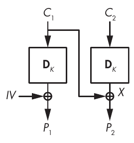

Hình 4-13: Padding oracle attack khôi phục X bằng cách chọn C<sub>1</sub> và kiểm tra tính hợp lệ của padding.

Dựa trên quan sát này, padding oracle attack nhắm vào CBC encryption có thể giải mã một block C<sub>2</sub> như sau (các byte được ký hiệu theo dạng mảng: C<sub>1</sub>[0] là byte đầu tiên của C<sub>1</sub>, C<sub>1</sub>[1] là byte thứ hai, v.v., cho đến C<sub>1</sub>[15], byte cuối cùng của C<sub>1</sub>):

1. Chọn một block ngẫu nhiên C<sub>1</sub> và thay đổi byte cuối của nó cho đến khi padding oracle chấp nhận ciphertext là hợp lệ. Thông thường, trong một ciphertext hợp lệ, C<sub>1</sub>[15] ⊕ X[15] = 01, vì vậy bạn sẽ tìm ra X[15] sau khi thử khoảng 128 giá trị của C<sub>1</sub>[15].

2. Tìm giá trị X[14] bằng cách đặt C<sub>1</sub>[15] thành X[15] ⊕ 02 và tìm C<sub>1</sub>[14] cho ra padding đúng. Khi oracle chấp nhận ciphertext là hợp lệ, điều đó có nghĩa là bạn đã tìm được C<sub>1</sub>[14] sao cho C<sub>1</sub>[14] ⊕ X[14] = 02.

3. Lặp lại bước 1 và 2 cho cả 16 byte.

Attack cần trung bình 128 query tới oracle cho mỗi byte trong 16 byte, tức tổng cộng khoảng 2,000 query. (Lưu ý rằng mỗi query phải dùng cùng một initial value.)

> **LƯU Ý** Trong thực tế, triển khai một padding oracle attack phức tạp hơn một chút so với những gì tôi đã mô tả, vì bạn phải xử lý các lần đoán sai ở bước 1. Một ciphertext có thể có padding hợp lệ không phải vì P<sub>2</sub> kết thúc bằng một byte 01 duy nhất mà vì nó kết thúc bằng hai byte 02 hoặc ba byte 03. Bạn có thể xử lý điều này bằng cách kiểm tra tính hợp lệ của các ciphertext có nhiều byte hơn bị sửa đổi.

## Đọc thêm (Further Reading)

Có rất nhiều điều để nói về block cipher, dù là về cách các algorithm hoạt động hay về cách chúng có thể bị tấn công. Chẳng hạn, Feistel network và SPN không phải là những cách duy nhất để xây dựng một block cipher. Các block cipher IDEA và FOX dùng cấu trúc Lai–Massey, còn Threefish dùng ARX network, một tổ hợp của phép cộng, phép xoay word và XOR.

Cũng còn nhiều mode khác ngoài ECB, CBC và CTR. Một số mode là những kỹ thuật dân gian không ai dùng, như CFB và OFB, trong khi những mode khác dành cho các ứng dụng cụ thể, như XTS cho tweakable encryption hay GCM cho authenticated encryption.

Tôi đã thảo luận về Rijndael, người chiến thắng cuộc thi AES, nhưng còn 14 algorithm khác trong cuộc đua: CAST-256, CRYPTON, DEAL, DFC, E2, FROG, HPC, LOKI97, Magenta, MARS, RC6, SAFER+, Serpent và Twofish. Tôi khuyên bạn nên tìm hiểu chúng để xem chúng hoạt động như thế nào, được thiết kế ra sao, đã bị tấn công như thế nào và nhanh đến mức nào. Cũng đáng để xem các thiết kế của NSA (Skipjack và, gần đây hơn, SIMON và SPECK) và những block cipher “lightweight” gần đây hơn như GIFT, KATAN, PRESENT hoặc PRINCE.
