# Chương 5: Stream Cipher (Stream Ciphers)

Symmetric cipher có thể là block cipher hoặc stream cipher. Hãy nhớ lại từ Chương 4 rằng block cipher trộn các mẩu bit plaintext với các bit key để tạo ra các mẩu ciphertext có cùng kích thước, thường là 64 hoặc 128 bit. Mặt khác, stream cipher không trộn bit plaintext với bit key; thay vào đó, chúng tạo ra các bit pseudorandom từ key và mã hóa plaintext bằng cách XOR nó với các bit pseudorandom, theo cùng cách như one-time pad đã giải thích trong Chương 1.

Stream cipher đôi khi bị xa lánh vì về mặt lịch sử chúng mong manh hơn block cipher và thường bị phá hơn—cả những cipher thử nghiệm do người nghiệp dư thiết kế lẫn những cipher được triển khai trong các hệ thống được hàng triệu người dùng, bao gồm điện thoại di động, Wi-Fi và smart card giao thông công cộng. Nhưng may thay, dù đã mất gần 20 năm, giờ đây chúng ta đã biết cách thiết kế các stream cipher an toàn, và chúng ta tin tưởng chúng để bảo vệ các kết nối Bluetooth, truyền thông di động 4G và các kết nối TLS.

Chương này trước tiên trình bày cách stream cipher hoạt động và thảo luận hai lớp stream cipher chính: stateful và counter based. Sau đó, chúng ta sẽ nghiên cứu các stream cipher hardware- và software-oriented, và xem xét một số cipher không an toàn (A5/1 như được dùng trong truyền thông di động GSM, và RC4 trong các phiên bản TLS cũ hơn) cùng những cipher an toàn, state-of-the-art (Grain-128a cho hardware và Salsa20 cho software).

## Stream cipher hoạt động như thế nào (How Stream Ciphers Work)

Stream cipher gần với deterministic random bit generator (DRBG) hơn là với block cipher, vì chúng tạo ra một dòng bit pseudorandom chứ không trực tiếp trộn dữ liệu plaintext.

Điều phân biệt stream cipher với DRBG là DRBG nhận một giá trị đầu vào duy nhất, trong khi stream cipher nhận hai giá trị: một key và một nonce. Key phải được giữ bí mật và thường dài 128 hoặc 256 bit. Nonce không cần bí mật, nhưng nó phải là duy nhất cho mỗi key và thường dài từ 64 đến 128 bit.

Stream cipher tạo ra một dòng bit pseudorandom mà chúng ta gọi là keystream. Để mã hóa bằng keystream, chúng ta XOR nó với một plaintext, rồi XOR nó một lần nữa với ciphertext để giải mã. Hình 5-1 cho thấy thao tác mã hóa stream cipher cơ bản, trong đó SC là stream cipher algorithm, KS là keystream, P là plaintext và C là ciphertext.

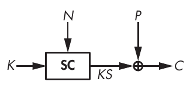

Hình 5-1: Cách stream cipher mã hóa, nhận một secret key, K, và một nonce công khai, N

Một stream cipher tính KS = SC(K, N), mã hóa theo C = P ⊕ KS, và giải mã theo P = C ⊕ KS. Encryption function và decryption function là như nhau vì cả hai làm cùng một việc—cụ thể là XOR các bit với keystream. Đó là lý do, chẳng hạn, một số cryptographic library cung cấp một function encrypt duy nhất cho cả encryption lẫn decryption.

Stream cipher cho phép bạn mã hóa một message với key K<sub>1</sub> và nonce N<sub>1</sub>, rồi mã hóa một message khác với key K<sub>1</sub> và nonce N<sub>2</sub> khác N<sub>1</sub>, hoặc với key K<sub>2</sub> khác K<sub>1</sub> và nonce N<sub>1</sub>. Tuy nhiên, bạn không bao giờ được mã hóa lại với K<sub>1</sub> và N<sub>1</sub>, vì bạn sẽ dùng cùng một keystream KS hai lần. Tức là bạn sẽ có ciphertext thứ nhất C<sub>1</sub> = P<sub>1</sub> ⊕ KS và ciphertext thứ hai C<sub>2</sub> = P<sub>2</sub> ⊕ KS, và nếu bạn biết P<sub>1</sub>, thì bạn có thể xác định P<sub>2</sub> = C<sub>1</sub> ⊕ C<sub>2</sub> ⊕ P<sub>1</sub>.

> **LƯU Ý** Nonce là viết tắt của “number used only once” (số chỉ dùng một lần). Trong bối cảnh stream cipher, đôi khi chúng ta gọi nó là IV, viết tắt của “initial value”.

Từ góc nhìn high-level, có hai loại stream cipher: stateful và counter based. Các stateful stream cipher có một internal state bí mật thay đổi trong suốt quá trình tạo keystream. Cipher khởi tạo state từ key và nonce rồi gọi một update function để cập nhật giá trị state và tạo ra một hoặc nhiều bit keystream từ state, như Hình 5-2 cho thấy. Ví dụ, RC4 là stateful còn Salsa20 là counter based.

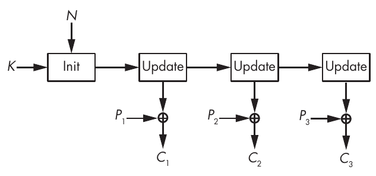

Hình 5-2: Một stateful stream cipher

Counter-based stream cipher tạo ra các mẩu keystream từ một key, một nonce và một giá trị counter, như trong Hình 5-3. Khác với stateful stream cipher, các stream cipher counter-based như Salsa20 không lưu giữ bí mật nào trong quá trình tạo keystream, ngoài giá trị của counter.

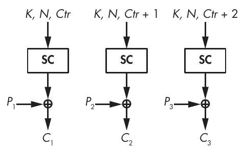

Hình 5-3: Một stream cipher counter-based

Hai cách tiếp cận này định nghĩa kiến trúc high-level của stream cipher, bất kể các core algorithm hoạt động ra sao. Phần bên trong của stream cipher cũng chia thành hai loại, tùy theo nền tảng đích của cipher: hướng hardware (hardware oriented) và hướng software (software oriented).

## Các stream cipher Hardware-Oriented

Khi các cryptographer nói về hardware, ý họ là application-specific integrated circuit (ASIC), programmable logic device (PLD) và field-programmable gate array (FPGA). Một implementation hardware của cipher là một mạch điện tử triển khai cryptographic algorithm ở mức bit và không thể dùng cho việc gì khác; nói cách khác, mạch đó là hardware chuyên dụng. Mặt khác, các implementation software của cryptographic algorithm chỉ đơn giản cho bộ vi xử lý biết cần thực thi những instruction nào để chạy algorithm. Những instruction này thao tác trên byte hoặc word rồi gọi tới các phần mạch điện tử triển khai các phép toán general-purpose như phép cộng và phép nhân. Software làm việc với byte hoặc word 32 hoặc 64 bit, trong khi hardware làm việc với bit. Những stream cipher đầu tiên làm việc với bit để tránh các phép toán phức tạp theo word và nhờ đó hiệu quả hơn trong hardware, nền tảng đích của chúng vào thời đó.

Stream cipher chủ yếu được dùng cho các implementation hardware vì chúng rẻ hơn block cipher. Chúng cần ít memory hơn và ít cổng logic hơn block cipher, và do đó chiếm diện tích nhỏ hơn trên mạch tích hợp, giúp giảm chi phí chế tạo. Ví dụ, nếu tính theo gate-equivalents, thước đo diện tích tiêu chuẩn cho mạch tích hợp, bạn có thể tìm thấy những stream cipher chiếm ít hơn 1,000 gate-equivalents; ngược lại, các block cipher software-oriented điển hình cần ít nhất 10,000 gate-equivalents, khiến crypto đắt hơn một bậc độ lớn so với khi dùng stream cipher.

Tuy nhiên, ngày nay block cipher không còn đắt hơn stream cipher nữa—thứ nhất, vì giờ đây đã có các block cipher hardware-friendly nhỏ xấp xỉ stream cipher, và thứ hai, vì chi phí hardware đã giảm mạnh. Dù vậy, stream cipher vẫn thường được gắn với hardware vì chúng từng là lựa chọn tốt nhất.

Trong mục tiếp theo, tôi sẽ giải thích cơ chế cơ bản đằng sau các hardware stream cipher, gọi là feedback shift register (FSR). Gần như mọi hardware stream cipher đều dựa vào FSR theo cách này hay cách khác, dù đó là cipher A5/1 được dùng trong điện thoại di động 2G hay cipher Grain-128a gần đây hơn.

> **LƯU Ý** Block cipher tiêu chuẩn đầu tiên, Data Encryption Standard (DES), được tối ưu cho hardware chứ không phải software. Khi chính phủ Hoa Kỳ chuẩn hóa DES vào những năm 1970, phần lớn các ứng dụng đích là các implementation hardware. Vì vậy, không có gì ngạc nhiên khi các S-boxes trong DES nhỏ và tính nhanh khi được triển khai như một mạch logic trong hardware nhưng lại kém hiệu quả trong software. Khác với DES, Advanced Encryption Standard (AES) hiện nay làm việc với byte và do đó hiệu quả hơn DES trong software.

### Feedback Shift Register (Feedback Shift Registers)

Vô số stream cipher dùng FSR vì chúng đơn giản và được hiểu rõ. Một FSR là một mảng bit được trang bị một update feedback function, mà tôi sẽ ký hiệu là f. State của FSR được lưu trong mảng, hay register, và mỗi lần cập nhật FSR dùng feedback function để thay đổi giá trị state và tạo ra một bit đầu ra.

Trong thực tế, một FSR hoạt động như sau: nếu R<sub>0</sub> là giá trị ban đầu của FSR, thì state tiếp theo, R<sub>1</sub>, được định nghĩa là R<sub>0</sub> left-shifted đi 1 bit, trong đó bit rời khỏi register được trả về làm đầu ra và vị trí trống được lấp bằng f(R<sub>0</sub>).

Chúng ta lặp lại cùng quy tắc để tính các giá trị state tiếp theo R<sub>2</sub>, R<sub>3</sub>, v.v. Tức là, cho R<sub>t</sub>, state của FSR tại thời điểm t, thì state tiếp theo, R<sub>t</sub> <sub>+</sub> <sub>1</sub>, là như sau:

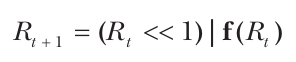

Trong phương trình này, | là toán tử OR logic, và << là toán tử shift, như được dùng trong ngôn ngữ C. Ví dụ, với chuỗi 8-bit 00001111, ta có:

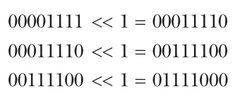

Phép shift bit dịch các bit sang trái, làm mất bit ngoài cùng bên trái để giữ nguyên độ dài bit của state và đặt bit ngoài cùng bên phải về không. Thao tác cập nhật của một FSR cũng giống hệt vậy, ngoại trừ việc thay vì được đặt về 0, bit ngoài cùng bên phải được đặt thành f(R<sub>t</sub>).

Ví dụ, hãy xét một FSR 4-bit có feedback function f XOR cả 4 bit với nhau. Khởi tạo state như sau:

1 1 0 0

Bây giờ hãy dịch các bit sang trái, trong đó 1 được xuất ra và bit ngoài cùng bên phải được đặt thành:

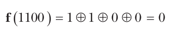

Bây giờ state trở thành:

1 0 0 0

Lần cập nhật tiếp theo xuất ra 1, left-shifts state, và đặt bit ngoài cùng bên phải thành:

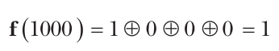

Bây giờ state là:

0 0 0 1

Ba lần cập nhật tiếp theo trả về ba bit 0 và cho ra các giá trị state sau:

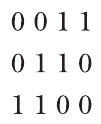

Như vậy, chúng ta quay trở lại state ban đầu 1100 sau năm lần lặp; cập nhật state năm lần từ bất kỳ giá trị nào quan sát được trong chu trình này đều đưa chúng ta trở lại giá trị ban đầu này. Chúng ta nói 5 là chu kỳ (period) của FSR với bất kỳ giá trị nào trong các giá trị 1100, 1000, 0001, 0011 hoặc 0110. Vì chu kỳ của FSR này là 5, việc clock register 10 lần sẽ cho ra hai lần cùng một chuỗi 5-bit. Tương tự, nếu bạn clock register 20 lần, bắt đầu từ 1100, các bit đầu ra sẽ là 11000110001100011000, tức bốn lần cùng một chuỗi 5-bit 11000. Theo trực giác, nên tránh những pattern lặp lại như vậy, và một chu kỳ dài hơn sẽ tốt hơn cho security.

> **LƯU Ý** Nếu bạn định dùng một FSR trong một stream cipher, hãy tránh những FSR có chu kỳ ngắn, vốn khiến đầu ra dễ đoán hơn. Với một số loại FSR, rất dễ tìm ra chu kỳ của chúng, nhưng với những loại khác thì gần như không thể.

Hình 5-4 cho thấy cấu trúc của chu trình này, cùng với các chu trình khác của FSR đó, trong đó mỗi chu trình là một vòng tròn mà các chấm biểu diễn một state của register.

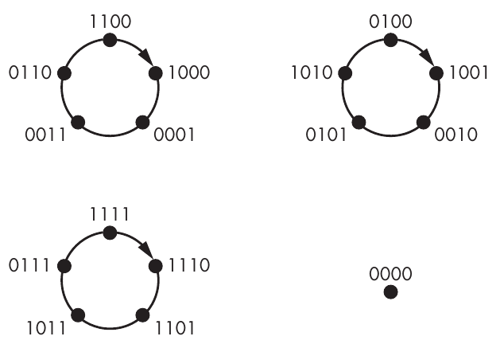

Hình 5-4: Các chu trình của FSR có feedback function XOR 4 bit với nhau

Thật vậy, FSR cụ thể này còn có hai chu trình period-5 khác—{0100, 1001, 0010, 0101, 1010} và {1111, 1110, 1101, 1011, 0111}. Lưu ý rằng bất kỳ state nào cũng chỉ có thể thuộc về một chu trình state duy nhất. Ở đây, chúng ta có ba chu trình, mỗi chu trình năm state, bao phủ 15 trong số 2<sup>4</sup> = 16 giá trị khả dĩ của register 4-bit. Giá trị khả dĩ thứ 16 là 0000, mà như Hình 5-4 cho thấy, là một chu trình period-1 vì FSR biến 0000 thành 0000.

Về bản chất, một FSR là một register bit, trong đó mỗi lần cập nhật register xuất ra một bit (bit ngoài cùng bên trái của register) và một function tính bit mới ngoài cùng bên phải của register. (Mọi bit khác đều được left-shifted.) Chu kỳ của một FSR, từ một state ban đầu nào đó, là số lần cập nhật cần thiết cho đến khi FSR quay lại cùng state đó. Nếu cần N lần cập nhật để làm điều đó, FSR sẽ tạo ra cùng N bit lặp đi lặp lại.

#### Linear Feedback Shift Register (Linear Feedback Shift Registers)

Linear feedback shift register (LFSR) là các FSR có feedback function tuyến tính—tức là một function là XOR của một số bit của state, như ví dụ FSR 4-bit trong mục trước với feedback function trả về XOR của 4 bit trong register. Hãy nhớ rằng trong cryptography, tính tuyến tính đồng nghĩa với khả năng bị đoán trước và gợi ý một cấu trúc toán học đơn giản bên dưới. Và như bạn có thể đoán, nhờ tính tuyến tính này, chúng ta có thể phân tích LFSR bằng các khái niệm như linear complexity, finite field và primitive polynomial—nhưng tôi sẽ bỏ qua chi tiết toán học và chỉ đưa ra những điều cốt yếu.

> **LƯU Ý** Trong đại số tuyến tính, chúng ta định nghĩa một phép biến đổi tuyến tính f là một function thỏa mãn f(u + v) = f(u) + f(v). Nếu biết f(u) và f(v), bạn có thể xác định f(u + v) mà không cần biết u hay v. Với một function phi tuyến, mọi thứ phức tạp hơn nhiều; bạn không thể dễ dàng tìm ra f(u + v) từ f(u) và f(v).

Việc chọn những bit nào để XOR với nhau là then chốt đối với chu kỳ của LFSR và do đó đối với giá trị cryptography của nó. Tin tốt là chúng ta biết cách chọn vị trí các bit để bảo đảm một chu kỳ tối đa là 2<sup>n</sup> – 1. Cụ thể, chúng ta lấy chỉ số của các bit, từ 1 cho bit ngoài cùng bên phải đến n cho bit ngoài cùng bên trái, và viết biểu thức đa thức 1 + X + X<sup>2</sup> + . . . + X<sup>n</sup>, trong đó chúng ta chỉ đưa số hạng X<sup>i</sup> vào nếu bit thứ i là một trong các bit được XOR trong feedback function. Chu kỳ là tối đa khi và chỉ khi đa thức đó là primitive. Để là primitive, đa thức phải có những tính chất sau:

• Đa thức phải bất khả quy (irreducible), nghĩa là nó không thể phân tích thành nhân tử—tức là không thể viết dưới dạng tích của các đa thức nhỏ hơn. Ví dụ, X + X<sup>3</sup> không bất khả quy vì nó bằng (1 + X)(X + X<sup>2</sup>):

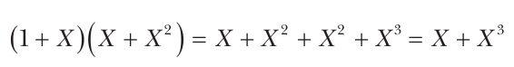

• Đa thức phải thỏa mãn một số tính chất toán học khác không dễ giải thích nếu không dùng các khái niệm toán học không tầm thường, nhưng lại dễ kiểm tra.

> **LƯU Ý** Chu kỳ tối đa của một LFSR n-bit là 2<sup>n</sup>–1, không phải 2<sup>n</sup>, vì state all-zero luôn tự lặp lại chính nó vô hạn. Vì XOR của bất kỳ số lượng số không nào cũng bằng không, các bit mới đi vào state từ feedback function sẽ luôn bằng không; do đó, state all-zero chắc chắn sẽ mãi là toàn số không.

Ví dụ, Hình 5-5 cho thấy một LFSR 4-bit với feedback polynomial 1 + X + X<sup>3</sup> + X<sup>4</sup>, trong đó chúng ta XOR các bit ở vị trí 1, 3 và 4 với nhau để tính bit mới được đặt vào L<sub>1</sub>. Tuy nhiên, đa thức này không primitive vì chúng ta có thể phân tích nó thành (1 + X<sup>3</sup>)(1 + X).

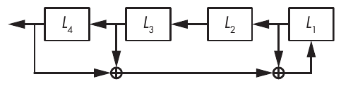

Hình 5-5: Một LFSR với feedback polynomial 1 + X + X<sup>3</sup> + X<sup>4</sup>

Thật vậy, chu kỳ của LFSR trong Hình 5-5 không phải là tối đa. Để chứng minh điều này, hãy bắt đầu từ state 0001:

0 0 0 1

Bây giờ hãy left-shift đi 1 bit và đặt bit mới thành 0 + 0 + 1 = 1:

0 0 1 1

Lặp lại thao tác thêm năm lần nữa cho ra các giá trị state sau:

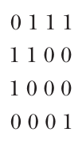

State sau sáu lần cập nhật giống với state ban đầu, cho thấy chúng ta đang ở trong một chu trình period-6 và chứng minh rằng chu kỳ của LFSR không phải là giá trị tối đa 15.

Bây giờ hãy xem một LFSR có chu kỳ tối đa, xét LFSR trong Hình 5-6.

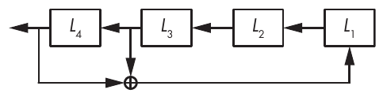

Hình 5-6: Một LFSR với feedback polynomial 1 + X<sup>3</sup> + X<sup>4</sup>, một primitive polynomial, bảo đảm chu kỳ tối đa

Feedback polynomial này là một primitive polynomial được mô tả bởi 1 + X<sup>3</sup> + X<sup>4</sup>, và bạn có thể kiểm chứng rằng chu kỳ của nó là tối đa (cụ thể là 15). Từ một giá trị ban đầu, state thay đổi như sau (từ 0001 sang 0010, 0100, 1001, 0011, v.v.):

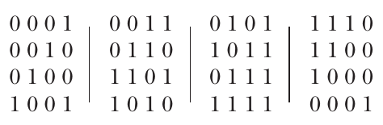

State đi qua mọi giá trị khả dĩ trừ 0000 mà không lặp lại cho đến khi cuối cùng quay vòng. Điều này chứng tỏ rằng chu kỳ là tối đa và feedback polynomial là primitive.

Đáng tiếc là dùng một LFSR làm stream cipher không an toàn. Nếu n là độ dài bit của LFSR, kẻ tấn công chỉ cần n bit đầu ra để khôi phục state ban đầu của LFSR, cho phép họ xác định mọi bit trước đó và đoán mọi bit tương lai. Attack này khả thi vì LFSR là tuyến tính, nghĩa là các quan hệ giữa các bit của state tuân theo các phương trình tuyến tính, vốn dễ giải. Bạn có thể dùng algorithm Berlekamp–Massey để giải các phương trình được định nghĩa bởi cấu trúc toán học của LFSR nhằm tìm ra không chỉ state ban đầu của LFSR mà còn cả feedback polynomial của nó. Thực tế, bạn thậm chí không cần biết độ dài chính xác của LFSR để thành công; bạn có thể lặp lại algorithm Berlekamp–Massey với mọi giá trị khả dĩ của n cho đến khi gặp giá trị đúng.

Điểm mấu chốt là LFSR yếu về mặt cryptography vì chúng tuyến tính. Các bit đầu ra và các bit state ban đầu liên hệ với nhau bằng những phương trình đơn giản và ngắn mà bạn có thể giải bằng các kỹ thuật đại số tuyến tính phổ thông. Để làm LFSR mạnh hơn, hãy thêm một chút tính phi tuyến.

#### Filtered LFSR (Filtered LFSRs)

Để giảm bớt sự không an toàn của LFSR, hãy che giấu tính tuyến tính của chúng bằng cách cho các bit đầu ra đi qua một function phi tuyến trước khi trả về, để tạo ra một filtered LFSR, như Hình 5-7 minh họa.

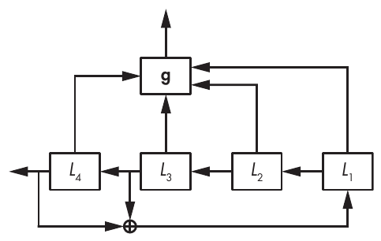

Hình 5-7: Một filtered LFSR

Function g trong Hình 5-7 phải là một function phi tuyến—một function vừa XOR các bit với nhau vừa kết hợp chúng bằng các phép toán logic AND hoặc OR. Ví dụ, L<sub>1</sub>L<sub>2</sub> + L<sub>3</sub>L<sub>4</sub> là một function phi tuyến (tôi đã bỏ dấu nhân, nên L<sub>1</sub>L<sub>2</sub> nghĩa là L<sub>1</sub> × L<sub>2</sub>, hay L<sub>1</sub> & L<sub>2</sub> theo cú pháp C).

> **LƯU Ý** Bạn có thể viết feedback function hoặc trực tiếp theo các bit của FSR, như L<sub>1</sub>L<sub>2</sub> + L<sub>3</sub>L<sub>4</sub>, hoặc dùng ký hiệu đa thức tương đương 1 + XX<sup>2</sup> + X<sup>3</sup>X<sup>4</sup>. Ký hiệu trực tiếp dễ nắm bắt hơn, nhưng ký hiệu đa thức phục vụ tốt hơn cho việc phân tích toán học các tính chất của một FSR. Chúng ta sẽ dùng ký hiệu trực tiếp trừ khi quan tâm đến các tính chất toán học.

Filtered LFSR mạnh hơn LFSR thuần túy vì function phi tuyến của chúng ngăn chặn các attack đơn giản. Dù vậy, những attack phức tạp hơn như sau sẽ phá được hệ thống:

**Algebraic attacks** Giải các hệ phương trình phi tuyến được suy ra từ các bit đầu ra, trong đó các ẩn trong phương trình là các bit từ state của LFSR.

**Cube attacks** Tính đạo hàm của các phương trình phi tuyến để giảm bậc của hệ xuống còn một rồi giải nó hiệu quả như một hệ tuyến tính.

**Fast correlation attacks** Khai thác các filtering function mà dù phi tuyến vẫn có xu hướng hoạt động như các function tuyến tính.

Bài học ở đây, như chúng ta đã thấy trong các ví dụ trước, là Band-Aids không vá được lỗ đạn. Vá một algorithm hỏng bằng một lớp mạnh hơn một chút sẽ không làm cho toàn bộ trở nên an toàn. Bạn phải sửa vấn đề từ gốc.

#### Nonlinear FSR (Nonlinear FSRs)

Nonlinear FSR (NFSR) giống LFSR nhưng có feedback function phi tuyến thay vì tuyến tính. Thay vì chỉ có các phép XOR theo bit, feedback function có thể bao gồm các phép AND và OR theo bit—một đặc điểm có cả ưu lẫn nhược điểm.

Một lợi ích của việc thêm feedback function phi tuyến là chúng làm NFSR mạnh hơn LFSR về mặt cryptography, vì các bit đầu ra phụ thuộc vào secret state ban đầu theo một cách phức tạp, theo các phương trình có kích thước hàm mũ. Function tuyến tính của LFSR giữ cho các quan hệ đơn giản, với tối đa n số hạng (N<sub>1</sub>, N<sub>2</sub>, . . . , N<sub>n</sub>, nếu các N<sub>i</sub> là các bit state của NFSR). Ví dụ, một NFSR 4-bit với secret state ban đầu (N<sub>1</sub>, N<sub>2</sub>, N<sub>3</sub>, N<sub>4</sub>) và feedback function N<sub>1</sub> + N<sub>2</sub> + N<sub>1</sub>N<sub>2</sub> + N<sub>3</sub>N<sub>4</sub> tạo ra bit đầu ra đầu tiên bằng:

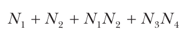

Lần lặp thứ hai thay giá trị N<sub>1</sub> bằng bit mới đó. Biểu diễn bit đầu ra thứ hai theo state ban đầu, chúng ta có phương trình sau:

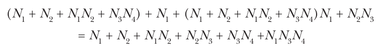

Phương trình mới này có bậc đại số 3 (số bit lớn nhất được nhân với nhau, ở đây là trong N<sub>1</sub>N<sub>3</sub>N<sub>4</sub>) chứ không phải bậc 2 của feedback function, và nó có sáu số hạng thay vì bốn. Kết quả là việc lặp function phi tuyến nhanh chóng tạo ra những phương trình không thể kiểm soát, vì kích thước của đầu ra tăng theo hàm mũ. Dù bạn sẽ không bao giờ tính những phương trình đó khi chạy NFSR, kẻ tấn công phải giải chúng để phá hệ thống.

Một nhược điểm của NFSR là không có cách hiệu quả nào để xác định chu kỳ của một NFSR hay để biết chu kỳ của nó có tối đa hay không. Với một NFSR n bit, bạn cần chạy gần 2<sup>n</sup> lần thử để kiểm chứng rằng chu kỳ của nó là tối đa. Phép tính này là bất khả thi với các NFSR lớn từ 80 bit trở lên.

May thay, có một thủ thuật để dùng NFSR mà không phải lo về chu kỳ ngắn: bạn có thể kết hợp LFSR và NFSR để có được cả chu kỳ tối đa được bảo đảm lẫn độ mạnh cryptography—và đó chính xác là cách Grain-128a hoạt động.

### Grain-128a

Bạn còn nhớ cuộc thi AES được thảo luận trong Chương 4, trong bối cảnh block cipher AES chứ? Stream cipher Grain là sản phẩm của một dự án tương tự gọi là cuộc thi eSTREAM. Cuộc thi này kết thúc vào năm 2008 với một danh sách rút gọn các stream cipher được khuyến nghị, bao gồm bốn cipher hardware-oriented và bốn cipher software-oriented. Grain là một trong các hardware cipher này, và Grain-128a là phiên bản nâng cấp do chính các tác giả ban đầu của Grain thực hiện. Hình 5-8 cho thấy cơ chế hoạt động của Grain-128a.

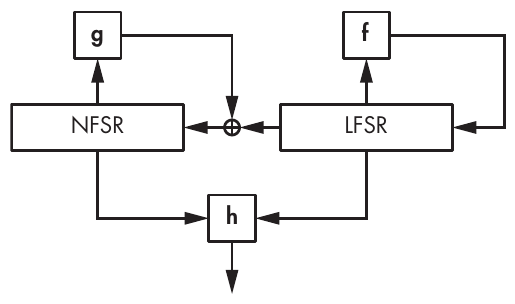

Hình 5-8: Cơ chế của Grain-128a, với một NFSR 128-bit và một LFSR 128-bit

Grain-128a đơn giản đến mức một stream cipher có thể đơn giản, kết hợp một LFSR 128-bit, một NFSR 128-bit và một filter function, h. LFSR có chu kỳ tối đa là 2<sup>128</sup> – 1, bảo đảm rằng chu kỳ của toàn bộ hệ thống ít nhất là 2<sup>128</sup> – 1 để phòng ngừa các chu trình ngắn tiềm ẩn trong NFSR. Đồng thời, NFSR và filter function phi tuyến h bổ sung độ mạnh cryptography.

Grain-128a nhận một key 128-bit và một nonce 96-bit. Nó sao chép 128 bit key vào 128 bit của NFSR và sao chép 96 bit nonce vào 96 bit đầu tiên của LFSR, lấp 32 bit còn lại bằng các số một và một bit không duy nhất ở cuối. Giai đoạn khởi tạo cập nhật toàn bộ hệ thống 256 lần trước khi trả về bit keystream đầu tiên. Do đó, trong quá trình khởi tạo, bit do function h trả về không được xuất ra làm keystream mà thay vào đó đi vào LFSR để bảo đảm rằng state tiếp theo của nó phụ thuộc vào cả key lẫn nonce.

Feedback function LFSR của Grain-128a là

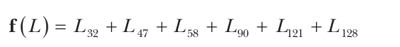

trong đó L<sub>1</sub>, L<sub>2</sub>, . . . , L<sub>128</sub> là các bit của LFSR. Feedback function này chỉ lấy 6 bit từ LFSR 128-bit, nhưng như vậy là đủ để có được một primitive polynomial bảo đảm chu kỳ tối đa. Số bit ít giúp giảm thiểu chi phí của một implementation hardware.

Đây là feedback polynomial của NFSR của Grain-128a (N<sub>1</sub>, . . . , N<sub>128</sub>):

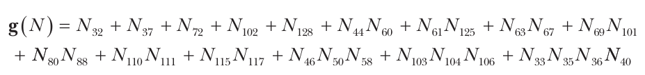

Function này được chọn cẩn thận để tối đa hóa độ mạnh cryptography đồng thời tối thiểu hóa chi phí triển khai. Nó có bậc đại số 4 vì số hạng có nhiều biến nhất của nó có bốn biến (cụ thể là N<sub>33</sub>N<sub>35</sub>N<sub>36</sub>N<sub>40</sub>). Hơn nữa, g không thể được xấp xỉ bằng một function tuyến tính vì nó phi tuyến ở mức cao. Ngoài ra, bên cạnh g, Grain-128a XOR bit đi ra từ LFSR để đưa kết quả trở lại làm bit mới ngoài cùng bên phải của NFSR.

Filter function h là một function phi tuyến khác; nó lấy 9 bit từ NFSR và 7 bit từ LFSR rồi kết hợp chúng theo cách bảo đảm các tính chất cryptography tốt.

Tại thời điểm tôi viết những dòng này, chưa có attack nào được biết đến nhắm vào Grain-128a, và tôi tin rằng nó sẽ vẫn an toàn. Grain-128a được dùng trong một số embedded system low-end cần một stream cipher nhỏ gọn và nhanh—thường là các hệ thống công nghiệp độc quyền—đó là lý do Grain-128a ít được biết đến trong cộng đồng phần mềm nguồn mở.

### A5/1

A5/1 là một stream cipher từng được dùng để mã hóa liên lạc thoại trong tiêu chuẩn di động 2G. Tiêu chuẩn A5/1 được tạo ra năm 1987 nhưng chỉ được công bố vào cuối những năm 1990 sau khi bị reverse engineering. Các attack xuất hiện vào đầu những năm 2000, và A5/1 cuối cùng đã bị phá theo cách cho phép giải mã các cuộc liên lạc đã mã hóa trên thực tế (chứ không phải trên lý thuyết). Hãy xem vì sao và như thế nào.

#### Cơ chế của A5/1

Như Hình 5-9 cho thấy, A5/1 dựa vào ba LFSR và dùng một thủ thuật thoạt nhìn có vẻ thông minh nhưng thực ra không an toàn.

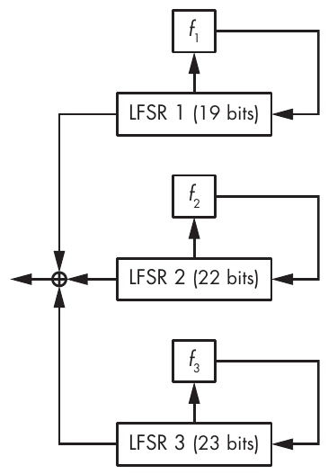

Hình 5-9: Cipher A5/1

A5/1 dùng các LFSR 19, 22 và 23 bit, với các đa thức cho mỗi LFSR như sau:

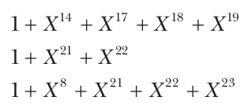

Làm sao điều này có thể được coi là an toàn khi chỉ có LFSR mà không có NFSR? Thủ thuật nằm ở cơ chế cập nhật của A5/1. Thay vì cập nhật cả ba LFSR ở mỗi chu kỳ clock, những người thiết kế A5/1 đã thêm một quy tắc clocking thực hiện như sau:

1. Kiểm tra giá trị của bit thứ 9 của LFSR 1, bit thứ 11 của LFSR 2 và bit thứ 11 của LFSR 3, gọi là các clocking bit. Trong 3 bit đó, hoặc cả ba có cùng giá trị (1 hoặc 0), hoặc có hai bit có cùng giá trị.

2. Clock các register có clocking bit bằng giá trị đa số, 0 hoặc 1. Ở mỗi lần cập nhật, hoặc hai hoặc ba LFSR được clock.

Nếu không có quy tắc này, A5/1 sẽ không cung cấp bất kỳ security nào, và bỏ qua quy tắc này là đủ để phá cipher. Tuy nhiên, nói thì dễ hơn làm, như bạn sẽ thấy.

> **LƯU Ý** Trong quy tắc clocking không đều của A5/1, mỗi register được clock với xác suất 3/4 ở bất kỳ lần cập nhật nào. Cụ thể, xác suất để ít nhất một register khác có cùng giá trị bit là 1 – (1/2)<sup>2</sup>, trong đó (1/2)<sup>2</sup> là khả năng cả hai register còn lại đều có giá trị bit khác.

Truyền thông 2G dùng A5/1 với một key 64 bit và một nonce 22-bit, thay đổi cho mỗi data frame mới. Cơ chế khởi tạo của A5/1 trước tiên đặt mọi register về không và đưa key, tiếp theo là nonce, vào từng register theo từng bit, và sau khi mỗi bit được đưa vào, các register được cập nhật. Sau đó, hệ thống được cập nhật 100 lần theo quy tắc không đều đã mô tả trước đó.

Các attack nhắm vào A5/1 khôi phục state ban đầu 64-bit của hệ thống (giá trị ban đầu của các LFSR 19 + 22 + 23), qua đó để lộ nonce (nếu nó chưa được biết) và key, bằng cách tháo ngược cơ chế khởi tạo. Các attack này là known-plaintext attack (KPA) vì một phần dữ liệu được mã hóa đã được biết, cho phép kẻ tấn công xác định các phần keystream tương ứng bằng cách XOR ciphertext với các mẩu plaintext đã biết.

Có hai loại attack chính nhắm vào A5/1:

**Subtle attacks (tấn công tinh vi)** Khai thác tính tuyến tính bên trong của A5/1 và hệ thống clocking không đều đơn giản của nó.

**Brutal attacks (tấn công thô bạo)** Chỉ khai thác key ngắn của A5/1 và tính khả nghịch của việc đưa frame number vào.

Hãy xem các attack này hoạt động như thế nào.

#### Subtle attack (Subtle Attacks)

Chúng ta sẽ xem xét subtle attack guess-and-determine. Trong loại attack này, kẻ tấn công đoán một số giá trị bí mật nhất định của state để xác định các giá trị khác. Trong cryptanalysis, “đoán” nghĩa là brute-forcing: với mỗi giá trị khả dĩ của LFSR 1 và 2 và mọi giá trị khả dĩ của clocking bit của LFSR 3 trong 11 lần clock đầu tiên, attack tái dựng các bit của LFSR 3 bằng cách giải các phương trình phụ thuộc vào các bit đã đoán. Khi đoán đúng, kẻ tấn công nhận được giá trị đúng cho LFSR 3.

Pseudocode của attack trông như sau:

<pre>
For all 2<sup>19</sup> values of LFSR 1's initial state
    For all 2<sup>22</sup> values of LFSR 2's initial state
        For all 2<sup>11</sup> values of LFSR 3's clocking bit during the first 11 clocks
            Reconstruct LFSR 3's initial state
            Test whether guess is correct; if yes, return; else continue
</pre>

Attack này hiệu quả đến mức nào so với brute-force search 2<sup>64</sup>-trial đã thảo luận trong Chương 3? Attack này thực hiện tối đa 2<sup>19</sup> × 2<sup>22</sup> × 2<sup>11</sup> = 2<sup>52</sup> phép toán trong trường hợp xấu nhất, khi algorithm chỉ thành công ở lần thử cuối cùng. Như vậy nhanh hơn brute-force search 2<sup>12</sup> (tức khoảng 4,000) lần, giả sử rằng hai thao tác cuối trong pseudocode trên cần khối lượng tính toán xấp xỉ như việc thử một key 64-bit trong brute-force search. Nhưng giả định này có đúng không?

Hãy nhớ lại phần thảo luận về full attack cost trong Chương 3. Khi đánh giá chi phí của một attack, chúng ta cần xét không chỉ khối lượng tính toán cần thiết để thực hiện attack mà còn cả parallelism và mức tiêu thụ memory. Ở đây, cả hai đều không phải là vấn đề: như mọi brute-force attack, attack guess-and-determine là embarrassingly parallel (tức nhanh hơn N lần khi chạy trên N core) và không cần nhiều memory hơn việc chỉ chạy chính cipher.

Ước tính chi phí attack 2<sup>52</sup> của chúng ta còn thiếu chính xác vì một lý do khác. Thực tế, mỗi phép toán trong 2<sup>52</sup> phép toán (thử một key ứng viên) mất khoảng gấp bốn lần số chu kỳ clock so với việc thử một key trong brute-force attack. Kết cục là chi phí thực của attack cụ thể này gần với 4 × 2<sup>52</sup> = 2<sup>54</sup> phép toán khi so với một brute-force attack.

Attack guess-and-determine nhắm vào A5/1 có thể giải mã các cuộc liên lạc di động đã mã hóa, nhưng nó mất vài giờ để khôi phục key khi chạy trên một cluster gồm các thiết bị hardware chuyên dụng. Nói cách khác, nó còn rất xa mới đạt đến mức giải mã real-time. Để làm được điều đó, chúng ta có một loại attack khác.

#### Brutal attack (Brutal Attacks)

Brutal attack nhắm vào A5/1 chính là time-memory trade-off (TMTO) attack. Attack này không quan tâm đến phần bên trong của A5/1; nó chỉ quan tâm rằng state của nó dài 64 bit. TMTO attack xem A5/1 như một hộp đen nhận vào một giá trị 64-bit (state) và nhả ra một giá trị 64-bit (64 bit keystream đầu tiên).

Ý tưởng đằng sau attack là giảm chi phí của brute-force search để đổi lấy việc dùng rất nhiều memory. Loại TMTO đơn giản nhất là một dạng codebook attack, trong đó bạn tính trước một bảng 2<sup>64</sup> phần tử chứa tổ hợp các cặp key và value (key:value) và lưu giá trị đầu ra cho mỗi key trong số 2<sup>64</sup> key khả dĩ. Để dùng bảng tính trước này cho attack, chỉ cần thu thập đầu ra của một instance A5/1 rồi tra trong bảng xem key nào tương ứng với đầu ra đó. Bản thân attack rất nhanh—chỉ mất lượng thời gian cần để tra một giá trị trong memory—nhưng việc tạo bảng cần 2<sup>64</sup> lần tính A5/1. Tệ hơn, codebook attack đòi hỏi một lượng memory điên rồ: 2<sup>64</sup> × (64 + 64) bit, tức là 2<sup>68</sup> byte hay 256 exabyte. Đó là hàng chục trung tâm dữ liệu, nên chúng ta có thể quên chuyện đó đi.

TMTO attack giảm yêu cầu memory của codebook attack với cái giá là tăng khối lượng tính toán trong giai đoạn online của attack. Bảng càng nhỏ thì càng cần nhiều phép tính để bẻ một key. Dù sao thì việc chuẩn bị bảng tốn khoảng 2<sup>64</sup> phép toán, nhưng việc đó chỉ cần làm một lần.

Năm 2010, các nhà nghiên cứu đã mất khoảng hai tháng để tạo ra lượng bảng cỡ hai terabyte, dùng các bộ xử lý đồ họa (GPU) và chạy 100,000 instance A5/1 song song. Với sự giúp đỡ của những bảng lớn như vậy, các cuộc gọi được mã hóa bằng A5/1 có thể được giải mã gần như real time. Các nhà mạng viễn thông đã triển khai các biện pháp tạm thời để giảm thiểu attack, nhưng giải pháp thực sự đến cùng các tiêu chuẩn điện thoại di động 3G và 4G, vốn đã bỏ hẳn A5/1.

## Các stream cipher Software-Oriented

Software stream cipher làm việc với byte hoặc word 32- hoặc 64-bit thay vì từng bit riêng lẻ, điều này tỏ ra hiệu quả hơn trên các CPU hiện đại, nơi các instruction có thể thực hiện các phép toán số học trên một word trong cùng khoảng thời gian như trên một bit. Vì vậy, software stream cipher phù hợp hơn hardware cipher cho các server hoặc trình duyệt chạy trên máy tính cá nhân, nơi các bộ xử lý general-purpose mạnh mẽ chạy cipher như software native.

Ngày nay, software stream cipher được quan tâm đáng kể vì một vài lý do. Thứ nhất, vì nhiều thiết bị tích hợp CPU mạnh và hardware đã trở nên rẻ hơn, nhu cầu về các cipher bit-oriented nhỏ đã giảm đi. Ví dụ, hai stream cipher trong tiêu chuẩn truyền thông di động 4G (SNOW3G của châu Âu và ZUC của Trung Quốc) làm việc với word 32-bit chứ không phải bit, khác với A5/1 cũ hơn.

Thứ hai, stream cipher đã trở nên phổ biến hơn trong software trên sự mất mát của block cipher, đặc biệt sau thất bại của padding oracle attack nhắm vào block cipher ở CBC mode. Ngoài ra, stream cipher dễ đặc tả và triển khai hơn block cipher: thay vì trộn bit message và bit key với nhau, stream cipher chỉ hấp thụ các bit key như một bí mật. Thực tế, một trong những stream cipher phổ biến nhất thực ra là một block cipher đội lốt: AES ở counter mode (CTR).

Một thiết kế software stream cipher, được dùng bởi SNOW3G và ZUC, sao chép hardware cipher và các FSR của chúng, thay bit bằng byte hoặc word. Nhưng đây không phải là những thiết kế thú vị nhất đối với một cryptographer. Tại thời điểm viết sách này, hai thiết kế được quan tâm nhất là RC4 và Salsa20, được dùng trong rất nhiều hệ thống, dù thực tế là một trong hai đã bị phá hoàn toàn.

### RC4

Được Ron Rivest của RSA Security thiết kế năm 1987 rồi bị reverse engineering và rò rỉ năm 1994, RC4 từ lâu đã là stream cipher được dùng rộng rãi nhất. RC4 đã được dùng trong vô số ứng dụng, nổi tiếng nhất là trong tiêu chuẩn mã hóa Wi-Fi đầu tiên Wired Equivalent Privacy (WEP) và trong protocol Transport Layer Security (TLS) được dùng để thiết lập kết nối HTTPS. Đáng tiếc là RC4 không đủ an toàn cho phần lớn ứng dụng, kể cả WEP và TLS. Để hiểu vì sao, hãy xem RC4 hoạt động như thế nào.

#### RC4 hoạt động như thế nào (How RC4 Works)

RC4 là một trong những cipher đơn giản nhất từng được tạo ra. Nó không thực hiện bất kỳ phép toán crypto-like nào, và nó không có XOR, không có phép nhân, không có S-boxes . . . chẳng có gì cả (nada). Nó chỉ đơn giản hoán đổi các byte. Internal state của RC4 là một mảng, S, gồm 256 byte, ban đầu được đặt là S[0] = 0, S[1] = 1, S[2] = 2, . . . , S[255] = 255, rồi được khởi tạo từ một K n-byte bằng key scheduling algorithm (KSA) của nó, hoạt động như trong code Python ở Listing 5-1.

```
j = 0
# Set S to the array S[0] = 0, S[1] = 1, ..., S[255] = 255.
S = range(256)
# Iterate over i from 0 to 255.
for i in range(256):
    # Compute the sum of v.
    j = (j + S[i] + K[i % n]) % 256
    # Swap S[i] and S[j].
    S[i], S[j] = S[j], S[i]
```

Listing 5-1: Key scheduling algorithm của RC4

Khi algorithm này hoàn tất, mảng S vẫn chứa mọi giá trị byte từ 0 đến 255 nhưng giờ theo một thứ tự random-looking. Ví dụ, với key 128-bit all-zero, state S (từ S[0] đến S[255]) trở thành:

0, 35, 3, 43, 9, 11, 65, 229, (. . .), 233, 169, 117, 184, 31, 39

Tuy nhiên, nếu tôi lật bit key đầu tiên và chạy lại KSA, tôi nhận được một state hoàn toàn khác, có vẻ ngẫu nhiên:

32, 116, 131, 134, 138, 143, 149, (. . .), 152, 235, 111, 48, 80, 12

Với state ban đầu S, RC4 tạo ra một keystream, KS, có cùng độ dài với plaintext, P, để tính ciphertext: C = P ⊕ KS. Các byte của keystream KS được tính từ S theo code Python trong Listing 5-2, nếu P dài m byte.

```
i = 0
j = 0
for b in range(m):
    i = (i + 1) % 256
    j = (j + S[i]) % 256
    S[i], S[j] = S[j], S[i]
    KS[b] = S[(S[i] + S[j]) % 256]
```

Listing 5-2: Việc tạo keystream của RC4, trong đó S là state được khởi tạo trong Listing 5-1

Trong Listing 5-2, mỗi lần lặp của vòng for sửa đổi tối đa 2 byte của internal state S của RC4: S[i] và S[j] có giá trị bị hoán đổi. Tức là, nếu i = 0 và j = 4 và nếu S[0] = 56 và S[4] = 78, thì thao tác swap đặt S[0] thành 78 và S[4] thành 56. Nếu j bằng i, thì S[i] không bị sửa đổi.

Điều này trông quá đơn giản để có thể an toàn, nhưng các cryptanalyst đã mất 20 năm mới tìm ra những lỗi có thể khai thác. Trước khi các lỗi được tiết lộ, chúng ta chỉ biết điểm yếu của RC4 trong các implementation cụ thể, như trong tiêu chuẩn mã hóa Wi-Fi đầu tiên, WEP.

#### RC4 trong WEP (RC4 in WEP)

WEP, security protocol Wi-Fi first-generation, giờ đã bị phá hoàn toàn do những điểm yếu trong thiết kế của protocol và trong RC4.

Trong implementation WEP, RC4 mã hóa dữ liệu payload của các frame 802.11, tức các datagram (hay packet) truyền dữ liệu qua mạng không dây. Mọi payload được gửi trong cùng một session đều dùng cùng một secret key 40 hoặc 104 bit nhưng có một nonce 3-byte được cho là duy nhất, được mã hóa trong frame header (phần của frame mã hóa metadata và đứng trước payload thực sự).

Vấn đề là RC4 không hỗ trợ nonce, ít nhất là không có trong đặc tả chính thức của nó, và chúng ta không thể dùng một stream cipher mà không có nonce. Những người thiết kế WEP đã xử lý hạn chế này bằng một cách lách: họ đưa một nonce 24-bit vào header của frame không dây và nối nó vào trước WEP key để dùng làm secret key của RC4. Tức là, nếu nonce là các byte N[0], N[1], N[2] và WEP key là K[0], K[1], K[2], K[3], K[4], thì RC4 key thực sự là N[0], N[1], N[2], K[0], K[1], K[2], K[3], K[4]. Hiệu ứng thực tế là các secret key 40-bit cho ra các key hiệu dụng 64-bit, và các key 104-bit cho ra các key hiệu dụng 128-bit. Kết quả là gì? Protocol WEP 128-bit được quảng cáo thực ra chỉ cung cấp tốt nhất là security 104-bit.

Nhưng đây mới là những vấn đề thực sự với thủ thuật nonce của WEP:

**Nonce quá nhỏ, chỉ có 24 bit** Điều này có nghĩa là nếu một nonce được chọn ngẫu nhiên cho mỗi message mới, bạn chỉ phải chờ khoảng 2<sup>24/2</sup> = 2<sup>12</sup> packet, tức lượng traffic cỡ vài megabyte, cho đến khi tìm được hai packet được mã hóa với cùng một nonce và do đó cùng một keystream. Ngay cả khi nonce là một counter chạy từ 0 đến 2<sup>24</sup> – 1, chỉ cần lượng dữ liệu cỡ vài gigabyte cho đến khi xảy ra quay vòng (rollover), lúc nonce bị lặp lại có thể cho phép kẻ tấn công giải mã các packet. Nhưng còn một vấn đề lớn hơn.

**Kết hợp nonce và key theo cách này giúp khôi phục key** Ba byte nonce không bí mật của WEP cho phép kẻ tấn công xác định giá trị của S sau ba lần lặp của key scheduling algorithm. Vì điều này, các cryptanalyst đã phát hiện rằng byte keystream đầu tiên phụ thuộc mạnh vào byte secret key đầu tiên—byte thứ tư được KSA hấp thụ—và độ lệch này có thể bị khai thác để khôi phục secret key.

Khai thác những điểm yếu đó đòi hỏi quyền truy cập vào cả ciphertext lẫn keystream—tức là known plaintext hoặc chosen plaintext. Nhưng điều đó đủ dễ: known plaintext xuất hiện khi các frame Wi-Fi đóng gói dữ liệu có header đã biết, và chosen plaintext xuất hiện khi kẻ tấn công đưa vào plaintext đã biết được mã hóa bằng key mục tiêu. Kết cục là các attack hoạt động được trong thực tế, chứ không chỉ trên giấy.

Sau khi những attack đầu tiên nhắm vào WEP xuất hiện năm 2001, các nhà nghiên cứu đã tìm ra những attack nhanh hơn, cần ít ciphertext hơn. Ngày nay, bạn thậm chí có thể tìm thấy các công cụ như aircrack-ng triển khai toàn bộ attack, từ việc nghe lén mạng (network sniffing) đến cryptanalysis.

Sự không an toàn của WEP là do cả những điểm yếu trong RC4, vốn nhận một key one-use duy nhất thay vì một key và một nonce (như ở bất kỳ stream cipher tử tế nào), lẫn những điểm yếu trong chính thiết kế của WEP.

Bây giờ hãy xem thất bại lớn thứ hai của RC4.

#### RC4 trong TLS (RC4 in TLS)

TLS là security protocol quan trọng nhất duy nhất được dùng trên internet. Nó được biết đến nhiều nhất vì là nền tảng của các kết nối HTTPS, nhưng nó cũng được dùng để bảo vệ một số kết nối virtual private network (VPN), cũng như email server, ứng dụng di động và nhiều thứ khác. Và đáng buồn là TLS đã hỗ trợ RC4 trong một thời gian dài.

Khác với WEP, implementation TLS không mắc phải sai lầm trắng trợn tương tự là sửa đổi đặc tả RC4 để dùng một nonce công khai. Thay vào đó, TLS chỉ cung cấp cho RC4 một session key 128-bit duy nhất, nghĩa là nó bị phá ít hơn WEP một chút.

Điểm yếu trong TLS chỉ do RC4 và những lỗi không thể tha thứ của nó: các độ lệch thống kê, hay sự không ngẫu nhiên, mà chúng ta biết là một deal-breaker hoàn toàn đối với một stream cipher. Ví dụ, byte keystream thứ hai do RC4 tạo ra bằng không với xác suất 1/128, trong khi lý tưởng nhất nó phải là 1/256. (Hãy nhớ rằng một byte có thể nhận 256 giá trị từ 0 đến 255; do đó, một byte thực sự ngẫu nhiên bằng không với khả năng 1/256.) Điên rồ hơn nữa là việc phần lớn chuyên gia vẫn tiếp tục tin tưởng RC4 cho đến tận năm 2013, dù các độ lệch thống kê của nó đã được biết đến từ năm 2001.

Các độ lệch thống kê đã biết của RC4 lẽ ra đã đủ để bỏ hẳn cipher này, ngay cả khi chúng ta chưa biết cách khai thác các độ lệch đó để xâm phạm các ứng dụng thực tế. Trong TLS, các lỗi của RC4 không bị khai thác công khai cho đến năm 2011, nhưng NSA được cho là đã khai thác được các điểm yếu của RC4 để xâm phạm các kết nối RC4 của TLS từ trước đó rất lâu.

Hóa ra không chỉ byte keystream thứ hai của RC4 bị lệch, mà cả 256 byte đầu tiên cũng đều bị lệch. Năm 2011, các nhà nghiên cứu phát hiện rằng xác suất để một trong những byte đó bằng không là 1/256 + c/256<sup>2</sup> với một hằng số nào đó, c, nhận giá trị giữa 0.24 và 1.34. Không chỉ với giá trị byte không mà với cả các giá trị byte khác. Điều đáng kinh ngạc ở RC4 là nó thất bại ở chỗ mà ngay cả nhiều PRNG noncryptographic cũng thành công—cụ thể là tạo ra các byte pseudorandom có phân phối đều (tức là mỗi giá trị trong số 256 byte đều có khả năng xuất hiện 1/256).

Implementation TLS có lỗi của RC4 thậm chí có thể bị khai thác trong attack model yếu nhất, chosen-ciphertext: bạn thu thập các ciphertext và tìm plaintext, chứ không phải key. Nhưng có một điểm cần lưu ý: bạn sẽ cần rất nhiều ciphertext, mã hóa cùng một plaintext nhiều lần bằng các secret key khác nhau. Đôi khi chúng ta gọi attack model này là broadcast model vì nó giống như việc phát cùng một message tới nhiều người nhận.

Giả sử bạn muốn giải mã byte plaintext P<sub>1</sub> của một plaintext P khi có nhiều byte ciphertext thu được bằng cách chặn các ciphertext khác nhau của cùng một message. Như vậy, bạn sẽ có được các byte đầu tiên của mỗi ciphertext trong bốn ciphertext C<sup>1</sup>, . . . , C<sup>4</sup>, với bốn keystream KS<sup>1</sup>, . . . , KS<sup>4</sup> sao cho:

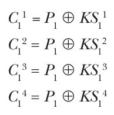

Vì độ lệch của RC4, các byte keystream KS<sub>1</sub><sup>i</sup> (byte đầu tiên trong mỗi instance trong bốn instance) có khả năng bằng không cao hơn bất kỳ giá trị byte nào khác. Do đó, các byte C<sub>1</sub><sup>i</sup> có khả năng bằng P<sub>1</sub> cao hơn bất kỳ giá trị nào khác. Để xác định P<sub>1</sub> khi có các byte C<sub>1</sub><sup>i</sup>, chỉ cần đếm số lần xuất hiện của mỗi giá trị byte và trả về giá trị xuất hiện nhiều nhất làm P<sub>1</sub>. Tuy nhiên, vì độ lệch thống kê rất nhỏ, bạn cần hàng triệu giá trị để có được kết quả đúng với mức độ chắc chắn nào đó.

Attack tổng quát hóa được để khôi phục nhiều hơn một byte plaintext và để khai thác nhiều hơn một giá trị bị lệch (ở đây là không). Algorithm chỉ trở nên phức tạp hơn một chút. Tuy nhiên, attack này khó áp dụng vào thực tế vì nó cần thu thập rất nhiều ciphertext mã hóa cùng một plaintext nhưng dùng các key khác nhau. Ví dụ, attack không thể phá mọi kết nối TLS-protected dùng RC4, vì bạn cần lừa server mã hóa cùng một plaintext tới nhiều người nhận khác nhau, hoặc nhiều lần tới cùng một người nhận với các key khác nhau.

### Salsa20

Salsa20 là một cipher software-oriented đơn giản, được tối ưu cho các CPU hiện đại, đã được triển khai trong rất nhiều protocol và thư viện, cùng với biến thể của nó, ChaCha. Người thiết kế nó, cryptographer đáng kính Daniel J. Bernstein, đã nộp Salsa20 vào cuộc thi eSTREAM năm 2005 và giành được một vị trí trong danh mục software của eSTREAM. Sự đơn giản và tốc độ của Salsa20 đã khiến nó được các developer ưa chuộng.

Salsa20 là một stream cipher counter-based—nó tạo keystream bằng cách xử lý lặp đi lặp lại một counter được tăng lên cho mỗi block. Như Hình 5-10 cho thấy, core algorithm của Salsa20 biến đổi một block 512-bit bằng một key (K), một nonce (N) và một giá trị counter (Ctr). Sau đó, Salsa20 cộng kết quả vào giá trị ban đầu của block để tạo ra một keystream block. (Nếu algorithm trả về trực tiếp permutation của core làm đầu ra, Salsa20 sẽ hoàn toàn không an toàn vì nó có thể bị đảo ngược. Phép cộng cuối cùng với secret state ban đầu K || N || Ctr làm cho phép biến đổi key-to-keystream-block không khả nghịch.)

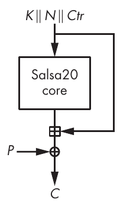

Hình 5-10: Encryption scheme của Salsa20 cho một plaintext block 512-bit

#### Dùng Quarter-Round Function

Core permutation của Salsa20 dùng một function gọi là quarter-round (QR), biến đổi bốn word 32-bit (a, b, c và d) như sau:

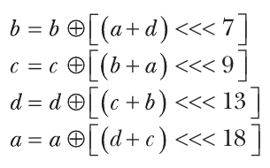

Chúng ta tính bốn dòng này từ trên xuống dưới, nghĩa là giá trị mới của b phụ thuộc vào a và d, giá trị mới của c phụ thuộc vào a và giá trị mới của b (và do đó cả d), v.v.

Phép toán <<< là phép xoay trái (left-rotation) theo word đi số bit được chỉ định, có thể là bất kỳ giá trị nào từ 1 đến 31 (với word 32-bit). Ví dụ, <<< 8 xoay các bit của một word đi tám vị trí về phía trái, như các ví dụ sau cho thấy:

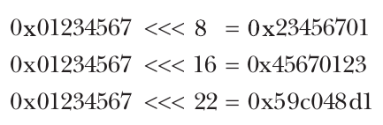

#### Biến đổi state 512-Bit của Salsa20

Core permutation của Salsa20 biến đổi một internal state 512-bit được xem như một mảng 4×4 các word 32-bit. Hình 5-11 cho thấy state ban đầu, dùng một key gồm tám word (256 bit), một nonce gồm hai word (64 bit), một counter gồm hai word (64 bit), và bốn word hằng số cố định (128 bit) giống nhau cho mọi lần encryption/decryption và mọi block.

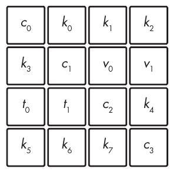

Hình 5-11: Việc khởi tạo state của Salsa20

Để biến đổi state 512-bit ban đầu, trước tiên Salsa20 áp dụng phép biến đổi QR cho cả bốn cột một cách độc lập (được gọi là column-round) và sau đó cho cả bốn hàng một cách độc lập (row-round), như Hình 5-12 minh họa. Chuỗi column-round/row-round là một double-round. Salsa20 lặp lại 10 double-rounds, tổng cộng 20 round, đó là lý do có số 20 trong tên Salsa20.

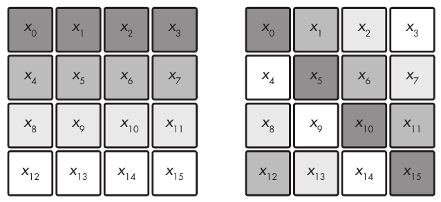

Hình 5-12: Các cột và hàng được biến đổi bởi function quarter-round (QR) của Salsa20

Bốn cột được column-round biến đổi như sau:

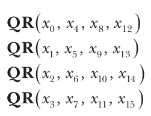

Các hàng được row-round biến đổi bằng cách thực hiện như sau:

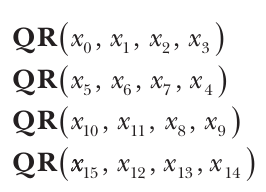

Trong một column-round, mỗi QR nhận các đối số x<sub>i</sub> được sắp xếp từ dòng trên cùng xuống dòng dưới cùng, trong khi QR của một row-round nhận đối số đầu tiên là các word trên đường chéo (như trong mảng bên phải của Hình 5-12) thay vì các word từ cột đầu tiên.

#### Đánh giá Salsa20 (Evaluating Salsa20)

Listing 5-3 cho thấy các state ban đầu của Salsa20 cho block thứ nhất và thứ hai khi được khởi tạo với một key all-zero (các byte 00) và một nonce all-one (các byte ff). Hai state này chỉ khác nhau 1 bit, ở counter, được in đậm: cụ thể là 0 cho block thứ nhất và 1 cho block thứ hai.

```
61707865 00000000 00000000 00000000      61707865 00000000 00000000 00000000
00000000 3320646e ffffffff ffffffff      00000000 3320646e ffffffff ffffffff
00000000 00000000 79622d32 00000000      00000001 00000000 79622d32 00000000
00000000 00000000 00000000 6b206574      00000000 00000000 00000000 6b206574
```

Listing 5-3: Các state ban đầu của Salsa20 cho hai block đầu tiên với một key all-zero và một nonce all-one

Thế nhưng, dù chỉ có một khác biệt 1-bit, các internal state tương ứng sau 10 double-rounds lại hoàn toàn khác nhau, như Listing 5-4 cho thấy.

```
e98680bc f730ba7a 38663ce0 5f376d93      1ba4d492 c14270c3 9fb05306 ff808c64
85683b75 a56ca873 26501592 64144b6d      b49a4100 f5d8fbbd 614234a0 e20663d1
6dcb46fd 58178f93 8cf54cfe cfdc27d7      12e1e116 6a61bc8f 86f01bcb 2efead4a
68bbe09e 17b403a1 38aa1f27 54323fe0      77775a13 d17b99d5 eb773f5b 2c3a5e7d
```

Listing 5-4: Các state từ Listing 5-3 sau 10 double-rounds của Salsa20

Nhưng hãy nhớ rằng, dù các giá trị word trong keystream block có thể trông ngẫu nhiên, điều đó còn xa mới là một bảo đảm về security. Đầu ra của RC4 trông ngẫu nhiên, nhưng nó có những độ lệch trắng trợn. May thay, Salsa20 an toàn hơn RC4 nhiều và không có độ lệch thống kê. Tuy nhiên, hãy nhớ rằng ngay cả khi các keystream không thể phân biệt về mặt thống kê với các byte hoàn toàn ngẫu nhiên, điều này vẫn không đủ để đạt được cryptographic security.

#### Tìm hiểu differential cryptanalysis (Learning Differential Cryptanalysis)

Để chứng tỏ vì sao Salsa20 an toàn hơn RC4, hãy xem những điều cơ bản của differential cryptanalysis, ngành nghiên cứu sự khác biệt giữa các state chứ không phải giá trị thực của chúng. Ví dụ, hai state ban đầu trong Listing 5-3 khác nhau 1 bit ở counter, tức là ở word x<sub>8</sub> trong mảng state của Salsa20. Mảng sau đây cho thấy sự khác biệt theo bit giữa hai state này:

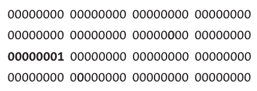

Sự khác biệt giữa hai state thực ra là XOR của các state này. Bit 1 in đậm tương ứng với một khác biệt 1-bit giữa hai state. Trong XOR của hai state, mọi bit khác không đều chỉ ra sự khác biệt.

Để thấy các thay đổi trong state ban đầu lan truyền nhanh đến mức nào do core algorithm của Salsa20, hãy xem sự khác biệt giữa hai state qua các lần lặp round. Sau một round, sự khác biệt lan truyền qua cột thứ nhất tới hai trong số ba word còn lại trong cột đó:

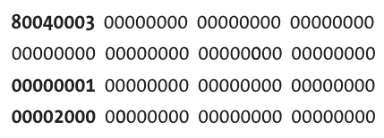

Sau hai round, các khác biệt tiếp tục lan truyền qua các hàng đã có một khác biệt, tức là tất cả trừ hàng thứ hai. Tại thời điểm này, các khác biệt giữa các state còn khá thưa; không có nhiều bit bị thay đổi trong một word:

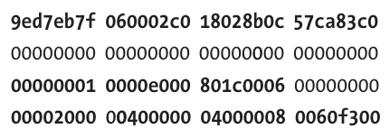

Sau ba round, các khác biệt giữa các state trở nên dày đặc hơn, dù có nhiều nibble bằng không cho thấy nhiều vị trí bit vẫn chưa bị ảnh hưởng bởi khác biệt ban đầu:

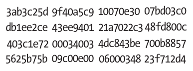

Sau bốn round, các khác biệt trông ngẫu nhiên đối với một người quan sát, và về mặt thống kê chúng cũng gần như ngẫu nhiên:

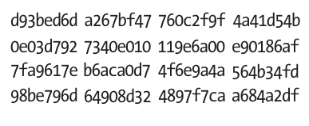

Chỉ sau bốn round, một khác biệt duy nhất đã lan truyền tới phần lớn các bit trong state 512-bit. Trong cryptography, chúng ta gọi đây là full diffusion.

Các khác biệt không chỉ lan truyền qua mọi state, mà chúng còn làm vậy theo những phương trình phức tạp khiến các khác biệt trong tương lai khó đoán, vì các quan hệ phi tuyến mạnh chi phối sự tiến triển của state, nhờ sự pha trộn giữa XOR, phép cộng và phép xoay. Nếu chỉ dùng XOR, chúng ta vẫn sẽ có nhiều khác biệt lan truyền, nhưng quá trình sẽ là tuyến tính và do đó không an toàn.

#### Tấn công Salsa20/8

Salsa20 mặc định thực hiện 20 round, nhưng đôi khi chúng ta dùng nó chỉ với 12 round, trong một phiên bản gọi là Salsa20/12, để làm nó nhanh hơn. Dù Salsa20/12 dùng ít hơn Salsa20 tám round, trong thực tế nó đáng tin cậy như phiên bản 20-round, theo tiến bộ nghiên cứu state-of-the-art. Ngay cả Salsa20/8, chỉ với tám round, cũng được biết là chỉ yếu hơn về mặt lý thuyết nhưng vững chắc như Salsa20 trong thực tế.

Phá Salsa20 lý tưởng phải tốn 2<sup>256</sup> phép toán, nhờ việc dùng key 256-bit. Nếu ai đó có thể khôi phục key bằng cách thực hiện ít hơn 2<sup>256</sup> phép toán, thì về lý thuyết cipher đã bị phá. Đó chính xác là trường hợp của Salsa20/8.

Attack nhắm vào Salsa20/8 (được công bố trong bài báo năm 2008 “New Features of Latin Dances: Analysis of Salsa, ChaCha, and Rumba”, mà tôi là một đồng tác giả và nhờ nó chúng tôi đã giành được một giải thưởng cryptanalysis từ Daniel J. Bernstein) khai thác một độ lệch thống kê trong core algorithm của Salsa sau bốn round để khôi phục key của Salsa20 eight-round. Trên thực tế, đây phần lớn là một attack lý thuyết: chúng tôi ước tính độ phức tạp của nó là 2<sup>251</sup> phép toán của core function—không khả thi, giống như bất kỳ phép tính nào cỡ, chẳng hạn, 2<sup>100</sup> phép toán trở lên, nhưng ít không khả thi hơn so với việc phá độ phức tạp 2<sup>256</sup> được kỳ vọng.

Attack khai thác không chỉ một độ lệch qua bốn round đầu của Salsa20/8 mà còn một tính chất của bốn round cuối: khi biết nonce, N, và counter, Ctr (xem Hình 5-10), giá trị duy nhất cần để đảo ngược phép tính từ keystream về state ban đầu là key, K. Nhưng như Hình 5-13 cho thấy, nếu bạn chỉ biết một phần nào đó của K, bạn có thể đảo ngược một phần phép tính cho đến round thứ tư và quan sát một số bit của state trung gian đó—bao gồm cả bit bị lệch! Bạn sẽ chỉ quan sát được độ lệch nếu đoán đúng phần key; do đó, độ lệch đóng vai trò như một dấu hiệu cho thấy bạn đã có key đúng.

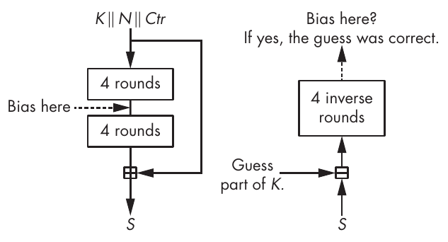

Hình 5-13: Nguyên lý của attack nhắm vào Salsa20/8

Trong attack thực tế nhắm vào Salsa20/8, để xác định lần đoán đúng, chúng ta cần đoán 220 bit của key, và chúng ta cần 2<sup>31</sup> cặp keystream block, tất cả đều có cùng một khác biệt cụ thể trong nonce. Khi đã chọn ra được 220 bit đúng, chúng ta brute-force 36 bit. Việc brute-forcing tốn 2<sup>36</sup> phép toán, một phép tính nhỏ bé so với 2<sup>220</sup> × 2<sup>31</sup> = 2<sup>251</sup> lần thử phi thực tế cần để tìm 220 bit nhằm hoàn thành phần đầu của attack.

## Những gì có thể sai (How Things Can Go Wrong)

Đáng tiếc là có nhiều thứ có thể sai với stream cipher, từ những thiết kế mong manh, không an toàn đến những algorithm mạnh nhưng được triển khai sai. Tôi sẽ tìm hiểu từng loại vấn đề tiềm ẩn trong các mục sau.

### Dùng lại nonce (Nonce Reuse)

Thất bại phổ biến nhất với stream cipher xảy ra khi dùng lại một nonce nhiều hơn một lần với cùng một key. Điều này tạo ra các keystream giống hệt nhau, cho phép bạn phá encryption—ví dụ, bằng cách XOR hai ciphertext với nhau; khi đó keystream biến mất, và bạn còn lại XOR của hai plaintext.

Một ví dụ thực tế là các phiên bản cũ của Microsoft Word và Excel dùng một nonce duy nhất cho mỗi tài liệu, nhưng việc sửa đổi tài liệu không làm thay đổi nonce. Kết quả là người ta có thể dùng bản rõ và bản đã mã hóa của một phiên bản cũ của tài liệu để giải mã các phiên bản được mã hóa sau đó. Nếu Microsoft đã mắc sai lầm ngớ ngẩn này, bạn có thể tưởng tượng vấn đề có thể lớn đến mức nào.

Một số stream cipher được thiết kế trong những năm 2010 đã cố gắng giảm rủi ro dùng lại nonce bằng cách xây dựng các cấu trúc “misuse-resistant”, tức là các cipher vẫn an toàn ngay cả khi một nonce được dùng hai lần. Tuy nhiên, đạt được mức security này phải trả giá về hiệu năng, như bạn sẽ thấy trong Chương 8 với SIV mode.

### Implementation RC4 hỏng (Broken RC4 Implementation)

Dù bản chất đã yếu, RC4 có thể còn yếu hơn nữa nếu bạn tối ưu hóa implementation của nó một cách mù quáng. Ví dụ, hãy xét một bài dự thi trong Underhanded C Contest năm 2007, một cuộc thi không chính thức nơi các lập trình viên viết code benign-looking nhưng thực ra chứa một function độc hại.

Đây là cách nó hoạt động. Cách ngây thơ để triển khai dòng swap(S[i], S[j]) trong algorithm của RC4 là làm như sau, như code Python này cho thấy:

```
buf = S[i]
S[i] = S[j]
S[j] = buf
```

Cách hoán đổi hai biến này có tác dụng, nhưng bạn cần tạo một biến mới, buf. Để tránh điều này, các lập trình viên thường dùng thủ thuật XOR-swap sau để hoán đổi giá trị của các biến x và y:

```
x = x ⊕ y
y = x ⊕ y
x = x ⊕ y
```

Điều này có tác dụng vì dòng thứ hai đặt y thành x ⊕ y ⊕ y = x, và dòng thứ ba đặt x thành x ⊕ y ⊕ x ⊕ y ⊕ y = y. Dùng thủ thuật này để triển khai RC4 cho ra implementation trong Listing 5-5 (phỏng theo chương trình của David Wagner và Philippe Biondi nộp cho Underhanded C Contest năm 2007, và có trên mạng tại http://www.underhanded-c.org/_page_id_16.html).

```
#define TOBYTE(x) (x) & 255
#define SWAP(x,y) do { x^=y; y^=x; x^=y; } while (0)

static unsigned char S[256];
static int i=0, j=0;

void init(char *passphrase) {
    int passlen = strlen(passphrase);
    for (i=0; i<256; i++)
        S[i] = i;
    for (i=0; i<256; i++) {
        j = TOBYTE(j + S[TOBYTE(i)] + passphrase[j % passlen]);
        SWAP(S[TOBYTE(i)], S[j]);
    }
    i = 0; j = 0;
}

unsigned char encrypt_one_byte(unsigned char c) {
    int k;
    i = TOBYTE(i+1);
    j = TOBYTE(j + S[i]);
    SWAP(S[i], S[j]);
    k = TOBYTE(S[i] + S[j]);
    return c ^ S[k];
}
```

Listing 5-5: Một implementation C sai của RC4, do việc dùng XOR swap

Bạn có phát hiện ra vấn đề với XOR swap không?

Mọi thứ trở nên tồi tệ khi i = j. Thay vì để nguyên state, XOR swap đặt S[i] thành S[i] ⊕ S[i] = 0. Kết quả là một byte của state bị đặt về không mỗi khi i bằng j trong key schedule hoặc trong quá trình mã hóa, cuối cùng dẫn đến một state all-zero và do đó một keystream all-zero. Ví dụ, sau khi xử lý 68KB dữ liệu, phần lớn các byte trong state 256-byte đều bằng không, và keystream đầu ra trông như sau:

```
00 00 00 00 00 00 00 53 53 00 00 00 00 00 00 00 00 00 00 00 13 13 00 5c 00 a5 00 00 ...
```

Bài học ở đây là hãy kiềm chế việc over-optimizing các implementation crypto của bạn. Sự rõ ràng và sự tin cậy luôn quan trọng hơn hiệu năng trong cryptography.

### Cipher yếu được đóng cứng vào hardware (Weak Ciphers Baked into Hardware)

Khi một cryptosystem không an toàn, một số hệ thống phản ứng nhanh bằng cách lặng lẽ cập nhật software bị ảnh hưởng từ xa (như với các ứng dụng web) hoặc bằng cách phát hành một phiên bản mới và nhắc người dùng nâng cấp (như với các ứng dụng di động). Những hệ thống khác không may mắn như vậy và phải dùng tiếp cryptosystem đã bị xâm phạm một thời gian trước khi nâng cấp lên một phiên bản an toàn, như trường hợp của một số điện thoại vệ tinh.

Vào đầu những năm 2000, các viện tiêu chuẩn hóa viễn thông của Hoa Kỳ và châu Âu (TIA và ETSI) đã cùng phát triển hai tiêu chuẩn cho liên lạc bằng điện thoại vệ tinh (satphone). Satphone giống điện thoại di động, ngoại trừ việc tín hiệu của chúng đi qua vệ tinh chứ không phải các trạm mặt đất. Ưu điểm là bạn có thể dùng chúng gần như ở mọi nơi trên thế giới, chừng nào có vùng phủ sóng vệ tinh. Nhược điểm của chúng là giá cả, chất lượng, độ trễ, và hóa ra là cả security.

GMR-1 và GMR-2 là hai tiêu chuẩn satphone được phần lớn các nhà cung cấp thương mại, như Thuraya và Inmarsat, chấp nhận. Cả hai đều có stream cipher để mã hóa liên lạc thoại. Cipher của GMR-1 là hardware oriented, với một tổ hợp bốn LFSR, tương tự A5/2, cipher cố tình không an toàn trong tiêu chuẩn di động 2G nhắm tới các quốc gia non-Western. Cipher của GMR-2 là software oriented, với một state 8-byte và dùng các S-boxes. Cả hai stream cipher đều không an toàn và chỉ bảo vệ người dùng trước những kẻ nghiệp dư, chứ không phải trước các cơ quan nhà nước.

Câu chuyện này nhắc chúng ta rằng stream cipher từng dễ bị phá hơn block cipher và chúng dễ bị phá hoại (sabotage) hơn. Vì sao? Chà, nếu bạn cố tình thiết kế một stream cipher yếu, khi lỗi bị phát hiện, bạn vẫn có thể đổ lỗi cho điểm yếu của stream cipher và chối bỏ mọi ý đồ xấu.

## Đọc thêm (Further Reading)

Để tìm hiểu thêm về stream cipher, hãy bắt đầu với kho lưu trữ của cuộc thi eSTREAM tại https://www.ecrypt.eu.org/stream/project.html, nơi bạn sẽ tìm thấy hàng trăm bài báo về stream cipher, bao gồm chi tiết về hơn 30 ứng viên và nhiều attack. Một số attack thú vị nhất là correlation attack, algebraic attack và cube attack. Đặc biệt, hãy xem công trình của Nicolas Courtois và Willi Meier về hai loại attack đầu tiên, và công trình của Itai Dinur và Adi Shamir về cube attack.

Để biết thêm về các attack nhắm vào RC4, hãy tìm attack năm 2001 của Scott Fluhrer, Itsik Mantin và Adi Shamir (FMS), và bài báo nghiên cứu năm 2013 “On the Security of RC4 in TLS.”

Di sản của Salsa20 cũng đáng để bạn quan tâm. Stream cipher ChaCha tương tự Salsa20 nhưng có một core permutation hơi khác, sau này được dùng trong hash function BLAKE, như bạn sẽ thấy trong Chương 6. Các algorithm này đều tận dụng các kỹ thuật implementation software của Salsa20 dùng các instruction song song hóa, như được thảo luận tại https://cr.yp.to/snuffle.html.
