# Chương 6: Hash Function (Hash Functions)

Hash function—như SHA-256, SHA3 và BLAKE3—tạo thành con dao đa năng Thụy Sĩ (Swiss Army Knife) của cryptographer: chúng được dùng trong digital signature, public-key encryption, kiểm tra tính toàn vẹn, xác thực message, bảo vệ mật khẩu, key agreement protocol và nhiều cryptographic protocol khác.

Dù bạn đang mã hóa một email, gửi một tin nhắn trên điện thoại di động, kết nối tới một website HTTPS, hay kết nối tới một máy từ xa thông qua virtual private network (VPN) hoặc Secure Shell (SSH), thì ở đâu đó bên dưới luôn có một hash function.

Hash function là loại linh hoạt và phổ biến nhất trong tất cả các crypto algorithm, hơn hẳn các loại còn lại. Các ứng dụng của chúng bao gồm: các hệ thống cloud storage dùng chúng để nhận diện các file giống hệt nhau và phát hiện các file bị sửa đổi; hệ thống quản lý phiên bản Git dùng chúng để nhận diện các file trong một repository; các hệ thống endpoint detection and response (EDR) dùng chúng để phát hiện các file bị sửa đổi; các network-based intrusion detection system (NIDS) dùng hash để phát hiện dữ liệu known-malicious đi qua mạng; các nhà phân tích pháp y dùng giá trị hash để chứng minh rằng các hiện vật số chưa bị sửa đổi; Bitcoin dùng một hash function trong các hệ thống proof-of-work của nó—và còn nhiều ứng dụng khác nữa.

Khác với stream cipher, vốn tạo ra một đầu ra dài từ một đầu vào ngắn, hash function nhận một đầu vào dài và tạo ra một đầu ra ngắn, gọi là hash value hay digest (xem Hình 6-1).

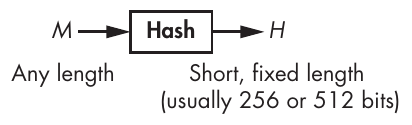

Hình 6-1: Đầu vào và đầu ra của một hash function

Chương này xoay quanh hai chủ đề chính. Thứ nhất là security: một hash function an toàn có nghĩa là gì? Để trả lời, tôi giới thiệu hai khái niệm thiết yếu—collision resistance và preimage resistance. Chủ đề thứ hai xoay quanh việc xây dựng hash function. Tôi giải thích các kỹ thuật high-level mà các hash function hiện đại sử dụng, rồi xem xét phần bên trong của các hash function phổ biến nhất: SHA-1, SHA-2, SHA-3 và BLAKE2. Cuối cùng, bạn sẽ thấy các hash function an toàn có thể hoạt động không an toàn như thế nào nếu bị dùng sai.

> **LƯU Ý** Đừng nhầm cryptographic hash function với noncryptographic hash function. Bạn dùng noncryptographic hash function trong các cấu trúc dữ liệu như hash table hoặc để phát hiện lỗi ngẫu nhiên, và chúng không cung cấp bất kỳ security nào. Ví dụ, cyclic redundancy check (CRC) là các noncryptographic hash mà bạn dùng để phát hiện các sửa đổi vô tình đối với một file.

## Hash function an toàn (Secure Hash Functions)

Khái niệm security đối với hash function khác với những gì chúng ta đã thảo luận cho đến giờ. Trong khi cipher bảo vệ tính bí mật của dữ liệu nhằm bảo đảm rằng dữ liệu được gửi ở dạng rõ không thể bị đọc, hash function bảo vệ tính toàn vẹn của dữ liệu nhằm bảo đảm rằng dữ liệu—dù được gửi ở dạng rõ hay đã mã hóa—chưa bị sửa đổi. Nếu một hash function an toàn, hai mẩu dữ liệu khác nhau phải luôn có hash khác nhau. Vì vậy, hash của một file có thể dùng làm định danh của nó.

Hãy xét ứng dụng phổ biến nhất của hash function: digital signature, hay gọi tắt là signature. Khi dùng digital signature, các ứng dụng xử lý hash của message cần ký thay vì chính message, như Hình 6-2 minh họa.

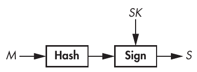

Hình 6-2: Một hash function trong digital signature scheme, trong đó hash đóng vai trò đại diện cho message

Hash đóng vai trò định danh của message. Nếu chỉ một bit duy nhất trong message bị thay đổi, hash của message sẽ hoàn toàn khác. Do đó, hash function giúp bảo đảm rằng message chưa bị sửa đổi. Ký hash của một message an toàn ngang với ký chính message đó, và ký một hash ngắn, chẳng hạn 256 bit, nhanh hơn nhiều so với ký một message có thể rất lớn. Thực tế, phần lớn signature algorithm chỉ làm việc trên các đầu vào ngắn như hash value.

### Lại là tính không thể đoán trước (Unpredictability Again)

Độ mạnh cryptography của hash function bắt nguồn từ tính không thể đoán trước của đầu ra của chúng. Hãy lấy các giá trị hexadecimal 256-bit sau; bạn tính các hash này bằng hash function tiêu chuẩn của NIST là SHA-256 với các chữ cái ASCII a, b và c làm đầu vào. Dù các giá trị a, b và c chỉ khác nhau 1 hoặc 2 bit (a là chuỗi bit 01100001, b là 01100010, và c là 01100011), các hash value của chúng hoàn toàn khác nhau:

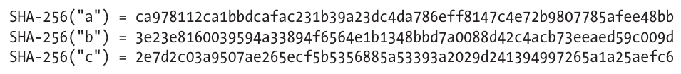

Chỉ với ba hash này, không thể đoán được giá trị hash SHA-256 của d hay bất kỳ bit nào của nó, vì hash value của một hash function an toàn là không thể đoán trước. Một hash function an toàn phải giống như một hộp đen trả về một chuỗi ngẫu nhiên mỗi khi nhận được một đầu vào.

Định nghĩa tổng quát, mang tính lý thuyết, về một hash function an toàn là nó hoạt động như một function thực sự ngẫu nhiên (đôi khi gọi là random oracle). Cụ thể, một hash function an toàn không được có bất kỳ tính chất hay pattern nào mà một function ngẫu nhiên không có. Định nghĩa này hữu ích cho các nhà lý thuyết, nhưng trong thực tế chúng ta cần những khái niệm cụ thể hơn, cụ thể là preimage resistance và collision resistance.

### Preimage Resistance

Một preimage của một hash value cho trước, H, là bất kỳ message M nào sao cho Hash(M) = H. Preimage resistance mô tả bảo đảm security rằng, khi có một hash value ngẫu nhiên, kẻ tấn công sẽ không bao giờ tìm được một preimage của hash value đó. Thật vậy, đôi khi bạn có thể gọi hash function là one-way function vì bạn có thể đi từ message đến hash của nó nhưng không thể đi theo chiều ngược lại.

Thật vậy, bạn không thể đảo ngược một hash function, ngay cả khi có sức mạnh tính toán không giới hạn. Ví dụ, giả sử tôi hash một message nào đó bằng hash function SHA-256 và nhận được hash value 256-bit này:

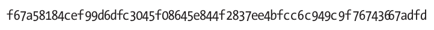

Ngay cả khi có thời gian và sức mạnh tính toán vô hạn, bạn cũng sẽ không bao giờ xác định được message mà tôi đã chọn để tạo ra hash cụ thể này, vì có nhiều message hash ra cùng một giá trị. Do đó, bạn sẽ tìm được một số message tạo ra hash value này (có thể bao gồm cả message tôi đã chọn) nhưng sẽ không thể xác định được message tôi đã dùng. Bạn có được unconditional security.

Ví dụ, có 2<sup>256</sup> giá trị khả dĩ của một hash 256-bit (một độ dài điển hình của các hash function được dùng trong thực tế), nhưng có nhiều giá trị hơn rất nhiều của, chẳng hạn, các message 1,024-bit (cụ thể là 2<sup>1,024</sup> giá trị khả dĩ). Do đó, suy ra rằng trung bình mỗi hash value 256-bit khả dĩ sẽ có 2<sup>1,024</sup> / 2<sup>256</sup> = 2<sup>1,024 – 256</sup> = 2<sup>768</sup> preimage, mỗi preimage dài 1,024 bit.

Trong thực tế, bạn phải chắc chắn rằng thực tế không thể tìm được bất kỳ message nào ánh xạ tới một hash value cho trước, chứ không chỉ message đã được dùng; đó là ý nghĩa thực sự của preimage resistance. Cụ thể, bạn có thể nói đến first-preimage resistance và second-preimage resistance. First-preimage resistance (hay chỉ gọi là preimage resistance) mô tả những trường hợp mà thực tế không thể tìm được một message hash ra một giá trị cho trước. Second-preimage resistance, mặt khác, mô tả trường hợp khi có một message, M<sub>1</sub>, thực tế không thể tìm được một message khác, M<sub>2</sub>, hash ra cùng giá trị với M<sub>1</sub>.

#### Chi phí của preimage (The Cost of Preimages)

Với một hash function và một hash value, bạn có thể tìm first preimage bằng cách thử các message khác nhau cho đến khi có một message cho ra đúng hash mục tiêu. Listing 6-1 cho thấy cách làm điều này bằng một algorithm tương tự solve_preimage().

```
solve_preimage(H) {
    repeat {
        M = random_message()
        if Hash(M) == H then return M
    }
}
```

Listing 6-1: Algorithm tìm preimage tối ưu cho một hash function an toàn

Ở đây, random_message() tạo ra một message ngẫu nhiên (chẳng hạn, một giá trị 1,024-bit ngẫu nhiên). Nếu độ dài bit của hash, n, đủ lớn, solve_preimage() trên thực tế sẽ không bao giờ hoàn tất, vì trung bình nó cần 2<sup>n</sup> lần thử trước khi tìm ra một preimage. Đó là tình huống vô vọng khi làm việc với n = 256, như trong các hash hiện đại như SHA-256 và BLAKE2.

#### Vì sao Second-Preimage Resistance yếu hơn

Nếu bạn có thể tìm first preimage, thì bạn cũng có thể tìm second preimage (cho cùng một hash function). Để chứng minh, nếu algorithm solve_preimage() trả về một preimage của một hash value cho trước, hãy dùng algorithm trong Listing 6-2 để tìm second preimage của một message nào đó, M.

```
solve_second_preimage(M) {
    H = Hash(M)
    return solve_preimage(H)
}
```

Listing 6-2: Cách tìm second preimage nếu bạn có thể tìm first preimage

Bạn sẽ tìm ra second preimage bằng cách xem nó như một bài toán preimage và áp dụng preimage attack. Suy ra rằng bất kỳ hash function second-preimage resistant nào cũng preimage resistant. (Nếu không phải vậy, thì nó cũng sẽ không second preimage resistant, theo algorithm solve_second_preimage() ở trên.) Nói cách khác, attack tốt nhất bạn có thể dùng để tìm second preimage gần như giống hệt attack tốt nhất bạn có thể dùng để tìm first preimage, trừ khi hash function có một khiếm khuyết nào đó cho phép những attack hiệu quả hơn. Cũng lưu ý rằng một preimage search attack về cơ bản tương tự một key-recovery attack nhắm vào block cipher hoặc stream cipher, ngoại trừ việc trong trường hợp encryption, có đúng một lời giải với kích thước đã biết.

### Collision Resistance

Dù bạn chọn hash function nào, collision chắc chắn sẽ tồn tại do nguyên lý chuồng bồ câu (pigeonhole principle), phát biểu rằng nếu bạn có m cái chuồng và n con bồ câu cần cho vào những chuồng đó, và nếu n lớn hơn m, thì ít nhất một chuồng phải chứa nhiều hơn một con bồ câu.

> **LƯU Ý** Bạn có thể tổng quát hóa pigeonhole principle cho các đối tượng và vật chứa khác. Ví dụ, bất kỳ chuỗi 27-word nào trong Hiến pháp Hoa Kỳ cũng chứa ít nhất hai từ bắt đầu bằng cùng một chữ cái. Trong thế giới hash function, chuồng là các hash value, còn bồ câu là các message. Vì bạn biết có nhiều message khả dĩ hơn rất nhiều so với hash value, collision phải tồn tại.

Tuy nhiên, dù collision là không thể tránh khỏi, chúng phải khó tìm thì một hash function mới được coi là collision resistant—nói cách khác, kẻ tấn công không thể tìm được hai message khác nhau hash ra cùng một giá trị.

Khái niệm collision resistance liên quan đến khái niệm second-preimage resistance: nếu bạn có thể tìm second preimage cho một hash function, bạn cũng có thể tìm collision, như Listing 6-3 cho thấy.

```
solve_collision() {
    M = random_message()
    return (M, solve_second_preimage(M))
}
```

Listing 6-3: Algorithm tìm collision ngây thơ

Tức là bất kỳ hash collision-resistant nào cũng second-preimage resistant. Nếu không phải vậy, sẽ có một algorithm solve-second-preimage hiệu quả có thể được dùng để phá collision resistance.

### Cách tìm collision (How to Find Collisions)

Tìm collision nhanh hơn tìm preimage: nó cần xấp xỉ 2<sup>n/2</sup> phép toán thay vì 2<sup>n</sup>, nhờ birthday attack, mà ý tưởng then chốt là: với N message và cũng từng ấy hash value, bạn có thể tạo ra tổng cộng N × (N – 1) / 2 collision tiềm năng bằng cách xét mỗi cặp hai hash value (một con số cùng bậc độ lớn với N<sup>2</sup>). Nó được gọi là birthday attack vì thường được minh họa bằng birthday paradox, tức là thực tế rằng một nhóm 23 người sẽ có hai người cùng ngày sinh với xác suất gần bằng 1/2—điều này không phải là nghịch lý, chỉ là một bất ngờ đối với nhiều người.

> **LƯU Ý** N × (N – 1) / 2 là số cặp gồm hai message khác nhau, trong đó bạn chia cho 2 vì bạn xem (M<sub>1</sub>, M<sub>2</sub>) và (M<sub>2</sub>, M<sub>1</sub>) là cùng một cặp, thứ tự không quan trọng.

Để so sánh, trong trường hợp tìm preimage, N message chỉ cho bạn N preimage ứng viên, trong khi cùng N message đó cho xấp xỉ N<sup>2</sup> collision tiềm năng. Với N<sup>2</sup> thay vì N, bạn có thể nói rằng có nhiều cơ hội hơn theo bậc hai để tìm ra một lời giải. Đến lượt mình, độ phức tạp của việc tìm kiếm thấp hơn theo bậc hai: để tìm một collision, hãy dùng căn bậc hai của 2<sup>n</sup> message; tức là dùng 2<sup>n/2</sup> thay vì 2<sup>n</sup>.

#### Birthday attack ngây thơ (The Naive Birthday Attack)

Đây là cách đơn giản nhất để tìm collision bằng birthday attack:

1. Tính 2<sup>n/2</sup> hash của 2<sup>n/2</sup> message được chọn tùy ý và lưu mọi cặp message/hash vào một danh sách.

2. Sắp xếp danh sách theo hash value để đưa mọi hash value giống hệt nhau về cạnh nhau.

3. Tìm trong danh sách đã sắp xếp hai mục liên tiếp có cùng hash value.

Đáng tiếc là phương pháp này cần rất nhiều memory (đủ để lưu 2<sup>n/2</sup> cặp message/hash), và việc sắp xếp rất nhiều phần tử làm chậm việc tìm kiếm, cần trung bình khoảng n2<sup>n/2</sup> phép toán khi dùng một algorithm sắp xếp nhanh như quicksort.

#### Low-Memory Collision Search bằng phương pháp Rho

Phương pháp Rho là một algorithm tìm collision mà, khác với birthday attack ngây thơ, chỉ cần một lượng memory nhỏ. Nó hoạt động như sau:

1. Với một hash function có hash value n-bit, hãy chọn một hash value ngẫu nhiên nào đó (H<sub>1</sub>), và định nghĩa H<sub>1</sub> = H′<sub>1</sub>.

2. Tính H<sub>2</sub> = Hash(H<sub>1</sub>) và H′<sub>2</sub> = Hash(Hash(H′<sub>1</sub>)). Trong trường hợp thứ nhất, áp dụng hash function một lần, còn trong trường hợp thứ hai, áp dụng nó hai lần.

3. Lặp lại quá trình và tính H<sub>i + 1</sub> = Hash(H<sub>i</sub>), H′<sub>i + 1</sub> = Hash(Hash(H′<sub>i</sub>)), với các giá trị i tăng dần, cho đến khi bạn đạt tới i sao cho H<sub>i + 1</sub> = H′<sub>i + 1</sub>.

Hình 6-3 giúp hình dung attack, trong đó một mũi tên từ, chẳng hạn, H<sub>1</sub> đến H<sub>2</sub> nghĩa là H<sub>2</sub> = Hash(H<sub>1</sub>). Hãy để ý rằng dãy các H<sub>i</sub> cuối cùng sẽ đi vào một vòng lặp, còn gọi là chu trình (cycle), có hình dạng giống chữ cái Hy Lạp rho (ρ). Chu trình bắt đầu tại H<sub>5</sub> và được đặc trưng bởi collision Hash(H<sub>4</sub>) = Hash(H<sub>10</sub>) = H<sub>5</sub>. Quan sát then chốt ở đây là để tìm một collision, bạn chỉ cần tìm một chu trình như vậy. Phương pháp Rho cho phép kẻ tấn công phát hiện vị trí của chu trình và do đó tìm ra collision.

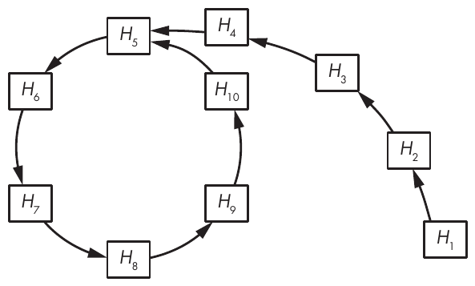

Hình 6-3: Cấu trúc của Rho hash function, trong đó mỗi mũi tên biểu diễn một lần tính hash function. Chu trình bắt đầu tại H<sub>5</sub> tương ứng với một collision, Hash( H<sub>4</sub> ) = Hash( H<sub>10</sub> ) = H<sub>5</sub>.

Các kỹ thuật collision-finding nâng cao dựa trên phương pháp Rho hoạt động bằng cách trước tiên phát hiện điểm bắt đầu của chu trình rồi tìm ra collision, mà không cần lưu nhiều giá trị trong memory hay phải sắp xếp một danh sách dài. Việc này cần khoảng 2<sup>n/2</sup> phép toán để thành công. Thật vậy, Hình 6-3 có ít hash value hơn nhiều so với một function thực tế có digest 256 bit trở lên. Trung bình, chu trình và phần đuôi (phần kéo dài từ H<sub>1</sub> đến H<sub>5</sub> trong Hình 6-3) mỗi phần chứa khoảng 2<sup>n/2</sup> hash value, trong đó n là độ dài bit của hash value. Do đó, bạn sẽ cần ít nhất 2<sup>n/2</sup> + 2<sup>n/2</sup> lần tính hash để tìm ra một collision.

## Cách xây dựng hash function (How to Build Hash Functions)

Vào những năm 1980, các cryptographer nhận ra rằng cách đơn giản nhất để hash một message là chia nó thành các mẩu và xử lý lần lượt từng mẩu bằng một algorithm tương tự nhau. Chiến lược này, iterative hashing, có hai dạng chính:

• Iterative hashing dùng một compression function biến một đầu vào thành một đầu ra nhỏ hơn, như Hình 6-4 minh họa. Kỹ thuật này còn được gọi là cấu trúc Merkle–Damgård, được đặt theo tên các cryptographer Ralph Merkle và Ivan Damgård, những người đã mô tả nó.

• Iterative hashing dùng một function biến một đầu vào thành một đầu ra có cùng kích thước, sao cho bất kỳ hai đầu vào khác nhau nào cũng cho ra hai đầu ra khác nhau (tức là một permutation). Các function như vậy được gọi là sponge function.

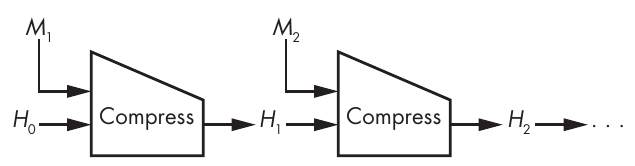

Hình 6-4: Cấu trúc Merkle–Damgård dùng một compression function gọi là Compress

Bây giờ chúng ta sẽ thảo luận cách các cấu trúc này hoạt động và compression function trông như thế nào trong thực tế.

### Các hash function Compression-Based

Mọi hash function được phát triển từ những năm 1980 đến những năm 2010 đều dựa trên cấu trúc Merkle–Damgård (M–D): MD4, MD5, SHA-1 và họ SHA-2, cũng như các hash function lesser-known là RIPEMD và Whirlpool. Dù cấu trúc M–D không hoàn hảo, nó đơn giản và đã được chứng minh là đủ an toàn cho nhiều ứng dụng.

> **LƯU Ý** Trong MD4, MD5 và RIPEMD, MD là viết tắt của message digest chứ không phải Merkle–Damgård.

Để hash một message, cấu trúc M–D chia message thành các block có kích thước giống nhau và trộn các block này với một internal state bằng một compression function, như Hình 6-4 cho thấy. Ở đây, H<sub>0</sub> là giá trị ban đầu (ký hiệu là IV) của internal state, các giá trị H<sub>1</sub>, H<sub>2</sub>, . . . là các chaining value, và giá trị cuối cùng của internal state là hash value của message.

Các message block thường dài 512 hoặc 1,024 bit, nhưng về nguyên tắc chúng có thể có kích thước bất kỳ. Dù độ dài block là bao nhiêu, nó vẫn cố định đối với một hash function cho trước. Ví dụ, SHA-256 làm việc với các block 512-bit, và SHA-512 làm việc với các block 1,024-bit.

#### Padding block (Padding Blocks)

Điều gì xảy ra nếu bạn muốn hash một message không thể chia thành một chuỗi block hoàn chỉnh? Ví dụ, nếu block dài 512 bit, thì một message 520-bit gồm một block 512-bit cộng thêm 8 bit. Trong trường hợp như vậy, cấu trúc M–D tạo block cuối như sau: lấy mẩu bit còn lại (8 trong ví dụ của chúng ta), nối thêm 1 bit, rồi nối thêm các bit 0, và cuối cùng nối thêm độ dài của message ban đầu, được mã hóa trên một số bit cố định. Thủ thuật padding này bảo đảm rằng bất kỳ hai message khác nhau nào cũng cho ra một chuỗi block khác nhau và do đó một hash value khác nhau.

Ví dụ, nếu bạn hash chuỗi 8-bit 10101010 bằng SHA-256, một hash function có message block 512-bit, thì block đầu tiên và duy nhất trông như sau, theo bit:

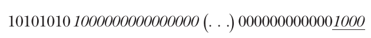

Ở đây, các bit message là 8 bit đầu tiên (10101010), và các bit padding là tất cả các bit tiếp theo (được in nghiêng). 1000 ở cuối block (được gạch dưới) là độ dài của message, tức số 8 được mã hóa nhị phân (trên tối đa 32 bit). Như vậy, padding tạo ra một message 512-bit gồm một block 512-bit duy nhất, sẵn sàng để compression function của SHA-256 xử lý.

#### Các bảo đảm security (Security Guarantees)

Cấu trúc Merkle–Damgård biến một compression function an toàn nhận các đầu vào nhỏ, fixed-length thành một hash function an toàn nhận các đầu vào có độ dài tùy ý. Nếu một compression function có preimage resistance và collision resistance, thì một hash function được xây dựng trên nó bằng cấu trúc M–D cũng có preimage resistance và collision resistance. Điều này đúng vì chúng ta có thể biến bất kỳ preimage attack thành công nào nhắm vào hash M–D thành một preimage attack thành công nhắm vào compression function, như Merkle và Damgård đã chứng minh trong các bài báo năm 1989 của họ (xem mục “Further Reading” của chương này). Điều tương tự cũng đúng với collision: kẻ tấn công không thể phá collision resistance của hash nếu không phá collision resistance của compression function bên dưới; do đó, security của compression function bảo đảm security của hash.

Lưu ý rằng lập luận ngược lại không đúng, vì một collision của compression function không nhất thiết cho ra một collision của hash. Một collision tùy ý giữa Compress(X, M<sub>1</sub>) và Compress(Y, M<sub>2</sub>) với các chaining value X và Y, cả hai đều khác H<sub>0</sub>, sẽ không cho bạn một collision của hash, vì bạn không thể “cắm” collision đó vào chuỗi hash lặp—trừ khi một trong các chaining value tình cờ là X và chaining value kia là Y, nhưng điều đó khó có khả năng xảy ra.

#### Tìm multicollision (Finding Multicollisions)

Multicollision xảy ra khi một tập ba message trở lên hash ra cùng một giá trị. Ví dụ, bộ ba (X, Y, Z) sao cho Hash(X) = Hash(Y) = Hash(Z) là một 3-collision. Lý tưởng nhất, multicollision phải khó tìm hơn collision nhiều, nhưng có một thủ thuật đơn giản để tìm chúng với chi phí gần như ngang một collision duy nhất. Nó hoạt động như sau:

1. Tìm một collision Compress(H<sub>0</sub>, M<sub>1.1</sub>) = Compress(H<sub>0</sub>, M<sub>1.2</sub>) = H<sub>1</sub>. Đây chỉ là một 2-collision, tức hai message hash ra cùng một giá trị.

2. Tìm collision thứ hai với H<sub>1</sub> làm chaining value bắt đầu: Compress(H<sub>1</sub>, M<sub>2.1</sub>) = Compress(H<sub>1</sub>, M<sub>2.2</sub>) = H<sub>2</sub>. Giờ bạn có một 4-collision, với bốn message hash ra cùng giá trị H<sub>2</sub>: M<sub>1.1</sub> || M<sub>2.1</sub>, M<sub>1.1</sub> || M<sub>2.2</sub>, M<sub>1.2</sub> || M<sub>2.1</sub> và M<sub>1.2</sub> || M<sub>2.2</sub>.

3. Lặp lại và tìm collision N lần, và bạn sẽ có 2<sup>N</sup> message, mỗi message gồm N block, hash ra cùng một giá trị—tức là một 2<sup>N</sup>-collision, với chi phí “chỉ” khoảng N2<sup>N</sup> lần tính hash.

Trong thực tế, thủ thuật này không thực sự hữu dụng lắm, vì trước hết nó đòi hỏi phải tìm được một 2-collision cơ bản.

#### Xây dựng compression function (Building Compression Functions)

Mọi compression function được dùng trong các hash function thực tế như SHA-256 và BLAKE2 đều dựa trên block cipher, vì đó là cách đơn giản nhất để xây dựng một compression function. Hình 6-5 cho thấy compression function block cipher–based phổ biến nhất, cấu trúc Davies–Meyer.

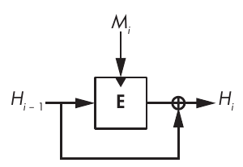

Hình 6-5: Cấu trúc Davies–Meyer. Hình tam giác tô đậm cho biết vị trí đưa key của block cipher vào.

Với một message block M<sub>i</sub> và chaining value trước đó H<sub>i</sub> <sub>–1</sub>, compression function Davies–Meyer dùng một block cipher, E, để tính chaining value mới như sau:

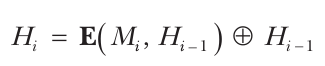

Message block M<sub>i</sub> đóng vai trò key của block cipher, còn chaining value H<sub>i</sub> <sub>–1</sub> đóng vai trò plaintext block của nó. Chừng nào block cipher còn an toàn, compression function thu được cũng an toàn, có collision resistance và preimage resistance. Nếu không có phép XOR với chaining value trước đó (⊕ H<sub>i</sub> <sub>–1</sub>), Davies–Meyer sẽ không an toàn vì bạn có thể đảo ngược nó, đi từ chaining value mới về chaining value trước đó bằng decryption function của block cipher.

> **LƯU Ý** Cấu trúc Davies–Meyer có một tính chất đáng ngạc nhiên: bạn có thể tìm các điểm bất động (fixed point), tức là các chaining value không thay đổi sau khi áp dụng compression function với một message block cho trước. Chỉ cần lấy H<sub>i</sub> <sub>–1</sub> = D(M<sub>i</sub>, 0) làm chaining value, trong đó D là decryption function tương ứng với E. Khi đó, chaining value mới H<sub>i</sub> bằng H<sub>i</sub> <sub>–1</sub> ban đầu:

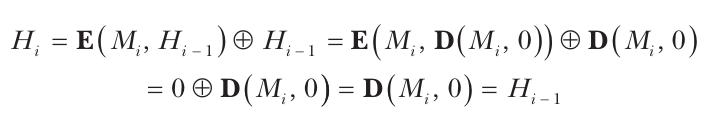

Bạn có H<sub>i</sub> = H<sub>i – 1</sub> vì việc đưa kết quả giải mã của số không vào encryption function cho ra số không—số hạng E(M<sub>i</sub>, D(M<sub>i</sub>, 0)) = 0—chỉ còn lại phần ⊕ H<sub>i – 1</sub> của phương trình trong biểu thức đầu ra của compression function. Khi đó, bạn có thể tìm các fixed point cho compression function của các SHA-2 function chẳng hạn, vốn dựa trên cấu trúc Davies–Meyer. May thay, fixed point không phải là một rủi ro security.

Có nhiều compression function block cipher–based khác ngoài Davies–Meyer, chẳng hạn những compression function trong Hình 6-6.

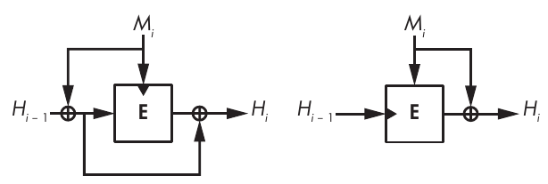

Hình 6-6: Các cấu trúc compression function block cipher–based an toàn khác

Chúng ít phổ biến hơn vì phức tạp hơn hoặc đòi hỏi message block phải có cùng độ dài với chaining value.

### Các hash function Permutation-Based

Sau nhiều thập kỷ nghiên cứu, các cryptographer đã biết mọi điều cần biết về các kỹ thuật hashing block cipher–based. Dù vậy, chẳng lẽ không có cách nào đơn giản hơn để hash sao? Sao phải bận tâm với một block cipher, một algorithm nhận một secret key, trong khi hash function không nhận secret key nào? Sao không xây dựng hash function bằng một block cipher fixed-key, tức một permutation algorithm duy nhất?

Những hash function đơn giản hơn đó là sponge function, và chúng dùng một permutation duy nhất thay vì một compression function và một block cipher (xem Hình 6-7). Thay vì dùng một block cipher để trộn các bit message với internal state, sponge function chỉ thực hiện một phép XOR. Sponge function không chỉ đơn giản hơn các function Merkle–Damgård mà còn linh hoạt hơn. Bạn sẽ thấy chúng được dùng làm hash function và cả làm deterministic random bit generator, stream cipher, pseudorandom function (xem Chương 7) và authenticated cipher (xem Chương 8). Sponge function nổi tiếng nhất là Keccak, còn được biết đến với tên SHA-3.

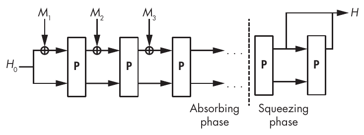

Hình 6-7: Cấu trúc sponge

Một sponge function hoạt động như sau:

1. Nó XOR message block đầu tiên, M<sub>1</sub>, vào H<sub>0</sub>, một giá trị ban đầu được định nghĩa trước của internal state (ví dụ, chuỗi all-zero). Các message block đều có cùng kích thước và nhỏ hơn internal state.

2. Một permutation, P, biến internal state thành một giá trị khác có cùng kích thước.

3. Nó XOR block M<sub>2</sub> và áp dụng P, rồi lặp lại điều này với các message block M<sub>3</sub>, M<sub>4</sub>, v.v. Đây là giai đoạn hấp thụ (absorbing phase).

4. Sau khi đưa vào mọi message block, nó áp dụng P một lần nữa và trích ra một block bit từ state để tạo thành hash. Nếu bạn cần một hash dài hơn, hãy áp dụng P lần nữa và trích ra một block. Đây là giai đoạn vắt (squeezing phase).

Security của một sponge function phụ thuộc vào độ dài internal state của nó và độ dài các block. Nếu message block dài r-bit và internal state dài w-bit, thì có c = w – r bit của internal state mà message block không thể sửa đổi. Giá trị c là capacity của sponge, và security level mà sponge function bảo đảm là c/2. Ví dụ, để đạt security 256-bit với message block 64-bit, internal state phải dài ít nhất w = 2 × 256 + 64 = 576 bit. Security level cũng phụ thuộc vào độ dài, n, của hash value. Do đó, độ phức tạp của một collision attack là giá trị nhỏ nhất giữa 2<sup>n/2</sup> và 2<sup>c/2</sup>, còn độ phức tạp của một second preimage attack là giá trị nhỏ nhất giữa 2<sup>n</sup> và 2<sup>c/2</sup>.

Để an toàn, permutation P phải hoạt động như một permutation ngẫu nhiên, không có độ lệch thống kê và không có cấu trúc toán học nào cho phép kẻ tấn công đoán trước đầu ra. Cũng như các hash dựa trên compression function, sponge function cũng pad message, nhưng padding đơn giản hơn vì nó không cần bao gồm độ dài của message. Bit message cuối cùng chỉ đơn giản được theo sau bởi một bit 1 và thêm bao nhiêu số không tùy theo nhu cầu.

## Họ hash function SHA (The SHA Family of Hash Functions)

Các hash function Secure Hash Algorithm (SHA) là các tiêu chuẩn do NIST định nghĩa để các cơ quan chính phủ liên bang phi quân sự tại Hoa Kỳ sử dụng. Chúng được coi là các tiêu chuẩn toàn cầu, và chỉ một số chính phủ non-US chọn dùng hash algorithm của riêng họ (như SM3 của Trung Quốc, Streebog của Nga và Kupyna của Ukraine) vì lý do chủ quyền chứ không phải vì thiếu tin tưởng vào security của SHA. Các SHA của Hoa Kỳ đã được các cryptanalyst xem xét kỹ lưỡng hơn so với các hash non-US.

> **LƯU Ý** Message Digest 5 (MD5) là hash function phổ biến nhất từ năm 1992 cho đến khi nó bị phá vào khoảng năm 2005, và nhiều ứng dụng đã chuyển sang một trong các hash function SHA. MD5 xử lý các message theo block 512-bit và cập nhật một internal state 128-bit để tạo ra một hash 128-bit, do đó cung cấp tốt nhất là preimage security 128-bit và collision security 64-bit. Năm 1996, các cryptanalyst đã cảnh báo về một collision cho compression function của MD5, nhưng cảnh báo của họ không được chú ý cho đến năm 2005, khi một nhóm cryptanalyst Trung Quốc phát hiện ra cách tính collision cho toàn bộ hash MD5. Tại thời điểm tôi viết những dòng này, chỉ mất vài giây để tìm một collision cho MD5, thế nhưng một số hệ thống vẫn dùng hoặc hỗ trợ MD5, thường vì lý do tương thích ngược.

### SHA-1

Tiêu chuẩn SHA-1 ra đời từ một thất bại trong hash function SHA-0 ban đầu của NSA. Năm 1993, NIST chuẩn hóa hash algorithm SHA-0, nhưng đến năm 1995 NSA phát hành SHA-1 để sửa một vấn đề security không được nêu rõ trong SHA-0. Lý do của sự điều chỉnh trở nên rõ ràng khi năm 1998 hai nhà nghiên cứu phát hiện ra cách tìm collision cho SHA-0 trong khoảng 2<sup>60</sup> phép toán thay vì 2<sup>80</sup> như kỳ vọng đối với các hash function 160-bit như SHA-0 và SHA-1. Các attack sau đó đã giảm độ phức tạp xuống khoảng 2<sup>33</sup> phép toán, dẫn đến các collision thực tế trong chưa đầy một giờ đối với SHA-0.

#### Bên trong SHA-1

SHA-1 kết hợp một hash function Merkle–Damgård với một compression function Davies–Meyer dựa trên một block cipher được thiết kế riêng. Tức là SHA-1 hoạt động bằng cách lặp lại thao tác sau trên các message block 512-bit (M):

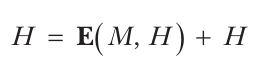

Ở đây, việc dùng dấu cộng (+) thay vì ⊕ (XOR) là có chủ ý. E(M, H) và H được xem như các mảng số nguyên 32-bit, và hai word ở cùng vị trí được cộng với nhau: word 32-bit đầu tiên của E(M, H) với word 32-bit đầu tiên của H, v.v. Giá trị ban đầu của H là hằng số với mọi message, sau đó H được sửa đổi theo phương trình trên, và giá trị cuối cùng của H sau khi xử lý mọi block được trả về làm hash của message.

Khi block cipher được chạy với message block làm key và chaining value 160-bit hiện tại làm plaintext block, kết quả 160-bit được xem như một mảng gồm năm word 32-bit, mỗi word được cộng vào word 32-bit tương ứng trong giá trị H ban đầu.

Listing 6-4 cho thấy compression function của SHA-1, SHA1-compress():

```
SHA1-compress(H, M) {
    (a0, b0, c0, d0, e0) = H   // Parsing H as five 32-bit big-endian words
    (a, b, c, d, e) = SHA1-blockcipher(a0, b0, c0, d0, e0, M)
    return (a + a0, b + b0, c + c0, d + d0, e + e0)
}
```

Listing 6-4: Compression function của SHA-1

Block cipher của SHA-1, SHA1-blockcipher(), được in đậm, nhận một message block 512-bit, M, làm key và biến đổi năm word 32-bit (a, b, c, d và e) bằng cách lặp 80 bước của một chuỗi phép toán ngắn để thay word a bằng một tổ hợp của cả năm word. Sau đó, nó dịch các word khác trong mảng, giống như trong một shift register. Listing 6-5 mô tả các phép toán này bằng pseudocode, trong đó K[i] là một hằng số round-dependent.

```
SHA1-blockcipher(a, b, c, d, e, M) {
    W = expand(M)
    for i = 0 to 79 {
        new = (a <<< 5) + f(i, b, c, d) + e + K[i] + W[i]
        (a, b, c, d, e) = (new, a, b >>> 2, c, d)
    }
    return (a, b, c, d, e)
}
```

Listing 6-5: Block cipher của SHA-1

Function expand() trong Listing 6-5 tạo ra một mảng 80 word 32-bit, W, từ message block 16-word bằng cách đặt 16 word đầu tiên của W bằng M và các word tiếp theo bằng một tổ hợp XOR của các word trước đó, được xoay 1 bit sang trái. Listing 6-6 cho thấy pseudocode tương ứng.

```
expand(M) {
    // The 512-bit M is seen as an array of sixteen 32-bit words.
    W = empty array of eighty 32-bit words
    for i = 0 to 79 {
        if i < 16 then W[i] = M[i]
        else
            W[i] = (W[i – 3] ⊕ W[i – 8] ⊕ W[i – 14] ⊕ W[i – 16]) <<< 1
    }
    return W
}
```

Listing 6-6: Function expand() của SHA-1

Phép toán <<< 1 trong Listing 6-6 là khác biệt duy nhất giữa các function SHA-1 và SHA-0.

Cuối cùng, Listing 6-7 cho thấy function f() trong SHA1-blockcipher(), một chuỗi các phép toán logic theo bit cơ bản (một Boolean function) phụ thuộc vào số thứ tự round.

```
f(i, b, c, d) {
    if i < 20 then return ((b & c) ⊕ (~b & d))
    if i < 40 then return (b ⊕ c ⊕ d)
    if i < 60 then return ((b & c) ⊕ (b & d) ⊕ (c & d))
    if i < 80 then return (b ⊕ c ⊕ d)
}
```

Listing 6-7: Function f() của SHA-1

Boolean function thứ hai và thứ tư trong Listing 6-7 chỉ đơn giản XOR ba word đầu vào với nhau, đây là một phép toán tuyến tính. Ngược lại, function thứ nhất và thứ ba dùng toán tử phi tuyến & (AND logic) để chống lại differential cryptanalysis, kỹ thuật khai thác sự lan truyền dễ đoán của khác biệt theo bit. Nếu không có toán tử & (nói cách khác, chẳng hạn nếu f() luôn là b ⊕ c ⊕ d), SHA-1 sẽ dễ bị phá bằng cách lần theo các pattern trong internal state của nó.

#### Các attack nhắm vào SHA-1

Dù mạnh hơn SHA-0, SHA-1 cũng không an toàn, đó là lý do trình duyệt Chrome đánh dấu các website dùng SHA-1 trong kết nối HTTPS là không an toàn từ năm 2014. Dù hash 160-bit của nó lẽ ra phải đem lại collision resistance 80-bit, năm 2005 các nhà nghiên cứu đã tìm ra điểm yếu trong SHA-1 và ước tính rằng tìm một collision sẽ cần xấp xỉ 2<sup>63</sup> phép tính (so với 2<sup>80</sup> nếu algorithm không có khiếm khuyết). Một collision SHA-1 thực sự chỉ xuất hiện 12 năm sau đó, khi sau nhiều năm nghiên cứu, các cryptanalyst đã trình bày hai tài liệu PDF va chạm nhau thông qua một công trình chung với các nhà nghiên cứu của Google (xem https://shattered.io).

Bạn không nên dùng SHA-1. Phần lớn trình duyệt web hiện đánh dấu SHA-1 là không an toàn, và NIST không còn khuyến nghị SHA-1 nữa. Hãy dùng SHA-2, SHA-3, BLAKE2 hoặc BLAKE3 thay thế.

### SHA-2

SHA-2, người kế nhiệm SHA-1, được NSA thiết kế và NIST chuẩn hóa năm 2002. SHA-2 là một họ gồm bốn hash function: SHA-224, SHA-256, SHA-384 và SHA-512 (trong đó SHA-256 và SHA-512 là hai algorithm chính). Các số three-digit biểu diễn độ dài bit của mỗi hash.

Động lực ban đầu đằng sau việc phát triển SHA-2 là tạo ra các hash dài hơn và do đó mang lại security level cao hơn SHA-1. Tuy nhiên, các algorithm SHA-1 và SHA-2 có cấu trúc tương tự nhau. Mọi instance SHA-2 cũng dùng cấu trúc Merkle–Damgård và có một compression function rất giống của SHA-1 nhưng có tính phi tuyến và tính chất lan truyền khác biệt mạnh hơn.

#### SHA-256

SHA-256 là phiên bản phổ biến nhất của SHA-2. Trong khi SHA-1 có chaining value 160-bit, SHA-256 có chaining value 256-bit dưới dạng tám word 32-bit. Cả SHA-1 lẫn SHA-256 đều có message block 512-bit, nhưng trong khi SHA-1 thực hiện 80 round, SHA-256 thực hiện 64 round, mở rộng message block 16-word thành message block 64-word bằng function expand256(), như Listing 6-8 cho thấy.

```
expand256(M) {
    // The 512-bit M is seen as an array of sixteen 32-bit words.
    W = empty array of sixty-four 32-bit words
    for i = 0 to 63 {
        if i < 16 then W[i] = M[i]
        else {
            // The ">>" shifts instead of a ">>>" rotates and is not a typo.
            s0 = (W[i – 15] >>> 7) ⊕ (W[i – 15] >>> 18) ⊕ (W[i – 15] >> 3)
            s1 = (W[i – 2] >>> 17) ⊕ (W[i – 2] >>> 19) ⊕ (W[i – 2] >> 10)
            W[i] = W[i – 16] + s0 + W[i – 7] + s1
        }
    }
    return W
}
```

Listing 6-8: Function expand256() của SHA-256

Hãy để ý rằng phép mở rộng message expand256() của SHA-2 phức tạp hơn expand() của SHA-1 trong Listing 6-6, vốn ngược lại chỉ thực hiện các phép XOR và một phép xoay 1-bit. Vòng lặp chính trong compression function của SHA-256 cũng phức tạp hơn của SHA-1, thực hiện 26 phép toán số học mỗi lần lặp so với 11 của SHA-1. Một lần nữa, các phép toán này là XOR, AND logic và phép xoay word. Độ phức tạp lớn hơn này giúp SHA-256 chống chịu differential cryptanalysis tốt hơn.

#### Các algorithm SHA-2 khác

Họ SHA-2 bao gồm SHA-224, giống hệt SHA-256 về mặt algorithm, ngoại trừ việc giá trị ban đầu của nó là một tập tám word 32-bit khác, và độ dài hash value của nó là 224 bit thay vì 256 bit, được lấy từ 224 bit đầu tiên của chaining value cuối cùng.

Họ SHA-2 cũng bao gồm các algorithm SHA-512 và SHA-384. SHA-512 tương tự SHA-256, ngoại trừ việc nó làm việc với word 64-bit thay vì word 32-bit. Kết quả là nó dùng chaining value 512-bit (tám word 64-bit) và hấp thụ message block 1,024-bit (mười sáu word 64-bit), và nó thực hiện 80 round thay vì 64. Ngoài ra, compression function gần như giống hệt của SHA-256, dù có các khoảng xoay khác nhau để phù hợp với kích thước word rộng hơn. (Ví dụ, SHA-512 có phép toán a >>> 34, điều không có ý nghĩa với các word 32-bit của SHA-256.) SHA-384 đối với SHA-512 giống như SHA-224 đối với SHA-256—cụ thể là cùng algorithm nhưng với giá trị ban đầu khác và hash cuối cùng bị cắt ngắn còn 384 bit.

Về mặt security (Security-wise), cả bốn phiên bản SHA-2 cho đến nay đều đáp ứng đúng lời hứa của chúng: SHA-256 bảo đảm preimage resistance 256-bit, SHA-512 bảo đảm collision resistance khoảng 256-bit, v.v. Dù vậy, không có chứng minh thực sự nào rằng các SHA-2 function là an toàn; chúng ta đang nói về probable security.

Dù vậy, sau các attack thực tế nhắm vào MD5 và SHA-1, các nhà nghiên cứu và NIST bắt đầu lo ngại về security long-term của SHA-2 vì nó giống SHA-1, và nhiều người tin rằng các attack nhắm vào SHA-2 chỉ còn là vấn đề thời gian. Tại thời điểm tôi viết những dòng này, chúng ta vẫn chưa thấy một attack thành công nào nhắm vào SHA-2. Dù sao thì NIST cũng đã phát triển một phương án dự phòng: SHA-3.

### Cuộc thi SHA-3

Được công bố năm 2007, NIST Hash Function Competition (tên chính thức của cuộc thi SHA-3) bắt đầu bằng một lời kêu gọi gửi bài cùng một số yêu cầu cơ bản: các hash được gửi phải ít nhất an toàn và nhanh như SHA-2, và chúng phải làm được ít nhất những gì SHA-2 làm được. Các ứng viên SHA-3 cũng không được trông quá giống SHA-1 và SHA-2, để miễn nhiễm trước các attack có thể phá SHA-1 và có khả năng phá SHA-2. Đến năm 2008, NIST đã nhận được 64 bài gửi từ khắp thế giới, kể cả từ các trường đại học và các tập đoàn lớn (BT, IBM, Microsoft, Qualcomm và Sony, chỉ kể ra vài cái tên). Trong 64 bài gửi này, 51 bài đáp ứng yêu cầu và vào vòng một của cuộc thi.

Trong những tuần đầu tiên của cuộc thi, các cryptanalyst đã tấn công các bài gửi không thương tiếc. Vào tháng Bảy năm 2009, NIST công bố 14 ứng viên second-round. Sau 15 tháng phân tích và đánh giá hiệu năng của các ứng viên này, NIST đã chọn ra năm ứng viên vào chung kết:

**BLAKE** Một hash Merkle–Damgård cải tiến, có compression function dựa trên một block cipher, mà block cipher này lại dựa trên core function của stream cipher ChaCha, một chuỗi các phép cộng, XOR và phép xoay word. BLAKE được thiết kế bởi một nhóm nhà nghiên cứu học thuật ở Thụy Sĩ và Vương quốc Anh, trong đó có tôi khi còn là nghiên cứu sinh tiến sĩ.

**Grøstl** Một hash Merkle–Damgård cải tiến, có compression function dùng hai permutation (hay block cipher fixed-key) dựa trên block cipher AES. Grøstl được thiết kế bởi một nhóm bảy nhà nghiên cứu học thuật đến từ Đan Mạch và Áo.

**JH** Một cấu trúc sponge function được điều chỉnh, trong đó các message block được đưa vào trước và sau permutation thay vì chỉ trước đó. Permutation cũng thực hiện các phép toán tương tự một block cipher substitution–permutation (xem Chương 4). JH được thiết kế bởi một cryptographer đến từ một trường đại học ở Singapore.

**Keccak** Một sponge function có permutation chỉ thực hiện các phép toán theo bit. Keccak được thiết kế bởi một nhóm bốn cryptographer làm việc cho một công ty bán dẫn có trụ sở tại Bỉ và Ý, trong đó có một trong hai người thiết kế AES.

**Skein** Một hash function dựa trên một mode of operation khác với Merkle–Damgård, có compression function dựa trên một block cipher mới chỉ dùng phép cộng số nguyên, XOR và phép xoay word. Skein được thiết kế bởi một nhóm tám cryptographer đến từ giới học thuật và công nghiệp, tất cả trừ một người đều ở Hoa Kỳ, trong đó có Bruce Schneier nổi tiếng.

Sau khi phân tích kỹ lưỡng năm ứng viên chung kết, NIST đã công bố người chiến thắng: Keccak. Báo cáo của NIST khen ngợi Keccak vì “thiết kế thanh lịch, security margin lớn, hiệu năng chung tốt, hiệu quả xuất sắc trong hardware, và tính linh hoạt của nó.” Hãy xem Keccak hoạt động như thế nào.

### Keccak (SHA-3)

Một trong những lý do NIST chọn Keccak là nó hoàn toàn khác với SHA-1 và SHA-2. Trước hết, nó là một sponge function. Core algorithm của Keccak là một permutation trên một state 1,600-bit, hấp thụ các block 1,152, 1,088, 832 hoặc 576 bit, tạo ra các hash value lần lượt dài 224, 256, 384 hoặc 512 bit—đúng bốn độ dài mà các hash function SHA-2 tạo ra. Nhưng khác với SHA-2, SHA-3 dùng một core algorithm duy nhất thay vì hai algorithm cho cả bốn độ dài hash.

Một lý do khác là Keccak còn hơn cả một hash. Tài liệu tiêu chuẩn SHA-3 FIPS 202 định nghĩa bốn hash—SHA3-224, SHA3-256, SHA3-384 và SHA3-512—và hai algorithm gọi là SHAKE128 và SHAKE256. (Tên SHAKE là viết tắt của Secure Hash Algorithm with Keccak.) Hai algorithm này là extendable-output function (XOF), tức là các hash function có thể tạo ra hash có độ dài thay đổi, thậm chí rất dài. Các số 128 và 256 biểu diễn security level của mỗi algorithm.

Bản thân tiêu chuẩn FIPS 202 dài và khó đọc hiểu, nhưng bạn sẽ tìm thấy các implementation nguồn mở khá nhanh và giúp algorithm dễ hiểu. Ví dụ, tiny_sha3 (https://github.com/mjosaarinen/tiny_sha3) của Markku-Juhani O. Saarinen giải thích core algorithm của Keccak trong 19 dòng code C, được trích lại một phần trong Listing 6-9.

```
static void sha3_keccakf(uint64_t st[25], int rounds)
{
    (⊕)
    for (r = 0; r < rounds; r++) {

      ❶ // Theta
        for (i = 0; i < 5; i++)
            bc[i] = st[i] ^ st[i + 5] ^ st[i + 10] ^ st[i + 15] ^ st[i + 20];

        for (i = 0; i < 5; i++) {
            t = bc[(i + 4) % 5] ^ ROTL64(bc[(i + 1) % 5], 1);
            for (j = 0; j < 25; j += 5)
                st[j + i] ^= t;
        }

      ❷ // Rho Pi
        t = st[1];
        for (i = 0; i < 24; i++) {
            j = keccakf_piln[i];
            bc[0] = st[j];
            st[j] = ROTL64(t, keccakf_rotc[i]);
            t = bc[0];
        }

      ❸ // Chi
        for (j = 0; j < 25; j += 5) {
            for (i = 0; i < 5; i++)
                bc[i] = st[j + i];
            for (i = 0; i < 5; i++)
                st[j + i] ^= (~bc[(i + 1) % 5]) & bc[(i + 2) % 5];
        }

      ❹ // Iota
        st[0] ^= keccakf_rndc[r];
    }
    (⊕)
}
```

Listing 6-9: Implementation tiny_sha3

Chương trình tiny_sha3 triển khai permutation, P, của Keccak, một phép biến đổi khả nghịch trên một state 1,600-bit được xem như một mảng gồm twenty-five word 64-bit. Code lặp lại một chuỗi round, trong đó mỗi round gồm bốn bước chính:

1. Theta ❶ bao gồm các phép XOR giữa các word 64-bit hoặc một giá trị đã xoay 1-bit của các word (phép toán ROTL64(w, 1) left-rotates một word w đi 1 bit).

2. Rho Pi ❷ bao gồm các phép xoay word 64-bit theo các hằng số được hardcode trong mảng keccakf_rotc[].

3. Chi ❸ bao gồm thêm các phép XOR nhưng cũng có các phép AND logic (toán tử &) giữa các word 64-bit. Các phép AND này là những phép toán phi tuyến duy nhất trong Keccak, và chúng mang lại độ mạnh cryptography.

4. Iota ❹ bao gồm một phép XOR với một hằng số 64-bit, được hardcode trong keccakf_rndc[].

Các phép toán này cung cấp cho SHA-3 một permutation algorithm mạnh, không có bất kỳ độ lệch hay cấu trúc nào có thể khai thác. SHA-3 là sản phẩm của hơn một thập kỷ nghiên cứu, và hàng trăm cryptanalyst giỏi đã không thể phá được nó. Khó có khả năng nó sẽ bị phá trong thời gian tới.

## Các hash function BLAKE2 và BLAKE3 (The BLAKE2 and BLAKE3 Hash Functions)

Security có thể quan trọng nhất, nhưng tốc độ đứng thứ hai. Tôi đã thấy nhiều trường hợp developer không chịu chuyển từ MD5 sang SHA-1 chỉ vì MD5 nhanh hơn, hay từ SHA-1 sang SHA-2 vì SHA-2 chậm hơn SHA-1 đáng kể. Đáng tiếc là SHA-3 không nhanh hơn SHA-2, và vì SHA-2 vẫn an toàn, có ít động lực để nâng cấp lên SHA-3. Vậy làm thế nào để hash nhanh hơn SHA-1 và SHA-2 mà lại còn an toàn hơn? Câu trả lời nằm ở hash function BLAKE2, được phát hành sau cuộc thi SHA-3.

> **LƯU Ý** Nói rõ để minh bạch: tôi là một người thiết kế BLAKE2, cùng với Samuel Neves, Zooko Wilcox-O’Hearn và Christian Winnerlein.

BLAKE2 được thiết kế với những ý tưởng sau:

• Nó phải ít nhất an toàn như SHA-3, nếu không muốn nói là mạnh hơn.

• Nó phải nhanh hơn mọi tiêu chuẩn hash trước đó, kể cả MD5.

• Nó phải phù hợp để dùng trong các ứng dụng hiện đại và có thể hash lượng dữ liệu lớn dưới dạng một vài message lớn hoặc nhiều message nhỏ, có hoặc không có secret key.

• Nó phải phù hợp để dùng trên các CPU hiện đại hỗ trợ tính toán song song trên hệ thống multicore cũng như parallelism instruction-level trong một core duy nhất.

Kết quả của quá trình thiết kế là một cặp hash function chính:

• BLAKE2b (hay chỉ là BLAKE2), được tối ưu cho các nền tảng 64-bit, tạo ra digest dài từ 1 đến 64 byte.

• BLAKE2s, được tối ưu cho các nền tảng 8- đến 32-bit, tạo ra digest dài từ 1 đến 32 byte.

Mỗi function có một biến thể song song có thể tận dụng nhiều core CPU. Bản song song của BLAKE2b, BLAKE2bp, chạy trên bốn core, trong khi BLAKE2sp chạy trên tám core. Bản thứ nhất là nhanh nhất trên CPU server và laptop hiện đại, và có thể hash với tốc độ gần 2Gbps trên một CPU laptop. Tốc độ và các tính năng của BLAKE2 đã khiến nó trở thành hash non-NIST-standard phổ biến nhất. BLAKE2 được dùng trong vô số ứng dụng phần mềm và đã được tích hợp vào các cryptography library lớn như OpenSSL và Sodium. BLAKE2 cũng là một tiêu chuẩn của Internet Engineering Task Force (IETF), được mô tả trong RFC 7693.

> **LƯU Ý** Bạn có thể tìm đặc tả và code tham chiếu của BLAKE2 tại https://blake2.net, và có thể tải về code và thư viện đã tối ưu từ https://github.com/BLAKE2. Code tham chiếu cũng cung cấp BLAKE2X, một phần mở rộng của BLAKE2 có thể tạo ra hash value có độ dài tùy ý.

Như Hình 6-8 minh họa, compression function của BLAKE2 là một biến thể của cấu trúc Davies–Meyer nhận thêm các tham số làm đầu vào bổ sung—cụ thể là một counter (bảo đảm rằng mỗi compression function hoạt động như một function khác) và một flag (cho biết compression function có đang xử lý message block cuối cùng hay không, để tăng security).

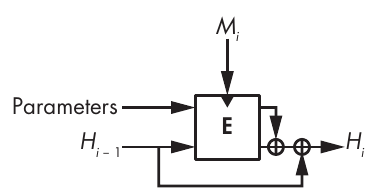

Hình 6-8: Compression function của BLAKE2. Hai nửa của state được XOR với nhau sau block cipher.

Block cipher trong compression function của BLAKE2 dựa trên stream cipher ChaCha, bản thân nó là một biến thể của stream cipher Salsa20 đã thảo luận trong Chương 5. Bên trong block cipher này, phép toán cốt lõi của BLAKE2b gồm chuỗi phép toán sau, biến đổi một state gồm bốn word 64-bit bằng hai word message, M<sub>i</sub> và M<sub>j</sub>:

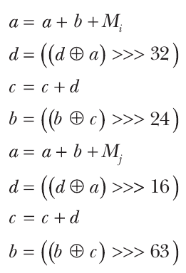

Phép toán cốt lõi của BLAKE2s tương tự nhưng làm việc với word 32-bit thay vì 64-bit (và do đó dùng các giá trị xoay khác).

Cuối cùng nhưng không kém phần quan trọng, BLAKE3 là một phiên bản của BLAKE2 dễ song song hóa hơn, đơn giản hơn, linh hoạt hơn và nhanh hơn, được giới thiệu năm 2020 tại hội nghị Real World Crypto. Được thiết kế bởi Jack O’Connor, Samuel Neves, Zooko Wilcox-O’Hearn và tôi, BLAKE3 đã nhanh chóng trở thành một trong những hash function phổ biến nhất nhờ những ưu điểm không thể phủ nhận của nó. Để biết thêm chi tiết, xem https://github.com/BLAKE3-team/BLAKE3.

## Những gì có thể sai (How Things Can Go Wrong)

Dù có vẻ đơn giản, hash function có thể gây ra những rắc rối security lớn khi được dùng sai chỗ hoặc sai cách—ví dụ, khi dùng các checksum algorithm yếu như CRC thay vì một crypto hash để kiểm tra tính toàn vẹn của file trong các ứng dụng truyền dữ liệu qua mạng. Tuy nhiên, điểm yếu này chẳng là gì so với những điểm yếu khác, vốn có thể khiến các hash function tưởng chừng an toàn bị xâm phạm hoàn toàn. Bạn sẽ thấy hai ví dụ thất bại: ví dụ thứ nhất áp dụng cho SHA-1 và SHA-2 nhưng không cho BLAKE2 hay SHA-3, còn ví dụ thứ hai áp dụng cho cả bốn function này.

### Length-Extension Attack

Hình 6-9 cho thấy length-extension attack, mối đe dọa chính đối với cấu trúc Merkle–Damgård.

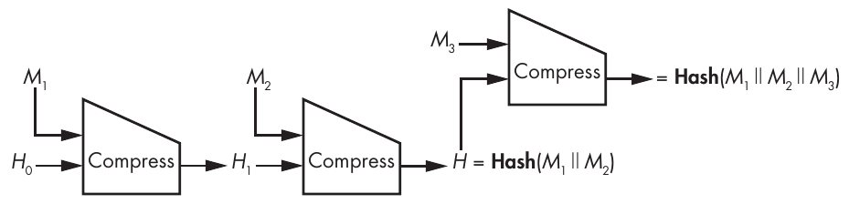

Hình 6-9: Minh họa length-extension attack

Về cơ bản, nếu bạn biết Hash(M) của một message chưa biết, M, gồm các block M<sub>1</sub> và M<sub>2</sub> (sau khi padding), bạn có thể xác định Hash(M<sub>1</sub> || M<sub>2</sub> || M<sub>3</sub>) với bất kỳ block M<sub>3</sub> nào. Vì hash của M<sub>1</sub> || M<sub>2</sub> là chaining value theo ngay sau M<sub>2</sub>, bạn có thể thêm một block khác, M<sub>3</sub>, vào message đã được hash, dù bạn không biết dữ liệu đã được hash. Hơn nữa, thủ thuật này tổng quát hóa được cho bất kỳ số block nào trong message chưa biết (ở đây là M<sub>1</sub> || M<sub>2</sub>) hoặc trong phần hậu tố (M<sub>3</sub>).

Nhìn chung, length-extension attack sẽ không ảnh hưởng đến phần lớn ứng dụng của hash function, nhưng nó có thể xâm phạm security nếu hash được dùng một cách hơi quá sáng tạo. Đáng tiếc là các hash function SHA-2 dễ bị length-extension attack, dù NSA đã thiết kế các function này và NIST đã chuẩn hóa chúng trong khi cả hai đều biết rõ lỗi này. Lỗi này lẽ ra có thể tránh được chỉ bằng cách làm cho lần gọi compression function cuối cùng khác với mọi lần gọi khác (ví dụ, bằng cách nhận một bit 1 làm tham số bổ sung trong khi các lần gọi trước nhận một bit 0). Đó là điều BLAKE2 làm.

### Đánh lừa các protocol Proof-of-Storage

Các ứng dụng cloud computing dùng hash function trong các protocol proof-of-storage—tức là các protocol trong đó một server (nhà cung cấp cloud) chứng minh với một client (người dùng của một dịch vụ cloud storage) rằng server thực sự có lưu trữ các file mà nó phải lưu thay cho client.

Năm 2007, bài báo “SafeStore: A Durable and Practical Storage System” (https://www.cs.utexas.edu/~lorenzo/papers/p129-kotla.pdf) của Ramakrishna Kotla, Lorenzo Alvisi và Mike Dahlin đã đề xuất một protocol proof-of-storage để xác minh việc lưu trữ một file nào đó, M, như sau:

1. Client chọn một giá trị ngẫu nhiên, C, làm challenge.

2. Server tính Hash(M || C) làm response và gửi kết quả cho client.

3. Client cũng tính Hash(M || C) và kiểm tra xem nó có khớp với giá trị nhận được từ server hay không.

Tiền đề của bài báo là server không thể đánh lừa client, vì nếu server không biết M, nó không thể đoán được Hash(M || C). Nhưng có một vấn đề: trong thực tế, Hash là một iterated hash xử lý đầu vào của nó theo từng block, tính các chaining value trung gian giữa mỗi block. Ví dụ, nếu Hash là SHA-256 và M dài 512 bit (kích thước một block trong SHA-256), server có thể gian lận. Bằng cách nào? Lần đầu tiên server nhận được M, nó tính H<sub>1</sub> = Compress(H<sub>0</sub>, M<sub>1</sub>), chaining value thu được từ giá trị ban đầu của SHA-256, H<sub>0</sub>, và từ M 512-bit. Sau đó, nó ghi lại H<sub>1</sub> trong memory và bỏ M đi, kể từ thời điểm đó nó không còn lưu M nữa.

Khi client gửi một giá trị ngẫu nhiên, C, server tính Compress(H<sub>1</sub>, C), sau khi thêm padding vào C để đầy một block hoàn chỉnh, và trả về kết quả như là Hash(M || C). Khi đó, client tin rằng vì server đã trả về đúng giá trị của Hash(M || C), nó đang giữ toàn bộ message—chỉ có điều có thể không phải vậy, như bạn đã thấy.

Thủ thuật này có tác dụng với SHA-1, SHA-2, cũng như SHA-3 và BLAKE2. Giải pháp rất đơn giản: hãy yêu cầu Hash(C || M) thay vì Hash(M || C).

## Đọc thêm (Further Reading)

Để tìm hiểu thêm về hash function, hãy đọc các tác phẩm kinh điển từ những năm 1980 và ’90: các bài báo nghiên cứu như “One Way Hash Functions and DES” của Ralph Merkle và “A Design Principle for Hash Functions” của Ivan Damgård. Hãy đọc thêm nghiên cứu kỹ lưỡng đầu tiên về hashing block cipher–based, “Hash Functions Based on Block Ciphers: A Synthetic Approach” của Bart Preneel, René Govaerts và Joos Vandewalle.

Để biết thêm về collision search, hãy đọc bài báo năm 1997 “Parallel Collision Search with Cryptanalytic Applications” của Paul van Oorschot và Michael Wiener. Để tìm hiểu thêm về các security notion lý thuyết làm nền tảng cho preimage resistance và collision resistance, cũng như length-extension attack, hãy tìm hiểu về indifferentiability.

Để biết các nghiên cứu gần đây hơn về hash function, hãy xem kho lưu trữ của cuộc thi SHA-3, bao gồm tất cả các algorithm khác nhau và cách chúng bị phá. Bạn sẽ tìm thấy nhiều tài liệu tham khảo trên SHA-3 Zoo tại https://ehash.iaik.tugraz.at/wiki/The_SHA-3_Zoo.html, và trên trang của NIST, https://csrc.nist.gov/projects/hash-functions/sha-3-project.

Để biết thêm về Keccak, người chiến thắng SHA-3, và về sponge function, hãy xem https://keccak.team/sponge_duplex.html, trang chính thức của những người thiết kế Keccak.

Cuối cùng, bạn có thể tìm hiểu hai vụ khai thác thực tế sau đối với các hash function yếu:

• Malware nation-state Flame đã khai thác một collision MD5 để tạo ra một certificate giả mạo và giả làm một phần mềm hợp pháp.

• Máy chơi game Xbox đã dùng một block cipher yếu (gọi là TEA) để xây dựng một hash function, và điều này đã bị khai thác để hack máy và chạy code tùy ý trên đó.
