# Chương 7: Keyed Hashing

Các hash function trong Chương 6 nhận một message và trả về hash value của nó—thường là một chuỗi ngắn 256 hoặc 512 bit. Bất kỳ ai cũng có thể tính hash value của một message và kiểm chứng rằng một message cụ thể hash ra một giá trị cụ thể. Tuy nhiên, khi bạn chỉ muốn những người cụ thể tính được hash, bạn sẽ hash bằng secret key, dùng keyed hash function.

Keyed hashing là nền tảng của hai loại cryptographic algorithm: message authentication code (MAC), dùng để xác thực một message và bảo vệ tính toàn vẹn của nó, và pseudorandom function (PRF), dùng để tạo ra các giá trị hash-sized random-looking. Chúng ta sẽ xem xét những điểm tương đồng giữa MAC và PRF trong mục đầu tiên của chương này, trước khi xem MAC và PRF hoạt động như thế nào. Một số MAC và PRF dựa trên hash function, một số dựa trên block cipher, và số khác là các thiết kế nguyên bản. Cuối cùng, chúng ta sẽ thảo luận các ví dụ về attack nhắm vào những MAC otherwise-secure.

## Message Authentication Code (Message Authentication Codes)

Một MAC bảo vệ tính toàn vẹn và tính xác thực của một message bằng cách tạo ra một giá trị T = MAC(K, M), gọi là authentication tag của message M (thường được gọi một cách gây nhầm lẫn là MAC của M). Giống như bạn có thể giải mã một message nếu biết key của cipher, bạn có thể xác nhận một message chưa bị sửa đổi nếu biết key của MAC.

Ví dụ, giả sử Alex và Bill dùng chung một key, K, và Alex gửi một message, M, cho Bill kèm authentication tag của nó, T = MAC(K, M). Khi nhận được message và authentication tag của nó, Bill tính lại MAC(K, M) và kiểm tra xem nó có bằng authentication tag nhận được hay không. Vì chỉ Alex mới có thể tính được giá trị này, Bill biết rằng message không bị hỏng trên đường truyền (xác nhận tính toàn vẹn của nó), dù là vô tình hay cố ý, và rằng Alex đã gửi message đó (xác nhận tính xác thực của nó).

### MAC trong liên lạc an toàn (MACs in Secure Communication)

Các hệ thống liên lạc an toàn thường kết hợp một cipher và một MAC để bảo vệ tính bí mật, tính toàn vẹn và tính xác thực của message. Ví dụ, các protocol trong Internet Protocol Security (IPsec), SSH và TLS tạo ra một MAC cho mỗi network packet được truyền.

Không phải hệ thống liên lạc nào cũng dùng MAC. Đôi khi một authentication tag có thể làm tăng overhead không thể chấp nhận được cho mỗi packet, thường trong khoảng 64 đến 128 bit. Ví dụ, tiêu chuẩn điện thoại di động GSM cũ mã hóa các packet chứa cuộc gọi thoại nhưng không xác thực chúng. Kẻ tấn công có thể sửa đổi tín hiệu âm thanh đã mã hóa, và người nhận sẽ không nhận ra.

### Forgery và Chosen-Message Attacks

Một MAC an toàn có nghĩa là gì? Trước hết, cũng như với một cipher, secret key phải được giữ bí mật. Nếu một MAC an toàn, kẻ tấn công không thể tạo ra tag của một message nào đó nếu họ không biết key. Chúng ta gọi một cặp message/tag bị làm giả là một forgery, và việc khôi phục key là một trường hợp cụ thể của một lớp forgery attack tổng quát hơn. Security notion cho rằng phải không thể tìm ra forgery được gọi là unforgeability. Ngoài ra, cũng phải không thể khôi phục secret key từ một danh sách tag; nếu không, kẻ tấn công có thể làm giả tag bằng key đó.

Kẻ tấn công có thể làm gì để phá một MAC? Nói cách khác, attack model là gì? Attack model cơ bản nhất là known-message attack, thu thập một cách thụ động các message và tag tương ứng của chúng (ví dụ, bằng cách nghe lén trên mạng). Nhưng kẻ tấn công thực tế thường có thể tiến hành các attack chủ động, vì họ có thể chọn các message cần xác thực và do đó có được MAC của message họ muốn. Vì vậy, model tiêu chuẩn là chosen-message attack, trong đó kẻ tấn công có được tag cho các message do họ chọn.

### Replay attack (Replay Attacks)

MAC không an toàn trước các attack liên quan đến việc phát lại (replay) tag. Ví dụ, nếu bạn nghe lén liên lạc của Alex và Bill, bạn có thể bắt được một message và tag của nó do Alex gửi cho Bill, rồi sau đó gửi lại chúng cho Bill, giả làm Alex. Để ngăn chặn các replay attack như vậy, các protocol đưa một số thứ tự message vào mỗi message. Số này được tăng lên cho mỗi message mới và được MAC xác thực cùng với message. Bên nhận nhận được các message được đánh số 1, 2, 3, 4, v.v. Do đó, nếu kẻ tấn công cố gửi lại message 1, bên nhận sẽ nhận ra rằng message này không đúng thứ tự và có khả năng là một bản phát lại của message 1 trước đó.

## Pseudorandom Function (Pseudorandom Functions)

Một PRF dùng một secret key để trả về PRF(K, M) sao cho đầu ra trông ngẫu nhiên. Vì key là bí mật, các giá trị đầu ra không thể đoán trước đối với kẻ tấn công.

Khác với MAC, PRF không nhằm để dùng riêng lẻ mà là một phần của một cryptographic algorithm hoặc protocol. Ví dụ, bạn có thể dùng PRF để tạo block cipher trong cấu trúc Feistel—xem “How to Construct Block Ciphers” trong Chương 4. Các key derivation scheme dùng PRF để tạo cryptographic key từ một master key hoặc mật khẩu, và các identification scheme dùng PRF để tạo một response từ một challenge ngẫu nhiên. (Về cơ bản, server gửi một message challenge ngẫu nhiên, M, và client trả về PRF(K, M) trong response của nó để chứng minh rằng nó biết K.) Tiêu chuẩn điện thoại 5G dùng một PRF để xác thực SIM card và nhà cung cấp dịch vụ của nó, và một PRF tương tự tạo ra encryption key và MAC key được dùng trong một cuộc gọi. Protocol TLS dùng một PRF để tạo key material từ một master secret cũng như các giá trị ngẫu nhiên session-specific. Thậm chí còn có một PRF trong function noncryptographic hash() được tích hợp sẵn trong ngôn ngữ Python để so sánh các object.

### Security của PRF (PRF Security)

Để an toàn, một pseudorandom function không được có pattern nào phân biệt đầu ra của nó với các giá trị thực sự ngẫu nhiên. Một kẻ tấn công không biết key, K, sẽ không thể phân biệt đầu ra của PRF(K, M) với các giá trị ngẫu nhiên. Nhìn theo cách khác, kẻ tấn công không được có bất kỳ cách nào để biết họ đang làm việc với một PRF algorithm hay với một function ngẫu nhiên. Cụm từ uyên bác cho security notion đó là “ indistinguishability from a random function” (không thể phân biệt với một function ngẫu nhiên). (Để tìm hiểu thêm về nền tảng lý thuyết của PRF, xem Volume 1, Section 3.6 của Foundations of Cryptography của Goldreich.)

### PRF mạnh hơn MAC (PRFs Are Stronger Than MACs)

PRF và MAC đều là keyed hash, nhưng PRF về cơ bản mạnh hơn MAC vì MAC có yêu cầu security yếu hơn. Trong khi bạn coi một MAC là an toàn nếu kẻ tấn công không thể làm giả tag—tức là nếu họ không thể đoán được đầu ra của MAC—thì một PRF chỉ an toàn nếu đầu ra của nó là các chuỗi ngẫu nhiên không thể phân biệt được. Nếu bạn không thể phân biệt đầu ra của một PRF với các chuỗi ngẫu nhiên, điều này ngụ ý rằng giá trị của chúng không thể bị đoán; nói cách khác, bất kỳ PRF an toàn nào cũng là một MAC an toàn.

Tuy nhiên, điều ngược lại không đúng: một MAC an toàn không nhất thiết là một PRF an toàn. Ví dụ, giả sử bạn bắt đầu với một PRF an toàn, PRF1, và bạn muốn xây dựng một PRF thứ hai, PRF2, từ nó, như sau:

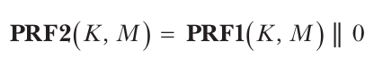

Vì đầu ra của PRF2 được định nghĩa là đầu ra của PRF1 theo sau bởi một bit 0, nó không trông ngẫu nhiên như một chuỗi thực sự ngẫu nhiên, và bạn có thể phân biệt đầu ra của nó nhờ bit 0 cuối cùng đó. Do đó, PRF2 không phải là một PRF an toàn. Tuy nhiên, vì PRF1 an toàn, PRF2 vẫn sẽ là một MAC an toàn. Nếu bạn có thể làm giả một tag, T = PRF2(K, M), cho một M nào đó, thì bạn cũng có thể làm giả một tag cho PRF1, điều mà ngay từ đầu bạn đã biết là không thể vì PRF1 là một MAC an toàn. Như vậy, PRF2 là một keyed hash là MAC an toàn nhưng không phải PRF an toàn.

Nhưng đừng lo: bạn sẽ không gặp những cấu trúc MAC như vậy trong các ứng dụng thực tế. Thực tế, nhiều MAC đã được triển khai hoặc chuẩn hóa cũng là các PRF an toàn và thường được dùng theo cả hai vai trò. Ví dụ, TLS dùng algorithm HMAC-SHA-256 vừa làm MAC vừa làm PRF.

## Cách tạo keyed hash từ unkeyed hash (How to Create Keyed Hashes from Unkeyed Hashes)

Trong suốt lịch sử cryptography, MAC và PRF hiếm khi được thiết kế từ đầu mà thường được xây dựng từ các algorithm có sẵn, thường là hash function hoặc block cipher. Có vẻ hiển nhiên là bạn có thể tạo ra một keyed hash function bằng cách đưa một key và một message vào một hash function (unkeyed), nhưng nói thì dễ hơn làm.

### Cấu trúc Secret-Prefix

Kỹ thuật đầu tiên chúng ta sẽ xem xét, cấu trúc secret-prefix, biến một hash function thông thường thành một keyed hash bằng cách nối key vào trước message và trả về Hash(K || M). Cách tiếp cận này không an toàn khi hash function dễ bị length-extension attack (xem “The Length-Extension Attack” trong Chương 6) và khi hash hỗ trợ các key có độ dài khác nhau.

#### Không an toàn trước Length-Extension Attacks

Hãy nhớ lại từ Chương 6 rằng các hash function thuộc họ SHA-2 cho phép kẻ tấn công tính hash của một message chưa biết một phần khi có hash của một phiên bản ngắn hơn của message đó. Nói một cách hình thức, length-extension attack cho phép kẻ tấn công tính Hash(K || M<sub>1</sub> || M<sub>2</sub>) khi chỉ có Hash(K || M<sub>1</sub>) mà không có M<sub>1</sub> lẫn K. Các function này cho phép kẻ tấn công làm giả các MAC tag hợp lệ một cách miễn phí, vì lẽ ra họ không thể đoán được MAC của M<sub>1</sub> || M<sub>2</sub> khi chỉ có MAC của M<sub>1</sub>. Thực tế này khiến cấu trúc secret-prefix không an toàn khi dùng làm MAC và PRF, chẳng hạn khi dùng nó với SHA-256 hoặc SHA-512. Việc cho phép length-extension attack là một điểm yếu của Merkle–Damgård, và không ứng viên chung kết SHA-3 nào có điểm yếu này. Khả năng ngăn chặn length-extension attack là bắt buộc đối với các bài gửi SHA-3 (xem Chương 6).

#### Không an toàn với các độ dài key khác nhau (Insecurity with Different Key Lengths)

Cấu trúc secret-prefix cũng không an toàn khi cho phép dùng các key có độ dài khác nhau. Ví dụ, nếu key K là chuỗi hexadecimal 24-bit 123abc và M là def00, thì Hash() xử lý giá trị K || M = 123abcdef00. Nếu thay vào đó K là chuỗi 16-bit 123a và M là bcdef000, thì Hash() cũng xử lý K || M = 123abcdef00. Do đó, kết quả của cấu trúc secret-prefix Hash(K || M) là như nhau với cả hai key.

Vấn đề này không phụ thuộc vào hash bên dưới; bạn có thể khắc phục nó bằng cách hash độ dài của key cùng với key và message—ví dụ, bằng cách mã hóa độ dài bit của key thành một số nguyên 16-bit, L, rồi hash Hash(L || K || M). Tuy nhiên, bạn không cần phải làm vậy, vì các hash function hiện đại như BLAKE2 và SHA-3 có một keyed mode tránh được những cạm bẫy này và cho ra một PRF an toàn, do đó cũng là một MAC an toàn.

### Cấu trúc Secret-Suffix

Thay vì hash key trước message như trong cấu trúc secret-prefix, bạn có thể hash nó sau. Và đó chính xác là cách cấu trúc secret-suffix hoạt động, bằng cách xây dựng một PRF từ một hash function dưới dạng Hash(M || K).

Đặt key ở cuối tạo ra khác biệt khá lớn. Một length-extension attack có tác dụng với các MAC secret-prefix sẽ không có tác dụng với secret suffix. Áp dụng length extension cho một MAC secret-suffix cho ra Hash(M<sub>1</sub> || K || M<sub>2</sub>) từ Hash(M<sub>1</sub> || K), nhưng đây không phải là một attack hợp lệ vì Hash(M<sub>1</sub> || K || M<sub>2</sub>) không phải là một MAC secret-suffix hợp lệ; key cần nằm ở cuối.

Tuy nhiên, cấu trúc secret-suffix lại yếu hơn trước một loại attack khác. Giả sử bạn có một collision cho hash Hash(M<sub>1</sub>) = Hash(M<sub>2</sub>), trong đó M<sub>1</sub> và M<sub>2</sub> là hai message khác nhau, có thể có kích thước khác nhau. Trong trường hợp một hash function M–D như SHA-256, điều này ngụ ý rằng Hash(M<sub>1</sub>|| P<sub>1</sub> || K) và Hash(M<sub>2</sub> || P<sub>2</sub> || K) cũng sẽ bằng nhau, trong đó P<sub>1</sub> và P<sub>2</sub> là dữ liệu padding được thêm vào để đầy một block. Sau khi xử lý M<sub>1</sub> || P<sub>1</sub>, state của hash function giống như sau khi xử lý M<sub>2</sub> || P<sub>2</sub>. Thêm K vào mỗi instance vẫn giữ nguyên sự bằng nhau của state, dẫn đến một collision bất kể giá trị của K.

Để khai thác tính chất này, kẻ tấn công:

1. Tìm hai message va chạm nhau, M<sub>1</sub> và M<sub>2</sub>

2. Yêu cầu MAC tag của M<sub>1</sub>, Hash(M<sub>1</sub> || K)

3. Đoán rằng Hash(M<sub>2</sub> || K) cũng như vậy, nhờ đó làm giả được một tag hợp lệ và phá security của MAC

### Cấu trúc HMAC (The HMAC Construction)

Cấu trúc hash-based MAC (HMAC) cho phép bạn xây dựng một MAC từ một hash function, an toàn hơn cả secret prefix lẫn secret suffix. HMAC cho ra một PRF an toàn chừng nào hash bên dưới có collision resistance, nhưng ngay cả khi không phải vậy, HMAC vẫn cho ra một PRF an toàn nếu compression function của hash là một PRF. Các protocol liên lạc an toàn IPsec, SSH và TLS đều đã dùng HMAC. (Bạn sẽ tìm thấy đặc tả HMAC trong tiêu chuẩn NIST FIPS 198-1 và trong RFC 2104.)

HMAC dùng một hash function, Hash, để tính một MAC tag, như Hình 7-1 cho thấy và theo biểu thức sau:

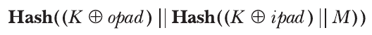

Giá trị opad (outer padding) là chuỗi hexadecimal 5c5c5c...5c dài bằng block size của Hash. Key, K, thường ngắn hơn một block, được lấp đầy bằng các byte 00 và XOR với opad. Ví dụ, nếu K là chuỗi 1-byte 00, thì K ⊕ opad = opad. (Điều tương tự cũng đúng nếu K là chuỗi all-zero có độ dài bất kỳ tới độ dài của một block.) K ⊕ opad là block đầu tiên được xử lý bởi lời gọi Hash bên ngoài—cụ thể là Hash ngoài cùng bên trái trong phương trình trên, hay hash phía dưới trong Hình 7-1.

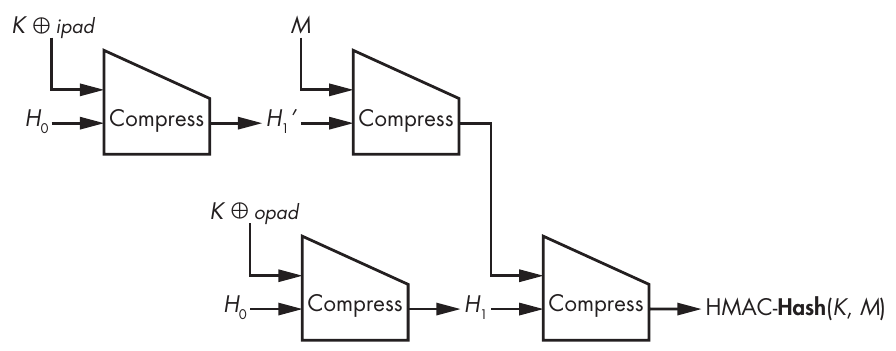

Hình 7-1: Cấu trúc HMAC hash-based MAC cho một hash function dựa trên compression function

Giá trị ipad (inner padding) là một chuỗi (363636 . . . 36) dài bằng block size của Hash và được hoàn thiện bằng các byte 00. Block thu được là block đầu tiên được xử lý bởi lời gọi Hash bên trong—cụ thể là Hash ngoài cùng bên phải trong phương trình, hay hash phía trên trong Hình 7-1.

> **LƯU Ý** Envelope method là một cấu trúc an toàn hơn secret prefix hay secret suffix. Nó được biểu diễn là Hash(K || M || K), một sandwich MAC, nhưng về lý thuyết nó kém an toàn hơn HMAC.

Nếu SHA-256 là hash function được dùng làm Hash, thì bạn gọi instance HMAC đó là HMAC-SHA-256. Tổng quát hơn, bạn gọi HMAC-Hash là một instance HMAC dùng hash function Hash. Điều đó có nghĩa là nếu ai đó yêu cầu bạn dùng HMAC, bạn nên luôn hỏi: “Hash function nào?”

### Một attack tổng quát nhắm vào các MAC Hash-Based

Có một attack hoạt động với mọi MAC dựa trên một iterated hash function. Hãy nhớ lại attack trong “The Secret-Suffix Construction” ở trang 143, nơi chúng ta dùng một hash collision để có được một collision của MAC. Bạn có thể dùng cùng chiến lược để tấn công một MAC secret-prefix hoặc HMAC, dù hậu quả ít tàn khốc hơn.

Hình 7-2 minh họa MAC secret-prefix Hash(K || M).

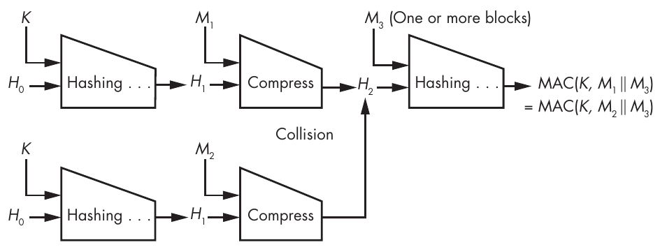

Hình 7-2: Nguyên lý của generic forgery attack nhắm vào các MAC hash-based

Nếu digest dài n bit, bạn có thể tìm hai message, M<sub>1</sub> và M<sub>2</sub>, sao cho Hash(K || M<sub>1</sub>) = Hash(K || M<sub>2</sub>), bằng cách yêu cầu xấp xỉ 2<sup>n/2</sup> MAC tag từ hệ thống đang giữ key. (Hãy nhớ lại birthday attack từ Chương 6.) Nếu hash cho phép length extension, như SHA-256, thì bạn có thể dùng M<sub>1</sub> và M<sub>2</sub> để làm giả MAC bằng cách chọn một dữ liệu tùy ý nào đó, M<sub>3</sub>, rồi query MAC oracle để lấy Hash(K || M<sub>1</sub> || M<sub>3</sub>), tức là MAC của message M<sub>1</sub> || M<sub>3</sub>. Hóa ra đây cũng là MAC của message M<sub>2</sub> || M<sub>3</sub>, vì internal state của hash với M<sub>1</sub> và M<sub>3</sub> và với M<sub>2</sub> và M<sub>3</sub> là như nhau. Bạn đã làm giả thành công một MAC tag. (Công sức trở nên không khả thi khi n lớn hơn, chẳng hạn, 128 bit.)

Attack này có tác dụng ngay cả khi hash function không dễ bị length extension, và nó cũng có tác dụng với HMAC. Đó là vì tất cả những gì cần thiết là một collision bên trong hash function chứ không nhất thiết trong toàn bộ hash. Chi phí của attack phụ thuộc vào cả kích thước chaining value lẫn độ dài của MAC: nếu chaining value của một MAC dài 512 bit và tag của nó dài 128 bit, một phép tính 2<sup>64</sup> sẽ tìm được một MAC collision nhưng có lẽ không tìm được collision trong internal state, vì tìm một collision như vậy cần trung bình 2<sup>512/2</sup> = 2<sup>256</sup> phép toán.

## Cách tạo keyed hash từ block cipher (How to Create Keyed Hashes from Block Ciphers)

Compression function trong nhiều hash function được xây dựng trên block cipher (xem Chương 6). Ví dụ, PRF HMAC-SHA-256 là một chuỗi lời gọi tới compression function của SHA-256, vốn là một block cipher lặp lại một chuỗi round. Nói cách khác, HMAC-SHA-256 là một block cipher nằm trong một compression function nằm trong một hash nằm trong cấu trúc HMAC. Vậy sao không dùng trực tiếp một block cipher thay vì xây dựng một cấu trúc nhiều lớp như vậy?

Cipher-based MAC (CMAC) chính là một cấu trúc như vậy: nó tạo ra một MAC chỉ với một block cipher, như AES. Dù kém phổ biến hơn HMAC, CMAC được triển khai trong nhiều hệ thống, bao gồm protocol Internet Key Exchange (IKE), một phần của bộ IPsec. Ví dụ, IKE tạo key material bằng cấu trúc AES-CMAC-PRF-128 làm core algorithm (tức CMAC dựa trên AES với đầu ra 128-bit). CMAC được đặc tả trong RFC 4493.

### Phá CBC-MAC

CMAC được thiết kế năm 2005 như một phiên bản cải tiến của CBC-MAC, một MAC block cipher–based đơn giản hơn, bắt nguồn từ mode of operation cipher block chaining (CBC) của block cipher (xem “Modes of Operation” trong Chương 4).

CBC-MAC, tổ tiên của CMAC, rất đơn giản: để tính tag của một message, M, với một block cipher, E, hãy mã hóa M ở CBC mode với initial value (IV) all-zero và bỏ đi mọi ciphertext block trừ block cuối cùng. Tức là hãy tính

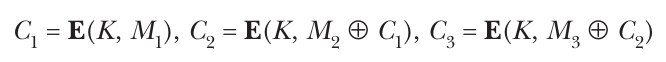

và cứ thế cho mỗi block của M và chỉ giữ lại C<sub>i</sub> cuối cùng—đó là CBC-MAC tag của bạn cho M—đơn giản, và dễ bị tấn công.

Để hiểu vì sao CBC-MAC không an toàn, hãy xét CBC-MAC tag, T<sub>1</sub> = E(K, M<sub>1</sub>), của một message single-block, M<sub>1</sub>, và tag, T<sub>2</sub> = E(K, M<sub>2</sub>), của một message single-block khác, M<sub>2</sub>. Với hai cặp này, (M<sub>1</sub>, T<sub>1</sub>) và (M<sub>2</sub>, T<sub>2</sub>), bạn có thể suy ra rằng T<sub>2</sub> cũng là tag của message two-block M<sub>1</sub> || (M<sub>2</sub> ⊕ T<sub>1</sub>). Nếu bạn áp dụng CBC-MAC cho M<sub>1</sub> || (M<sub>2</sub> ⊕ T<sub>1</sub>) và tính C<sub>1</sub> = E(K, M<sub>1</sub>) = T<sub>1</sub> rồi tiếp đến C<sub>2</sub> = E(K, (M<sub>2</sub> ⊕ T<sub>1</sub>) ⊕ T<sub>1</sub>) = E(K, M<sub>2</sub>) = T<sub>2</sub>, bạn có thể tạo ra cặp message/tag thứ ba từ hai cặp message/tag mà không cần biết key. Tức là bạn có thể làm giả CBC-MAC tag, nhờ đó phá security của CBC-MAC.

### Sửa CBC-MAC

CMAC sửa CBC-MAC bằng cách xử lý block cuối cùng bằng một key khác với các block trước đó. Để làm điều này, trước tiên CMAC suy ra hai key, K<sub>1</sub> và K<sub>2</sub>, từ main key, K, sao cho K, K<sub>1</sub> và K<sub>2</sub> khác nhau. CMAC xử lý block cuối cùng bằng K<sub>1</sub> hoặc K<sub>2</sub>, trong khi các block trước đó dùng K.

Để xác định K<sub>1</sub> và K<sub>2</sub>, trước tiên CMAC tính một giá trị tạm thời, L = E(0, K), trong đó 0 đóng vai trò key của block cipher và K đóng vai trò plaintext block. Sau đó, CMAC đặt K<sub>1</sub> bằng (L << 1) nếu bit có trọng số cao nhất (most significant bit, MSB) của L là 0, và bằng (L << 1) ⊕ 87 nếu MSB của L là 1. (Số hexadecimal 87, tức 135 trong hệ thập phân, được chọn vì các tính chất toán học của nó khi các data block dài 128 bit; cần một giá trị khác khi block không dài 128 bit.) Key K<sub>2</sub> được đặt bằng (K<sub>1</sub> << 1) nếu MSB của K<sub>1</sub> là 0, và bằng K<sub>2</sub> = (K<sub>1</sub> << 1) ⊕ 87 trong trường hợp ngược lại.

Với K<sub>1</sub> và K<sub>2</sub>, CMAC hoạt động giống CBC-MAC, ngoại trừ block cuối cùng. Nếu mẩu message cuối cùng M<sub>n</sub> có đúng kích thước một block, CMAC trả về E(K, M<sub>n</sub> ⊕ C<sub>n</sub> <sub>−</sub> <sub>1</sub> ⊕ K<sub>1</sub>) làm tag, như Hình 7-3 minh họa.

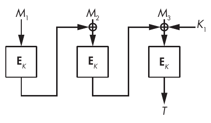

Hình 7-3: Cấu trúc MAC block cipher–based CMAC khi message là một chuỗi các block nguyên vẹn

Nếu M<sub>n</sub> có ít bit hơn một block, CMAC pad nó bằng một bit 1 và các số 0 rồi trả về E(K, M<sub>n</sub> ⊕ C<sub>n</sub> <sub>−</sub> <sub>1</sub> ⊕ K<sub>2</sub>) làm tag, như trong Hình 7-4.

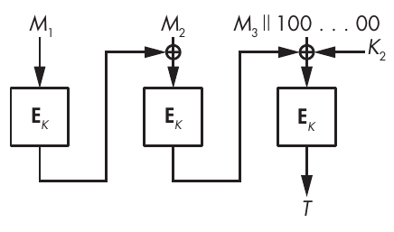

Hình 7-4: Cấu trúc MAC block cipher–based CMAC khi block cuối cùng của message phải được pad bằng 1 bit và các số không để đầy một block

Trường hợp thứ nhất chỉ dùng K<sub>1</sub> và trường hợp thứ hai chỉ dùng K<sub>2</sub>, nhưng cả hai đều dùng main key K để xử lý các mẩu message đứng trước mẩu cuối cùng.

Khác với CBC encryption mode, CMAC không nhận IV làm tham số và mang tính tất định: với cùng một key, CMAC luôn trả về cùng một tag cho một message cho trước, M, vì việc tính CMAC(M) không được ngẫu nhiên hóa—và điều đó không sao, vì khác với encryption, việc tính MAC không cần được ngẫu nhiên hóa để an toàn, điều này loại bỏ gánh nặng phải chọn IV ngẫu nhiên.

## Các thiết kế MAC chuyên dụng (Dedicated MAC Designs)

Bạn đã thấy cách tái sử dụng hash function và block cipher để xây dựng các PRF an toàn chừng nào hash hoặc cipher bên dưới còn an toàn. Các scheme như HMAC và CMAC chỉ đơn giản kết hợp các hash function hoặc block cipher có sẵn để cho ra một PRF hoặc MAC an toàn. Tái sử dụng các algorithm có sẵn là tiện lợi, nhưng liệu đó có phải là cách tiếp cận hiệu quả nhất?

Theo trực giác, PRF và MAC lẽ ra phải cần ít công sức hơn để an toàn so với unkeyed hash function—việc chúng dùng secret key ngăn kẻ tấn công nghịch với algorithm vì họ không có key. Ngoài ra, PRF và MAC chỉ để lộ một tag ngắn cho kẻ tấn công, khác với block cipher, vốn để lộ một ciphertext dài bằng message. Do đó, PRF và MAC không cần đến sức mạnh tối đa của hash function hay block cipher—đây chính là ý nghĩa của thiết kế chuyên dụng (dedicated design), tức các algorithm được tạo ra chỉ để làm PRF hoặc MAC.

Các mục sau tập trung vào hai algorithm như vậy: Poly1305 và SipHash. Tôi sẽ giải thích các nguyên tắc thiết kế của chúng và vì sao chúng (rất có thể) an toàn.

### Poly1305

Algorithm Poly1305 (phát âm là poly-thirteen-o-five) được thiết kế năm 2005 bởi Daniel J. Bernstein (người tạo ra stream cipher Salsa20 trong Chương 5 và cipher ChaCha, nguồn cảm hứng cho các hash function BLAKE và BLAKE2 trong Chương 6). Poly1305 được tối ưu để siêu nhanh trên các CPU hiện đại, và tại thời điểm tôi viết những dòng này, nó là một trong những algorithm được hỗ trợ trong TLS 1.3 và trong OpenSSH, cùng nhiều ứng dụng khác. Khác với Salsa20, thiết kế của Poly1305 được xây dựng trên các kỹ thuật có từ những năm 1970—cụ thể là universal hash function và cấu trúc Wegman–Carter.

#### Universal Hash Function (Universal Hash Functions)

MAC Poly1305 dùng một universal hash function. Một hash function như vậy yếu hơn một cryptographic hash function nhưng nhanh hơn nhiều. Chẳng hạn, universal hash function không cần có collision resistance.

Giống một PRF, một universal hash được tham số hóa bởi một secret key: với một message, M, và key, K, chúng ta sẽ viết UH(K, M) cho đầu ra của một universal hash function ký hiệu là UH. Một universal hash function chỉ có một yêu cầu security duy nhất: với bất kỳ hai message M<sub>1</sub> và M<sub>2</sub> nào, và một key ngẫu nhiên K, xác suất để UH(K, M<sub>1</sub>) bằng UH(K, M<sub>2</sub>) phải không đáng kể. Khác với một PRF, một universal hash không cần phải pseudorandom; chỉ đơn giản là không được có cặp (M<sub>1</sub>, M<sub>2</sub>) nào cho ra cùng một hash với nhiều key khác nhau. Vì các yêu cầu security của chúng dễ thỏa mãn hơn, universal hash function cần ít phép toán hơn và nhanh hơn PRF đáng kể.

Tuy nhiên, bạn chỉ có thể dùng một universal hash làm MAC để xác thực không quá một message. Ví dụ, hãy xét universal hash polynomial-evaluation được dùng trong Poly1305. (Xem bài báo kinh điển năm 1974 “Codes Which Detect Deception” của Edgar Gilbert, Jessie MacWilliams và Neil Sloane để biết thêm về khái niệm này.) Loại hash polynomial-evaluation này được tham số hóa bởi một số nguyên tố, p, và nhận đầu vào là một key gồm hai số, R và K, trong khoảng [1, p) và một message, M, gồm n block (M<sub>1</sub>, M<sub>2</sub>, . . . , M<sub>n</sub>). Sau đó, bạn tính đầu ra của universal hash như sau:

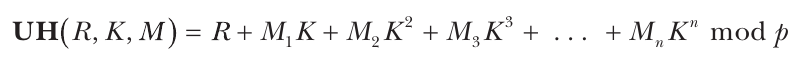

Trong phương trình này, dấu cộng (+) biểu thị phép cộng các số nguyên dương, K<sup>i</sup> là số K lũy thừa i, và “mod p” biểu thị phép rút gọn modulo p của kết quả (tức là phần dư của phép chia kết quả cho p; ví dụ, 12 mod 10 = 2, 10 mod 10 = 0, 8 mod 10 = 8, v.v.).

Vì bạn muốn thao tác hashing càng nhanh càng tốt, các MAC universal hash-based thường làm việc với message block 128 bit và với một số nguyên tố, p, lớn hơn 2<sup>128</sup> một chút, chẳng hạn 2<sup>128</sup> + 51. Độ rộng 128-bit cho phép có các implementation rất nhanh nhờ dùng hiệu quả các đơn vị số học 32- và 64-bit của các CPU thông dụng.

#### Các giới hạn security (Security Limitations)

Universal hash có một điểm yếu: vì một universal hash chỉ xác thực an toàn được một message, kẻ tấn công có thể phá MAC polynomial-evaluation trên chỉ bằng cách yêu cầu tag của hai message. Cụ thể, họ có thể yêu cầu tag cho một message mà mọi block đều bằng không—M<sub>1</sub> = M<sub>2</sub> = . . . = 0—để có được tag UH(R, K, 0) = R, nhờ đó tìm ra giá trị bí mật R. Ngoài ra, họ có thể yêu cầu tag cho một message trong đó M<sub>1</sub> = 1 và M<sub>2</sub> = M<sub>3</sub> = . . . = 0 (có tag là T = R + K), cho phép họ tìm ra K bằng cách lấy T trừ R. Giờ kẻ tấn công đã biết toàn bộ key (R, K) và có thể làm giả MAC cho bất kỳ message nào.

May thay, có một cách để đi từ single-message security đến multimessage security.

#### MAC Wegman–Carter (Wegman–Carter MACs)

Thủ thuật để xác thực nhiều message bằng một universal hash function xuất hiện nhờ các nhà nghiên cứu IBM Mark Wegman và Lawrence Carter cùng bài báo năm 1981 của họ “New Hash Functions and Their Use in Authentication and Set Equality.” Cấu trúc Wegman–Carter xây dựng một MAC từ một universal hash function và một PRF, dùng hai key, K<sub>1</sub> và K<sub>2</sub>, và nó trả về

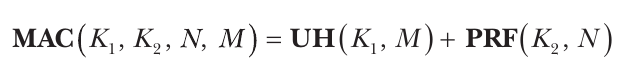

trong đó N là một nonce chỉ được dùng tối đa một lần cho mỗi key, K<sub>2</sub>, và đầu ra của PRF lớn bằng đầu ra của universal hash function UH. Bằng cách cộng hai giá trị này, đầu ra pseudorandom mạnh của PRF che đi điểm yếu cryptography của UH. Bạn có thể xem điều này như việc mã hóa kết quả của universal hash, trong đó PRF đóng vai trò một stream cipher và ngăn chặn attack trên bằng cách cho phép xác thực nhiều message với cùng một key, K<sub>1</sub>.

Tóm lại, cấu trúc Wegman–Carter UH(K<sub>1</sub>, M) + PRF(K<sub>2</sub>, N) cho ra một MAC an toàn nếu bạn giả định những điều sau:

• UH là một universal hash an toàn.

• PRF là một PRF an toàn.

• Mỗi nonce N chỉ được dùng một lần cho mỗi key K<sub>2</sub>.

• Các giá trị đầu ra của UH và PRF đủ dài để bảo đảm security đủ cao.

Bây giờ hãy xem Poly1305 tận dụng cấu trúc Wegman–Carter như thế nào để xây dựng một MAC vừa an toàn vừa nhanh.

#### Poly1305-AES

Poly1305 ban đầu được đề xuất dưới dạng Poly1305-AES, kết hợp universal hash Poly1305 với block cipher AES. Poly1305-AES nhanh hơn nhiều so với các MAC HMAC-based, hay thậm chí so với CMAC, vì nó chỉ tính một block AES và xử lý message song song thông qua một chuỗi phép toán số học đơn giản.

Với K<sub>1</sub>, K<sub>2</sub> và N 128-bit và message M, Poly1305-AES trả về như sau:

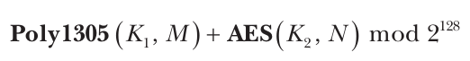

Phép rút gọn mod 2<sup>128</sup> bảo đảm rằng kết quả vừa trong 128 bit. Poly1305 phân tích message M thành một chuỗi block 128-bit (M<sub>1</sub>, M<sub>2</sub>, . . . , M<sub>n</sub>) và nối thêm bit thứ 129 vào bit có trọng số cao nhất của mỗi block để mọi block đều dài 129 bit. (Nếu block cuối cùng nhỏ hơn 16 byte, nó được pad bằng một bit 1 theo sau là các bit 0 trước bit thứ 129 cuối cùng.) Tiếp theo, Poly1305 tính giá trị đa thức để có được như sau:

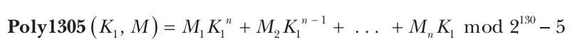

Kết quả của biểu thức này là một số nguyên dài tối đa 129 bit. Khi bạn cộng nó với giá trị 128-bit AES(K<sub>2</sub>, N), kết quả được rút gọn modulo 2<sup>128</sup> để tạo ra một MAC 128-bit.

> **LƯU Ý** Tôi đã mô tả Wegman–Carter như là dùng một PRF, nhưng AES không phải là một PRF, nó là một pseudorandom permutation (PRP). Tuy nhiên, điều đó không quan trọng, vì cấu trúc Wegman–Carter hoạt động tốt với cả PRP lẫn PRF. Đó là vì nếu bạn được cho một function là PRF hoặc PRP, rất khó xác định nó là PRF hay PRP chỉ bằng cách nhìn vào các giá trị đầu ra của function. Nói cách khác, phân biệt một PRP với một PRF là khó về mặt tính toán.

Phân tích security của Poly1305-AES (xem “The Poly1305-AES Message-Authentication Code” tại https://cr.yp.to/mac/poly1305-20050329.pdf) cho thấy Poly1305-AES là 128-bit secure chừng nào AES là một block cipher an toàn—và mọi thứ được triển khai đúng, như với bất kỳ cryptographic algorithm nào.

Bạn có thể kết hợp universal hash Poly1305 với các algorithm khác ngoài AES. Ví dụ, Poly1305 đã được dùng với stream cipher ChaCha (xem RFC 7539, “ChaCha20 and Poly1305 for IETF Protocols”). Chắc chắn Poly1305 sẽ tiếp tục được dùng ở bất cứ đâu cần một MAC nhanh.

Dù Poly1305 nhanh và an toàn, nó có một số nhược điểm. Thứ nhất, việc tính giá trị đa thức của nó khó triển khai một cách hiệu quả, đặc biệt là trong tay những người không quen với các khái niệm toán học liên quan. (Xem các ví dụ tại https://github.com/floodyberry/poly1305-donna.) Thứ hai, tự thân nó chỉ an toàn cho một message duy nhất trừ khi bạn dùng cấu trúc Wegman–Carter. Nhưng khi đó nó cần một nonce, và nếu nonce bị lặp lại, algorithm sẽ trở nên không an toàn. Cuối cùng, Poly1305 được tối ưu cho các message dài, nhưng nó là quá mức cần thiết nếu bạn chỉ xử lý các message nhỏ (chẳng hạn, ít hơn 128 byte). Trong những trường hợp như vậy, SipHash là một giải pháp tốt.

### SipHash

Tôi đã thiết kế SipHash năm 2012 cùng với Dan Bernstein, ban đầu để giải quyết một vấn đề noncryptographic: các denial-of-service attack nhắm vào hash table. Hash table là các cấu trúc dữ liệu, đặc biệt được dùng trong các ngôn ngữ lập trình để lưu trữ các phần tử bên trong một cách hiệu quả. Trước SipHash, hash table dựa vào các noncryptographic keyed hash function mà collision thường dễ tìm, điều có thể bị khai thác để làm chậm hệ thống và thực hiện các denial-of-service attack. Chúng tôi nhận thấy rằng một PRF sẽ giải quyết được vấn đề này và bắt tay vào thiết kế SipHash, một PRF phù hợp cho hash table. Vì hash table chủ yếu xử lý các đầu vào ngắn, SipHash được tối ưu cho các message ngắn. SipHash là một PRF và MAC full-blown, tỏa sáng ở những nơi phần lớn đầu vào đều ngắn.

SipHash dùng một thủ thuật khiến nó an toàn hơn các sponge function cơ bản: thay vì XOR các message block chỉ một lần trước permutation, SipHash XOR chúng cả trước và sau permutation, như Hình 7-5 minh họa. Key 128-bit của SipHash được xem như hai word 64-bit, K<sub>1</sub> và K<sub>2</sub>, được XOR vào một state ban đầu cố định 256-bit được xem như bốn word 64-bit. Tiếp theo, các key bị loại bỏ, và việc tính SipHash rốt cuộc là lặp qua một core function gọi là SipRound rồi XOR các mẩu message để sửa đổi internal state four-word. Cuối cùng, SipHash trả về một tag 64-bit bằng cách XOR các word four-state với nhau.

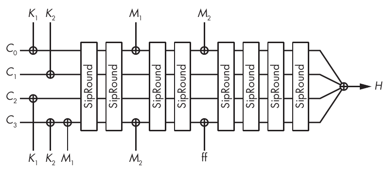

Hình 7-5: SipHash-2-4 xử lý một message 15-byte (một block, M<sub>1</sub>, gồm 8 byte và một block, M<sub>2</sub>, gồm 7 byte, cộng thêm 1 byte padding)

Function SipRound dùng một loạt phép XOR cùng với phép cộng và phép xoay word để làm cho function an toàn. SipRound biến đổi một state gồm bốn word 64-bit (a, b, c, d) bằng cách thực hiện các phép toán sau, từ trên xuống dưới. Các phép toán bên trái và bên phải là độc lập và có thể được thực hiện song song:

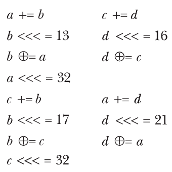

Ở đây, a += b là cách viết tắt của a = a + b, và b <<< = 13 là cách viết tắt của b = b <<< 13 (word 64-bit b được left-rotated 13 bit).

Những phép toán đơn giản này trên các word 64-bit gần như là tất cả những gì bạn cần triển khai để tính SipHash—dù bạn sẽ không phải tự triển khai nó. Bạn có thể tìm thấy các implementation có sẵn trong phần lớn các ngôn ngữ, như C, Go, Java, JavaScript, Python và Rust.

> **LƯU Ý** Tôi viết SipHash-x-y để chỉ phiên bản SipHash, nghĩa là nó thực hiện x SipRound giữa mỗi lần đưa vào một message block rồi y round. Nhiều round hơn cần nhiều phép toán hơn, làm chậm hoạt động nhưng cũng tăng security. Phiên bản mặc định là SipHash-2-4 (gọi đơn giản là SipHash), và cho đến nay nó đã chống chịu được cryptanalysis. Lưu ý rằng tôi cũng đã định nghĩa SipHash128, một phiên bản SipHash tạo ra tag 128-bit.

Nhiều hệ thống, như ngôn ngữ Rust, hệ điều hành OpenBSD và blockchain Bitcoin, dùng SipHash bên trong. Linux kernel cũng dùng SipHash và còn dùng HalfSipHash, “người em họ trẻ tuổi không an toàn của SipHash”, một phiên bản nhỏ hơn với key 64-bit và đầu ra 32-bit (xem https://docs.kernel.org/security/siphash.html).

## Những gì có thể sai (How Things Can Go Wrong)

Cũng như cipher và unkeyed hash function, các MAC và PRF an toàn trên giấy có thể dễ bị tấn công khi được dùng trong môi trường thực tế. Hãy thảo luận hai ví dụ.

### Timing attack nhắm vào việc xác minh MAC (Timing Attacks on MAC Verification)

Side-channel attack nhắm vào implementation của một cryptographic algorithm chứ không phải chính algorithm. Đặc biệt, timing attack dùng thời gian thực thi của một algorithm để xác định thông tin bí mật, như key, plaintext và các giá trị ngẫu nhiên bí mật. So sánh chuỗi Variable-time gây ra lỗ hổng không chỉ trong việc xác minh MAC mà còn trong nhiều chức năng cryptography và security khác.

MAC có thể dễ bị timing attack khi một hệ thống từ xa xác minh tag trong một khoảng thời gian phụ thuộc vào giá trị của tag, nhờ đó cho phép kẻ tấn công xác định tag đúng của message bằng cách thử nhiều tag sai để tìm ra tag mất nhiều thời gian nhất để hoàn tất. Vấn đề xảy ra khi một server so sánh tag đúng với một tag sai bằng cách so sánh hai chuỗi theo từng byte, theo thứ tự, cho đến khi các byte khác nhau. Ví dụ, code Python trong Listing 7-1 so sánh hai chuỗi theo từng byte, trong thời gian thay đổi: nếu các byte đầu tiên khác nhau, function trả về chỉ sau một lần so sánh; nếu các chuỗi x và y giống hệt nhau, function thực hiện n lần so sánh theo độ dài của các chuỗi.

```
def compare_mac(x, y, n):
    if len(x) != len(y):
        return False
    if len(x) != n:
        return False
    for i in range(n):
        if x[i] != y[i]:
            return False
    return True
```

Listing 7-1: So sánh hai chuỗi n-byte, tốn thời gian thay đổi

Để chứng tỏ lỗ hổng của function compare_mac(), chúng ta sẽ viết một chương trình đo thời gian thực thi của 100,000 lần gọi compare_mac() , trước tiên với các giá trị x và y 16-character giống hệt nhau, rồi với các giá trị x và y khác nhau ở byte thứ ba. Lần so sánh sau phải tốn ít thời gian hơn đáng kể vì compare_mac() so sánh ít byte hơn so với khi x và y giống hệt nhau, như Listing 7-2 cho thấy.

```
from time import time

MAC1 = 'abcdefghijklmnop'
MAC2 = 'abXdefghijklmnop'
TRIALS = 100000

def compare_mac(x, y, n):
    if len(x) != len(y):
        return False
    if len(x) != n:
        return False
    for i in range(n):
        if x[i] != y[i]:
            return False
    return True

# Each call to compare_mac() will look at all 16 characters.
start = time()
for i in range(TRIALS):
    compare_mac(MAC1, MAC1, len(MAC1))
end = time()
print("%0.5f" % (end-start))

# Each call to compare_mac() will look at three characters.
start = time()
for i in range(TRIALS):
    compare_mac(MAC1, MAC2, len(MAC1))
end = time()
print("%0.5f" % (end-start))
```

Listing 7-2: Đo sự khác biệt thời gian khi thực thi compare_mac() từ Listing 7-1

Trên một MacBook Pro với chip ARM M1, một lần thực thi chương trình trong Listing 7-2 in ra thời gian thực thi lần lượt khoảng 67 và 26 mili giây. Khác biệt đó đủ đáng kể để nhận ra điều gì đang xảy ra bên trong algorithm. Bây giờ hãy chuyển điểm khác biệt sang các offset khác trong chuỗi, và bạn sẽ quan sát thấy thời gian thực thi khác nhau với các offset khác nhau. Nếu MAC1 là MAC tag đúng và MAC2 là tag kẻ tấn công thử, bạn có thể dễ dàng xác định vị trí của điểm khác biệt đầu tiên, tức là số byte đã đoán đúng.

Nếu thời gian thực thi không phụ thuộc vào một timing bí mật, timing attack sẽ không có tác dụng, đó là lý do người triển khai cố gắng viết các implementation constant-time—tức là code tốn đúng cùng một khoảng thời gian để hoàn tất với bất kỳ giá trị đầu vào bí mật nào. Ví dụ, function C trong Listing 7-3 so sánh hai buffer kích thước size bytes trong thời gian hằng: biến tạm result khác không khi và chỉ khi có một khác biệt ở đâu đó trong hai buffer.

```
int cmp_const(const void *a, const void *b, const size_t size)
{
    const unsigned char *_a = (const unsigned char *) a;
    const unsigned char *_b = (const unsigned char *) b;
    unsigned char result = 0;
    size_t i;

    for (i = 0; i < size; i++) {
        result |= _a[i] ^ _b[i];
    }

    return result; /* Returns 0 if *a and *b are equal, nonzero otherwise */
}
```

Listing 7-3: So sánh constant-time hai buffer để xác minh MAC an toàn hơn

### Khi sponge bị rò rỉ (When Sponges Leak)

Các algorithm Permutation-based như SHA-3 và SipHash đơn giản, dễ triển khai và có các implementation nhỏ gọn, nhưng chúng mong manh trước các side-channel attack khôi phục được một ảnh chụp nhanh (snapshot) state của hệ thống. Ví dụ, nếu một process có thể đọc giá trị RAM và register bất kỳ lúc nào hoặc đọc một core dump của memory, kẻ tấn công có thể xác định internal state của SHA-3 ở MAC mode, hoặc internal state của SipHash, rồi tính ngược permutation để khôi phục secret state ban đầu. Khi đó, họ có thể làm giả tag cho bất kỳ message nào, phá security của MAC.

May thay, attack này sẽ không có tác dụng với các MAC compression function–based như HMAC-SHA-256 và keyed BLAKE2, vì kẻ tấn công cần một snapshot của memory vào đúng thời điểm key được dùng. Kết cục là nếu bạn ở trong một môi trường mà các phần memory của một process có thể bị rò rỉ, bạn có thể dùng một MAC dựa trên compression function biến đổi không khả nghịch thay vì dựa trên một permutation.

## Đọc thêm (Further Reading)

HMAC đáng kính xứng đáng được quan tâm nhiều hơn so với những gì tôi có thể dành chỗ ở đây, và còn hơn thế nữa với dòng suy nghĩ đã dẫn đến việc nó được chấp nhận rộng rãi và cuối cùng là sự suy tàn của nó khi kết hợp với một hash function yếu. Tôi khuyên bạn đọc bài báo năm 1996 “Keying Hash Functions for Message Authentication” của Mihir Bellare, Ran Canetti và Hugo Krawczyk, bài báo đã giới thiệu HMAC và người anh em họ của nó là NMAC, và bài báo follow-up năm 2006 của Bellare có tựa đề “New Proofs for NMAC and HMAC: Security Without Collision-Resistance”, chứng minh rằng HMAC không cần một hash collision-resistant mà chỉ cần một hash có compression function là một PRF. Về phía tấn công, bài báo năm 2007 “Full Key-Recovery Attacks on HMAC/NMAC-MD4 and NMAC-MD5” của Pierre-Alain Fouque, Gaëtan Leurent và Phong Nguyen cho thấy cách tấn công HMAC và NMAC khi chúng được xây dựng trên một hash function mong manh như MD4 hoặc MD5. (HMAC-MD5 và HMAC-SHA-1 không bị phá hoàn toàn, nhưng rủi ro đã đủ cao.)

Các MAC Wegman–Carter cũng xứng đáng được quan tâm nhiều hơn, cả vì giá trị thực tiễn lẫn lý thuyết nền tảng của chúng. Các bài báo kinh điển của Wegman và Carter có tại https://cr.yp.to/bib/entries.html. Các thiết kế state-of-the-art khác bao gồm UMAC và VMAC, nằm trong số những MAC nhanh nhất với các message dài.

Một loại MAC không được thảo luận trong chương này là Pelican, dùng block cipher AES được rút gọn còn bốn round (giảm từ 10 round trong block cipher đầy đủ) để xác thực các mẩu message trong một cấu trúc đơn giản, như được mô tả tại https://eprint.iacr.org/2005/088. Tuy nhiên, Pelican chủ yếu chỉ là một thứ lạ, và nó hiếm khi được dùng trong thực tế.

Cuối cùng nhưng không kém phần quan trọng, nếu bạn quan tâm đến việc tìm lỗ hổng trong phần mềm cryptography, hãy tìm những chỗ dùng CBC-MAC hoặc những điểm yếu gây ra bởi việc HMAC xử lý key có kích thước tùy ý—lấy Hash(K) làm key thay vì K nếu K quá dài, khiến K và Hash(K) trở thành các key tương đương. Hoặc chỉ cần tìm những hệ thống không dùng MAC khi lẽ ra phải dùng—một tình huống thường gặp.

Trong Chương 8, chúng ta sẽ kết hợp MAC với cipher để bảo vệ tính xác thực, tính toàn vẹn và tính bí mật của message. Chúng ta cũng sẽ làm điều này mà không cần MAC, nhờ các authenticated cipher, vốn kết hợp chức năng của một cipher cơ bản với chức năng của một MAC bằng cách trả về một tag kèm theo mỗi ciphertext.
