# Chương 8: Authenticated Encryption

Chương này nói về một loại algorithm bảo vệ không chỉ tính bí mật của message mà còn cả tính xác thực của nó. Hãy nhớ lại từ Chương 7 rằng message authentication code (MAC) bảo vệ tính xác thực của message bằng cách tạo ra một tag, một kiểu chữ ký. Giống như MAC, các authenticated encryption (AE) algorithm trong chương này tạo ra một authentication tag, nhưng chúng còn mã hóa message. Nói cách khác, một AE algorithm duy nhất cung cấp các tính năng của cả một cipher thông thường lẫn một MAC.

Kết hợp một cipher và một MAC có thể đạt được các mức authenticated encryption khác nhau, như bạn sẽ thấy xuyên suốt chương này. Chúng ta sẽ xem xét một số cách kết hợp MAC với cipher, thảo luận phương pháp nào an toàn nhất, và tìm hiểu các cipher tạo ra cả ciphertext lẫn authentication tag. Sau đó, chúng ta sẽ xem bốn authenticated cipher quan trọng: ba cấu trúc block cipher–based, trong đó tập trung vào Advanced Encryption Standard ở Galois Counter Mode (AES-GCM) phổ biến, và một cipher chỉ dùng một permutation algorithm.

## Authenticated encryption dùng MAC (Authenticated Encryption Using MACs)

Hình 8-1 cho thấy ba cách kết hợp MAC và cipher để vừa mã hóa vừa xác thực một plaintext: encrypt-and-MAC, MAC-then-encrypt và encrypt-then-MAC.

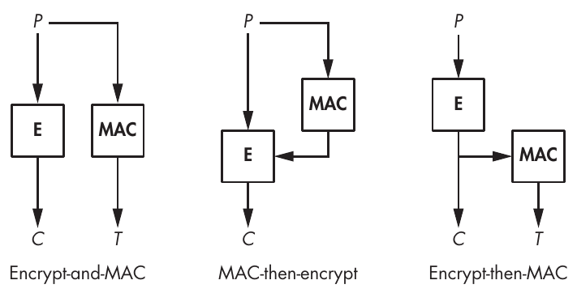

Hình 8-1: Các cách kết hợp cipher và MAC

Các cách kết hợp này khác nhau ở thứ tự bạn áp dụng encryption và tạo authentication tag. Việc chọn một MAC algorithm hay cipher algorithm cụ thể nào không quan trọng, chừng nào mỗi algorithm tự nó an toàn và MAC với cipher dùng các key khác nhau.

Trong cách kết hợp encrypt-and-MAC, plaintext được mã hóa và một authentication tag được tạo trực tiếp từ plaintext, sao cho hai thao tác (encryption và authentication) độc lập với nhau, và do đó bạn có thể tính chúng song song. Trong scheme MAC-then-encrypt, trước tiên bạn tạo tag từ plaintext rồi mã hóa plaintext và MAC cùng nhau. Trong phương pháp encrypt-then-MAC, trước tiên bạn mã hóa plaintext rồi tạo tag từ ciphertext. Hãy xem phương pháp nào có khả năng an toàn nhất.

### Cách tiếp cận Encrypt-and-MAC

Cách tiếp cận encrypt-and-MAC tính ciphertext và MAC tag riêng biệt. Với một plaintext P, bên gửi tính một ciphertext C = E(K<sub>1</sub>, P), trong đó E là một encryption algorithm và C là ciphertext thu được. Bạn tính authentication tag T từ plaintext theo T = MAC(K<sub>2</sub>, P). Hai thao tác là độc lập và do đó có thể được tính song song.

Khi đã tạo được ciphertext và authentication tag, bên gửi truyền cả hai tới người nhận dự kiến. Khi người nhận nhận được C và T, họ giải mã C để có được plaintext P bằng cách tính P = D(K<sub>1</sub>, C). Tiếp theo, họ tính MAC(K<sub>2</sub>, P) bằng plaintext đã giải mã và so sánh kết quả với T nhận được. Việc xác minh này thất bại nếu C hoặc T bị hỏng, và message bị coi là không hợp lệ.

Về lý thuyết, encrypt-and-MAC là cách kết hợp MAC và cipher kém an toàn nhất, vì ngay cả một MAC an toàn cũng có thể làm rò rỉ thông tin về P, khiến P dễ bị khôi phục hơn. Vì mục tiêu của việc dùng MAC chỉ đơn giản là làm cho tag không thể bị làm giả, và vì tag không nhất thiết trông ngẫu nhiên, nên authentication tag (T) của một plaintext (P) vẫn có thể làm rò rỉ thông tin dù MAC được coi là an toàn! (Nếu MAC là một pseudorandom function, tag sẽ không làm rò rỉ gì về P.)

Dù vậy, bất chấp điểm yếu tương đối của nó, nhiều hệ thống vẫn tiếp tục hỗ trợ encrypt-and-MAC, kể cả protocol tầng truyền tải an toàn SSH, trong đó mỗi packet đã mã hóa C được theo sau bởi tag T = MAC(K, N || P), với N là một số thứ tự 32-bit tăng lên cho mỗi packet. Trong thực tế, encrypt-and-MAC đã tỏ ra đủ tốt để dùng với SSH, nhờ việc dùng các MAC algorithm mạnh như HMAC-SHA-256 không làm rò rỉ thông tin về P. Hãy nhập lệnh sau

```
$ ssh -Q mac
```

để xem danh sách các MAC được phần mềm OpenSSH hỗ trợ.

### Cách kết hợp MAC-Then-Encrypt

Cách kết hợp MAC-then-encrypt bảo vệ một message, P, bằng cách trước tiên tính authentication tag T = MAC(K<sub>2</sub>, P). Tiếp theo, nó tạo ciphertext bằng cách mã hóa plaintext và tag cùng nhau, theo C = E(K<sub>1</sub>, P || T).

Khi các bước này hoàn tất, bên gửi chỉ truyền C, chứa cả plaintext lẫn tag đã mã hóa. Khi nhận được, người nhận giải mã C bằng cách tính P || T = D(K<sub>1</sub>, C) để có được plaintext và tag T. Tiếp theo, người nhận xác minh tag T nhận được bằng cách tính một tag trực tiếp từ plaintext theo MAC(K<sub>2</sub>, P) để xác nhận rằng tag tính được bằng tag T.

Cũng như với encrypt-and-MAC, khi dùng MAC-then-encrypt, người nhận phải giải mã C trước khi xác định được họ có đang nhận các packet bị hỏng hay không—một quá trình để lộ các plaintext có thể bị hỏng cho người nhận. Dù vậy, MAC-then-encrypt an toàn hơn encrypt-and-MAC vì nó che giấu authentication tag của plaintext, nhờ đó ngăn tag làm rò rỉ thông tin về plaintext.

Protocol TLS đã dùng MAC-then-encrypt trong nhiều năm, nhưng TLS 1.3 đã thay MAC-then-encrypt bằng authenticated cipher (xem Chương 13 để biết thêm về TLS 1.3).

### Cách kết hợp Encrypt-Then-MAC

Cách kết hợp encrypt-then-MAC gửi hai giá trị tới người nhận: ciphertext được tạo bởi C = E(K<sub>1</sub>, P) và một tag dựa trên ciphertext, T = MAC(K<sub>2</sub>, C). Bên nhận tính tag bằng MAC(K<sub>2</sub>, C) và xác minh rằng nó bằng T nhận được. Nếu các giá trị bằng nhau, plaintext được tính theo P = D(K<sub>1</sub>, C); nếu chúng không bằng nhau, ciphertext bị loại bỏ.

Một ưu điểm của phương pháp này là bên nhận chỉ cần tính một MAC để phát hiện các message bị hỏng, nghĩa là không cần giải mã một ciphertext bị hỏng. Ngoài ra, kẻ tấn công không thể gửi các cặp C và T để bên nhận giải mã trừ khi họ đã phá được MAC, điều này khiến kẻ tấn công khó truyền dữ liệu độc hại tới người nhận hơn.

Sự kết hợp các đặc điểm này khiến encrypt-then-MAC mạnh hơn các cách tiếp cận encrypt-and-MAC và MAC-then-encrypt. Đây là một lý do bộ protocol liên lạc an toàn IPsec, được dùng rộng rãi, dùng nó để bảo vệ các packet (ví dụ, bên trong các VPN tunnel).

Lưu ý rằng SSH và TLS không dùng encrypt-then-MAC vì các cách tiếp cận khác có vẻ đã đủ khi SSH và TLS được tạo ra—không phải vì không tồn tại điểm yếu lý thuyết, mà vì các tính chất không mong muốn không nhất thiết trở thành lỗ hổng thực tế.

## Authenticated cipher (Authenticated Ciphers)

Authenticated cipher là một lựa chọn thay thế cho các cách kết hợp cipher và MAC. Chúng giống cipher thông thường, ngoại trừ việc chúng trả về một authentication tag cùng với ciphertext.

Bạn biểu diễn encryption của authenticated cipher là AE(K, P) = (C, T). Thuật ngữ AE là viết tắt của authenticated encryption, dựa trên một key (K) và một plaintext (P), và trả về một ciphertext (C) cùng một authentication tag được tạo ra (T). Nói cách khác, một authenticated cipher algorithm duy nhất làm cùng công việc như một cách kết hợp cipher và MAC, giúp nó đơn giản hơn, nhanh hơn và thường an toàn hơn.

Bạn biểu diễn decryption của authenticated cipher là AD(K, C, T) = P. Ở đây, AD là viết tắt của authenticated decryption, trả về một plaintext (P) khi có một ciphertext (C), tag (T) và key (K). Nếu việc xác thực tag thất bại, AD trả về một lỗi để ngăn người nhận xử lý một plaintext có thể đã bị làm giả. Cũng vì lý do đó, nếu AD trả về một plaintext, thì nó đã được mã hóa bởi một người hay một thứ gì đó biết secret key.

Các yêu cầu security cơ bản của một authenticated cipher rất đơn giản: authentication của nó phải mạnh ngang một MAC, nghĩa là phải không thể làm giả một cặp ciphertext và tag (C, T) mà decryption function AD sẽ chấp nhận và giải mã.

Về mặt tính bí mật, một authenticated cipher về cơ bản mạnh hơn một cipher cơ bản, vì các hệ thống giữ secret key sẽ chỉ giải mã một ciphertext nếu authentication tag hợp lệ. Nếu tag không hợp lệ, plaintext bị loại bỏ. Đặc điểm này ngăn kẻ tấn công thực hiện các query chosen-ciphertext, một attack trong đó họ tạo ra các ciphertext và yêu cầu plaintext tương ứng.

### Authenticated encryption với associated data (Authenticated Encryption with Associated Data)

Các cryptographer định nghĩa associated data là bất kỳ dữ liệu nào được một authenticated cipher xử lý sao cho dữ liệu được xác thực (nhờ authentication tag) nhưng không được mã hóa. Theo mặc định, mọi dữ liệu plaintext đưa vào một authenticated cipher đều được mã hóa và xác thực.

Giả sử bạn muốn xác thực một message, kể cả các phần không được mã hóa của nó, nhưng không mã hóa toàn bộ message—tức là bạn muốn xác thực và truyền dữ liệu bên cạnh một message đã mã hóa. Ví dụ, nếu một cipher xử lý một network packet gồm một header theo sau là một payload, bạn có thể chọn mã hóa payload để che giấu dữ liệu thực sự được truyền, nhưng không mã hóa header vì nó chứa thông tin cần thiết để chuyển packet tới người nhận cuối cùng. Đồng thời, bạn vẫn có thể muốn xác thực dữ liệu của header để chắc chắn rằng nó được nhận từ bên gửi dự kiến.

Để đạt được các mục tiêu này, các cryptographer đã tạo ra khái niệm authenticated encryption with associated data (AEAD). Một AEAD algorithm cho phép bạn gắn dữ liệu cleartext vào một ciphertext theo cách sao cho nếu dữ liệu cleartext bị hỏng, authentication tag sẽ không được xác thực, và ciphertext sẽ không được giải mã. Dữ liệu cleartext như vậy phải được encode và serialize theo cách an toàn để tránh việc diễn giải nội dung của nó một cách mơ hồ.

Bạn có thể viết một thao tác AEAD là AEAD(K, P, A) = (C, A, T). Với một key (K), plaintext (P) và associated data (A), AEAD trả về ciphertext, associated data A không được mã hóa, và một authentication tag. AEAD giữ nguyên associated data không được mã hóa, còn ciphertext là kết quả mã hóa plaintext. Authentication tag phụ thuộc vào cả P lẫn A và sẽ chỉ được xác minh là hợp lệ nếu cả C lẫn A đều chưa bị sửa đổi.

Vì authenticated tag phụ thuộc vào A, bạn tính decryption với associated data bằng ADAD(K, C, A, T) = (P, A). Decryption cần key, ciphertext, associated data và tag để tính plaintext và associated data, và nó thất bại nếu C hoặc A bị hỏng.

Khi dùng AEAD, bạn có thể để A hoặc P rỗng. Nếu associated data A rỗng, AEAD trở thành một authenticated cipher thông thường; nếu P rỗng, nó chỉ là một MAC.

> **LƯU Ý** Tại thời điểm viết sách này, AEAD là chuẩn mực hiện nay cho authenticated encryption. Vì gần như mọi authenticated cipher đang được dùng ngày nay đều hỗ trợ associated data, khi nói đến authenticated cipher xuyên suốt cuốn sách này, tôi đang nói đến AEAD trừ khi có ghi chú khác. Khi thảo luận các thao tác encryption và decryption của AEAD, tôi sẽ lần lượt gọi chúng là AE và AD.

### Tính dễ đoán và nonce (Predictability and Nonces)

Hãy nhớ lại từ Chương 1 rằng để an toàn, các encryption scheme phải không thể đoán trước và phải trả về các ciphertext khác nhau khi được gọi lặp lại để mã hóa cùng một plaintext—nếu không, kẻ tấn công có thể xác định cùng một plaintext có bị mã hóa hai lần hay không. Để không thể đoán trước, block cipher và stream cipher đưa vào cipher một tham số bổ sung: initial value (IV) hoặc nonce—một số chỉ có thể dùng một lần. Authenticated cipher dùng cùng thủ thuật đó. Do đó, bạn biểu diễn authenticated encryption là AE(K, P, A, N), trong đó N là một nonce. Việc chọn một nonce chưa từng được dùng trước đó với cùng key là trách nhiệm của thao tác encryption.

Cũng như với block cipher và stream cipher, decryption với một authenticated cipher cần nonce đã được dùng để mã hóa thì mới thực hiện đúng. Do đó, bạn có thể biểu diễn decryption là AD(K, C, A, T, N) = (P, A), trong đó N là nonce được dùng để tạo C và T.

### Tiêu chí cho một authenticated cipher tốt (Criteria for a Good Authenticated Cipher)

Từ đầu những năm 2000, các nhà nghiên cứu đã chật vật để định nghĩa điều gì tạo nên một authenticated cipher tốt, và câu trả lời vẫn còn khó nắm bắt. Vì AEAD có nhiều đầu vào đóng các vai trò khác nhau, việc định nghĩa một notion security khó hơn so với các cipher cơ bản chỉ mã hóa một message. Ví dụ, bài báo nghiên cứu “Nonces Are Noticed: AEAD Revisited”, có tại https://eprint.iacr.org/2019/624, đã đề xuất một framework lý thuyết cho encryption nonce-based. Dù vậy, trong mục này, tôi sẽ tóm tắt những tiêu chí quan trọng nhất cần xét khi đánh giá security, hiệu năng và chức năng của một authenticated cipher.

#### Security

Những tiêu chí quan trọng nhất để đo độ mạnh của một authenticated cipher là khả năng bảo vệ tính bí mật của dữ liệu (tức là tính bí mật của plaintext) và tính xác thực cùng tính toàn vẹn của liên lạc (như khả năng phát hiện message bị hỏng của MAC). Một authenticated cipher phải cạnh tranh ở cả hai hạng mục: tính bí mật của nó phải mạnh ngang cipher mạnh nhất, và tính xác thực của nó mạnh ngang MAC tốt nhất. Nói cách khác, nếu bạn bỏ phần authentication trong một AEAD, bạn phải có được một cipher an toàn, và nếu bạn bỏ phần encryption, bạn phải có được một MAC mạnh.

Một thước đo khác về độ mạnh security của một authenticated cipher dựa trên mức độ mong manh của nó khi gặp nonce bị lặp lại. Ví dụ, nếu một nonce bị dùng lại, kẻ tấn công có thể giải mã ciphertext hay biết được sự khác biệt giữa các plaintext không?

Các nhà nghiên cứu gọi khái niệm độ bền vững này là misuse resistance và đã thiết kế các authenticated cipher misuse-resistant để đánh giá tác động của một nonce bị lặp lại, và cố gắng xác định xem tính bí mật, tính xác thực, hay cả hai có bị xâm phạm khi gặp một attack như vậy hay không, cũng như thông tin nào về dữ liệu đã mã hóa có khả năng bị rò rỉ.

#### Hiệu năng (Performance)

Cũng như với mọi cryptographic algorithm, bạn đo throughput của một authenticated cipher theo số bit được xử lý mỗi giây. Tốc độ này phụ thuộc vào số phép toán do algorithm của cipher thực hiện và vào chi phí bổ sung của chức năng authentication. Các tính năng security bổ sung của authenticated cipher đi kèm một sự sụt giảm hiệu năng. Tuy nhiên, thước đo hiệu năng của một cipher không chỉ là tốc độ thuần túy. Nó còn là khả năng song song hóa, cấu trúc, và việc cipher có streamable hay không. Hãy xem xét kỹ hơn các khái niệm này.

Khả năng song song hóa của một cipher là thước đo khả năng xử lý nhiều data block cùng lúc mà không cần chờ việc xử lý block trước đó hoàn tất. Các thiết kế block cipher–based có thể dễ dàng song song hóa khi mỗi block có thể được xử lý độc lập với các block khác. Ví dụ, block cipher mode CTR trong Chương 4 có thể song song hóa, trong khi CBC encryption mode thì không, vì các block được xâu chuỗi với nhau.

Cấu trúc bên trong của một authenticated cipher là một tiêu chí hiệu năng quan trọng khác. Có hai loại cấu trúc chính: one-layer và two-layer. Trong một cấu trúc two-layer (ví dụ, trong AES-GCM được dùng rộng rãi), một algorithm xử lý plaintext, rồi algorithm thứ hai xử lý kết quả. Thông thường, layer thứ nhất là encryption layer, và layer thứ hai là authentication layer. Nhưng như bạn có thể đoán, một cấu trúc two-layer làm phức tạp việc hiện thực và có xu hướng làm chậm tính toán.

Một authenticated cipher là streamable (còn gọi là online cipher) khi nó có thể xử lý một message theo từng block và loại bỏ mọi block already-processed. Ngược lại, các cipher nonstreamable phải lưu toàn bộ message, thường là vì chúng cần duyệt qua dữ liệu hai lượt liên tiếp: một lượt từ đầu đến cuối và lượt kia từ cuối về đầu dữ liệu thu được từ lượt thứ nhất.

Vì yêu cầu memory có thể cao, một số ứng dụng sẽ không làm việc được với các cipher nonstreamable. Ví dụ, một router có thể nhận một block dữ liệu đã mã hóa, giải mã nó, rồi trả về plaintext block trước khi chuyển sang giải mã block tiếp theo của message, dù người nhận message đã giải mã vẫn sẽ phải xác minh authentication tag được gửi ở cuối dòng dữ liệu đã giải mã.

#### Các tính năng khác (Other Features)

Các tiêu chí chức năng là những tính năng của một cipher hoặc implementation của nó không liên quan trực tiếp đến security hay hiệu năng. Ví dụ, một số authenticated cipher chỉ cho phép associated data đứng trước dữ liệu cần mã hóa (vì chúng cần truy cập nó để bắt đầu mã hóa). Những cipher khác yêu cầu associated data đứng sau dữ liệu cần mã hóa hoặc hỗ trợ đưa associated data vào bất kỳ đâu—kể cả giữa các mẩu plaintext. Trường hợp cuối cùng này là tốt nhất, vì nó cho phép người dùng bảo vệ dữ liệu của họ trong mọi tình huống có thể, nhưng nó cũng khó thiết kế an toàn nhất: nhiều tính năng hơn thường mang lại nhiều độ phức tạp và lỗ hổng tiềm ẩn hơn.

Một tiêu chí chức năng khác cần xét là liệu bạn có thể dùng cùng một core algorithm cho cả encryption lẫn decryption hay không. Ví dụ, nhiều authenticated cipher dựa trên block cipher AES, vốn quy định dùng hai algorithm tương tự nhau để mã hóa và giải mã một block. Như đã thảo luận trong Chương 4, block cipher mode CBC cần cả hai algorithm, nhưng CTR mode chỉ cần encryption algorithm. Tương tự, authenticated cipher có thể không cần cả hai algorithm. Dù chi phí bổ sung của việc hiện thực cả encryption algorithm lẫn decryption algorithm sẽ không ảnh hưởng đến phần lớn software, nó thường đáng kể trên hardware chuyên dụng low-cost, nơi bạn đo chi phí hiện thực theo số cổng logic, hay diện tích silicon mà phần cryptography chiếm.

## Tiêu chuẩn authenticated cipher AES-GCM

AES-GCM là authenticated cipher được dùng rộng rãi nhất. AES-GCM dựa trên algorithm AES, và mode of operation Galois counter mode (GCM) về cơ bản là một biến thể của CTR mode có thêm một thành phần nhỏ và hiệu quả để tính authentication tag. Tại thời điểm tôi viết những dòng này, AES-GCM là một tiêu chuẩn NIST (SP 800-38D), là một phần của Suite B của NSA, và được IETF công nhận cho các secure network protocol IPsec, SSH và TLS 1.2 và 1.3.

> **LƯU Ý** Dù GCM làm việc với bất kỳ block cipher nào, có lẽ bạn sẽ chỉ thấy nó được dùng với AES.

### Bên trong GCM (GCM Internals)

Hình 8-2 cho thấy AES-GCM hoạt động như thế nào: các instance AES được tham số hóa bởi một secret key (K) biến đổi một block gồm nonce (N) nối với một counter (ở đây bắt đầu từ 1, rồi tăng lên 2, 3, v.v.) và sau đó XOR kết quả với một plaintext block để có được một ciphertext block. Cho đến đây, không có gì mới so với CTR mode.

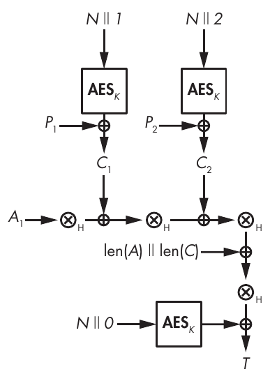

Hình 8-2: AES-GCM mode, áp dụng cho một associated data block, A<sub>1</sub>, và hai plaintext block, P<sub>1</sub> và P<sub>2</sub>. Dấu nhân trong vòng tròn biểu diễn phép nhân đa thức với H, authentication key được suy ra từ K.

Sau đó, các ciphertext block được trộn bằng một tổ hợp các phép XOR và phép nhân (như bạn sẽ thấy tiếp theo). Bạn có thể xem AES-GCM như việc thực hiện (1) một encryption ở CTR mode và (2) một MAC trên các ciphertext block. Do đó, AES-GCM về cơ bản là một cấu trúc encrypt-then-MAC, trong đó AES-CTR mã hóa bằng một key 128-bit (K) và một nonce 96-bit (N).

Để xác thực ciphertext, GCM dùng một MAC Wegman–Carter (xem Chương 7), XOR giá trị AES(K, N || 0) với đầu ra của universal hash function GHASH. Trong Hình 8-2, GHASH tương ứng với chuỗi phép toán “⊗<sub>H</sub>” theo sau là phép XOR với len(A) || len(C), tức là độ dài bit của A (associated data) theo sau là độ dài bit của C (ciphertext).

Do đó, bạn có thể biểu diễn giá trị của authentication tag là T = GHASH (H, A, C) ⊕ AES(K, N || 0), trong đó H là hash key, hay authentication key. Key này được xác định là H = AES(K, 0), tức là kết quả mã hóa block bằng một chuỗi byte null (để rõ ràng, tôi không đưa bước này vào Hình 8-2).

> **LƯU Ý** Trong GCM, GHASH không dùng trực tiếp K để bảo đảm rằng nếu key của GHASH bị xâm phạm, master key K vẫn được giữ bí mật. Với K, bạn có thể có được H bằng cách tính AES(K, 0), nhưng bạn không thể khôi phục K từ giá trị đó, vì ở đây K đóng vai trò key của AES.

GHASH dùng ký hiệu đa thức để nhân mỗi ciphertext block với authentication key H. Việc dùng phép nhân đa thức này giúp GHASH nhanh trong hardware và software, nhờ một instruction nhân đa thức đặc biệt có trong nhiều bộ vi xử lý thông dụng (CLMUL, viết tắt của carry-less multiplication).

Đáng tiếc là GHASH còn xa mới lý tưởng. Trước hết, tốc độ của nó chưa tối ưu. Ngay cả khi dùng instruction CLMUL, layer AES-CTR mã hóa plaintext vẫn nhanh hơn MAC GHASH. Thứ hai, GHASH rất khó hiện thực đúng. Thực tế, ngay cả các developer giàu kinh nghiệm của dự án OpenSSL, phần mềm cryptography most-used trên thế giới, hơn hẳn các phần mềm khác, cũng đã làm sai GHASH của AES-GCM. Một commit có bug trong function gcm_ghash_clmul cho phép kẻ tấn công làm giả MAC hợp lệ cho AES-GCM. (May thay, các kỹ sư Intel đã phát hiện ra lỗi trước khi bug được đưa vào bản phát hành OpenSSL tiếp theo.)

> **PHÉP NHÂN ĐA THỨC (POLYNOMIAL MULTIPLICATION)**

> Dù phức tạp hơn số học số nguyên kinh điển, phép nhân đa thức lại đơn giản hơn đối với máy tính vì không có phép nhớ (carry). Cụ thể, bạn có thể tính phép nhân modular của các đa thức, trong một cấu trúc được định nghĩa bởi một đa thức cho trước (các cấu trúc như vậy được gọi là quotient ring). Ví dụ, giả sử bạn muốn tính tích của các đa thức (1 + X + X<sup>2</sup>) và (1 + X<sup>2</sup>) modulo (1 +X + X<sup>3</sup>). Trước tiên, bạn nhân hai đa thức (1 + X + X<sup>2</sup>) và (1 + X<sup>2</sup>) như khi làm phép nhân đa thức thông thường, nhờ đó có được kết quả sau (hai số hạng X<sup>2</sup> triệt tiêu nhau vì bạn làm việc với các đa thức Boolean, một thế giới trong đó 1 + 1 = 0):

> (1 + X + X<sup>2</sup>) ⊗ (1 + X<sup>2</sup>) = 1 + X + X<sup>3</sup> + X<sup>4</sup>

> (còn tiếp)

> Bạn áp dụng phép rút gọn modulo, rút gọn 1 + X + X<sup>3</sup> + X<sup>4</sup> modulo 1 + X + X<sup>3</sup> để có được X + X<sup>2</sup>, vì bạn có thể viết 1+ X + X<sup>3</sup> + X<sup>4</sup> dưới dạng (1 + X) ⊗ (1 + X + X<sup>3</sup>) + X + X<sup>2</sup> . Nói tổng quát hơn, A + BC modulo B bằng A, theo định nghĩa của phép rút gọn modular.

### Security của GCM (GCM Security)

Điểm yếu lớn nhất của AES-GCM là sự mong manh của nó khi nonce bị lặp lại. Nếu bạn dùng cùng một nonce N hai lần để mã hóa hai message khác nhau, thì kẻ tấn công quan sát hai ciphertext có thể xác định giá trị XOR giữa các plaintext tương ứng của chúng. Họ cũng có thể lấy được authentication key H và dùng nó để làm giả tag cho bất kỳ ciphertext, associated data, hay tổ hợp nào của chúng.

Nhìn vào phần đại số cơ bản đằng sau các phép tính của AES-GCM (xem Hình 8-2) sẽ giúp làm rõ sự mong manh này. Bạn tính một tag (T) theo T = GHASH (H, A, C) ⊕ AES(K, N || 0), trong đó GHASH là một universal hash function có đầu vào và đầu ra liên hệ tuyến tính với nhau.

Nếu bạn tính hai tag, T<sub>1</sub> và T<sub>2</sub>, với cùng một nonce N, phần AES sẽ biến mất. Nếu bạn có hai tag, T<sub>1</sub> = GHASH(H, A<sub>1</sub>, C<sub>1</sub>) ⊕ AES(K, N || 0) và T<sub>2</sub> = GHASH(H, A<sub>2</sub>, C<sub>2</sub>) ⊕ AES(K, N || 0), XOR chúng với nhau sẽ cho kết quả sau:

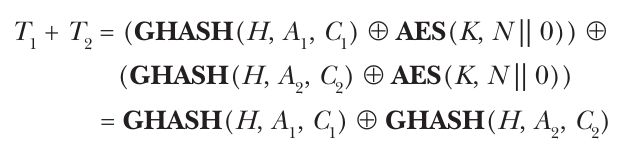

Do đó, nếu bạn dùng cùng một nonce hai lần, kẻ tấn công có thể khôi phục giá trị GHASH(H, A<sub>1</sub>, C<sub>1</sub>) ⊕ GHASH(H, A<sub>2</sub>, C<sub>2</sub>) với một số A<sub>1</sub>, C<sub>1</sub>, A<sub>2</sub> và C<sub>2</sub> đã biết. Khi đó, tính tuyến tính của GHASH cho phép kẻ tấn công khôi phục H.

Năm 2016, các nhà nghiên cứu đã quét internet tìm các instance AES-GCM được để lộ qua các server HTTPS, nhằm tìm các hệ thống có nonce bị lặp lại (xem bài báo nghiên cứu https://eprint.iacr.org/2016/475). Họ tìm thấy 184 server có nonce bị lặp lại, trong đó có 23 server luôn dùng chuỗi all-zero làm nonce.

### Hiệu quả của GCM (GCM Efficiency)

Một ưu điểm của GCM mode là encryption và decryption của GCM xử lý các block một cách độc lập, cho phép bạn song song hóa việc tính toán chúng. Tuy nhiên, việc tính GMAC không thể song song hóa, vì nó phải được tính từ đầu đến cuối ciphertext một khi GHASH đã xử lý xong associated data. Việc thiếu khả năng song song hóa này có nghĩa là bất kỳ hệ thống nào nhận plaintext trước rồi mới đến associated data đều phải chờ cho đến khi mọi associated data được đọc và hash xong rồi mới hash ciphertext block đầu tiên.

Tuy nhiên, GCM là streamable: vì các phép tính trong hai layer của nó có thể được xếp thành pipeline, không cần lưu mọi ciphertext block trước khi tính GHASH, vì GHASH xử lý mỗi block ngay khi nó được mã hóa. Nói cách khác, P<sub>1</sub> được mã hóa thành C<sub>1</sub>, rồi GHASH xử lý C<sub>1</sub> trong khi P<sub>2</sub> được mã hóa thành C<sub>2</sub>, rồi P<sub>1</sub> và C<sub>1</sub> không còn cần nữa, v.v.

## Authenticated cipher mode OCB (The OCB Authenticated Cipher Mode)

Được phát triển lần đầu năm 2001, offset codebook (OCB) ra đời trước GCM, và giống GCM, nó tạo ra một authenticated cipher từ một block cipher, dù nó làm điều đó nhanh hơn và đơn giản hơn. OCB vẫn chưa được chấp nhận rộng rãi vì cho đến năm 2021, việc dùng OCB còn được bảo hộ bằng sáng chế và cần giấy phép từ người phát minh. Giờ đây, OCB được dùng miễn phí cho bất kỳ ai trong bất kỳ ứng dụng nào.

Khác với GCM, OCB hòa trộn encryption và authentication vào một layer xử lý duy nhất dùng một key duy nhất. Không có authentication layer riêng biệt, vì vậy OCB cung cấp authentication gần như miễn phí và thực hiện số lời gọi block cipher gần như ngang một cipher nonauthenticated—OCB gần như đơn giản ngang ECB mode (xem Chương 4), ngoại trừ việc nó an toàn hơn.

### Bên trong OCB (OCB Internals)

Hình 8-3 cho thấy OCB hoạt động như thế nào: nó mã hóa mỗi plaintext block P thành một ciphertext block C = E(K, P ⊕ O) ⊕ O, trong đó E là một block cipher encryption function. Ở đây, O (offset) là một giá trị phụ thuộc vào key và nonce, được tăng lên cho mỗi block mới được xử lý.

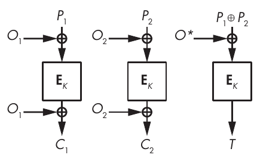

Hình 8-3: Quá trình mã hóa của OCB khi chạy trên hai plaintext block, không có associated data

Để tạo authentication tag, trước tiên OCB XOR các plaintext block với nhau để tính S = P<sub>1</sub> ⊕ P<sub>2</sub> ⊕ P<sub>3</sub> ⊕ . . . Khi đó, tag là T = E(K, S ⊕ O<sup>\*</sup>), trong đó O<sup>\*</sup> là một giá trị offset được tính từ offset của plaintext block cuối cùng được xử lý.

Giống AES-GCM, OCB cũng hỗ trợ associated data dưới dạng một chuỗi block, A<sub>1</sub>, A<sub>2</sub>, v.v. Khi một message được mã hóa bằng OCB có chứa associated data, hãy tính authentication tag theo công thức

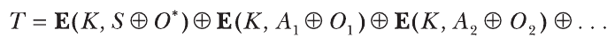

trong đó OCB định nghĩa các offset khác với các offset được dùng để mã hóa P.

Khác với GCM và encrypt-then-MAC, vốn kết hợp các ciphertext block để tạo thành tag, OCB tính authentication tag bằng cách kết hợp dữ liệu plaintext. Không có gì sai với cách tiếp cận này, và OCB được hỗ trợ bởi các security proof vững chắc.

> **LƯU Ý** Để biết thêm về cách hiện thực OCB, hãy xem RFC 7253 hoặc bài báo năm 2011 “The Software Performance of Authenticated-Encryption Modes” của Ted Krovetz và Phillip Rogaway, đề cập phiên bản OCB mới nhất và tốt nhất, OCB3. Để biết thêm chi tiết về OCB, xem FAQ tại http://web.cs.ucdavis.edu/rogaway/ocb/ocb-faq.htm.

### Security của OCB (OCB Security)

OCB kém mong manh hơn GCM một chút trước nonce bị lặp lại. Nếu bạn dùng một nonce hai lần, kẻ tấn công nhìn thấy hai ciphertext có thể nhận ra rằng, chẳng hạn, plaintext block thứ ba của message thứ nhất giống hệt plaintext block thứ ba của message thứ hai. Với GCM, kẻ tấn công không chỉ tìm được các block trùng lặp mà còn cả XOR difference giữa các block ở cùng vị trí. Do đó, tác động của nonce bị lặp lại tệ hơn với GCM so với OCB.

Cũng như với GCM, nonce bị lặp lại gây nguy hiểm cho tính xác thực của OCB, dù ít nghiêm trọng hơn. Ví dụ, kẻ tấn công có thể kết hợp các block từ hai message được xác thực bằng OCB để tạo ra một message đã mã hóa khác có cùng checksum và tag với một trong hai message ban đầu, nhưng kẻ tấn công sẽ không thể khôi phục secret key như với GCM.

Năm 2023, các cryptographer đã phát hiện rằng việc dùng OCB3 với các nonce rất ngắn (6 bit) khiến security của nó giảm đáng kể; xem bài viết tại https://eprint.iacr.org/2023/326. Lưu ý rằng phiên bản OCB2 đã bị phá, như được mô tả trong bài viết tại https://eprint.iacr.org/2019/311.pdf.

### Hiệu quả của OCB (OCB Efficiency)

OCB và GCM có hiệu quả xấp xỉ nhau. Giống GCM, OCB có thể song song hóa và streamable. Xét về hiệu quả thô, GCM và OCB thực hiện số lời gọi tới block cipher bên dưới (thường là AES) xấp xỉ nhau, nhưng OCB nhanh hơn GCM một chút vì nó chỉ XOR plaintext thay vì thực hiện một thứ gì đó như phép tính GHASH tương đối tốn kém. (Trong các thế hệ bộ vi xử lý Intel trước đây, AES-GCM từng chậm hơn AES-OCB hơn ba lần, vì các instruction AES và GHASH phải tranh giành tài nguyên CPU và không thể chạy song song.)

Một khác biệt quan trọng giữa các implementation OCB và GCM là OCB cần cả encryption function lẫn decryption function của block cipher để mã hóa và giải mã, làm tăng chi phí của các implementation hardware khi chỉ có một lượng silicon hạn chế dành cho các thành phần crypto. Ngược lại, GCM chỉ dùng encryption function cho cả encryption lẫn decryption.

## Authenticated cipher mode SIV (The SIV Authenticated Cipher Mode)

Synthetic IV (SIV) là một authenticated cipher mode thường được dùng với AES. Khác với GCM và OCB, SIV an toàn ngay cả khi bạn dùng cùng một nonce hai lần: kẻ tấn công có được hai ciphertext được mã hóa bằng cùng một nonce sẽ chỉ có thể biết được cùng một plaintext có bị mã hóa hai lần hay không. Khác với trường hợp GCM hay OCB, kẻ tấn công sẽ không thể biết block đầu tiên của hai message có giống nhau hay không, vì nonce được dùng để mã hóa trước tiên được tính như một tổ hợp của nonce được cho và plaintext.

Đặc tả cấu trúc SIV tổng quát hơn của GCM. Thay vì đặc tả chi tiết phần bên trong như với GHASH của GCM, SIV chỉ đơn giản cho bạn biết cách kết hợp một cipher (E) và một pseudorandom function (PRF) để có được một authenticated cipher: trước tiên bạn tính tag T = PRF(K<sub>1</sub>, N || P) rồi tính ciphertext C = E(K<sub>2</sub>, T, P), trong đó T đóng vai trò nonce của E. Do đó, SIV cần hai key (K<sub>1</sub> và K<sub>2</sub>) và một nonce (N).

Hạn chế lớn của SIV là nó không streamable: sau khi tính T, nó phải giữ toàn bộ plaintext P trong memory. Nói cách khác, để mã hóa một plaintext 100GB bằng SIV, trước tiên bạn phải lưu 100GB đó để SIV encryption có thể đọc nó.

Tài liệu RFC 5297, dựa trên bài báo năm 2006 “Deterministic Authenticated-Encryption” của Phillip Rogaway và Thomas Shrimpton, đặc tả SIV như là dùng CMAC-AES (một cấu trúc MAC dùng AES) làm PRF và AES-CTR làm cipher. Năm 2015, một phiên bản SIV hiệu quả hơn đã được đề xuất, GCM-SIV, kết hợp function GHASH nhanh của GCM với mode của SIV và nhanh gần ngang GCM. Tuy nhiên, giống SIV ban đầu, GCM-SIV không streamable. (Để biết thêm thông tin, xem https://eprint.iacr.org/2015/102.)

## AEAD Permutation-Based

Giờ là một cách tiếp cận hoàn toàn khác để xây dựng một authenticated cipher: thay vì xây dựng một mode of operation quanh một block cipher như AES, chúng ta sẽ xem xét một cipher xây dựng mode quanh một permutation. Một permutation chỉ đơn giản biến một đầu vào thành một đầu ra có cùng kích thước, một cách khả nghịch, mà không dùng key, đó là thành phần đơn giản nhất có thể tưởng tượng. Tốt hơn nữa, AEAD thu được rất nhanh, provably secure, và chống chịu việc dùng lại nonce tốt hơn GCM và OCB.

Hình 8-4 cho thấy một AEAD permutation-based hoạt động như thế nào: từ một state ban đầu cố định H<sub>0</sub>, bạn XOR key K theo sau là nonce N vào internal state, để có được một giá trị mới của internal state có cùng kích thước với giá trị ban đầu. Sau đó, bạn biến đổi state mới bằng một permutation P và có được một giá trị mới của state. Bây giờ bạn XOR plaintext block đầu tiên P<sub>1</sub> vào state và lấy giá trị thu được làm ciphertext block đầu tiên C<sub>1</sub>, trong đó P<sub>1</sub> và C<sub>1</sub> có kích thước bằng nhau nhưng ngắn hơn state.

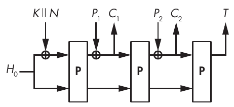

Hình 8-4: Một authenticated cipher permutation-based

Để mã hóa block thứ hai, hãy biến đổi state bằng P, XOR plaintext block tiếp theo P<sub>2</sub> vào state hiện tại, và lấy giá trị thu được làm C<sub>2</sub>. Sau đó, lặp qua mọi plaintext block và, sau lần gọi P cuối cùng, lấy các bit từ internal state làm authentication tag T, như ở phía bên phải của Hình 8-4.

> **LƯU Ý** Bạn có thể điều chỉnh mode trong Hình 8-4 để hỗ trợ associated data, nhưng quá trình phức tạp hơn một chút, nên tôi sẽ bỏ qua phần mô tả.

Thiết kế các authenticated cipher permutation-based an toàn có những yêu cầu nhất định. Thứ nhất, chỉ XOR các giá trị đầu vào vào một phần của state: phần này càng lớn, kẻ tấn công thành công càng có nhiều quyền kiểm soát internal state và do đó security của cipher càng thấp. Thật vậy, toàn bộ security dựa vào tính bí mật của internal state.

Ngoài ra, bạn phải pad block đúng cách bằng các bit bổ sung theo cách bảo đảm rằng bất kỳ hai message khác nhau nào cũng cho ra kết quả khác nhau. Lấy một phản ví dụ, nếu plaintext block cuối cùng ngắn hơn một block hoàn chỉnh, nó không nên chỉ được pad bằng các số 0; nếu không, một plaintext block, chẳng hạn, 2 byte (0000) sẽ cho ra một plaintext block hoàn chỉnh (0000 . . . 0000), giống như một block 3 byte (000000). Kết quả là bạn sẽ có cùng một tag cho cả hai message, dù chúng khác nhau về kích thước.

Nếu bạn dùng lại một nonce trong một cipher permutation-based như vậy, tác động không tệ như với GCM hay OCB—độ mạnh của authentication tag sẽ không bị xâm phạm. Nếu bạn lặp lại một nonce, kẻ tấn công sẽ chỉ biết được hai message đã mã hóa có bắt đầu bằng cùng một giá trị hay không, cũng như độ dài của giá trị chung này, tức tiền tố (prefix). Ví dụ, dù việc mã hóa hai message six-block ABCXYZ và ABCDYZ (mỗi chữ cái ở đây tượng trưng cho một block) với cùng một nonce có thể cho ra hai ciphertext JKLTUV và JKLMNO có tiền tố giống hệt nhau, kẻ tấn công sẽ không thể biết rằng hai plaintext có chung hai block cuối cùng (YZ).

Về hiệu năng, các cipher permutation-based mang lại lợi ích của một layer phép toán duy nhất, xử lý streamable, và việc dùng một algorithm single-core cho encryption và decryption. Tuy nhiên, chúng không thể song song hóa như GCM hay OCB vì các lời gọi P mới cần chờ lời gọi trước đó hoàn tất.

> **LƯU Ý** Nếu bạn bị cám dỗ chọn permutation yêu thích của mình và tự chế ra authenticated cipher của riêng bạn, xin đừng làm vậy. Nhiều khả năng bạn sẽ làm sai các chi tiết và kết cục là một cipher không an toàn. Hãy đọc các đặc tả do các cryptographer giàu kinh nghiệm viết cho các algorithm như Keyak (một algorithm bắt nguồn từ Keccak), cấu trúc Duplex, và các deck function trên https://keccak.team. Bạn sẽ thấy rằng các cipher permutation-based phức tạp hơn vẻ ngoài ban đầu của chúng.

## Những gì có thể sai (How Things Can Go Wrong)

Authenticated cipher có attack surface lớn hơn hash function hay block cipher vì chúng nhắm tới việc đạt được cả tính bí mật lẫn tính xác thực. Chúng nhận nhiều giá trị đầu vào khác nhau và phải vẫn an toàn bất kể đầu vào chỉ chứa associated data mà không có dữ liệu được mã hóa, plaintext cực lớn, hay các kích thước key khác nhau. Chúng cũng phải an toàn với mọi giá trị nonce trước những kẻ tấn công thu thập rất nhiều cặp message/tag và, ở một mức độ nào đó, trước việc nonce vô tình bị lặp lại.

Đó là đòi hỏi rất nhiều, và ngay cả AES-GCM cũng có một số điểm không hoàn hảo.

### AES-GCM và hash key yếu

Một trong những điểm yếu của AES-GCM nằm ở authentication algorithm GHASH của nó: một số giá trị nhất định của hash key H làm đơn giản hóa rất nhiều các attack nhắm vào cơ chế authentication của GCM. Cụ thể, nếu giá trị H thuộc về một số subgroup cụ thể, được định nghĩa bằng toán học, của mọi chuỗi 128-bit, kẻ tấn công có thể đoán được một authentication tag hợp lệ cho một message nào đó chỉ bằng cách xáo trộn các block của một message trước đó.

Để hiểu điểm yếu này, hãy xem GHASH hoạt động như thế nào.

#### Bên trong GHASH (GHASH Internals)

Như bạn đã thấy trong Hình 8-2, GHASH bắt đầu với một giá trị 128-bit, H, ban đầu được đặt là AES(K, 0), rồi tính lặp lại

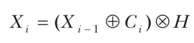

bắt đầu từ X<sub>0</sub> = 0 và xử lý các ciphertext block C<sub>1</sub>, C<sub>2</sub>, v.v. GHASH trả về X<sub>i</sub> cuối cùng để tính tag cuối cùng.

Để đơn giản, giả sử mọi giá trị C<sub>i</sub> đều bằng 1, sao cho với mọi I bạn có:

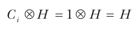

Tiếp theo, tính X<sub>1</sub> từ phương trình đầu tiên của chúng ta cho ra

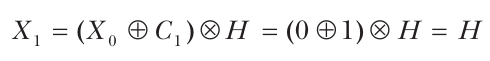

thay X<sub>0</sub> bằng 0 và C<sub>1</sub> bằng 1, để có được kết quả sau:

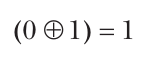

Nhờ tính chất phân phối của ⊗ đối với ⊕, chúng ta thay X<sub>1</sub> bằng H và C<sub>2</sub> bằng 1 rồi tính giá trị tiếp theo, X<sub>2</sub>, là

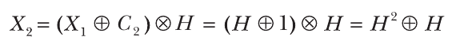

trong đó H<sup>2</sup> là H bình phương, tức H ⊗ H.

Bây giờ bạn suy ra X<sub>3</sub> bằng cách thay X<sub>2</sub> bằng biểu thức suy ra của nó, và có được kết quả sau:

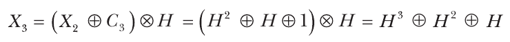

Tiếp theo, bạn suy ra X<sub>4</sub> là X<sub>4</sub> = H<sup>4</sup> ⊕ H<sup>3</sup> ⊕ H<sup>2</sup> ⊕ H, v.v., và cuối cùng X<sub>i</sub> cuối là:

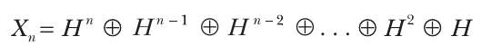

Hãy nhớ rằng bạn đã đặt mọi block C<sub>i</sub> bằng 1. Nếu thay vào đó các giá trị này là tùy ý, bạn sẽ có được kết quả sau:

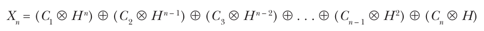

Sau đó, GHASH XOR độ dài của message vào X<sub>n</sub> cuối cùng này, nhân kết quả với H, và XOR giá trị này với AES(K, N || 0) để tạo authentication tag cuối cùng, T.

#### Chỗ mọi thứ bị phá vỡ (Where Things Break)

Điều gì có thể sai từ đây? Trước tiên hãy xem những trường hợp đơn giản nhất:

• Nếu H = 0, thì X<sub>n</sub> = 0 bất kể các giá trị C<sub>i</sub> và do đó bất kể message. Tức là mọi message sẽ có cùng một authentication tag nếu H bằng 0.

• Nếu H = 1, thì tag chỉ là XOR của các ciphertext block, và sắp xếp lại thứ tự các ciphertext block sẽ cho ra cùng một authentication tag.

Vì 0 và 1 chỉ là hai trong số 2<sup>128</sup> giá trị khả dĩ của H, khả năng những trường hợp này xảy ra chỉ là 2/2<sup>128</sup> = 1/2<sup>127</sup>. Nhưng còn có những giá trị yếu khác—cụ thể là mọi giá trị của H thuộc về một chu trình ngắn khi được nâng lên các lũy thừa bậc i. Ví dụ, giá trị H 10d04d25f93556e69f58ce2f8d035a4 thuộc về một chu trình độ dài 5, vì nó thỏa mãn H<sup>5</sup> = H, và do đó H<sup>e</sup> = H với mọi e là bội số của 5 (chính là định nghĩa của chu trình đối với lũy thừa bậc năm). Do đó, trong biểu thức trên của giá trị GHASH cuối cùng X<sub>n</sub>, việc hoán đổi block C<sub>n</sub> (được nhân với H) và block C<sub>n –</sub> <sub>4</sub> (được nhân với H<sup>5</sup>) giữ nguyên authentication tag, tương đương với một forgery. Kẻ tấn công có thể khai thác tính chất này để tạo ra một message mới cùng tag hợp lệ của nó mà không cần biết key, điều lẽ ra phải là không thể đối với một authenticated cipher an toàn.

Ví dụ trên dựa trên một chu trình độ dài 5, nhưng có nhiều chu trình dài hơn và do đó nhiều giá trị H yếu hơn mức lẽ ra phải có. Kết cục là, trong trường hợp khó xảy ra khi H thuộc về một chu trình giá trị ngắn và kẻ tấn công có thể làm giả bao nhiêu authentication tag tùy thích, thì trừ khi họ biết H hoặc K, họ không thể xác định độ dài chu trình của H. Dù kẻ tấn công không thể khai thác lỗ hổng này, bạn có thể tránh nó bằng cách chọn cẩn thận đa thức được dùng cho phép rút gọn modulo.

> **LƯU Ý** Để biết thêm chi tiết về attack này, hãy đọc “Cycling Attacks on GCM, GHASH and Other Polynomial MACs and Hashes” của Markku-Juhani O. Saarinen, có tại https://eprint.iacr.org/2011/202.

### AES-GCM và tag ngắn

Trong thực tế, AES-GCM thường trả về tag 128-bit, nhưng nó có thể tạo ra tag có độ dài bất kỳ. Đáng tiếc là khi dùng tag ngắn hơn, xác suất bị làm giả tăng lên đáng kể.

Khi dùng một tag 128-bit, kẻ tấn công cố gắng làm giả sẽ thành công với xác suất 1/2<sup>128</sup>, vì có 2<sup>128</sup> tag 128-bit khả dĩ. (Nói chung, với một tag n-bit, xác suất thành công phải là 1/2<sup>n</sup>, trong đó 2<sup>n</sup> là số giá trị khả dĩ của một tag n-bit.) Nhưng khi dùng tag ngắn hơn, xác suất bị làm giả cao hơn 1/2<sup>n</sup> rất nhiều do những điểm yếu trong cấu trúc của GCM nằm ngoài phạm vi thảo luận này. Ví dụ, một tag 32-bit cho phép kẻ tấn công biết authentication tag của một message 2MB nào đó thành công với khả năng 1/2<sup>16</sup> thay vì 1/2<sup>32</sup>.

Nói chung, với tag n-bit, xác suất bị làm giả không phải là 1/2<sup>n</sup> mà là 2<sup>m</sup>/2<sup>n</sup>, trong đó 2<sup>m</sup> là số block của message dài nhất mà một kẻ tấn công thành công đã quan sát được tag. Ví dụ, nếu bạn dùng tag 48-bit và xử lý các message 4GB (tức 2<sup>28</sup> block, mỗi block 16 byte), xác suất bị làm giả là 2<sup>28</sup>/2<sup>48</sup> = 1/2<sup>20</sup>, tức khoảng một phần triệu. Xét theo cryptography, đó là một khả năng tương đối cao. (Để biết thêm thông tin về attack này, xem bài báo năm 2005 “Authentication Weaknesses in GCM” của Niels Ferguson.)

## Đọc thêm (Further Reading)

Để tìm hiểu thêm về authenticated cipher, hãy truy cập trang chủ của CAESAR, Competition for Authenticated Encryption: Security, Applicability, and Robustness (http://competitions.cr.yp.to/caesar.html). Bắt đầu năm 2012, CAESAR là một cuộc thi crypto theo phong cách của các cuộc thi AES và SHA-3, dù nó không do NIST tổ chức.

Cuộc thi CAESAR đã thu hút một số lượng ấn tượng các thiết kế sáng tạo: từ các mode OCB-like đến các mode permutation-based (như NORX và Keyak), cũng như các algorithm hoàn toàn nguyên bản (như AEZ hay AEGIS). Năm 2019, CAESAR kết thúc với việc chọn ra một danh mục gồm bảy algorithm chia thành ba hạng mục, mà bạn có thể tìm thấy trên trang chính thức của nó tại https://competitions.cr.yp.to/caesar-submissions.html.

Một cuộc thi khác nơi bạn có thể tìm thấy các authenticated encryption algorithm là dự án Lightweight Cryptography của NIST. Diễn ra từ năm 2017 đến 2023, nó nhắm tới việc chuẩn hóa các algorithm được tối ưu cho các môi trường resource-constrained (memory, kích thước bộ xử lý, v.v.) như các nền tảng nhúng. Người chiến thắng cuộc thi là Ascon, một họ algorithm permutation-based, được trình bày chi tiết trên trang chính thức của nó tại https://ascon.iaik.tugraz.at. Để khám phá các algorithm ứng viên khác và các công trình được trình bày tại các workshop của dự án, hãy truy cập https://csrc.nist.gov/Projects/lightweight-cryptography.

Trong chương này, chúng ta tập trung vào GCM, nhưng còn một số mode khác cũng được dùng trong các ứng dụng thực tế. Cụ thể, các mode counter with CBC-MAC (CCM) và EAX đã cạnh tranh với GCM để được chuẩn hóa vào đầu những năm 2000, và dù GCM được chọn, các đối thủ của nó vẫn được dùng trong một số ứng dụng. Ví dụ, CCM được dùng trong protocol mã hóa Wi-Fi WPA2. Hãy cân nhắc đọc đặc tả của các cipher này và xem xét ưu điểm tương đối về security và hiệu năng của chúng.

Đến đây kết thúc phần thảo luận của chúng ta về symmetric-key cryptography! Bạn đã thấy block cipher, stream cipher, hash function (keyed), và giờ là authenticated cipher—tất cả các thành phần cryptography chính làm việc với một symmetric key, hoặc không có key nào cả. Trước khi chuyển sang asymmetric cryptography, Chương 9 tập trung vào khoa học máy tính và toán học, để cung cấp kiến thức nền cho các asymmetric scheme như RSA (Chương 10) và Diffie–Hellman (Chương 11).
