# Chương 10: RSA

Cryptosystem Rivest–Shamir–Adleman (RSA) đã cách mạng hóa cryptography khi nó xuất hiện năm 1977 như là public-key encryption scheme đầu tiên. Trong khi các encryption scheme symmetric-key cổ điển dùng cùng một secret key để mã hóa và giải mã message, public-key encryption (hay asymmetric encryption) dùng hai key: một public key, mà bất kỳ ai muốn mã hóa message gửi cho bạn đều có thể dùng, và một private key, cần thiết để giải mã các message được mã hóa bằng public key. Phép màu này là lý do vì sao RSA là một đột phá thực sự, và 40 năm sau, nó vẫn là hình mẫu của public-key encryption và là công cụ chủ lực của internet security. (Một năm trước RSA, Whitfield Diffie và Martin Hellman đã giới thiệu khái niệm public-key cryptography, nhưng scheme của họ chỉ có thể thực hiện việc phân phối key trong bối cảnh public-key.)

RSA hoạt động bằng cách tạo ra một trapdoor permutation, một function biến một số x thành một số y trong cùng phạm vi, sao cho việc tính y từ x là dễ dàng khi dùng public key, nhưng việc tính x từ y thực tế là không thể trừ khi bạn biết private key—tức trapdoor. (Hãy nghĩ x là một plaintext và y là một ciphertext.)

Ngoài encryption, bạn cũng có thể dùng RSA để xây dựng digital signature, trong đó chỉ chủ sở hữu private key mới có thể ký một message, và public key cho phép bất kỳ ai kiểm chứng tính hợp lệ của chữ ký.

Trong chương này, bạn sẽ học cách RSA trapdoor permutation hoạt động và vì sao chỉ riêng permutation này không đủ để xây dựng encryption và signature an toàn. Tôi cũng sẽ thảo luận security của RSA liên quan đến factoring problem (xem Chương 9), các cách triển khai RSA an toàn, và cách tấn công nó.

Chúng ta bắt đầu bằng việc giải thích các khái niệm toán học cơ bản đằng sau RSA.

## Toán học đằng sau RSA (The Math Behind RSA)

Khi xử lý một message, dù là mã hóa hay ký nó, RSA trước tiên tạo ra một số lớn từ message đó và xử lý nó bằng cách thực hiện các phép nhân giữa các số lớn. Vì vậy, để hiểu RSA hoạt động như thế nào, bạn cần biết RSA thao tác với loại số lớn nào và phép nhân hoạt động ra sao trên các số đó.

Để mã hóa hoặc ký, RSA biến đổi một số nguyên dương nằm giữa 1 và n – 1, trong đó n là một số lớn gọi là modulus. Những số như vậy, khi nhân với nhau, cho ra một số khác cũng thỏa mãn các tiêu chí này. Các số này tạo thành một group, mà bạn ký hiệu là Z<sub>n</sub><sup>\*</sup> và gọi là multiplicative group các số nguyên modulo n. (Xem định nghĩa toán học của một group trong “Groups” ở trang 189.)

Ví dụ, hãy xét group Z<sub>4</sub><sup>\*</sup> các số nguyên modulo 4. Hãy nhớ lại từ Chương 9 rằng một group phải chứa một phần tử đơn vị (tức là 1) và mỗi số x trong group phải có một nghịch đảo, tức một số y sao cho x × y = 1. Làm thế nào để xác định tập tạo thành Z<sub>4</sub><sup>\*</sup>? Dựa trên các định nghĩa, bạn biết rằng 0 không thuộc group Z<sub>4</sub><sup>\*</sup>, vì nhân bất kỳ số nào với 0 cũng không bao giờ cho ra 1, nên 0 không có nghịch đảo. Số 1 thuộc Z<sub>4</sub><sup>\*</sup> vì 1 × 1 = 1, nên 1 là nghịch đảo của chính nó. Tuy nhiên, số 2 không thuộc group này vì bạn không thể có được 1 bằng cách nhân 2 với một phần tử khác của Z<sub>4</sub><sup>\*</sup> (lưu ý rằng 2 không nguyên tố cùng nhau với 4, vì 4 và 2 có chung thừa số 2). Số 3 thuộc group Z<sub>4</sub><sup>\*</sup> vì nó là nghịch đảo của chính nó trong Z<sub>4</sub><sup>\*</sup>. Như vậy, bạn có Z<sub>4</sub><sup>\*</sup> = {1, 3}.

Bây giờ hãy xét Z<sub>5</sub><sup>\*</sup>, multiplicative group các số nguyên modulo 5. Như trong Chương 9, Z<sub>5</sub><sup>\*</sup> = {1, 2, 3, 4}. Thật vậy, vì 5 là số nguyên tố, 1, 2, 3 và 4 đều nguyên tố cùng nhau với 5, nên tập Z<sub>5</sub><sup>\*</sup> chứa tất cả chúng. Hãy kiểm chứng điều này: 2 × 3 mod 5 = 1; do đó, 2 là nghịch đảo của 3, và 3 là nghịch đảo của 2; lưu ý rằng 4 là nghịch đảo của chính nó vì 4 × 4 mod 5 = 1; và cuối cùng, 1 một lần nữa là nghịch đảo của chính nó trong group.

Để tìm số phần tử trong một group Z<sub>n</sub><sup>\*</sup> khi n không phải là số nguyên tố, bạn có thể dùng hàm phi Euler (Euler’s totient function), mà chúng ta viết là φ(n), với φ biểu diễn chữ cái Hy Lạp phi. Function này cho số phần tử nguyên tố cùng nhau (coprime) với n, chính là số phần tử trong Z<sub>n</sub><sup>\*</sup>. Theo quy tắc, nếu n là tích của các số nguyên tố n = p<sub>1</sub> × p<sub>2</sub> × . . . × p<sub>m</sub>, số phần tử trong group Z<sub>n</sub><sup>\*</sup> là như sau:

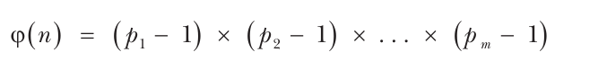

RSA chỉ làm việc với các số n là tích của hai số nguyên tố lớn, thường được ký hiệu là n = pq. Khi đó, group Z<sub>n</sub><sup>\*</sup> tương ứng chứa φ(n) = (p – 1)(q – 1) phần tử. Bằng cách khai triển biểu thức này, bạn có được định nghĩa tương đương φ(n) = n – p – q + 1, hay φ(n) = (n + 1) – (p + q), biểu thị giá trị của φ(n) so với n một cách trực quan hơn.

## RSA Trapdoor Permutation (The RSA Trapdoor Permutation)

RSA trapdoor permutation là core algorithm đằng sau encryption và signature RSA-based. Với một modulus n và một số e, mà bạn gọi là public exponent, RSA trapdoor permutation biến một số x từ tập Z<sub>n</sub><sup>\*</sup> thành một số y = x<sup>e</sup> mod n. Nói cách khác, nó tính giá trị bằng x nhân với chính nó e – 1 lần modulo n rồi trả về kết quả. Khi bạn dùng RSA trapdoor permutation để mã hóa, modulus n và số mũ e tạo thành RSA public key.

Để lấy lại x từ y, bạn có thể dùng một số khác, d, để tính như sau:

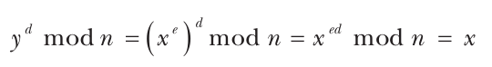

Vì d là trapdoor cho phép bạn giải mã, nó là một phần của private key trong một cặp RSA key, nghĩa là nó phải luôn được giữ bí mật. Số d còn được gọi là secret exponent.

Tất nhiên, d không phải là một số bất kỳ; nó là số sao cho e nhân với d tương đương với 1 và do đó sao cho x<sup>ed</sup> mod n = x với mọi x. Chính xác hơn, bạn phải có ed mod φ(n) = 1 để có được x<sup>ed</sup> = x<sup>1</sup> = x và giải mã message đúng. Lưu ý rằng ở đây bạn tính modulo φ(n) chứ không phải modulo n, vì các số mũ hoạt động như index của các phần tử của Z<sub>n</sub><sup>\*</sup> chứ không phải như chính các phần tử đó. Vì Z<sub>n</sub><sup>\*</sup> có φ(n) phần tử, index phải nhỏ hơn φ(n).

Số φ(n) có vai trò then chốt đối với security của RSA. Thực tế, tìm ra φ(n) cho một RSA modulus n tương đương với việc phá RSA, vì bạn có thể dễ dàng suy ra secret exponent d từ φ(n) và e bằng cách tính nghịch đảo của e. Do đó, p và q cũng phải được giữ bí mật, vì biết p hoặc q sẽ cho ra φ(n) bằng cách tính (p – 1)(q – 1) = φ(n).

> **LƯU Ý** φ(n) được gọi là cấp (order) của group Z<sub>n</sub><sup>\*</sup>; order là một đặc trưng quan trọng của một group, thiết yếu đối với các public-key system khác như Diffie–Hellman và elliptic curve cryptography.

## Tạo RSA key và security (RSA Key Generation and Security)

Key generation là quá trình tạo ra một cặp RSA key, cụ thể là một public key (modulus n và public exponent e) và private key của nó (secret exponent d). Vì các số p và q (sao cho n = pq) và order φ(n) cũng phải được giữ bí mật, bạn thường sẽ đưa chúng vào làm một phần của private key.

Để tạo một cặp RSA key, trước tiên hãy chọn hai số nguyên tố ngẫu nhiên, p và q, và tính φ(n) từ chúng. Sau đó tính d là nghịch đảo của e. Listing 10-1 cho thấy cách làm điều này bằng SageMath (https://www.sagemath.org ), một môi trường nguồn mở Python-esque bao gồm nhiều gói toán học.

```
sage: p = random_prime(2^32); p
1103222539
sage: q = random_prime(2^32); q
17870599
sage: n = p*q; n
19715247602230861
sage: phi = (p-1)*(q-1); phi
19715246481137724
sage: e = random_prime(phi); e
13771927877214701
sage: d = xgcd(e, phi); d
15417970063428857
sage: mod(d*e, phi)
1
```

Listing 10-1: Tạo các tham số RSA bằng SageMath

Ở đây, bạn dùng function random_prime() để chọn các số nguyên tố ngẫu nhiên p và q nhỏ hơn một đối số cho trước. Tiếp theo, bạn nhân p với q để có được modulus n và φ(n), chính là biến phi. Sau đó, bạn tạo một public exponent ngẫu nhiên, e, bằng cách chọn một số nguyên tố ngẫu nhiên nhỏ hơn phi để bảo đảm rằng e có nghịch đảo modulo phi.

Bạn dùng function xgcd() của Sage để tạo private exponent d tương ứng. Function này tính các số s và t khi có hai số, a và b, bằng extended Euclidean algorithm sao cho as + bt = GCD(a, b). Cuối cùng, bạn kiểm tra rằng ed mod φ(n) = 1 để bảo đảm d đảo ngược đúng RSA permutation.

> **LƯU Ý** Tôi đã dùng một modulus n 64-bit trong Listing 10-1 để tránh output dài nhiều trang, nhưng trong thực tế một RSA modulus phải dài ít nhất 2,048 bit thì mới an toàn.

Bây giờ bạn có thể áp dụng trapdoor permutation, như Listing 10-2 cho thấy.

```
sage: x = 1234567
sage: y = power_mod(x, e, n); y
19048323055755904
sage: power_mod(y, d, n)
1234567
```

Listing 10-2: Tính RSA trapdoor permutation theo cả hai chiều

Bạn gán số nguyên 1,234,567 cho x rồi dùng function power_mod(x, e, n), phép lũy thừa modulo n, hay x<sup>e</sup> mod n ở dạng phương trình, để tính y. Sau khi tính y = x<sup>e</sup> mod n, bạn tính y<sup>d</sup> mod n với trapdoor d để trả về x ban đầu.

Tìm x mà không có trapdoor d khó đến mức nào? Một kẻ tấn công có khả năng phân tích thừa số các số lớn có thể phá RSA bằng cách khôi phục p và q rồi φ(n) để tính d từ e. Một rủi ro khác đối với RSA nằm ở khả năng của kẻ tấn công tính x từ x<sup>e</sup> mod n, tức căn bậc e modulo n, mà không nhất thiết phải phân tích n thành thừa số. Dù hai rủi ro này có vẻ liên hệ chặt chẽ, chúng ta không biết chắc chúng có tương đương nhau hay không.

Giả sử việc phân tích thừa số và việc tìm căn bậc e khó xấp xỉ nhau, security level của RSA phụ thuộc vào ba yếu tố: kích thước của n, việc chọn p và q, và cách trapdoor permutation được sử dụng. Nếu n quá nhỏ, người ta có thể phân tích nó thành thừa số trong một khoảng thời gian thực tế, để lộ private key. Để an toàn, n phải dài ít nhất 2,048 bit (security level khoảng 90 bit, đòi hỏi công sức tính toán khoảng 2<sup>90</sup> phép toán) nhưng tốt hơn là dài 4,096 bit (security level xấp xỉ 128 bit). Các giá trị p và q phải là các số nguyên tố ngẫu nhiên không liên quan đến nhau và có kích thước tương tự nhau. Nếu chúng quá nhỏ hoặc quá gần nhau, việc xác định giá trị của chúng từ n sẽ dễ hơn. Cuối cùng, bạn không nên dùng trực tiếp RSA trapdoor permutation để mã hóa hay ký, như tôi sẽ thảo luận ngay sau đây.

## Mã hóa bằng RSA (Encrypting with RSA)

Thông thường, RSA được dùng kết hợp với một symmetric encryption scheme, trong đó RSA mã hóa một symmetric key dùng để mã hóa message bằng một symmetric cipher, như AES-GCM. Nhưng mã hóa một message hay symmetric key bằng RSA phức tạp hơn việc chỉ đơn giản chuyển đối tượng cần mã hóa thành một số x và tính x<sup>e</sup> mod n.

Trong các mục con sau, tôi sẽ giải thích vì sao một ứng dụng ngây thơ của RSA trapdoor permutation là không an toàn và encryption RSA-based mạnh hoạt động như thế nào.

### Tính malleable của textbook RSA encryption (Textbook RSA Encryption’s Malleability)

Cụm từ textbook RSA encryption mô tả RSA encryption scheme đơn giản trong đó số được lũy thừa chỉ chứa message bạn muốn mã hóa. Ví dụ, để mã hóa chuỗi RSA, trước tiên bạn chuyển nó thành một số—chẳng hạn, bằng cách nối mã ASCII của mỗi chữ cái trong ba chữ cái thành một byte: R (byte 52), S (byte 53) và A (byte 41). Chuỗi byte thu được 525341 bằng 5,395,265 khi chuyển sang hệ thập phân, mà sau đó bạn có thể mã hóa bằng cách tính 5,395,265<sup>e</sup> mod n. Nếu không biết secret key, không có cách nào giải mã message—ít nhất là trên lý thuyết.

Tuy nhiên, textbook RSA encryption là tất định: nếu bạn mã hóa cùng một plaintext hai lần, bạn sẽ nhận được cùng một ciphertext hai lần. Và còn một vấn đề lớn hơn nữa: khi có hai ciphertext textbook RSA y<sub>1</sub> = x<sub>1</sub><sup>e</sup> mod n và y<sub>2</sub> = x<sub>2</sub><sup>e</sup> mod n, bạn có thể suy ra ciphertext của x<sub>1</sub> × x<sub>2</sub> bằng cách nhân các ciphertext này với nhau:

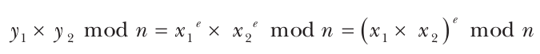

Kết quả là (x<sub>1</sub> × x<sub>2</sub>)<sup>e</sup> mod n, ciphertext của message x<sub>1</sub> × x<sub>2</sub> mod n. Kẻ tấn công có thể tạo ra một ciphertext hợp lệ mới từ hai RSA ciphertext, làm tổn hại security của encryption bằng cách cho phép họ suy ra thông tin về message ban đầu. Điểm yếu này khiến textbook RSA encryption là malleable. (Nếu bạn biết x<sub>1</sub> và x<sub>2</sub>, bạn cũng có thể tính (x<sub>1</sub> × x<sub>2</sub>)<sup>e</sup> mod n, nhưng nếu bạn chỉ biết y<sub>1</sub> và y<sub>2</sub>, lẽ ra bạn không thể nhân các ciphertext và có được ciphertext của các plaintext đã nhân với nhau.)

Một vấn đề khác của textbook RSA encryption ngây thơ là sự tồn tại của các message “đặc biệt”. Dù n và e là gì, 1<sup>e</sup> = 1. Do đó, message 1 vẫn giữ nguyên sau khi mã hóa. Textbook RSA còn nhiều vấn đề khác, nhưng bạn sẽ học cách tránh chúng bằng cách dùng một RSA encryption mạnh.

### RSA encryption mạnh với OAEP (Strong RSA Encryption with OAEP)

Để làm cho RSA ciphertext nonmalleable, số được lũy thừa trong quá trình mã hóa phải kết hợp dữ liệu message với dữ liệu bổ sung gọi là padding, như Hình 10-1 cho thấy.

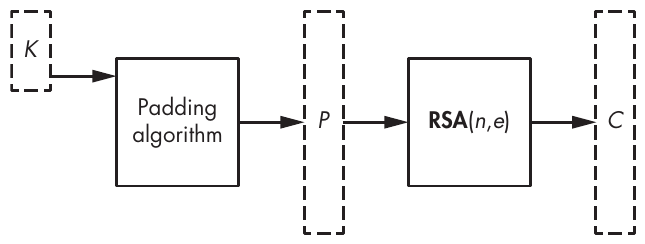

Hình 10-1: Mã hóa một symmetric key, K, bằng RSA với (n, e) làm public key

Cách tiêu chuẩn để mã hóa bằng RSA theo kiểu này là dùng Optimal Asymmetric Encryption Padding (OAEP), một sự kết hợp thường được gọi là RSA-OAEP. Scheme này bao gồm việc tạo một bit string lớn bằng modulus bằng cách pad message với dữ liệu bổ sung và tính ngẫu nhiên trước khi áp dụng RSA function.

> **LƯU Ý** Các tài liệu chính thức như tiêu chuẩn PKCS#1 và Special Publication 800-56B của NIST gọi OAEP là RSAES-OAEP. OAEP cải tiến từ phương pháp trước đó là PKCS#1 v1.5, một trong những tiêu chuẩn đầu tiên trong loạt Public-Key Cryptography Standards (PKCS) của RSA. Nó kém an toàn hơn OAEP rõ rệt nhưng vẫn được dùng trong nhiều hệ thống sau khi OAEP ra đời.

#### Security

OAEP dùng một PRNG để bảo đảm indistinguishability và nonmalleability của ciphertext bằng cách làm cho encryption mang tính xác suất. Nó đã được chứng minh là an toàn chừng nào RSA function và PRNG an toàn và, ở mức độ thấp hơn, các hash function không quá yếu. Bạn nên dùng OAEP khi mã hóa bằng RSA, thay vì người tiền nhiệm của nó, tiêu chuẩn PKCS#1 v1.5.

#### Encryption

Mã hóa bằng RSA ở OAEP mode cần một message (như một symmetric key, K), một PRNG và hai hash function. Để tạo ciphertext, hãy dùng một modulus n cho trước dài m byte (tức là 8m bit và do đó n nhỏ hơn 2<sup>8m</sup>). Để mã hóa K, hãy tạo message đã encode là

M = H || 00 . . . 00 || 01 || K

trong đó H là một hằng số h-byte được OAEP scheme định nghĩa, theo sau là bao nhiêu byte 00 cần thiết và một byte 01. Hình 10-2 cho thấy cách xử lý message đã encode này, M.

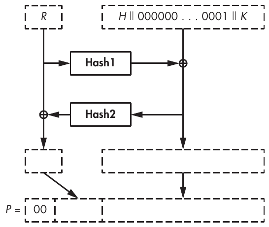

Hình 10-2: Mã hóa một symmetric key, K, bằng RSA-OAEP, trong đó H là một tham số cố định và R là các bit ngẫu nhiên

Bạn tạo một chuỗi ngẫu nhiên h-byte R và đặt M = M ⊕ Hash1(R), trong đó Hash1(R) dài bằng M. Tiếp theo, đặt R = R ⊕ Hash2(M), trong đó Hash2(M) dài bằng R. Bây giờ, hãy dùng các giá trị mới này của M và R để tạo thành một chuỗi m-byte P = 00 || M || R, dài bằng modulus n và có thể chuyển thành một số nguyên nhỏ hơn n. Phép chuyển đổi này cho ra số x, mà sau đó bạn dùng để tính RSA function x<sup>e</sup> mod n để có được ciphertext.

Để giải mã một ciphertext y, trước tiên hãy tính x = y<sup>d</sup> mod n và, từ đó, khôi phục các giá trị cuối cùng của M và R. Tiếp theo, lấy lại giá trị ban đầu của M bằng cách tính M ⊕ Hash1(R ⊕ Hash2(M)). Cuối cùng, kiểm chứng rằng M có dạng H || 00 . . . 00 || 01 || K, với H h-byte và các byte 00 theo sau là một byte 01.

Trong thực tế, các tham số m và h (lần lượt là độ dài của modulus và độ dài đầu ra của Hash2) thường là m = 256 byte (cho RSA 2,048-bit) và h = 32 (khi dùng SHA-256 làm Hash2). Điều này để lại m – h – 1 = 223 byte cho M, trong đó tối đa m – 2h – 2 = 190 byte có sẵn cho K (“–2” là do byte phân cách 01 trong M). Khi đó, hash value Hash1 gồm m – h – 1 = 223 byte, dài hơn hash value của bất kỳ hash function thông dụng nào. Để xây dựng một hash có độ dài đầu ra bất thường như vậy, đặc tả tiêu chuẩn RSA định nghĩa một kỹ thuật mask generating function để tạo ra các hash function trả về hash value lớn tùy ý từ bất kỳ hash function nào. Một cách tiếp cận khác là dùng một extendable output function (XOF) như SHAKE hoặc BLAKE3, dù điều này khác với các đặc tả tiêu chuẩn.

## Ký bằng RSA (Signing with RSA)

Digital signature có thể chứng minh rằng người giữ private key gắn với một digital signature cụ thể đã ký một message nào đó, thường là để xác nhận nội dung của nó. Vì chỉ người giữ private key mới biết private exponent d, không ai khác có thể tính một chữ ký y = x<sup>d</sup> mod n từ một giá trị x nào đó, nhưng mọi người đều có thể kiểm chứng y<sup>e</sup> mod n = x khi có public exponent e. Về nguyên tắc, người ta có thể dùng chữ ký đã được kiểm chứng đó làm bằng chứng để chứng tỏ rằng người giữ private-key đã ký một message cụ thể nào đó; đây là một tính chất gọi là nonrepudiation (chống chối bỏ).

Thật hấp dẫn khi xem RSA signature như là ngược lại của encryption, nhưng không phải vậy. Ký bằng RSA không giống với mã hóa bằng private key. Encryption cung cấp tính bí mật, trong khi digital signature giúp ngăn chặn việc làm giả. Ví dụ nổi bật nhất về sự khác biệt này là một signature scheme làm rò rỉ thông tin về message được ký là chấp nhận được, vì message không phải là bí mật. Ví dụ, một scheme để lộ một phần message có thể là một signature scheme an toàn nhưng không phải là một encryption scheme an toàn.

Vì overhead xử lý cần thiết, public-key encryption chỉ có thể xử lý các message ngắn, thường là secret key chứ không phải message thực sự. Tuy nhiên, một signature scheme có thể xử lý các message có kích thước tùy ý bằng cách dùng hash value của chúng Hash(M) làm đại diện, và nó có thể tất định mà vẫn an toàn. Giống RSA-OAEP, các signature scheme RSA-based có thể dùng một padding scheme, nhưng chúng cũng có thể dùng toàn bộ không gian message tối đa mà RSA modulus cho phép.

### Textbook RSA signature (Textbook RSA Signatures)

Một textbook RSA signature là phương pháp ký một message, x, bằng cách tính trực tiếp y = x<sup>d</sup> mod n, trong đó x có thể là bất kỳ số nào nằm giữa 1 và n – 1. Giống textbook encryption, textbook RSA signing đơn giản để đặc tả và triển khai nhưng không an toàn trước một số attack. Một attack như vậy là một forgery tầm thường: khi để ý thấy 1<sup>d</sup> mod n = 1 và (n – 1)<sup>d</sup> mod n = n – 1, bất kể giá trị của private key d, kẻ tấn công có thể làm giả chữ ký của 1 hoặc n – 1 mà không cần biết d.

Đáng lo ngại hơn là blinding attack. Ví dụ, giả sử bạn muốn có được chữ ký của một bên thứ ba trên một message nào đó, M, mà bạn biết họ sẽ không bao giờ cố ý ký. Để tiến hành attack này, trước tiên hãy tìm một giá trị nào đó, R, sao cho R<sup>e</sup>M mod n là một message mà nạn nhân của bạn sẽ sẵn lòng ký. Tiếp theo, bạn thuyết phục họ ký message đó và cho bạn xem chữ ký của họ, bằng S = (R<sup>e</sup>M)<sup>d</sup> mod n, tức message được nâng lên lũy thừa d. Khi có chữ ký đó, bạn có thể suy ra chữ ký của M, cụ thể là M<sup>d</sup>, nhờ một vài phép tính đơn giản.

Vì bạn có thể viết S là (R<sup>e</sup>M)<sup>d</sup> = R<sup>ed</sup>M<sup>d</sup>, và vì R<sup>ed</sup>= R (theo định nghĩa), bạn có S = (R<sup>e</sup>M)<sup>d</sup> = RM<sup>d</sup>. Để có được chữ ký M<sup>d</sup>, hãy chia S cho R như sau:

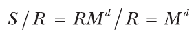

Đây thường là một attack thực tế và mạnh.

### Tiêu chuẩn chữ ký PSS (The PSS Signature Standard)

RSA Probabilistic Signature Scheme (PSS) đối với RSA signature giống như OAEP đối với RSA encryption. Nó được thiết kế để làm cho việc ký message an toàn hơn, nhờ việc thêm dữ liệu padding.

Hình 10-3 cho thấy PSS kết hợp một message hẹp hơn modulus với một số bit ngẫu nhiên và bit cố định trước khi áp dụng RSA lên kết quả của quá trình padding này.

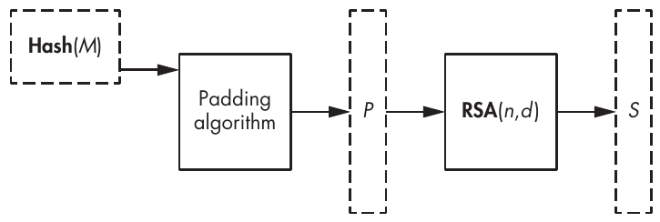

Hình 10-3: Ký một message, M, bằng RSA và bằng tiêu chuẩn PSS, trong đó (n, d) là private key

Giống mọi public-key signature scheme, PSS làm việc trên hash của message chứ không phải trên chính message. Ký Hash(M) chỉ an toàn nếu hash function có collision resistance. Do đó, bạn có thể ký các message có độ dài bất kỳ, vì sau khi hash một message, bạn sẽ có được một hash value có cùng độ dài cố định bất kể độ dài ban đầu của message.

Vì sao không ký chỉ bằng cách áp dụng OAEP encryption cho Hash(M)? Đáng tiếc là bạn không thể. Dù tương tự PSS, OAEP chỉ được chứng minh là an toàn cho encryption, không phải cho signature.

Giống OAEP, PSS cũng cần một PRNG và hai hash function. Một hash, Hash1, là một hash điển hình có độ dài đầu ra tiêu chuẩn, như SHA-256. Hash kia, Hash2, là một hash wide-output giống Hash2 của OAEP. Giống OAEP, PSS có thể dùng cấu trúc mask-generating function (MGF) để xây dựng một hash như vậy.

Quy trình ký PSS hoạt động như sau (trong đó h là độ dài đầu ra của Hash1):

1. Chọn một chuỗi ngẫu nhiên r-byte R bằng PRNG.

2. Tạo một message đã encode M′ = 0000000000000000 || Hash1(M) || R, dài h + r + 8 byte (với 8 byte không ở đầu).

3. Tính chuỗi h-byte H = Hash1(M′).

4. Đặt L = 00...00 || 01 || R, tức một chuỗi byte 00 theo sau là một byte 01 rồi đến R, với số byte 00 sao cho L dài m – h – 1 byte (độ rộng byte m của modulus trừ độ dài hash h trừ 1).

5. Đặt L = L ⊕ Hash2(H) để thay giá trị trước đó của L bằng một giá trị mới.

6. Chuyển chuỗi m-byte P = L || H || BC thành một số, x, nhỏ hơn n. Ở đây, byte BC là một giá trị cố định được nối vào sau H.

7. Với giá trị x vừa có được, tính RSA function x<sup>d</sup> mod n để có được chữ ký.

8. Để kiểm chứng một chữ ký khi có một message, M, hãy tính Hash1(M) và dùng public exponent e để đảo ngược RSA function và lấy lại L, H, rồi M′ từ chữ ký, kiểm tra tính đúng đắn của padding ở mỗi bước.

Trong thực tế, chuỗi ngẫu nhiên R (được gọi là salt t trong tiêu chuẩn RSA-PSS) thường dài bằng hash value. Ví dụ, nếu bạn dùng n = 2,048 bit và SHA-256 làm hash, giá trị L là m – h – 1 = 256 – 32 – 1 = 223 byte, và chuỗi ngẫu nhiên R thường sẽ dài 32 byte.

Giống OAEP, PSS là provably secure, được chuẩn hóa, và có sẵn trong nhiều tiện ích và thư viện phần mềm cryptography, bao gồm OpenSSL và module cryptography của ngôn ngữ Go. Cũng giống OAEP, nó trông phức tạp một cách không cần thiết và dễ mắc lỗi triển khai cũng như xử lý sai các trường hợp biên. Khác với RSA encryption, có một lựa chọn thay thế đơn giản hơn PSS để ký: không cần PRNG, chỉ với một hash function duy nhất, và không có padding.

### Chữ ký Full Domain Hash (Full Domain Hash Signatures)

Full Domain Hash (FDH) là signature scheme đơn giản nhất bạn có thể tưởng tượng. Để triển khai nó, hãy chuyển chuỗi byte Hash(M) thành một số, x, và tạo chữ ký y = x<sup>d</sup> mod n, như trong Hình 10-4.

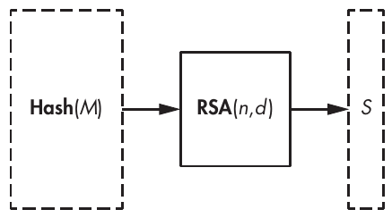

Hình 10-4: Ký một message bằng RSA dùng kỹ thuật Full Domain Hash

Việc kiểm chứng chữ ký cũng đơn giản. Với một chữ ký là một số y, hãy tính x = y<sup>e</sup> mod n và so sánh kết quả với Hash(M). Nó đơn giản đến nhàm chán, tất định, nhưng an toàn. Vậy sao phải bận tâm với sự phức tạp của PSS?

PSS được công bố sau FDH, năm 1996, và nó có một security proof tạo nhiều tin tưởng hơn FDH. Cụ thể, chứng minh của nó đưa ra các bảo đảm security cao hơn một chút so với chứng minh của FDH, và việc nó dùng tính ngẫu nhiên đã giúp củng cố chứng minh đó.

Những bảo đảm lý thuyết mạnh hơn này là lý do chính khiến nhiều cryptographer thích PSS hơn FDH, nhưng phần lớn ứng dụng dùng PSS ngày nay có thể chuyển sang FDH mà không mất mát security đáng kể. Tuy nhiên, trong một số bối cảnh, dùng PSS thay vì FDH là hợp lý, vì tính ngẫu nhiên của PSS bảo vệ nó trước một số attack nhắm vào implementation của nó, như các fault attack mà chúng ta sẽ thảo luận trong “How Things Can Go Wrong” ở trang 211.

Dù sao thì RSA signature (PSS hay FDH) ngày càng ít được dùng. Các chữ ký dựa trên elliptic curve, như ECDSA và EdDSA, đã trở nên phổ biến hơn, không chỉ vì việc tính chữ ký của chúng nhanh hơn nhiều (dù việc kiểm chứng chữ ký thường nhanh hơn với RSA).

## Các implementation RSA (RSA Implementations)

Tôi hy vọng bạn sẽ không bao giờ phải tự triển khai RSA từ đầu. Nếu bạn được yêu cầu làm vậy, hãy chạy nhanh hết mức có thể và đặt câu hỏi về sự tỉnh táo của người đã yêu cầu bạn. Các cryptographer và engineer đã mất hàng chục năm để phát triển các implementation RSA nhanh, đủ an toàn và lý tưởng nhất là không có bug nghiêm trọng, vì vậy không khôn ngoan khi phát minh lại RSA. Ngay cả với tất cả tài liệu có sẵn, cũng phải mất hàng tháng để hoàn thành nhiệm vụ đáng nản lòng này.

Thông thường, khi dùng RSA trong software, bạn sẽ dùng một thư viện hoặc API cung cấp các function cần thiết để thực hiện các thao tác RSA. Ví dụ, ngôn ngữ Go có function sau trong gói crypto của nó (từ https://go.dev/src/crypto/rsa/rsa.go):

```
func EncryptOAEP(hash hash.Hash, random io.Reader, pub *PublicKey, msg []byte,
label []byte) (out []byte, err error)
```

Function EncryptOAEP() nhận một hash function, một PRNG, một public key, một message và một label (một tham số tùy chọn của OAEP) rồi trả về một ciphertext và một mã lỗi. Khi bạn gọi EncryptOAEP(), nó gọi encrypt() để tính RSA function với dữ liệu đã được pad, như Listing 10-3 cho thấy.

```
func encrypt(c *big.Int, pub *PublicKey, m *big.Int) *big.Int {
    e := big.NewInt(int64(pub.E))
    c.Exp(m, e, pub.N)
    return c
}
```

Listing 10-3: Implementation của RSA encryption function cốt lõi từ thư viện cryptography của ngôn ngữ Go

Thao tác chính ở đây là c.Exp(m, e, pub.N), nâng một message, m, lên lũy thừa e modulo pub.N, và gán kết quả cho biến c.

Nếu bạn chọn tự triển khai RSA thay vì dùng một function thư viện có sẵn, hãy chắc chắn dựa vào một thư viện big-number có sẵn, tức là một tập các function và kiểu dữ liệu cho phép bạn định nghĩa và tính các phép toán số học trên các số lớn dài hàng nghìn bit. Ví dụ, bạn có thể dùng thư viện số học GNU Multiple Precision (GMP) trong C hoặc trong gói big của Go. (Hãy tin tôi, bạn không muốn tự triển khai số học big-number đâu.)

Ngay cả khi bạn chỉ dùng một function thư viện khi triển khai RSA, hãy chắc chắn rằng bạn hiểu phần bên trong hoạt động như thế nào để bạn có thể đánh giá rủi ro và xem nó có khớp với các yêu cầu security của ứng dụng hay không.

### Một algorithm lũy thừa nhanh (A Fast Exponentiation Algorithm)

Lũy thừa (exponentiation) là phép toán nâng x lên lũy thừa e, khi tính x<sup>e</sup> mod n. Khi làm việc với các số lớn, như với RSA, phép toán này có thể cực kỳ chậm nếu được triển khai một cách ngây thơ. Làm thế nào để tính lũy thừa một cách hiệu quả?

Cách ngây thơ để tính x<sup>e</sup> mod n cần e – 1 phép nhân, như algorithm pseudocode trong Listing 10-4 cho thấy.

```
expModNaive(x, e, n) {
    y = x
    for i = 1 to e – 1 {
        y = y * x mod n
    }
    return y
}
```

Listing 10-4: Một algorithm lũy thừa ngây thơ bằng pseudocode, nâng x lên lũy thừa e modulo n

Algorithm này đơn giản nhưng rất kém hiệu quả. Bạn có thể có được cùng kết quả nhanh hơn theo hàm mũ bằng cách bình phương thay vì nhân các giá trị trung gian y cho đến khi đạt được giá trị đúng. Họ phương pháp này được gọi là square-and-multiply, exponentiation by squaring, hay binary exponentiation.

Ví dụ, giả sử bạn muốn tính 3<sup>65,537</sup> mod 36,567,232,109,354,321. (Số 65,537 là public exponent trong phần lớn các implementation RSA.) Bạn có thể nhân số 3 với chính nó 65,536 lần, hoặc bạn có thể tiếp cận bài toán này khi biết rằng bạn có thể viết 65,537 là 2<sup>16</sup> + 1 và dùng một chuỗi phép bình phương thay thế. Về cơ bản, bạn khởi tạo một biến, y = 3, rồi tính các phép bình phương (y<sup>2</sup>) sau:

1. Đặt y = y<sup>2</sup> mod n (giờ y = 3<sup>2</sup> mod n).

2. Đặt y = y<sup>2</sup> mod n (giờ y = (3<sup>2</sup>)<sup>2</sup> mod n = 3<sup>4</sup> mod n).

3. Đặt y = y<sup>2</sup> mod n (giờ y = (3<sup>4</sup>)<sup>2</sup> = 3<sup>8</sup> mod n).

4. Đặt y = y<sup>2</sup> mod n (giờ y = (3<sup>8</sup>)<sup>2</sup> = 3<sup>16</sup> mod n).

5. Đặt y = y<sup>2</sup> mod n (giờ y = (3<sup>16</sup>)<sup>2</sup> = 3<sup>32</sup> mod n).

Và cứ thế cho đến khi y = 3<sup>65,536</sup>, bằng cách thực hiện 16 phép bình phương.

Để có kết quả cuối cùng, bạn sẽ trả về 3 × y mod n = 3<sup>65,537</sup> mod n = 26,652,909,283,612,267. Nói cách khác, bạn tính kết quả chỉ với 17 phép nhân thay vì 65,536 phép nhân với phương pháp ngây thơ.

Tổng quát hơn, một phương pháp square-and-multiply hoạt động bằng cách duyệt từng bit của số mũ, tính bình phương cho mỗi bit của số mũ để nhân đôi giá trị của số mũ, và nhân với số ban đầu cho mỗi bit có giá trị 1 gặp phải. Trong ví dụ trên, số mũ 65,537 là 10000000000000001 ở dạng nhị phân, và bạn đã bình phương y cho mỗi bit mới và chỉ nhân với số ban đầu 3 ở bit đầu tiên và bit cuối cùng.

Listing 10-5 cho thấy cách điều này hoạt động như một algorithm tổng quát bằng pseudocode để tính x<sup>e</sup> mod n khi số mũ e gồm các bit e<sub>m – 1</sub>e<sub>m – 2</sub> . . . e<sub>1</sub>e<sub>0</sub>, trong đó e<sub>0</sub> là bit có trọng số thấp nhất.

<pre>
expMod(x, e, n) {
    y = x
    for i = m – 1 to 0 {
        y = y * y  mod n
        if e<sub>i</sub> == 1 then
            y = y * x  mod n
    }
    return y
}
</pre>

Listing 10-5: Một algorithm lũy thừa nhanh bằng pseudocode, nâng x lên lũy thừa e modulo n

Algorithm expMod() chạy trong thời gian O(m), trong khi algorithm ngây thơ chạy trong thời gian O(2<sup>m</sup>), trong đó m là độ dài bit của số mũ. Ở đây, O() là ký hiệu độ phức tạp tiệm cận đã giới thiệu trong Chương 9.

Mọi hệ thống nghiêm túc đều triển khai một biến thể nào đó của phương pháp square-and-multiply đơn giản nhất này. Một biến thể như vậy là phương pháp sliding window, xét các khối bit thay vì từng bit riêng lẻ để thực hiện một phép nhân cho trước. Ví dụ, hãy xem function expNN() của ngôn ngữ Go, mà source code có tại https://go.dev/src/math/big/nat.go.

Các algorithm lũy thừa square-and-multiply này an toàn đến mức nào? Đáng tiếc là các thủ thuật để tăng tốc quá trình thường dẫn đến việc dễ bị tổn thương hơn trước một số attack.

Điểm yếu của các algorithm này bắt nguồn từ thực tế là các phép lũy thừa phụ thuộc nhiều vào giá trị của số mũ. Phép toán if trong Listing 10-5 rẽ sang nhánh khác tùy theo bit của số mũ là 0 hay 1. Nếu một bit là 1, một lần lặp của vòng for chậm hơn so với khi bit là 0, và kẻ tấn công theo dõi thời gian thực thi của thao tác RSA có thể khai thác sự khác biệt thời gian này để khôi phục một private exponent. Đây được gọi là timing attack. Các attack nhắm vào hardware có thể phân biệt bit 1 với bit 0 bằng cách theo dõi mức tiêu thụ điện của thiết bị và quan sát lần lặp nào thực hiện thêm một phép nhân để biết những bit nào của private exponent là 1.

Tùy theo loại nền tảng, kênh thông tin có thể không phải là thời gian thực thi. Ví dụ, bạn có thể phân biệt các 1-bits trong số mũ với các 0-bits bằng cách đo mức tiêu thụ điện của thiết bị và quan sát lần lặp nào thực hiện thêm phép nhân, để lộ các bit của private exponent bằng 1. Đây là một power-analysis attack. Ít thư viện cryptography nguồn mở có biện pháp phòng thủ hiệu quả trước những loại attack này.

### Số mũ nhỏ để thao tác Public-Key nhanh hơn

Vì một phép tính RSA về cơ bản là phép tính một lũy thừa, hiệu năng của nó phụ thuộc vào giá trị của các số liên quan, đặc biệt là số mũ. Số mũ nhỏ hơn cần ít phép nhân hơn và do đó có thể làm phép tính lũy thừa nhanh hơn nhiều.

Về nguyên tắc, public exponent e có thể là bất kỳ giá trị nào nằm giữa 3 và φ(n) – 1, chừng nào e và φ(n) nguyên tố cùng nhau (coprime). Nhưng trong thực tế, bạn sẽ chỉ gặp các giá trị nhỏ của e, và phần lớn thời gian e = 65,537 vì những lo ngại về tốc độ encryption và kiểm chứng chữ ký. Ví dụ, Microsoft Windows CryptoAPI chỉ hỗ trợ các public exponent vừa trong một số nguyên 32-bit. e càng lớn thì tính x<sup>e</sup> mod n càng chậm.

Khác với kích thước của public exponent, private exponent d không thể tránh khỏi việc lớn xấp xỉ bằng n, khiến decryption chậm hơn encryption nhiều, và việc ký chậm hơn việc kiểm chứng nhiều. Vì d là bí mật, nó phải không thể đoán trước và do đó không thể bị giới hạn ở một giá trị nhỏ. Ví dụ, nếu e được cố định là 65,537, thì d tương ứng thường có cùng bậc độ lớn với modulus n, tức sẽ gần 2<sup>2,048</sup> nếu n dài 2,048 bit.

Như đã thảo luận trong “A Fast Exponentiation Algorithm” ở trang 206, nâng một số lên lũy thừa 65,537 cần 17 phép nhân, trong khi nâng một số lên lũy thừa của một số 2,048-bit nào đó cần khoảng 3,000 phép nhân.

Bạn có thể ước lượng tốc độ của RSA bằng bộ công cụ OpenSSL. Ví dụ, Listing 10-6 cho thấy kết quả của các thao tác RSA 512- , 1,024- , 2,048- và 4,096-bit trên một MacBook trang bị chipset M2:

```
Doing 1024 bits private rsa sign ops for 10s: 119019 1024 bits private RSA sign ops in 9.93s
Doing 1024 bits public rsa verify ops for 10s: 2573979 1024 bits public RSA verify ops in 9.93s
Doing 2048 bits private rsa sign ops for 10s: 19184 2048 bits private RSA sign ops in 9.93s
Doing 2048 bits public rsa verify ops for 10s: 769696 2048 bits public RSA verify ops in 9.93s
Doing 4096 bits private rsa sign ops for 10s: 3005 4096 bits private RSA sign ops in 9.92s
Doing 4096 bits public rsa verify ops for 10s: 206367 4096 bits public RSA verify ops in 9.91s
                  sign    verify   sign/s verify/s
rsa 1024 bits 0.000083s 0.000004s 11985.8 259212.4
rsa 2048 bits 0.000518s 0.000013s  1931.9  77512.2
rsa 4096 bits 0.003301s 0.000048s   302.9  20824.1
--snip--
```

Listing 10-6: Ví dụ benchmark các thao tác RSA dùng bộ công cụ OpenSSL (phiên bản 3.2.0)

Để hình dung việc kiểm chứng chậm hơn bao nhiêu so với việc tạo chữ ký, hãy tính tỷ lệ giữa thời gian kiểm chứng và thời gian ký. Các benchmark trong Listing 10-6 cho thấy tôi có được các tỷ lệ tốc độ verification-over-signature xấp xỉ 21.6, 40.1 và 68.7 lần lượt cho các modulus 1,024- , 2,048- và 4,096-bit. Khoảng cách tăng theo kích thước modulus vì số phép nhân cho các thao tác với e vẫn không đổi theo kích thước modulus (ví dụ, 17 phép toán khi e = 65,537), trong khi các thao tác private-key luôn cần nhiều phép nhân hơn với modulus lớn hơn vì d tăng tương ứng.

Nếu số mũ nhỏ tốt như vậy, sao lại dùng 65,537 mà không phải thứ gì đó như 3? Thực ra dùng 3 làm số mũ khi triển khai RSA với một scheme an toàn như OAEP, PSS hoặc FDH là hoàn toàn ổn (và nhanh hơn). Tuy nhiên, các cryptographer tránh làm vậy, vì khi e = 3, các scheme kém an toàn hơn khiến một số loại attack toán học trở nên khả thi. Số 65,537 đủ lớn để tránh các low-exponent attack như vậy, và nó chỉ có hai bit khác không (nonzero), giúp giảm thời gian tính toán khi tính x<sup>65,537</sup>. Số 65,537 cũng đặc biệt đối với các nhà toán học: nó là số Fermat thứ tư, hay một số có dạng

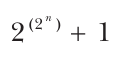

vì nó bằng 2<sup>16</sup> + 1, trong đó 16 = 2<sup>4</sup>, nhưng đó là một điều thú vị không liên quan đến phần lớn các cryptographic engineer.

### Định lý số dư Trung Hoa (The Chinese Remainder Theorem)

Thủ thuật phổ biến nhất để tăng tốc decryption và việc tạo chữ ký (tức là phép tính y<sup>d</sup> mod n) là Chinese remainder theorem (CRT), giúp RSA nhanh hơn khoảng bốn lần.

CRT cho phép giải mã nhanh hơn bằng cách tính hai phép lũy thừa, modulo p và modulo q, thay vì một phép lũy thừa modulo n duy nhất. Vì p và q nhỏ hơn n nhiều, thực hiện hai phép lũy thừa “nhỏ” nhanh hơn một phép lũy thừa “lớn” duy nhất.

Chinese remainder theorem không chỉ dành riêng cho RSA. Đó là một kết quả số học tổng quát mà, ở dạng đơn giản nhất, phát biểu rằng nếu n = n<sub>1</sub>n<sub>2</sub>n<sub>3</sub> . . . , trong đó các n<sub>i</sub> nguyên tố cùng nhau từng đôi một (coprime theo từng cặp, tức là GCD(n<sub>i</sub>, n<sub>j</sub>) = 1 với mọi i và j khác nhau), thì người ta có thể tính giá trị x mod n từ các giá trị x mod n<sub>1</sub>, x mod n<sub>2</sub>, x mod n<sub>3</sub>, . . . Ví dụ, giả sử bạn có n = 1,155, là tích của các thừa số nguyên tố 3 × 5 × 7 × 11, và giả sử bạn muốn xác định x thỏa mãn x mod 3 = 2, x mod 5 = 1, x mod 7 = 6 và x mod 11 = 8. (Tôi đã chọn 2, 1, 6 và 8 một cách tùy ý.) Để tìm x bằng Chinese remainder theorem, hãy tính tổng P(n<sub>1</sub>) + P(n<sub>2</sub>) + . . . , trong đó P(n<sub>i</sub>) được định nghĩa như sau:

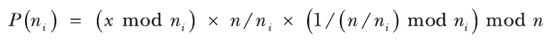

Lưu ý rằng số hạng thứ hai, n/n<sub>i</sub>, bằng tích của mọi thừa số khác ngoài n<sub>i</sub> này.

Để áp dụng công thức này cho ví dụ này và khôi phục x mod 1155, hãy tính P(3), P(5), P(7) và P(11); rồi cộng chúng lại để có được biểu thức sau:

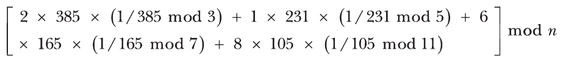

Ở đây, tôi chỉ áp dụng định nghĩa P(n<sub>i</sub>) ở trên. (Phần toán để tìm từng số khá đơn giản, nhưng tôi sẽ không trình bày chi tiết ở đây.) Sau đó, bạn có thể rút gọn biểu thức này thành [770 + 231 + 1980 + 1680] mod n = 41. Vì 41 là số tôi đã chọn cho ví dụ này, bạn đã có được kết quả đúng.

Áp dụng CRT cho RSA đơn giản hơn ví dụ trước vì chỉ có hai thừa số cho mỗi n (cụ thể là p và q). Với một ciphertext y cần giải mã, thay vì tính y<sup>d</sup> mod n, hãy dùng CRT để tính x<sub>p</sub> = y<sup>s</sup> mod p, trong đó s = d mod (p – 1), và x<sub>q</sub> = y<sup>t</sup> mod q, trong đó t = d mod (q – 1). Kết hợp hai biểu thức này và tính x như sau:

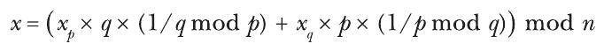

Chỉ có vậy. Cách này nhanh hơn một phép lũy thừa duy nhất ngay cả với thủ thuật square-and-multiply, vì các phép toán multiplication-heavy được thực hiện modulo p và q, những số nhỏ bằng một nửa n, trong khi độ phức tạp của phép lũy thừa tăng nhanh hơn tuyến tính. Khi bạn nhân đôi kích thước của số, bạn không chỉ nhân đôi chi phí lũy thừa—nó tăng nhanh hơn thế.

> **LƯU Ý** Trong phép toán cuối cùng, bạn có thể tính trước hai số q × (1/q mod p) và p × (1/p mod q), nghĩa là bạn chỉ cần tính hai phép nhân và một phép cộng modulo n để tìm ra x.

Đáng tiếc là có một điểm cần lưu ý về security gắn với các kỹ thuật này.

## Những gì có thể sai (How Things Can Go Wrong)

Còn thanh lịch hơn cả bản thân RSA scheme là loạt attack có tác dụng hoặc vì implementation làm rò rỉ (hoặc có thể bị khiến làm rò rỉ) thông tin về phần bên trong của nó, hoặc vì RSA được dùng một cách không an toàn. Tôi sẽ thảo luận hai ví dụ kinh điển về những loại attack này trong các mục sau.

### Bellcore Attack nhắm vào RSA-CRT

Bellcore attack nhắm vào RSA là một trong những attack quan trọng nhất trong lịch sử RSA. Được phát hiện lần đầu năm 1996, nó nổi bật vì khai thác lỗ hổng của RSA trước fault injection—các attack buộc một phần của algorithm hoạt động sai và có thể cho ra kết quả không đúng. Ví dụ, người ta có thể tạm thời gây nhiễu các mạch hardware hoặc embedded system bằng cách đột ngột thay đổi nguồn điện áp của chúng hoặc chiếu một xung laser vào một phần được chọn cẩn thận của chip. Khi đó, kẻ tấn công có thể khai thác các lỗi phát sinh trong phần bên trong của một algorithm bằng cách quan sát tác động lên kết quả. So sánh kết quả đúng với một kết quả lỗi có thể cung cấp thông tin về các giá trị bên trong của algorithm, kể cả các giá trị bí mật. Tương tự, những nỗ lực tìm hiểu xem kết quả có hợp lệ hay không cũng có thể làm rò rỉ thông tin có thể khai thác.

Bellcore attack chính là một fault attack như vậy. Nó có tác dụng với các RSA signature scheme dùng Chinese remainder theorem và mang tính tất định—nghĩa là nó có tác dụng với FDH nhưng không với PSS, vốn mang tính xác suất.

Để hiểu Bellcore attack, hãy nhớ lại từ mục trước rằng với CRT, bạn có được kết quả bằng x<sup>d</sup> mod n bằng cách tính như sau, trong đó x<sub>p</sub> = y<sup>s</sup> mod p và x<sub>q</sub> = y<sup>t</sup> mod q:

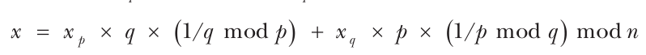

Bây giờ hãy giả sử rằng kẻ tấn công gây ra một lỗi trong phép tính x<sub>q</sub> khiến bạn có được một giá trị sai nào đó, khác với x<sub>q</sub> thực sự. Hãy gọi giá trị sai này là x<sub>q</sub>′ và kết quả cuối cùng thu được là x′. Khi đó, kẻ tấn công có thể lấy chữ ký đúng x trừ đi chữ ký sai x′ để phân tích n thành thừa số, cho ra kết quả sau:

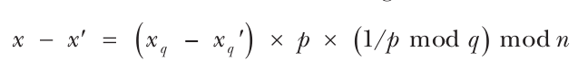

Do đó, giá trị x – x′ là một bội số của p, nên p là một ước của x – x′. Vì p cũng là một ước của n, ước chung lớn nhất của n và x – x′ cho ra p, GCD(x – x′, n) = p. Sau đó, bạn có thể tính q = n/p và d, dẫn đến việc phá hoàn toàn RSA signature.

Một biến thể của attack này có tác dụng khi bạn chỉ biết rằng message được ký, chứ không biết chữ ký đúng. Cũng có một fault attack tương tự nhắm vào giá trị modulus, thay vì vào phép tính các giá trị CRT, nhưng tôi sẽ không đi vào chi tiết ở đây.

### Dùng chung private exponent hoặc modulus (Shared Private Exponents or Moduli)

Bây giờ tôi sẽ cho bạn thấy vì sao public key của bạn không nên có cùng modulus n với của người khác.

Các private key thuộc về những hệ thống hoặc người khác nhau phải có private exponent, d, khác nhau, ngay cả khi các key dùng modulus khác nhau. Nếu không, bạn có thể thử giá trị d của chính mình để giải mã các message được mã hóa cho các thực thể khác, cho đến khi gặp một thực thể có cùng d. Cũng vì lý do đó, các cặp key khác nhau phải có giá trị modulus n khác nhau, ngay cả khi chúng có d khác nhau, vì p và q thường là một phần của private key. Do đó, nếu tôi dùng chung cùng n và do đó cùng p và q, tôi có thể tính private key của bạn từ public key e của bạn bằng p và q.

Hãy tưởng tượng rằng bạn biết private exponent d<sub>1</sub> của mình và public exponent e<sub>2</sub> của một người khác mà bạn dùng chung modulus n, nhưng không biết các thừa số p và q của nó. Làm thế nào bạn có thể tính p và q từ private exponent d<sub>1</sub> của mình để tìm private exponent d<sub>2</sub> của người kia? Lời giải hơi nặng về kỹ thuật nhưng thanh lịch.

Hãy nhớ rằng d và e thỏa mãn ed = kφ(n) + 1, trong đó φ(n) là bí mật và có thể để lộ p và q. Bạn không biết k hay φ(n), nhưng bạn có thể tính kφ(n) = ed – 1.

Bạn có thể làm gì với kφ(n)? Theo định lý Euler, với bất kỳ số a nào nguyên tố cùng nhau (coprime) với n, bạn có a<sup>φ(n)</sup> = 1 mod n. Do đó, modulo n bạn có như sau:

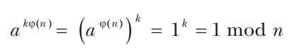

Vì kφ(n) là một số chẵn, bạn có thể viết nó dưới dạng 2<sup>s</sup>t với các số s và t nào đó. Tức là bạn sẽ có thể viết a<sup>kφ(n)</sup> = 1 mod n dưới dạng x<sup>2</sup> = 1 mod n với một x nào đó dễ dàng tính được từ kφ(n). Bạn có thể gọi một x như vậy là một căn của đơn vị (root of unity).

Quan sát then chốt là x<sup>2</sup> = 1 mod n tương đương với việc nói rằng giá trị x<sup>2</sup> – 1 = (x – 1)(x + 1) là một ước của n. Nói cách khác, x – 1 hoặc x + 1 phải có một thừa số chung với n, điều này có thể cho bạn sự phân tích thừa số của n.

Listing 10-7 cho thấy một implementation Python của phương pháp này, trong đó, để tìm các thừa số p và q từ n và d, tôi dùng các số nhỏ, 64-bit, để đơn giản.

```
  from math import gcd

  n = 36567232109354321
  e = 13771927877214701
  d = 15417970063428857
❶ kphi = d*e - 1
  t = kphi

❷ while t % 2 == 0:
      t = divmod(t, 2)[0]

❸ a = 2
  while a < 100:
    ❹ k = t
      while k < kphi:
          x = pow(a, k, n)
        ❺ if x != 1 and x != (n - 1) and pow(x, 2, n) == 1:
            ❻ p = gcd(x - 1, n)
              break
          k = k*2
      a = a + 2

  q = n//p
❼ assert (p*q) == n
  print('p = ', p)
  print('q = ', q)
```

Listing 10-7: Một chương trình Python tính các thừa số nguyên tố p và q từ private exponent d

Chương trình này xác định kφ(n) từ e và d ❶ bằng cách tìm số t sao cho kφ(n) = 2<sup>s</sup>t, với một s nào đó ❷. Sau đó, nó tìm a và k sao cho (a<sup>k</sup>)<sup>2</sup> = 1 mod n ❸, dùng t làm điểm bắt đầu cho k ❹. Khi điều kiện này được thỏa mãn ❺, bạn đã tìm được một lời giải. Sau đó, nó xác định thừa số p ❻ và kiểm chứng ❼ rằng giá trị của pq bằng giá trị của n. Rồi nó in ra các giá trị thu được của p và q:

```
p = 2046223079
q = 17870599
```

Chương trình trả về đúng hai thừa số.

## Đọc thêm (Further Reading)

RSA xứng đáng có một cuốn sách riêng. Tôi đã phải bỏ qua nhiều chủ đề quan trọng và thú vị, như padding oracle attack của Daniel Bleichenbacher nhắm vào người tiền nhiệm của OAEP (tiêu chuẩn PKCS#1 v1.5) hay padding oracle attack của Manger nhắm vào OAEP, cả hai attack đều có tinh thần tương tự padding oracle attack nhắm vào block cipher trong Chương 4. Còn có attack của Michael Wiener nhắm vào RSA với private exponent nhỏ, và các attack dùng phương pháp Coppersmith nhắm vào RSA với số mũ nhỏ có khả năng cũng có padding không an toàn.

Để xem các kết quả nghiên cứu liên quan đến side-channel attack và các biện pháp phòng thủ, hãy xem kỷ yếu của workshop CHES được tổ chức từ năm 1999 tại https://ches.iacr.org. Một trong những tài liệu tham khảo hữu ích nhất khi viết chương này là “Twenty Years of Attacks on the RSA Cryptosystem” của Dan Boneh, một bài tổng quan xem xét và giải thích những attack quan trọng nhất nhắm vào RSA. Để tham khảo về timing attack, bài báo “Remote Timing Attacks Are Practical” của Billy Bob Brumley và Dan Boneh là một must-read, cả về đóng góp phân tích lẫn đóng góp thực nghiệm. Để tìm hiểu thêm về fault attack, hãy đọc phiên bản đầy đủ của bài báo về Bellcore attack “On the Importance of Eliminating Errors in Cryptographic Computations” của Dan Boneh, Richard DeMillo và Richard Lipton.

Cách tốt nhất để học cách các implementation RSA hoạt động, dù đôi khi đau đớn và gây bực bội, là xem source code của các implementation được dùng rộng rãi. Ví dụ, hãy xem RSA và các implementation số học big-number bên dưới của nó trong OpenSSL, NSS (thư viện được trình duyệt Mozilla Firefox dùng), Crypto++, hoặc các phần mềm phổ biến khác, và xem xét các implementation phép toán số học của chúng cũng như các biện pháp phòng thủ của chúng trước timing attack và fault attack.
