# Chương 12: Elliptic Curve

Sự ra đời của elliptic curve cryptography (ECC) năm 1985 đã cách mạng hóa public-key cryptography. Nó mạnh hơn và hiệu quả hơn các lựa chọn thay thế như RSA và Diffie–Hellman cổ điển: ECC với một key 256-bit mạnh hơn RSA với một key 4,096-bit. Nhưng nó cũng phức tạp hơn.

Giống như RSA, ECC chủ yếu gồm các phép nhân số lớn, nhưng nó làm vậy để kết hợp các điểm trên một đường cong toán học, gọi là elliptic curve (nhân tiện, điều này chẳng liên quan gì đến hình ellipse). Phức tạp hơn nữa, có nhiều loại elliptic curve—đơn giản và tinh vi, hiệu quả và kém hiệu quả, an toàn và không an toàn, tùy theo trường hợp sử dụng.

ECC không được các tổ chức tiêu chuẩn hóa chấp nhận cho đến đầu những năm 2000s, và nó chưa xuất hiện trong các phần mềm cryptography lớn cho đến tận rất lâu sau đó: OpenSSL thêm ECC năm 2005, còn công cụ kết nối an toàn OpenSSH thì đợi đến năm 2011. Bạn sẽ thấy ECC trong hầu hết các kết nối HTTPS, trong điện thoại di động, và trong các nền tảng blockchain như Bitcoin và Ethereum. Thật vậy, elliptic curve cho phép bạn thực hiện các thao tác public-key cryptography phổ biến như encryption, signature và key agreement nhanh hơn các đối tác cổ điển của chúng. Hầu hết các ứng dụng cryptography dựa vào discrete logarithm problem (DLP) cũng hoạt động khi dựa trên đối tác elliptic curve của nó, ECDLP, với một ngoại lệ đáng chú ý: protocol Secure Remote Password (SRP).

Chương này tập trung vào các ứng dụng của ECC và thảo luận khi nào và vì sao nên dùng ECC thay vì RSA hay Diffie–Hellman cổ điển, cũng như cách chọn elliptic curve phù hợp cho ứng dụng của bạn.

## Elliptic curve là gì? (What Is an Elliptic Curve?)

Một elliptic curve là một đường cong trên mặt phẳng—một tập các điểm có tọa độ x-and y-coordinates. Phương trình của một đường cong định nghĩa mọi điểm thuộc đường cong đó. Ví dụ, đường cong y = 3 là một đường nằm ngang với tọa độ dọc 3, các đường cong có dạng y = ax + b với các số cố định a và b là các đường thẳng, x<sup>2</sup> + y<sup>2</sup> = 1 là một đường tròn bán kính 1 có tâm tại gốc tọa độ, v.v. Dù là loại đường cong nào, các điểm trên một đường cong là các cặp (x, y) thỏa mãn phương trình của đường cong.

Trong cryptography, một elliptic curve thường có phương trình dạng y<sup>2</sup> = x<sup>3</sup> + ax + b (dạng Weierstrass), trong đó các hằng số a và b định nghĩa hình dạng của đường cong. Ví dụ, Hình 12-1 cho thấy elliptic curve thỏa mãn phương trình y<sup>2</sup> = x<sup>3</sup> – 4x.

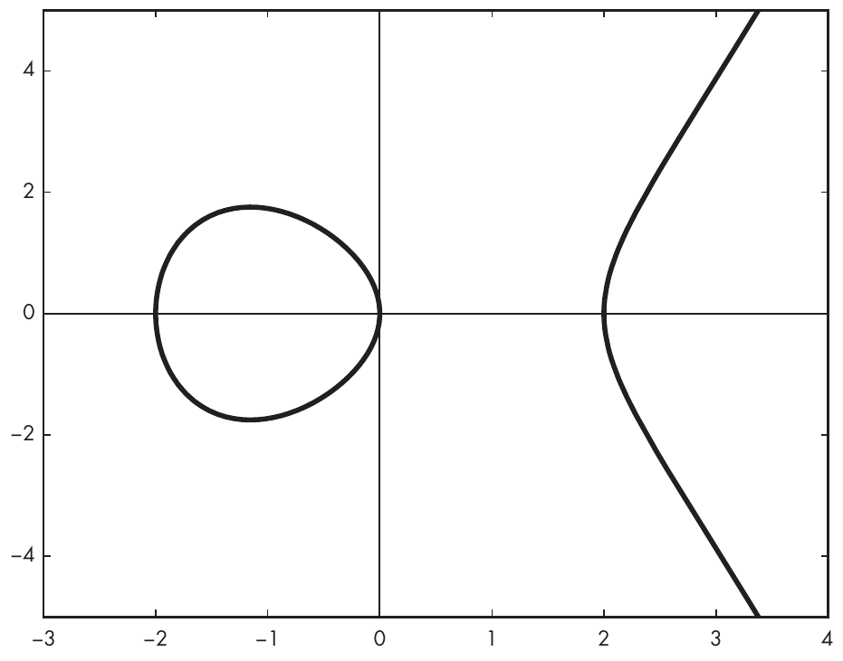

Hình 12-1: Một elliptic curve với phương trình y<sup>2</sup> = x<sup>3</sup> – 4x, biểu diễn trên tập số thực

Hình này hiển thị mọi điểm tạo nên đường cong với x nằm giữa –3 và 4, dù đó là các điểm ở phía bên trái của đường cong, trông giống một đường tròn, hay ở phía bên phải, trông giống một parabol. Mọi điểm đều có tọa độ (x, y) thỏa mãn phương trình của đường cong y<sup>2</sup> = x<sup>3</sup> – 4x. Ví dụ, khi x = 0, thì y<sup>2</sup> = x<sup>3</sup> – 4x = 0<sup>3</sup> – 4 × 0 = 0; do đó, y = 0 là một nghiệm, và điểm (0, 0) thuộc đường cong. Tương tự, nếu x = 2, nghiệm của phương trình là y = 0, nghĩa là điểm (2, 0) thuộc đường cong.

> **LƯU Ý** Trong chương này, tôi tập trung vào loại elliptic curve đơn giản nhất, phổ biến nhất—những đường cong có phương trình như y<sup>2</sup> = x<sup>3</sup> + ax + b—nhưng các elliptic curve khác có phương trình ở các dạng khác. Ví dụ, Edwards curve có phương trình dạng x<sup>2</sup> + y<sup>2</sup> = 1 + dx<sup>2</sup>y<sup>2</sup>. Các cryptographer đôi khi dùng Edwards curve (ví dụ, trong scheme Ed25519).

Khi dùng elliptic curve cho cryptography, điều cốt yếu là phân biệt các điểm thuộc đường cong với các điểm khác, vì các điểm nằm ngoài đường cong thường gây ra rủi ro security. Tuy nhiên, phương trình của đường cong không phải lúc nào cũng có nghiệm, ít nhất là không có trong mặt phẳng số tự nhiên. Ví dụ, để tìm các điểm có tọa độ ngang x = 1, bạn giải y<sup>2</sup> = x<sup>3</sup> – 4x và được y<sup>2</sup> = x<sup>3</sup> – 4x = 1<sup>3</sup> – 4 × 1, cho kết quả –3. Nhưng y<sup>2</sup> = –3 không có nghiệm vì không có số nào mà y<sup>2</sup> = –3. Có tồn tại một nghiệm trong tập số phức (√3i), nhưng trong thực tế, elliptic curve cryptography chỉ dùng số tự nhiên (ECC làm việc với số nguyên modulo một số nguyên tố, trực tiếp hoặc thông qua đa thức). Vì phương trình của đường cong không có nghiệm với x = 1, đường cong không có điểm nào tại vị trí đó trên x-axis, như bạn có thể thấy trong Hình 12-1.

Nếu bạn thử giải với x = –1, bạn được phương trình y<sup>2</sup> = –1 + 4 = 3, có hai nghiệm (y = √3 ≈ 1.73 và y = – √3 ≈ –1.73), căn bậc hai của 3 và giá trị âm của nó. Bình phương của cả hai giá trị đều là 3, và Hình 12-1 có hai điểm với x = –1. Tổng quát hơn, đường cong đối xứng qua x-axis với mọi điểm thỏa mãn phương trình của nó (như mọi elliptic curve có dạng y<sup>2</sup> = x<sup>3</sup> + ax + b, ngoại trừ y = 0).

### Elliptic curve trên số nguyên (Elliptic Curves over Integers)

Có một chút bất ngờ ở đây: các đường cong trong elliptic curve cryptography thực ra không trông giống Hình 12-1. Chúng chẳng phải đường cong cũng chẳng phải ellipse. Thay vào đó, chúng trông giống Hình 12-2, là một đám mây điểm chứ không phải một đường cong. Chuyện gì đang xảy ra vậy?

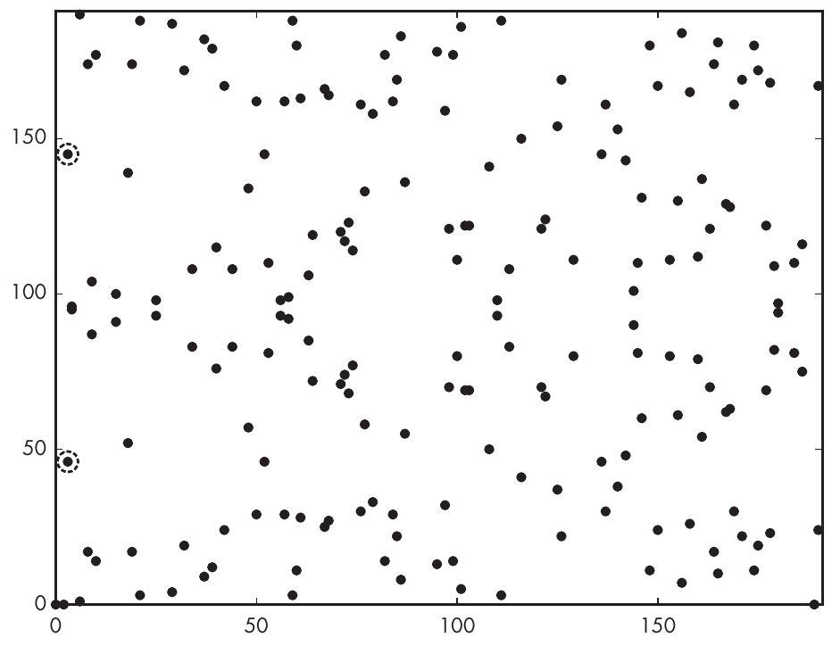

Hình 12-2: Elliptic curve với phương trình y<sup>2</sup> = x<sup>3</sup> – 4x trên Z<sub>191</sub>, tập các số nguyên modulo 191

Hình 12-1 và 12-2 dựa trên cùng một phương trình đường cong, y<sup>2</sup> = x<sup>3</sup> – 4x, nhưng chúng thể hiện các điểm của đường cong đối với các tập số khác nhau: Hình 12-1 thể hiện các điểm của đường cong trên tập số thực, bao gồm số âm, số thập phân, v.v. Ví dụ, là một đường cong liên tục, nó thể hiện các điểm tại x = 2.0, x = 2.1, x = 2.00002, v.v. Mặt khác, Hình 12-2 chỉ thể hiện các số nguyên thỏa mãn phương trình này, loại trừ số thập phân. Cụ thể, Hình 12-2 thể hiện đường cong y<sup>2</sup> = x<sup>3</sup> – 4x đối với các số nguyên modulo 191: 0, 1, 2, 3, cho đến 190. Bạn có thể ký hiệu tập số này là Z<sub>191</sub>. (Không có gì đặc biệt với 191 ở đây, ngoại trừ việc nó là một số nguyên tố. Tôi chọn một số nhỏ để tránh có quá nhiều điểm trên đồ thị.) Do đó, các điểm trong Hình 12-2 đều có x-and y-coordinates là các số nguyên modulo 191 và thỏa mãn phương trình y<sup>2</sup> = x<sup>3</sup> – 4x. Ví dụ, với x = 2, bạn có y<sup>2</sup> = 0, mà y = 0 là một nghiệm hợp lệ. Điều này cho bạn biết rằng điểm (2, 0) thuộc đường cong.

Nếu x = 3, bạn được phương trình y<sup>2</sup> = 27 – 12 = 15, có hai nghiệm trong Z<sub>191</sub>, 46 và 145. Thật vậy, 46<sup>2</sup> = 2,116, với 2,116 mod 191 = 15, và 145<sup>2</sup> = 21,025, với 21,025 mod 191 = 15. Do đó, các điểm (3, 46) và (3, 145) đều thuộc đường cong và xuất hiện như trong Hình 12-2 (hai điểm được khoanh tròn ở bên trái).

> **LƯU Ý** Hình 12-2 xét các điểm từ tập ký hiệu là Z<sub>191</sub> = {0, 1, 2, . . . , 190}, bao gồm số không. Điều này khác với các group ký hiệu là Z<sub>p</sub><sup>\*</sup> (có chỉ số trên dấu sao) mà chúng ta đã thảo luận trong bối cảnh RSA và Diffie–Hellman. Lý do cho sự khác biệt này là bạn sẽ vừa nhân vừa cộng các số, và do đó bạn cần bảo đảm rằng tập số bao gồm phần tử đơn vị của phép cộng (cụ thể là 0, sao cho x + 0 = x với mọi x trong Z<sub>191</sub>).

> Ngoài ra, mọi số x đều có một nghịch đảo đối với phép cộng, ký hiệu là –x, sao cho x + (–x) = 0. Ví dụ, nghịch đảo của 100 trong Z<sub>191</sub> là 91 vì 100 + 91 mod 191 = 0. Một tập số như vậy, nơi có thể thực hiện phép cộng và phép nhân và mỗi phần tử x có một nghịch đảo đối với phép cộng (ký hiệu là –x) cũng như một nghịch đảo (ngoại trừ phần tử không) đối với phép nhân (ký hiệu là 1 / x), được gọi là một field. Khi một field có số phần tử hữu hạn, như trong Z<sub>191</sub> và như với mọi field được dùng cho elliptic curve cryptography, nó là một finite field.

### Luật cộng (The Addition Law)

Giờ bạn đã biết rằng các điểm trên một elliptic curve là các tọa độ (x, y) thỏa mãn phương trình của đường cong, y<sup>2</sup> = x<sup>3</sup> + ax + b, hãy xem cách cộng các điểm elliptic curve bằng luật cộng (addition law).

#### Cộng hai điểm (Adding Two Points)

Giả sử bạn muốn cộng hai điểm trên elliptic curve, P và Q, để được một điểm mới, R, là tổng của hai điểm này. Cách đơn giản nhất để hiểu phép cộng điểm là xác định vị trí của R = P + Q trên đường cong so với P và Q dựa trên một quy tắc hình học: vẽ đường thẳng nối P và Q, tìm điểm khác của đường cong giao với đường thẳng này, và R là ảnh đối xứng của điểm này qua x-axis. Ví dụ, trong Hình 12-3, đường thẳng nối P và Q cắt đường cong tại một điểm thứ ba nằm giữa P và Q, và điểm P + Q có cùng x-coordinate nhưng y-coordinate ngược dấu.

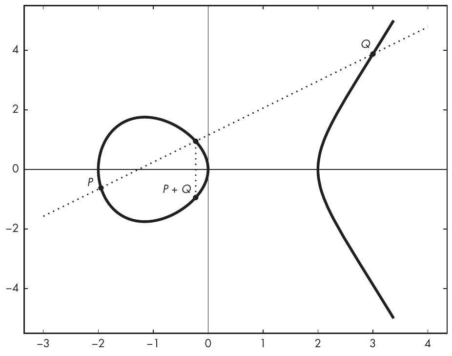

Hình 12-3: Một trường hợp tổng quát của quy tắc hình học để cộng các điểm trên một elliptic curve

Quy tắc hình học này đơn giản, nhưng nó sẽ không trực tiếp cho bạn tọa độ của điểm R. Bạn tính tọa độ (x<sub>R</sub>, y<sub>R</sub>) của R bằng tọa độ (x<sub>P</sub>, y<sub>P</sub>) của P và tọa độ (x<sub>Q</sub>, y<sub>Q</sub>) của Q bằng các công thức x<sub>R</sub> = m<sup>2</sup> – x<sub>P</sub> – x<sub>Q</sub> và y<sub>R</sub> = m(x<sub>P</sub> – x<sub>R</sub>) – y<sub>P</sub>, trong đó giá trị m = (y<sub>Q</sub> – y<sub>P</sub>) / (x<sub>Q</sub> – x<sub>P</sub>) là hệ số góc của đường thẳng nối P và Q.

Đáng tiếc, các công thức này và thủ thuật line-drawing trong Hình 12-3 không phải lúc nào cũng hoạt động. Ví dụ, nếu P = Q, bạn không thể vẽ một đường thẳng giữa hai điểm (chỉ có một điểm), và nếu Q = –P, đường thẳng không cắt đường cong thêm lần nào nữa, nên không có điểm nào trên đường cong để lấy đối xứng. Chúng ta sẽ khám phá những trường hợp này trong các mục tiếp theo.

#### Cộng một điểm với điểm đối của nó (Adding a Point and Its Negative)

Điểm đối (negative) của một điểm P = (x<sub>P</sub>, y<sub>P</sub>) là điểm –P = (x<sub>P</sub>, –y<sub>P</sub>), là ảnh đối xứng của điểm đó qua x-axis. Với mọi P, bạn có thể nói rằng P + (–P) = O, trong đó O là điểm ở vô cực (point at infinity). Như trong Hình 12-4, đường thẳng giữa P và –P chạy ra vô cực và không bao giờ cắt đường cong. Point at infinity đối với elliptic curve giống như số không đối với số nguyên, ngoại trừ việc nó chỉ là một điểm “ảo” mà bạn không thể định vị tại một chỗ cụ thể, vì nó xa vô hạn.

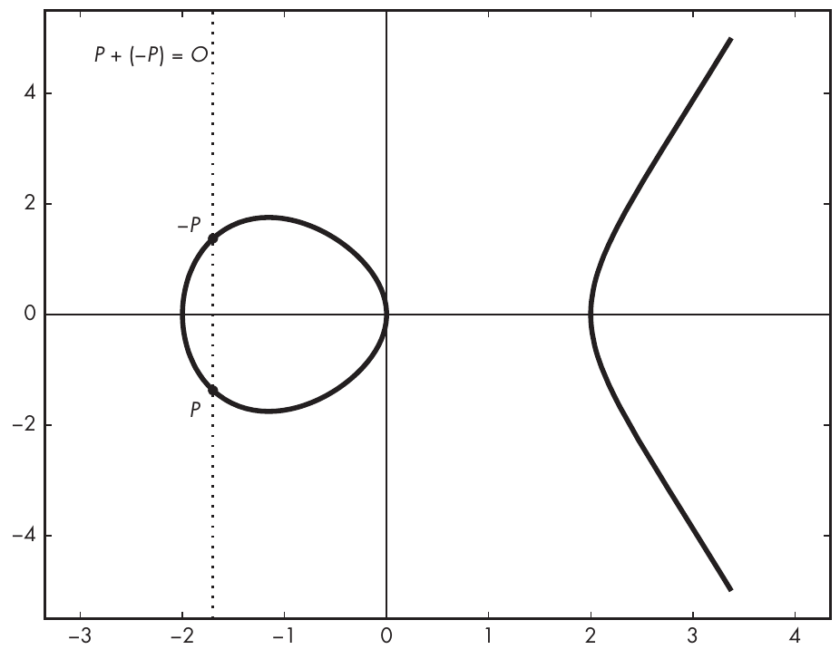

Hình 12-4: Quy tắc hình học để cộng một điểm với điểm đối của nó, hay P + (–P) = O, khi đường thẳng giữa các điểm không bao giờ cắt đường cong

#### Nhân đôi một điểm (Doubling a Point)

Khi P = Q (tức là P và Q ở cùng vị trí), cộng P và Q tương đương với tính P + P, hay 2P. Phép cộng này được gọi là phép nhân đôi (doubling).

Để tìm tọa độ của kết quả R = 2P, bạn không thể dùng quy tắc hình học từ mục trước, vì bạn không thể vẽ một đường thẳng giữa P và chính nó. Thay vào đó, bạn vẽ tiếp tuyến của đường cong tại P, và 2P là điểm đối của điểm mà tiếp tuyến này cắt đường cong, như Hình 12-5 minh họa.

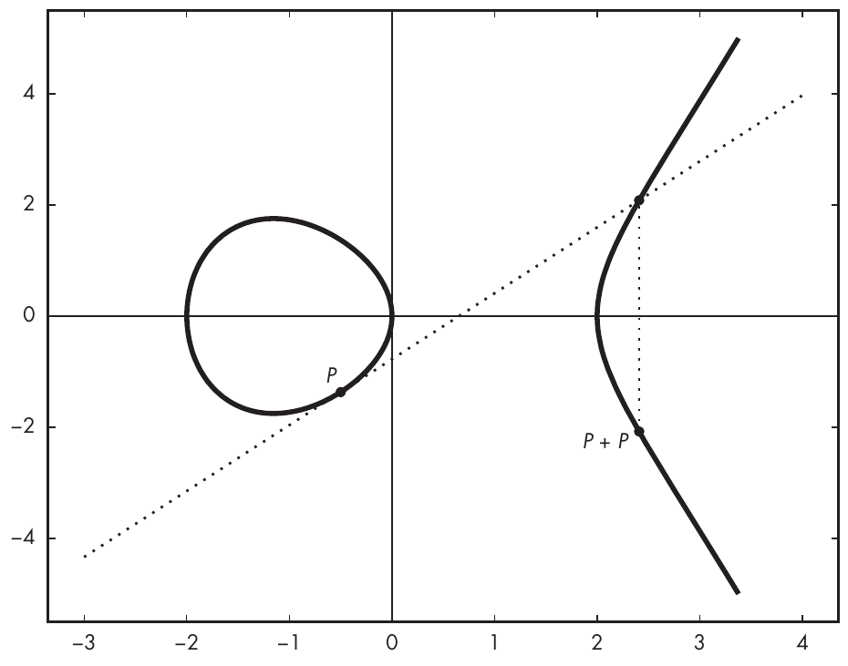

Hình 12-5: Quy tắc hình học để nhân đôi một điểm—tức là P + P

Công thức xác định tọa độ (x<sub>R</sub>, y<sub>R</sub>) của R = P + P hơi khác so với công thức cho P và Q phân biệt. Công thức cơ bản là x<sub>R</sub> = m<sup>2</sup> – x<sub>P</sub> – x<sub>Q</sub> và y<sub>R</sub> = m(x<sub>P</sub> – x<sub>R</sub>) – y<sub>P</sub>, nhưng giá trị của m trở thành (3x<sub>P</sub><sup>2</sup> + a) / 2y<sub>P</sub>, trong đó a là tham số của đường cong, như trong y<sup>2</sup> = x<sup>3</sup> + ax + b.

#### Nhân điểm (Multiplying Points)

Để nhân các điểm trên elliptic curve với một số nguyên k cho trước, bạn xác định điểm kP bằng cách cộng P với chính nó k – 1 lần. Nói cách khác, 2P = P + P, 3P = P + P + P, v.v. Để có được x-and y-coordinates của kP, hãy lặp lại việc cộng P với chính nó và áp dụng luật cộng ở trên.

Tuy nhiên, để tính kP hiệu quả, kỹ thuật ngây thơ là cộng P bằng cách áp dụng luật cộng k – 1 lần còn xa mới tối ưu. Ví dụ, nếu k lớn (cỡ, chẳng hạn, 2<sup>256</sup>) như vẫn xảy ra trong các crypto scheme dựa trên elliptic curve–based, thì việc tính k – 1 phép cộng là hoàn toàn bất khả thi.

Bạn có thể đạt được mức tăng tốc theo cấp số mũ bằng cách điều chỉnh kỹ thuật trong mục “A Fast Exponentiation Algorithm” của Chương 10 để tính x<sup>e</sup> mod n. Khác biệt là bạn đang nhân các điểm với một số nguyên thay vì tính lũy thừa. Nhưng bạn có thể điều chỉnh phương pháp để trở thành double-and-add, trong đó phép nhân trở thành phép cộng và phép bình phương trở thành phép nhân đôi.

Ví dụ, để tính 8P bằng ba phép cộng thay vì bảy phép cộng như khi dùng phương pháp ngây thơ, đầu tiên tính P<sub>2</sub> = P + P, rồi P<sub>4</sub> = P<sub>2</sub> + P<sub>2</sub>, và cuối cùng P<sub>4</sub> + P<sub>4</sub> = 8P. Đây là trường hợp đơn giản nhất, khi số nhân là một lũy thừa của hai, như 8 = 2<sup>3</sup>. Ngược lại, ví dụ, để tính 10P, hãy làm như sau: nhận thấy rằng 10 là 1010 ở dạng nhị phân, hãy bắt đầu từ bit có trọng số cao nhất (“ngoài cùng bên trái”) và tính kết quả R như sau:

**Bit 1** Bắt đầu bằng cách đặt R = P.

**Bit 0** Nhân đôi, đặt R = 2R = 2P.

**Bit 1** Nhân đôi và cộng, đặt R = 2R + P = 2(2P) + P = 5P.

**Bit 0** Nhân đôi, đặt R = 2R = 2(5P) = 10P.

### Các group elliptic curve (Elliptic Curve Groups)

Bạn không chỉ có thể cộng các điểm elliptic curve với nhau mà còn có thể dùng chúng để tạo thành một cấu trúc group. Theo định nghĩa của một group (xem “Groups” trong Chương 9), nếu các điểm P và Q thuộc một đường cong cho trước, thì P + Q cũng thuộc đường cong đó.

Hơn nữa, vì phép cộng có tính kết hợp, bạn có (P + Q) + R = P + (Q + R) với mọi điểm P, Q và R. Trong một group các điểm elliptic curve, chúng ta gọi phần tử đơn vị là point at infinity và ký hiệu nó là O, sao cho P + O = P với mọi P. Mọi điểm P = (x<sub>P</sub>, y<sub>P</sub>) đều có một nghịch đảo, –P = (x<sub>P</sub>, –y<sub>P</sub>), sao cho P + (–P) = O.

Trong thực tế, hầu hết các cryptosystem dựa trên elliptic curve–based làm việc với x-and y-coordinates là các số modulo một số nguyên tố, p (nói cách khác, các số trong finite field Z<sub>p</sub>). Cũng như security của RSA phụ thuộc vào kích thước của các số được dùng, security của một cryptosystem dựa trên elliptic curve–based phụ thuộc vào số điểm trên đường cong. Nhưng làm thế nào để biết số điểm trên một elliptic curve, hay cardinality của nó? Chà, điều đó phụ thuộc vào đường cong và giá trị của p.

> **LƯU Ý** Prime field không phải là những field duy nhất được dùng trong elliptic curve cryptography. Còn có các binary field, là các mở rộng của two-element field (bao gồm 0 và 1), mà các phần tử của chúng được biểu diễn dưới dạng đa thức với hệ số nhị phân. Số học trên binary field có ưu điểm là thường dễ hiện thực hiệu quả hơn trong phần cứng dưới dạng mạch logic, so với trên một bộ vi xử lý general-purpose.

Có cỡ p điểm trên một đường cong được định nghĩa trên Z<sub>p</sub>, nhưng bạn có thể tính chính xác số điểm bằng Schoof’s algorithm, algorithm đếm số điểm trên elliptic curve trên các finite field. Bạn sẽ thấy algorithm này được tích hợp sẵn trong SageMath. Ví dụ, Listing 12-1 dùng Schoof’s algorithm để đếm số điểm trên đường cong y<sup>2</sup> = x<sup>3</sup> – 4x trên Z<sub>191</sub> từ Hình 12-1.

```
sage: Z = Zmod(191)
sage: E = EllipticCurve(Z, (-4,0))
sage: E.cardinality()
192
```

Listing 12-1: Tính cardinality, hay số điểm trên một đường cong

Trong Listing 12-1, đầu tiên bạn định nghĩa biến Z là tập các số nguyên modulo 191; sau đó bạn định nghĩa biến E là elliptic curve trên Z với các hệ số –4 và 0. Cuối cùng, bạn tính số điểm trên đường cong, hay cardinality, group order, hay chỉ là order của nó. Số đếm này bao gồm cả point at infinity O.

## Bài toán ECDLP (The ECDLP Problem)

Chương 9 đã giới thiệu discrete logarithm problem (DLP): bài toán tìm số y khi cho một số cơ sở g nào đó, trong đó x = g<sup>y</sup> mod p với một số nguyên tố lớn p nào đó. Cryptography với elliptic curve có một bài toán tương tự là tìm số k khi cho một điểm cơ sở P trong đó điểm Q = kP. Đây là elliptic curve discrete logarithm problem. Thay vì các số, các bài toán của elliptic curve thao tác trên các điểm và dùng phép nhân thay cho phép lũy thừa.

Gần như toàn bộ elliptic curve cryptography được xây dựng trên bài toán ECDLP, bài toán mà, giống như DLP, được tin là khó và đã chịu được cryptanalysis kể từ khi ra đời năm 1985. Một khác biệt quan trọng so với DLP cổ điển là ECDLP cho phép bạn làm việc với các số nhỏ hơn mà vẫn có được security level tương tự.

Nói chung, khi tham số p là n-bit, ECC cho bạn security level khoảng n/2 bit. Ví dụ, một elliptic curve trên các số modulo một p 256-bit cho security level khoảng 128 bit. Để so sánh, muốn đạt được security level tương tự với DLP hoặc RSA, bạn cần dùng các số dài vài nghìn bit. Dùng các số nhỏ hơn cho số học ECC là một lý do khiến nó thường nhanh hơn RSA hoặc Diffie–Hellman cổ điển.

Một cách tiếp cận để giải ECDLP là tìm một collision giữa hai đầu ra, c<sub>1</sub>P + d<sub>1</sub>Q và c<sub>2</sub>P + d<sub>2</sub>Q. Các điểm P và Q trong các phương trình này thỏa mãn Q = kP với một k chưa biết nào đó, và c<sub>1</sub>, d<sub>1</sub>, c<sub>2</sub> và d<sub>2</sub> là các số bạn cần để tìm k.

Như với hash function trong Chương 6, một collision xảy ra khi hai đầu vào khác nhau tạo ra cùng một đầu ra. Do đó, để giải ECDLP, bạn cần tìm các điểm thỏa mãn điều sau:

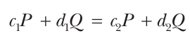

Giả sử bạn đã tìm được bốn hệ số, bạn sẽ khôi phục k. Để làm vậy, hãy thay Q bằng giá trị kP, và bạn có như sau:

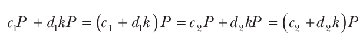

Điều này cho bạn biết rằng (c<sub>1</sub> + d<sub>1</sub>k) bằng (c<sub>2</sub> + d<sub>2</sub>k) khi lấy modulo số điểm trên đường cong, vốn không phải là bí mật.

Từ đó, bạn có thể suy ra như sau:

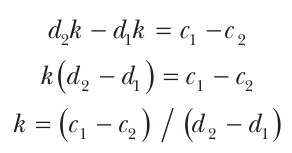

Và bạn đã tìm được k, nghiệm của ECDLP. Tất nhiên, đó mới chỉ là bức tranh tổng thể—các chi tiết phức tạp và thú vị hơn, đặc biệt là về cách khôi phục các hệ số c<sub>1</sub>, c<sub>2</sub>, d<sub>1</sub>, d<sub>2</sub>.

Trong thực tế, elliptic curve trải trên các số ít nhất 256 bit, điều này khiến việc tấn công elliptic curve cryptography bằng cách tìm collision là không khả thi vì làm vậy tốn tới 2<sup>128</sup> phép toán (chi phí tìm một collision trên các số 256-bit—xem Chương 6).

## Diffie–Hellman key agreement trên elliptic curve (Diffie–Hellman Key Agreement over Elliptic Curves)

Hãy nhớ lại từ Chương 11 rằng trong key agreement protocol Diffie–Hellman (DH) cổ điển, hai bên thiết lập một shared secret bằng cách trao đổi các giá trị không bí mật. Cho một số cố định g nào đó, Alice chọn một số ngẫu nhiên bí mật a, tính A = g<sup>a</sup>, và gửi A cho Bob. Sau đó, Bob chọn một b ngẫu nhiên bí mật và gửi B = g<sup>b</sup> cho Alice. Cả hai kết hợp secret key của mình với public key của bên kia để tạo ra cùng một giá trị A<sup>b</sup> = B<sup>a</sup> = g<sup>ab</sup>.

Phiên bản elliptic curve của DH, elliptic curve Diffie–Hellman (ECDH), giống hệt DH cổ điển nhưng với ký hiệu khác. Trong trường hợp ECC, với một fixed-point G nào đó, Alice chọn một số ngẫu nhiên bí mật a, tính A = aG (điểm G nhân với số nguyên a), và gửi A cho Bob. Bob chọn một b ngẫu nhiên bí mật, tính điểm B = bG, và gửi nó cho Alice. Sau đó, cả hai tính cùng một shared secret, aB = bA = abG.

ECDH đối với bài toán ECDLP giống như DH đối với DLP: nó an toàn chừng nào ECDLP còn khó. Do đó, bạn có thể điều chỉnh các protocol DH dựa vào DLP để làm việc với elliptic curve và dựa vào ECDLP như một giả định về độ khó. Ví dụ, authenticated DH và Menezes–Qu–Vanstone (MQV) cũng sẽ an toàn khi được dùng với elliptic curve. Thực tế, MQV ban đầu được định nghĩa là làm việc trên elliptic curve.

## Ký bằng elliptic curve (Signing with Elliptic Curves)

Algorithm tiêu chuẩn chính bạn có thể dùng để ký với ECC là elliptic curve digital signature algorithm (ECDSA). Algorithm này đã thay thế chữ ký RSA và chữ ký DSA cổ điển trong nhiều ứng dụng. ECDSA là một tiêu chuẩn NIST, được hỗ trợ trong các protocol TLS và SSH, và là signature algorithm chính trong nhiều nền tảng blockchain, bao gồm Bitcoin và Ethereum.

Như mọi signature scheme, ECDSA gồm một signature generation algorithm mà người ký dùng để tạo chữ ký bằng private key của họ và một verification algorithm mà người xác minh dùng để kiểm tra tính đúng đắn của chữ ký khi có public key của người ký. Người ký giữ một số, d, làm private key, và người xác minh giữ public key, P = dG. Cả hai biết trước elliptic curve nào sẽ được dùng, order của nó (n, số điểm trên đường cong), và tọa độ của một điểm cơ sở, G.

### Tạo chữ ký ECDSA (ECDSA Signature Generation)

Để ký một message, đầu tiên người ký hash message bằng một cryptographic hash function như SHA-256 hoặc BLAKE2 để tạo ra một hash value, h, mà bạn diễn giải như một số nằm giữa 0 và n – 1. Tiếp theo, người ký chọn một số ngẫu nhiên, k, nằm giữa 1 và n – 1 và tính kG, một điểm có tọa độ (x, y). Giờ người ký đặt r = x mod n và tính s = (h + rd) / k mod n rồi dùng các giá trị này làm chữ ký (r, s).

Độ dài của chữ ký phụ thuộc vào độ dài tọa độ bạn đang dùng. Ví dụ, khi bạn làm việc với một đường cong mà tọa độ là các số 256-bit, r và s đều dài 256 bit, cho ra một chữ ký 512-bit-long.

### Xác minh chữ ký ECDSA (ECDSA Signature Verification)

Verification algorithm của ECDSA dùng public key của người ký để xác minh tính hợp lệ của một chữ ký.

Để xác minh một chữ ký ECDSA (r, s) và hash của một message, h, đầu tiên người xác minh tính w = 1 / s, nghịch đảo của s trong chữ ký, bằng k / (h + rd) mod n, vì s được định nghĩa là s = (h + rd) / k. Tiếp theo, người xác minh nhân w với h để tìm u theo công thức sau:

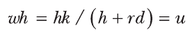

Sau đó, người xác minh nhân w với r để tìm v:

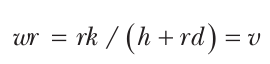

Khi có u và v, người xác minh tính điểm Q theo công thức sau:

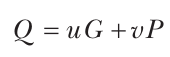

Ở đây, P là public key của người ký, bằng dG, và người xác minh chỉ chấp nhận chữ ký nếu x-coordinate của Q bằng giá trị r trong chữ ký.

Quá trình này hoạt động vì, ở bước cuối cùng, bạn tính điểm Q bằng cách thay public key P bằng giá trị thực của nó là dG:

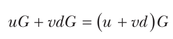

Khi bạn thay u và v bằng giá trị thực của chúng, bạn được như sau:

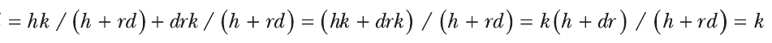

Điều này cho bạn biết rằng (u + vd) bằng giá trị k, được chọn trong quá trình tạo chữ ký, và uG + vdG bằng điểm kG. Nói cách khác, verification algorithm tính thành công điểm kG, cùng điểm đã được tính trong quá trình tạo chữ ký. Việc kiểm chứng hoàn tất khi người xác minh xác nhận rằng x-coordinate của kG bằng r nhận được; ngược lại, chữ ký bị từ chối là không hợp lệ.

### Chữ ký ECDSA so với RSA (ECDSA vs. RSA Signatures)

Dù một số người coi elliptic curve cryptography là một lựa chọn thay thế cho RSA trong public-key cryptography, ECC và RSA không có nhiều điểm chung. Bạn chỉ dùng RSA cho encryption và signature, còn ECC là một họ các algorithm mà bạn dùng để thực hiện encryption, tạo chữ ký, thực hiện key agreement, và cung cấp các chức năng cryptography nâng cao như identity-based encryption (một loại encryption dùng các encryption key được suy ra từ một định danh cá nhân, như một địa chỉ email).

Khi so sánh ECDSA với chữ ký RSA, hãy nhớ lại rằng trong chữ ký RSA, người ký dùng private key d của họ để tính chữ ký là y = x<sup>d</sup> mod n, trong đó x là dữ liệu cần ký và y là chữ ký. Việc xác minh dùng public key e để xác nhận rằng y<sup>e</sup> mod n bằng x—một quá trình rõ ràng đơn giản hơn so với ECDSA.

Quá trình xác minh của RSA thường nhanh hơn việc xác minh chữ ký của ECC vì nó dùng một public key e nhỏ. Khi đó, việc xác minh một chữ ký RSA chỉ gồm một phép lũy thừa y<sup>65,537</sup> mod n.

ECC có hai ưu điểm lớn so với RSA: chữ ký ngắn hơn và tốc độ ký. Vì ECC làm việc với các số ngắn hơn, nó tạo ra chữ ký ngắn hơn RSA (dài hàng trăm bit, không phải hàng nghìn bit), một lợi ích hiển nhiên nếu bạn phải lưu trữ hoặc truyền nhiều chữ ký. Ký bằng ECDSA cũng nhanh hơn ký bằng RSA vì số học của ECDSA với các số nhỏ hơn nhiều rẻ hơn về mặt tính toán. Ví dụ, Listing 12-2 cho thấy ECDSA nhanh hơn khoảng 200 lần khi ký và nhanh xấp xỉ RSA khi xác minh (benchmark trên bộ xử lý Apple M2). Lưu ý rằng trong ví dụ này, chữ ký ECDSA cũng ngắn hơn chữ ký RSA vì chúng dài 512 bit (hai phần tử, mỗi phần tử 256 bit) thay vì 4,096 bit.

```
$ openssl speed ecdsap256 rsa4096
                              sign     verify     sign/s     verify/s
rsa 4096 bits            0.003297s  0.000048s      303.3      20933.4
                              sign     verify     sign/s     verify/s
256 bit ecdsa (nistp256)   0.0000s    0.0000s    63709.1      20979.8
```

Listing 12-2: So sánh tốc độ của chữ ký RSA 4,096-bit với chữ ký ECDSA 256-bit

So sánh hiệu năng của các chữ ký có kích thước khác nhau này là công bằng vì chúng cung cấp security level tương tự. Tuy nhiên, trong thực tế, nhiều hệ thống dùng chữ ký RSA với 2,048 bit, kém an toàn hơn nhiều bậc so với ECDSA 256-bit. Nhờ kích thước modulus nhỏ hơn, RSA 2,048-bit nhanh hơn ECDSA 256-bit khi xác minh, nhưng vẫn chậm hơn khi ký, như Listing 12-3 cho thấy.

```
$ openssl speed rsa2048
                              sign     verify     sign/s     verify/s
rsa 2048 bits            0.000520s  0.000013s     1923.7      77221.1
```

Listing 12-3: Tốc độ của chữ ký RSA 2,048-bit

Bạn nên ưu tiên ECDSA hơn RSA, ngoại trừ khi việc xác minh chữ ký là then chốt và bạn không quan tâm đến tốc độ ký, như trong tình huống sign-once, verify-many (ví dụ, khi một ứng dụng thực thi Windows được ký một lần rồi được xác minh bởi mọi hệ thống chạy nó).

### EdDSA và Ed25519 (EdDSA and Ed25519)

ECDSA được giới thiệu vào đầu những năm 1990s như một phiên bản elliptic curve của DSA, tiêu chuẩn chữ ký số của NSA được NIST chuẩn hóa năm 1991. Nhưng năm 1989, cryptographer Claus-Peter Schnorr đã đề xuất cái gọi là (so-called) Schnorr signature scheme, một algorithm đơn giản hơn và hiệu quả hơn (EC)DSA và cũng phù hợp với elliptic curve. Tuy nhiên, Schnorr đã nộp một bằng sáng chế hạn chế việc sử dụng signature scheme của mình, ngăn cản việc chấp nhận rộng rãi và chuẩn hóa.

Sau khi bằng sáng chế của Schnorr hết hạn năm 2008, các cryptographer Daniel J. Bernstein, Niels Duif, Tanja Lange, Peter Schwabe và Bo-Yin Yang đã xây dựng dựa trên ý tưởng của Schnorr để tạo ra Edwards-curve DSA (EdDSA), một loại chữ ký chỉ phù hợp với elliptic curve, với các ưu điểm sau:

• Đơn giản hơn ECDSA

• Nhanh hơn ECDSA, cả khi ký lẫn khi xác minh

• Tất định (deterministic) (trong khi chữ ký ECDSA và Schnorr dùng một số ngẫu nhiên để ký), loại bỏ các rủi ro liên quan đến tính ngẫu nhiên có lỗi

Hãy xem EdDSA tổng quát hoạt động như thế nào và điều gì khiến instance cụ thể Ed25519 của nó hấp dẫn đến vậy. Để giữ đơn giản, tôi sẽ đưa ra một cái nhìn tổng quan giản lược về các scheme này. Để biết đầy đủ chi tiết và lý do đằng sau các scheme này, hãy xem bài báo năm 2011 “High-Speed High-Security Signatures” và RFC 8032, “Edwards-Curve Digital Signature Algorithm (EdDSA).”

Lưu ý rằng tôi dùng các ký hiệu tương tự như trong bài báo gốc, có thể khác với các ký hiệu đã dùng trước đó trong sách này.

#### Chữ ký EdDSA (EdDSA Signature)

Như mọi signature scheme, ký bằng EdDSA cần một private key và một message, nhưng khác với ECDSA, private key là một chuỗi byte ngẫu nhiên chứ không phải một số (scalar) ngẫu nhiên. Bạn suy ra private scalar thực sự bằng cách hash chuỗi private key. Điều này có nhiều lợi ích security, bao gồm giúp ứng dụng dễ dàng chọn một key ngẫu nhiên chỉ bằng cách lấy các byte thô từ một PRNG, thay vì phải bảo đảm rằng key có đúng định dạng và không yếu. Nó cũng giúp suy ra một nonce một cách hiệu quả từ key và message, thay thế cho việc dùng một giá trị ngẫu nhiên per-signature như trong ECDSA.

Khi đó, việc ký hoạt động như sau, từ một private key 256-bit k và một message M có kích thước tùy ý, và cho trước một điểm cơ sở B:

1. Tính a || h = Hash(k), với một hash function tạo ra các giá trị 512-bit, trong đó 256 bit đầu tạo thành private scalar a và 256 bit cuối tạo thành chuỗi h.

2. Định nghĩa public key là A = aB (trong thực tế, giá trị này được tính trước).

3. Tính “pre-hash” của message r = Hash(h || M) và tính điểm elliptic curve R = rB, là phần đầu tiên của chữ ký, signature point.

4. Tính số S = r + Hash(R, A, M) × a, phần thứ hai của chữ ký.

Chữ ký được trả về là cặp (R, S).

Do đó, nút thắt cổ chai về tính toán là phép nhân scalar-point rB, với một điểm cơ sở cố định B. Khi message dài, chi phí hash message hai lần cũng có thể đáng kể. Tuy nhiên, khác với ECDSA, bạn không phải tính một nghịch đảo modular.

Trong thực tế, bạn có thể tối ưu các implementation—ví dụ, để tránh tính lại public key cho mỗi chữ ký. Bạn cũng phải đặt các giá trị đúng kiểu (như các số chịu modular reduction) và encode chúng theo một định dạng tin cậy và không mơ hồ (như các điểm trên đường cong).

#### Xác minh EdDSA (EdDSA Verification)

Cho một chữ ký (R, S), một message M, một public key A, và một điểm cơ sở B, việc xác minh gồm kiểm tra rằng SB bằng R + Hash(R, A, M)A. Lưu ý rằng SB = S × B.

Nếu bạn thay S bằng biểu thức của nó đã tính ở bước 4, SB bằng các giá trị sau:

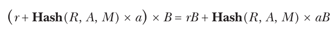

Trong biểu thức này, bạn biết rằng rB = R và aB = A. Do đó, bạn có được kết quả mong đợi, R + Hash(R, A, M) × A.

So với ECDSA, bạn tránh được việc tính một nghịch đảo modular. Giống như ECDSA, bạn cần hai phép nhân scalar-point (SB và Hash(R, A, M)A).

#### Ed25519

Ed25519 là một instance cụ thể của EdDSA với các tham số sau:

• Một twisted Edwards curve dựa trên Curve25519, mà bạn sẽ thấy trong mục tiếp theo

• SHA-512 làm hash function

• Một điểm cơ sở B được chọn để tối ưu hiệu quả

Tính đến năm 2023, Ed25519 có lẽ là elliptic curve signature algorithm phổ biến thứ hai nhờ các lợi ích về hiệu năng và các bảo đảm security cao của nó (xem https://ed25519.cr.yp.to).

OpenSSH, các sản phẩm của Apple, và nhiều nền tảng blockchain dùng Ed25519 để ký các giao dịch. Tháng Hai năm 2023, Ed25519 đã được thêm vào làm một tiêu chuẩn NIST, như một phần của FIPS 186-5, “Digital Signature Standard.”

Ed25519 đã gặp phải một số vấn đề về khả năng tương tác, như bạn sẽ thấy ở phần sau của chương này.

## Mã hóa bằng elliptic curve (Encrypting with Elliptic Curves)

Dù bạn thường dùng elliptic curve để ký, bạn vẫn có thể mã hóa bằng chúng. Nhưng bạn sẽ hiếm khi thấy người ta làm vậy trong thực tế vì những hạn chế về kích thước plaintext có thể được mã hóa: bạn có thể chứa khoảng 100 bit plaintext, so với gần 4,000 trong RSA với cùng security level.

Bạn có thể mã hóa bằng elliptic curve với elliptic curve integrated encryption scheme (ECIES), một hybrid scheme kết hợp cryptography bất đối xứng và đối xứng. Nó dùng một phép toán Diffie–Hellman để suy ra một shared secret key, thứ bảo vệ dữ liệu bằng một authenticated cipher.

Cho public key P của người nhận, ECIES mã hóa một message M như sau:

1. Chọn một số ngẫu nhiên, d, và tính điểm Q = dG, trong đó điểm cơ sở G là một tham số cố định. Ở đây, (d, Q) đóng vai trò một ephemeral key pair, chỉ dùng để mã hóa M.

2. Tính một ECDH shared secret bằng cách tính S = dP.

3. Dùng một key derivation function (KDF) để suy ra một symmetric key, K, từ S.

4. Mã hóa M bằng K và một symmetric authenticated cipher, thu được một ciphertext, C, và một authentication tag, T.

Khi đó, ciphertext ECIES gồm ephemeral public key Q theo sau là C và T. Việc giải mã rất đơn giản: người nhận tính S bằng cách nhân Q với private exponent của họ, rồi suy ra key K, giải mã C, và xác minh T.

## Chọn một đường cong (Choosing a Curve)

Các tiêu chí để đánh giá sự an toàn của một elliptic curve bao gồm order của group bạn dùng (tức là số điểm của nó), các công thức cộng của nó, và nguồn gốc các tham số của nó.

Có nhiều loại elliptic curve, nhưng không phải tất cả đều như nhau cho mục đích cryptography. Hãy chọn các hệ số a và b trong phương trình của đường cong y<sup>2</sup> = x<sup>3</sup> + ax + b một cách cẩn thận, theo các tiêu chí security đã được thiết lập; nếu không, bạn có thể rốt cuộc có một đường cong không an toàn. Trong thực tế, bạn sẽ dùng một đường cong đã được thiết lập cho encryption, nhưng biết điều gì làm nên một đường cong an toàn sẽ giúp bạn chọn giữa nhiều đường cong có sẵn và hiểu rõ hơn mọi rủi ro liên quan. Dưới đây là một số điểm cần ghi nhớ:

• Order của group không nên là tích của các số nhỏ; nếu không, việc giải ECDLP trở nên dễ hơn nhiều.

• Trong “The Addition Law” ở trang 235, bạn đã học rằng phép cộng các điểm P + Q đòi hỏi một công thức cộng riêng khi Q = P. Đáng tiếc, việc xử lý trường hợp này khác với trường hợp tổng quát có thể làm rò rỉ thông tin quan trọng nếu kẻ tấn công có thể phân biệt phép nhân đôi với phép cộng giữa các điểm phân biệt. Một số đường cong an toàn vì chúng dùng một công thức duy nhất cho mọi phép cộng điểm. (Khi một đường cong không cần công thức riêng cho phép nhân đôi, nó có một unified addition law.)

• Nếu những người tạo ra một đường cong không giải thích nguồn gốc của a và b, họ có thể bị nghi ngờ gian lận vì bạn không thể biết liệu họ có chọn các giá trị yếu hơn cho phép một attack yet-unknown nào đó nhắm vào cryptosystem hay không.

Hãy điểm qua một số đường cong phổ biến nhất, đặc biệt là những đường cong được dùng cho chữ ký hoặc Diffie–Hellman key agreement.

> **LƯU Ý** Bạn sẽ tìm thấy thêm các tiêu chí và chi tiết về các đường cong tại https://safecurves.cr.yp.to.

### Các đường cong NIST (NIST Curves)

Năm 2000, NIST đã chuẩn hóa một số đường cong trong tài liệu FIPS 186 dưới mục “Recommended Elliptic Curves for Federal Government Use.” Năm đường cong NIST, gọi là prime curve, làm việc modulo một số nguyên tố (xem “Elliptic Curves over Integers” ở trang 233). Mười đường cong NIST khác làm việc với đa thức nhị phân (binary polynomial), các đối tượng toán học giúp việc hiện thực trong phần cứng hiệu quả hơn. (Tôi sẽ không đi sâu hơn vào binary polynomial vì chúng hiếm khi được dùng với elliptic curve.)

Các đường cong NIST phổ biến nhất là các prime curve. Trong số đó, một trong những đường cong phổ biến nhất là P-256, một đường cong làm việc trên các số modulo số 256-bit p = 2<sup>256</sup> – 2<sup>224</sup> + 2<sup>192</sup> + 2<sup>96</sup> – 1. Phương trình của P-256 là y<sup>2</sup> = x<sup>3</sup> – 3x + b, trong đó b là một số 256-bit. NIST cũng cung cấp các prime curve 192 bit, 224 bit, 384 bit và 521 bit (đây không phải lỗi đánh máy; đó là 521, không phải 512).

Các đường cong NIST đôi khi bị chỉ trích vì chỉ NSA, tác giả của các đường cong, biết nguồn gốc của hệ số b trong phương trình của chúng. Lời giải thích mà họ đưa ra là b là kết quả của việc hash một hằng số random-looking bằng SHA-1. Ví dụ, tham số b của P-256 đến từ hằng số sau: c49d3608 86e70493 6a6678e1 139d26b7 819f7e90. Không ai biết vì sao NSA chọn hằng số cụ thể này, nhưng hầu hết các chuyên gia không tin rằng nguồn gốc của đường cong che giấu bất kỳ điểm yếu nào.

### Curve25519

Daniel J. Bernstein đã giới thiệu Curve25519 (thường được phát âm là curve-twenty-five-five-nineteen) với thế giới năm 2006. Được thúc đẩy bởi hiệu năng, ông thiết kế Curve25519 để nhanh hơn và dùng key ngắn hơn các đường cong tiêu chuẩn. Nhưng Curve25519 cũng mang lại lợi ích về security; khác với các đường cong NIST, nó không có hằng số đáng ngờ nào và có thể dùng cùng một công thức thống nhất để cộng các điểm phân biệt hoặc để nhân đôi một điểm.

Dạng phương trình của Curve25519, y<sup>2</sup> = x<sup>3</sup> + 486662x<sup>2</sup> + x, hơi khác so với các phương trình khác trong chương này, nhưng nó vẫn thuộc họ elliptic curve. Dạng khác thường của phương trình này cho phép các kỹ thuật hiện thực cụ thể giúp Curve25519 nhanh trong phần mềm.

Curve25519 làm việc với các số modulo 2<sup>255</sup> – 19, một số nguyên tố gần 2<sup>255</sup> nhất có thể. Hệ số b 486662 là số nguyên nhỏ nhất thỏa mãn các tiêu chí security do Bernstein đặt ra. Gộp lại, những đặc điểm này khiến Curve25519 đáng tin cậy hơn các đường cong NIST và các hệ số đáng ngờ của chúng.

Curve25519 được dùng ở khắp nơi—ví dụ, trong WhatsApp, TLS 1.3, OpenSSH, và nhiều hệ thống khác. Tiếp nối thành công này, Curve25519 đã được thêm vào danh sách các đường cong NIST-approved vào tháng Hai năm 2023, như một phần của tài liệu SP 800-186, “Recommendations for Discrete Logarithm-based Cryptography: Elliptic Curve Domain Parameters.”

> **LƯU Ý** Để biết chi tiết và lý do đằng sau Curve25519, hãy xem bài trình bày năm 2016 “The First 10 Years of Curve25519” của Daniel J. Bernstein tại https://cr.yp.to/talks.html#2016.03.09.

### Các đường cong khác (Other Curves)

Vào lúc tôi viết những dòng này, hầu hết các ứng dụng cryptography dùng các đường cong NIST hoặc Curve25519 (kể cả thông qua Ed25519), nhưng vẫn có các tiêu chuẩn cũ khác đang được dùng, và các đường cong mới hơn đang được quảng bá và thúc đẩy trong các ủy ban tiêu chuẩn hóa. Các tiêu chuẩn quốc gia cũ bao gồm các đường cong ANSSI của Pháp và các đường cong Brainpool của Đức: hai họ không hỗ trợ các công thức cộng đầy đủ (complete addition formula) và dùng các hằng số không rõ nguồn gốc.

Một số đường cong mới hơn hiệu quả hơn các đường cong cũ và không có bất kỳ nghi vấn nào; chúng cung cấp các security level khác nhau và nhiều tối ưu hiệu quả khác nhau. Các ví dụ bao gồm Curve41417, một biến thể của Curve25519, làm việc với các số lớn hơn và cung cấp security level cao hơn (khoảng 200 bit); Ed448-Goldilocks, một đường cong 448-bit được đề xuất lần đầu năm 2014 và được đặc tả trong RFC 8032; và sáu đường cong do Diego Aranha và cộng sự đề xuất trong “A Note on High-Security General-Purpose Elliptic Curves” (xem https://eprint.iacr.org/2013/647), dù các đường cong này hiếm khi được dùng. Các chi tiết cụ thể về những đường cong này nằm ngoài phạm vi của cuốn sách này.

Cuối cùng, sáng kiến Ristretto (https://ristretto.group) là một kỹ thuật để xây dựng các point group prime-order từ các elliptic curve có order non-prime (và do đó có các subgroup). Ristretto cung cấp một cách an toàn và không mơ hồ để biểu diễn các điểm trên một elliptic curve, loại bỏ các rủi ro gắn với cấu trúc của Curve25519, chẳng hạn.

## Những gì có thể sai (How Things Can Go Wrong)

Một nhược điểm của elliptic curve là độ phức tạp tương đối của chúng. Số tham số nhiều hơn so với RSA hay Diffie–Hellman cổ điển để lại một attack surface lớn hơn và nhiều khả năng hơn cho lỗi thiết kế và bug hiện thực. Các implementation ECC cũng có thể dễ bị side-channel attack, đặc biệt là phần số học big-number (số lớn) của chúng—ví dụ, khi thời gian tính toán phụ thuộc vào các giá trị bí mật.

Trong các mục sau, tôi thảo luận ba ví dụ về các lỗ hổng có thể xảy ra với elliptic curve, ngay cả khi implementation an toàn.

### ECDSA với tính ngẫu nhiên kém (ECDSA with Bad Randomness)

Việc ký ECDSA được ngẫu nhiên hóa, vì nó liên quan đến một số ngẫu nhiên bí mật k khi đặt s = (h + rd) / k mod n. Tuy nhiên, nếu bạn dùng lại cùng k để ký một message thứ hai, kẻ tấn công có thể kết hợp các giá trị thu được, s<sub>1</sub> = (h<sub>1</sub> + rd) / k và s<sub>2</sub> = (h<sub>2</sub> + rd) / k, để có s<sub>1</sub> – s<sub>2</sub> = (h<sub>1</sub> – h<sub>2</sub>) / k và rồi k = (h<sub>1</sub> – h<sub>2</sub>) / (s<sub>1</sub> – s<sub>2</sub>). Khi biết k, bạn có thể dễ dàng khôi phục private key d bằng cách tính như sau:

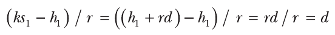

Khác với chữ ký RSA, vốn không cho phép khôi phục key nếu dùng một PRNG yếu, việc dùng các số không ngẫu nhiên có thể dẫn đến việc k của ECDSA bị khôi phục, như đã xảy ra với attack nhắm vào máy chơi game PlayStation 3 năm 2010, được nhóm fail0verflow trình bày tại 27th Chaos Communication Congress ở Berlin, Đức. Họ phát hiện ra rằng cùng một k đã được dùng lại để ký các game khác nhau và nhờ đó có thể tìm ra signing key, điều giúp có thể ký bất kỳ chương trình nào để cho phép nó chạy trên máy.

### Invalid curve attack (Invalid Curve Attacks)

Bạn có thể phá ECDH một cách thanh lịch nếu các điểm đầu vào không được kiểm tra hợp lệ đúng cách. Lý do chính là các công thức cho tọa độ của tổng các điểm P + Q không bao giờ liên quan đến hệ số b của đường cong; thay vào đó, chúng chỉ dựa vào tọa độ của P và Q và hệ số a (khi nhân đôi một điểm). Hệ quả đáng tiếc là khi cộng hai điểm, bạn không thể chắc chắn rằng mình đang làm việc trên đúng đường cong vì bạn có thể thực ra đang cộng các điểm trên một đường cong khác với một hệ số b khác. Điều đó có nghĩa là bạn có thể phá ECDH, như kịch bản sau, invalid curve attack, mô tả.

Giả sử Alice và Bob đang chạy ECDH và đã thống nhất một đường cong và một điểm cơ sở, G. Bob gửi public key bG của mình cho Alice. Alice, thay vì gửi một public key aG trên đường cong đã thống nhất, lại gửi một điểm trên một đường cong khác, cố ý hoặc vô tình. Đáng tiếc, đường cong mới này yếu và cho phép Alice chọn một điểm P mà việc giải ECDLP là dễ. Cô ấy chọn một điểm có order thấp, mà có một k tương đối nhỏ sao cho kP = O.

Bob, tin rằng mình có một public key hợp lệ, tính thứ mà anh ấy nghĩ là shared secret bP, hash nó, và dùng key thu được để mã hóa dữ liệu gửi cho Alice. Khi Bob tính bP, anh ấy vô tình tính toán trên đường cong yếu hơn. Kết quả là, vì P được chọn để thuộc một subgroup nhỏ bên trong group điểm lớn hơn, kết quả bP cũng thuộc subgroup nhỏ đó, cho phép kẻ tấn công xác định shared secret bP một cách hiệu quả nếu họ biết order của P.

Một cách để ngăn chặn điều này là xác nhận các điểm P và Q thuộc đúng đường cong bằng cách bảo đảm tọa độ của chúng thỏa mãn phương trình của đường cong. Điều này bảo đảm bạn chỉ có thể làm việc trên đường cong an toàn.

Một invalid curve attack như vậy đã được phát hiện năm 2015 trên một số implementation của protocol TLS, protocol dùng ECDH để thỏa thuận session key. (Để biết chi tiết, hãy xem bài báo “Practical Invalid Curve Attacks on TLS-ECDH” của Tibor Jager, Jörg Schwenk và Juraj Somorovsky.)

### Các quy tắc kiểm tra hợp lệ Ed25519 không tương thích (Incompatible Ed25519 Validation Rules)

Bạn đã thấy rằng Ed25519 là một signature scheme được tối ưu để cung cấp cả hiệu quả lẫn các bảo đảm security cao. Các nhà thiết kế Ed25519 đã mô tả chi tiết cách nó hoạt động trong một bài báo khoa học và công bố một reference implementation well-coded (được viết tốt). Algorithm được đặc tả thành một tiêu chuẩn IETF trong RFC 8032. Người ta sẽ kỳ vọng chỉ có một phiên bản Ed25519 và các implementation khác nhau hoạt động hoàn toàn giống nhau: với một giá trị đầu vào cho trước, tất cả chúng phải hành xử giống hệt nhau và trả về cùng một kết quả.

Đáng tiếc, thực tế không phải vậy. Như cryptographer Henry de Valence đã ghi lại trong bài viết “It’s 255:19AM. Do You Know What Your Validation Criteria Are?” (xem https://hdevalence.ca/blog/2020-10-04-its-25519am), các implementation khác nhau của Ed25519 có các tiêu chí khác nhau về điều gì cấu thành một chữ ký hợp lệ. Thật vậy, RFC 8032 không mô tả đầy đủ các tiêu chí kiểm tra hợp lệ—và nhiều implementation thậm chí không tuân thủ nó.

Trong 15 implementation trong bài viết của de Valence, mỗi implementation có tiêu chí kiểm tra hợp lệ riêng. Đặc biệt, việc kiểm tra hợp lệ các điểm R (của chữ ký) và A (public key) thường khác nhau, cũng như việc xác minh đẳng thức giữa S × B và R + Hash(R, A, M) × A. Sự khác biệt có thể xảy ra ở nhiều mức, bao gồm việc encode các điểm (cách bạn ghép các byte để mô tả tọa độ của chúng) và việc kiểm tra rằng các điểm thuộc đúng subgroup.

Kết quả là, các implementation khác nhau của cùng một scheme có thể hành xử khác nhau—ví dụ, trong một mạng blockchain nơi chữ ký sẽ được một số node chấp nhận nhưng bị các node khác từ chối, một vấn đề đối với consensus protocol. Mọi chi tiết đều được giải thích trong blog post của de Valence.

## Đọc thêm (Further Reading)

Elliptic curve cryptography là một chủ đề hấp dẫn, phức tạp và liên quan đến nhiều toán học. Tôi chưa thảo luận các khái niệm quan trọng như order của một điểm, cofactor của một đường cong, projective coordinate, torsion point, và các phương pháp giải bài toán ECDLP. Nếu bạn thiên về toán học, bạn sẽ tìm thấy thông tin về những chủ đề này và các chủ đề liên quan khác trong Handbook of Elliptic and Hyperelliptic Curve Cryptography của Henri Cohen và Gerhard Frey (Chapman and Hall/CRC, 2005). Bản khảo sát năm 2013 “Elliptic Curve Cryptography in Practice” của Joppe Bos, Alex Halderman, Nadia Heninger, Jonathan Moore, Michael Naehrig và Eric Wustrow cũng đưa ra một phần giới thiệu có minh họa với các ví dụ thực tế (https://eprint.iacr.org/2013/734).
