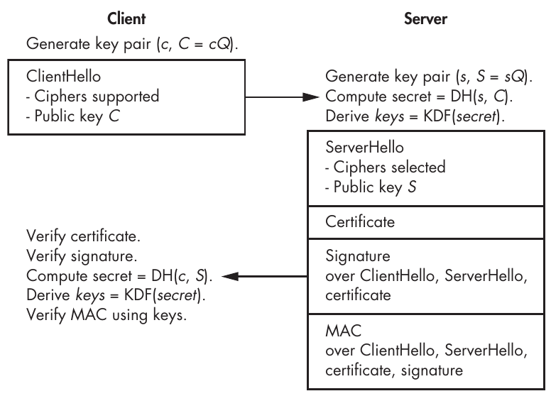
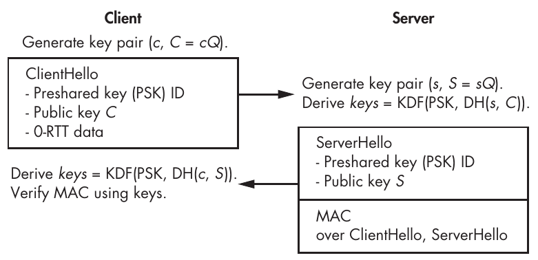
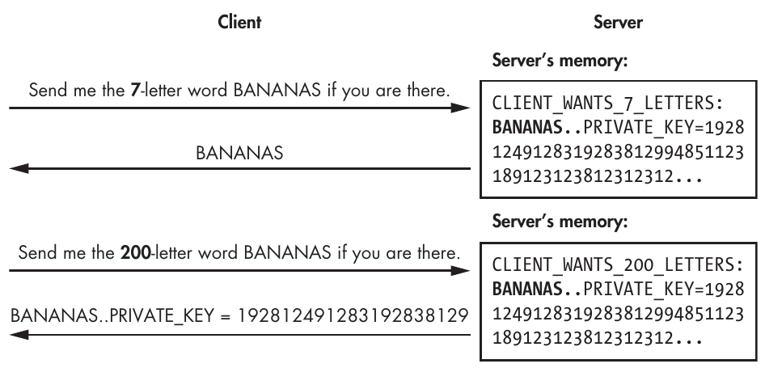

# Chương 13: TLS

Protocol Transport Layer Security (TLS) là con ngựa thồ của internet security. TLS bảo vệ các kết nối giữa server và client, dù là giữa một website và khách truy cập của nó, giữa các email server, giữa một ứng dụng di động và các server của nó, hay giữa các server trò chơi điện tử và người chơi. Không có TLS, internet sẽ chẳng mấy an toàn.

TLS không phụ thuộc ứng dụng (application agnostic), nghĩa là bạn có thể dùng nó cho các ứng dụng web-based dựa vào protocol HTTP, cũng như cho bất kỳ hệ thống nào mà một máy tính hoặc thiết bị client cần khởi tạo kết nối với một server từ xa. Ví dụ, TLS được dùng rộng rãi cho liên lạc machine-to-machine trong các ứng dụng internet of things (IoT), như tủ lạnh thông minh liên lạc với các server từ xa.

Chương này đưa ra một cái nhìn rút gọn về TLS, thứ đã ngày càng trở nên phức tạp qua nhiều năm. Đáng tiếc, sự phức tạp và cồng kềnh đã mang đến nhiều lỗ hổng, và các bug tìm thấy trong những implementation rối rắm của nó đã lên trang nhất—Heartbleed, BEAST, CRIME và POODLE đều là những lỗ hổng đã ảnh hưởng đến hàng triệu web server.

> **LƯU Ý** Bạn có thể thấy người ta gọi TLS là Secure Sockets Layer (SSL), vốn là tên của tiền thân của nó.

Năm 2013, các kỹ sư bắt đầu làm việc với TLS 1.3. Như bạn sẽ học trong chương này, TLS 1.3 đã loại bỏ các tính năng không cần thiết và không an toàn, đồng thời thay các algorithm cũ bằng những algorithm state-of-the-art vào thời điểm đó. Kết quả là một protocol đơn giản hơn, nhanh hơn và an toàn hơn.

Trước khi khám phá cách TLS 1.3 hoạt động, hãy điểm lại vấn đề mà TLS nhắm đến giải quyết và lý do nó tồn tại.

## Ứng dụng mục tiêu và yêu cầu (Target Applications and Requirements)

TLS là chữ S trong các website HTTPS, và ổ khóa xuất hiện trên thanh địa chỉ của trình duyệt cho biết một trang là an toàn. Động lực chính để tạo ra TLS là cho phép duyệt web an toàn trong các ứng dụng như e-commerce hay e-banking, bằng cách xác thực trang web và mã hóa traffic để bảo vệ thông tin nhạy cảm như dữ liệu cá nhân, số thẻ tín dụng và thông tin đăng nhập của người dùng.

TLS cũng giúp bảo vệ liên lạc internet-based nói chung bằng cách thiết lập một kênh an toàn giữa một client và một server, bảo đảm rằng dữ liệu được truyền là bí mật, được xác thực và không bị sửa đổi.

Một trong các security goal của TLS là ngăn chặn man-in-the-middle attack, trong đó kẻ tấn công chặn traffic đã mã hóa từ bên truyền, giải mã traffic để lấy nội dung rõ, và mã hóa lại nó để gửi cho bên nhận. TLS đánh bại các attack này bằng cách xác thực server (và tùy chọn cả client) bằng certificate và các certificate authority đáng tin cậy, như chúng ta sẽ thảo luận trong “Certificates and Certificate Authorities” ở trang 258.

Để được chấp nhận rộng rãi, TLS cần thỏa mãn thêm bốn yêu cầu: hiệu quả, khả năng tương tác, khả năng mở rộng và tính linh hoạt. Với TLS, hiệu quả nghĩa là giảm thiểu cái giá về hiệu năng so với các kết nối không mã hóa. Điều này tốt cho cả server (để giảm chi phí phần cứng cho các nhà cung cấp dịch vụ) lẫn client (để tránh độ trễ có thể nhận thấy hoặc việc giảm thời lượng pin của thiết bị di động). Protocol cần có khả năng tương tác để nó hoạt động trên bất kỳ phần cứng và bất kỳ hệ điều hành nào. Nó phải có khả năng mở rộng để có thể hỗ trợ các tính năng hoặc algorithm bổ sung. Và nó phải linh hoạt—tức là không bị ràng buộc với một ứng dụng cụ thể. Điều này tương tự như Transport Control Protocol (TCP), vốn không quan tâm đến application protocol được dùng bên trên nó.

## Bộ protocol TLS (The TLS Protocol Suite)

Để bảo vệ liên lạc client-server, TLS gồm nhiều phiên bản của một số protocol tạo thành bộ protocol TLS (TLS protocol suite). TLS không phải là một transport protocol và thường nằm giữa transport protocol (TCP) và một application layer protocol như HTTP hoặc SMTP, để bảo vệ dữ liệu được truyền qua một kết nối TCP.

TLS cũng hoạt động trên transport protocol User Datagram Protocol (UDP), được dùng cho các truyền dẫn “connectionless” khi độ trễ phải ở mức tối thiểu, như streaming audio hoặc video và chơi game trực tuyến. Tuy nhiên, khác với TCP, UDP không bảo đảm việc chuyển phát hay thứ tự packet đúng. Do đó, phiên bản UDP của TLS, Datagram Transport Layer Security (DTLS), hơi khác một chút. Để biết thêm về TCP và UDP, hãy xem The TCP/IP Guide của Charles Kozierok (No Starch Press, 2005).

### Họ protocol TLS và SSL (The TLS and SSL Families of Protocols)

TLS bắt đầu năm 1995 khi Netscape phát triển tổ tiên của TLS, protocol SSL. SSL còn xa mới hoàn hảo, và cả SSL 2.0 lẫn SSL 3.0 đều có các lỗi security. Bạn không bao giờ nên dùng SSL, và bạn nên luôn dùng TLS—điều làm tăng thêm sự nhầm lẫn là người ta thường gọi TLS là SSL, kể cả các chuyên gia security.

Không phải mọi phiên bản TLS đều an toàn. TLS 1.0 (1999) là phiên bản kém an toàn nhất, dù nó vẫn an toàn hơn SSL 3.0. TLS 1.1 (2006) tốt hơn nhưng bao gồm một số algorithm yếu. TLS 1.2 (2008) còn tốt hơn nữa, nhưng nó phức tạp và chỉ cung cấp security cao nếu được cấu hình đúng. Ngoài ra, sự phức tạp của nó làm tăng rủi ro có bug trong các implementation và rủi ro cấu hình sai. Ví dụ, TLS 1.2 hỗ trợ AES ở CBC mode, thứ thường dễ bị padding oracle attack.

TLS 1.2 thừa hưởng hàng chục tính năng và lựa chọn thiết kế từ các phiên bản TLS trước đó khiến nó kém tối ưu về security và hiệu năng. Để dọn dẹp mớ hỗn độn này, các kỹ sư cryptography đã tái phát minh TLS—chỉ giữ lại những phần tốt và thêm các tính năng security. Kết quả là TLS 1.3, một cuộc đại tu đã đơn giản hóa một thiết kế cồng kềnh và làm nó an toàn hơn, hiệu quả hơn và đơn giản hơn. Về cơ bản, TLS 1.3 là TLS trưởng thành.

### TLS tóm gọn (TLS in a Nutshell)

TLS có hai protocol chính: handshake protocol (hay chỉ là handshake) xác định các secret key dùng chung giữa hai bên; record protocol mô tả cách dùng các key này để bảo vệ dữ liệu. Các packet dữ liệu mà TLS xử lý được gọi là record. TLS định nghĩa một định dạng packet để đóng gói dữ liệu từ các protocol higher-layer để truyền tới bên kia.

Handshake bắt đầu với một client khởi tạo một kết nối an toàn với một server. Client gửi một message ban đầu gọi là ClientHello với các tham số bao gồm cipher mà nó muốn dùng. Server kiểm tra message này và các tham số của nó rồi phản hồi bằng một message ServerHello. Một khi client và server xử lý xong message của nhau, chúng sẵn sàng trao đổi dữ liệu đã mã hóa bằng các session key được thiết lập thông qua handshake protocol, như bạn sẽ thấy trong “The TLS Handshake Protocol” ở trang 263.

### Certificate và certificate authority (Certificates and Certificate Authorities)

Bước then chốt nhất trong TLS handshake, và là cốt lõi của security trong TLS, là bước kiểm tra hợp lệ certificate, trong đó một server dùng một certificate để tự xác thực với client.

Về cơ bản, một certificate là một public key kèm theo một chữ ký của key đó và thông tin liên quan (bao gồm tên miền). Ví dụ, khi kết nối tới https://www.google.com , trình duyệt của bạn nhận một certificate từ một network host nào đó rồi xác minh chữ ký của certificate, có nội dung kiểu như “Tôi là google . com, và public key của tôi là [key].” Nếu chữ ký được xác minh, certificate và public key của nó được tin cậy, và trình duyệt tiếp tục thiết lập kết nối. (Xem Chương 10 và 12 để biết chi tiết về chữ ký.)

Trình duyệt biết public key cần thiết để xác minh chữ ký thông qua một certificate authority (CA), về cơ bản là một public key được hardcode trong trình duyệt hoặc hệ điều hành của bạn. Private key của public key đó (tức là khả năng ký của nó) thuộc về một tổ chức đáng tin cậy, tổ chức này bảo đảm rằng các public key trong những certificate mà nó cấp thuộc về website hoặc thực thể đã khai nhận chúng. Tức là, một CA đóng vai trò một bên thứ ba đáng tin cậy. Không có CA, không có cách nào xác minh rằng public key do google . com cung cấp thuộc về Google chứ không phải về một kẻ nghe lén đang thực hiện man-in-the-middle attack.

Ví dụ, Listing 13-1 cho thấy điều gì xảy ra khi bạn dùng công cụ dòng lệnh OpenSSL để khởi tạo một kết nối TLS tới www.google.com trên port 443, network port được dùng cho các kết nối HTTP TLS-based (HTTPS).

```
$ openssl s_client -connect www.google.com:443
CONNECTED(00000003)
---
Certificate chain
 0 s:CN = www.google.com
   i:C = US, O = Google Trust Services LLC, CN = GTS CA 1C3
 1 s:C = US, O = Google Trust Services LLC, CN = GTS CA 1C3
   i:C = US, O = Google Trust Services LLC, CN = GTS Root R1
 2 s:C = US, O = Google Trust Services LLC, CN = GTS Root R1
   i:C = BE, O = GlobalSign nv-sa, OU = Root CA, CN = GlobalSign Root CA
---
Server certificate
-----BEGIN CERTIFICATE-----
MIIEiDCCA3CgAwIBAgIQNJvIv7ypW9IQHaA7P69MzzANBgkqhkiG9w0BAQsFADBG
MQswCQYDVQQGEwJVUzEiMCAGA1UEChMZR29vZ2xlIFRydXN0IFNlcnZpY2VzIExM
QzETMBEGA1UEAxMKR1RTIENBIDFDMzAeFw0yMzA5MDQwODIzMjlaFw0yMzExMjcw
ODIzMjhaMBkxFzAVBgNVBAMTDnd3dy5nb29nbGUuY29tMFkwEwYHKoZIzj0CAQYI
KoZIzj0DAQcDQgAENEMvWAY0TRTb0w5ZxbUbX/Z+EcviE50SzQzvP/xyyVIaURM4
A0Jer9IJO/6Iq6o2AfDXUxrdBKpSzlzaeFCaqqOCAmgwggJkMA4GA1UdDwEB/wQE
AwIHgDATBgNVHSUEDDAKBggrBgEFBQcDATAMBgNVHRMBAf8EAjAAMB0GA1UdDgQW
BBRnwQnVC8ok1e6YPIbQwjB+XFpPRjAfBgNVHSMEGDAWgBSKdH+vhc3ulc09nNDi
RhTzcTUdJzBqBggrBgEFBQcBAQReMFwwJwYIKwYBBQUHMAGGG2h0dHA6Ly9vY3Nw
LnBraS5nb29nL2d0czFjMzAxBggrBgEFBQcwAoYlaHR0cDovL3BraS5nb29nL3Jl
cG8vY2VydHMvZ3RzMWMzLmRlcjAZBgNVHREEEjAQgg53d3cuZ29vZ2xlLmNvbTAh
BgNVHSAEGjAYMAgGBmeBDAECATAMBgorBgEEAdZ5AgUDMDwGA1UdHwQ1MDMwMaAv
oC2GK2h0dHA6Ly9jcmxzLnBraS5nb29nL2d0czFjMy9mVkp4YlYtS3Rtay5jcmww
ggEFBgorBgEEAdZ5AgQCBIH2BIHzAPEAdgDoPtDaPvUGNTLnVyi8iWvJA9PL0RFr
7Otp4Xd9bQa9bgAAAYpfgRjOAAAEAwBHMEUCID+BcS984SEh2E2UrKfLvF2fG7qa
SYkzbELytrDz91wmAiEAlwOPMM26CynmadsqomPMXKdRNMvzdyciHVimh0snrBAA
dwB6MoxU2LcttiDqOOBSHumEFnAyE4VNO9IrwTpXo1LrUgAAAYpfgRkAAAAEAwBI
MEYCIQDZf1tULkVCXRc68zJwgp5WFJUbTxFjz6CP+eLb3dgz3gIhAJ9uS7psu2Gl
HdTXokXTetMY7MCdIcuj60Qm/qTn+1dFMA0GCSqGSIb3DQEBCwUAA4IBAQCIEn0v
QzaqNCOhiI5TKcRhaR24yKid3F57a/GOM1LDE/v7oCm+3fxtvuK9HVa/Dmnvavqp
ci7TpMDj/ocXjE4dL4/yHaVx6GhTDKMW/bbBkDaqXoSdb9lAcUZPLRTV4AjFdjmB
8wZTf95bnfeuKNXWlbo/k/9pRRhFNKKMUI54xLiVdj4wk1EUAsrMTTn+Ol2ZbFeS
s614abBT5W0hhFkLvjvEht8p3UKQwwyhRjZMBsae/d0QfT8hglVtVhhGd7f1hFqI
XSERl8EsyDc3urCsa+RjUjCvE9Q+y2X8WVV0HPCjwsANU56qEZmh4kqgg5paW/SL
maM/8Vny/nKNd6Dj
-----END CERTIFICATE-----
subject=CN = www.google.com

issuer=C = US, O = Google Trust Services LLC, CN = GTS CA 1C3

---
No client certificate CA names sent
Peer signing digest: SHA256
Peer signature type: ECDSA
Server Temp Key: X25519, 253 bits
---
SSL handshake has read 4295 bytes and written 396 bytes
Verification: OK
---
New, TLSv1.3, Cipher is TLS_AES_256_GCM_SHA384
Server public key is 256 bit
Secure Renegotiation IS NOT supported
Compression: NONE
Expansion: NONE
No ALPN negotiated
Early data was not sent
Verify return code: 0 (ok)
```

Listing 13-1: Thiết lập một kết nối TLS với www.google.com và nhận các certificate để xác thực kết nối

Dữ liệu certificate nằm giữa các marker BEGIN CERTIFICATE và END CERTIFICATE. Trước đó, Certificate chain chứa mô tả về chuỗi certificate, trong đó các dòng bắt đầu bằng s: mô tả subject của thực thể được chứng nhận, và các dòng bắt đầu bằng i: mô tả issuer của chữ ký. Certificate số 0 được nhận bởi www.google.com, certificate 1 thuộc về thực thể đã ký certificate 0, và certificate 2 thuộc về thực thể đã ký certificate 1.

Tổ chức đã cấp certificate 0 là Google (thông qua thực thể Google Trust Services, GTS), tổ chức đã cho phép cấp certificate 0 cho tên miền www.google.com bằng cách ký certificate bằng private key GTS CA 1C3. Certificate xác nhận rằng key này thuộc hệ thống phân cấp key của Google là certificate 1, được ký bởi key Root R1 của GTS, một root certificate bên trong Google. Certificate 2, do GlobalSign (một certification authority được công nhận) cấp, xác nhận rằng key GTS Root R1 thuộc về tổ chức Google.

Trong ví dụ này, hệ điều hành của bạn thường đã có sẵn certificate 1 và 2, mà nó coi là các certificate đáng tin cậy. Trong trường hợp đó, bạn chỉ cần kiểm tra hai chữ ký: của thực thể GTS CA 1C3 của Google trong certificate 0 và của thực thể GTS Root R1 của Google trong certificate 1. Nếu hệ thống của bạn chưa có certificate 2 như một certificate đáng tin cậy nhưng có root certificate của GlobalSign (GlobalSign Root CA), thì bạn cũng sẽ cần kiểm tra chữ ký của GlobalSign trong certificate 2.

Các tổ chức certificate authority như Google và GlobalSign phải đáng tin cậy và chỉ cấp certificate cho các thực thể đáng tin cậy, và họ phải bảo vệ private key của mình để ngăn kẻ tấn công cấp certificate thay mặt họ (ví dụ, để mạo danh một server www.google.com hợp lệ).

Để xem bên trong một certificate có gì, hãy nhập lệnh openssl x509 -text -noout trong một terminal Unix rồi dán certificate trong Listing 13-1 vào. Đầu ra xuất hiện trong Listing 13-2.

```
$ openssl x509 -text -noout
Certificate:
  Data:
    Version: 3 (0x2)
    Serial Number:
      34:9b:c8:bf:bc:a9:5b:d2:10:1d:a0:3b:3f:af:4c:cf
    Signature Algorithm: sha256WithRSAEncryption
    Issuer: C = US, O = Google Trust Services LLC, CN = GTS CA 1C3
    Validity
      Not Before: Sep  4 08:23:29 ...
      Not After : Nov 27 08:23:28 ...
    Subject: CN = www.google.com
    Subject Public Key Info:
      Public Key Algorithm: id-ecPublicKey
        Public-Key: (256 bit)
        pub:
          04:34:43:2f:58:06:34:4d:14:db:d3:0e:59:c5:b5:
          1b:5f:f6:7e:11:cb:e2:13:9d:12:cd:0c:ef:3f:fc:
          72:c9:52:1a:51:13:38:03:42:5e:af:d2:09:3b:fe:
          88:ab:aa:36:01:f0:d7:53:1a:dd:04:aa:52:ce:5c:
          da:78:50:9a:aa
        ASN1 OID: prime256v1
        NIST CURVE: P-256
    X509v3 extensions:
      X509v3 Key Usage: critical
        Digital Signature
      X509v3 Extended Key Usage:
        TLS Web Server Authentication
      X509v3 Basic Constraints: critical
        CA:FALSE
      X509v3 Subject Key Identifier:
        67:C1:09:D5:0B:CA:24:D5:EE:98:3C:86:D0:C2:30:7E:5C:5A:4F:46
      X509v3 Authority Key Identifier:
        8A:74:7F:AF:85:CD:EE:95:CD:3D:9C:D0:E2:46:14:F3:71:35:1D:27
      Authority Information Access:
        OCSP - URI:http://ocsp.pki.goog/gts1c3
        CA Issuers - URI:http://pki.goog/repo/certs/gts1c3.der
      X509v3 Subject Alternative Name:
        DNS:www.google.com
      X509v3 Certificate Policies:
        Policy: 2.23.140.1.2.1
        Policy: 1.3.6.1.4.1.11129.2.5.3
      X509v3 CRL Distribution Points:
        Full Name:
          URI:http://crls.pki.goog/gts1c3/fVJxbV-Ktmk.crl
      CT Precertificate SCTs:
        Signed Certificate Timestamp:
          Version   : v1 (0x0)
          Log ID    : E8:3E:D0:DA:3E:F5:06:35:32:E7:57:28:BC:89:6B:C9:
                    03:D3:CB:D1:11:6B:EC:EB:69:E1:77:7D:6D:06:BD:6E
          Timestamp : Sep  4 09:23:30.638 2023 GMT
          Extensions: none
          Signature : ecdsa-with-SHA256
            30:45:02:20:3F:81:71:2F:7C:E1:21:21:D8:4D:94:AC:
            A7:CB:BC:5D:9F:1B:BA:9A:49:89:33:6C:42:F2:B6:B0:
            F3:F7:5C:26:02:21:00:97:03:8F:30:CD:BA:0B:29:E6:
            69:DB:2A:A2:63:CC:5C:A7:51:34:CB:F3:77:27:22:1D:
            58:A6:87:4B:27:AC:10
        Signed Certificate Timestamp:
          Version   : v1 (0x0)
          Log ID    : 7A:32:8C:54:D8:B7:2D:B6:20:EA:38:E0:52:1E:E9:84:
                    16:70:32:13:85:4D:3B:D2:2B:C1:3A:57:A3:52:EB:52
          Timestamp : Sep  4 09:23:30.688 2023 GMT
          Extensions: none
          Signature : ecdsa-with-SHA256
            30:46:02:21:00:D9:7F:5B:54:2E:45:42:5D:17:3A:F3:
            32:70:82:9E:56:14:95:1B:4F:11:63:CF:A0:8F:F9:E2:
            DB:DD:D8:33:DE:02:21:00:9F:6E:4B:BA:6C:BB:61:A5:
            1D:D4:D7:A2:45:D3:7A:D3:18:EC:C0:9D:21:CB:A3:EB:
            44:26:FE:A4:E7:FB:57:45
    Signature Algorithm: sha256WithRSAEncryption
    Signature Value:
      88:12:7d:2f:43:36:aa:34:23:a1:88:8e:53:29:c4:61:69:1d:
      b8:c8:a8:9d:dc:5e:7b:6b:f1:8e:33:52:c3:13:fb:fb:a0:29:
      be:dd:fc:6d:be:e2:bd:1d:56:bf:0e:69:ef:6a:fa:a9:72:2e:
      d3:a4:c0:e3:fe:87:17:8c:4e:1d:2f:8f:f2:1d:a5:71:e8:68:
      53:0c:a3:16:fd:b6:c1:90:36:aa:5e:84:9d:6f:d9:40:71:46:
      4f:2d:14:d5:e0:08:c5:76:39:81:f3:06:53:7f:de:5b:9d:f7:
      ae:28:d5:d6:95:ba:3f:93:ff:69:45:18:45:34:a2:8c:50:8e:
      78:c4:b8:95:76:3e:30:93:51:14:02:ca:cc:4d:39:fe:3a:5d:
      99:6c:57:92:b3:ad:78:69:b0:53:e5:6d:21:84:59:0b:be:3b:
      c4:86:df:29:dd:42:90:c3:0c:a1:46:36:4c:06:c6:9e:fd:dd:
      10:7d:3f:21:82:55:6d:56:18:46:77:b7:f5:84:5a:88:5d:21:
      11:97:c1:2c:c8:37:37:ba:b0:ac:6b:e4:63:52:30:af:13:d4:
      3e:cb:65:fc:59:55:74:1c:f0:a3:c2:c0:0d:53:9e:aa:11:99:
      a1:e2:4a:a0:83:9a:5a:5b:f4:8b:99:a3:3f:f1:59:f2:fe:72:
      8d:77:a0:e3
```

Listing 13-2: Giải mã một certificate nhận được từ www.google.com

Listing này cho thấy lệnh openssl x509 giải mã một certificate, ban đầu được cung cấp dưới dạng một khối dữ liệu base64-encoded. Vì OpenSSL biết cấu trúc của dữ liệu này, nó có thể cho bạn biết bên trong certificate có gì, bao gồm một serial number và thông tin phiên bản, thông tin định danh, các ngày hiệu lực (các dòng Not Before và Not After), một public key (ở đây là một RSA modulus và public exponent của nó), và một chữ ký của các thông tin phía trước.

Dù các chuyên gia security và các cryptographer thường cho rằng toàn bộ hệ thống certificate vốn đã hỏng, nó vẫn là một trong những giải pháp tốt nhất mà chúng ta có, cùng với chính sách trust-on-first-use (TOFU) mà SSH áp dụng, chẳng hạn.

### Record protocol (The Record Protocol)

Mọi dữ liệu được trao đổi qua liên lạc TLS 1.3 đều được truyền dưới dạng các chuỗi TLS record, các packet dữ liệu mà TLS dùng. TLS record protocol (record layer) về cơ bản là một transport protocol, không phụ thuộc vào ý nghĩa của dữ liệu được vận chuyển; điều này làm cho TLS phù hợp với mọi ứng dụng.

TLS record protocol trước hết mang dữ liệu được trao đổi trong quá trình handshake. Một khi handshake hoàn tất và cả hai bên dùng chung một secret key, dữ liệu ứng dụng được phân mảnh thành các khối được truyền như một phần của các TLS record.

#### Cấu trúc của một TLS record (The Structure of a TLS Record)

Một TLS record là một khối dữ liệu tối đa 16KB với cấu trúc sau:

• Byte đầu tiên biểu diễn loại dữ liệu được truyền và được đặt giá trị 22 cho dữ liệu handshake, 23 cho dữ liệu đã mã hóa, và 21 cho các alert. Các đặc tả TLS 1.3 gọi giá trị này là ContentType.

• Byte thứ hai và thứ ba lần lượt được đặt là 03 và 01. Các byte này cố định vì lý do lịch sử và không riêng cho TLS phiên bản 1.3. Các đặc tả gọi giá trị 2-byte này là ProtocolVersion.

• Byte thứ tư và thứ năm encode độ dài của dữ liệu cần truyền dưới dạng một số nguyên 16-bit, không thể lớn hơn 2<sup>14</sup> byte (16KB).

• Các byte còn lại là dữ liệu cần truyền (hay payload), có độ dài bằng giá trị được encode bởi byte thứ tư và thứ năm của record.

> **LƯU Ý** Một TLS record có cấu trúc tương đối đơn giản. Như bạn đã thấy, header của một TLS record chỉ gồm ba trường. Để so sánh, một packet IPv4 gồm 14 trường trước payload của nó, và một TCP segment gồm 13 trường.

Khi byte đầu tiên của một TLS 1.3 record (ContentType) được đặt là 23, một authenticated cipher mã hóa và xác thực payload của nó. Payload gồm một ciphertext theo sau là một authentication tag, mà đầu nhận lần lượt giải mã và xác minh. Bên nhận biết phải dùng cipher và key nào để giải mã, nhờ phép màu của TLS: nếu bạn nhận được một TLS record đã mã hóa, bạn đã biết cipher và key vì việc thực thi handshake protocol đã thiết lập chúng.

#### Nonce (Nonces)

Khác với nhiều protocol khác, như Encapsulating Security Payload (ESP) của IPsec, các TLS record không chỉ định nonce mà authenticated cipher sẽ dùng.

Các nonce dùng để mã hóa và giải mã TLS record được suy ra từ các sequence number 64-bit, do mỗi bên duy trì cục bộ và tăng lên với mỗi record mới. Khi client mã hóa dữ liệu, nó suy ra một nonce bằng cách XOR sequence number với một giá trị client_write_iv, bản thân giá trị này được suy ra từ shared secret. Server dùng một phương pháp tương tự để chọn nonce khi truyền dữ liệu, nhưng với một giá trị server_write_iv.

Ví dụ, nếu bạn truyền ba TLS record, bạn sẽ suy ra một nonce từ 0 cho record thứ nhất, từ 1 cho record thứ hai, và từ 2 cho record thứ ba; nếu sau đó bạn nhận ba record, bạn cũng sẽ dùng các nonce 0, 1 và 2, theo thứ tự này. Việc dùng lại cùng các giá trị sequence number để mã hóa dữ liệu truyền đi và giải mã dữ liệu nhận về không phải là điểm yếu vì chúng được XOR với các hằng số khác nhau (client_write_iv và server_write_iv) và vì bạn dùng các secret key khác nhau cho mỗi chiều.

#### Tính năng zero padding (The Zero Padding Feature)

Các TLS 1.3 record hỗ trợ zero padding, giúp giảm thiểu các traffic analysis attack. Kẻ tấn công dùng traffic analysis để trích xuất thông tin từ các mẫu traffic dựa vào thời gian, lượng dữ liệu được truyền, v.v. Ví dụ, vì ciphertext có kích thước xấp xỉ plaintext, ngay cả khi dùng encryption mạnh, kẻ tấn công vẫn có thể xác định kích thước xấp xỉ của message chỉ bằng cách nhìn vào độ dài ciphertext của chúng.

Zero padding thêm các số không vào plaintext để làm phình kích thước ciphertext, đánh lừa người quan sát nghĩ rằng một message đã mã hóa dài hơn thực tế.

### TLS handshake protocol (The TLS Handshake Protocol)

Handshake là cốt lõi của TLS agreement protocol—quá trình mà qua đó một client và một server thiết lập các secret key dùng chung để khởi tạo liên lạc an toàn. Trong một TLS handshake, client và server đóng các vai trò khác nhau. Client đề xuất một số cấu hình (phiên bản TLS và một bộ cipher, theo thứ tự ưu tiên), và server chọn cấu hình mà nó sẽ dùng. Server nên tuân theo các ưu tiên của client. Để bảo đảm khả năng tương tác giữa các implementation và bảo đảm rằng bất kỳ server nào hiện thực TLS 1.3 cũng sẽ đọc được dữ liệu TLS 1.3 do bất kỳ client nào hiện thực TLS 1.3 gửi (ngay cả khi nó dùng một thư viện hoặc ngôn ngữ lập trình khác), các đặc tả TLS 1.3 cũng mô tả định dạng mà dữ liệu nên được gửi.

Hình 13-1 cho thấy quá trình handshake trao đổi dữ liệu như thế nào, theo mô tả của các đặc tả TLS 1.3.



Hình 13-1: Quá trình handshake TLS 1.3

Trong handshake TLS 1.3, client gửi một message tới server nói rằng: “Tôi muốn thiết lập một kết nối TLS với bạn. Đây là các cipher mà tôi hỗ trợ để mã hóa các TLS record, và đây là một Diffie–Hellman public key.” Public key phải được tạo riêng cho TLS session này, và client giữ private key tương ứng. Message do client gửi cũng bao gồm một giá trị ngẫu nhiên 32-byte và thông tin tùy chọn (như các tham số bổ sung). Message đầu tiên này, ClientHello, phải tuân theo một định dạng cụ thể khi được truyền dưới dạng một chuỗi byte, như đặc tả TLS 1.3 định nghĩa.

Server nhận message ClientHello, xác minh rằng nó được định dạng đúng, và phản hồi bằng một message ServerHello, chứa đầy thông tin. Thông thường, khi kết nối tới một website HTTPS, nó chứa cipher sẽ mã hóa các TLS record, một Diffie–Hellman public key, một giá trị ngẫu nhiên 32-byte (được thảo luận trong “Downgrade Protection” ở trang 266), một certificate, một chữ ký của toàn bộ thông tin trước đó trong các message ClientHello và ServerHello (được tính bằng private key gắn với public key của certificate), và một MAC của cùng thông tin đó, cộng với chữ ký. MAC được tính bằng một symmetric key suy ra từ Diffie–Hellman shared secret, thứ mà server tính từ Diffie–Hellman private key của nó và public key của client.

Khi client nhận message ServerHello, nó xác minh tính hợp lệ của certificate, xác minh chữ ký, tính Diffie–Hellman secret dùng chung và suy ra các symmetric key từ đó, và xác minh MAC do server gửi. Một khi mọi thứ được xác minh, client sẵn sàng gửi các message đã mã hóa tới server.

> **LƯU Ý** TLS 1.3 hỗ trợ nhiều tùy chọn và extension, nên nó có thể hành xử khác đi. Ví dụ, bạn có thể cấu hình handshake TLS 1.3 để yêu cầu một client certificate sao cho server xác minh danh tính của client. TLS 1.3 cũng hỗ trợ một handshake với preshared key.

Hãy xem điều này trong thực tế. Giả sử bạn đã triển khai TLS 1.3 để cung cấp truy cập an toàn tới website https://www.nostarch.com. Khi bạn trỏ trình duyệt (client) tới trang này, trình duyệt của bạn gửi một message ClientHello tới server của trang, bao gồm các cipher mà nó hỗ trợ. Website phản hồi bằng một message ServerHello và một certificate bao gồm một public key gắn với tên miền www.nostarch.com. Client xác minh tính hợp lệ của certificate bằng một trong các certificate authority được nhúng trong trình duyệt (một certificate authority đáng tin cậy, mà certificate của nó cần nằm trong certificate store của trình duyệt hoặc của hệ điều hành để được kiểm tra hợp lệ, phải ký certificate nhận được). Một khi mọi kiểm tra đều qua, trình duyệt yêu cầu trang đầu của site từ www.nostarch.com server.

Sau một handshake TLS 1.3 thành công, mọi liên lạc giữa client và server đều được mã hóa và xác thực. Một kẻ nghe lén có thể biết rằng một client tại một địa chỉ IP cho trước đang nói chuyện với một server tại một địa chỉ IP cho trước khác và có thể quan sát nội dung đã mã hóa được trao đổi, nhưng không thể biết plaintext bên dưới hay sửa đổi các message đã mã hóa (nếu họ làm vậy, bên nhận sẽ nhận ra rằng cuộc liên lạc đã bị can thiệp, vì các message được xác thực). Như vậy là đủ security cho nhiều ứng dụng.

### Các algorithm cryptography của TLS 1.3

TLS 1.3 dùng các authenticated encryption algorithm, một key derivation function (một hash function suy ra các secret key từ một shared secret), cũng như một phép toán Diffie–Hellman—nhưng chính xác thì chúng hoạt động như thế nào, những algorithm nào được dùng, và chúng an toàn đến đâu?

Về lựa chọn authenticated cipher, TLS 1.3 chỉ hỗ trợ ba algorithm: AES-GCM, AES-CCM (một mode kém hiệu quả hơn GCM một chút), và stream cipher ChaCha20 kết hợp với MAC Poly1305 (như được định nghĩa trong RFC 7539). Vì TLS 1.3 ngăn việc dùng một độ dài key không an toàn như 64 hoặc 80 bit, secret key có thể là 128 bit (AES-GCM hoặc AES-CCM) hoặc 256 bit (AES-GCM hoặc ChaCha20-Poly1305).

Thao tác key derivation (KDF) trong Hình 13-1 dựa trên HKDF, một cấu trúc dựa trên HMAC (xem Chương 7) và được định nghĩa trong RFC 5869, dùng hash function SHA-256 hoặc SHA-384.

Các lựa chọn của bạn để thực hiện phép toán Diffie–Hellman (cốt lõi của handshake TLS 1.3) bị giới hạn ở elliptic curve cryptography và một multiplicative group các số nguyên modulo một số nguyên tố (như trong Diffie–Hellman truyền thống). Nhưng bạn không thể dùng bất kỳ elliptic curve hay group nào: các đường cong được hỗ trợ bao gồm ba đường cong NIST cũng như Curve25519 (xem Chương 12) và Curve448, cả hai đều được định nghĩa trong RFC 7748. TLS 1.3 cũng hỗ trợ DH trên các group số nguyên, trái với elliptic curve. Các group được hỗ trợ là năm group được định nghĩa trong RFC 7919: các group 2,048, 3,072, 4,096, 6,144 và 8,192 bit.

Về lý thuyết, group 2,048-bit có thể là mắt xích yếu nhất của TLS 1.3. Trong khi các lựa chọn khác cung cấp security ít nhất 128-bit, Diffie–Hellman 2,048-bit được tin là cung cấp security dưới 100-bit. Do đó, việc hỗ trợ một group 2,048-bit có thể bị xem là không nhất quán với các lựa chọn thiết kế khác của TLS 1.3. Trong thực tế, security 100-bit khó bẻ gần như 128-bit—tức là, thực tế không thể.

## Những cải tiến của TLS 1.3 so với TLS 1.2

TLS 1.3 rất khác với tiền thân của nó. Trước hết, nó loại bỏ các algorithm yếu như MD5, SHA-1, RC4 và AES ở CBC mode. Ngoài ra, trong khi TLS 1.2 thường bảo vệ các record bằng sự kết hợp giữa một cipher và một MAC (như HMAC-SHA-1) trong một cấu trúc MAC-then-encrypt, TLS 1.3 chỉ hỗ trợ các authenticated cipher hiệu quả hơn và an toàn hơn. TLS 1.3 cũng bỏ việc thương lượng cách encode điểm elliptic curve và định nghĩa một định dạng điểm duy nhất cho mỗi đường cong.

TLS 1.3 đã gỡ bỏ các tính năng trong 1.2 làm suy yếu protocol, và nó giảm độ phức tạp tổng thể của protocol và do đó giảm attack surface của nó. Ví dụ, TLS 1.3 bỏ tính năng nén dữ liệu tùy chọn, một tính năng đã tạo điều kiện cho CRIME attack nhắm vào TLS 1.2. Attack này khai thác thực tế rằng độ dài của phiên bản đã nén của một message làm rò rỉ thông tin về nội dung của message.

Nhưng TLS 1.3 cũng mang đến các tính năng mới giúp kết nối an toàn hơn hoặc hiệu quả hơn. Tôi sẽ thảo luận ba trong số các tính năng này: downgrade protection, handshake single round-trip, và session resumption.

### Downgrade protection (Downgrade Protection)

Tính năng downgrade protection của TLS 1.3 là một biện pháp phòng thủ trước các downgrade attack, trong đó kẻ tấn công ép client và server dùng một phiên bản TLS yếu hơn 1.3. Để thực hiện một downgrade attack, kẻ tấn công ép server dùng một phiên bản TLS yếu hơn bằng cách chặn và sửa đổi message ClientHello để nói với server rằng client không hỗ trợ TLS 1.3. Giờ kẻ tấn công có thể khai thác các lỗ hổng trong các phiên bản TLS trước đó.

Trong nỗ lực đánh bại downgrade attack, server TLS 1.3 dùng ba loại mẫu trong giá trị ngẫu nhiên 32-byte được gửi trong message ServerHello để xác định loại kết nối được yêu cầu. Mẫu phải khớp với yêu cầu của client về một loại kết nối TLS cụ thể. Nếu client nhận được mẫu sai, nó biết có điều gì đó không ổn.

Cụ thể, nếu client yêu cầu một kết nối TLS 1.2, 8 trong 32 byte đầu tiên được đặt là 44 4F 57 4E 47 52 44 01, và nếu nó yêu cầu một kết nối TLS 1.1, chúng được đặt là 44 4F 57 4E 47 52 44 00. Tuy nhiên, nếu client yêu cầu một kết nối TLS 1.3, 8 bit đầu tiên này phải là ngẫu nhiên *(ghi chú: sách in “bits”; đúng là “bytes”)*. Ví dụ, nếu một client gửi một ClientHello yêu cầu kết nối TLS 1.3, nhưng một kẻ tấn công trên mạng sửa đổi nó để yêu cầu kết nối TLS 1.1, khi client nhận được ServerHello với mẫu sai, nó biết rằng message ClientHello của nó đã bị sửa đổi. (Kẻ tấn công không thể tùy ý sửa đổi giá trị ngẫu nhiên 32-byte của server vì giá trị này được ký bằng cryptography.)

### Handshake Single Round-Trip

Trong một handshake TLS 1.2 điển hình, client gửi một số dữ liệu tới server, chờ phản hồi, rồi gửi thêm dữ liệu và chờ phản hồi của server trước khi gửi các message đã mã hóa. Độ trễ bằng hai round-trip time (RTT). Ngược lại, handshake của TLS 1.3 chỉ mất một round-trip time (xem Hình 13-1). Thời gian tiết kiệm được có thể lên tới hàng trăm mili giây. Điều này đáng kể khi bạn xét rằng các server của những dịch vụ phổ biến xử lý hàng nghìn kết nối mỗi giây.

### Session resumption (Session Resumption)

TLS 1.3 nhanh hơn TLS 1.2, nhưng nó có thể được làm nhanh hơn nữa (cỡ hàng trăm mili giây) bằng cách loại bỏ hoàn toàn các round trip đi trước một session đã mã hóa. Thủ thuật là dùng session resumption, tận dụng preshared key đã được trao đổi giữa client và server trong một session trước đó để khởi động một session mới. Session resumption mang lại hai lợi ích lớn: client có thể bắt đầu mã hóa ngay lập tức, và không cần dùng certificate trong các session tiếp theo.

Hình 13-2 cho thấy session resumption hoạt động như thế nào.



Hình 13-2: Handshake session resumption của TLS 1.3, trong đó dữ liệu 0-RTT là dữ liệu session resumption được gửi kèm với ClientHello

Đầu tiên, client gửi một message ClientHello bao gồm định danh của key đã được dùng chung (gọi là PSK, viết tắt của preshared key) với server, cùng với một DH public key mới. Client cũng có thể đưa dữ liệu đã mã hóa vào message đầu tiên này (gọi là dữ liệu 0-RTT). Khi server phản hồi một message ClientHello, nó cung cấp một MAC trên dữ liệu được trao đổi. Client xác minh MAC và biết rằng nó đang nói chuyện với cùng server như trước đó, do đó khiến việc kiểm tra hợp lệ certificate phần nào trở nên thừa. Client và server thực hiện một Diffie–Hellman key agreement như trong handshake bình thường, và các message tiếp theo được mã hóa bằng các key phụ thuộc vào cả PSK lẫn Diffie–Hellman shared secret mới được tính.

## Điểm mạnh của security trong TLS (The Strengths of TLS Security)

Chúng ta sẽ đánh giá các điểm mạnh của TLS 1.3 theo hai security notion chính từ Chương 11: authentication và forward secrecy.

### Authentication

Trong handshake TLS 1.3, server tự xác thực với client bằng cơ chế certificate. Tuy nhiên, client không được xác thực, và client có thể xác thực với một ứng dụng server-based (như Gmail) bằng cách cung cấp username và password trong một TLS record sau khi thực hiện handshake. Nếu client đã thiết lập một session với dịch vụ từ xa, nó có thể xác thực bằng cách gửi một secure cookie, thứ chỉ có thể được gửi qua một kết nối TLS.

Trong một số trường hợp, client có thể xác thực với server bằng một cơ chế certificate-based tương tự như cơ chế mà server dùng để xác thực với client: client gửi một client certificate tới server, server xác minh certificate này trước khi cấp quyền cho client. Tuy nhiên, bạn sẽ hiếm khi dùng client certificate vì chúng làm phức tạp mọi thứ cho cả client lẫn server (tức là bên cấp certificate): client cần thực hiện các thao tác phức tạp để tích hợp certificate vào hệ thống của mình và để bảo vệ private key của nó, trong khi bên cấp cần bảo đảm rằng chỉ các client được ủy quyền mới nhận được certificate, cùng nhiều yêu cầu khác.

### Forward secrecy (Forward Secrecy)

Hãy nhớ lại từ “Key Agreement Protocols” trong Chương 11 rằng một key agreement cung cấp forward secrecy nếu các session trước đó không bị xâm phạm khi session hiện tại bị xâm phạm. Trong data leak model, chỉ các bí mật tạm thời bị xâm phạm, trong khi trong breach model, các bí mật long-term bị lộ.

May thay, forward secrecy của TLS 1.3 đứng vững trước cả data leak lẫn breach. Trong data leak model, kẻ tấn công khôi phục các bí mật tạm thời như session key hoặc Diffie–Hellman private key của một session cụ thể (các giá trị c, s, secret và keys trong Hình 13-1). Tuy nhiên, họ chỉ có thể dùng các giá trị này để giải mã liên lạc của session hiện tại, không phải các session trước đó, vì các giá trị c và s khác nhau đã được dùng (do đó cho ra các key khác nhau).

Trong breach model, kẻ tấn công còn khôi phục được các bí mật long-term (cụ thể là private key tương ứng với public key trong certificate). Tuy nhiên, điều này cũng không hữu ích hơn các bí mật tạm thời khi giải mã các session trước đó, vì private key này chỉ dùng để xác thực server, và forward secrecy lại đứng vững.

Trong thực tế, nếu kẻ tấn công xâm phạm máy của client và có quyền truy cập toàn bộ bộ nhớ của nó, họ có thể khôi phục các TLS session key và bí mật của client cho session hiện tại từ bộ nhớ. Nhưng quan trọng hơn, nếu các key trước đó vẫn còn trong bộ nhớ, kẻ tấn công có thể tìm thấy chúng và giải mã các session trước đó, nhờ đó vượt qua forward secrecy trên lý thuyết. Do đó, để một implementation TLS bảo đảm forward secrecy, nó phải xóa đúng cách các key khỏi bộ nhớ một khi chúng không còn được dùng, thường bằng cách ghi đè bộ nhớ bằng số không.

## Những gì có thể sai (How Things Can Go Wrong)

TLS 1.3 đáp ứng yêu cầu như một protocol liên lạc an toàn general-purpose, nhưng nó không phải là bất khả xâm phạm. Giống như mọi hệ thống security, nó có thể thất bại trong những hoàn cảnh nhất định (ví dụ, khi các giả định mà nhà thiết kế đưa ra về các attack thực tế là sai). Đáng tiếc, ngay cả phiên bản mới nhất của TLS 1.3, được cấu hình với các cipher an toàn nhất, cũng có thể bị xâm phạm. Ví dụ, security của TLS 1.3 dựa vào giả định rằng cả ba bên (client, server và certificate authority) sẽ hành xử trung thực, nhưng nếu một bên bị xâm phạm hoặc bản thân implementation TLS được hiện thực kém thì sao?

### Certificate authority bị xâm phạm (Compromised Certificate Authority)

Root certificate authority (root CA) là các tổ chức mà trình duyệt tin tưởng để kiểm tra hợp lệ các certificate do các host từ xa cung cấp. Ví dụ, nếu trình duyệt của bạn chấp nhận certificate được cung cấp bởi www.google.com, giả định là một CA đáng tin cậy đã xác minh tính hợp pháp của chủ sở hữu certificate. Trình duyệt xác minh certificate bằng cách kiểm tra chữ ký CA-issued của nó. Vì chỉ CA biết private key cần thiết để tạo chữ ký này, chúng ta giả định rằng những người khác không thể tạo certificate hợp lệ thay mặt CA. Rất thường xuyên, certificate của một website sẽ không được ký bởi một root CA mà bởi một intermediate CA, được kết nối với root CA thông qua một certificate chain.

Nếu private key của một CA bị xâm phạm, kẻ tấn công có thể dùng private key của CA để tạo một certificate cho bất kỳ URL nào trong, chẳng hạn, tên miền google . com mà không cần Google chấp thuận. Sau đó, kẻ tấn công có thể dùng các certificate đó để giả vờ host một server hoặc subdomain hợp lệ như mail . google . com và chặn thông tin đăng nhập và liên lạc của người dùng. Đó chính xác là điều đã xảy ra năm 2011 khi một kẻ tấn công xâm nhập vào mạng của certificate authority Hà Lan DigiNotar và tạo ra các certificate có vẻ hợp lệ. Kẻ tấn công đã dùng các certificate giả này cho một số dịch vụ của Google.

### Server bị xâm phạm (Compromised Server)

Nếu một server bị xâm phạm và bị kẻ tấn công kiểm soát hoàn toàn, mọi thứ đều mất: server giữ các session key, vì nó là điểm kết thúc của kết nối TLS. Kẻ tấn công có thể thấy mọi dữ liệu được truyền trước khi nó được mã hóa và mọi dữ liệu nhận được sau khi nó được giải mã. Họ cũng có thể sẽ nắm được private key của server, thứ có thể cho phép họ mạo danh server hợp lệ bằng server độc hại của chính họ. TLS sẽ không cứu được bạn trong trường hợp này.

May thay, những thảm họa security như vậy hiếm khi xảy ra trong các ứng dụng high-profile như Gmail và iCloud, vốn được bảo vệ tốt và đôi khi lưu private key của chúng trong một security module riêng biệt, như một hardware security module (HSM), trực tiếp hoặc thông qua một ứng dụng key management system (KMS).

Các attack nhắm vào ứng dụng web thông qua các lỗ hổng như database query injection và cross-site scripting phổ biến hơn vì chúng phần lớn độc lập với security của TLS và được kẻ tấn công thực hiện qua một kết nối TLS hợp lệ. Những attack như vậy có thể làm lộ username, password, v.v.

### Client bị xâm phạm (Compromised Client)

Security của TLS cũng bị đe dọa khi một client, như một trình duyệt, bị một kẻ tấn công từ xa xâm phạm. Sau khi xâm phạm client, kẻ tấn công có thể lấy các session key, đọc mọi dữ liệu đã giải mã, v.v. Họ thậm chí có thể cài một CA certificate giả mạo vào hệ thống của client để khiến nó âm thầm chấp nhận các certificate otherwise-invalid (vốn không hợp lệ), qua đó cho phép kẻ tấn công chặn các kết nối TLS.

Khác biệt giữa các kịch bản CA hoặc server bị xâm phạm và kịch bản client bị xâm phạm là trong trường hợp client bị xâm phạm, chỉ client bị nhắm đến chịu ảnh hưởng, thay vì có thể là mọi client.

### Bug trong implementation (Bugs in Implementations)

Như với mọi thành phần cryptography, TLS có thể thất bại khi có bug trong implementation của nó. Ví dụ điển hình cho bug TLS là Heartbleed (xem Hình 13-3), một buffer overflow trong implementation OpenSSL của một tính năng TLS nhỏ gọi là heartbeat. Heartbleed được phát hiện năm 2014, một cách độc lập bởi một nhà nghiên cứu của Google và bởi công ty Codenomicon, và đã ảnh hưởng đến hàng triệu TLS server và client.



Hình 13-3: Bug Heartbleed trong các implementation TLS của OpenSSL

Đầu tiên, client gửi một buffer cùng với độ dài buffer tới server để kiểm tra xem server có đang online không. Trong ví dụ này, buffer là chuỗi BANANAS, và client nói rõ rằng từ này dài bảy chữ cái. Server đọc từ seven-letter này và trả nó về cho client.

Vấn đề là server không xác nhận rằng độ dài là đúng và cố đọc đúng bấy nhiêu ký tự như client bảo. Do đó, nếu client cung cấp một độ dài lớn hơn độ dài thực của chuỗi, server sẽ đọc quá nhiều dữ liệu từ bộ nhớ và trả nó về cho client, cùng với mọi dữ liệu thừa có thể chứa thông tin nhạy cảm, như private key hoặc session cookie.

Bug Heartbleed đã gây chấn động. Để tránh các bug tương tự trong tương lai, OpenSSL và các implementation TLS lớn khác giờ thực hiện code review nghiêm ngặt và dùng các công cụ tự động như fuzzer để xác định các vấn đề tiềm ẩn.

## Đọc thêm (Further Reading)

Chương này không phải là một hướng dẫn toàn diện về TLS, và bạn có thể muốn tìm hiểu sâu hơn về lịch sử của TLS, các lỗ hổng trước đây của nó, và phiên bản mới nhất của nó. Các đặc tả đầy đủ của TLS 1.3, có trên trang chủ của TLS Working Group (TLSWG) tại https://tlswg.org, bao gồm mọi thứ về protocol (dù không nhất thiết có lý do nền tảng của nó).

Tôi cũng gợi ý bạn tìm hiểu về các protocol lớn dùng TLS, như QUIC (được dùng trong các kết nối giữa Chrome và các server của Google) và SRTP (được dùng cho hội nghị truyền hình và traffic streaming).

Ngoài ra, đây là hai sáng kiến quan trọng liên quan đến việc triển khai TLS:

• SSL Labs TLS test (https://www.ssllabs.com/ssltest) là một dịch vụ miễn phí của Qualys cho phép bạn kiểm tra cấu hình TLS của một trình duyệt hoặc một server, cung cấp một đánh giá security cũng như các gợi ý cải thiện. Nếu bạn tự dựng TLS server của riêng mình, hãy dùng bài kiểm tra này để chắc chắn mọi thứ đều an toàn.

• Let’s Encrypt (https://letsencrypt.org) là một tổ chức phi lợi nhuận cung cấp một dịch vụ để “automagically” triển khai TLS trên các HTTP server của bạn. Nó bao gồm các tính năng tự động tạo certificate và cấu hình TLS server, và nó hỗ trợ mọi web server và hệ điều hành phổ biến.
