# Chương 14: Quantum và Post-Quantum

Trong chương này, chúng ta sẽ xem xét tương lai của cryptography trong một tầm nhìn thời gian, chẳng hạn, một thế kỷ hoặc hơn—một tương lai mà máy tính lượng tử (quantum computer) có thể tồn tại. Quantum computer tận dụng các hiện tượng của vật lý lượng tử để chạy những loại algorithm khác với những gì chúng ta quen thuộc. Dù các quantum computer lớn chưa tồn tại, chúng có tiềm năng phá RSA, Diffie–Hellman và elliptic curve cryptography—toàn bộ public-key crypto đã được triển khai hoặc chuẩn hóa vào thời điểm viết sách này.

Để phòng ngừa rủi ro từ quantum computing, các nhà nghiên cứu cryptography đã phát triển các algorithm public-key post-quantum thay thế. Năm 2015, NSA kêu gọi chuyển đổi sang các algorithm quantum-resistant, và năm 2017 NIST bắt đầu một quy trình chuẩn hóa các algorithm post-quantum, mà họ đã công bố như một phần của các tiêu chuẩn mới năm 2022.

Chương này đưa ra một cái nhìn tổng quan phi kỹ thuật về các nguyên lý đằng sau quantum computer cũng như một cái nhìn thoáng qua về các algorithm post-quantum. Có một chút toán học, nhưng chỉ là số học cơ bản và đại số tuyến tính, nên đừng lo lắng về những ký hiệu khác thường.

## Quantum computer hoạt động như thế nào (How Quantum Computers Work)

Quantum computing dùng vật lý lượng tử để tính toán theo cách khác và thực hiện những tác vụ mà máy tính cổ điển không thể, như phá RSA và elliptic curve cryptography một cách hiệu quả. Một quantum computer không phải là một máy tính thông thường siêu nhanh. Thực tế, quantum computer không thể giải hiệu quả bất kỳ bài toán nào quá khó đối với máy tính cổ điển, như tìm kiếm brute-force hay các bài toán NP-hard.

Cơ học lượng tử (quantum mechanics)—nhánh vật lý nghiên cứu hành vi của các hạt hạ nguyên tử, vốn hành xử thực sự ngẫu nhiên—là nền tảng của quantum computer. Khác với máy tính cổ điển, vốn thao tác trên các bit hoặc là 0 hoặc là 1, quantum computer thao tác trên các quantum bit (hay qubit), có thể “vừa là 0 vừa là 1 cùng lúc.” Đây là một trạng thái mơ hồ gọi là chồng chập (superposition), trong đó dấu ngoặc kép của tôi cho thấy đây là một sự đơn giản hóa quá mức. Trong thế giới vi mô này, các nhà vật lý phát hiện ra rằng các hạt như electron và photon hành xử theo cách hết sức phản trực giác: trước khi bạn quan sát một electron, nó không ở một vị trí xác định trong không gian mà ở nhiều vị trí cùng lúc (tức là ở trạng thái superposition). Một khi bạn quan sát nó—một thao tác gọi là phép đo (measurement) —nó dừng lại ở một vị trí cố định, ngẫu nhiên và không còn ở trạng thái superposition; trạng thái lượng tử đã sụp đổ. Điều này cho phép tạo ra các qubit trong một quantum computer, cùng với các hiện tượng vướng víu (entanglement) và giao thoa (interference).

Quantum computer hoạt động nhờ entanglement, trong đó hai hạt được kết nối (vướng víu) theo cách mà việc quan sát giá trị của hạt này cho ra giá trị của hạt kia, ngay cả khi hai hạt cách xa nhau (hàng kilomet hoặc thậm chí hàng light-years). Nghịch lý Einstein–Podolsky–Rosen (EPR) minh họa hành vi này, thứ đã khiến Albert Einstein ban đầu bác bỏ cơ học lượng tử. (Xem https://plato.stanford.edu/entries/qt-epr/for để có giải thích in-depth (chuyên sâu).)

Interference cũng rất quan trọng đối với hoạt động của quantum computer. Với tính chất này, các hạt có thể kết hợp hoặc triệt tiêu tác động của nhau do bản chất wave-like (giống sóng) của chúng, như thí nghiệm double-slit (khe đôi) nổi tiếng đã minh họa. Quantum computing khai thác interference sao cho các “sóng” của những lời giải hợp lệ củng cố lẫn nhau và các lời giải không hợp lệ triệt tiêu lẫn nhau.

Để giải thích một quantum computer hoạt động như thế nào, tôi sẽ phân biệt quantum computer thực sự (phần cứng, bao gồm các quantum bit của nó) với các quantum algorithm (phần mềm chạy trên nó, được tạo thành từ các quantum gate).

### Quantum bit (Quantum Bits)

Bạn có thể đặc trưng các qubit, hoặc các nhóm qubit, bằng các biên độ (amplitude), là những con số tương tự xác suất nhưng không hẳn là xác suất. Trong khi xác suất là một số nằm giữa 0 và 1, một amplitude là một số phức có dạng a + bi (tức là a + b × i), trong đó a và b là các số thực và i là đơn vị ảo. Bạn dùng số i để tạo ra các số ảo có dạng bi, với b là một số thực. Khi bạn nhân i với một số thực, bạn được một số ảo khác, và nhân nó với chính nó cho kết quả –1 (tức là i2 = –1).

Khác với các số thực, mà bạn xem như thuộc về một đường thẳng (xem Hình 14-1), các số phức thuộc về một mặt phẳng (một không gian hai chiều), như Hình 14-2 minh họa.

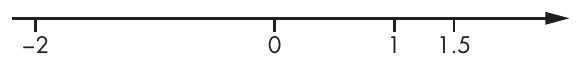

Hình 14-1: Một cách nhìn các số thực như các điểm trên một đường thẳng vô hạn

Trong Hình 14-2, x-axis tương ứng với a trong a + bi, y-axis tương ứng với b, và các đường chấm tương ứng với phần thực và phần ảo của mỗi số. Ví dụ, đường chấm thẳng đứng đi từ điểm 3 + 2i xuống 3 dài hai đơn vị (số 2 trong phần ảo 2i).

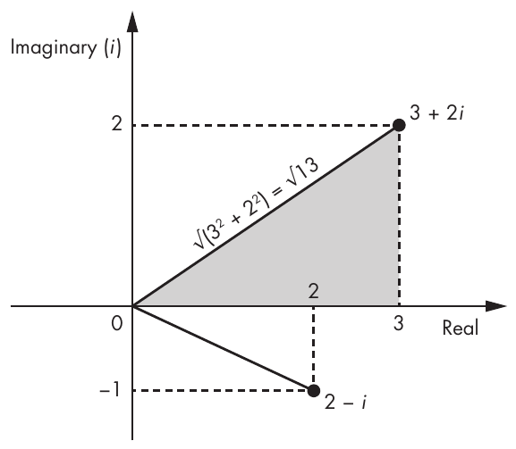

Hình 14-2: Một cách nhìn các số phức như các điểm trong một không gian two-dimensional

Bạn có thể dùng định lý Pythagoras để tính độ dài của đoạn thẳng đi từ gốc tọa độ (0) tới điểm a + bi bằng cách xem đoạn thẳng này là cạnh huyền của một tam giác. Độ dài của cạnh huyền bằng căn bậc hai của tổng bình phương các tọa độ của điểm, hay √(a2 + b2), được gọi là modulus của số phức a + bi. Bạn ký hiệu modulus là |a + bi| và có thể dùng nó làm độ dài của một số phức.

Trong một quantum computer, các register gồm một hoặc nhiều qubit ở trạng thái superposition, có thể được đặc trưng bằng một tập các số phức như vậy, hay các amplitude. Nhưng như bạn sẽ thấy, các amplitude này không thể là những con số bất kỳ.

#### Amplitude của một qubit đơn (Amplitudes of a Single Qubit)

Bạn có thể đặc trưng một qubit đơn bằng hai amplitude mà chúng ta sẽ ký hiệu là α (alpha) và β (beta). Khi đó, bạn có thể biểu diễn trạng thái của một qubit là α|0⟩ + ® |1⟩ *(ghi chú: sách in “®”; đúng là “β”)*, trong đó ký hiệu | ⟩ biểu thị các vector trong một trạng thái lượng tử. Ký hiệu này nghĩa là khi bạn quan sát qubit này, nó xuất hiện là 0 với xác suất |α|2 và là 1 với xác suất |β|2. Để đây là các xác suất thực sự, |α|2 và |β|2 phải là các số nằm giữa 0 và 1, và |α|2 + |β|2 phải bằng 1.

Ví dụ, giả sử bạn có qubit Ψ (psi) với các amplitude α = 1/√2 và β = 1/√2. Bạn biểu diễn nó như sau:

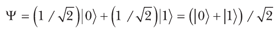

Trong qubit Ψ, giá trị 0 có amplitude 1/√2, và giá trị 1 có cùng amplitude, 1/√2. Để có xác suất thực từ các amplitude, hãy tính modulus của 1/√2 (bằng 1/√2 vì nó không có phần ảo) rồi bình phương nó: (1/√2)2 = 1/2. Điều này nghĩa là nếu bạn quan sát qubit Ψ, bạn sẽ có xác suất 1/2 thấy một số 0 và cùng xác suất đó thấy một số 1.

Giờ hãy xét qubit Φ (phi), trong đó:

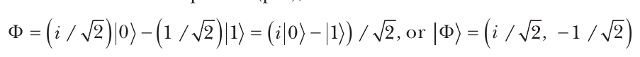

Qubit Φ khác biệt căn bản với Ψ vì không giống Ψ, nơi các amplitude có giá trị bằng nhau, qubit Φ có các amplitude khác nhau α = i/√2 (một số ảo dương) và β = –1/√2 (một số thực âm). Tuy nhiên, nếu bạn quan sát Φ, xác suất thấy 0 hoặc 1 là 1/2, giống như với Ψ. Hãy tính xác suất thấy 0 như sau, dựa trên các quy tắc ở trên:

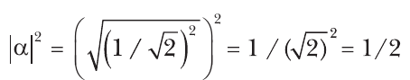

Lưu ý rằng vì α = i/√2, bạn có thể viết α là a + bi với a = 0 và b = 1/√2, và tính |α| = √(a2 + b2) cho ra 1/√2.

Các qubit khác nhau có thể hành xử giống nhau đối với người quan sát (với cùng xác suất thấy 0 cho cả hai qubit) nhưng có các amplitude khác nhau. Điều này cho thấy xác suất thực của việc thấy 0 hoặc 1 chỉ đặc trưng một qubit một phần; điều này tương tự như quan sát cái bóng của một vật trên tường, cho bạn ý niệm về chiều rộng và chiều cao của vật nhưng không cho biết chiều sâu của nó. Trong trường hợp qubit, chiều ẩn này là giá trị amplitude của nó: Nó dương hay âm? Nó là số thực hay số ảo?

> **LƯU Ý** Để đơn giản hóa ký hiệu, chúng ta thường viết một qubit dưới dạng cặp amplitude (α, β) của nó. Do đó, chúng ta có thể viết ví dụ trước là |Ψ⟩ = (1/√2, 1/√2).

#### Amplitude của các nhóm qubit (Amplitudes of Groups of Qubits)

Chúng ta hiểu nhiều qubit như thế nào? Ví dụ, tám qubit có thể tạo thành một quantum byte khi các trạng thái lượng tử của tám qubit này được kết nối thông qua entanglement. Bạn có thể mô tả một quantum byte như vậy như sau, trong đó các α là các amplitude gắn với mỗi giá trị trong 256 giá trị khả dĩ của nhóm tám qubit:

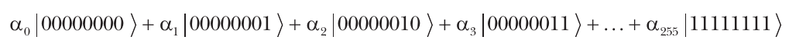

Lưu ý rằng bạn phải có |α0|2 + |〈α1|2 + . . . + |α255|2 = 1 để mọi xác suất cộng lại bằng 1.

Bạn có thể xem nhóm tám qubit này như một tập 28 = 256 amplitude vì nó có 256 cấu hình khả dĩ, mỗi cấu hình có amplitude riêng. Tuy nhiên, trong thực tế vật lý, bạn sẽ có tám vật thể vật lý, không phải 256. 256 amplitude là một đặc trưng ngầm của nhóm tám qubit; mỗi số trong 256 số này có thể nhận bất kỳ giá trị nào trong vô số giá trị khác nhau. Tổng quát hóa, bạn có thể đặc trưng một nhóm n qubit bằng một tập 2n số phức, một con số tăng theo hàm mũ với số qubit.

Nếu bạn muốn mô phỏng sự tiến hóa của một trạng thái lượng tử bằng một máy tính cổ điển, bạn cần lưu trữ số lượng amplitude theo hàm mũ này và thực hiện các phép tính để sửa đổi chúng. Yêu cầu này là một trong những lý do chính khiến máy tính cổ điển không thể mô phỏng hiệu quả một quantum computer: làm vậy đòi hỏi một lượng bộ nhớ khổng lồ (cỡ 2n) để lưu cùng lượng thông tin chứa trong chỉ n qubit khi dùng một hệ lượng tử. Trong thực tế, bạn có thể mô phỏng tối đa 50 hoặc 60 qubit, tùy theo loại phép tính.

### Quantum gate (Quantum Gates)

Các khái niệm amplitude và quantum gate là riêng có của quantum computing. Về cơ bản, một quantum gate là một phép biến đổi một hoặc nhiều qubit, và nó là đối tác của các cổng điện tử trong lĩnh vực quantum computing. Trong khi một máy tính cổ điển dùng register, bộ nhớ và bộ vi xử lý để thực hiện một chuỗi lệnh trên dữ liệu, một quantum computer biến đổi một nhóm qubit một cách khả nghịch bằng cách áp dụng một chuỗi quantum gate rồi đo giá trị của một hoặc nhiều qubit. Quantum computer hứa hẹn sức mạnh tính toán lớn hơn vì chỉ với n qubit chúng có thể tác động lên giá trị của 2n amplitude. Tính chất này có những hệ quả sâu sắc.

Từ góc độ toán học, quantum algorithm về cơ bản là một mạch các quantum gate biến đổi một tập số phức (các amplitude) trước một phép đo cuối cùng, nơi giá trị của 1 hoặc nhiều qubit được quan sát (xem Hình 14-3).

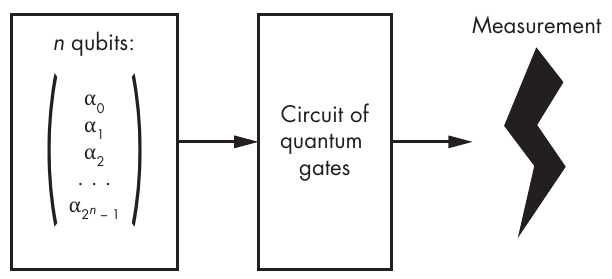

Hình 14-3: Nguyên lý của một quantum algorithm

Chúng ta cũng gọi quantum algorithm là quantum gate array hay quantum circuit.

#### Quantum gate như phép nhân ma trận (Quantum Gates as Matrix Multiplications)

Khác với các Boolean gate của máy tính cổ điển (AND, XOR, v.v.), một quantum gate tác động lên một nhóm amplitude giống như cách một ma trận tác động khi được nhân với một vector. Ví dụ, để áp dụng quantum gate đơn giản nhất, identity gate, lên qubit Φ, chúng ta xem I là một ma trận đơn vị 2×2 và nhân nó với vector cột gồm hai amplitude của Φ:

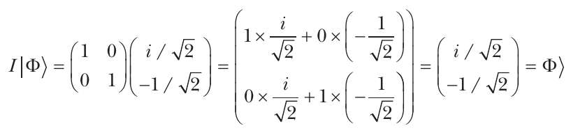

Kết quả của phép nhân ma trận–vector này là một vector cột khác có hai phần tử, trong đó giá trị trên cùng bằng tích vô hướng của dòng đầu tiên của ma trận I với vector đầu vào (kết quả của việc cộng tích của các phần tử thứ nhất 1 và i/√2 với tích của các phần tử thứ hai 0 và –1/√2) và tương tự cho giá trị dưới cùng.

Identity gate I khá vô dụng vì nó không làm gì cả và giữ nguyên qubit.

> **LƯU Ý** Trong thực tế, một quantum computer sẽ không tính tường minh các phép nhân ma trận–vector vì các ma trận sẽ quá lớn. (Đó là lý do một máy tính cổ điển không thể mô phỏng quantum computing.) Thay vào đó, một quantum computer sẽ biến đổi các qubit như các hạt vật lý thông qua các phép biến đổi vật lý tương đương với một phép nhân ma trận. Bối rối ư? Đây là điều Richard Feynman đã nói: “Nếu bạn không hoàn toàn bối rối bởi cơ học lượng tử, bạn không hiểu nó.”

#### Hadamard quantum gate (The Hadamard Quantum Gate)

Một trong những quantum gate hữu ích nhất là Hadamard gate, thường được ký hiệu là H. Bạn có thể định nghĩa Hadamard gate như sau (lưu ý giá trị âm ở vị trí bottom-right):

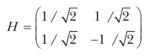

Áp dụng gate này lên qubit |Ψ⟩ = (1/√2, 1/√2) cho kết quả như sau:

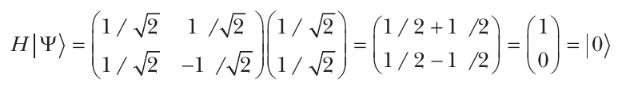

Bằng cách áp dụng Hadamard gate H lên |Ψ⟩, bạn có được qubit |0⟩ mà trong đó giá trị |0⟩ có amplitude 1, và |1⟩ có amplitude 0. Điều này cho bạn biết rằng qubit hành xử một cách tất định: nếu bạn quan sát qubit này, bạn sẽ luôn thấy 0 và không bao giờ thấy 1. Nói cách khác, bạn đã mất tính ngẫu nhiên của qubit ban đầu |Ψ⟩.

Áp dụng Hadamard gate một lần nữa lên qubit |0⟩ cho kết quả như sau:

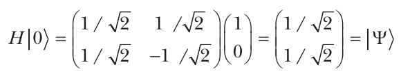

Điều này đưa bạn trở lại qubit |Ψ⟩ và một trạng thái ngẫu nhiên. Chúng ta thường dùng Hadamard gate trong các quantum algorithm để chuyển từ một trạng thái tất định sang một trạng thái ngẫu nhiên đều.

#### Không phải ma trận nào cũng là quantum gate (Not All Matrices Are Quantum Gates)

Dù bạn có thể xem việc áp dụng quantum gate như các phép nhân ma trận, không phải ma trận nào cũng tương ứng với quantum gate. Hãy nhớ rằng một qubit gồm các số phức α và β, các amplitude của qubit, thỏa mãn điều kiện |α|2 + |β|2 = 1. Nếu bạn có hai amplitude không thỏa mãn điều kiện này sau khi nhân một qubit với một ma trận, kết quả không thể là một qubit. Quantum gate chỉ tương ứng với các ma trận unitary, thứ bảo toàn tính chất |α|2 + |β|2 = 1.

Các ma trận unitary (và theo định nghĩa là các quantum gate) đều khả nghịch, nghĩa là khi có kết quả của một phép toán, bạn có thể tính ngược lại qubit ban đầu bằng cách áp dụng ma trận nghịch đảo. Đây là lý do quantum computing là một loại reversible computing (tính toán khả nghịch).

## Quantum speedup (Quantum Speedup)

Một quantum speedup xảy ra khi một quantum computer có thể giải một bài toán nhanh hơn một cách căn bản so với một máy tính cổ điển. Ví dụ, để tìm một phần tử trong số n phần tử của một danh sách không có thứ tự trên một máy tính cổ điển, bạn cần trung bình n/2 phép toán vì bạn cần xem từng phần tử trong danh sách trước khi tìm thấy phần tử bạn đang tìm. (Trung bình, bạn sẽ tìm thấy phần tử đó sau khi tìm qua một nửa danh sách.) Không algorithm cổ điển nào có thể làm tốt hơn n/2. Tuy nhiên, tồn tại một quantum algorithm tìm một phần tử chỉ trong O(√n) phép toán, nhỏ hơn n/2 nhiều bậc. Ví dụ, nếu n bằng 1,000,000, thì n/2 là 500,000, trong khi √n là 1,000.

Chúng ta định lượng sự khác biệt giữa quantum algorithm và algorithm cổ điển theo độ phức tạp thời gian (time complexity), được biểu diễn bằng ký hiệu O(). Trong ví dụ trước, quantum algorithm chạy trong thời gian O(√n), nhưng algorithm cổ điển không thể nhanh hơn O(n). Vì sự khác biệt về time complexity này là do số mũ bình phương, chúng ta gọi đây là quadratic speedup. Dù một speedup như vậy có thể tạo ra khác biệt, còn có những speedup mạnh hơn nhiều.

### Exponential speedup và Simon’s problem (Exponential Speedup and Simon’s Problem)

Exponential speedup là chén thánh của quantum computing. Chúng xảy ra khi một tác vụ tốn lượng thời gian theo hàm mũ trên máy tính cổ điển, như O(2n), có thể được thực hiện trên một quantum computer với độ phức tạp đa thức—cụ thể là O(nk) với một số cố định k nào đó. Exponential speedup này có thể biến một tác vụ thực tế bất khả thi thành một tác vụ khả thi. (Hãy nhớ lại từ Chương 9 rằng các cryptographer và các nhà lý thuyết độ phức tạp gắn thời gian hàm mũ với điều bất khả thi và thời gian đa thức với điều khả thi trong thực tế.)

Ví dụ điển hình của exponential speedup là Simon’s problem. Trong bài toán tính toán này, một function, f(), biến đổi các chuỗi n-bit thành các chuỗi n-bit, sao cho đầu ra của f() trông như một chuỗi n-bit ngẫu nhiên, nhưng với một ràng buộc: có một giá trị bí mật, m, sao cho với hai giá trị bất kỳ x, y, ta có f(x) = f(y) khi và chỉ khi y = x ⊕ m. Simon’s problem là tìm m khi có quyền truy cập black-box tới f().

Giải Simon’s problem bằng một algorithm cổ điển rốt cuộc là tìm một collision, hay các giá trị x và y sao cho f(x) = f(y). Việc này tốn xấp xỉ 2n/2 truy vấn tới f(). Tuy nhiên, Hình 14-4 cho thấy một quantum algorithm có thể giải Simon’s problem chỉ trong xấp xỉ n truy vấn, với time complexity cực kỳ hiệu quả là O(n).

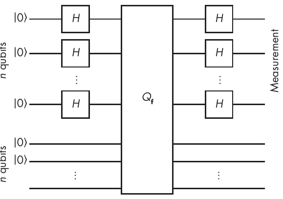

Hình 14-4: Mạch của quantum algorithm giải hiệu quả Simon’s problem

Trong quantum circuit giải Simon’s problem, bạn khởi tạo 2n qubit thành |0⟩, áp dụng các Hadamard gate (H) lên n qubit đầu tiên, rồi áp dụng gate Q f lên hai nhóm, mỗi nhóm gồm n qubit. Cho hai nhóm n-qubit x và y, gate Qf biến đổi trạng thái lượng tử |x⟩|y⟩ thành trạng thái |x⟩|f(x) ⊕ y⟩. Tức là, nó tính function f() trên trạng thái lượng tử một cách khả nghịch vì bạn có thể đi từ trạng thái mới về trạng thái cũ bằng cách tính f(x) và XOR nó với f(x) ⊕ y. (Giải thích vì sao điều này hoạt động nằm ngoài phạm vi của cuốn sách này.)

Bạn chỉ có thể dùng exponential speedup cho Simon’s problem để chống lại các symmetric cipher trong những trường hợp rất cụ thể, nhưng mục tiếp theo sẽ thảo luận một số ứng dụng crypto-killer thực sự của quantum computing.

### Mối đe dọa của Shor’s algorithm (The Threat of Shor’s Algorithm)

Năm 1995, nhà nghiên cứu Peter Shor của AT&T đã công bố một bài báo eye-opening (mở mang tầm mắt) có tựa đề “Polynomial-Time Algorithms for Prime Factorization and Discrete Logarithms on a Quantum Computer.” Shor’s algorithm là một quantum algorithm tạo ra exponential speedup khi giải các bài toán factoring, discrete logarithm (DLP) và elliptic curve discrete logarithm (ECDLP). Bạn không thể giải hiệu quả các bài toán này bằng một máy tính cổ điển, nhưng bạn có thể với một quantum computer. Điều này nghĩa là một quantum computer có thể giải bất kỳ cryptographic algorithm nào dựa vào các bài toán đó, bao gồm RSA, Diffie–Hellman, elliptic curve cryptography, và hầu hết các cơ chế public-key cryptography đang được triển khai hiện nay (ngoại trừ những cơ chế đã chuyển sang post-quantum cryptography). Nói cách khác, bạn có thể hạ security của RSA hay elliptic curve cryptography xuống ngang Caesar’s cipher. (Shor hoàn toàn có thể đặt tựa bài báo của mình là “Breaking All Public-Key Crypto on a Quantum Computer.”) Nhà lý thuyết độ phức tạp nổi tiếng Scott Aaronson gọi Shor’s algorithm là “một trong những thành tựu khoa học lớn của cuối thế kỷ 20th.”

Shor’s algorithm thực ra giải một lớp bài toán tổng quát hơn factoring và discrete logarithm. Cụ thể, nếu một function f() có tính tuần hoàn—tức là, nếu có một ω (chu kỳ) sao cho f(x + ω) = f(x) với mọi x—thì Shor’s algorithm sẽ tìm ra ω một cách hiệu quả. (Điều này trông rất giống Simon’s problem, vì nó là nguồn cảm hứng lớn cho Shor’s algorithm.)

Thảo luận chi tiết cách Shor’s algorithm đạt được speedup của nó là quá kỹ thuật đối với cuốn sách này, nhưng mục tiếp theo cho thấy cách dùng Shor’s algorithm để giải các bài toán factoring và discrete logarithm (xem Chương 9), những bài toán khó đằng sau RSA và Diffie–Hellman.

#### Bài toán factoring (The Factoring Problem)

Giả sử bạn muốn phân tích thừa số một số lớn, N = pq. Phân tích N rất dễ nếu bạn có thể tính chu kỳ của ax mod N, với một hằng số a nào đó. Tác vụ này khó thực hiện với một máy tính cổ điển nhưng dễ với một quantum computer. Đầu tiên, chọn một số ngẫu nhiên a nhỏ hơn N, và yêu cầu Shor’s algorithm tìm chu kỳ ω của function f(x) = ax mod N. Một khi bạn đã tìm được chu kỳ, bạn sẽ có ax mod N = ax + ω mod N (tức là ax mod N = axaω mod N), nghĩa là aω mod N = 1, hay tương đương aω – 1 mod N = 0. Nói cách khác, aω – 1 là một bội của N, nghĩa là aω – 1 = kN với một số chưa biết k nào đó.

Khi ω chẵn, dễ dàng phân tích aω – 1 thành (aω/2 – 1)(aω/2 + 1), trong đó giá trị aω/2 là một căn của đơn vị (root of unity), vì (aω/2)2 mod N = 1. Khi chu kỳ ω lẻ, hãy chạy lại Shor với một giá trị a khác cho đến khi bạn có được một số chẵn.

Vì các thừa số của aω – 1 chứa các thừa số nguyên tố của k và N, bạn có thể tìm thấy các thừa số này phân bố giữa các thừa số của aω/2 – 1 và aω/2 + 1. Sau đó, bạn có thể tính ước chung lớn nhất (GCD) giữa aω/2 – 1 và N, và giữa aω/2 + 1 và N, để có được một thừa số nontrivial (không tầm thường) của N—tức là một giá trị khác 1 hoặc N. Nếu không được như vậy—ví dụ, khi aω/2 – 1 hoặc aω/2 + 1 là một bội của N—hãy khởi động lại attack với một a khác.

Khi đã có được các thừa số của N, giờ bạn đã khôi phục được RSA private key từ public key của nó, cho phép bạn giải mã các message đã mã hóa hoặc làm giả chữ ký.

Lưu ý rằng algorithm cổ điển tốt nhất để phân tích thừa số một số N chạy trong thời gian hàm mũ theo n, độ dài bit của N (tức là n = log2 N). Tuy nhiên, Shor’s algorithm chạy trong thời gian đa thức theo n—cụ thể là O(n2(log n)(log log n)). Điều này nghĩa là nếu bạn có một quantum computer, bạn có thể chạy Shor’s algorithm và thấy kết quả trong một khoảng thời gian hợp lý hơn nhiều so với hàng nghìn năm.

#### Discrete logarithm problem (The Discrete Logarithm Problem)

Thách thức trong discrete logarithm problem là tìm x, khi cho y = gx mod p, với các số đã biết g và p nào đó. Giải bài toán này tốn một lượng thời gian (dưới) hàm mũ trên máy tính cổ điển, nhưng bạn có thể tìm x dễ dàng bằng Shor’s algorithm nhờ kỹ thuật period-finding hiệu quả của nó.

Ví dụ, hãy xét function f(a, b) = gayb. Giả sử bạn muốn tìm chu kỳ của function này, các số ω và ω′, sao cho f(a + ω, b + ω′) = f(a, b) với mọi a và b. Khi đó, lời giải bạn tìm là x = – ω/ω′ modulo q, order của g, là một tham số đã biết. Đẳng thức f(a + ω, b + ω′) = f(a, b) kéo theo gωyω′ mod p = 1. Bằng cách thay y bằng gx, bạn có gω + xω′ mod p = 1, tương đương với ω + xω′ mod q = 0, từ đó bạn suy ra x = – ω/ω′.

Một lần nữa, độ phức tạp tổng thể là O(n2(log n)(log log n)), với n là độ dài bit của p. Algorithm này tổng quát hóa được để tìm discrete logarithm trong bất kỳ finite commutative group nào, không chỉ group các số modulo một số nguyên tố. Do đó, bạn cũng có thể áp dụng nó để giải ECDLP, phiên bản elliptic curve của discrete logarithm problem.

### Grover’s algorithm (Grover’s Algorithm)

Một dạng quantum speedup quan trọng khác là khả năng tìm kiếm trong số n phần tử với thời gian tỉ lệ với căn bậc hai của n, trong khi bất kỳ algorithm cổ điển nào cũng tốn thời gian tỉ lệ với n. Quadratic speedup này khả thi nhờ Grover’s algorithm, một quantum algorithm được khám phá năm 1996. Tôi sẽ không trình bày nội tại của Grover’s algorithm vì về cơ bản chúng là một loạt Hadamard gate, nhưng tôi sẽ giải thích Grover giải loại bài toán nào và tác động tiềm tàng của nó lên security của cryptography. Tôi cũng sẽ cho thấy vì sao bạn có thể cứu một symmetric crypto algorithm khỏi quantum computer bằng cách tăng gấp đôi kích thước key hoặc hash value, trong khi các asymmetric algorithm bị phá hủy hoàn toàn.

Hãy nghĩ về Grover’s algorithm như một cách tìm giá trị x trong số n giá trị khả dĩ, sao cho f(x) = 1, và f(x) = 0 với hầu hết các giá trị khác. Nếu m giá trị của x thỏa mãn f(x) = 1, Grover sẽ tìm ra một lời giải trong thời gian O(√(n/m)); tức là trong thời gian tỉ lệ với căn bậc hai của n chia cho m. So sánh lại, một algorithm cổ điển không thể làm tốt hơn O(n/m).

Giờ hãy xét thực tế rằng f() có thể là bất kỳ function nào. Ví dụ, nó có thể là “f(x) = 1 khi và chỉ khi x bằng secret key chưa biết K sao cho E(K, P) = C” với một plaintext P và ciphertext C đã biết nào đó, và trong đó E() là một encryption function nào đó. Trong thực tế, điều này nghĩa là nếu bạn đang tìm một AES key 128-bit bằng một quantum computer, bạn sẽ tìm ra key trong thời gian tỉ lệ với 264, thay vì 2128 nếu bạn chỉ có máy tính cổ điển. Bạn sẽ cần một plaintext đủ lớn để bảo đảm tính duy nhất của key. (Nếu plaintext và ciphertext dài, chẳng hạn, 32 bit, nhiều key ứng viên sẽ ánh xạ plaintext đó thành ciphertext đó.) Độ phức tạp 264 nhỏ hơn 2128 nhiều, nghĩa là một secret key sẽ dễ khôi phục hơn nhiều. Nhưng có một giải pháp dễ dàng: để khôi phục security 128-bit, chỉ cần dùng key 256-bit! Khi đó, Grover’s algorithm sẽ giảm độ phức tạp của việc tìm key xuống 2256 / 2 = 2128 phép toán.

Grover’s algorithm cũng có thể tìm preimage của hash function (xem Chương 6). Để tìm một preimage của một giá trị h nào đó, chúng ta định nghĩa function f() là “f(x) = 1 khi và chỉ khi Hash(x) = h, ngược lại f(x) = 0.” Do đó, Grover cho bạn preimage của các hash n-bit với chi phí cỡ 2n/2 phép toán. Như với encryption, để bảo đảm security post-quantum 2n, hãy dùng hash value lớn gấp đôi, vì Grover’s algorithm tìm preimage của một giá trị 2n-bit trong ít nhất 2n phép toán.

Điểm mấu chốt là bạn có thể cứu các symmetric crypto algorithm khỏi quantum computer bằng cách tăng gấp đôi kích thước key hoặc hash value.

> **LƯU Ý** Có một quantum algorithm nổi tiếng tìm collision của hash function trong thời gian O(2n/3), thay vì O(2n/2) như với birthday attack cổ điển. Điều này gợi ý rằng quantum computer có thể vượt trội máy tính cổ điển trong việc tìm collision của hash function, ngoại trừ việc quantum algorithm O(2n/3)-time cũng cần O(2n/3) không gian, hay bộ nhớ, để chạy. Hãy cho một algorithm cổ điển lượng không gian máy tính tương đương O(2n/3), và nó có thể chạy một algorithm tìm collision song song với thời gian tìm collision chỉ O(2n/6), nhanh hơn nhiều so với quantum algorithm O(2n/3). (Để biết chi tiết về attack này, hãy xem “Cost Analysis of Hash Collisions” của Daniel J. Bernstein tại https://cr.yp.to/papers.html#collisioncost.) Tuy nhiên, năm 2017, các cryptographer đã đề xuất một quantum algorithm tìm collision trong thời gian O(22n/5), cần O(n) bộ nhớ lượng tử và O(2n/5) bộ nhớ cổ điển. Algorithm này có thể vượt trội việc tìm kiếm cổ điển (xem https://eprint.iacr.org/2017/847).

## Vì sao xây dựng quantum computer lại khó đến vậy? (Why Is It So Hard to Build a Quantum Computer?)

Dù về nguyên tắc quantum computer có thể được xây dựng, chúng ta không biết việc đó sẽ khó đến mức nào hay khi nào nó có thể xảy ra, nếu có. Tính đến mid-2024, kỷ lục thuộc về một cỗ máy có 1,121 qubit (“Condor” của IBM), trong khi chúng ta cần giữ hàng triệu qubit ổn định trong nhiều tuần để phá bất kỳ crypto nào. Vấn đề là chúng ta chưa đến được đó.

Độ khó của việc xây dựng một quantum computer bắt nguồn từ việc cần những thứ cực kỳ nhỏ đóng vai trò qubit—nhỏ hơn nguyên tử, như photon. Vì qubit phải nhỏ như vậy, chúng cũng cực kỳ mỏng manh.

Ngoài ra, qubit phải được giữ ở nhiệt độ cực thấp (gần độ không tuyệt đối) để duy trì ổn định. Ngay cả ở nhiệt độ đóng băng, trạng thái của qubit vẫn suy giảm, và cuối cùng chúng trở nên vô dụng. Vào thời điểm viết sách này, chúng ta vẫn chưa biết cách tạo ra các qubit tồn tại lâu hơn vài giây (coherence time của chúng).

Một thách thức khác là môi trường, như nhiệt và từ trường, có thể ảnh hưởng đến trạng thái của qubit và dẫn đến lỗi tính toán. Về lý thuyết, có thể sửa các lỗi này, nhưng làm vậy rất khó. Sửa lỗi qubit đòi hỏi các quantum error-correcting code, mà đến lượt chúng lại đòi hỏi nhiều qubit bổ sung và tỉ lệ lỗi đủ thấp.

Hiện tại, có hai cách tiếp cận chính để tạo qubit: mạch siêu dẫn (superconducting circuit) và bẫy ion (ion trap). Các phòng thí nghiệm tại Google và IBM ủng hộ việc dùng superconducting circuit, dựa trên việc tạo qubit dưới dạng các mạch điện tí hon dựa vào các hiện tượng lượng tử từ vật liệu siêu dẫn, nơi các hạt tải điện là các cặp electron. Qubit làm từ superconducting circuit có thời gian sống rất ngắn.

Ion trap, hay trapped ion, gồm các ion (nguyên tử mang điện) và được điều khiển bằng laser để chuẩn bị các qubit ở những trạng thái ban đầu cụ thể. Ion trap có xu hướng ổn định hơn superconducting circuit, nhưng chúng vận hành chậm hơn và có vẻ khó mở rộng quy mô hơn.

Xây dựng một quantum computer thực sự là một nỗ lực kiểu moon shot. Thách thức quy về 1) xây dựng một hệ thống với một số ít qubit ổn định, chịu lỗi (fault tolerant), và có khả năng áp dụng các quantum gate cơ bản, và 2) mở rộng một hệ thống như vậy lên hàng nghìn hoặc hàng triệu qubit để làm cho nó hữu ích. Từ góc độ thuần vật lý và theo hiểu biết tốt nhất của chúng ta, không có gì ngăn cản việc tạo ra các quantum computer fault-tolerant lớn. Nhưng nhiều thứ khả thi về lý thuyết lại tỏ ra khó hoặc quá tốn kém để hiện thực trong thực tế (như máy tính an toàn). Tương lai sẽ cho biết ai đúng—những người lạc quan về lượng tử (dự đoán sẽ có một quantum computer lớn trong thập kỷ này) hay những người hoài nghi về lượng tử (cho rằng loài người sẽ không bao giờ thấy một quantum computer).

Như đã đề cập trước đó, tính đến tháng Một năm 2024, một trong những thành tựu tiên tiến nhất là chip quantum computing Condor của IBM bao gồm 1,121 qubit, một công nghệ dựa trên superconducting circuit. Nhưng số qubit không nên là thước đo duy nhất khi so sánh các hệ thống quantum computing. Các yếu tố quan trọng khác bao gồm thời gian ổn định, số qubit được vướng víu với nhau, và khả năng sửa lỗi một cách tin cậy.

## Các algorithm cryptography Post-Quantum

Lĩnh vực post-quantum cryptography tập trung vào thiết kế các public-key algorithm mà một quantum computer không thể phá; tức là chúng quantum safe và có thể thay thế RSA và các algorithm dựa trên elliptic curve–based trong một tương lai mà các quantum computer off-the-shelf có thể phá các RSA modulus 4,096-bit trong nháy mắt.

Những algorithm như vậy không nên dựa vào một bài toán khó đã biết là có thể giải hiệu quả bằng Shor’s algorithm, thứ triệt tiêu độ khó trong các bài toán factoring và discrete logarithm. Các symmetric algorithm như block cipher và hash function sẽ chỉ mất một nửa security lý thuyết của chúng trước một quantum computer nhưng sẽ không bị phá nặng nề như RSA. Chúng có thể tạo thành nền tảng cho một post-quantum scheme.

Trong các mục sau, chúng ta sẽ điểm qua bốn loại algorithm post-quantum chính: dựa trên code (code based), dựa trên lattice (lattice based), multivariate và dựa trên hash (hash based).

### Cryptography Code-Based

Code-based cryptographic algorithm post-quantum dựa trên các error-correcting code, là những kỹ thuật được thiết kế để truyền bit qua một kênh nhiễu. Lý thuyết cơ bản về error-correcting code có từ những năm 1950s. Encryption scheme code-based đầu tiên (McEliece cryptosystem) được phát triển năm 1978 và đến nay vẫn chưa bị phá. Bạn có thể dùng các crypto scheme code-based cho cả encryption lẫn signature. Hạn chế chính của chúng là kích thước public key, thường vào cỡ một trăm kilobyte. Nhưng đó có thực sự là vấn đề khi kích thước trung bình của một trang web vào khoảng 2MB?

Trước hết, hãy để tôi giải thích error-correcting code là gì. Giả sử bạn muốn truyền một chuỗi bit dưới dạng một chuỗi các từ 3-bit, nhưng việc truyền không tin cậy và bạn lo rằng một hoặc nhiều bit bị truyền sai: bạn gửi 010, nhưng bên nhận nhận được 011. Người ta có thể giải quyết điều này bằng cách dùng một repetition code error-correction cơ bản: thay vì truyền 010, bạn truyền 000111000 (lặp mỗi bit ba lần), và bên nhận giải mã từ nhận được bằng cách lấy giá trị chiếm đa số cho mỗi nhóm 3 bit.

Ví dụ, bên nhận sẽ giải mã codeword lặp 100110111 thành 011 vì 100 chứa hai số 0, rồi 110 chứa hai số 1, và 111 chứa ba số 1. Với error-correcting code cụ thể này, bên nhận chỉ sửa được tối đa một lỗi trên mỗi khối 3-bit, vì nếu hai lỗi xảy ra trong cùng một khối 3-bit, giá trị chiếm đa số sẽ sai.

Linear code là một ví dụ ít tầm thường hơn về error-correcting code. Trong trường hợp linear code, một từ cần encode được xem là một vector n-bit v, và việc encode gồm nhân v với một ma trận m×n G để tính code word w = vG. (Trong ví dụ này, m lớn hơn n, nghĩa là code word dài hơn từ ban đầu.) Người ta có thể cấu trúc ma trận G sao cho với một số t cho trước, bất kỳ lỗi t-bit nào trong w đều cho phép bên nhận khôi phục v đúng. Nói cách khác, t là số lỗi tối đa mà người ta có thể sửa.

Để mã hóa dữ liệu bằng linear code, McEliece cryptosystem xây dựng G như một tổ hợp bí mật của ba ma trận và mã hóa bằng cách tính w = vG cộng với một giá trị ngẫu nhiên, e, có một số bit cố định được đặt bằng 1. Ở đây, G là public key, còn private key gồm các ma trận A, B và C sao cho G = ABC. Biết A, B và C cho phép người ta giải mã một message một cách tin cậy và lấy lại w. Nhưng không có các ma trận này, việc giải mã từ đó và do đó việc decrypt hẳn là bất khả thi.

Security của McEliece encryption scheme dựa vào độ khó của việc giải mã một linear code với thông tin không đầy đủ, một bài toán mà chúng ta biết là NP-hard và do đó nằm ngoài tầm với của quantum computer. Tuy nhiên, hãy nhớ rằng chỉ vì một bài toán là NP-hard không có nghĩa là mọi instance của nó sẽ bất khả thi để giải trong thực tế. Do đó, cần đánh giá xem những instance nào của bài toán khó được một cryptosystem đưa ra và liệu các instance này có luôn khó hay không. Cipher của McEliece thỏa mãn tiêu chí này sau nhiều năm phân tích của các cryptographer và các chuyên gia lý thuyết mã hóa.

### Cryptography Lattice-Based

Lattice là các cấu trúc toán học về cơ bản gồm một tập điểm trong một không gian n-dimensional, với một cấu trúc tuần hoàn nào đó. Ví dụ, Hình 14-5 cho thấy cách bạn có thể xem một lattice trong không gian hai chiều (n = 2) như một tập điểm.

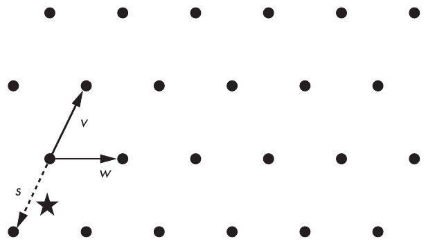

Hình 14-5: Các điểm của một lattice two-dimensional, trong đó v và w là các basis vector của lattice và s là vector gần nhất với điểm star-shaped

Lý thuyết lattice đã dẫn đến những cryptography scheme đơn giản đến đáng ngạc nhiên. Tôi sẽ cho bạn ý chính của nó.

Short integer solution (SIS) là một bài toán khó trong crypto lattice-based, là tìm vector bí mật s gồm n số khi cho (A, b) sao cho b = As mod q, trong đó A là một ma trận m×n ngẫu nhiên và q là một số nguyên tố.

Một bài toán khó khác trong cryptography lattice-based, learning with errors (LWE), là tìm vector bí mật s gồm n số khi cho (A, b), trong đó b = As + e mod q, với A là một ma trận m×n ngẫu nhiên, e là một vector nhiễu ngẫu nhiên, và q là một số nguyên tố. Bài toán này trông rất giống việc giải mã có nhiễu trong cryptography code-based.

SIS và LWE tương đương nhau ở một mức độ nào đó, và chúng ta có thể phát biểu lại chúng như các instance của closest vector problem (CVP) trên một lattice, hay bài toán tìm vector trong một lattice gần nhất với một điểm cho trước, bằng cách kết hợp một tập basis vector. Vector đứt nét s trong Hình 14-5 cho thấy cách tìm vector gần nhất với điểm star-shaped bằng cách kết hợp các basis vector v và w.

CVP và các bài toán lattice khác được tin là khó cho cả máy tính cổ điển lẫn quantum computer. Nhưng điều này không trực tiếp chuyển thành các cryptosystem an toàn, vì một số bài toán chỉ khó trong trường hợp xấu nhất (tức là với instance khó nhất của chúng) chứ không phải trong trường hợp trung bình (thứ chúng ta cần cho crypto). Hơn nữa, trong khi tìm lời giải chính xác cho CVP là khó, việc tìm một xấp xỉ của lời giải có thể dễ hơn đáng kể.

Dù vậy, các post-quantum cryptosystem dựa trên lattice đã chứng tỏ mang lại sự kết hợp tốt nhất giữa security và hiệu năng. Các tiêu chuẩn được NIST chọn năm 2022 chủ yếu thuộc họ này, như bạn sẽ thấy ở phần sau.

### Multivariate cryptography (Multivariate Cryptography)

Multivariate cryptography tập trung vào xây dựng các cryptographic scheme khó phá ngang với việc giải các hệ phương trình nhiều biến, hay các phương trình liên quan đến nhiều ẩn số được nhân với nhau trong phương trình. Ví dụ, hãy xét hệ phương trình sau với bốn ẩn số x1, x2, x3, x4:

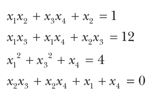

Các phương trình này gồm tổng của các số hạng hoặc là một ẩn số đơn lẻ, như x4 (hay các số hạng bậc một), hoặc là tích của hai ẩn số, như x2x3 (các số hạng bậc hai hay số hạng quadratic). Để giải hệ này, bạn cần tìm các giá trị x1, x2, x3, x4 thỏa mãn cả bốn phương trình. Các phương trình có thể trên toàn bộ số thực, chỉ trên số nguyên, hoặc trên các tập số hữu hạn. Tuy nhiên, trong cryptography, các phương trình thường trên các số modulo một số nguyên tố nào đó hoặc trên các giá trị nhị phân (0 và 1).

Bài toán khó ở đây là tìm một lời giải cho một hệ quadratic ngẫu nhiên, được biết đến là multivariate quadratics (MQ). Bài toán này là NP-hard và do đó là một nền tảng tiềm năng cho các hệ thống post-quantum vì quantum computer sẽ không giải hiệu quả các bài toán NP-hard.

Đáng tiếc, xây dựng một cryptosystem trên MQ không đơn giản như vậy. Ví dụ, nếu bạn dùng MQ cho chữ ký, private key có thể gồm ba hệ phương trình: L1, N và L2. Kết hợp chúng theo thứ tự này cho ra một hệ phương trình khác gọi là P, public key. Khi đó, áp dụng các phép biến đổi L1, N và L2 liên tiếp (tức là biến đổi một nhóm giá trị theo hệ phương trình) tương đương với áp dụng P bằng cách biến đổi x1, x2, x3, x4 thành y1, y2, y3, y4, ví dụ, được định nghĩa như sau:

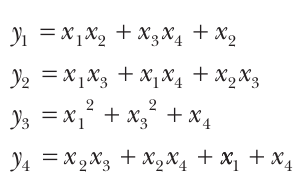

Trong một cryptosystem như vậy, L1, N và L2 được chọn sao cho L1 và L2 là các phép biến đổi tuyến tính (tức là có các phương trình mà các số hạng chỉ được cộng, không được nhân) khả nghịch, và N là một hệ phương trình quadratic cũng khả nghịch. Điều này làm cho tổ hợp của ba hệ là một hệ quadratic khả nghịch, nhưng nghịch đảo của nó khó xác định nếu không biết các nghịch đảo của L1, N và L2.

Khi đó, việc tính một chữ ký gồm tính các nghịch đảo của L1, N và L2 áp dụng lên một message M nào đó, mà chúng ta xem như một chuỗi biến, x1, x2, . . . :

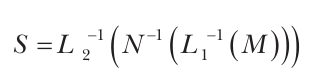

Khi đó, việc xác minh một chữ ký gồm xác minh rằng P(S) = M.

Kẻ tấn công có thể phá một cryptosystem như vậy nếu họ tính được nghịch đảo của P hoặc xác định được L1, N và L2 từ P. Độ khó thực tế của việc giải những bài toán như vậy phụ thuộc vào các tham số của scheme, như số phương trình được dùng và kích thước và loại của các số. Nhưng chọn các tham số an toàn là khó, và hơn một multivariate scheme “an toàn” đã bị phá.

Multivariate cryptography không được dùng trong các ứng dụng lớn do thách thức trong việc đạt được một trade-off tin cậy giữa security và hiệu năng. Tuy nhiên, một lợi ích thực tế của các multivariate signature scheme là chúng tạo ra chữ ký ngắn.

### Cryptography Hash-Based

Khác với các scheme trước, cryptography hash-based dựa trên security well-established của các cryptographic hash function chứ không dựa trên độ khó của các bài toán toán học. Vì quantum computer không thể phá hash function, chúng không thể phá bất cứ thứ gì dựa vào độ khó của việc tìm collision hoặc preimage, vốn là ý tưởng then chốt của các signature scheme dựa trên hash function–based.

Hash-based cryptographic scheme khá phức tạp, nên chúng ta sẽ xem khối xây dựng đơn giản nhất của chúng: Winternitz one-time signature (WOTS), một thủ thuật được khám phá vào khoảng năm 1979. Ở đây, one-time nghĩa là bạn chỉ có thể dùng một private key để ký một message duy nhất; nếu không, signature scheme trở nên không an toàn. (Bạn có thể kết hợp WOTS với các phương pháp khác để ký nhiều message, như bạn sẽ thấy ngay sau đây.)

Giả sử bạn muốn ký một message được xem là một số nằm giữa 0 và w – 1, trong đó w là một tham số nào đó của scheme. Private key là một chuỗi ngẫu nhiên, K. Để ký một message, M, với 0 ≤ M < w, hãy tính Hash(Hash(. . .(Hash(K))), trong đó hash function Hash lặp lại M lần. Bạn ký hiệu giá trị này là HashM(K). Public key là Hashw(K), hay kết quả của w lần lặp lồng nhau của Hash, bắt đầu từ K.

Một chữ ký WOTS, S, được xác minh bằng cách kiểm tra rằng Hashw – M(S) bằng public key Hashw(K). Lưu ý rằng S là K sau M lần áp dụng Hash, nên nếu bạn áp dụng Hash thêm w – M lần nữa, bạn sẽ được một giá trị bằng K được hash M + (w – M) = w lần, chính là public key.

Scheme này có những hạn chế đáng kể:

**Kẻ tấn công có thể làm giả chữ ký** Từ HashM(K), chữ ký của M, bạn có thể tính Hash(HashM(K)) = HashM + 1(K), là một chữ ký hợp lệ của message M + 1. Bạn có thể sửa vấn đề này bằng cách ký không chỉ M mà cả w – M, dùng một key thứ hai.

**Nó chỉ hoạt động với message ngắn** Nếu message dài 8 bit, có tới 28 – 1 = 255 message khả dĩ, nên bạn phải tính Hash tới 255 lần để tạo một chữ ký. Điều đó có thể được với message ngắn, nhưng không được với message dài hơn—ví dụ, với message 128-bit, việc ký message 2128 – 1 tốn thời gian vô tận. Một cách khắc phục là chia message dài thành các message ngắn hơn và ký từng khối một cách độc lập.

**Nó chỉ hoạt động một lần** Nếu bạn dùng một private key để ký nhiều hơn một message, kẻ tấn công có thể khôi phục đủ thông tin để làm giả một chữ ký. Ví dụ, nếu w = 8 và bạn ký các số 1 và 7 bằng thủ thuật ở trên để tránh các chữ ký giả tầm thường, kẻ tấn công có được Hash1(K) và Hash7(K′) làm chữ ký của 1, và Hash7(K) và Hash1(K′) làm chữ ký của 7. Từ các giá trị này, kẻ tấn công có thể tính Hashx(K) và Hashx(K′) với mọi x trong [1;7] và do đó làm giả một chữ ký thay mặt chủ sở hữu của K và K′. Không có cách đơn giản nào để sửa điều này.

Các scheme hash-based State-of-the-art dựa vào các phiên bản phức tạp hơn của WOTS, kết hợp với cấu trúc dữ liệu cây và các kỹ thuật tinh vi được thiết kế để ký các message khác nhau bằng các key khác nhau. Đáng tiếc, các scheme thu được tạo ra chữ ký lớn (cỡ hàng chục kilobyte, như với SPHINCS+, một trong các signature algorithm được NIST chọn để chuẩn hóa năm 2022).

Bạn cũng nên lưu ý sự khác biệt giữa signature scheme stateful và stateless. SPHINCS+ là stateless, trong khi XMSS là stateful, vì nó cần duy trì một bộ đếm. Tính stateful đơn giản hóa rất nhiều việc thiết kế algorithm nhưng buộc người dùng phải duy trì một trạng thái như bộ đếm trong khi dùng algorithm.

Cuối cùng, lưu ý rằng các cấu trúc public-key chỉ dựa vào hash function có thể cung cấp signature scheme nhưng không cung cấp encryption.

## Các tiêu chuẩn NIST (The NIST Standards)

Năm 2017, NIST tổ chức một cuộc thi mở để xác định các tiêu chuẩn algorithm post-quantum phù hợp cho encryption và signature. Giống như các cuộc thi trước đó đã mang lại cho chúng ta AES (Rijndael) và SHA-3 (Keccak), dự án Post-Quantum Cryptography Standardization của NIST mời các cryptographer nộp algorithm và cryptanalyze các algorithm của những người nộp khác để loại chúng khỏi cuộc thi.

NIST nhận được 69 bài nộp, phần lớn dựa trên lattice. Trong số này, 26 bài vào được vòng hai. Tháng Bảy năm 2020, NIST chọn bảy algorithm vào chung kết và tám algorithm thay thế. Tháng Bảy năm 2022, NIST công bố bốn tiêu chuẩn đầu tiên:

**CRYSTALS-Kyber** Một key encapsulation mechanism (KEM) lattice-based, là một primitive có thể được xem như một encryption scheme cho các secret key. Nó có thể được dùng để mã hóa dữ liệu (trong một hybrid scheme, nơi một symmetric cipher thực sự mã hóa dữ liệu bằng một key được mã hóa bởi KEM) và được dùng cho key agreement, theo cách tương tự như các protocol Diffie–Hellman.

**CRYSTAL-Dilithium** *(ghi chú: sách in thiếu chữ “S”; đúng tên là CRYSTALS)* Một signature scheme lattice-based được thiết kế bởi cùng nhóm với CRYSTALS-Kyber.

**Falcon** Một signature scheme lattice-based dựa trên các kỹ thuật và giả định hơi khác so với Dilithium.

**SPHINCS+** Một signature scheme hash-based, do đó là algorithm duy nhất không dựa trên lattice.

NIST đã phát biểu như sau về việc có hai signature scheme lattice-based:

> [Cả hai] được chọn vì security mạnh và hiệu năng xuất sắc, và NIST kỳ vọng chúng hoạt động tốt trong hầu hết các ứng dụng. Falcon cũng sẽ được NIST chuẩn hóa vì có thể có những trường hợp sử dụng mà chữ ký CRYSTALS-Dilithium quá lớn.

Chữ ký Dilithium ngắn nhất dài xấp xỉ 2KB, trong khi của Falcon dài bằng một nửa. NIST cũng phát biểu rằng họ sẽ chuẩn hóa SPHINCS+ “để tránh chỉ dựa vào security của lattice cho chữ ký.”

Vào thời điểm viết sách này, các bản dự thảo tiêu chuẩn đã được công bố trong loạt FIPS cho Kyber, Dilithium và SPHINCS+ lần lượt là FIPS 203 (Module-Lattice-Based Key-Encapsulation Mechanism Standard), FIPS 204 (Module-Lattice-Based Digital Signature Standard) và FIPS 205 (Stateless Hash-Based Digital Signature Standard), trong khi tiêu chuẩn của Falcon dự kiến sẽ ra muộn hơn một chút.

Các algorithm post-quantum này dự kiến ban đầu sẽ được dùng ở các hybrid mode, kết hợp với một algorithm cổ điển, non-quantum-resilient để phòng ngừa rủi ro có điểm yếu. Ví dụ, Kyber thường được dùng kết hợp với X25519, Diffie–Hellman scheme dựa trên Curve25519, để bảo vệ các kết nối TLS.

NIST cũng công bố bốn algorithm tiến vào “vòng bốn.” Chúng bao gồm ba encryption scheme code-based BIKE, Classic McEliece và HQC. SIKE isogeny-based bị phát hiện là đã bị phá hoàn toàn ngay sau thông báo và do đó đã rút khỏi cuộc thi.

NIST bắt đầu một dự án mới vào mùa hè năm 2022 để xác định thêm các signature scheme post-quantum, phát biểu rằng “các signature scheme không dựa trên structured lattice được quan tâm nhiều nhất” và kỳ vọng các bài nộp có “chữ ký ngắn và xác minh nhanh.” Tháng Sáu năm 2023, NIST nhận được 50 bài nộp, bao gồm 11 multivariate, 7 lattice-based, 6 code-based, 2 hash-based, và 7 bài dùng MPC-in-the-head. Kỹ thuật mới nổi này biến một protocol multiparty-computation (MPC) thành một zero-knowledge proof of knowledge—tức là một mẩu dữ liệu duy nhất mà việc xác minh nó tương ứng với việc xác minh một chữ ký. Số lượng và sự đa dạng của các scheme được đề xuất sẽ dẫn đến những attack mới và những kỹ thuật tấn công mới, và hy vọng sẽ dẫn đến các tiêu chuẩn tin cậy.

## Những gì có thể sai (How Things Can Go Wrong)

Post-quantum cryptography có thể mạnh hơn một cách căn bản so với RSA hay elliptic curve cryptography, nhưng nó không phải không thể sai lầm hay toàn năng. Hiểu biết của chúng ta về security của các post-quantum scheme và các implementation của chúng hạn chế hơn so với các trường hợp khác, điều kéo theo rủi ro gia tăng.

### Security level không rõ ràng (Unclear Security Level)

Post-quantum scheme có thể trông mạnh một cách đánh lừa nhưng lại tỏ ra không an toàn trước cả attack lượng tử lẫn attack cổ điển. Lattice-based algorithm, như họ bài toán tính toán ring-LWE (các phiên bản của bài toán LWE làm việc với đa thức), đôi khi có vấn đề. Ring-LWE hấp dẫn đối với các cryptographer vì chúng ta có thể tận dụng nó để xây dựng các crypto system về nguyên tắc khó phá ngang với việc giải các instance khó nhất của các bài toán ring-LWE, vốn có thể là NP-hard. Nhưng khi security trông quá tốt để là thật, thì thường nó đúng là như vậy.

Các chứng minh security thường mang tính tiệm cận (asymptotic), nghĩa là chúng chỉ đúng với các giá trị tham số lớn như số chiều của lattice bên dưới. Tuy nhiên, trong thực tế, các tham số nhỏ hơn nhiều được dùng. Ngay cả khi một scheme lattice-based trông khó phá ngang một bài toán NP-hard nào đó, security của nó vẫn khó định lượng. Trong trường hợp các algorithm lattice-based, chúng ta hiếm khi có bức tranh rõ ràng về các attack tốt nhất nhắm vào chúng và chi phí của một attack như vậy về tính toán hay phần cứng, do thiếu hiểu biết về những cấu trúc gần đây này. Sự không chắc chắn này khiến các scheme lattice-based khó so sánh hơn với các cấu trúc better-understood như RSA. Tuy nhiên, các nhà nghiên cứu đã và đang đạt được tiến bộ trên mặt trận này và, lý tưởng là trong vài năm nữa, các bài toán lattice sẽ được hiểu rõ như RSA. (Để biết thêm chi tiết kỹ thuật về bài toán ring-LWE, hãy đọc bản khảo sát xuất sắc của Peikert tại https://eprint.iacr.org/2016/351.)

### Sự tồn tại rốt cuộc của quantum computer lớn (The Eventual Existence of Large Quantum Computers)

Hãy tưởng tượng tiêu đề này của CNN vào khoảng ngày 2 tháng Tư, 2048: “ACME, Inc. tiết lộ quantum computer được bí mật chế tạo, ra mắt nền tảng break-crypto-as-a-service.” OK, RSA và elliptic curve crypto tiêu rồi. Giờ thì sao?

Điểm mấu chốt là post-quantum encryption quan trọng hơn nhiều so với post-quantum signature. Hãy xem trường hợp chữ ký trước. Nếu bạn vẫn đang dùng RSA-PSS hoặc ECDSA làm signature scheme, bạn có thể phát hành chữ ký mới bằng một signature scheme post-quantum để khôi phục sự tin cậy cho chữ ký của mình. Bạn sẽ thu hồi các public key cũ hơn, quantum-unsafe của mình và tính chữ ký mới cho mọi message bạn đã ký. Sau một chút công sức, bạn sẽ ổn.

Bạn chỉ có lý do để hoảng loạn nếu bạn đang mã hóa dữ liệu bằng các scheme quantum-unsafe, như RSA-OAEP. Trong trường hợp này, mọi ciphertext đã được truyền có thể bị xâm phạm, nên mã hóa lại plaintext đó bằng một algorithm post-quantum là vô nghĩa vì tính bí mật của dữ liệu của bạn đã mất rồi.

Nhưng còn key agreement, với Diffie–Hellman (DH) và đối tác elliptic curve của nó (ECDH) thì sao? Thoạt nhìn, tình hình có vẻ tệ như với encryption: kẻ tấn công đã thu thập các public key ga và gb có thể dùng quantum computer mới bóng loáng của họ để tính số mũ bí mật a hoặc b và tính shared secret gab, rồi suy ra từ đó các key đã mã hóa traffic của bạn. Nhưng trong thực tế, Diffie–Hellman không phải lúc nào cũng được dùng theo cách đơn giản như vậy. Các session key thực sự mã hóa dữ liệu của bạn có thể được suy ra từ cả Diffie–Hellman shared secret lẫn một trạng thái nội bộ nào đó của hệ thống. Đó là cách các hệ thống nhắn tin di động state-of-the-art hoạt động, nhờ một protocol được tiên phong với ứng dụng Signal. Khi bạn gửi một message mới tới một người khác bằng Signal, nó tính một Diffie–Hellman shared secret mới và kết hợp nó với các bí mật nội bộ phụ thuộc vào các message trước đó đã được gửi trong session đó (có thể kéo dài trong thời gian dài). Cách dùng Diffie–Hellman nâng cao như vậy khiến công việc của kẻ tấn công khó hơn nhiều, ngay cả với một quantum computer.

### Vấn đề implementation (Implementation Issues)

Trong thực tế, các post-quantum scheme gồm code—phần mềm chạy trên một bộ xử lý vật lý nào đó—chứ không chỉ là các algorithm trừu tượng. Dù các algorithm có mạnh đến đâu trên giấy, chúng sẽ không miễn nhiễm với lỗi implementation, bug phần mềm, hay side-channel attack. Một algorithm có thể hoàn toàn post-quantum trên lý thuyết nhưng vẫn có thể bị phá khi được triển khai—ví dụ, bởi một chương trình máy tính cổ điển vì một lập trình viên quên gõ dấu chấm phẩy.

Hơn nữa, các scheme như các algorithm code-based và lattice-based dựa nhiều vào các phép toán, mà implementation của chúng dùng nhiều thủ thuật để làm các phép toán đó nhanh nhất có thể. Cũng vì lẽ đó, độ phức tạp của code trong các algorithm này khiến implementation dễ bị side-channel attack hơn, như timing attack, thứ suy ra thông tin về các giá trị bí mật dựa trên việc đo thời gian thực thi. Thực tế, chúng ta đã áp dụng những attack như vậy lên code-based encryption (xem https://eprint.iacr.org/2010/479) và lên các signature scheme lattice-based (xem https://eprint.iacr.org/2016/300).

Trớ trêu thay, ban đầu việc dùng các post-quantum scheme có thể kém an toàn hơn trong thực tế so với các scheme non-post-quantum do các lỗ hổng tiềm ẩn trong implementation của chúng.

## Đọc thêm (Further Reading)

Để học những điều cơ bản về quantum computation, hãy đọc cuốn kinh điển Quantum Computation and Quantum Information (Anniversary Edition) của Michael Nielsen và Isaac Chuang (Cambridge, 2011). Quantum Computing Since Democritus của Scott Aaronson (Cambridge, 2013), một cuốn sách ít kỹ thuật hơn và thú vị hơn, bao quát nhiều hơn quantum computing.

Một số phần mềm mô phỏng cho phép bạn thử nghiệm quantum computing, như The Quantum Computing Playground tại https://www.quantumplayground.net hoặc nền tảng của IBM tại https://quantum.ibm.com. Các trang này tương đối dễ dùng, nhờ các hình ảnh trực quan dễ hiểu.

Để biết các nghiên cứu mới nhất về post-quantum cryptography, hãy xem https://pqcrypto.org và hội nghị liên quan PQCrypto.

Những năm tới hứa hẹn sẽ đặc biệt thú vị đối với post-quantum crypto, nhờ sự tiếp nối dự án Post-Quantum Cryptography Standardization của NIST và việc triển khai trên quy mô lớn các giải pháp post-quantum.
