# Chương 15: Cryptography trong cryptocurrency

Chương này không có trong ấn bản đầu tiên của cuốn sách khi nó ra mắt vào mùa thu năm 2017, thời kỳ mà cryptocurrency và blockchain đang ở đỉnh cơn sốt. Dù blockchain chưa hoàn toàn thực hiện được những lời hứa làm đảo lộn nhiều ngành công nghiệp, nó đã ảnh hưởng sâu sắc đến nghiên cứu và kỹ thuật cryptography. Các ứng dụng blockchain đã mang đến những bài toán mới thú vị, thu hút nhân tài mới, và đưa ra một cách mới lạ để kết nối lý thuyết với thực tiễn.

Trước khi “crypto” trở thành đồng nghĩa với cryptocurrency, các cryptographic algorithm và protocol phần lớn liên quan đến các chức năng tiêu chuẩn như encryption và kênh an toàn. Các protocol bí hiểm hơn bị giới hạn trong những lĩnh vực nghiên cứu ngách và các bài báo kỹ thuật, thường phục vụ mối quan tâm của các nhà nghiên cứu và chỉ được trình bày tại các hội nghị học thuật. Các algorithm mới chủ yếu do các nhà nghiên cứu học thuật tạo ra và sẽ được triển khai real-world, nếu có, sau ít nhất năm năm bình duyệt (peer review) và phân tích và sau vô số bài báo nghiên cứu mô tả chi tiết các nỗ lực cryptanalysis không thành công.

Blockchain đã đảo ngược quy trình đó. Giống như cách các cryptographic protocol của Signal và Tor né tránh con đường học thuật truyền thống, những người đam mê blockchain ít bị ràng buộc bởi truyền thống hơn. Các protocol đột phá thường ra mắt trong các bài blog hoặc các white paper không chính thức, với implementation theo sau ngay sau đó. Đôi khi, họ bỏ qua hoàn toàn đặc tả bằng văn bản, để code tự nói lên tất cả. Chỉ sau khi được chấp nhận rộng rãi, giới học thuật mới chú ý. Trường hợp đáng chú ý nhất là protocol Bitcoin, vốn không trải qua bình duyệt chính thức trước khi được triển khai.

Nhiều nhà nghiên cứu dày dạn kinh nghiệm đã nhận ra những thách thức mới lạ trong lĩnh vực blockchain, thường hợp tác trực tiếp với các tổ chức blockchain. Họ phát triển các protocol phức tạp không chỉ vượt qua các giới hạn và nhận được sự công nhận của đồng nghiệp mà còn nhanh chóng được triển khai real-world, tác động đến hàng nghìn, nếu không phải hàng triệu, hệ thống. Các ví dụ tiêu biểu bao gồm các ECDSA threshold signature scheme hiệu quả và các hệ thống zero-knowledge proof. Trong một số kịch bản, các protocol có sẵn ít được dùng trong thực tế đã tìm thấy những trường hợp sử dụng có tác động lớn, như chữ ký Boneh–Lynn–Shacham (BLS).

Chương này đưa ra một cái nhìn tổng quan về các cryptographic algorithm và protocol này—những thứ được thiết kế riêng cho blockchain và những thứ phát triển mạnh nhờ nó. Tôi sẽ không đi sâu vào định nghĩa blockchain hay cách nó hoạt động, vì có vô số tài liệu trực tuyến. Thay vào đó, tôi nhấn mạnh các cryptographic scheme làm nền tảng cho blockchain, vốn có ý nghĩa bất kể các trường hợp sử dụng blockchain. Ngay cả khi bạn vẫn hoài nghi về hiện tượng blockchain, tôi tin bạn sẽ thấy chương này bổ ích.

## Các ứng dụng của hashing (Hashing Applications)

Hash function, con dao đa năng Thụy Sĩ của cryptography, phục vụ nhiều ứng dụng trong các hệ thống blockchain, bao gồm:

**Hash dữ liệu của một giao dịch**

Hash function có thể tạo ra một digest được người phát hành giao dịch ký, thường bằng ECDSA-secp256k1 hoặc Ed25519. Việc xác minh chữ ký bảo đảm rằng chủ sở hữu của một địa chỉ cho trước đã chấp thuận thông tin được hash, dẫn đến việc đưa giao dịch vào sổ cái (ledger) của chuỗi.

Trong blockchain Ethereum, hash của một giao dịch đóng vai trò định danh duy nhất của nó; ví dụ, bạn có thể nhập một hash vào ô tìm kiếm của https://etherscan.io để lấy giao dịch tương ứng. Hash giao dịch Ethereum dùng Keccak-256—tương tự nhưng không giống hệt SHA3-256—và dữ liệu process-encoded. Dữ liệu này bao gồm địa chỉ người nhận, lượng ether (mã ETH) được gửi, mọi đầu vào smart contract, giá và giới hạn gas, một nonce (tăng dần với mỗi giao dịch mới), và một chữ ký của giao dịch.

**Hash nội dung của một block**

Hash function có thể đưa digest vào block tiếp theo để “nối chuỗi” các block. Ví dụ, mỗi block Bitcoin có một block header bao gồm hash của block trước, một tree hash của các giao dịch được ghi lại, và một số metadata (version, timestamp, nonce, v.v.). Bitcoin tính hash của block trước bằng cách hash header của block trước bằng double SHA-256, hay SHA-256(SHA-256(block header)). Cấu trúc khác thường này loại bỏ rủi ro length extension attack và thêm một lưới an toàn phòng khi SHA-256 bị phát hiện là không an toàn—điều khó xảy ra.

Ngoài các trường hợp sử dụng cơ bản này, hash function là khối xây dựng chính trong các thành phần then chốt của hệ thống blockchain.

### Merkle tree (Merkle Trees)

Merkle tree là một loại hash tree, một cấu trúc dữ liệu tính một giá trị gốc từ các giá trị lá theo một mẫu cây. Trong hash tree, node cha được tính bằng cách hash các node con. Ví dụ, Merkle tree được dùng để tạo header của một block Bitcoin. Chúng được đặt theo tên nhà khoa học máy tính Ralph Merkle, người có cấu trúc cryptographic scheme năm 1979 dùng các binary hash tree.

#### Tính toán tree hashing (Tree Hashing Computation)

Một Merkle tree nhận đầu vào là các giá trị tạo thành các lá của nó—tức là các giá trị mà từ đó gốc (đầu ra) được tính. Bạn thường biểu diễn các cây cấu trúc dữ liệu với gốc ở trên cùng và lá ở dưới cùng.

Ví dụ, Hình 15-1 cho thấy một Merkle tree hash bốn giá trị (A, B, C, D).

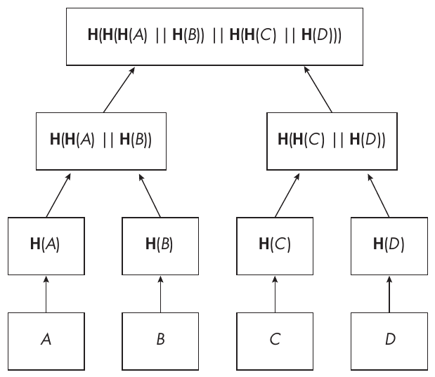

Hình 15-1: Một hash tree, trong đó các lá là đầu vào và gốc là đầu ra

Khi đó, tree hashing hoạt động như sau:

• Hash từng giá trị trong bốn giá trị để có bốn hash H(A), H(B), H(C) và H(D).

• Hash cùng nhau từng cặp hash liên tiếp để có H(H(A) || H(B)) và H(H(C) || H(D)). Ở đây bạn nối các hash value (như ký hiệu || biểu thị).

• Hash hai hash cùng nhau để có gốc của cây, là đầu ra cuối cùng của tree hashing: H(H(H(A) || H(B)) || H(H(C) || H(D))).

Nếu bạn bỏ qua việc hash ban đầu các giá trị đầu vào—điều chỉ cần thiết nếu các giá trị chưa có kích thước bằng hash—bạn đi từ bốn giá trị đến một giá trị với một cây hai tầng, hay chiều cao hai. Lưu ý rằng trong khi dữ liệu đầu vào có thể có kích thước khác nhau, mọi hash value đều có cùng kích thước. Nói chung, một cây n tầng có 2<sup>n</sup> lá, cho phép bạn xử lý tới 2<sup>n</sup> giá trị bằng cách tính 2<sup>n</sup> – 1 hash từ các lá (đã được hash).

Nếu số giá trị đầu vào không chính xác là 2<sup>n</sup> với một số nguyên n nào đó, một kỹ thuật phổ biến là thêm các giá trị giả (ví dụ, đặt bằng không hoặc bằng giá trị cuối cùng trong danh sách); tuy nhiên, quy tắc padding nên được chọn cẩn thận để tránh các collision tầm thường.

#### Merkle proof (Merkle Proofs)

Cấu trúc của một Merkle tree có thể được tận dụng để chứng minh rằng một giá trị cho trước thuộc danh sách 2<sup>n</sup> giá trị đã được hash mà không cần tính lại toàn bộ cây (việc tốn cỡ 2<sup>n</sup> phép toán) mà chỉ trong thời gian tỉ lệ với chiều cao của cây—tức là số tầng n của nó. Tùy ngữ cảnh, những chứng minh như vậy được gọi là membership path, inclusion proof, hay Merkle proof. Đây là tính năng “sát thủ” của Merkle tree, thứ mà các hash function general-purpose không cung cấp.

Hình 15-2 cho thấy điều này hoạt động như thế nào. Các ô tô đậm là những giá trị đủ để chứng minh rằng V<sub>1</sub> là một trong các giá trị đã được hash để có được gốc.

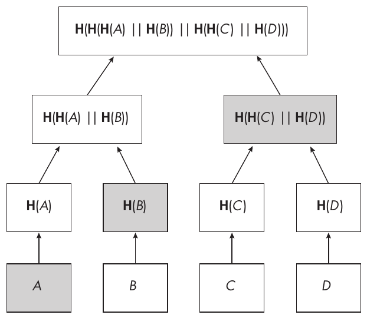

Hình 15-2: Một Merkle tree, trong đó các ô tô đậm tạo thành membership path của A

Giả sử bạn muốn chứng minh rằng A là một trong các giá trị đã được hash, mà không tiết lộ B, C hay D. Đầu tiên, hash A để có lá thực sự của hash tree. Sau đó, giả sử bạn đã nhận được membership path của A, gồm các giá trị tô đậm khác, H(B) và H(H(C) || H(D)). Để xác minh rằng A thuộc cây, hãy tính như sau:

• X = H(H(A) || H(B)), vì bạn biết A và H(B)

• H(H(X) || H(H(C) || H(D))), vì bạn biết H(H(C) || H(D))

Chỉ cần hai hash của các giá trị anh em (sibling) để chứng minh A thuộc cây, hay số hash bằng chiều cao của cây. Một cây có tám lá có chiều cao ba; do đó, việc xác minh membership path cần ba sibling hash. Với 16 lá, bạn cần bốn sibling hash, v.v., với n sibling hash cho một cây có 2<sup>n</sup> lá.

Các ứng dụng blockchain thường dùng Merkle tree để hash các giao dịch thành một Merkle root duy nhất, như root được đưa vào block header của Bitcoin. Một block Bitcoin điển hình ghi khoảng 2,000 giao dịch, đòi hỏi một cây chiều cao 11 (2<sup>11</sup> = 2,048). Trong trường hợp này, cần 2,048 – 1 = 2,047 sibling hash để tính gốc từ các lá, trong đó mỗi lá là hash của dữ liệu một giao dịch. Mỗi hash tính một double SHA-256, nên trong trường hợp 2,048 giao dịch, cần 2,047 + 2,048 = 4,095 double SHA-256s, hay 8,190 lần gọi SHA-256.

Ethereum dùng một cấu trúc dữ liệu tree-based phức tạp hơn một chút, kết hợp Merkle tree với Patricia trie (đây không phải lỗi đánh máy; “trie” bắt nguồn từ “retrieval”), một cấu trúc tree-like lưu các cặp key-value. Cấu trúc này phục vụ model state-based của Ethereum, khác đáng kể so với model UTXO (unspent transaction output) của Bitcoin, mà với nó các Merkle tree đơn giản hơn là đủ.

### Proof of work (Proof of Work)

Proof of work (PoW) được cho là thành phần then chốt nhất của consensus protocol trong blockchain—đối với các blockchain dựa trên PoW thay vì proof of stake (PoS) hay các protocol khác.

Về cơ bản, một PoW là một hash function nhận một số đầu vào cố định và các đầu vào thay đổi và kết quả của nó phải khớp với một mẫu nhất định để hợp lệ. Các bên muốn giải một PoW lặp đi lặp lại việc tính hash với các giá trị khác nhau của đầu vào thay đổi cho đến khi kết quả thỏa mãn một ràng buộc nào đó.

Ví dụ, trong Bitcoin và một số blockchain PoW-based khác, ràng buộc là hash value khi được xem như một số 256-bit phải nhỏ hơn một số cho trước. Điều này cũng có thể được xem là hash value có một số lượng số không đứng đầu (leading zero) cho trước, khi xem hash là cách encode big-endian của một số 256-bit.

Ví dụ, năm 2022 giá trị difficulty cao nhất của Bitcoin (theo báo cáo tại https://btc.com/stats/diff) là 34,244,331,613,176, hay xấp xỉ 2<sup>45</sup>. Bạn nhân giá trị này với 2<sup>32</sup> để tìm giá trị thực mà hash phải nhỏ hơn, 2<sup>77</sup>. Với mỗi block, mọi bên tham gia mạng (miner) cùng nhau tính cỡ 2<sup>77</sup> phép tính double SHA-256 để tìm một lời giải cho PoW. Một lời giải như vậy gồm một nonce (phần thay đổi trong đầu vào của PoW hash) cho ra một hash value nhỏ hơn 2<sup>77</sup>. Phần cố định trong đầu vào của PoW hash gồm các giá trị block header (version, hash của block trước, Merkle tree root, timestamp và giá trị difficulty target).

Không có PoW “làm chậm” việc tạo block trong một blockchain, các block hợp lệ mới có thể được tạo ra tức thì, nghĩa là lịch sử giao dịch có thể được tạo ra và re-created tùy ý. Sẽ không thể đạt được finality (tức là sự bảo đảm rằng một block, và do đó một tập giao dịch, không thể bị hoàn tác hay thay đổi một khi đã được mạng chấp nhận). Đặc biệt, sẽ không thể bảo vệ mạng khỏi double spending, hay việc tiêu cùng một lượng coin trong hai giao dịch khác nhau.

Không phải mọi PoW scheme đều đơn giản như của Bitcoin, vốn dùng một hash function general-purpose (SHA-256). Một số PoW đã cố gắng làm cho việc tính toán chúng trên phần cứng chuyên dụng kém hiệu quả hơn so với các CPU general-purpose để ngăn chặn việc tập trung hóa mining bởi các tổ chức đầu tư phát triển công nghệ phần cứng miner được tối ưu—trái ngược với các server và máy tính off-the-shelf mà ai cũng có thể dùng. Các thủ thuật đã được triển khai bao gồm:

**Memory hardness** Bạn có thể buộc PoW dùng một lượng bộ nhớ lớn, thường bằng cách tạo một bảng khổng lồ và truy cập tại các địa chỉ không thể đoán trước. Ví dụ, PoW của Ethereum đã dùng algorithm Ethash, đòi hỏi khoảng 4GB bộ nhớ. (Tháng Chín năm 2022, Ethereum đã từ bỏ Ethash và chuyển từ PoW sang một cơ chế proof-of-stake.)

**Virtual machine** Như một số malware vẫn làm, bạn có thể tạo một tập lệnh máy tính tùy biến sẽ được một ứng dụng virtual machine dịch sang các lệnh tiêu chuẩn, đồng thời có thể dùng một lượng bộ nhớ lớn để tính lời giải của PoW. Đây là cách tiếp cận của RandomX, một algorithm PoW được blockchain Monero áp dụng.

### Hierarchical key derivation (Hierarchical Key Derivation)

Người dùng blockchain thường muốn quản lý nhiều tài khoản, sao cho mỗi tài khoản gồm một key pair trong đó:

• Private key phải bí mật, vì nó là signing key cần thiết để ký giao dịch và chuyển tiền từ tài khoản.

• Public key phải công khai, vì nó được dùng để xác minh chữ ký của giao dịch. Nó cũng là giá trị mà từ đó địa chỉ của tài khoản được suy ra. Ví dụ, Bitcoin suy ra địa chỉ từ một public key bằng sự kết hợp giữa hash SHA-256 và RIPEMD-160. Lưu ý rằng trong một số blockchain, như Bitcoin, public key không công khai cho đến khi tài khoản phát hành một giao dịch.

Để quản lý tất cả các key này một cách tin cậy, các nhà phát triển blockchain đã định nghĩa hierarchical deterministic wallet (HD wallet), giúp việc quản lý key ít rườm rà và ít rủi ro hơn so với việc phải tạo và sao lưu một key ngẫu nhiên mới cho mỗi tài khoản mới.

Với HD wallet, bạn tạo và lưu một bí mật, seed (còn gọi là master key hay entropy). Seed này là giá trị duy nhất được tạo ngẫu nhiên và là giá trị duy nhất cung cấp entropy, hay tính bất định, và do đó tính bí mật cho các private signing key được suy ra từ nó. Các ứng dụng phần mềm wallet thường encode seed thành một seed phrase, hay mnemonic, một chuỗi từ 12 đến 24 từ giúp dễ lưu và ghi nhớ hơn.

Hãy xem key derivation này hoạt động như thế nào khi dùng pseudorandom function HMAC-SHA-512 (cấu trúc HMAC được khởi tạo với SHA-512): từ một seed S dài 128 hoặc 256 bit, tính HMAC-SHA-512 với seed làm đầu vào key, và đầu vào message là một định danh của elliptic curve bên dưới (một chuỗi có thể là “Bitcoin seed,” “Nist256p1 seed,” hoặc “ed25519 seed”). 256 bit đầu tiên của kết quả là master key, k, và 256 bit cuối là master chain code, c, một giá trị dùng để suy ra thêm key.

Bạn có thể suy ra một child private key từ k và c như sau, cho một định danh i (một số tối đa 2<sup>31</sup>): tính HMAC-SHA-512 với chain code c làm key, và một message bao gồm k và i. Kết quả 512-bit được phân tách thành một giá trị 256-bit L theo sau là một chain code 256-bit R. Trong ký hiệu giản lược, L || R = HMAC-SHA-512(c, k || i). Sau đó, bạn đặt child private key là k + L, và chain code của nó là R.

Đến lượt mình, bạn có thể suy ra các key từ key và chain code thu được để thiết lập một hệ thống phân cấp key. Ví dụ, từ key có chỉ số 0, bạn suy ra toàn bộ key cho Bitcoin, và từ key có chỉ số 60, bạn suy ra toàn bộ key cho Ethereum. Các quy ước gán một số cho mỗi mạng blockchain được chuẩn hóa như một phần của tài liệu “SLIP-0044: Registered Coin Types for BIP-0044.”

Nếu đầu tiên bạn suy ra một child key với định danh 0 và tiếp theo suy ra một key với định danh (chẳng hạn) 29 từ key này và chain code của nó, thì derivation path của key là 0/29. Bạn sẽ đã thực hiện hai lần gọi HMAC-SHA-512, lần lượt cho ra L<sub>1</sub> và L<sub>2</sub> là 256 bit đầu tiên của chúng, và private key cuối cùng là k + L<sub>1</sub> + L<sub>2</sub>. Do đó, bạn có thể xem mọi key được suy ra từ một master key k cho trước là k cộng với tổng các giá trị mà HMAC-SHA-512 trả về. Cách suy ra này được gọi là hardened vì bạn cần cả private key k lẫn chain code c của key cha.

> **LƯU Ý** Với phiên bản nonhardened, hãy dùng public key thay cho private key, điều này cho phép bạn xác định public key của một child key từ public key của cha nó. Để biết thêm chi tiết, hãy xem tài liệu tiêu chuẩn Bitcoin ban đầu “BIP32: Hierarchical Deterministic Wallets” và tài liệu tiêu chuẩn tổng quát hóa của nó “SLIP-0010: Universal Private Key Derivation from Master Private Key.”

### Algebraic hash function (Algebraic Hash Functions)

Các hash function như SHA-3 và BLAKE3 thao tác trên byte, hoặc trên các word 4 hoặc 8 byte, trong đó một byte là một khối 8 bit. Dữ liệu đầu vào là một chuỗi byte, trong đó mỗi byte có thể nhận bất kỳ giá trị nào trong 256 giá trị khả dĩ từ 0x00 đến 0xff (255), và tương tự dữ liệu đầu ra là một chuỗi byte tùy ý. Điều này hoạt động tốt khi dùng dữ liệu được chuyển đổi hiệu quả thành một chuỗi byte và khi các phép toán trên byte hoặc word là hiệu quả (như XOR, dịch bit word và cộng số nguyên).

#### Chiếc máy tính toán học (The Mathematical Computer)

Giả sử bạn có một máy tính chỉ làm việc với các số trong một khoảng cho trước, như các số modulo 13. Phép XOR sẽ không làm việc tốt với những số như vậy, vì không phải mọi số 4-bit đều nhỏ hơn 13; ví dụ, XOR giữa 10 và 4 sẽ cho bạn 14, nằm ngoài khoảng. Bạn có thể rút gọn nó modulo 13 để có 1, nhưng khi đó 10 XOR 4 cho cùng kết quả với 10 XOR 11, một vấn đề bạn không gặp khi làm việc với byte. Điều này có xu hướng làm giảm đáng kể security của hash function—chẳng hạn, thông qua collision.

Tệ hơn nữa, máy tính của bạn chỉ biết các phép toán modulo 13: cộng, trừ, nhân và chia. Nó không có lệnh XOR bitwise built-in (có sẵn), nên nó mô phỏng XOR bằng các lệnh số học modulo 13 của mình, việc này không đơn giản cũng không hiệu quả về mặt tính toán. Tôi sẽ để chi tiết của việc mô phỏng này làm bài tập.

Nhiệm vụ của bạn là tạo một hash function chỉ (hoặc chủ yếu) làm việc với các phép toán số học cho khoảng số đã cho và không dùng các phép toán bitwise bao gồm XOR, OR, AND, hay dịch bit.

Bạn cần loại function này để chạy hiệu quả một số cryptographic protocol nâng cao—cụ thể là multiparty computation (MPC) và zero-knowledge proof, mà bạn sẽ thấy ở phần sau của chương này. Những protocol như vậy thường hoạt động trong phạm vi các cấu trúc toán học như finite field (ví dụ, các tập số nguyên modulo một số nguyên tố) và đôi khi phải “chuyển đổi” một chương trình thành các phương trình toán học. Về nguyên tắc, bạn có thể chuyển bất kỳ chương trình nào thành phương trình. Nhưng khi chương trình không được tối ưu cho cấu trúc toán học bên dưới, các phương trình trở nên rất lớn và tính chậm. Algebraic hash function nhắm đến giải quyết vấn đề này bằng cách thiết kế các hash function vừa an toàn vừa dễ triển khai chỉ với các phép toán số học trong một finite field.

#### Nguyên lý thiết kế (Design Principles)

Hãy xét các nguyên lý thiết kế của Poseidon, một hash function được thiết kế năm 2019 cho các hệ thống zero-knowledge proof và nhanh chóng được nhiều hệ thống blockchain áp dụng. Những proof như vậy đôi khi phải biểu diễn một hash function dưới dạng một mạch các phép toán số học trên một finite field lớn, như các field gồm số nguyên modulo một số nguyên tố 255-bit. Trong trường hợp đó, Poseidon tỏ ra hiệu quả hơn nhiều bậc so với các hash function general-purpose như SHA-256.

Poseidon dùng cấu trúc sponge hash function (xem Chương 7), nên nó cần xây dựng một permutation, một phép biến đổi khả nghịch với đầu vào và đầu ra có cùng kích thước. Nó áp dụng permutation này lên một state là một vector các phần tử finite field. Trong các ứng dụng liên quan, một finite field như vậy thường gồm các số modulo một số nguyên tố, có thể nhỏ chỉ 31 bit và lớn tới 381 bit, tùy ứng dụng.

Sau đó, như hầu hết các hash function, permutation lặp một chuỗi round, nên nó cần thiết kế một round function.

Cuối cùng, Poseidon chia permutation của mình thành ba tầng, với ba mục đích khác nhau, gợi nhớ đến các round của AES:

• Một tầng unicity, AddRoundConstants, mà Poseidon ký hiệu là ARC() trong tài liệu. Tầng này cộng các giá trị hằng số vào các phần tử của state, sao cho các hằng số khác nhau ở mỗi round. Làm cho mỗi round là duy nhất ngăn chặn các attack bao gồm slide attack. Để tránh phải định nghĩa và lưu nhiều hằng số, Poseidon tạo hằng số từ một deterministic random bit generator được khởi tạo bằng một encoding các đặc trưng của instance Poseidon (số round, finite field, loại S-box, v.v.).

• Một tầng phi tuyến hay tầng S-box, SubWords, mà tài liệu của Poseidon ký hiệu là S. Tầng này thêm confusion, tính chất mà các giá trị đầu vào và đầu ra của function liên hệ với nhau bằng các phương trình đại số high-degree—và do đó càng xa càng tốt các phương trình tuyến tính và low-degree, thứ mà differential cryptanalysis có thể khai thác. S-box biến đổi từng phần tử của state độc lập với các phần tử khác, thường ánh xạ một phần tử field x thành x<sup>3</sup> hoặc x<sup>5</sup>. Số mũ được giữ tương đối thấp để tính hiệu quả.

• Một tầng tuyến tính, MixLayer, mà Poseidon ký hiệu là M() trong tài liệu. MixLayer mang lại diffusion, hay sự lan truyền các khác biệt trong state ban đầu ra mọi phần tử. Ví dụ, nếu state gồm vector four-element (x<sub>1</sub>, x<sub>2</sub>, x<sub>3</sub>, x<sub>4</sub>), thì M() thay mỗi phần tử bằng một tổ hợp tuyến tính của mọi phần tử. Nó có thể thay x<sub>1</sub> bằng kết quả của 2x<sub>1</sub> + 10x<sub>2</sub> + x<sub>3</sub> + 3x<sub>4</sub>. Một phép biến đổi như vậy tương ứng với phép nhân một vector với một ma trận. Các ma trận của Poseidon phải thỏa mãn những tính chất security nhất định và nên được thiết kế để triển khai hiệu quả.

Một full round của Poseidon áp dụng ba tầng theo thứ tự này: ARC(), S cho từng phần tử, và M(). Một partial round chỉ áp dụng S cho một phần tử và có thể dùng một ma trận khác trong M(). Khi đó, một instance Poseidon lặp các full round, partial round và full round—số lượng của chúng phụ thuộc vào instance, số phần tử, finite field và security level mục tiêu.

> **LƯU Ý** Để biết thêm chi tiết về Poseidon, hãy xem https://www.poseidon-hash.info cũng như bài báo Poseidon ban đầu (https://eprint.iacr.org/2019/458.pdf) và bài báo về thiết kế cải tiến Poseidon2 (https://eprint.iacr.org/2023/323.pdf).

Poseidon là một trong nhiều algebraic hash function được tạo ra để giải quyết các trường hợp sử dụng thực tế. Các thiết kế khác bao gồm MiMC, Monolith, Rescue-Prime và Tip5.

### Những gì có thể sai (How Things Can Go Wrong)

Hãy xem một số thất bại security liên quan đến hash function và các ứng dụng của chúng trong thế giới blockchain.

#### Hash tự chế bị phá (Broken Custom Hash)

Dự án blockchain Iota năm 2017 khá kỳ quặc. Nó tuyên bố dùng một kiến trúc khác với chuỗi block tuần tự của hầu hết các blockchain, gần với direct acyclic graph (DAG) hơn, thứ kém an toàn hơn nhiều. Nó cũng encode dữ liệu không phải bằng bit mà bằng trit, các đơn vị nhận ba giá trị thay vì hai, được cho là để làm các phép tính hiệu quả hơn trên những bộ xử lý không hề tồn tại.

Iota không dùng một signature scheme elliptic curve-based như ECDSA hay Ed25519 mà dùng một signature scheme hash-based dựa trên cấu trúc Winternitz đã được thiết lập, nhờ đó cung cấp security post-quantum—ngoại trừ việc Iota cũng thiết kế hash function tự chế của riêng mình, Curl.

Iota đã trở thành một trong 10 cryptocurrency phổ biến nhất và đưa ra những tuyên bố phô trương về tính hữu ích tiềm năng và security của nó. Nhưng hash function tự chế của nó, thứ mà nó tuyên bố được phát triển với sự trợ giúp của trí tuệ nhân tạo, hóa ra rất yếu trước collision attack. Dùng phần cứng off-the-shelf, các nhà nghiên cứu đã tìm ra collision trong vòng vài phút, những collision chỉ có thể bị khai thác trong các kịch bản tấn công gượng ép. Iota nhanh chóng vá hash function của mình.

Sau thất bại này, chuyên gia cryptography và security nổi tiếng Bruce Schneier đã bình luận: “Vào năm 2017, để cryptographic algorithm của bạn dễ bị differential cryptanalysis là một lỗi của người mới vào nghề. Điều đó cho thấy không ai có tầm cỡ đã phân tích hệ thống của họ, và khả năng bản sửa của họ làm hệ thống an toàn là thấp.”

#### Wallet với entropy thấp (Wallet with Low Entropy)

Model hierarchical key derivation ở phần trước trong mục này an toàn trên giấy nhưng trong thực tế chỉ khi nó được triển khai đúng. Bạn thường có thể xác minh điều này bằng các test vector trong các tài liệu tiêu chuẩn BIP32 và SLIP-0010. Nếu bạn có được cùng các giá trị đầu vào/đầu ra như những giá trị được ghi trong tài liệu, implementation của bạn có lẽ đúng, dù không nhất thiết an toàn.

Năm 2022, ứng dụng wallet cryptocurrency di động phổ biến Trust Wallet đã công bố phát hành một phiên bản extension trình duyệt dùng công nghệ WebAssembly (Wasm) để chạy hiệu quả trên các trình duyệt khác nhau. Tuy nhiên, Wasm không thể dùng cùng PRNG như các phiên bản di động; nó phải định nghĩa một PRNG khác.

Một PRNG kém có thể là gót chân Achilles của cryptography (xem Chương 2). Trong Trust Wallet, các nhà phát triển đã dùng Mersenne Twister PRNG (mt19937), vốn không phải là một cryptographic PRNG. Entropy của nó tối đa là 32 bit, và nó tạo ra các bit đầu ra bằng các tổ hợp tuyến tính đơn giản của các giá trị internal state.

Vì PRNG của Trust Wallet có 32 bit entropy, nó chỉ có thể tạo ra 2<sup>32</sup> seed khác nhau cho wallet của người dùng. Khi đó, kẻ tấn công có thể tính toàn bộ 2<sup>32</sup> seed khả dĩ và, với mỗi seed, tính các private key và địa chỉ được suy ra bằng hierarchical key derivation. Sau đó, họ có thể quét các blockchain để tìm các địa chỉ do Trust Wallet tạo ra và đánh cắp token của chúng. Các nhà nghiên cứu của công ty Ledger, những người tìm ra lỗ hổng, đã bình luận: “Chạy một attack như vậy tốn nhiều hơn vài giờ, nhưng có thể thực hiện được với một vài GPU trong vòng chưa đến một ngày.”

#### Collision do domain separation thất bại (Collisions from Domain Separation Failures)

Hãy thảo luận cách tìm collision cho một hash function có tính collision resistant. Như cryptographer Moti Yung đã nói: “Nếu nó nghe có vẻ bất khả thi, thì nó thú vị về mặt cryptography.”

Hãy tưởng tượng trường hợp đơn giản sau: một ứng dụng nhận các message A và B từ hai bên, Alice và Bob, rồi hash hai message này cùng nhau để tạo một hash value duy nhất cho các message này. Khi đó, nó có thể tính H(A || B) bằng cách hash chuỗi gồm A theo sau là B. Ngay cả khi hash function của bạn có tính collision resistant, bạn sẽ có cùng hash value với A = COL và B = LISION như với A = CO và B = LLISION. Bạn rốt cuộc có một hash collision đối với các giá trị đầu vào của ứng dụng, dù đó không phải là collision của hash function vì hash function H xử lý cùng một chuỗi trong hai trường hợp, COLLISION.

Để tránh vấn đề này, hãy encode các giá trị đầu vào của ứng dụng thành một chuỗi duy nhất cho mỗi đầu vào, không có encoding mơ hồ: với mỗi chuỗi, bạn phải có thể xác định duy nhất tập giá trị đầu vào ban đầu. Trong ví dụ của chúng ta, thêm ký tự dấu đô la ($) làm dấu phân cách giữa hai đầu vào có vẻ tránh được collision giữa COL || LISION và CO || LLISION: bạn sẽ có các chuỗi COL$LISION và CO$LLISION, dẫn đến các hash value khác nhau.

Nhưng một ký hiệu phân cách không đủ để loại bỏ sự mơ hồ khi ký tự đó được phép xuất hiện trong các giá trị đầu vào của ứng dụng. Ví dụ, lấy chuỗi COL$$LISION là kết quả nối hai chuỗi đầu vào được phân cách bằng $. Bạn có thể đã có chuỗi đó từ hai cặp đầu vào: COL và $LISION, COL$ và LISION. Lưu ý rằng vấn đề không xảy ra khi các giá trị đầu vào có kích thước cố định, không đổi—ví dụ, chuỗi thứ nhất gồm hai ký tự và chuỗi thứ hai gồm ba ký tự. Ngay cả trong trường hợp đó, vẫn an toàn hơn nếu dùng một dấu phân cách hoặc encoding nào đó ngăn được collision, vì một bản vá trong tương lai có thể đưa vào đầu vào variable-length.

Các nhà nghiên cứu đã tìm thấy những bug loại này trong các threshold signing protocol, mà bạn sẽ thấy ở phần sau của chương này, cũng như trong các protocol e-voting, nơi các hash collision thu được có thể bị khai thác để vi phạm các tính chất security của những protocol này.

## Multisignature protocol (Multisignature Protocols)

Trong một cryptographic multisignature protocol, các bên tham gia cùng nhau tạo ra một chữ ký của một message, tương đương về mặt chức năng với việc mọi bên ký message một cách riêng rẽ; một chữ ký thu được nghĩa là mọi bên đã đồng ý ký message. Ưu điểm là thay vì có số chữ ký bằng số người ký, chỉ có một chữ ký. Khi đó, bất kỳ ai có public key của mọi người ký đều có thể xác minh chữ ký.

Các nền tảng blockchain dùng multisignature khi nhiều bên quản lý một tài khoản để bảo đảm rằng mọi bên đều tán thành các giao dịch được phát hành. Một bên duy nhất cũng có thể dùng chúng nếu họ có nhiều key trên nhiều thiết bị để ngăn một key bị xâm phạm duy nhất cho phép attack *(ghi chú: sách in “attack”; đúng là “attacker”)* phát hành giao dịch. Các multisignature protocol như vậy là một trong nhiều loại collective signature protocol, trong đó các bên chạy một protocol để tạo ra một chữ ký.

Trước khi đi vào chi tiết kỹ thuật, hãy làm rõ các multisignature này khác với các protocol liên quan như thế nào.

### Nhiều loại chữ ký nhiều bên (Multiple Multiparty Signatures)

Dù có tên tương tự, các multisignature protocol mà chúng ta sẽ thảo luận khác với các multisignature script on-chain hay các multisignature smart contract, lần lượt được dùng trong Bitcoin và Ethereum. Những thứ sau không phải là cryptographic protocol vì các bên tham gia gửi chữ ký riêng của mình tới mạng blockchain một cách độc lập. Đến lượt mình, mạng xác minh một quy tắc như “nếu một giao dịch có chữ ký từ pub<sub>1</sub> và pub<sub>2</sub>, thì chấp nhận nó” hoặc “nếu một giao dịch được ký bởi hai bên bất kỳ trong số pub<sub>1</sub>, pub<sub>2</sub> và pub<sub>3</sub>, thì chấp nhận nó”—ngược lại thì từ chối giao dịch. Ở đây, chúng ta ngầm xem các public key pub là định danh của các bên, như thường thấy trong các blockchain protocol.

So với các multisig on-chain, multisignature protocol tạo ra một chữ ký duy nhất; khi đó chỉ có một chữ ký cần xác minh thay vì nhiều chữ ký. Ngược lại, các multisignature script và smart contract xử lý nhiều chữ ký và gồm một quy tắc xác minh chứ không phải một protocol ở phía người ký. Trong cả hai trường hợp, việc xác minh đều cần public key của mọi người ký.

Multisignature protocol cũng khác với hai loại collective signature protocol khác, mà bạn sẽ thấy trong các mục sau. Trong cả hai protocol, kết quả là một chữ ký duy nhất, nhưng khác biệt là nó được tạo ra như thế nào và từ cái gì:

**Aggregate signature protocol**

• Giống như trong multisignature, mỗi bên tham gia có key pair riêng (public key và private key).

• Khác với trong multisignature, các bên tham gia có thể ký các message khác nhau, thay vì cùng một message. Một bên tham gia cũng có thể ký nhiều message.

• Giống như trong multisignature, việc xác minh một chữ ký cần nhiều public key (hoặc một phiên bản aggregate duy nhất của chúng, với các protocol hỗ trợ).

**Threshold signature protocol**

• Khác với trong multisignature, các bên tham gia không dùng key riêng của mình. Thay vào đó, họ có các share (còn gọi là shard) của một private key duy nhất, sao cho không bên tham gia nào biết toàn bộ key, ngay cả trong quá trình thực thi protocol.

• Giống như trong multisignature, các bên tham gia ký một message duy nhất.

• Khác với trong multisignature, việc xác minh cần một public key duy nhất.

Giờ chúng ta đã định nghĩa multisignature là gì, hãy xem chúng hoạt động như thế nào trong trường hợp sử dụng lừng lẫy nhất của chúng: chữ ký Schnorr.

### Các protocol chữ ký Schnorr (Schnorr Signature Protocols)

Nhà toán học Claus-Peter Schnorr đã tạo ra signature scheme mang tên ông năm 1989 và nộp bằng sáng chế cho nó, điều đã ngăn cản việc nó được chấp nhận rộng rãi cho đến năm 2008, khi scheme EdDSA (xem Chương 12) tối ưu nó để làm việc với các elliptic curve hiện đại. Scheme của Schnorr đơn giản hơn tiêu chuẩn ECDSA, giúp dễ biến nó thành một multisignature scheme hơn. Bitcoin hỗ trợ chữ ký Schnorr, được đưa vào năm 2022 như một sự hỗ trợ tốt hơn cho các multisignature protocol.

> **LƯU Ý** Chúng ta sẽ dùng ký hiệu cộng (như với EdDSA và khi làm việc với elliptic curve), thay vì ký hiệu nhân ban đầu (như được dùng khi làm việc với số nguyên trong một multiplicative group). Do đó, public key A gắn với một private key a là điểm elliptic curve A = aG, trong đó G là một điểm cơ sở được định nghĩa trước, và các phần tử group là các điểm được kết hợp bằng phép cộng. Điều này trái với ký hiệu nhân, nơi chúng ta sẽ có A = g<sup>a</sup> với một generator g nào đó của group, trong đó các phần tử group là các số được nhân với nhau.

#### Chữ ký Schnorr Single-Signer

Trước khi xem cách ký nhiều bên hoạt động, hãy xem cách ký Schnorr single-party hoạt động. Giả sử Alice có một private key a, với public key tương ứng A = aG. Ở đây a là một số, hay scalar, trong một khoảng số cho trước (cụ thể là finite field mà trên đó elliptic curve được định nghĩa, thường là các số nguyên dương modulo một số nguyên tố lớn nào đó, dài ít nhất khoảng 256 bit), và G là một điểm cơ sở cố định của đường cong.

Để ký một message M, Alice làm như sau:

1. Chọn một số ngẫu nhiên bí mật, r, và tính điểm R = rG. Giá trị r là một nonce, một private key one-time với R là public key của nó.

2. Tính h = H(R || A || M), giá trị mà bạn sẽ “nối” với private key a và private key one-time r để ký M. Chúng ta không chỉ hash message mà còn ràng buộc h với người ký và nonce, lần lượt thông qua các giá trị không bí mật A và R. Không có chúng, nhiều attack khác nhau sẽ khả thi.

3. Tính s = r + ha và trả về cặp (R, s) làm chữ ký. Bạn có thể xem s là phép nhân giữa secret key và dữ liệu cần ký, trong đó bí mật r che đi kết quả; không có nó, việc khôi phục private key từ một chữ ký là tầm thường.

Xác minh một chữ ký bằng cách kiểm tra rằng sG bằng R + H(R || A || M)A. Điều này hoạt động vì từ s = r + ha, thay r + ha cho s trong sG, bạn được

sG = (r + ha)G = rG + haG = R + hA

với h = H(R || A || M), giá trị mà người xác minh phải tính từ message M, public key A và phần R của chữ ký.

#### Schnorr multisignature (Schnorr Multisignatures)

Trong multisignature, chúng ta không có một người ký mà có nhiều người ký. Để đơn giản, chúng ta sẽ mô tả trường hợp hai người đồng ký: hãy gặp Bob, người sẽ ký message cùng với Alice. Private key của Bob là b và public key của anh ấy là B = bG. Để cùng tạo một multisignature, Alice và Bob có thể làm như sau để ký một message M:

1. Alice chọn một nonce r<sub>A</sub>, tính R<sub>A</sub> = r<sub>A</sub>G, và gửi R<sub>A</sub> cho Bob.

2. Bob chọn một nonce r<sub>B</sub>, tính R<sub>B</sub> = r<sub>B</sub>G, và gửi R<sub>B</sub> cho Alice.

3. Họ tính R = R<sub>A</sub> + R<sub>B</sub> và đặt h = H(R || A || B || M), giá trị mà Alice và Bob sẽ dùng để tạo phần chữ ký của mình. Một giá trị cụ thể của h được ràng buộc với các bên thông qua public key của họ (A và B) và được ràng buộc với signing session hiện tại thông qua nonce R chỉ cho lần thực thi chữ ký cụ thể như được xác định bởi nonce R.

4. Alice tính s<sub>A</sub> = r<sub>A</sub> + ha và gửi nó cho Bob.

5. Bob tính s<sub>B</sub> = r<sub>B</sub> + hb và gửi nó cho Alice.

6. Cả hai tính R = R<sub>A</sub> + R<sub>B</sub> và s = s<sub>A</sub> + s<sub>B</sub> rồi trả về (R, s) làm chữ ký.

Để xác minh một chữ ký, hãy kiểm tra rằng sG bằng R + h(A + B). Thay s trong sG bằng giá trị đã tính trước đó cho kết quả như sau:

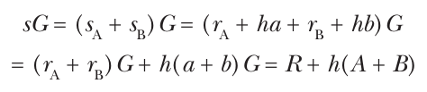

Lưu ý rằng người xác minh cần biết cả A và B, chứ không chỉ tổng A + B của chúng, vì họ cần cả hai giá trị để tính H(R || A || B || M). Tuy nhiên, nếu h được định nghĩa là H(R || A + B || M), người xác minh có thể dùng một public key duy nhất A + B mà không cần biết rằng chữ ký được phát hành bởi hai bên. Chúng ta gọi việc “gộp” nhiều public key thành một là key aggregation. Điều này đặc biệt hữu ích để giảm kích thước dữ liệu cần hash khi có nhiều người ký.

> **LƯU Ý** Tôi đã mô tả Schnorr multisignature cơ bản trong trường hợp hai bên, nhưng protocol mở rộng được cho số bên tùy ý với các public key P<sub>1</sub>, P<sub>2</sub>, . . . , P<sub>n</sub>. Trong định nghĩa, hãy thay A + B bằng P<sub>1</sub> + P<sub>2</sub> + . . . + P<sub>n</sub>, thay A || B bằng P<sub>1</sub> || P<sub>2</sub> || . . . || P<sub>n</sub>, và thay “gửi nó cho Bob/Alice” bằng “gửi nó cho mọi người.” Bạn có thể áp dụng một protocol tương tự cho EdDSA và Ed25519, các biến thể của scheme của Schnorr.

### Những gì có thể sai (How Things Can Go Wrong)

Schnorr multisignature protocol tương đối đơn giản nhưng có thể thất bại trong các kịch bản tấn công sau.

#### Key cancellation attack (Key Cancellation Attack)

Trong attack này, Bob thuyết phục những người xác minh chữ ký rằng anh ấy đã ký một message cùng với Alice, trong khi Alice chưa hề thấy message và không tương tác với Bob. Kẻ tấn công có thể khai thác điều này trong một kịch bản mà bạn kỳ vọng Alice và Bob cùng ký message—ví dụ, trong các giao dịch đòi hỏi sự chấp thuận của cả hai bên. Trong trường hợp bình thường, người xác minh sẽ biết public key A của Alice và public key B của Bob, và Bob và Alice sẽ biết key của nhau.

Giờ giả sử điều sau xảy ra: Alice gửi public key A của mình cho mọi người kể cả Bob, nhưng thay vì chia sẻ public key B của mình, Bob chia sẻ C = B – A = (b – a)G với những người xác minh, và B với Alice. Việc Bob không biết private key tương ứng với C sẽ không ảnh hưởng đến attack.

Bob phải ký một message bằng private key b của mình, như trong trường hợp single-signer, nhưng với h = H(R || A || C || M), như thể anh ấy đang ký cùng Alice. Anh ấy trả về (R, s) làm chữ ký, với R = rG cho một r do anh ấy chọn và s = r + hb.

Kỳ vọng chữ ký từ Alice và Bob, người xác minh kiểm tra rằng sG bằng R + h(A + C), điều đúng vì A + C = A + (B – A) = B. Do đó, Bob có thể làm giả multisignature mà thậm chí không cần tương tác với Alice và không cần biết private key của cô ấy.

Trong thực tế, bạn có thể tránh attack này bằng cách yêu cầu người ký chứng minh việc biết private key—ví dụ, bằng cách ký một message. Vì Bob không biết private key tương ứng với C, anh ấy không thể đưa ra bằng chứng như vậy. Như bạn sẽ thấy với protocol MuSig, bạn cũng có thể tránh attack ở mức protocol.

Attack mở rộng được cho số bên tùy ý, một bối cảnh thường được gọi là rogue key attack. Sau khi nhận được public key của mọi bên khác, kẻ tấn công Bob chỉ cần định nghĩa public key của mình là B – X, với X là tổng các public key của mọi bên khác.

#### Nonce lặp lại (Repeated Nonces)

Giống như trong ECDSA, nonce lặp lại là chết người đối với Schnorr multisignature protocol. Hãy tưởng tượng pseudorandom generator của Alice thất bại và cô ấy tạo cùng một secret nonce r<sub>A</sub> hai lần trong hai lần chạy protocol: cô ấy gửi s<sub>A</sub> = r<sub>A</sub> + ha ban đầu cho Bob, và s<sub>A</sub>' = r<sub>A</sub> + h'a thứ hai, trong đó h thứ nhất và h' thứ hai cũng phụ thuộc vào tính ngẫu nhiên của Bob. Do đó, bạn có r<sub>A</sub> = ha – s<sub>A</sub> và r<sub>A</sub> = h'a – s<sub>A</sub>', kéo theo ha – s<sub>A</sub> = h'a – s<sub>A</sub>' hoặc, tương đương,

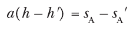

từ đó bạn có thể tính private key của Alice a = (s<sub>A</sub> – s<sub>A</sub>') / (h – h').

Một cách tiếp cận để loại bỏ các rủi ro security do thất bại về tính ngẫu nhiên là loại bỏ tính ngẫu nhiên. Ví dụ, tính nonce bằng cách hash message và private key như trong Ed25519 hoạt động khi chỉ có một người ký. Tuy nhiên, đặt r bằng H(a || M) sẽ không hoạt động trong trường hợp multisignature: nếu Alice và Bob ký cùng một message hai lần, thì Alice tính s<sub>A</sub> = r<sub>A</sub> + ha thứ nhất và s<sub>A</sub>' = r<sub>A</sub> + h'a thứ hai, trong đó ở cả hai trường hợp r<sub>A</sub> = H(a || M), và h' sẽ khác h nếu một Bob độc hại gửi một giá trị khác với H(b || M). Trong trường hợp này, Bob—và bất kỳ kẻ nghe lén nào của cuộc liên lạc—lại có thể tính a là (s<sub>A</sub> – s<sub>A</sub>') / (h – h').

#### Không an toàn khi thực thi song song (Parallel Execution Insecurity)

Schnorr multisignature protocol không an toàn khi kẻ tấn công có thể khởi tạo nhiều signature protocol đồng thời. Attack quá phức tạp để mô tả ở đây nhưng được ghi lại trong các bài báo nghiên cứu có tại https://eprint.iacr.org/2018/417 và https://eprint.iacr.org/2020/945.

### Schnorr multisignature an toàn hơn (Safer Schnorr Multisignatures)

Để tránh key cancellation attack và các vấn đề nonce lặp lại, các nhà nghiên cứu đã phát triển những multisignature protocol nâng cao hơn và đặc biệt là các protocol MuSig: MuSig, MuSig2 và MuSig-DN, trong đó MuSig là viết tắt của multisignature và DN là viết tắt của deterministic nonce. Các protocol MuSig cũng hỗ trợ key aggregation để cho phép người xác minh kiểm tra một chữ ký chỉ bằng một public key được suy ra từ key của những người ký, sao cho key đã aggregate không tiết lộ số người ký hay public key của họ.

Hãy xem thủ thuật chính của MuSig trong thực tế. Nếu chúng ta ở trường hợp đơn giản nhất với hai người ký, Alice và Bob, dùng cùng ký hiệu như trong các mục trước, thay vì tính s<sub>A</sub> = r<sub>A</sub> + ha làm phần chữ ký của mình, Alice tính s<sub>A</sub> = r<sub>A</sub> + μ<sub>A</sub>ha, do đó nhân phần ha với giá trị μ<sub>A</sub>. Cô ấy tính μ<sub>A</sub> (trong đó μ là chữ cái Hy Lạp mu) bằng cách hash danh sách public key của các bên tham gia theo sau là key của Alice, H(A || B || A). Tương tự, Bob tính s<sub>B</sub> = r<sub>B</sub> + μ<sub>B</sub>hb với μ<sub>B</sub> = H(A || B || B), hash danh sách public key theo sau là key của mình.

Sau đó, Alice tính aggregate public key là X = μ<sub>A</sub>A + μ<sub>B</sub>B, tổng các public key nhân với các giá trị μ tương ứng của chúng. Khi đó, hash của message là h = H(R || X || M) thay vì H(R || (A + B) || M) như trong phiên bản multisignature scheme có lỗ hổng hỗ trợ key aggregation.

Thủ thuật này hoạt động vì một Bob độc hại không còn có thể làm giả một public key khác sẽ “triệt tiêu” A của Alice, như anh ta có thể làm bằng cách đặt C = B – A trong key cancellation attack. Trong phương trình X = μ<sub>A</sub>A + μ<sub>B</sub>B, Bob phải tìm một giá trị B mới cho ra các hệ số μ “đúng” để loại A khỏi phương trình. Nhưng giờ điều đó là bất khả thi vì phương trình là phi tuyến đối với A và B (tính tuyến tính thường đồng nghĩa với sự không an toàn—xem Chương 2).

Khi có nhiều hơn hai người ký, bạn áp dụng thủ thuật theo cách tương tự, tính các hệ số μ bằng cách hash danh sách key theo sau là key của người ký rồi aggregate các public key thành một X duy nhất bằng cách tính tổng các public key nhân với μ tương ứng của chúng.

> **LƯU Ý** Để biết thêm chi tiết về các protocol MuSig và cách phiên bản MuSig-DN suy ra nonce một cách an toàn từ message, hãy xem https://bitcoinops.org/en/topics/musig/.

## Aggregate signature protocol (Aggregate Signature Protocols)

Aggregate signature có nhiều người ký, và mỗi người ký ký một message (có thể khác nhau cho mọi người ký); sau đó các chữ ký này được gộp thành một chữ ký duy nhất. Chỉ từ chữ ký này cùng public key của những người ký và các message họ đã ký, việc xác minh kiểm tra rằng mọi người ký đã ký các message tương ứng của mình. Vì chỉ cần lưu một chữ ký duy nhất, thay vì số chữ ký bằng số người ký, thời gian xác minh tỉ lệ với số message. Khi mọi người ký ký cùng một message, việc xác minh có thể nhanh ngang việc xác minh chữ ký của một người ký duy nhất, bất kể số người ký.

Aggregate signature được dùng đáng chú ý trong Ethereum, cụ thể là trong consensus layer của nó. Trong trường hợp sử dụng này, các validator node tán thành các đề xuất thay đổi trạng thái của hệ thống (dưới dạng block) và tận dụng aggregate signature để giảm thiểu không gian lưu trữ chữ ký và thời gian xác minh. Chúng dùng signature scheme Boneh–Lynn–Shacham (BLS), mà bạn sẽ học trong mục này, bắt đầu với phép màu đằng sau chữ ký BLS: cryptographic pairing.

### Pairing (Pairings)

Trong elliptic curve cryptography, một pairing là một phép toán biến đổi hai điểm từ hai group elliptic curve (không nhất thiết giống nhau) thành một phần tử finite field. Ký hiệu tiêu chuẩn cho một pairing giữa hai điểm elliptic curve P và Q là e(P, Q). Các pairing được dùng trong cryptography có tính chất gọi là bilinearity (song tuyến tính) và do đó được gọi là bilinear pairing, nghĩa là chúng thỏa mãn điều sau với mọi điểm P, Q và R:

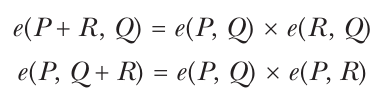

Ở đây, cộng một điểm R vào một toán hạng tương đương với nhân kết quả với pairing giữa R và toán hạng còn lại. Do đó, nếu bạn cộng một điểm với chính nó n lần—tức là, nếu bạn nhân nó với một số n—thì bạn có

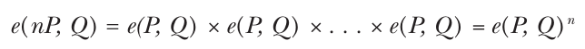

hay e(P, Q) nhân với chính nó n lần, cũng bằng e(P, nQ).

Nếu bạn có các điểm khác nhau P<sub>1</sub>, P<sub>2</sub>, . . . , P<sub>n</sub>, bạn có thể biến phép cộng các giá trị đầu vào thành phép nhân các giá trị đầu ra:

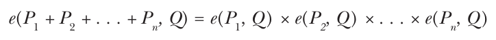

Nội tại cách pairing hoạt động nằm ngoài phạm vi của cuốn sách này. Để biết thêm chi tiết, hãy xem bài viết “Cryptographic Pairings” của Kristin Lauter và Michael Naehrig (https://eprint.iacr.org/2017/1108) và cuốn sách Guide to Pairing-Based Cryptography của Nadia El Mrabet và Marc Joye (Chapman and Hall/CRC, 2016).

### Chữ ký BLS (BLS Signatures)

Chữ ký BLS được trình bày năm 2006 trong bài báo “Short Signatures from the Weil Pairing” của Dan Boneh, Ben Lynn và Hovav Shacham. Bài báo nói rằng scheme được thiết kế “cho các hệ thống mà chữ ký được con người gõ vào hoặc chữ ký được gửi qua một kênh low-bandwidth.” Chữ ký BLS hóa ra lại được dùng trong các hệ thống tự động hóa cao qua các kênh high-bandwidth, những hệ thống được hưởng lợi từ một tính chất được mô tả trong một bài báo sau đó: aggregation chữ ký và public key.

> **LƯU Ý** Đừng nhầm chữ ký BLS với các đường cong BLS (Barreto–Lynn–Scott), vốn có chung một tác giả (Lynn). Các đường cong BLS là các elliptic curve được thiết kế thân thiện với pairing (pairing friendly), cho phép các phép toán pairing an toàn và hiệu quả. Thực tế, chữ ký BLS thường làm việc với các điểm trên một đường cong BLS. Ví dụ, chữ ký BLS của Ethereum dựa vào đường cong BLS12-381.

#### Ký và xác minh Single-Signer

Trong chữ ký BLS, private key của Alice là một số scalar a, và public key của cô ấy là A = aG, với một điểm cơ sở G được định nghĩa trước. Để ký một message M, đầu tiên cô ấy tính H = H(M), trong đó hash function trả về một điểm trên đường cong thay vì một chuỗi bit hay một scalar—ký hiệu H tuân theo quy ước chung là bạn ký hiệu các điểm bằng chữ in hoa. Khi đó, chữ ký là S = aH. Điều này trông đơn giản hơn nhiều so với một chữ ký Schnorr hay ECDSA: chỉ cần hash message và nhân kết quả với private key.

Để xác minh một chữ ký BLS, hãy tính hai phép toán pairing:

• e(A, H) giữa public key và message đã hash (lưu ý rằng A = aG)

• e(G, S) giữa điểm cơ sở và chữ ký (lưu ý rằng S = aH)

Các giá trị này phải bằng nhau nhờ tính chất bilinearity của pairing:

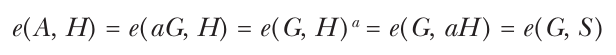

Nếu đẳng thức đúng, chữ ký được chấp nhận; ngược lại, nó bị từ chối.

Bỏ qua độ phức tạp của phép toán pairing, các chữ ký pairing-based như vậy là signature scheme đơn giản nhất.

#### Aggregate signature từ nhiều người ký (Aggregate Signatures from Multiple Signers)

Hãy khai thác thêm phép màu của chữ ký BLS và bilinear pairing, xét một kịch bản trong đó n người ký với các private key k<sub>1</sub>, k<sub>2</sub>, . . . , k<sub>n</sub> và các public key P<sub>1</sub>, P<sub>2</sub>, . . . , P<sub>n</sub> ký n message M<sub>1</sub>, M<sub>2</sub>, . . . , M<sub>n</sub> và tạo ra các chữ ký S<sub>1</sub>, S<sub>2</sub>, . . . , S<sub>n</sub>. Lưu ý rằng H<sub>i</sub> = H(M<sub>i</sub>) là hash của message thứ i.

Bạn có thể aggregate các chữ ký S<sub>i</sub> = k<sub>i</sub>H<sub>i</sub> thành một bằng cách cộng chúng để có S = S<sub>1</sub> + S<sub>2</sub> + . . . + S<sub>n</sub>. Hãy quan sát rằng việc tính e(G, S), như trong việc xác minh một chữ ký đơn lẻ, cho kết quả như sau, nhờ tính chất bilinearity:

e(G, S) = e(G, S<sub>1</sub> + S<sub>2</sub> + . . . + S<sub>n</sub>) = e(G, S<sub>1</sub>) × e(G, S<sub>2</sub>) × . . . × e(G, S<sub>n</sub>)

Hãy nhớ rằng pairing thỏa mãn e(nP, Q) = e(P, nQ). Do đó, bạn có thể thay mỗi số hạng e(G, S<sub>i</sub>) bằng e(P<sub>i</sub>, H<sub>i</sub>) bằng cách “chuyển” hệ số nhân k<sub>i</sub> sang toán hạng bên trái của pairing: khi đó toán hạng thứ nhất sẽ là k<sub>i</sub>G = P<sub>i</sub> thay vì G, và toán hạng thứ hai sẽ là H<sub>i</sub> thay vì S<sub>i</sub> = k<sub>i</sub>H<sub>i</sub>.

Sau khi aggregate nhiều chữ ký của nhiều người ký trên nhiều message thành một chữ ký duy nhất, bạn có thể xác minh aggregate signature từ public key của những người ký và các message đã ký. Việc xác minh chỉ cần kiểm tra đẳng thức giữa e(G, S) và tích của mọi pairing e(P<sub>i</sub>, H<sub>i</sub>). Có 1 + n pairing cần tính, thay vì 2n pairing nếu bạn không aggregate các chữ ký—trong trường hợp này, các chữ ký chiếm bộ nhớ gấp n lần so với chữ ký đã aggregate.

Hãy xét một kịch bản mà bạn sẽ aggregate cả chữ ký lẫn public key.

#### Aggregate public key (Aggregate Public Keys)

Hãy tưởng tượng rằng mọi người ký đều ký cùng một message M và bạn aggregate mọi public key thành một: P = P<sub>1</sub> + P<sub>2</sub> + . . . + P<sub>n</sub>. Lưu ý rằng k<sub>1</sub>, k<sub>2</sub>, . . . , k<sub>n</sub> vẫn biểu diễn các private key tương ứng của họ và H = H(M) là hash của message. Cho các chữ ký hợp lệ S<sub>i</sub>, bạn có được đẳng thức sau:

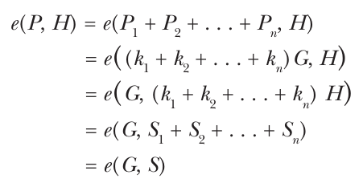

Do đó, bạn xác minh chữ ký của n bên trên cùng một message chỉ bằng hai phép toán pairing, e(P, H) và e(G, S). Điều này cực kỳ hiệu quả, vì nó làm cho việc xác minh chữ ký về cơ bản độc lập với số bên, bởi bạn có thể cộng các điểm một cách hiệu quả, trong khi pairing tốn kém để tính. Ngoài hiệu quả tính toán, việc aggregate key và chữ ký cũng tiết kiệm bộ nhớ.

### Những gì có thể sai (How Things Can Go Wrong)

Như nhiều elliptic curve cryptography scheme, chữ ký BLS phải tránh các key không hợp lệ và tham số yếu để an toàn. Và như các protocol trước, chữ ký BLS có thể dễ bị key cancellation attack. Hãy khám phá chi tiết.

#### Key không hợp lệ (Invalid Keys)

Chữ ký BLS được đặc tả trong một Internet-Draft, một tài liệu làm việc của IETF có tại https://github.com/cfrg/draft-irtf-cfrg-bls-signature. Tài liệu này đặc tả các phép toán cốt lõi bao gồm tạo key (algorithm KeyGen), ký (CoreSign), xác minh (CoreVerify) và kiểm tra hợp lệ key (KeyValidate). Cho một public key, phép toán sau cùng bảo đảm tính hợp lệ của public key ở chỗ nó “biểu diễn một điểm hợp lệ, non-identity nằm trong đúng subgroup.”

Việc kiểm tra hợp lệ key ngăn việc dùng các cặp private/public key yếu, mà với chúng chữ ký dễ bị làm giả hơn. Ví dụ, hãy xét trường hợp tầm thường của một secret key bằng không a = 0. Khi đó, chữ ký của bất kỳ message M nào cũng là 0 × H(M) = 0. Do đó, làm giả một chữ ký cho bất kỳ message nào là tầm thường. Trong trường hợp đó, public key là 0 × G = O, chính là point at infinity. Nếu việc kiểm tra hợp lệ key từ chối các public key bằng O, nó bảo đảm rằng secret key không bằng không.

Một trường hợp ít tầm thường hơn là khi public key, với tư cách một điểm elliptic curve, có một giá trị khiến việc làm giả chữ ký dễ hơn—tức là tạo một chữ ký hợp lệ mà không biết private key. Không phải mọi điểm trên một elliptic curve cho trước đều an toàn như nhau—đặc biệt là các điểm thuộc một subgroup nhỏ thay vì thuộc subgroup điểm chính. Nếu một điểm public key thuộc một subgroup nhỏ như vậy, sẽ có ít chữ ký hợp lệ khả dĩ hơn rất nhiều, khiến việc làm giả một chữ ký dễ hơn. Tương tự, nếu public key được đưa cho verification function không thuộc elliptic curve, thì các chữ ký hợp lệ rất dễ làm giả.

Do đó, điều cốt yếu là kiểm tra rằng public key hợp lệ bằng algorithm KeyValidate từ đặc tả nói trên, như được sao chép trong Listing 15-1.

```
Inputs:
- PK, a public key in the format output by SkToPk.

Outputs:
- result, either VALID or INVALID

Procedure:
1. xP = pubkey_to_point(PK)
2. If xP is INVALID, return INVALID
3. If xP is the identity element, return INVALID
4. If pubkey_subgroup_check(xP) is INVALID, return INVALID
5. return VALID
```

Listing 15-1: Algorithm KeyValidate bảo đảm rằng một BLS public key là hợp lệ.

Nếu bạn triển khai chữ ký BLS, hãy chắc chắn code của bạn thực hiện mọi kiểm tra được mô tả trong đặc tả BLS khi kiểm tra hợp lệ public key và chữ ký.

#### Key cancellation attack (Key Cancellation Attack)

Ở dạng cơ bản, BLS aggregate signature với aggregate public key chịu cùng loại key cancellation attack như chữ ký Schnorr: nếu kẻ tấn công biết các public key P<sub>1</sub>, P<sub>2</sub>, . . . , P<sub>n –</sub> <sub>1</sub> của n – 1 người ký đầu tiên, họ có thể tuyên bố rằng public key của mình là

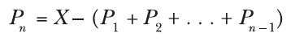

trong đó X là public key mà họ biết private key x của nó, sao cho X = xG. Khi kẻ tấn công đưa ra một chữ ký được tạo từ x, những người dùng không nghi ngờ gì xác minh chữ ký của message bằng public key P<sub>1</sub> + P<sub>2</sub> + . . . + P<sub>n</sub>, bằng X. Kẻ tấn công có thể single-handedly (một mình) ký một message thay mặt tập những người ký giả định.

Để ngăn chặn attack này, người dùng có thể chứng minh việc biết private key của public key của mình bằng cách ký một message. Vì kẻ tấn công không biết private key của P<sub>n</sub>, họ sẽ không vượt qua được bài kiểm tra này.

Một biện pháp giảm thiểu khác là sửa đổi aggregate signature scheme sao cho chữ ký được trả về không chỉ là tổng các chữ ký S = S<sub>1</sub> + S<sub>2</sub> + . . . + S<sub>n</sub> mà là tổng với các hệ số được suy ra từ các public key, như trong

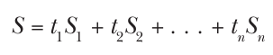

trong đó t<sub>i</sub> = H(P<sub>i</sub> || P<sub>1</sub> || P<sub>2</sub> || . . . || P<sub>n</sub>) với i = 1, 2, . . . , n. Khi đó, aggregate public key dùng để xác minh một chữ ký là P = t<sub>1</sub>P<sub>1</sub> + t<sub>2</sub>P<sub>2</sub> + . . . + t<sub>n</sub>P<sub>n</sub>. Bạn có thể thấy thủ thuật này hoạt động bằng cách kiểm tra rằng e(P, H(M)) vẫn bằng e(G, S).

## Threshold signature protocol (Threshold Signature Protocols)

Threshold signature khác với multisignature và aggregate signature—vốn đòi hỏi mọi bên tham gia signing protocol có public key và private key riêng—ở chỗ có một private key k duy nhất và một public key P duy nhất, và có n bên tham gia, mỗi bên có một share khác nhau của key k<sub>i</sub>, trong đó một tham số t (ngưỡng, threshold) được định nghĩa sao cho t < n và:

• t + 1 người ký có thể cùng nhau phát hành một chữ ký hợp lệ của một message nào đó được xác minh bằng public key P, theo cách mà không người ký nào biết được private key k. Điều này được thực hiện bằng cách chạy một protocol dùng các share k<sub>i</sub> của mỗi người ký và message cần ký, mà không bao giờ để lộ private key cho bất kỳ bên nào.

• Một tập t người ký hoặc ít hơn không thể tạo chữ ký và do đó cũng không thể xác định private key k.

Chữ ký được phát hành trông giống một chữ ký single-signer bình thường và được xác minh như vậy.

Threshold signature là một loại cụ thể của multiparty computation (MPC), một lớp protocol trong đó n bên tham gia tính đầu ra của một function f(x<sub>1</sub>, x<sub>2</sub>, . . . , x<sub>n</sub>) nào đó sao cho mỗi bên tham gia biết đầu vào x<sub>i</sub> tương ứng của mình và biết được đầu ra của function nhưng không biết được các đầu vào x<sub>i</sub> của các bên tham gia khác. Trong trường hợp threshold signature, các x<sub>i</sub> là các share của private key, và đầu ra là một chữ ký. Tôi sẽ giải thích rõ share là gì trong mục “Secret-Sharing Techniques” ở trang 319.

Threshold signature có lợi ích là “che giấu” số người co-signers và danh tính của họ, vì người xác minh chỉ thấy một chữ ký từ một private key duy nhất. Dù một số multisignature scheme và aggregate signature scheme cũng có tính chất này, threshold signature phù hợp hơn với trường hợp sử dụng lưu ký (custody) tài sản crypto vì chỉ có một private key và một public key; bạn có thể áp dụng trực tiếp threshold signature để phân tán quyền kiểm soát bất kỳ địa chỉ nào.

### Các trường hợp sử dụng (Use Cases)

Threshold signature được dùng trong quản lý cryptocurrency và tài sản số để phân tán quyền kiểm soát một địa chỉ qua nhiều hệ thống hoặc nhiều bên. Chúng có thể dùng để chia sẻ quyền kiểm soát một tài khoản giữa một nhà cung cấp dịch vụ và thiết bị của người dùng: mỗi bên có một share của key và phải cùng nhau chạy một protocol để ký một giao dịch, tức là tiêu tiền. Cách thiết lập này bảo đảm rằng kẻ tấn công không thể tự mình cho phép giao dịch, ngay cả khi họ xâm nhập thiết bị của người dùng và lấy được các key share. Tương tự, nhà cung cấp không thể khởi tạo giao dịch mà không có sự đồng ý của người dùng. Tuy nhiên, triển khai model này một cách tin cậy đặt ra nhiều thách thức, đặc biệt là các khía cạnh quản lý key (tạo key, xoay vòng key, sao lưu, v.v.).

Một tổ chức cũng có thể dùng threshold signature để phân tán việc lưu ký tiền qua nhiều hệ thống, như các loại thiết bị, data center, hệ điều hành và thành phần phần mềm khác nhau. Cách tiếp cận này đặc biệt phù hợp với cold wallet và các tài khoản chứa tài sản lớn. Chỉ dựa vào threshold signature là không đủ, vì các biện pháp và kiểm soát security toàn diện là then chốt. Ví dụ, người ta phải tách biệt đúng cách quyền truy cập vào các thành phần IT để bảo đảm rằng các cá nhân hoặc nhà cung cấp dịch vụ IT khác nhau có quyền truy cập vào các hệ thống khác nhau (do đó vào các share khác nhau). Hơn nữa, việc khởi tạo và phê duyệt giao dịch phải chịu sự kiểm soát chặt chẽ và có audit trail.

### Security model (Security Model)

Như với mọi cryptographic protocol, chúng ta cần định nghĩa một threshold signing scheme an toàn có nghĩa là gì. Một security model như vậy bao gồm security goal (điều gì phải khó đối với kẻ tấn công) và attacker model (các giả định về khả năng của kẻ tấn công). Hãy đi sâu vào hai đặc điểm này.

#### Security goal (Security Goals)

Security goal chính của threshold signature giống như của chữ ký single-party: kẻ tấn công không được có khả năng làm giả chữ ký hợp lệ, điều kéo theo việc họ không được có khả năng xác định private key. Điều này cũng kéo theo việc protocol bảo đảm input privacy: các key share do các bên nắm giữ không được rò rỉ sang bất kỳ bên nào khác. Cuối cùng, protocol phải bảo đảm correctness: chữ ký mà protocol tính phải hợp lệ và mọi bên tham gia trong lần thực thi protocol đều truy cập được.

#### Attacker model (Attacker Models)

Không có một security model duy nhất cho threshold signature; thay vào đó, kẻ tấn công được đặc trưng theo nhiều chiều. Mối đe dọa chung trong mọi kịch bản tấn công là giả định rằng kẻ tấn công có thể tấn công chủ động liên lạc mạng—bắt, sửa đổi và đưa thêm message. Dùng một kênh an toàn để thiết lập liên lạc được xác thực và mã hóa giữa các bên sẽ ngăn chặn những attack như vậy. Các nhà thiết kế protocol cũng giả định liên lạc tin cậy, ở chỗ mọi message được truyền phải được nhận theo đúng thứ tự chúng được gửi.

Attacker model của threshold signature xét việc các bên tham gia bị corruption (thao túng)—cụ thể là kẻ tấn công xâm phạm hệ thống của họ, biết được bí mật của họ, và về cơ bản khiến họ làm điều kẻ tấn công muốn. Model giả định rằng kẻ tấn công không thể thao túng quá t bên; nếu không, theo định nghĩa của chức năng threshold signing, họ sẽ có thể làm giả chữ ký.

Hãy xem xét các tham số cần cân nhắc khi kẻ tấn công có thể thao túng các bên tham gia.

Thứ nhất, chúng ta đặc trưng kẻ tấn công theo số bên mà họ có thể thao túng. Có hai loại threshold signature, mỗi loại được định nghĩa bởi số lượng tối đa các bên tham gia độc hại có thể bị xâm phạm mà không làm tổn hại security của protocol:

**Honest majority (đa số trung thực)** Ở đây, kẻ tấn công bị giới hạn ở việc thao túng ít hơn một nửa số bên key-sharing. Do đó, ngưỡng t phải thỏa mãn t < n/2. Theo định nghĩa, một threshold signing protocol với tham số (t, n) phải an toàn ngay cả khi t bên tham gia bị xâm phạm. Các protocol được thiết kế theo giả định honest majority thường hiệu quả hơn, nhưng chúng không thể đáp ứng các giá trị t tùy ý. Ví dụ, một protocol với tham số (4, 5) là không khả thi trong model này, vì nó đòi hỏi chịu được tới bốn bên bị thao túng.

**Dishonest majority (đa số không trung thực)** Model này cho phép protocol hỗ trợ bất kỳ giá trị t nào từ 1 đến n – 1. Nó cho phép tạo các protocol mà trong đó tất cả trừ một bên trong n bên có thể bị thao túng, nhưng các bên độc hại vẫn không có khả năng làm giả chữ ký hay khôi phục private key. Model này mang lại sự linh hoạt hơn về giá trị ngưỡng nhưng thường đòi hỏi các cơ chế security phức tạp và mạnh mẽ hơn.

Chúng ta cũng đặc trưng kẻ tấn công theo những gì họ có thể làm một khi đã thao túng một bên và biết được các giá trị bí mật của bên đó (bao gồm key share). Có hai attacker model định nghĩa điều này:

**Passive, hay honest-but-curious (thụ động, hay trung thực nhưng tò mò)** Họ biết được thông tin từ các bên bị thao túng nhưng không thể buộc các bên đó đi chệch khỏi protocol. Điều này mô hình hóa các vụ xâm phạm “read-only”, trong đó kẻ tấn công có được một snapshot bộ nhớ của hệ thống, cả bộ lưu trữ lẫn bộ nhớ khả biến (RAM, register của bộ xử lý).

**Active, hay malicious (chủ động, hay độc hại)** Các bên có thể tùy ý đi chệch khỏi protocol được quy định. Điều này mô hình hóa các hệ thống bị kẻ tấn công xâm phạm hoàn toàn hoặc bị một người trong nội bộ độc hại kiểm soát (như một operator, administrator hay nhà cung cấp cloud).

Do đó, một protocol an toàn trước kẻ tấn công chủ động luôn an toàn trước kẻ tấn công thụ động, nhưng điều ngược lại thì không.

Có hai cách để kẻ tấn công chọn bên nào để thao túng, được định nghĩa bởi các model loại corruption sau:

**Static corruption (thao túng tĩnh)** Kẻ tấn công phải chọn những bên tham gia nào để thao túng trước khi bắt đầu protocol.

**Adaptive corruption (thao túng thích ứng)** Kẻ tấn công có thể đợi đến sau khi protocol bắt đầu mới chọn những bên tham gia nào để thao túng—và sau đó biết được lịch sử các thao tác của họ trong suốt protocol.

Một protocol an toàn trước static corruption luôn an toàn trước adaptive corruption, nhưng điều ngược lại thì không. Tuy nhiên, có những kỹ thuật để chuyển một protocol từ an toàn trước static corruption thành an toàn trước adaptive corruption.

### Các kỹ thuật Secret-Sharing

Một thành phần then chốt của threshold signature là các secret-sharing protocol, hay các kỹ thuật chia một bí mật thành nhiều mảnh (share) được phân phát cho các bên khác nhau theo cách mà các bên sau đó có thể cùng nhau tính lại bí mật ban đầu. Secret-sharing protocol đáng chú ý có thể được dùng khi tạo bản sao lưu private key sao cho các bên khác nhau lưu các share khác nhau ở các vị trí khác nhau.

#### Additive sharing (Additive Sharing)

Cách đơn giản nhất để chia sẻ một bí mật mà bạn xem như một số là thông qua additive sharing: cho một số s, bạn chia sẻ nó thành n giá trị s<sub>1</sub>, s<sub>2</sub>, . . . , s<sub>n</sub> sao cho s<sub>1</sub> + s<sub>2</sub> + . . . + s<sub>n</sub> = s. Ví dụ, nếu bạn làm việc với các số modulo 100, bạn có thể tạo một additive sharing ngẫu nhiên của số s = 47 thành bốn share như sau: chọn ba số ngẫu nhiên nằm giữa 0 và 99, chẳng hạn s<sub>1</sub> = 12, s<sub>2</sub> = 94 và s<sub>3</sub> = 80, và đặt s<sub>4</sub> = s – s<sub>1</sub> – s<sub>2</sub> – s<sub>3</sub> = 61. (Lưu ý rằng phép trừ được tính modulo 100, sao cho –1 = 99, –2 = 98, v.v.)

Cách tiếp cận này rất đơn giản nhưng đòi hỏi dùng mọi share để khôi phục bí mật ban đầu.

#### Threshold sharing (Threshold Sharing)

Threshold sharing gần hơn với những gì threshold signature làm: cho các tham số n và t < n và bí mật s, nó tạo ra các share sao cho bạn có thể khôi phục bí mật bằng bất kỳ tập t share nào trong số n share đã tạo.

Phương pháp threshold sharing best-known (nổi tiếng nhất) là Shamir’s secret sharing, tận dụng tính chất sau của đa thức: cho một đa thức bậc t có dạng

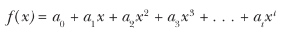

bạn chỉ cần kết quả của t + 1 lần tính f(x) trên t + 1 giá trị x phân biệt để xác định mọi hệ số a<sub>i</sub>, là các giá trị cố định.

Để tạo một threshold secret sharing từ tính chất này, hãy đặt a<sub>0</sub> = s, bí mật. Sau đó chọn các giá trị ngẫu nhiên từ a<sub>1</sub> đến a<sub>t</sub> và tính f(x) với n giá trị x phân biệt, đó sẽ là n share của bí mật.

Việc tính lại các hệ số từ các giá trị f(x) là một kỹ thuật gọi là nội suy Lagrange (Lagrange interpolation), theo tên nhà toán học người Ý thế kỷ 18th-century đã phát triển một phương pháp tổng quát để xác định phương trình của một đường cong khi cho một danh sách điểm trên đường cong đó. Thật vậy, bạn có thể nhìn bài toán theo cách hình học. Nếu phương trình có bậc 1 (và có dạng a<sub>0</sub> + a<sub>1</sub>x), thì đó là phương trình của một đường thẳng, và biết hai điểm trên một đường thẳng là đủ để xác định duy nhất đường thẳng đó. Tương tự, nếu phương trình có bậc 2 (dạng a<sub>0</sub> + a<sub>1</sub>x + a<sub>2</sub>x<sup>2</sup>), thì đường cong là một parabol, mà phương trình có thể được xác định bằng ba điểm.

Đôi khi chúng ta thấy các implementation của Shamir’s secret sharing định nghĩa một function Lagrange() tính phép nội suy và trả về hệ số a<sub>0</sub>, chính là bí mật được chia sẻ. Nếu bạn có các giá trị của f(x) cần kết hợp để khôi phục bí mật, bạn có thể định nghĩa phép toán Lagrange(s<sub>1</sub>, s<sub>2</sub>, . . . , s<sub>t</sub>) trả về bí mật được chia sẻ s. Điều này hoạt động với bất kỳ tổ hợp t share phân biệt nào, không nhất thiết là t share đầu tiên. Chi tiết của phép toán Lagrange() hơi quá kỹ thuật đối với cuốn sách này, nhưng bạn có thể triển khai nó như một chuỗi các phép cộng, phép nhân và phép nghịch đảo cơ bản.

### Trường hợp tầm thường (The Trivial Case)

Một trong những loại threshold signature đơn giản nhất dùng chữ ký BLS, như đã thấy trước đó trong bối cảnh aggregate signature. Hãy nhớ rằng cho một private key k, chữ ký BLS tính một chữ ký bằng cách nhân k với điểm trên đường cong H = H(M). Bạn có thể dùng additive sharing để tạo một threshold scheme với tham số (n – 1, n). Ví dụ, nếu n = 3, hãy chia key thành ba share sao cho k<sub>1</sub> + k<sub>2</sub> + k<sub>3</sub> = k. Khi đó, mỗi bên tính share chữ ký của mình bằng cách nhân share k<sub>i</sub> của mình với H. Cộng ba share lại cho kết quả như sau:

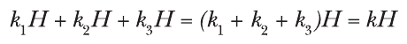

Kết hợp ba share thông qua phép cộng cho ra một chữ ký hợp lệ với k, ngay cả khi không bên nào biết k. Các bên cũng có thể khôi phục k nếu họ cộng các share tương ứng của mình, nhưng cộng share của hai bên không tiết lộ thông tin nào về k nếu các share được tạo ngẫu nhiên.

Để tạo một threshold signature scheme với t và n tùy ý, hãy dùng kỹ thuật Shamir secret-sharing và tận dụng tính tuyến tính của phép toán Lagrange(): bạn tạo các key share k<sub>i</sub> như được mô tả trong mục “Threshold Sharing” và tính chữ ký như sau:

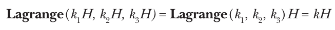

Một lần nữa, bạn có được một chữ ký hợp lệ với key k.

### Trường hợp đơn giản (The Simple Case)

Giờ bạn sẽ tính chữ ký Schnorr trong thiết lập threshold, việc này kỹ thuật hơn một chút so với chữ ký BLS. Hãy nhớ rằng scheme Schnorr tính một chữ ký là s = r + ha, trong đó h = H(R || A || M), r là nonce ngẫu nhiên per-signature, và a là private key của người ký. Chữ ký cũng bao gồm R = rG, giá trị nonce công khai. Điều này tương đối dễ biến thành một threshold signature scheme, nhờ tính tuyến tính của nó đối với các giá trị bí mật: hãy quan sát rằng bí mật r được cộng với bí mật a nhân với hash h, vốn không bí mật.

Hãy tưởng tượng trường hợp đơn giản nhất với hai người ký, với một additive sharing của private signing key k = a + b, trong đó a và b là các key share tương ứng của hai người ký. Để ký, hai bên có thể tạo các secret nonce r<sub>A</sub> và r<sub>B</sub>, với các giá trị công khai tương ứng R<sub>A</sub> = r<sub>A</sub>G và R<sub>B</sub> = r<sub>B</sub>G. Sau đó, các bên có thể trao đổi các giá trị này và tính nonce công khai R = R<sub>A</sub> + R<sub>B</sub>, sẽ là một phần của chữ ký. Khi đó, R là giá trị công khai mà bạn suy ra từ giá trị bí mật r = r<sub>A</sub> + r<sub>B</sub>, vì bạn có:

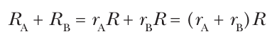

Tiếp theo, các bên tính share chữ ký của mình: s<sub>A</sub> = r<sub>A</sub> + ha và s<sub>B</sub> = r<sub>B</sub> + hb, được cộng với nhau để cho ra:

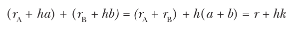

Do đó, bạn có được r + hk, một chữ ký từ key k, dù các bên tham gia chỉ dùng các additive share a và b trong tính toán của mình. Để có được một cấu trúc threshold cho các tham số t và n tùy ý, có thể dùng Shamir’s secret sharing thay cho additive sharing.

Cấu trúc ở trên không đủ an toàn để thỏa mãn mọi yêu cầu security của một threshold signing scheme. Đáng chú ý, nó dễ bị key cancellation attack trừ khi các bên tham gia commit với nonce của mình trong một giai đoạn sơ bộ của protocol—ví dụ, bằng cách gửi hash của nonce. Nó cũng có một số lỗ hổng tinh vi được giải quyết bởi protocol Flexible Round-Optimized Schnorr Threshold (FROST) signatures, do các cryptographer Chelsea Komlo và Ian Goldberg thiết kế năm 2020 và được ghi lại tại https://eprint.iacr.org/2020/852.

> **LƯU Ý** Signature protocol EdDSA từ Chương 12 tương tự chữ ký Schnorr nhưng tính nonce như một hash từ message, thay vì như một giá trị ngẫu nhiên, tùy ý. Điều này làm phức tạp việc tạo các threshold signature protocol tuân thủ đặc tả EdDSA ban đầu.

### Trường hợp khó (The Hard Case)

Signature scheme khó chạy nhất trong thiết lập threshold cũng là scheme phổ biến nhất. Signature algorithm ECDSA (xem Chương 12) phức tạp hơn chữ ký Schnorr và EdDSA vì nó liên quan đến một phép chia. Cho một message hash h = H(M), người ký chọn một số ngẫu nhiên k, tính số r từ tọa độ của điểm kG, và tính chữ ký là s = (h + ra) / k, trong đó a là private key của người ký.

Threshold signature ECDSA hiệu quả và an toàn vẫn là một bài toán nghiên cứu đầy thách thức giữa các cryptographer. Các protocol thực tế đầu tiên xuất hiện vào cuối những năm 2010s, được thúc đẩy bởi trường hợp sử dụng cryptocurrency—hầu hết các cryptocurrency hàng đầu, bao gồm Bitcoin và Ethereum, khi đó chỉ hỗ trợ ECDSA làm transaction signing scheme.

Các cryptographer đã nghĩ ra nhiều cách tiếp cận để xây dựng các ECDSA threshold signing protocol. Ví dụ, “Fast Secure Two-Party ECDSA Signing” năm 2017 của Yehuda Lindell (https://eprint.iacr.org/2017/552) đòi hỏi một commitment scheme, một homomorphic encryption scheme và một hệ thống zero-knowledge proof. Độ phức tạp của những protocol như vậy làm phức tạp việc hiểu, triển khai và phân tích security của chúng, dẫn đến một số lỗi security trong các hệ thống đã triển khai.

### Những gì có thể sai (How Things Can Go Wrong)

Các vấn đề security cụ thể trong threshold signature protocol thường phức tạp và liên quan đến những chi tiết của các cấu trúc cryptography mà tôi chưa trình bày trong cuốn sách này. Do đó, thay vì các vấn đề cụ thể, tôi sẽ thảo luận các loại vấn đề đã ảnh hưởng đến những triển khai threshold signature thực tế, từ phần mềm open source được dùng rộng rãi đến các giải pháp thương mại.

#### Bài báo so với code (Papers vs. Code)

Khi các kỹ sư cần triển khai một threshold signature protocol từ các bài báo nghiên cứu của nó, họ gặp phải những thách thức. Các bài báo này, chủ yếu nhắm đến các nhà nghiên cứu cryptography, thường có chất lượng biên tập không đồng đều và phức tạp, nặng toán học, và khá mới. Sự mới mẻ này có thể có nghĩa là một protocol thử nghiệm có thể không an toàn như dự định. Những yếu tố này góp phần tạo ra một loạt vấn đề security real-world, có thể được phân thành bốn lĩnh vực chính:

**Protocol không an toàn** Nếu protocol không an toàn trên giấy, nó sẽ không an toàn hơn khi triển khai. Các vấn đề phổ biến bao gồm bỏ sót các edge case hoặc kiểm tra hợp lệ không đầy đủ khi nhận đầu vào từ các bên khác. Ví dụ, một số protocol đã không kiểm tra xem một số đã mã hóa có nằm trong khoảng mong đợi hay không, dẫn đến các attack thực tế.

**Mô tả không đầy đủ** Các bài báo nghiên cứu không phải là đặc tả kỹ thuật mà được viết cho độc giả học thuật, nên chúng thường thiếu các chi tiết triển khai thực tế như networking và encoding. Một ví dụ đáng chú ý là TSSHOCK attack nhắm vào threshold signature, khai thác encoding mơ hồ trong các phần tử đầu vào của một hash function, như được mô tả trong “Collisions from Domain Separation Failures” ở trang 305.

**Implementation không đầy đủ** Độ phức tạp của các threshold signing protocol, với vô số thành phần con và các yêu cầu chi tiết, có thể dẫn đến việc bỏ sót các kiểm tra security, đặc biệt nếu chúng chỉ được nhắc đến trong phụ lục. Một ví dụ là khi một protocol đòi hỏi một số N = pq (cho Paillier encryption) phải được xác minh là tích của hai số nguyên tố đủ lớn thông qua một zero-knowledge proof, nhưng việc xác minh này đã bị bỏ qua trong implementation, cho phép các giá trị N không an toàn.

**Lựa chọn thành phần không an toàn** Mô tả của các protocol thường không nói “dùng hash function BLAKE3” hay “dùng elliptic curve 256-bit nistp256”; thay vào đó, chúng nói “dùng một hash function và một elliptic curve cung cấp security level bạn cần.” Do đó, việc chọn các primitive phù hợp và dùng các giao diện lập trình của chúng một cách an toàn là tùy thuộc vào người triển khai. Ví dụ, dùng một RSA modulus 1,024 bit không đủ để bảo đảm security 128-bit.

Ngoài ra, rủi ro phát sinh khi người triển khai cố ý sửa đổi một protocol, có lẽ để tăng hiệu quả hoặc để phù hợp với một trường hợp sử dụng cụ thể. Điều này thường không kết thúc tốt đẹp. Để xem các ví dụ về attack nhắm vào threshold signature, hãy xem các bài báo “Alpha-Rays: Key Extraction Attacks on Threshold ECDSA Implementations” của Dmytro Tymokhanov và Omer Shlomovits (https://eprint.iacr.org/2021/1621) và “Practical Key-Extraction Attacks in Leading MPC Wallets” của Nikolaos Makriyannis, Oren Yomtov và Arik Galansky (https://eprint.iacr.org/2023/1234).

#### Các khía cạnh quản lý key (Key Management Aspects)

Một người bạn từng nhận xét: “Cứ mỗi 10 dòng code encryption, có 1,500 dòng quản lý key,” điều nhấn mạnh tầm quan trọng và sự phức tạp của các quy trình quản lý key, bao gồm tạo, lưu trữ, sao lưu và khôi phục key. Dù những khía cạnh này có thể bị bỏ qua trong các bài báo học thuật tập trung vào khía cạnh lý thuyết, chúng là sống còn trong các ứng dụng thực tế. Các kỹ sư và chuyên gia security triển khai threshold signing trong môi trường production phải ưu tiên những vấn đề quản lý key này—ngay cả các threshold signature protocol mạnh mẽ nhất cũng không thể thay thế cho các thực hành quản lý key toàn diện.

Hãy điểm qua các cân nhắc chính về quản lý key cho một tổ chức dùng threshold signature để bảo vệ lượng cryptocurrency nắm giữ đáng kể:

**Tạo key** Dù bạn dùng distributed key generation hay tạo key tập trung, bạn phải bảo đảm rằng các giá trị bí mật không bị lộ cho các hệ thống hoặc các bên không được phép trong hoặc sau quá trình tạo key. Sự bảo đảm này thường được cung cấp thông qua các quy trình nghiêm ngặt như key ceremony, bảo đảm tính toàn vẹn supply-chain và audit trail, để chứng minh rằng key đã được tạo đúng cách. Đừng cho phép bên khác (như một nhà cung cấp cloud) tạo key thay mặt bạn hoặc có khả năng đọc chúng vào bất kỳ lúc nào.

**Lưu trữ key** Lưu một key dưới dạng nhiều share thay vì một giá trị duy nhất không làm giảm sự cần thiết của lưu trữ an toàn. Bảo vệ nhiều bí mật trên các nền tảng đa dạng có thể là một thách thức lớn hơn so với bảo vệ một bí mật duy nhất trên một nền tảng thống nhất. Các key share phải được lưu trong một loại bộ nhớ an toàn nào đó, được bảo vệ trước truy cập trái phép, can thiệp và các tấn công vật lý.

**Sao lưu và khôi phục key** Triển khai một threshold scheme trong đó, chẳng hạn, bạn cần ba trên sáu share để ký một giao dịch, sẽ bảo vệ trước việc mất key share hoặc sự cố hệ thống. Tuy nhiên, điều này không phủ nhận sự cần thiết của việc sao lưu key, mà bạn cũng nên duy trì dưới dạng threshold share. Bắt buộc phải phân phối quyền truy cập vào các share sao lưu này cho các bên khác nhau. Ngoài ra, hãy định kỳ kiểm chứng độ tin cậy của các bản sao lưu để bảo đảm chúng chưa bị xâm phạm và có thể được dùng hiệu quả để tái tạo key khi cần, như trong các buổi diễn tập khôi phục sau thảm họa.

## Zero-Knowledge Proof

Zero-knowledge proof (ZKP) là một trong những công cụ mạnh nhất của các cryptographer. Đây là các protocol giữa hai bên, một prover (bên chứng minh) và một verifier (bên xác minh), trong đó prover thuyết phục verifier rằng một điều gì đó là đúng mà không tiết lộ bất cứ điều gì về lý do. Ví dụ, prover có thể chứng minh rằng họ biết một lời giải cho một bài toán tính toán khó nào đó mà không tiết lộ lời giải. Bạn có thể tạo một ZKP cho bất kỳ bài toán NP-complete nào để chứng minh bạn biết một lời giải mà không tiết lộ nó.

Tổng quát hơn, ZKP được dùng để chứng minh một mệnh đề (statement), như “số được mã hóa trong ciphertext này nằm giữa 100 và 200” hoặc “với một plaintext P và ciphertext C cho trước, tôi biết một secret key K sao cho C = AES(K, P).”

Để có phần giới thiệu non-technical về zero-knowledge proof, tôi giới thiệu video “Computer Scientist Explains One Concept in 5 Levels of Difficulty” của cryptographer Amit Sahai (https://youtu.be/fOGdb1CTu5c). Để biết chi tiết toán học, hãy xem các liên kết trên https://github.com/matter-labs/awesome-zero-knowledge-proofs.

> **LƯU Ý** Thuật ngữ zero-knowledge proof là một sự đơn giản hóa của các thuật ngữ chính xác hơn trong tài liệu nghiên cứu. Ví dụ, nhiều protocol “zero-knowledge proof” thực ra là zero-knowledge argument of knowledge. Các nhà nghiên cứu dành thuật ngữ proof cho security vô điều kiện và dùng argument cho security tính toán. Hơn nữa, thuật ngữ witness chỉ bí mật cho phép prover chứng minh mệnh đề của mình, như một sự tổng quát hóa của secret hay secret key, do phạm vi rộng hơn của nó.

### Security model (Security Model)

Một ZKP protocol an toàn có nghĩa là gì? Kẻ tấn công là prover hay verifier? Họ có thể tấn công protocol như thế nào? Hãy trả lời những câu hỏi này bằng cách xem xét các security goal và attacker model.

#### Security goal (Security Goals)

Một ZKP an toàn phải thỏa mãn các notion sau:

**Completeness (tính đầy đủ)** Nếu prover tuân theo protocol bằng bí mật đúng, một verifier trung thực bị thuyết phục về tính đúng đắn của mệnh đề. Nói cách khác, protocol luôn hoạt động.

**Soundness (tính đúng đắn)** Nếu prover không biết bí mật, họ không thể thuyết phục verifier trung thực về một mệnh đề sai (ngoại trừ với xác suất không đáng kể). Nói cách khác, prover không thể gian lận.

**Zero-knowledge** Một verifier không biết được gì ngoài việc mệnh đề là đúng. Cụ thể, họ không thể biết được bất cứ điều gì về bí mật của prover.

Notion rằng một verifier “sẽ bị thuyết phục về tính đúng đắn của mệnh đề” được bảo đảm bởi sự thống nhất chung rằng protocol thỏa mãn ba tính chất này—cụ thể là, một prover không thể hoàn tất protocol nếu mệnh đề là sai (ví dụ, nếu họ không biết lời giải mà họ khẳng định là biết).

#### Attacker model (Attacker Models)

Cả hai bên đều có thể là kẻ tấn công cố gắng xâm phạm lần lượt soundness và zero-knowledge:

**Prover độc hại** Muốn chứng minh một mệnh đề sai—ví dụ, để thuyết phục sai lệch verifier rằng họ biết lời giải cho một bài toán khó nào đó. Một kẻ tấn công như vậy có thể đi chệch khỏi protocol để cố đánh lừa verifier. Trong thực tế, đây là mối đe dọa lớn nhất đối với ZKP trong các ứng dụng như thực thi chương trình bí mật.

**Verifier độc hại** Muốn trích xuất thông tin về bí mật (witness), qua đó phá vỡ tính chất zero-knowledge. Các attacker model phân biệt kẻ tấn công verifier thụ động (honest-but-curious) và kẻ tấn công verifier chủ động (có thể tùy ý đi chệch khỏi protocol).

Lưu ý rằng verifier độc hại có thể thách thức completeness bằng cách tuyên bố rằng họ không bị thuyết phục về tính đúng đắn của một mệnh đề. Trong thực tế, điều này không phải là vấn đề, vì prover có thể lặp lại proof protocol cho các verifier (trung thực) khác, những người sẽ vạch trần verifier nói dối.

### Protocol của Schnorr (Schnorr’s Protocol)

Claus-Peter Schnorr, người đã tạo ra signature scheme mang tên ông, cũng mô tả một cấu trúc tương tự là một zero-knowledge proof of knowledge của một discrete logarithm. Nó là nền tảng cho chữ ký Schnorr và EdDSA, cũng như cho nhiều ZKP phức tạp hơn.

Protocol của Schnorr hoạt động theo ba bước để chứng minh việc biết a sao cho aG = A—tức là discrete logarithm của A đối với generator G:

1. Commitment: Prover chọn một số ngẫu nhiên r và gửi R = rG.

2. Challenge: Verifier gửi một số ngẫu nhiên c.

3. Response: Prover gửi s = r + ca, và verifier chấp nhận khi và chỉ khi sG = R + cA.

> **LƯU Ý** Loại protocol three-step này, với một commitment, một challenge và một response, được gọi là sigma protocol, theo hình dạng của chữ cái Hy Lạp sigma viết hoa (Σ).

Completeness của protocol Schnorr là dễ kiểm chứng nhất: nếu a thỏa mãn aG = A, bạn sẽ có

sG = (r + ca)G = rG + caG = R + cA

chính là điều kiện kiểm tra hợp lệ của prover *(ghi chú: sách in “prover’s”; đúng là “verifier’s”)*.

Để thấy rằng protocol bảo đảm soundness—rằng prover phải biết a—hãy tưởng tượng prover dùng cùng r hai lần trong hai lần chạy protocol. Khi đó, verifier nhận được hai response, s<sub>1</sub> = r + c<sub>1</sub>a và s<sub>2</sub> = r + c<sub>2</sub>a, cho hai challenger phân biệt c<sub>1</sub> và c<sub>2</sub> *(ghi chú: sách in “challengers”; đúng là “challenges”)*. Giờ họ có thể tính

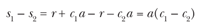

và chia kết quả cho (c<sub>1</sub> – c<sub>2</sub>) để có a. Vì việc kiểm tra rằng sG bằng R + cA bảo đảm rằng bạn có s = r + ca, suy ra prover phải biết a khi thực thi protocol này một cách đúng đắn. Kiểu lập luận logic này được gọi là knowledge extractor, và nó là kỹ thuật chính để chứng minh một ZKP là sound.

Protocol cũng có thể được chứng minh là zero-knowledge, bằng một kỹ thuật gọi là simulator, một algorithm tạo ra các message (hay một bản ghi liên lạc) không thể phân biệt được với các message trong một lần thực thi thật của một zero-knowledge proof. Tuy nhiên, khác với một prover thật, simulator không nhất thiết biết bí mật (hay witness) đang được chứng minh. Dù vậy, các message mà nó tạo ra vẫn trông hợp lệ và thuyết phục đối với verifier trong bối cảnh của proof system.

Trong protocol của Schnorr, simulator làm việc ngược lại và đầu tiên chọn một response ngẫu nhiên, s, để cho thấy rằng một s thật sẽ “ngẫu nhiên” ngang một s hoàn toàn ngẫu nhiên. Sau đó, nó chọn một challenge ngẫu nhiên c và tính commitment ban đầu là R = sG – cA. Khi đó, chứng minh rằng protocol là zero-knowledge cho thấy ba giá trị này không thể phân biệt được với các giá trị của một lần thực thi thật của protocol nhưng không đòi hỏi biết bí mật a. (Lưu ý rằng trong trường hợp của Schnorr, bạn phải giả định rằng verifier tuân theo protocol và chọn một c ngẫu nhiên.)

### Noninteractive proof (Noninteractive Proofs)

Protocol của Schnorr có tính tương tác: prover gửi một message đầu tiên, verifier phản hồi bằng một challenge, và prover gửi cho verifier một response—các bên tương tác qua ba vòng message. Nhưng nếu verifier không thể gửi message và chỉ muốn nhận một message duy nhất thuyết phục được họ thì sao? Làm thế nào người ta có thể tạo những noninteractive proof như vậy từ một protocol có tương tác?

Hãy nhìn lại protocol Schnorr, trong đó verifier gửi một challenge ngẫu nhiên c, một giá trị phải không thể đoán trước đối với prover. Nếu prover biết c trước khi gửi R, họ có thể gian lận như sau: cho c, chọn một giá trị tùy ý cho s, và tính R = sG – cA; rồi gửi R này cho verifier, và gửi s làm response cho c. Việc xác minh thành công, nhưng prover không cần dùng giá trị bí mật a.

Làm thế nào để c không thể đoán trước đối với prover mà không cần tương tác với verifier? Thủ thuật là suy ra c từ R bằng một hash function, điều này ngăn prover tìm một cặp (R, c) thỏa mãn sG = R + cA nhờ hành vi pseudorandom của hash function.

Để tạo một noninteractive zero-knowledge (NIZK) proof of knowledge của bí mật a bằng protocol của Schnorr, prover làm như sau:

1. Commitment: Prover chọn một số ngẫu nhiên r và tính R = rG.

2. Challenge: Prover tính c = H(G || R || A); bạn phải đưa vào các giá trị G và A để ràng buộc việc tạo c với tham số generator G và với public key A của prover.

3. Response: Prover tính s = r + ca và tạo proof dưới dạng một encoding của R và s.

Để xác minh một proof (R, s) nhận được từ prover có public key A, verifier tính lại challenge c = H(G || R || A) và kiểm tra đẳng thức sG = R + cA có đúng không.

Thủ thuật hash dữ liệu protocol để thay thế các challenge verifier-generated đã được hình thức hóa bởi Fiat–Shamir transform, một kỹ thuật tổng quát để biến một protocol có tương tác thành một protocol không tương tác. Để transform này áp dụng được, các challenge ngẫu nhiên của verifier phải độc lập với message của prover và phải là các giá trị công khai (không bí mật).

### zkSNARK (zkSNARKs)

Hãy nói về loại zero-knowledge proof đã được chấp nhận rộng rãi trong các ứng dụng blockchain nhờ sức mạnh và hiệu quả của nó. Ví dụ, zkSNARK là nền tảng của nền tảng giao dịch bí mật Zcash: trong Zcash, zkSNARK chứng minh rằng một lượng tiền nhất định đã được trừ khỏi một tài khoản và ghi có vào một tài khoản khác, mà không tiết lộ số dư của các tài khoản và không dẫn đến lượng tính toán hay lưu trữ lớn đến mức không thể chấp nhận.

Một zkSNARK là một loại noninteractive proof of knowledge cung cấp tính chất zero-knowledge (zk), trong đó SNARK là viết tắt của:

**Succinct (súc tích)** Proof rất nhỏ so với kích thước của mệnh đề và bí mật. Nó có thể có kích thước tương đương logarit của kích thước mệnh đề, hoặc thậm chí có kích thước hằng—luôn cùng kích thước bất kể kích thước mệnh đề.

**Noninteractive (không tương tác)** Một SNARK là một noninteractive argument of knowledge, thường dùng Fiat–Shamir transform để biến một protocol có tương tác thành một protocol không tương tác. Nó không cần verifier gửi message cho prover.

**Argument** Argument of knowledge là một proof an toàn về mặt tính toán, tức là an toàn có điều kiện. Nói cách khác, nó sẽ không an toàn trước một kẻ tấn công có sức mạnh tính toán vô hạn, điều nhìn chung là một hạn chế chấp nhận được.

**Of knowledge** Một SNARK cung cấp completeness và soundness, với tư cách một argument of knowledge.

Ngoài ra, việc tạo proof và xác minh một zkSNARK phải hiệu quả về mặt tính toán.

Tạo một proof súc tích như vậy khi bạn muốn chứng minh việc biết lời giải cho một bài toán mà mô tả của nó thậm chí không vừa trong kích thước proof nghe có vẻ phản trực giác. Ví dụ, còn những mệnh đề như “Tôi biết một lời giải cho phương trình f(x) = 0,” khi phương trình f(x) có thể có kích thước tùy ý thì sao? Từ góc độ lý thuyết, proof ngắn là hợp lý vì thông tin duy nhất một proof phải truyền tải là việc biết một lời giải nào đó và nói chung là tính đúng đắn của một mệnh đề nào đó, chứ không phải bản thân lời giải và các bí mật; proof phải là zero-knowledge và chỉ tiết lộ thông tin đó cho verifier.

Năm 2016, cryptographer Jens Groth đã công bố bài báo “On the Size of Pairing-Based Non-interactive Arguments” (https://eprint.iacr.org/2016/260), mô tả một zkSNARK hiệu quả đặc biệt. Proof chỉ gồm ba phần tử group và có thể được xác minh bằng cách tính ba phép toán pairing (cùng loại pairing như với chữ ký BLS). Protocol Zcash đã áp dụng kết quả đột phá này, thứ đặt nền móng cho một số zkSNARK khác. zkSNARK của Groth thường được gọi đơn giản là Groth16.

### Từ mệnh đề đến proof (From Statements to Proofs)

zkSNARK là một trong những cấu trúc cryptography phức tạp nhất, với một trong những bước phức tạp và tốn kém nhất của chúng là arithmetization, một phép toán chuyển mệnh đề cần chứng minh thành một số lượng cố định các phương trình đa thức, thường có dạng

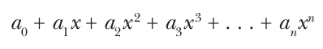

với một đa thức bậc n, trong đó các hệ số a<sub>i</sub> là các phần tử của một cấu trúc finite ring hoặc finite field nào đó. Sau đó, proving algorithm xử lý các đa thức để tạo zkSNARK proof.

Arithmetization tuân theo một quy trình chung:

1. Mô tả mệnh đề cần chứng minh bằng các ký hiệu hình thức, như một chương trình máy tính, các phương trình hay các công thức logic.

2. Biến đổi biểu thức hình thức từ bước 1 thành một circuit, thứ định nghĩa một đầu ra từ các giá trị đầu vào bằng cách áp dụng một chuỗi gate lên đầu vào, tương tự các cổng logic trong một mạch Boolean hay mạch điện tử, ngoại trừ việc các gate có thể là các phép toán đại số như cộng và nhân.

3. Biến circuit thành một danh sách ràng buộc có cấu trúc, theo constraint system của proof system zkSNARK. Những ràng buộc như vậy là danh sách các điều kiện mà đầu vào phải đáp ứng để thỏa mãn mệnh đề cần chứng minh.

Mệnh đề cần chứng minh có thể tầm thường như “Tôi biết các số nguyên x và y thỏa mãn phương trình x<sup>3</sup> + y<sup>2</sup> + xy + 55 = 0 mod 57.” Điều này hoàn tất bước 1 bằng việc có một phương trình hình thức biểu diễn bài toán. Để hoàn tất bước 2, bạn có thể chia nhỏ phương trình thành một chuỗi các phép toán đơn giản liên quan đến hai toán hạng (Groth16 đòi hỏi điều này). Việc này hoạt động như sau, trong đó bạn viết các giá trị trung gian v<sub>0</sub>, v<sub>1</sub>, . . . , v<sub>6</sub>:

Đặt v<sub>0</sub> = x × x.

Đặt v<sub>1</sub> = x × v<sub>0</sub>; do đó v<sub>1</sub> = x<sup>3</sup>.

Đặt v<sub>2</sub> = y × y.

Đặt v<sub>3</sub> = x × y.

Đặt v<sub>4</sub> = v<sub>1</sub> + v<sub>2</sub>.

Đặt v<sub>5</sub> = v<sub>4</sub> + v<sub>3</sub>.

Đặt v<sub>6</sub> = v<sub>5</sub> + 55; do đó v<sub>6</sub> = x<sup>3</sup> + y<sup>2</sup> + xy + 55.

Việc chuyển một phương trình dài thành một chuỗi các phương trình nhỏ như vậy được gọi là flattening.

Sau đó, prover chuyển các phép toán này—circuit—thành một tập cấu trúc toán học dùng để xây dựng các đa thức được prover xử lý. Các đa thức dài cuối cùng được “nén” thành một proof bằng tính ngẫu nhiên, cụ thể là khái niệm probabilistically checkable proof (PCP), một khám phá lớn của lĩnh vực lý thuyết độ phức tạp. Điều này thuyết phục verifier rằng nhiều ràng buộc được thỏa mãn chỉ với một vài lần kiểm tra ràng buộc thực tế, trong khi vẫn bảo toàn tính chất zero-knowledge.

Để tìm hiểu thêm về sự phức tạp của arithmetization, hãy nghiên cứu hai cách tiếp cận chính được zkSNARK dùng: rank-1 constraint systems (R1CS) và algebraic intermediate representations (AIR).

Cuối cùng, lưu ý rằng chúng ta phân biệt các proof system zkSNARK nonuniversal và universal: trong loại thứ nhất, prover làm việc cho một mệnh đề cụ thể, được định nghĩa trước. Đặc biệt, giai đoạn thiết lập của proof system tạo ra các tham số chỉ phù hợp với một mệnh đề cho trước. Tuy nhiên, các universal proof system như Marlin và Plonk nhận đầu vào là một mệnh đề và tạo proof cho nó. Chúng linh hoạt hơn nhưng cũng phức tạp hơn để xây dựng và có chi phí tính toán cao hơn.

### Những gì có thể sai (How Things Can Go Wrong)

zkSNARK có thể gặp phải cùng các loại vấn đề như trong bối cảnh threshold signature, từ một protocol không an toàn đến các lỗi implementation. Các vấn đề security có thể phát sinh ở các giai đoạn khác nhau của quy trình, từ việc định nghĩa mệnh đề đến bước arithmetization và việc tính proof. Notion security bị ảnh hưởng có thể là completeness, soundness hay zero-knowledge. Nhưng hầu hết thời gian, rủi ro lớn nhất liên quan đến soundness, hay khả năng kẻ tấn công gian lận và đánh lừa verifier—cả vì tác động tiềm tàng lên ứng dụng lẫn vì sự tinh vi của các soundness bug, trong khi việc rò rỉ “knowledge” ít có khả năng xảy ra hơn, đặc biệt nếu proof phải vẫn là một proof hợp lệ được verifier chấp nhận.

Trong các ví dụ sắp tới, chúng ta sẽ tập trung vào protocol của Schnorr. Các vấn đề tương đối đơn giản, nhưng các proof system phức tạp hơn có thể có những vấn đề tinh vi hơn nhiều.

Hãy nhớ rằng protocol không tương tác của Schnorr chứng minh việc biết a với một verifier biết A = aG bằng cách gửi cho verifier s = r + ca và R = rG với một r ngẫu nhiên và c = H(G || R || A). Sau đó, verifier kiểm tra đẳng thức sG = R + cA sau khi tính lại c. Trong phiên bản có tương tác, verifier chọn c ngẫu nhiên.

#### Fiat–Shamir hashing không đủ (Insufficient Fiat–Shamir Hashing)

Hãy tưởng tượng rằng thay vì c = H(G || R || A), một noninteractive Schnorr proof dùng c = H(G || A), khiến challenge c độc lập với nonce R. Khi đó, kẻ tấn công chọn một giá trị tùy ý cho s và tính R = sG – cA. Proof thu được gồm s và R là hợp lệ, nhưng kẻ tấn công không cần biết a, qua đó phá vỡ soundness của protocol.

Tương tự, nếu c = H(G || R), bỏ public key A khỏi dữ liệu được hash để định nghĩa challenge c, một attack là khả thi: giờ kẻ tấn công có thể chọn các giá trị R và s tùy ý và tính điểm B = (1/c) × (sG – R), thỏa mãn sG = R + cB. Điều này cho kẻ tấn công một proof of knowledge của discrete logarithm của B—cụ thể là b sao cho B = bG—trong khi họ không biết nó.

Những attack này minh họa tầm quan trọng của việc đưa mọi giá trị cần thiết vào đầu vào hash function khi dùng Fiat–Shamir transform để làm một protocol trở thành không tương tác.

#### Replay attack (Replay Attacks)

Replay là một attack tầm thường nhưng có thể gây tàn phá. Nếu kẻ tấn công biết được giá trị của một noninteractive proof of knowledge nào đó, họ có thể gửi nó cho một bên khác và nói rằng họ đã tạo ra nó, nhận công cho knowledge được chứng minh.

Bạn có thể tránh điều này bằng cách ràng buộc proof với danh tính của prover, đưa public key của họ vào dữ liệu được hash. Để ngăn việc replay bởi cùng một bên theo thời gian, bạn có thể ràng buộc proof với một session identifier hoặc timestamp bằng cách đưa những giá trị như vậy vào dữ liệu được các Fiat–Shamir hash xử lý.

#### Dùng lại tính ngẫu nhiên (Randomness Reuse)

Hãy xét protocol Schnorr có tương tác, trong đó verifier chọn một c ngẫu nhiên. Nếu prover có một pseudorandom generator bị lỗi và dùng lại cùng challenge r hai lần *(ghi chú: sách in “challenge r”; đúng là “nonce r”)*, thì kẻ tấn công quan sát các giá trị được trao đổi có thể khôi phục bí mật a bằng cách dùng hai proof s<sub>1</sub> = r + c<sub>1</sub>a và s<sub>2</sub> = r + c<sub>2</sub>a cho hai challenger phân biệt *(ghi chú: sách in “challengers”; đúng là “challenges”)*, c<sub>1</sub> và c<sub>2</sub>, và tính a = (s<sub>1</sub> – s<sub>2</sub>) / (c<sub>1</sub> – c<sub>2</sub>).

## Crypto thực sự nghiêm túc (Really Serious Crypto)

Với chương cuối cùng này, chúng ta đã điểm qua một số chủ đề hấp dẫn nhất trong cryptography vào thời điểm viết sách, từ cả góc nhìn lý thuyết lẫn thực tiễn. Tuy vậy, chúng ta mới chỉ chạm vào bề mặt, đặc biệt là trong lĩnh vực các hệ thống zero-knowledge proof, một không gian nghiên cứu và kỹ thuật sôi động với nhiều ứng dụng rộng rãi vượt ra ngoài công nghệ blockchain. Nhưng cryptography hay ho không phải là thuốc chữa bách bệnh của blockchain. Từ các multiparty computation protocol như private set intersection (PSI) đến homomorphic encryption được dùng để đánh giá riêng tư các model AI, các ứng dụng và trường hợp sử dụng mới đòi hỏi những chức năng cryptography tốt hơn, nhanh hơn.

Chúng ta đang chứng kiến một thời kỳ hoàng kim của cryptography, với sự hội tụ chưa từng có giữa các nguyên lý lý thuyết và các ứng dụng thực tiễn. Sự hiệp lực này đang mang lại những giải pháp gần như kỳ diệu cho một số vấn đề security và quyền riêng tư nan giải nhất. Tuy nhiên, những thách thức đáng kể cần được giải quyết, đặc biệt là trong các lĩnh vực pháp lý và quy định. Điều bắt buộc là các nhà công nghệ và các nhà hoạch định chính sách phải hợp tác chặt chẽ để vượt qua những thách thức này và cả hai bên đều cố gắng hiểu quan điểm của nhau. Tôi hy vọng rằng cuốn sách này, và đặc biệt là chương cuối cùng này, góp phần giải mã cryptography và làm cho nó dễ tiếp cận hơn và bớt bí ẩn hơn đối với mọi độc giả.
