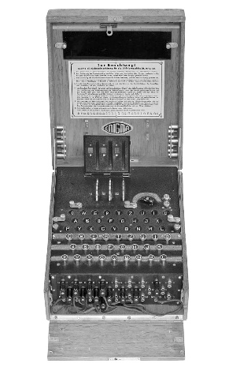
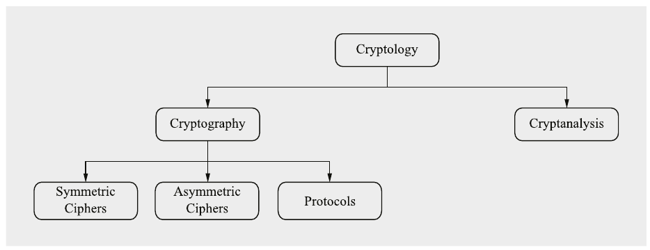
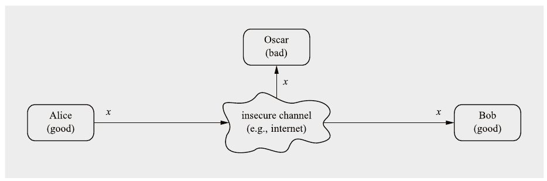
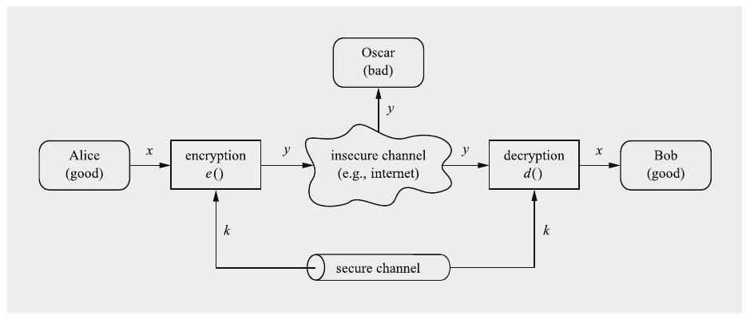
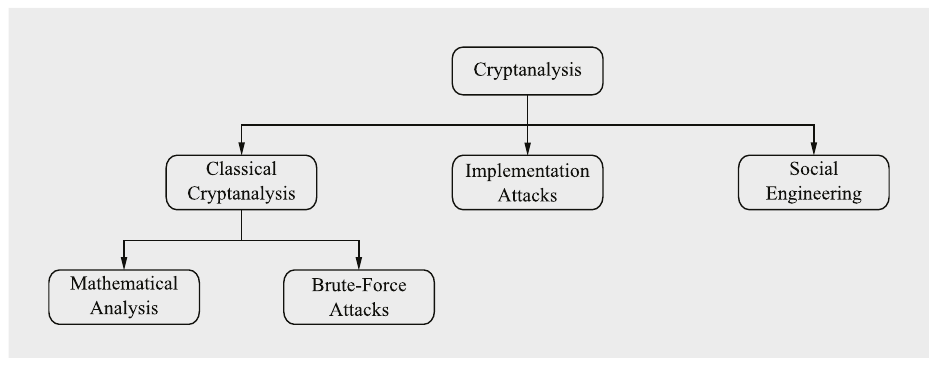
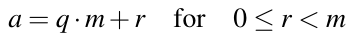
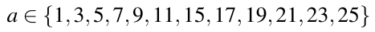
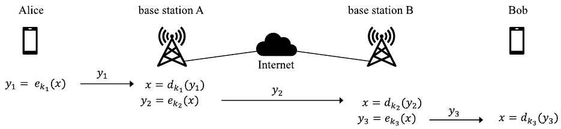
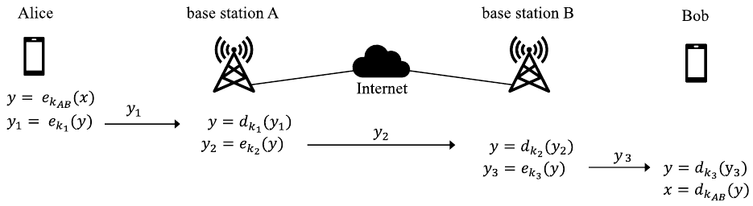

# Chương 1 Giới thiệu về Cryptography và bảo mật dữ liệu (Introduction to Cryptography and Data Security)

Mục này sẽ giới thiệu các thuật ngữ quan trọng nhất của cryptology hiện đại và sẽ dạy một bài học quan trọng về thuật toán proprietary so với thuật toán được công khai. Chúng ta cũng sẽ giới thiệu modular arithmetic, thứ hữu ích cho các cipher lịch sử và có tầm quan trọng lớn trong public-key cryptography hiện đại.

Trong chương này bạn sẽ học:

■ Các quy tắc chung của cryptography

■ Độ dài key cho bảo mật short-, medium- và long-term

■ Các cách khác nhau để tấn công cipher

■ Một vài cipher lịch sử, và trên đường đi chúng ta sẽ học về modular arithmetic

■ Vì sao chỉ nên dùng các thuật toán cryptographic well-established

## 1.1 Tổng quan về Cryptology (và về cuốn sách này)

Cuốn sách trong tay bạn cung cấp phần giới thiệu về cryptography. Đây là một phần của lĩnh vực rộng hơn là cybersecurity, lĩnh vực xử lý việc bảo vệ thông tin số khỏi bị lạm dụng. Dù cybersecurity là một lĩnh vực phức tạp bao gồm cả các khía cạnh kỹ thuật lẫn các khía cạnh tổ chức và con người, gần như mọi giải pháp IT security trong thực tế đều dùng cryptography như một module then chốt. Một phép so sánh thô đến từ lĩnh vực ô tô: Nếu cybersecurity là một chiếc xe, cryptography là động cơ. Dù hiển nhiên có nhiều bộ phận và công nghệ cần cho một chiếc xe, mọi ô tô đều dựa vào động cơ như một thành phần trung tâm. Điều tương tự đúng trong lĩnh vực bảo mật: Rất khó xây dựng các hệ thống số an toàn mà không có các thuật toán cryptographic. Như chúng ta biết từ các tin tức gần như hằng ngày về các vụ hack thành công vào hệ thống IT, cybersecurity rất khó đạt được. Trong bối cảnh này, điều quan trọng cần ghi nhớ là cryptography ngày nay thường là phần an toàn nhất của một giải pháp cybersecurity. Cuốn sách này chủ yếu quan tâm tới các thuật toán cryptographic hiện đại, còn được gọi là cryptographic primitive hay cipher.

Nếu nghe từ cryptography, liên tưởng đầu tiên của chúng ta có thể là cryptocurrency, end-to-end encryption cho ứng dụng nhắn tin tức thời chạy trên smartphone, hay truy cập website an toàn. Có lẽ chúng ta quay ngược lịch sử một chút và nghĩ về vụ tấn công nổi tiếng vào máy mã hóa Enigma của Đức trong Thế chiến II (Hình 1.1). Dù sao đi nữa, cryptography có vẻ gắn chặt với truyền thông điện tử hiện đại. Tuy nhiên, cryptography là một nghề khá lâu đời, với những ví dụ sớm có từ khoảng 2000 năm trước Công nguyên, khi các chữ tượng hình “bí mật” non-standard được dùng ở Ai Cập cổ đại. Từ thời Ai Cập, cryptography đã được dùng dưới hình thức này hay hình thức khác trong nhiều, nếu không nói là hầu hết, các nền văn hóa đã phát triển chữ viết. Chẳng hạn, có những trường hợp được ghi chép về chữ viết bí mật ở Hy Lạp cổ đại, cụ thể là scytale của Sparta (Hình 1.2), hay Caesar cipher nổi tiếng ở La Mã cổ đại, thứ chúng ta sẽ học ở phần sau của chương này. Tuy nhiên, cuốn sách này tập trung mạnh vào các phương pháp cryptographic hiện đại và cũng dạy nhiều vấn đề bảo mật dữ liệu và mối quan hệ của chúng với cryptography.



Hình 1.1 Máy mã hóa Enigma của Đức (in lại với sự cho phép của Deutsches Museum, Munich)


Hình 1.2 Scytale của Sparta

Bây giờ hãy xem lĩnh vực cryptography, được thể hiện trong Hình 1.3. Điều đầu tiên chúng ta để ý là thuật ngữ tổng quát nhất là cryptology chứ không phải cryptography. Cryptology chia thành hai nhánh chính:



Hình 1.3 Tổng quan về lĩnh vực cryptology

Cryptography là khoa học về việc bảo vệ truyền thông trước một đối thủ. Về mặt lịch sử, mục tiêu chính của crypography *(ghi chú: sách in crypography; đúng là cryptography)* là che giấu ý nghĩa của một message. Tuy nhiên, ngày nay cryptography cũng được dùng cho nhiều mục tiêu bảo mật khác như integrity và authenticity của message.

Cryptanalysis là khoa học, và đôi khi là nghệ thuật, phá các cryptosystem. Bạn có thể nghĩ rằng phá mã là việc của giới tình báo hoặc có lẽ của tội phạm có tổ chức, và không nên được đưa vào một phân loại nghiêm túc của một ngành khoa học. Tuy nhiên, hầu hết cryptanalysis ngày nay được thực hiện bởi các nhà nghiên cứu đáng kính trong giới học thuật. Cryptanalysis có tầm quan trọng trung tâm đối với các cryptosystem hiện đại: Không có những người cố phá các phương pháp cryptographic của chúng ta, chúng ta sẽ không bao giờ biết liệu chúng có thực sự an toàn hay không. Vấn đề này được thảo luận chi tiết hơn trong Mục 1.3.

Vì cryptanalysis là cách duy nhất để bảo đảm một cryptosystem an toàn, nó là một phần không thể thiếu của cryptology. Dù vậy, trọng tâm của cuốn sách này là cryptography: Chúng tôi giới thiệu chi tiết các thuật toán cryptographic thực tế quan trọng nhất. Tất cả đều là các cipher đã chịu được cryptanalysis trong một thời gian dài, trong hầu hết trường hợp là vài thập kỷ. Về cryptanalysis, chúng tôi chủ yếu giới hạn ở việc đưa ra các kết quả state-of-the-art về việc phá các thuật toán cryptographic được giới thiệu, chẳng hạn kỷ lục phân tích thừa số để phá scheme RSA.

Bây giờ hãy quay lại Hình 1.3. Bản thân cryptography chia thành ba nhánh chính:

Symmetric Algorithms (thuật toán đối xứng) là thứ mà nhiều người nghĩ cryptography là như vậy: Hai bên có một phương pháp mã hóa và giải mã mà họ dùng chung một secret key. Toàn bộ cryptography từ thời cổ đại cho tới năm 1976 đều chỉ dựa trên các phương pháp symmetric. Các symmetric cipher vẫn được dùng rộng rãi, đặc biệt cho việc mã hóa dữ liệu thực tế và kiểm tra integrity của message.

Asymmetric (or Public-Key) Algorithms (thuật toán bất đối xứng) Năm 1976, một loại cipher hoàn toàn khác được Whitfield Diffie, Martin Hellman và Ralph Merkle giới thiệu. Trong public-key cryptography, tồn tại hai key: Một người dùng sở hữu một secret key như trong symmetric cryptography nhưng cũng có một public key. Các thuật toán asymmetric có thể được dùng cho các ứng dụng như digital signature và key establishment nhưng cũng cho mã hóa dữ liệu kiểu cổ điển.

Cryptographic Protocols (giao thức cryptographic) Nói đại khái, các cryptographic protocol hiện thực các chức năng bảo mật phức tạp hơn thông qua việc dùng các thuật toán cryptographic. Các thuật toán symmetric và asymmetric có thể được xem như các khối xây dựng mà với chúng có thể hiện thực các ứng dụng như truyền thông internet an toàn. Scheme Transport Layer Security (TLS), được dùng trong mọi trình duyệt web, là một ví dụ về cryptographic protocol.

Nói chính xác, hash function, sẽ được giới thiệu trong Chương 11, tạo thành một lớp thuật toán thứ ba nhưng đồng thời chúng có nhiều tính chất chung với symmetric cipher.

Trong phần lớn các ứng dụng cryptographic trong hệ thống thực tế, các thuật toán symmetric và asymmetric (và thường cả hash function) đều được dùng cùng nhau. Chúng đôi khi được gọi là hybrid scheme. Lý do dùng cả hai họ thuật toán là mỗi họ có điểm mạnh và điểm yếu riêng.

Trọng tâm chính của cuốn sách này là các thuật toán symmetric và asymmetric, cũng như hash function. Tuy nhiên, chúng tôi cũng sẽ giới thiệu các security protocol cơ bản. Cụ thể, chúng tôi sẽ giới thiệu vài key establishment protocol và thảo luận những gì có thể đạt được với cryptographic protocol, bao gồm confidentiality của dữ liệu, integrity của dữ liệu, authentication của dữ liệu, nhận dạng người dùng, v.v.

## 1.2 Symmetric Cryptography

Mục này đề cập khái niệm symmetric cipher và giới thiệu substitution cipher lịch sử. Dùng substitution cipher làm ví dụ, chúng ta sẽ học sự khác biệt giữa tấn công brute-force và tấn công phân tích (analytical).

### 1.2.1 Cơ bản

Các scheme symmetric cryptographic còn được gọi là các scheme hay thuật toán symmetric-key, secret-key và single-key. Symmetric cryptography được giới thiệu tốt nhất bằng một bài toán easy-to-understand: Có hai người dùng, Alice và Bob, muốn giao tiếp qua một kênh không an toàn (Hình 1.4). Thuật ngữ kênh (channel) nghe có thể hơi trừu tượng nhưng nó chỉ là một thuật ngữ chung cho liên kết truyền thông: Đây có thể là internet, một khoảng không khí trong trường hợp smartphone hay mạng Wi-Fi gia đình, hoặc bất kỳ phương tiện truyền thông nào khác bạn có thể nghĩ tới. Vấn đề thực sự bắt đầu với kẻ xấu, Oscar[^1], kẻ có quyền truy cập vào kênh, chẳng hạn bằng cách hack vào một router internet hoặc bằng cách nghe các tín hiệu radio của một kết nối Wi-Fi. Kiểu nghe lén trái phép này được gọi là eavesdropping. Hiển nhiên, có nhiều tình huống trong đó Alice và Bob muốn giao tiếp mà không có Oscar nghe lén. Chẳng hạn, nếu Alice và Bob đại diện cho trụ sở chính và văn phòng nghiên cứu của một công ty dược phẩm, và họ đang truyền các tài liệu chứa chiến lược phát triển một loại thuốc mới trong vài năm tới, các tài liệu này không nên lọt vào tay đối thủ cạnh tranh, hay vào tay các cơ quan tình báo nước ngoài.



Hình 1.4 Truyền thông qua một kênh không an toàn

Trong tình huống này, symmetric cryptography đưa ra một giải pháp mạnh mẽ: Alice mã hóa message x của cô bằng một thuật toán symmetric, thu được ciphertext y. Bob nhận ciphertext và giải mã message. Như vậy, giải mã là quá trình ngược của mã hóa (Hình 1.5). Ưu điểm là gì? Nếu chúng ta có một thuật toán mã hóa mạnh, ciphertext sẽ trông như các bit ngẫu nhiên và Oscar sẽ không thể thu được thông tin hữu ích nào từ nó.



Hình 1.5 Cryptosystem Symmetric-key

Các biến x, y và k trong Hình 1.5 có tên đặc biệt trong cryptography:

■ x được gọi là plaintext hay cleartext,

■ y được gọi là ciphertext,

■ k được gọi là key.

Lưu ý rằng tập hợp tất cả các key khả dĩ được gọi là key space. Hệ thống cần một kênh an toàn để phân phối key giữa Alice và Bob. Kênh an toàn được thể hiện trong Hình 1.5 có thể, chẳng hạn, là một người mang key trong ví giữa Alice và Bob. Tất nhiên, đây là một phương pháp cồng kềnh. Một ví dụ mà phương pháp này hoạt động tốt là các pre-shared key được dùng trong mã hóa Wi-Fi Protected Access (WPA) trong mạng LAN không dây. Ở phần sau của cuốn sách này, chúng ta sẽ học các phương pháp thiết lập key qua các kênh không an toàn. Dù sao đi nữa, key chỉ phải được truyền một lần giữa Alice và Bob và sau đó có thể được dùng để bảo vệ nhiều lần truyền thông tiếp theo.

Một sự thật quan trọng và cũng phản trực giác trong tình huống này là cả thuật toán mã hóa lẫn thuật toán giải mã đều được công khai. Có vẻ như việc giữ bí mật thuật toán mã hóa sẽ làm toàn bộ hệ thống khó bị phá hơn. Tuy nhiên, thuật toán bí mật cũng có nghĩa là thuật toán ít được kiểm thử kỹ: Cách duy nhất để biết một phương pháp mã hóa có mạnh hay không, tức là không thể bị phá bởi một kẻ tấn công quyết tâm, là công khai nó và để các nhà cryptographer khác phân tích nó. Vui lòng xem Mục 1.3 để có thêm thảo luận về chủ đề này. Thứ duy nhất nên được giữ bí mật trong một cryptosystem vững chắc là key.

Nhận xét:

1. Có vẻ rất khả năng là hầu hết các thuật toán cryptographic hiện đại không thể bị phá bởi bất kỳ ai trên hành tinh Trái Đất, kể cả các cơ quan tình báo lớn. Tuy nhiên, điều này giả định rằng thuật toán được dùng đúng. Đặc biệt, chúng ta phải bảo đảm kẻ tấn công không lấy được key. Tất nhiên, một khi Oscar biết key, hắn có thể dễ dàng giải mã message vì thuật toán được công khai.

Do đó, điều then chốt cần lưu ý là bài toán truyền một message một cách an toàn được quy về các bài toán truyền key một cách bí mật và lưu trữ key một cách an toàn.

2. Trong kịch bản này, chúng ta chỉ xét vấn đề confidentiality, tức là che giấu nội dung message khỏi một kẻ nghe lén. Ở phần sau của cuốn sách, chúng ta sẽ thấy có nhiều điều khác chúng ta có thể làm với cryptography, chẳng hạn ngăn Oscar thực hiện những thay đổi không bị phát hiện đối với message (message integrity) hoặc bảo đảm rằng một message thực sự đến từ Alice (sender authentication).

### 1.2.2 Mã hóa symmetric đơn giản: Substitution Cipher

Bây giờ chúng ta sẽ học một trong những phương pháp đơn giản nhất để mã hóa văn bản, substitution (= thay thế) cipher. Về mặt lịch sử, loại cipher này đã được dùng rộng rãi, và nó là một minh họa tốt về cryptography cơ bản. Chúng ta sẽ dùng substitution cipher để học một số sự thật quan trọng về độ dài key và về các cách khác nhau để tấn công các thuật toán cryptographic.

Mục tiêu của substitution cipher là mã hóa văn bản (trái với mã hóa bit trong các hệ thống số hiện đại). Ý tưởng rất đơn giản: Chúng ta thay mỗi chữ cái trong bảng chữ cái bằng một chữ cái khác.

Ví dụ 1.1.

Plaintext Ciphertext

A → k

B → d

C → w

···

Chẳng hạn, nhóm nhạc pop ABBA sẽ được mã hóa thành kddk.

◇

Chúng ta giả định rằng chúng ta chọn bảng thay thế hoàn toàn ngẫu nhiên, để kẻ tấn công không thể đoán được nó. Lưu ý rằng bảng thay thế chính là key của cryptosystem này. Như mọi khi trong symmetric cryptography, key, tức là bảng thay thế, phải được phân phối giữa Alice và Bob một cách an toàn.

Ví dụ 1.2. Hãy xem một ciphertext khác:

```
iq ifcc vqqr fb rdq vfllcq na rdq cfjwhwz hr bnnb
            hcc hwwhbsqvqbre hwq vhlq
```

◇

Điều này có vẻ không có nhiều ý nghĩa và trông giống cryptography tử tế. Tuy nhiên, substitution cipher hoàn toàn không an toàn! Hãy xem các cách phá cipher này.

#### Tấn công thứ nhất: Brute-Force Attack hay Exhaustive Key Search

Các tấn công Brute-force coi cipher như một hộp đen. Chúng dựa trên một khái niệm đơn giản: Oscar, kẻ tấn công, có ciphertext từ việc nghe lén trên kênh và tình cờ có một đoạn plaintext ngắn, chẳng hạn header của một file đã được mã hóa. Bây giờ Oscar chỉ đơn giản giải mã đoạn ciphertext đầu tiên với mọi key khả dĩ. Một lần nữa, key của cipher này là bảng thay thế. Nếu plaintext kết quả khớp với đoạn plaintext ngắn đó, hắn biết rằng hắn đã tìm được key đúng.

> Định nghĩa 1.2.1 Exhaustive Key Search cơ bản hay Brute-Force Attack
>
> Gọi (x,y) là cặp plaintext và ciphertext, và gọi K = {k<sub>1</sub>,...,k<sub>κ</sub>} là key space gồm mọi key khả dĩ k<sub>i</sub>. Khi đó, một brute-force attack kiểm tra với mọi k<sub>i</sub> ∈ K xem liệu
>
> d<sub>k<sub>i</sub></sub>(y) ≟ x.
>
> Nếu đẳng thức đúng, một key có thể đúng đã được tìm thấy; nếu không, tiếp tục với key tiếp theo.

Trong thực tế, một brute-force attack có thể phức tạp hơn vì các key sai có thể cho kết quả false positive. Chúng ta sẽ đề cập vấn đề này trong Mục 5.2.

Điều quan trọng cần lưu ý là về nguyên tắc, một brute-force attack nhắm vào symmetric cipher luôn khả thi. Việc nó có khả thi trong thực tế hay không phụ thuộc vào key space, tức là vào số key khả dĩ tồn tại cho một cipher cho trước. Nếu việc thử tất cả các key trên nhiều máy tính hiện đại mất quá nhiều thời gian, tức là hàng trăm hay hàng nghìn năm, cipher đó an toàn về mặt tính toán (computationally secure) trước brute-force attack. Sẽ nói thêm về bảo mật tính toán trong Mục 2.2.3.

Hãy xác định key space của substitution cipher: Khi chọn chữ thay thế cho chữ cái đầu tiên A, chúng ta chọn ngẫu nhiên một chữ cái từ 26 chữ cái của bảng chữ cái (trong ví dụ trên chúng ta đã chọn k). Chữ thay thế cho chữ cái tiếp theo B được chọn ngẫu nhiên từ 25 chữ cái còn lại, v.v. Do đó tồn tại số bảng thay thế khác nhau như sau:

key space của substitution cipher = 26 · 25···3 · 2 · 1 = 26! ≈ 2<sup>88</sup>

Điều đó có nghĩa là key space có kích thước khoảng 2<sup>88</sup>, bằng key space của một cipher có key gồm 88 bit. Ngay cả với hàng trăm nghìn PC high-end, một cuộc tìm kiếm như vậy sẽ mất vài thập kỷ! Do đó, chúng ta bị cám dỗ kết luận rằng substitution cipher an toàn. Nhưng điều này không đúng vì có một tấn công khác, mạnh hơn, sẽ được mô tả sau đây.

#### Tấn công thứ hai: Phân tích tần suất chữ cái (Letter Frequency Analysis)

Trước hết, chúng ta lưu ý rằng brute-force attack ở trên coi cipher như một hộp đen, tức là chúng ta không phân tích cấu trúc bên trong của cipher. Substitution cipher có thể dễ dàng bị phá bởi một tấn công phân tích (analytical attack) như vậy.

Điểm yếu lớn của cipher này là mỗi ký hiệu plaintext luôn ánh xạ tới cùng một ký hiệu ciphertext. Điều đó có nghĩa là các tính chất thống kê của plaintext được giữ nguyên trong ciphertext. Nếu quay lại ví dụ thứ hai, chúng ta quan sát thấy chữ q xuất hiện thường xuyên nhất trong văn bản. Từ đó chúng ta biết q phải là chữ thay thế cho một trong các chữ cái phổ biến trong tiếng Anh. Với các tấn công thực tế, có thể khai thác các tính chất sau của ngôn ngữ:

1. Xác định tần suất của mỗi chữ cái ciphertext. Phân bố tần suất, thường khá ổn định ngay cả với các đoạn văn bản mã hóa tương đối ngắn, sẽ gần với phân bố của ngôn ngữ đó nói chung. Đặc biệt, các chữ cái thường gặp nhất thường có thể dễ dàng được nhận ra trong ciphertext. Chẳng hạn, trong tiếng Anh E là chữ cái thường gặp nhất (khoảng 13%), T là chữ cái thường gặp thứ hai (khoảng 9%), A là chữ cái thường gặp thứ ba (khoảng 8%), v.v. Bảng 1.1 liệt kê phân bố tần suất chữ cái của tiếng Anh.

Bảng 1.1 Tần suất tương đối của các chữ cái trong tiếng Anh

| Chữ cái | Tần suất | Chữ cái | Tần suất |
|---|---|---|---|
| A | 0.0817 | N | 0.0675 |
| B | 0.0150 | O | 0.0751 |
| C | 0.0278 | P | 0.0193 |
| D | 0.0425 | Q | 0.0010 |
| E | 0.1270 | R | 0.0599 |
| F | 0.0223 | S | 0.0633 |
| G | 0.0202 | T | 0.0906 |
| H | 0.0609 | U | 0.0276 |
| I | 0.0697 | V | 0.0098 |
| J | 0.0015 | W | 0.0236 |
| K | 0.0077 | X | 0.0015 |
| L | 0.0403 | Y | 0.0197 |
| M | 0.0241 | Z | 0.0007 |

2. Phương pháp trên có thể được tổng quát hóa bằng cách xem các cặp, bộ ba, bộ bốn, v.v. ký hiệu ciphertext. Chẳng hạn, trong tiếng Anh (và một số ngôn ngữ châu Âu khác), chữ Q gần như luôn được theo sau bởi chữ U. Hành vi này có thể được khai thác để phát hiện chữ thay thế cho chữ Q và chữ U.

3. Nếu chúng ta giả định rằng các dấu phân cách từ, tức là các “khoảng trắng”, đã được tìm ra (điều chỉ đôi khi xảy ra), người ta thường có thể phát hiện các từ ngắn phổ biến như THE, AND, v.v. Một khi đã nhận diện được một trong các từ này, chúng ta lập tức biết ba chữ cái (hay bao nhiêu chữ tùy độ dài của từ) cho toàn bộ văn bản.

Trong thực tế, ba kỹ thuật được liệt kê ở trên thường được kết hợp để phá các substitution cipher.

Ví dụ 1.3. Nếu phân tích văn bản mã hóa từ Ví dụ 1.2, chúng ta thu được:

```
WE WILL MEET IN THE MIDDLE OF THE LIBRARY AT NOON
            ALL ARRANGEMENTS ARE MADE
```

◇

Bài học rút ra (Lesson learned) Các cipher tốt nên che giấu các tính chất thống kê của plaintext được mã hóa. Các ký hiệu ciphertext nên trông như ngẫu nhiên. Ngoài ra, chỉ riêng một key space lớn là không đủ cho một hàm mã hóa mạnh.

## 1.3 Cryptanalysis

Mục này đề cập độ dài key được khuyến nghị cho symmetric cipher và các cách khác nhau để tấn công các thuật toán cryptographic. Chúng tôi nhấn mạnh rằng một cipher nên an toàn ngay cả khi kẻ tấn công biết các chi tiết của thuật toán.

### 1.3.1 Những suy nghĩ chung về việc phá cryptosystem

Nếu chúng ta hỏi một người có chút nền tảng kỹ thuật về việc phá cipher là gì, anh ấy/cô ấy nhiều khả năng sẽ nói rằng phá mã liên quan tới toán học nặng, những người thông minh và các máy tính lớn. Chúng ta có trong đầu hình ảnh các nhà phá mã người Anh trong Thế chiến II, tấn công cipher Enigma của Đức với các nhà toán học cực kỳ thông minh (nhà khoa học máy tính nổi tiếng Alan Turing dẫn đầu nỗ lực này) và các máy tính electro-mechanical room-sized. Tuy nhiên, trong thực tế cũng có những phương pháp phá mã khác. Với một cryptosystem an toàn, điều quan trọng là (1) dùng các thuật toán và protocol cryptographic vững chắc và (2) dùng các hiện thực đúng của các thuật toán. Hãy xem các cách khác nhau để phá cryptosystem trong thế giới thực được thể hiện trong Hình 1.6.

#### Cryptanalysis cổ điển

Cryptanalysis cổ điển cố phá một cipher bằng cách phân tích input và output. Nhớ lại từ thảo luận trước rằng cryptanalysis có thể được chia thành các tấn công phân tích, khai thác cấu trúc bên trong của phương pháp mã hóa, và các tấn công brute-force, coi thuật toán mã hóa như một hộp đen và thử mọi key khả dĩ. Mục tiêu cụ thể của đối thủ có thể khác nhau nhưng trong hầu hết trường hợp Oscar cố khôi phục plaintext x từ ciphertext y hoặc cố khôi phục key k từ ciphertext y. Đặc biệt với các tấn công phân tích, xem xét đối thủ có thông tin gì ngoài ciphertext là hữu ích. Các lớp tấn công chính là:



Hình 1.6 Tổng quan về cryptanalysis

■ Ciphertext-only attack: Đối thủ chỉ có quyền truy cập vào ciphertext.

■ Known-plaintext attack: Ngoài ciphertext, đối thủ còn biết một số đoạn plaintext (chẳng hạn thông tin header của một file hay email đã được mã hóa).

■ Chosen-plaintext attack: Đối thủ có thể chọn plaintext được mã hóa và cũng có quyền truy cập vào ciphertext tương ứng. Chẳng hạn, đây có thể là trường hợp khi hắn có quyền truy cập vào một thiết bị giải mã như smart card và hắn cố khôi phục secret key.

■ Chosen-ciphertext attack: Đối thủ có thể chọn ciphertext và cũng thu được plaintext tương ứng. Một lần nữa, mục tiêu thường là khôi phục secret key.

Danh sách này không đầy đủ; các tấn công khác bao gồm adaptive chosen-plaintext và adaptive chosen-ciphertext attack hay related-key attack.

#### Tấn công vào hiện thực (Implementation Attacks)

Side-channel analysis có thể được dùng để trích xuất một secret key bằng cách quan sát hành vi của một hiện thực cryptographic, chẳng hạn một mạch tích hợp hay một phần mềm. Một họ tấn công dùng mức tiêu thụ điện hay bức xạ điện từ của CPU tính toán các thuật toán cryptographic làm sidechannel. Kẻ tấn công ghi lại các trace công suất hay điện từ và áp dụng các kỹ thuật xử lý tín hiệu để khôi phục key. Các tấn công liên quan dựa trên timing side-channels, trong đó đối thủ đo hành vi thời gian chạy của một hiện thực cryptographic và cố tính ra key từ các phép đo thời gian. Tất cả các tấn công này chủ yếu được dùng nhắm vào các thiết bị mà kẻ tấn công có quyền truy cập vật lý như smart card, smartphone hay thiết bị IoT.[^2]

Một họ tấn công khác khai thác software side-channels. Chúng chủ yếu liên quan nếu các process khác nhau đang chạy trên một máy tính, chẳng hạn trong cloud computing. Giả định là đối thủ điều khiển một process mà qua đó hắn có thể biết được các giá trị bí mật như cryptographic key từ một process khác. Để có được thông tin, process thù địch khai thác các hiệu ứng như hành vi thời gian hay mẫu truy cập cache. Một cơ chế chính để ngăn software side-channels là bảo đảm các hiện thực cryptographic có thời gian chạy không đổi, độc lập với mọi giá trị bí mật.

#### Tấn công Social Engineering

Hối lộ, tống tiền, lừa gạt hay gián điệp cổ điển có thể được dùng để lấy một secret key bằng cách lôi kéo con người. Chẳng hạn, buộc ai đó tiết lộ secret key của họ, chẳng hạn bằng cách dí súng vào đầu họ, có thể khá thành công. Một tấn công khác, ít bạo lực hơn, chỉ đơn giản là gọi điện thoại cho nạn nhân và nói: “Đây là phòng IT của công ty bạn. Để cập nhật phần mềm quan trọng, chúng tôi cần mật khẩu của bạn”. Luôn đáng ngạc nhiên khi có bao nhiêu người đủ naïve để thực sự đưa ra mật khẩu của họ trong những tình huống như vậy.

Dù cả tấn công vào hiện thực lẫn tấn công social engineering có thể khá mạnh trong thực tế, cuốn sách này chủ yếu giả định các tấn công dựa trên cryptanalysis toán học và tấn công brute-force.

Chúng tôi lưu ý rằng danh sách các tấn công nhắm vào hệ thống cryptographic chắc chắn không đầy đủ. Chẳng hạn, malware trên máy tính cũng có thể làm lộ secret key trong các hệ thống phần mềm. Bạn có thể nghĩ rằng nhiều tấn công trong số này, đặc biệt là social engineering và tấn công vào hiện thực, là “không công bằng” nhưng có rất ít sự công bằng trong cryptography real-world. Nếu người ta muốn phá hệ thống IT của bạn, họ đã phá luật rồi và vì vậy là không công bằng. Điểm chính cần học ở đây là:

Một kẻ tấn công luôn tìm mắt xích yếu nhất trong cryptosystem của bạn. Điều đó có nghĩa là chúng ta phải chọn các thuật toán mạnh và phải bảo đảm rằng mọi tấn công khác như social engineering và tấn công vào hiện thực đều không khả thi.

Các cryptosystem vững chắc nên tuân theo Nguyên lý Kerckhoffs (Kerckhoffs’ Principle), được Auguste Kerckhoffs đề ra năm 1883.

> Định nghĩa 1.3.1 Nguyên lý Kerckhoffs
>
> Một cryptosystem nên an toàn ngay cả khi kẻ tấn công (Oscar) biết mọi chi tiết về hệ thống, ngoại trừ secret key. Đặc biệt, hệ thống nên an toàn khi kẻ tấn công biết các thuật toán mã hóa và giải mã.

Một số thông tin nền về nguyên lý này có thể được tìm thấy trong phần Further Reading, Mục 1.5.

Nhận xét quan trọng: Nguyên lý Kerckhoffs là phản trực giác! Cực kỳ hấp dẫn khi thiết kế một hệ thống có vẻ an toàn hơn vì chúng ta giữ kín các chi tiết. Điều này được gọi là security by obscurity. Tuy nhiên, kinh nghiệm và lịch sử quân sự đã cho thấy theo thời gian rằng các hệ thống như vậy gần như luôn yếu, và chúng rất thường bị phá dễ dàng ngay khi thiết kế bí mật bị reverse-engineered hoặc bị rò rỉ bằng cách khác. Một case study bổ ích cho điều này là vụ tấn công vào chipcard Mifare. Loại chipcard này đã được dùng hàng triệu lần trong các ứng dụng thanh toán không tiếp xúc, chẳng hạn trong thẻ Oyster nguyên bản dùng cho hệ thống giao thông công cộng của London. Bảo mật của nó dựa trên một cipher được giữ bí mật. Điều này hoạt động “tốt” trong vài năm. Tuy nhiên, sau khi reverse-engineering cipher, các nhà nghiên cứu nhanh chóng tìm ra vài cách tấn công thuật toán, cả bằng cryptanalysis cổ điển lẫn tấn công vào hiện thực. Điều này dẫn tới các vấn đề bảo mật nghiêm trọng cho các hệ thống real-world dựa trên Mifare. Vì lý do này, các thuật toán cryptographic phải bảo đảm an toàn ngay cả khi kẻ tấn công biết mọi chi tiết bên trong ngoại trừ key.

### 1.3.2 Bao nhiêu bit key là đủ?

Trong những năm 1990 đã có nhiều thảo luận công khai về độ dài key của cipher. Trước khi đưa ra một số hướng dẫn, có hai khía cạnh then chốt cần nhớ:

1. Thảo luận về độ dài key cho các thuật toán symmetric cryptographic chỉ có ý nghĩa nếu brute-force attack là tấn công tốt nhất được biết. Như chúng ta đã thấy trong Mục 1.2.2 khi phân tích bảo mật của substitution cipher, nếu có một tấn công phân tích hiệu quả, một key space lớn hoàn toàn không giúp được gì. Tất nhiên, nếu có khả năng tấn công social engineering hay tấn công vào hiện thực, một key dài cũng không giúp được gì.

2. Độ dài key cho các thuật toán symmetric và asymmetric khác nhau rất lớn. Chẳng hạn, một symmetric key 128-bit cung cấp mức bảo mật gần như ngang với một key RSA 3072-bit (RSA là một thuật toán asymmetric phổ biến).

Cả hai sự thật này thường bị hiểu sai, đặc biệt trong tài liệu bán kỹ thuật (semitechnical).

Bảng 1.2 cho một chỉ dẫn thô về mức bảo mật của symmetric cipher đối với tấn công brute-force. Như được mô tả trong Mục 1.2.2, một key space lớn là điều kiện cần nhưng không đủ cho một symmetric cipher an toàn. Cipher cũng phải mạnh trước các tấn công phân tích. Bảng có nhắc tới máy tính lượng tử. Vai trò của chúng đối với cryptanalysis của symmetric cipher được thảo luận trong Mục 12.1.1.

Bảng 1.2 Thời gian ước tính cho các tấn công brute-force thành công nhắm vào symmetric cipher với các độ dài key khác nhau

| Độ dài key | Ước lượng bảo mật |
|---|---|
| 56–64 bit | ngắn hạn: vài giờ hoặc vài ngày |
| 112–128 bit | dài hạn: vài thập kỷ khi không có máy tính lượng tử |
| 256 bit | dài hạn: vài thập kỷ, ngay cả với máy tính lượng tử chạy các thuật toán tính toán lượng tử hiện được biết |

Dự đoán tương lai (Foretelling the Future) Tất nhiên, dự đoán tương lai thường khó: Chúng ta không thể thực sự thấy trước các phát triển kỹ thuật hay lý thuyết mới một cách chắc chắn. Như bạn có thể hình dung, rất khó biết những loại máy tính nào sẽ có vào năm 2050. Với các dự đoán medium-term, Định luật Moore (Moore’s Law) thường được giả định. Nói đại khái, Định luật Moore phát biểu rằng sức mạnh tính toán tăng gấp đôi mỗi 18 tháng[^3] trong khi chi phí giữ không đổi. Điều này có các hệ quả sau trong cryptography: Nếu hôm nay chúng ta cần một tháng và các máy tính trị giá $1,000,000 để phá một cipher X, thì:

■ Chi phí để phá cipher sẽ là $500,000 sau 18 tháng (vì chúng ta chỉ phải mua số máy tính bằng một nửa),

■ $250,000 sau 3 năm,

■ $125,000 sau 4.5 năm, v.v.

Điều quan trọng cần nhấn mạnh là Định luật Moore là một hàm mũ. Sau 15 năm, tức là sau 10 lần sức mạnh máy tính tăng gấp đôi, chúng ta có thể thực hiện số phép tính gấp 2<sup>10</sup> = 1024 lần với cùng số tiền mà hôm nay chúng ta cần chi. Nói cách khác, chúng ta chỉ cần chi khoảng 1/1000th số tiền của hôm nay để thực hiện cùng phép tính. Trong ví dụ trên, điều đó có nghĩa là sau 15 năm chúng ta có thể phá cipher X trong vòng một tháng với chi phí khoảng $1,000,000/1024 ≈ $1000. Hoặc, với $1,000,000, một tấn công có thể được hoàn thành trong vòng 45 phút sau 15 năm kể từ bây giờ. Định luật Moore hoạt động tương tự một tài khoản ngân hàng trả lãi suất 100% mỗi 18 tháng: Lãi kép tăng rất, rất nhanh. Đáng tiếc, có rất ít ngân hàng đáng tin cậy đưa ra mức lãi suất như vậy.

## 1.4 Modular Arithmetic và thêm các cipher lịch sử

Trong mục này, chúng ta dùng hai cipher lịch sử để giới thiệu modular arithmetic với số nguyên. Dù các cipher lịch sử không còn ý nghĩa thực tế, modular arithmetic cực kỳ quan trọng trong cryptography hiện đại, đặc biệt với các thuật toán asymmetric. Các cipher cổ có từ thời Ai Cập, nơi substitution cipher được dùng. Một trường hợp đặc biệt rất phổ biến của substitution cipher là Caesar cipher, được cho là đã được Julius Caesar dùng để liên lạc với quân đội của ông. Caesar cipher chỉ đơn giản dịch các chữ cái trong bảng chữ cái đi một số bước cố định. Khi tới cuối bảng chữ cái, các chữ cái lặp lại theo vòng, tương tự các số trong modular arithmetic.

Để việc tính toán với chữ cái thuận tiện hơn, chúng ta có thể gán cho mỗi chữ cái trong bảng chữ cái một số. Khi làm vậy, một phép mã hóa bằng Caesar cipher đơn giản trở thành một phép cộng (modular) với một giá trị cố định. Thay vì chỉ cộng hằng số, cũng có thể áp dụng phép nhân với một hằng số. Điều này dẫn chúng ta tới affine cipher.

Cả Caesar cipher lẫn affine cipher bây giờ sẽ được thảo luận chi tiết hơn.

### 1.4.1 Modular Arithmetic

Gần như mọi thuật toán cryptographic, cả symmetric cipher lẫn asymmetric cipher, đều dựa trên số học trong một số hữu hạn phần tử. Hầu hết các tập số chúng ta quen thuộc, như tập số tự nhiên hay tập số thực, là vô hạn. Sau đây chúng tôi giới thiệu modular arithmetic, một cách đơn giản để thực hiện số học trên một tập hữu hạn các số nguyên. Hãy xem một ví dụ về tập hữu hạn các số nguyên từ đời sống hằng ngày:

Ví dụ 1.4. Xét các giờ trên đồng hồ. Nếu bạn cứ cộng thêm một giờ, bạn thu được:

1h,2h,3h,...,11h,12h,1h,2h,3h,...,11h,12h,1h,2h,3h,...

Dù chúng ta cứ cộng thêm một giờ, chúng ta không bao giờ rời khỏi tập hợp.

◇

Hãy xem một cách tổng quát để xử lý số học trong các tập hữu hạn như vậy.

Ví dụ 1.5. Chúng ta xét tập chín số:

{0,1,2,3,4,5,6,7,8}

Chúng ta có thể làm số học thông thường miễn là kết quả nhỏ hơn 9. Chẳng hạn:

2 · 3 = 6

4 + 4 = 8

Nhưng còn 8 + 4 thì sao? Bây giờ chúng ta thử quy tắc sau: Thực hiện số học số nguyên thông thường và chia kết quả cho 9. Sau đó chúng ta chỉ xét số dư thay vì kết quả ban đầu. Vì 8 + 4 = 12, và 12/9 có số dư là 3, chúng ta viết:

8 + 4 ≡ 3 mod 9

◇

Bây giờ chúng tôi đưa ra một định nghĩa chính xác về phép toán modulo.

> Định nghĩa 1.4.1 Phép toán Modulo
>
> Cho a,r,m ∈ ℤ (trong đó ℤ là tập tất cả các số nguyên) và m > 0. Chúng ta viết
>
> a ≡ r mod m
>
> nếu m chia hết a − r.
>
> m được gọi là modulus và r được gọi là số dư (remainder).

Có những hệ quả từ định nghĩa này vượt ra ngoài quy tắc thông thường “chia cho modulus và xét số dư.” Chúng ta thảo luận chúng sau đây.

#### Tính số dư

Luôn có thể viết a ∈ ℤ sao cho

 (1.1)

Vì a − r = q · m, tức là m chia hết a − r, giờ chúng ta có thể viết: a ≡ r mod m. Lưu ý rằng r ∈ {0,1,2,...,m − 1}.

Ví dụ 1.6. Cho a = 42 và m = 9. Khi đó

42 = 4 · 9 + 6

và do đó 42 ≡ 6 mod 9.

◇

#### Số dư không duy nhất

Hơi đáng ngạc nhiên là với mỗi modulus m và số a cho trước, có (vô hạn) nhiều số dư hợp lệ. Hãy xem một ví dụ khác:

Ví dụ 1.7. Chúng ta muốn rút gọn 12 modulo 9. Đây là vài kết quả đúng theo định nghĩa:

■ 12 ≡ 3 mod 9, 3 là một số dư hợp lệ vì 9|(12 − 3)

■ 12 ≡ 21 mod 9, 21 là một số dư hợp lệ vì 9|(12 − 21)

■ 12 ≡ −6 mod 9, −6 là một số dư hợp lệ vì 9|(12 − (−6))

trong đó “x|y” có nghĩa là “x chia hết y”. Có một quy luật đằng sau hành vi này. Tập số:

{...,−24,−15,−6,3,12,21,30,...}

tạo thành cái được gọi là một equivalence class (lớp tương đương). Có tổng cộng chín equivalence class cho modulus 9:

{...,−27,−18,−9, 0, 9,18,27,...}

{...,−26,−17,−8, 1, 10,19,28,...}

⋮

{...,−19,−10,−1, 8, 17,26,35,...}

◇

Chúng ta lưu ý rằng mọi số nguyên, tức là mọi số không có phần thập phân từ âm vô cùng tới dương vô cùng, đều là thành viên của một trong các equivalence class này.

#### Mọi thành viên của một equivalence class cho trước đều hoạt động tương đương

Với một modulus m cho trước, việc chúng ta chọn phần tử nào từ một lớp cho một phép tính cho trước không quan trọng. Tính chất này của equivalence class có những hệ quả thực tế lớn. Nếu có các phép tính phức tạp với một modulus cố định — điều thường xảy ra trong cryptography — chúng ta được tự do chọn phần tử của lớp cho ra phép tính dễ nhất. Hãy xem trước một ví dụ.

Ví dụ 1.8. Phép toán cốt lõi trong nhiều scheme public-key thực tế là một phép lũy thừa có dạng x<sup>e</sup> mod m, trong đó x,e,m là các số nguyên rất lớn, chẳng hạn mỗi số 2048 bit. Dùng một ví dụ toy-size, chúng ta có thể minh họa hai cách thực hiện modular exponentiation. Chúng ta muốn tính 3<sup>8</sup> mod 7. Phương pháp thứ nhất là cách tiếp cận thẳng, và với phương pháp thứ hai chúng ta chuyển đổi bên trong equivalence class.

1. Phương pháp ngây thơ (Naïve): Chúng ta tính 3<sup>8</sup> = 6561 ≡ 2 mod 7, vì 6561 = 937 · 7 + 2. Lưu ý rằng chúng ta thu được kết quả trung gian khá lớn 6561 dù chúng ta biết kết quả cuối cùng không thể lớn hơn 6.

2. Đây là một phương pháp thông minh hơn nhiều: Trước hết chúng ta thực hiện hai phép lũy thừa từng phần:

3<sup>8</sup> = 3<sup>4</sup> · 3<sup>4</sup> = 81 · 81

Bây giờ chúng ta có thể thay các kết quả trung gian 81 bằng một thành viên khác của cùng equivalence class. Thành viên dương nhỏ nhất modulo 7 trong lớp là 4 (vì 81 = 11 · 7 + 4). Do đó:

3<sup>8</sup> = 81 · 81 ≡ 4 · 4 = 16 mod 7

Từ đây chúng ta dễ dàng thu được kết quả cuối cùng là 16 ≡ 2 mod 7.

Lưu ý rằng chúng ta có thể thực hiện phương pháp thứ hai mà không cần máy tính bỏ túi vì các số không bao giờ lớn hơn 81. Mặt khác, với phương pháp thứ nhất, chia nhẩm 6561 cho 7 đã hơi khó. Như một quy tắc chung, chúng ta nên nhớ rằng áp dụng phép rút gọn modulo càng sớm càng tốt để giữ các số nhỏ gần như luôn có lợi về mặt tính toán. ◇

Tất nhiên, kết quả cuối cùng của bất kỳ phép tính modulo nào luôn như nhau, bất kể chúng ta chuyển qua lại bên trong các equivalence class bao nhiêu lần.

#### Chúng ta chọn số dư nào?

Theo quy ước, chúng ta thường chọn r trong Phương trình (1.1) sao cho:

0 ≤ r ≤ m − 1

Tuy nhiên, về mặt toán học, việc chúng ta dùng thành viên nào của một equivalent class không quan trọng.

### 1.4.2 Integer Ring

Sau khi nghiên cứu các tính chất của phép rút gọn modulo, giờ chúng ta sẵn sàng định nghĩa theo những thuật ngữ tổng quát hơn một cấu trúc dựa trên modulo arithmetic. Hãy xem cấu trúc toán học mà chúng ta thu được nếu xét tập các số nguyên từ không tới m − 1 cùng với các phép toán cộng và nhân.

> Định nghĩa 1.4.2 Ring
>
> Integer ring ℤ<sub>m</sub> gồm:
>
> 1. Tập ℤ<sub>m</sub> = {0,1,2,...,m − 1}
>
> 2. Hai phép toán “+” và “·” cho mọi a,b ∈ ℤ<sub>m</sub> sao cho:
>
>    1. a + b ≡ c mod m (c ∈ ℤ<sub>m</sub>)
>
>    2. a · b ≡ d mod m (d ∈ ℤ<sub>m</sub>)

Trước hết hãy xem một ví dụ về một integer ring nhỏ.

Ví dụ 1.9. Cho m = 9, tức là chúng ta đang xử lý ring ℤ<sub>9</sub> = {0,1,2,3,4,5,6,7,8}. Đây là hai phép tính đơn giản trong ring này:

6 + 8 = 14 ≡ 5 mod 9

6 · 8 = 48 ≡ 3 mod 9

◇

Thêm về ring và finite field, vốn liên quan tới ring, được thảo luận trong Mục 4.3. Tại thời điểm này, các tính chất sau của ring là quan trọng:

■ Chúng ta có thể cộng và nhân hai số bất kỳ từ tập hợp và kết quả luôn nằm trong ring. Ring được gọi là đóng (closed).

■ Phép cộng và phép nhân có tính kết hợp (associative), tức là a + (b + c) = (a + b) + c và a · (b · c) = (a · b) · c, với mọi a,b,c ∈ ℤ<sub>m</sub>.

■ Phép cộng có tính giao hoán (commutative), tức là a + b = b + a, với mọi a,b ∈ ℤ<sub>m</sub>.

■ Có phần tử trung hòa 0 đối với phép cộng, tức là với mọi phần tử a ∈ ℤ<sub>m</sub> ta có a + 0 ≡ a mod m.

■ Với mọi phần tử a trong ring, luôn có phần tử đối − a sao cho a + (−a) ≡ 0 mod m, tức là additive inverse luôn tồn tại.

■ Có phần tử trung hòa 1 đối với phép nhân, tức là với mọi phần tử a ∈ ℤ<sub>m</sub> ta có a · 1 ≡ a mod m.

■ Multiplicative inverse chỉ tồn tại với một số, chứ không phải mọi, phần tử. Cho a ∈ ℤ. Inverse a<sup>−1</sup> được định nghĩa sao cho

a · a<sup>−1</sup> ≡ 1 mod m

Nếu a có inverse, chúng ta có thể chia cho phần tử này vì b/a ≡ b · a<sup>−1</sup> mod m.

■ Một tính chất khác của ring là a · (b + c) = (a · b) + (a · c) với mọi a,b,c ∈ ℤ<sub>m</sub>, tức là luật phân phối (distributive law) đúng.

Tóm lại, nói đại khái, chúng ta có thể nói ring ℤ<sub>m</sub> là tập số nguyên {0,1,2,...,m − 1} trong đó chúng ta có thể cộng, trừ, nhân và đôi khi chia.

Một vấn đề đáng thảo luận là multiplicative inverse. Cần chút công sức để tìm inverse (thường dùng extended Euclidean algorithm, được giới thiệu trong Mục 6.3). Tuy nhiên, có một cách dễ để biết inverse của một phần tử a cho trước có tồn tại hay không:

Một phần tử a ∈ ℤ có multiplicative inverse a<sup>−1</sup> khi và chỉ khi gcd(a,m) = 1, trong đó gcd là ước chung lớn nhất (greatest common divisor), tức là số nguyên lớn nhất chia hết cả hai số a và m. Việc hai số có gcd bằng 1 có tầm quan trọng trong lý thuyết số, và có một tên đặc biệt cho nó: Nếu gcd(a,m) = 1, thì a và m được gọi là nguyên tố cùng nhau (relatively prime hay coprime).

Ví dụ 1.10. Hãy xem liệu multiplicative inverse của 15 có tồn tại trong ℤ<sub>26</sub> hay không. Vì

gcd(15,26) = 1

inverse phải tồn tại. (Thực tế, inverse là 7 vì 7 · 15 ≡ 1 mod 26.) Mặt khác, vì

gcd(14,26) = 2 ≠ 1

multiplicative inverse của 14 không tồn tại trong ℤ<sub>26</sub>.

◇

Như đã đề cập trước đó, ring ℤ<sub>m</sub>, và do đó số học số nguyên với phép toán modulo, có tầm quan trọng trung tâm trong public-key cryptography hiện đại. Trong thực tế, các số nguyên liên quan có độ dài 256–4096 bit nên chúng ta cần những cách để thực hiện modular arithmetic với các số lớn như vậy một cách hiệu quả.

### 1.4.3 Shift Cipher (hay Caesar Cipher)

Bây giờ chúng tôi giới thiệu một cipher lịch sử khác, shift cipher. Thực ra nó là một trường hợp đặc biệt của substitution cipher và có một mô tả toán học rất thanh lịch.

Bản thân shift cipher cực kỳ đơn giản: Chúng ta chỉ dịch mỗi chữ cái plaintext đi một số vị trí cố định trong bảng chữ cái. Chẳng hạn, nếu dịch 3 vị trí, A sẽ được thay bằng d, B bằng e, v.v. Vấn đề duy nhất nảy sinh ở gần cuối bảng chữ cái: Chúng ta nên làm gì với X, Y, Z? Như bạn có thể đã đoán, chúng nên “quay vòng” (wrap around). Điều đó có nghĩa là X nên trở thành a, Y nên trở thành b, và Z được thay bằng c. (Xét theo quy tắc này, một tên chính xác hơn cho shift cipher sẽ là “rotation cipher” nhưng tên này hiếm khi được dùng.) Người ta cho rằng Julius Caesar đã dùng cipher này với độ dịch three-position.

Shift cipher cũng có một mô tả thanh lịch dùng modular arithmetic. Để biểu diễn cipher về mặt toán học, các chữ cái của bảng chữ cái được mã hóa thành số, như được thể hiện trong Bảng 1.3.

Bảng 1.3 Mã hóa chữ cái cho shift cipher

| A | B | C | D | E | F | G | H | I | J | K | L | M |
|---|---|---|---|---|---|---|---|---|---|---|---|---|
| 0 | 1 | 2 | 3 | 4 | 5 | 6 | 7 | 8 | 9 | 10 | 11 | 12 |
| N | O | P | Q | R | S | T | U | V | W | X | Y | Z |
| 13 | 14 | 15 | 16 | 17 | 18 | 19 | 20 | 21 | 22 | 23 | 24 | 25 |

Cả các chữ cái plaintext lẫn các chữ cái ciphertext giờ đều là phần tử của ring ℤ<sub>26</sub>. Ngoài ra, key, tức là số vị trí dịch, nằm trong ℤ<sub>26</sub> vì dịch hơn 26 lần sẽ không có ý nghĩa (dịch 27 lần sẽ giống dịch 1 lần, v.v.). Mã hóa và giải mã của shift cipher như sau.

> Định nghĩa 1.4.3 Shift Cipher
>
> Cho x,y,k ∈ ℤ<sub>26</sub>.
>
> Mã hóa: e<sub>k</sub>(x) ≡ x + k mod 26
>
> Giải mã: d<sub>k</sub>(y) ≡ y − k mod 26

Ví dụ 1.11. Cho key là k = 17, và plaintext là:

ATTACK = x<sub>1</sub>,x<sub>2</sub>,...,x<sub>6</sub> = 0,19,19,0,2,10

Khi đó ciphertext được tính là

y<sub>1</sub>,y<sub>2</sub>,...,y<sub>6</sub> = 17,10,10,17,19,1 = rkkrtb

◇

Như bạn có thể đoán từ thảo luận về substitution cipher trước đó trong cuốn sách, shift cipher hoàn toàn không an toàn. Có hai cách tấn công nó:

1. Vì chỉ có 26 key khác nhau (vị trí dịch), người ta có thể dễ dàng thực hiện một brute-force attack bằng cách thử giải mã một ciphertext cho trước với cả 26 key khả dĩ. Nếu plaintext kết quả là văn bản đọc được, bạn đã tìm ra key.

2. Như với substitution cipher, người ta cũng có thể dùng phân tích tần suất chữ cái. Tấn công này còn hiệu quả hơn với shift cipher so với substitution cipher. Ngay khi kẻ tấn công phát hiện được chữ cái ciphertext cho một chữ cái plaintext, anh ta/cô ta biết số lần dịch và do đó có key.

### 1.4.4 Affine Cipher

Bây giờ chúng ta cố cải tiến shift cipher bằng cách tổng quát hóa hàm mã hóa. Nhớ lại rằng phép mã hóa thực sự của shift cipher là phép cộng key y<sub>i</sub> ≡ x<sub>i</sub> + k mod 26. Affine cipher mã hóa bằng cách nhân plaintext với một phần của key rồi cộng phần còn lại của key.

> Định nghĩa 1.4.4 Affine Cipher
>
> Cho x,y,a,b ∈ ℤ<sub>26</sub>.
>
> Mã hóa: e<sub>k</sub>(x) = y ≡ a · x + b mod 26
>
> Giải mã: d<sub>k</sub>(y) = x ≡ a<sup>−1</sup> · (y − b) mod 26
>
> với key: k = (a,b), có ràng buộc: gcd(a,26) = 1.

Phép giải mã dễ dàng được suy ra từ hàm mã hóa:

a · x + b ≡ y mod 26

a · x ≡ (y − b) mod 26

x ≡ a<sup>−1</sup> · (y − b) mod 26

Ràng buộc gcd(a,26) = 1 xuất phát từ việc tham số key a cần được nghịch đảo để giải mã. Nhớ lại từ Mục 1.4.2 rằng một phần tử a và modulus phải nguyên tố cùng nhau để inverse của a tồn tại. Do đó, a phải nằm trong tập:

 (1.2)

Nhưng làm sao tìm a<sup>−1</sup>? Hiện tại, chúng ta có thể đơn giản tính nó bằng thử và sai: Với một a cho trước, chúng ta chỉ thử mọi giá trị khả dĩ a<sup>−1</sup> cho tới khi thu được:

a · a<sup>−1</sup> ≡ 1 mod 26

Chẳng hạn, nếu a = 3, thì a<sup>−1</sup> = 9 vì 3 · 9 = 27 ≡ 1 mod 26. Lưu ý rằng a<sup>−1</sup> cũng luôn thỏa điều kiện gcd(a<sup>−1</sup>,26) = 1 vì inverse của a<sup>−1</sup> luôn tồn tại. Thực tế, inverse của a<sup>−1</sup> chính là a. Do đó, với việc xác định a<sup>−1</sup> bằng trial-and-error, người ta chỉ phải kiểm tra các giá trị cho trong Phương trình (1.2).

Ví dụ 1.12. Cho key là k = (a,b) = (9,13), và plaintext là

ATTACK = x<sub>1</sub>,x<sub>2</sub>,...,x<sub>6</sub> = 0,19,19,0,2,10.

Ciphertext được tính là

y<sub>1</sub>,y<sub>2</sub>,...,y<sub>6</sub> = 13,2,2,13,5,25 = nccnfz

Để giải mã, cần xác định inverse của a, hóa ra là a<sup>−1</sup> = 3. ◇

Affine cipher có an toàn không? Không! Key space chỉ lớn hơn một chút so với trường hợp shift cipher:

key space = (#giá trị cho a) · (#giá trị cho b)

= 12 · 26 = 312

Tất nhiên, một key space với 312 phần tử vẫn có thể được tìm kiếm vét cạn, tức là bị brute-force attack, trong một phần giây với bất kỳ PC nào. Ngoài ra, affine cipher có cùng điểm yếu với shift cipher và substitution cipher: Ánh xạ giữa các chữ cái plaintext và các chữ cái ciphertext là cố định. Do đó, nó cũng có thể bị phá bằng phân tích tần suất chữ cái.

Phần còn lại của cuốn sách này đề cập các thuật toán cryptographic mạnh có ý nghĩa thực tế.

## 1.5 Thảo luận và đọc thêm (Discussion and Further Reading)

Cuốn sách này đề cập các khía cạnh thực tế của cryptography và bảo mật dữ liệu và được dự định dùng như một tài liệu nhập môn; nó phù hợp cho việc dạy trên lớp, học từ xa và self-study. Ở cuối mỗi chương, chúng tôi đưa ra một mục thảo luận trong đó chúng tôi mô tả ngắn gọn các chủ đề cho độc giả quan tâm nghiên cứu thêm nội dung.

Cryptography so với Cybersecurity so với Safety và Reliability Như đã đề cập ngay ở đầu cuốn sách, cryptography là một phần của các lĩnh vực rộng hơn là cybersecurity và IT security, nơi khó có sự phân biệt rõ ràng giữa hai thuật ngữ sau. Thực tế, tồn tại nhiều định nghĩa cho IT- và cybersecurity. Theo truyền thống, các thuật ngữ đó thường được mô tả là liên quan tới “bảo đảm confidentiality, integrity và availability của thông tin”, đôi khi được gọi là bộ ba CIA (CIA triad). Tuy nhiên, ngoài ba mục tiêu bảo mật cơ bản này, thường có thêm các mục tiêu khác, bao gồm authenticity, accountability, non-repudiation và reliability. Thêm về security service có thể được tìm thấy trong Mục 10.1.3 của cuốn sách này. Điều quan trọng cần ghi nhớ là cryptography, IT- và cybersecurity đều liên quan tới việc bảo vệ hệ thống thông tin trước các tác nhân con người độc hại, mà trong cuốn sách này chúng tôi gọi là kẻ tấn công hay đối thủ. Ngược lại, technical safety[^4] quan tâm tới việc bảo vệ trước các mối nguy như các hỏng hóc ngẫu nhiên phát sinh trong quá trình sử dụng thông thường của các hệ thống kỹ thuật. Chẳng hạn, khi lái xe, chúng ta muốn bảo đảm phanh và tay lái không hỏng — nếu không nó sẽ không an toàn (unsafe). Để đạt được technical safety như vậy, hệ thống phải tin cậy (reliable). Khác với security, safety và reliability chủ yếu không quan tâm tới hỏng hóc do tác nhân độc hại mà do các hỏng hóc kỹ thuật (ngẫu nhiên). Dù reliability và security phụ thuộc lẫn nhau một phần, chúng liên quan tới các khía cạnh khác nhau của việc bảo vệ hệ thống.

Để tiếp cận vấn đề IT security một cách có hệ thống, tồn tại vài framework chung. Chúng thường theo một cách tiếp cận toàn diện bằng cách tính đến mọi yếu tố security-relevant. Một cách tiếp cận như vậy đòi hỏi các asset và nhu cầu bảo mật tương ứng phải được xác định, và tiềm năng tấn công và các đường tấn công khả dĩ phải được đánh giá. Cuối cùng, các biện pháp đối phó thích đáng phải được chỉ định để hiện thực một mức bảo mật phù hợp cho một ứng dụng hay môi trường cụ thể. Có rất nhiều tiêu chuẩn có thể được dùng để đánh giá và giúp định nghĩa một hệ thống an toàn. Trong số các tiêu chuẩn nổi bật hơn có ISO/IEC 27001 cho Information Security Management Systems (ISMS), Common Criteria for Information Technology Security Evaluation [75] và FIPS PUBS [116]. Ở một số ngành, các tiêu chuẩn giúp thiết lập một cách tiếp cận domain-specific hơn đối với IT security, chẳng hạn ISO/IEC 62443 cho mạng truyền thông công nghiệp hay ISO/SAE 21434 cho cybersecurity engineering cho phương tiện giao thông đường bộ [147]. Hơn nữa, tồn tại các framework như NIST framework để cải thiện IT security trong hạ tầng trọng yếu [29].

Các cipher lịch sử và Nguyên lý Kerckhoffs Chương này đã giới thiệu một vài cipher lịch sử. Tuy nhiên, còn rất, rất nhiều cipher khác, từ các cipher thời cổ đại tới các phương pháp mã hóa của WWII. Với độc giả muốn học thêm về các cipher lịch sử và vai trò của chúng qua các thế kỷ, các cuốn sách của Bauer [30], Kahn [156], Singh [237] và Wrixon [254] được khuyến nghị. Ngoài việc là những cuốn sách đọc trước giờ ngủ hấp dẫn, các cuốn sách này giúp hiểu vai trò của tình báo quân sự và ngoại giao trong việc định hình lịch sử thế giới. Chúng cũng giúp đặt cryptography hiện đại vào một bối cảnh rộng hơn.

Auguste Kerckhoffs là một nhà cryptographer và ngôn ngữ học người Hà Lan trong nửa sau thế kỷ mười chín. Ông quan sát thấy cryptography thường được dùng sai trong thực tế và đã đề ra sáu nguyên lý năm 1883, được liệt kê dưới đây. Thứ ngày nay được biết rộng rãi là Nguyên lý Kerckhoffs thực ra là nguyên lý thứ hai trong danh sách.

■ Hệ thống nên, nếu không phải là không thể phá về mặt lý thuyết, thì không thể phá trong thực tế.

■ Thiết kế của một hệ thống không nên đòi hỏi giữ bí mật, và việc hệ thống bị lộ không nên gây bất tiện cho các bên liên lạc.

■ Key nên dễ nhớ mà không cần ghi chép và nên dễ thay đổi.

■ Các cryptogram nên truyền được bằng điện báo.

■ Thiết bị hay tài liệu nên mang theo được và vận hành được bởi một người.

■ Hệ thống nên dễ dùng, không đòi hỏi biết một danh sách dài quy tắc cũng không gây căng thẳng tinh thần.

Đáng chú ý là vài nguyên lý trong số này liên quan tới việc dùng cryptography, trái với các khía cạnh kỹ thuật của cipher, một sự thật mới chỉ được Sasse [226] nhận ra tương đối gần đây. Mãi tới những năm 1990, usable security mới nổi lên như một ngành nghiên cứu thực thụ trong cộng đồng khoa học.

Modular Arithmetic Phần toán học được giới thiệu trong chương này, modular arithmetic, thuộc lĩnh vực lý thuyết số. Đây là một lĩnh vực hấp dẫn mà, đáng tiếc, về mặt lịch sử đã bị xem là một “nhánh toán học không có ứng dụng”. Do đó, nó hiếm khi được dạy bên ngoài các chương trình toán. Có rất nhiều sách về lý thuyết số. Trong số các sách nhập môn kinh điển có tài liệu tham khảo [204, 222]. Một cuốn sách đặc biệt dễ tiếp cận được viết cho non-mathematications *(ghi chú: sách in non-mathematications; đúng là non-mathematicians)* là tài liệu tham khảo [236].

Provable Security (bảo mật chứng minh được) Do tập trung vào cryptography thực tế, cuốn sách này bỏ qua phần lớn các khía cạnh liên quan tới nền tảng lý thuyết của các thuật toán và protocol cryptographic. Một trong những nền tảng của cryptography lý thuyết xây dựng trên niềm tin rằng mọi scheme cryptographic nên đi kèm một chứng minh toán học chặt chẽ về bảo mật của nó (“security proof”) dưới một giả định cryptographic hardness well-defined và hợp lý. Các ví dụ về giả định hardness như vậy bao gồm giả định rằng tính discrete logarithm trên một số group prime-order nhất định là khó, giả định rằng tìm một vector nhỏ trong một lattice high-dimensional là khó, hoặc giả định rằng tìm một collision trong một hash function cụ thể là khó. Khái niệm này được gọi là provable security.[^5] Một cách không chính thức, “provable security” đạt được cho một scheme cryptographic cho trước khi người ta cung cấp (i) một mô tả thuật toán của scheme cryptographic; (ii) một phát biểu định nghĩa chặt chẽ và chính xác về khả năng và mục tiêu của đối thủ (security model); và (iii) một chứng minh toán học rằng scheme đề xuất đáp ứng mục tiêu bảo mật của nó, giả sử một giả định cryptographic tiêu chuẩn nào đó đúng. Điểm (iii) đáng chú ý và xứng đáng được quan tâm hơn. Chứng minh toán học này chỉ ra một cách hình thức rằng cách duy nhất để phá scheme (trong security model đã định nghĩa) là tấn công giả định cryptographic nền tảng. Chứng minh đúng với mọi tấn công khả dĩ dưới cùng các giả định, kể cả những tấn công chúng ta không thể hình dung ra tại thời điểm thiết kế scheme.

Các tài liệu tham khảo tiêu chuẩn cho provable security là các giáo trình của Katz/Lindell [158] và Goldreich [123, 124]. Cũng được khuyến nghị là cuốn sách trực tuyến gần đây hơn của Rosulek [223].

Một vài lần cuốn sách này cũng đề cập tới provable security, chẳng hạn mối quan hệ giữa trao đổi key Diffie–Hellman và bài toán Diffie–Hellman (xem Mục 8.4), các hash function block cipher-based trong Mục 11.3.1, bảo mật của scheme message authentication HMAC trong Mục 13.2, hay bảo mật của lattice-based cryptography dựa trên tính khó giải được phỏng đoán của shortest-vector problem trong Mục 12.2.

Các scheme cryptographic nâng cao Có nhiều cấu trúc cryptographic nâng cao vượt ra ngoài các symmetric cipher và asymmetric cipher là chủ đề chính của cuốn sách này. Sau đây chúng tôi phác họa một số ví dụ quan trọng hơn về cryptography nâng cao.

Homomorphic encryption cho phép tính toán trên dữ liệu đã mã hóa, tức là trên ciphertext, mà không cần giải mã trước. Một kịch bản ứng dụng chính là cloud computing, nơi một người dùng có một lượng dữ liệu khổng lồ ở dạng mã hóa trên cloud. Nếu dữ liệu, chẳng hạn, là một cơ sở dữ liệu khách hàng lớn, người dùng có thể muốn tải về một số bản ghi khách hàng thỏa các tiêu chí nhất định. Thách thức là thực hiện một tìm kiếm như vậy trên ciphertext. Tương đối dễ xây dựng các scheme partially homomorphic encryption, là các cấu trúc cho phép thực hiện một phép toán toán học trên ciphertext, thường là phép nhân hoặc phép cộng. Thực tế, hai scheme mã hóa asymmetric phổ biến RSA (xem Chương 7) và Elgamal (xem Mục 8.5) là partially homomorphic. Đáng tiếc, một phép toán toán học là không đủ cho phần lớn các ứng dụng thực tế. Trong một thời gian dài, việc tìm ra một scheme fully homomorphic encryption cho phép các phép toán tùy ý được coi là chén thánh của cryptography. Scheme đầu tiên như vậy được Gentry [122] đề xuất năm 2009, dựa trên lattice (xem Mục 12.2). Hệ thống nguyên bản này khá phi thực tế nhưng kể từ đó đã có rất nhiều cải tiến. Tại thời điểm viết sách, nhiều scheme cạnh tranh tồn tại và việc sử dụng trong thực tế đã gần trong tầm tay. Chủ đề này cũng liên quan tới việc huấn luyện các thuật toán machine learning.

Một scheme cryptographic nâng cao khác là multiparty computation (MPC), còn được gọi là secure multiparty computation. Với MPC, vài bên cung cấp các giá trị input và cùng tính một hàm từ các input. Phần thú vị là khi protocol hoàn tất, các bên tham gia chỉ biết input của chính mình và câu trả lời nhưng không biết gì về input của các bên tham gia khác. Một ví dụ tiêu chuẩn là một tình huống trong đó ba người muốn tìm ra mức lương cao nhất trong nhóm là bao nhiêu mà không tiết lộ lương của từng người. Một ứng dụng khác là xác định kết quả của một cuộc bầu cử, tức là bầu cử điện tử, hay giá thầu cao nhất trong một cuộc đấu giá dựa trên dữ liệu đã mã hóa. Lý thuyết tổng quát của MPC được đề xuất vào cuối những năm 1980 nhưng phải mất hơn 20 năm trước khi ứng dụng thực tế đầu tiên bắt đầu xuất hiện. Một nguồn tham khảo tốt là [80]. Liên quan tới multiparty computation là secret sharing. Ý tưởng của secret sharing (tổng quát) là trong n bên tham gia, t bên phải hợp tác để tính ra một bí mật, chẳng hạn một cryptographic key. Một kịch bản real-world là ít nhất 2 trong 3 người quản lý của một ngân hàng phải cùng nhau tạo ra mã bí mật để mở một két sắt. Secret sharing được Shamir và Blakley đề xuất độc lập năm 1979 [229, 54].

Zero-knowledge proofs quan tâm tới việc chứng minh một hiểu biết nhất định cho một bên khác mà không tiết lộ bí mật. Ban đầu chúng được thúc đẩy cho việc xác thực mà không tiết lộ mật khẩu hay key. Có nhiều ứng dụng khác như các scheme thanh toán ẩn danh. Zero-knowledge proofs ban đầu được Goldwasser, Micali và Rackoff [125] đề xuất.

Các cấu trúc cryptographic nâng cao khác bao gồm identity-based encryption, attribute-based encryption, functional encryption và proxy-reencryption.

Cộng đồng nghiên cứu và tài liệu tham khảo chung Dù cryptography đã trưởng thành đáng kể kể từ những năm 1970, nó vẫn là một lĩnh vực tương đối trẻ so với các ngành khoa học khác, và mỗi năm đều mang tới nhiều phát triển và khám phá mới. Nhiều kết quả nghiên cứu được công bố tại tám sự kiện chính do International Association for Cryptologic Research (IACR) tổ chức. Kỷ yếu của ba hội nghị IACR Crypto, Eurocrypt và Asicacrypt, bốn hội nghị chuyên biệt hơn Cryptographic Hardware and Embedded Systems[^6] (CHES), Fast Software Encryption (FSE), Public Key Cryptography (PKC) và Theoretical Cryptograpy Conference (TCC), cũng như hội thảo Real World Cryptography (RWC) là những nguồn tuyệt vời để theo dõi các phát triển gần đây trong lĩnh vực cryptology. Có bốn hội nghị hàng đầu trong lĩnh vực rộng hơn là computer security (mà cryptography là một khía cạnh): IEEE Symposium on Security and Privacy (IEEE S&P), ACM Conference on Computer and Communications Security (CCS), USENIX Security Symposium và Network and Distributed System Security Symposium (NDSS). Cần nhấn mạnh rằng trong cryptography cũng như trong computer security còn rất, rất nhiều hội nghị và workshop khác, nhiều trong số đó cũng có chất lượng rất cao.

Có vài cuốn sách hay về cryptography. Một cuốn kinh điển, dù hơi lỗi thời, là Applied Cryptography [227] của Schneier xuất bản năm 1994, đã giúp phổ biến cryptography hiện đại. Một cuốn gần đây hơn, là một bổ sung tuyệt vời cho cuốn sách này, là Serious Cryptography: A Practical Introduction to Modern Encryption của Aumasson [20]. Về nguồn tham khảo, có thể giới thiệu Handbook of Applied Cryptography của Menezes, van Oorschot và Vanstone [189] và Encyclopedia of Cryptography and Security [246]. Một tài liệu tham khảo tuyệt vời cho lĩnh vực rộng hơn nhiều là security engineering là Security Engineering: A Guide to Building Dependable Distributed Systems của Anderson [12].

## 1.6 Bài học rút ra (Lessons Learned)

■ Đừng bao giờ tự phát triển thuật toán cryptographic của riêng bạn trừ khi bạn có một nhóm cryptanalyst giàu kinh nghiệm kiểm tra thiết kế của bạn.

■ Đừng dùng các thuật toán cryptographic chưa được kiểm chứng (tức là symmetric cipher, asymmetric cipher, hash function) hay các protocol chưa được kiểm chứng.

■ Kẻ tấn công luôn tìm điểm yếu nhất của một cryptosystem. Chẳng hạn, tự thân một key space lớn không bảo đảm một cipher an toàn; cipher vẫn có thể dễ bị tổn thương trước các tấn công phân tích.

■ Độ dài key cho các thuật toán symmetric để chống lại các tấn công exhaustive key-search là:

□ 64 bit: không an toàn ngoại trừ với dữ liệu có giá trị cực kỳ short-term.

□ 112–128 bit: bảo mật long-term trong vài thập kỷ, kể cả trước tấn công của các cơ quan tình báo trừ khi họ sở hữu máy tính lượng tử. Dựa trên hiểu biết hiện tại của chúng ta, các tấn công chỉ khả thi với máy tính lượng tử (thứ chưa tồn tại nhưng có thể trở thành hiện thực trong 1–2 thập kỷ).

□ 256 bit: như trên, nhưng có thể an toàn trước tấn công bằng máy tính lượng tử.

■ Modular arithmetic là một công cụ để biểu diễn các scheme mã hóa lịch sử, như affine cipher, theo một cách thanh lịch về mặt toán học và cung cấp nền tảng cơ bản cho nhiều scheme cryptographic hiện đại.

## Bài tập

1.1. Ciphertext dưới đây được mã hóa bằng một substitution cipher. Hãy giải mã ciphertext mà không biết key.

```
  lrvmnir bpr sumvbwvr jx bpr lmiwv yjeryrkbi jx qmbm wi
bpr xjvni mkd ymibrut jx irhx wi bpr riirkvr jx
ymbinlmtmipw utn qmumbr dj w ipmhh but bj rhnvwdmbr bpr
yjeryrkbi jx bpr qmbm mvvjudwko bj yt wkbrusurbmbwjk
lmird jk xjubt trmui jx ibndt

  wb wi kjb mk rmit bmiq bj rashmwk rmvp yjeryrkb mkd wbi
iwokwxwvmkvr mkd ijyr ynib urymwk nkrashmwkrd bj ower m
vjyshrbr rashmkmbwjk jkr cjnhd pmer bj lr fnmhwxwrd mkd
wkiswurd bj invp mk rabrkb bpmb pr vjnhd urmvp bpr ibmbr
jx rkhwopbrkrd ywkd vmsmlhr jx urvjokwgwko ijnkdhrii
ijnkd mkd ipmsrhrii ipmsr w dj kjb drry ytirhx bpr xwkmh
mnbpjuwbt lnb yt rasruwrkvr cwbp qmbm pmi hrxb kj djnlb
bpmb bpr xjhhjcwko wi bpr sujsru msshwvmbwjk mkd
wkbrusurbmbwjk w jxxru yt bprjuwri wk bpr pjsr bpmb bpr
riirkvr jx jqwkmcmk qmumbr cwhh urymwk wkbmvb
```

1. Tính tần suất tương đối của mọi chữ cái A...Z trong ciphertext. Bạn có thể muốn dùng một công cụ như chương trình open-source CrypTool [82] cho việc này. Tuy nhiên, cách làm bằng giấy và bút chì cũng khả thi.

2. Giải mã ciphertext với sự trợ giúp của tần suất chữ cái tương đối của tiếng Anh (xem Bảng 1.1 trong Mục 1.2.2). Lưu ý rằng văn bản tương đối ngắn và tần suất chữ cái trong đó có thể không khớp hoàn hảo với tần suất của tiếng Anh nói chung trong bảng.

3. Ai đã viết văn bản này?

1.2. Chúng ta nhận được ciphertext sau, được mã hóa bằng một shift cipher:

```
xultpaajcxitltlxaarpjhtiwtgxktghidhipxciwtvgtpilpit
```

ghlxiwiwtxgqadds.

1. Thực hiện một tấn công vào cipher dựa trên việc đếm tần suất chữ cái: Bạn phải nhận diện bao nhiêu chữ cái qua việc đếm tần suất để khôi phục key? Cleartext là gì?

2. Ai đã viết message này?

1.3. Chúng ta xét bảo mật long-term của Advanced Encryption Standard (AES) với độ dài key 128 bit đối với các tấn công exhaustive key-search. AES có lẽ là symmetric cipher được dùng rộng rãi nhất hiện nay.

1. Giả sử một kẻ tấn công có các chip phần cứng special-purpose (còn gọi là ASIC, hay application-specific integrated circuit) kiểm tra 5 · 10<sup>8</sup> key mỗi giây, và cô ta có ngân sách $1 triệu. Một ASIC giá $50, và chúng ta giả định 100% overhead cho việc tích hợp ASIC (sản xuất bảng mạch in, nguồn điện, làm mát, v.v.). Chúng ta có thể chạy song song bao nhiêu ASIC với ngân sách đã cho? Một lần tìm key trung bình mất bao lâu? Hãy so sánh thời gian này với tuổi của Vũ trụ, khoảng 10<sup>10</sup> năm.

2. Bây giờ chúng ta cố tính đến các tiến bộ trong công nghệ máy tính. Dự đoán tương lai thường khó nhưng ước lượng thường được áp dụng là Định luật Moore, phát biểu rằng sức mạnh tính toán tăng gấp đôi mỗi 18 tháng trong khi chi phí của mạch tích hợp giữ không đổi. Chúng ta phải đợi bao nhiêu năm cho tới khi có thể chế tạo một máy key-search để phá AES 128 bit với thời gian tìm kiếm trung bình 24 giờ? Một lần nữa, giả định ngân sách $1 triệu (không tính lạm phát).

1.4. Bây giờ chúng ta xét mối quan hệ giữa mật khẩu và kích thước key. Với mục đích này, chúng ta xét một cryptosystem trong đó người dùng nhập key dưới dạng mật khẩu.

1. Giả sử một mật khẩu gồm 8 chữ cái, trong đó mỗi chữ cái được mã hóa bằng mã ASCII (7 bit mỗi ký tự, tức là 128 ký tự khả dĩ). Kích thước của key space có thể được tạo ra bởi các mật khẩu như vậy là bao nhiêu?

2. Độ dài key tương ứng tính bằng bit là bao nhiêu?

3. Giả sử hầu hết người dùng chỉ dùng 26 chữ cái thường của bảng chữ cái thay vì đủ 7 bit của mã hóa ASCII-encoding. Trong trường hợp này, độ dài key tương ứng tính bằng bit là bao nhiêu?

4. Cần ít nhất bao nhiêu ký tự cho một mật khẩu để tạo ra độ dài key 128 bit trong trường hợp các chữ cái gồm

a. ký tự 7-bit?

b. 26 chữ cái thường của bảng chữ cái?

1.5. Trong trường hợp brute-force attack, chúng ta phải tìm kiếm toàn bộ key space của một cipher. Để ngăn một cuộc tìm kiếm như vậy thành công, key space phải đủ lớn. Điều then chốt cần nhận thấy là key space tăng theo hàm mũ với độ dài key tính bằng bit. Với bài tập này, chúng ta muốn hiểu rõ hơn về sự tăng trưởng hàm mũ như vậy.

Theo một giai thoại, người phát minh ra cờ vua đã xin nhà vua một phần thưởng khiêm tốn dưới dạng các hạt gạo: Trên ô đầu tiên của bàn cờ, nhà vua nên đặt một hạt gạo, trên ô thứ hai hai hạt gạo, trên ô thứ ba bốn hạt, v.v.

1. Có bao nhiêu hạt gạo trên ô cuối cùng của bàn cờ?

2. Một hạt gạo nặng khoảng 0.03 g. Tổng khối lượng của mọi hạt trên bàn cờ là bao nhiêu? Hãy so sánh tổng khối lượng với sản lượng toàn thế giới khoảng 480 triệu tấn mỗi năm.

Bây giờ, hãy xét một tờ giấy được gấp đôi liên tục. Độ dày của tờ giấy tăng theo hàm mũ: Nó dày gấp đôi nếu gấp một lần, gấp bốn lần nếu gấp hai lần, v.v. Với các bài sau, chúng ta giả định một tờ giấy dày 0.1 mm.

3. Tờ giấy dày bao nhiêu sau 10 lần gấp?

4. Chúng ta cần gấp bao nhiêu lần để đạt độ dày 1 km?

5. Chúng ta cần gấp bao nhiêu lần để đạt khoảng cách từ Trái Đất tới Mặt Trăng (384,400 km)?

6. Chúng ta cần gấp bao nhiêu lần để đạt khoảng cách một năm ánh sáng, tức là 9.46 · 10<sup>15</sup> km?

Nhận xét: Hiển nhiên, gấp một tờ giấy nhiều lần như vậy sẽ không thực hiện được tốt trong thực tế.

1.6. Trong bài tập này, chúng ta xét sự khác biệt giữa end-to-end encryption (E2EE) và các cách tiếp cận mã hóa cổ điển hơn khi truyền thông qua một kênh gồm nhiều phần. E2EE được dùng rộng rãi, chẳng hạn trong các dịch vụ nhắn tin tức thời như WhatsApp hay Signal. Ý tưởng đằng sau là việc mã hóa và giải mã được thực hiện bởi hai người dùng đang giao tiếp và mọi bên nghe lén trên liên kết truyền thông đều không thể đọc (hay thao túng một cách có ý nghĩa) message.

Sau đây chúng ta giả định rằng mỗi lần mã hóa riêng lẻ bằng cipher e() đều an toàn, tức là thuật toán cryptographic không thể bị phá bởi đối thủ. Trước hết chúng ta xem việc truyền thông giữa hai smartphone không có end-to-end encryption, được thể hiện trong Hình 1.7. Mã hóa và/hoặc giải mã xảy ra ba lần trong thiết lập này: Giữa Alice và trạm gốc A (liên kết không dây), giữa trạm gốc A và B (qua internet), và giữa trạm gốc B và Bob (lại là liên kết không dây).



Hình 1.7 Truyền thông không có E2EE

1. Mô tả kẻ tấn công nào sau đây có thể đọc (và thao túng một cách có ý nghĩa) message.

a. Một hacker có thể nghe (và sửa đổi) message trên liên kết không dây giữa Alice và trạm gốc của cô.

b. Nhà mạng di động vận hành và điều khiển trạm gốc A.

c. Một cơ quan thực thi pháp luật quốc gia có quyền đối với nhà mạng di động và giành được quyền truy cập vào trạm gốc A hoặc B.

d. Một cơ quan tình báo nước ngoài có thể nghe lén mọi truyền thông internet.

e. Nhà mạng di động vận hành và điều khiển trạm gốc B.

f. Một hacker có thể nghe (và sửa đổi) message trên liên kết không dây giữa Bob và trạm gốc của anh.

Bây giờ chúng ta xem cùng hệ thống truyền thông đó nhưng lần này Alice và Bob dùng E2EE, xem Hình 1.8



Hình 1.8 Truyền thông có E2EE

2. Mô tả kẻ tấn công nào sau đây có thể đọc (và thao túng một cách có ý nghĩa) message trong hệ thống truyền thông có E2EE.

a. Một hacker có thể nghe (và sửa đổi) message trên liên kết không dây giữa Alice và trạm gốc của cô.

b. Nhà mạng di động vận hành và điều khiển trạm gốc A.

c. Một cơ quan thực thi pháp luật quốc gia có quyền đối với nhà mạng di động và giành được quyền truy cập vào trạm gốc A hoặc B.

d. Một cơ quan tình báo nước ngoài có thể nghe lén mọi truyền thông internet.

e. Nhà mạng di động vận hành và điều khiển trạm gốc B.

f. Một hacker có thể nghe (và sửa đổi) message trên liên kết không dây giữa Bob và trạm gốc của anh.

1.7. Như chúng ta đã học trong chương này, modular arithmetic là nền tảng của nhiều cryptosystem. Bây giờ chúng tôi sẽ đưa ra một số bài tập giúp chúng ta làm quen với các phép tính modular.

Hãy bắt đầu với một bài dễ: Tính kết quả sau mà không dùng máy tính.

1. 15 · 29 mod 13

2. 2 · 29 mod 13

3. 2 · 3 mod 13

4. −11 · 3 mod 13

Kết quả nên được đưa ra trong khoảng từ 0,1,..., modulus-1. Hãy mô tả ngắn gọn mối quan hệ giữa các phần khác nhau của bài.

1.8. Tính mà không dùng máy tính:

1. 1/5 mod 13

2. 1/5 mod 7

3. 3 · 2/5 mod 7

1.9. Chúng ta xét ring ℤ<sub>4</sub>. Hãy lập một bảng mô tả phép cộng của mọi phần tử trong ring với nhau theo dạng sau:

| + | 0 1 2 3 |
|---|---|
| 0 | 0 1 2 3 |
| 1 | 1 2··· |
| 2 | ··· |
| 3 |  |

1. Lập bảng nhân cho ℤ<sub>4</sub>.

2. Lập bảng cộng và bảng nhân cho ℤ<sub>5</sub>.

3. Lập bảng cộng và bảng nhân cho ℤ<sub>6</sub>.

4. Có những phần tử trong ℤ<sub>4</sub> và ℤ<sub>6</sub> không có multiplicative inverse. Đó là những phần tử nào? Vì sao multiplicative inverse tồn tại với mọi phần tử khác không trong ℤ<sub>5</sub>?

1.10. Multiplicative inverse của 5 trong ℤ<sub>11</sub>, ℤ<sub>12</sub> và ℤ<sub>13</sub> là gì? Bạn có thể tìm bằng trial-and-error dùng máy tính bỏ túi hoặc PC.

Với bài tập đơn giản này, giờ chúng tôi muốn nhấn mạnh sự thật rằng inverse của một số nguyên trong một ring cho trước phụ thuộc hoàn toàn vào ring được xét. Nghĩa là, nếu modulus thay đổi, inverse thay đổi. Do đó, nói về inverse của một phần tử là vô nghĩa trừ khi đã rõ modulus là gì. Sự thật này là then chốt với cryptosystem RSA, được giới thiệu trong Chương 7. Extended Euclidean algorithm, có thể được dùng để tính inverse một cách hiệu quả, được giới thiệu trong Mục 6.3.

1.11. Tính x càng nhiều càng tốt mà không dùng máy tính. Khi thích hợp, hãy tận dụng một cách phân tách thông minh số mũ như được thể hiện trong ví dụ ở Mục 1.4.1:

1. x ≡ 3<sup>2</sup> mod 13

2. x ≡ 7<sup>2</sup> mod 13

3. x ≡ 3<sup>10</sup> mod 13

4. x ≡ 7<sup>100</sup> mod 13

5. 7<sup>x</sup> ≡ 11 mod 13

Bài cuối cùng được gọi là một discrete logarithm và chỉ tới một bài toán khó mà chúng ta thảo luận trong Chương 8. Bảo mật của nhiều scheme public-key dựa trên độ khó của việc giải discrete logarithm với các số lớn, chẳng hạn với hơn 2000 bit.

1.12. Tìm mọi số nguyên n với 0 ≤ n < m nguyên tố cùng nhau với m, với m = 4,5,9,26. Chúng ta ký hiệu số các số nguyên n thỏa điều kiện là φ(m), chẳng hạn φ(3) = 2. Hàm này được gọi là “Euler’s phi function”. φ(m) là bao nhiêu với m = 4,5,9,26?

Thêm về Euler’s phi function sẽ được nói trong Mục 6.3.

1.13. Bài tập này đề cập affine cipher với key được cho là a = 7 và b = 22.

1. Giải mã văn bản dưới đây:

```
falszztysyjzyjkywjrztyjztyynaryjkyswarztyegyyj
```

2. Ai đã viết dòng này?

1.14. Chúng ta muốn mở rộng affine cipher từ Mục 1.4.4 để có thể mã hóa và giải mã các message được viết bằng bảng chữ cái tiếng Đức đầy đủ. Bảng chữ cái tiếng Đức gồm bảng chữ cái tiếng Anh cùng với ba umlaut, Ä, Ö, Ü, và ký tự (còn lạ hơn) “sharp S” ß. Chúng ta dùng ánh xạ sau từ chữ cái sang số nguyên:

A ↔ 0 B ↔ 1 C ↔ 2 D ↔ 3 E ↔ 4 F ↔ 5 G ↔ 6 H ↔ 7 I ↔ 8 J ↔ 9 K ↔ 10 L ↔ 11 M ↔ 12 N ↔ 13 O ↔ 14 P ↔ 15 Q ↔ 16 R ↔ 17 S ↔ 18 T ↔ 19 U ↔ 20 V ↔ 21 W ↔ 22 X ↔ 23 Y ↔ 24 Z ↔ 25 Ä ↔ 26 Ö ↔ 27 Ü ↔ 28 ß ↔ 29

1. Các phương trình mã hóa và giải mã của cipher là gì?

2. Key space của affine cipher cho bảng chữ cái này lớn bao nhiêu?

3. Ciphertext sau đã được mã hóa bằng key (a = 17,b = 1). Plaintext tương ứng là gì?

```
ä u ß w ß
```

4. Plaintext đến từ ngôi làng nào?

1.15. Chúng ta xét một kịch bản tấn công trong đó đối thủ Oscar xoay xở đưa cho Alice một vài đoạn plaintext để cô mã hóa. Hãy chỉ ra cách Oscar có thể phá affine cipher bằng cách dùng hai cặp plaintext–ciphertext, (x<sub>1</sub>,y<sub>1</sub>) và (x<sub>2</sub>,y<sub>2</sub>). Điều kiện để chọn x<sub>1</sub> và x<sub>2</sub> là gì?

Nhận xét: Trong thực tế, chosen-plaintext attack này thường khả thi tùy theo ứng dụng, chẳng hạn nếu Alice là một web server mã hóa và trả về các message được gửi tới cô.

1.16. Một cách tiếp cận hiển nhiên để tăng bảo mật của một thuật toán symmetric là áp dụng cùng cipher hai lần, tức là

y = e<sub>k2</sub>(e<sub>k1</sub>(x))

Như thường thấy trong cryptography, mọi thứ có thể khó lường và kết quả thường khác với kết quả được kỳ vọng hay mong muốn. Trong bài tập này, chúng ta chỉ ra rằng mã hóa hai lần bằng affine cipher chỉ an toàn ngang mã hóa một lần! Giả sử hai affine cipher e<sub>k1</sub> ≡ a<sub>1</sub>x + b<sub>1</sub> mod 26 và e<sub>k2</sub> ≡ a<sub>2</sub>x + b<sub>2</sub> mod 26.

1. Chỉ ra rằng có một affine cipher duy nhất e<sub>k3</sub> ≡ a<sub>3</sub>x + b<sub>3</sub> mod 26 thực hiện đúng cùng phép mã hóa (và giải mã) như tổ hợp e<sub>k2</sub>(e<sub>k1</sub>(x)).

2. Tìm các giá trị a<sub>3</sub>,b<sub>3</sub> khi a<sub>1</sub> = 3,b<sub>1</sub> = 5 và a<sub>2</sub> = 11,b<sub>2</sub> = 7.

3. Để kiểm chứng lời giải, (1) mã hóa chữ K bằng e<sub>k1</sub> và mã hóa kết quả bằng e<sub>k2</sub>, và (2) mã hóa chữ K bằng e<sub>k3</sub>.

4. Hãy mô tả ngắn gọn điều gì xảy ra nếu một tấn công exhaustive key-search được áp dụng vào một ciphertext affine double-encrypted. Key space hiệu dụng có tăng không?

Nhận xét: Vấn đề mã hóa nhiều lần có tầm quan trọng thực tế lớn trong trường hợp Data Encryption Standard (DES), nơi mã hóa nhiều lần (đặc biệt là mã hóa ba lần) thực sự làm tăng bảo mật đáng kể, xem Mục 5.3.2.

1.17. Chúng ta đã biết rằng substitution cipher và shift cipher có thể dễ dàng bị phá trong thời gian ngắn. Bây giờ hãy xét một mở rộng của shift cipher, cụ thể là Vigenère cipher (đặt theo tên Blaise de Vigenère). Thay vì dùng một key k duy nhất cho việc dịch, nó dùng l lần dịch khác nhau được suy ra từ một từ mã bí mật c. Từ mã gồm l chữ cái và có dạng c = (c<sub>0</sub>,c<sub>1</sub>,...,c<sub>l−1</sub>). Mỗi chữ cái c<sub>i</sub> tương ứng với một số 0,...,25, được cho bởi vị trí của nó trong bảng chữ cái. Các số này là l vị trí dịch, mà chúng ta ký hiệu là (k<sub>0</sub>,k<sub>1</sub>,...k<sub>l−1</sub>).

Mã hóa (và giải mã) hoạt động như sau: Chữ cái plaintext đầu tiên x<sub>0</sub> được dịch vòng k<sub>0</sub> vị trí, plaintext thứ hai x<sub>1</sub> dịch k<sub>1</sub> vị trí, v.v., cho tới khi chữ cái plaintext x<sub>l−1</sub> được dịch k<sub>l−1</sub> vị trí. Từ đó trở đi, dãy dịch lặp lại, tức là plaintext x<sub>l</sub> lại được dịch k<sub>0</sub> vị trí, plaintext tiếp theo dịch k<sub>1</sub> vị trí, v.v. Quá trình này được biểu diễn là:

y<sub>j</sub> ≡ x<sub>j</sub> + k<sub>(j mod l)</sub> mod 26

trong đó x<sub>j</sub> ký hiệu chữ cái thứ j-th của plaintext x = (x<sub>0</sub>,x<sub>1</sub>,...).

Vì cipher dùng nhiều bảng chữ cái ciphertext, nó được gọi là một polyalphabetic cipher.

1. Giả sử từ mã được cho là c = JAMAIKA có kích thước l = 7. Hãy chuyển từ mã thành các key mã hóa tương ứng k<sub>i</sub>. Bạn có thể dùng Bảng 1.4 cho việc này.

2. Dùng bảng để mã hóa từ x = CODEBREAKERS bằng Vigenère cipher. Với mỗi chữ cái plaintext, chọn hàng có giá trị dịch tương ứng ở cột ngoài cùng bên trái # và tra phiên bản đã dịch của plaintext.

3. Bạn nghĩ gì về bảo mật của Vigenère cipher? Hãy đề xuất một tấn công.

Bảng 1.4 Bảng thay thế polyalphabetic (Polyalphabetic substition table)

| # | A B C D E F G H I J K L M N O P Q R S T U V W X Y Z |
|---|---|
| 0 1 | A B C D E F G H I J K L M N O P Q R S T U V W X Y Z B C D E F G H I J K L M N O P Q R S T U V W X Y Z A |
| 2 3 | C D E F G H I J K L M N O P Q R S T U V W X Y Z A B D E F G H I J K L M N O P Q R S T U V W X Y Z A B C |
| 4 5 | E F G H I J K L M N O P Q R S T U V W X Y Z A B C D F G H I J K L M N O P Q R S T U V W X Y Z A B C D E |
| 6 7 | G H I J K L M N O P Q R S T U V W X Y Z A B C D E F H I J K L M N O P Q R S T U V W X Y Z A B C D E F G |
| 8 9 | I J K L M N O P Q R S T U V W X Y Z A B C D E F G H J K L M N O P Q R S T U V W X Y Z A B C D E F G H I |
| 10 11 | K L M N O P Q R S T U V W X Y Z A B C D E F G H I J L M N O P Q R S T U V W X Y Z A B C D E F G H I J K |
| 12 13 | M N O P Q R S T U V W X Y Z A B C D E F G H I J K L N O P Q R S T U V W X Y Z A B C D E F G H I J K L M |
| 14 15 | O P Q R S T U V W X Y Z A B C D E F G H I J K L M N P Q R S T U V W X Y Z A B C D E F G H I J K L M N O |
| 16 17 | Q R S T U V W X Y Z A B C D E F G H I J K L M N O P R S T U V W X Y Z A B C D E F G H I J K L M N O P Q |
| 18 19 | S T U V W X Y Z A B C D E F G H I J K L M N O P Q R T U V W X Y Z A B C D E F G H I J K L M N O P Q R S |
| 20 21 | U V W X Y Z A B C D E F G H I J K L M N O P Q R S T V W X Y Z A B C D E F G H I J K L M N O P Q R S T U |
| 22 23 | W X Y Z A B C D E F G H I J K L M N O P Q R S T U V X Y Z A B C D E F G H I J K L M N O P Q R S T U V W |
| 24 25 | Y Z A B C D E F G H I J K L M N O P Q R S T U V W X Z A B C D E F G H I J K L M N O P Q R S T U V W X Y |

---

[^1]: Tên Oscar được chọn để nhắc chúng ta tới từ opponent (đối thủ).

[^2]: Lưu ý rằng hầu hết các hardware token hiện đại nhạy cảm về bảo mật, như smart card dùng cho thanh toán, có các biện pháp đối phó built-in chống lại các tấn công sidechannel và rất khó bị phá.

[^3]: Trong tài liệu, chu kỳ tăng gấp đôi của Định luật Moore đôi khi được cho là 24 tháng. Trong bối cảnh bảo mật, chu kỳ tăng gấp đôi chính xác là bao nhiêu hầu như không quan trọng. Sự thật then chốt là sức mạnh tính toán tăng theo hàm mũ theo thời gian.

[^4]: Chúng tôi lưu ý rằng safety cũng được dùng trong các bối cảnh non-technical, chẳng hạn food safety (an toàn thực phẩm).

[^5]: Thuật ngữ “provable security” có thể hơi gây hiểu lầm vì nó không cung cấp các chứng minh vô điều kiện theo nghĩa toán học. Thay vào đó, nó quy bảo mật của một protocol về một giả định hardness toán học well-defined. Do đó, một số nhà cryptographer thích dùng thuật ngữ “reductionist security” thay thế.

[^6]: CHES do một trong các tác giả của cuốn sách này đồng sáng lập (co-founded).
