# Chương 2 Stream Cipher (Stream Ciphers)

Nếu xem chi tiết hơn các loại thuật toán cryptographic hiện có, chúng ta thấy symmetric cipher có thể được chia thành hai họ, stream cipher và block cipher, như được thể hiện trong Hình 2.1.

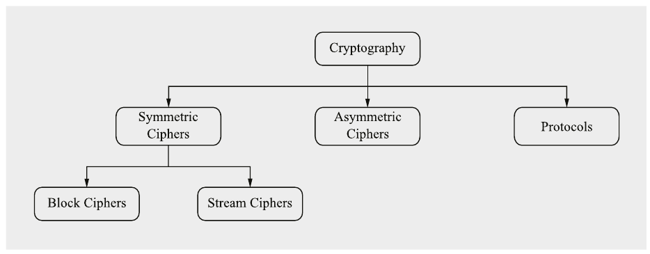

Hình 2.1 Các lĩnh vực chính trong cryptography

Chương này đề cập stream cipher, một lớp cryptographic primitive quan trọng. Trong chương này bạn sẽ học:

■ Ưu và nhược điểm của stream cipher

■ Bộ sinh số ngẫu nhiên và bộ sinh số giả ngẫu nhiên (pseudorandom)

■ Một cipher thực sự không thể phá: one-time pad (OTP)

■ Linear feedback shift register

■ Các stream cipher hiện đại ChaCha20, Salsa20 và Trivium

## 2.1 Giới thiệu

Mục này trước hết sẽ thảo luận sự khác biệt giữa stream cipher và block cipher, rồi giới thiệu nguyên lý hoạt động của stream cipher.

### 2.1.1 Stream Cipher so với Block Cipher

Symmetric cryptography được chia thành block cipher và stream cipher, hai loại dễ phân biệt. Hình 2.2 mô tả các khác biệt về hoạt động giữa stream cipher (Hình 2.2a) và block cipher (Hình 2.2b). Trong cả hai trường hợp, chúng ta muốn mã hóa b bit mỗi lần, trong đó b là độ rộng của block cipher. Sau đây là mô tả hoạt động của hai loại symmetric cipher.

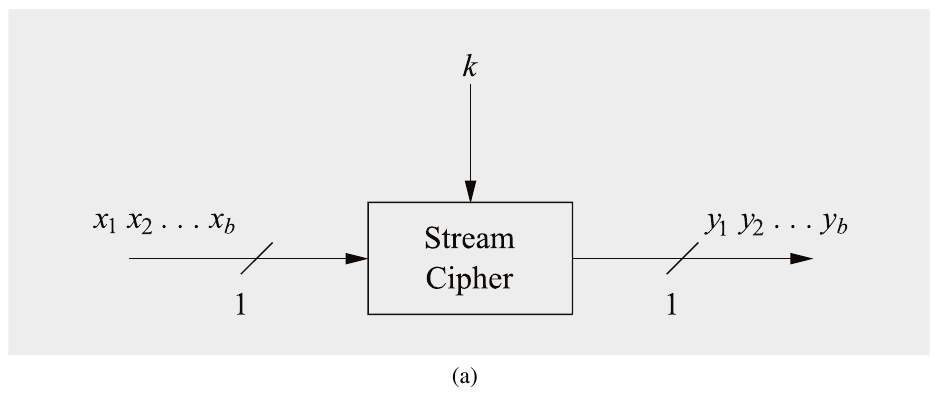

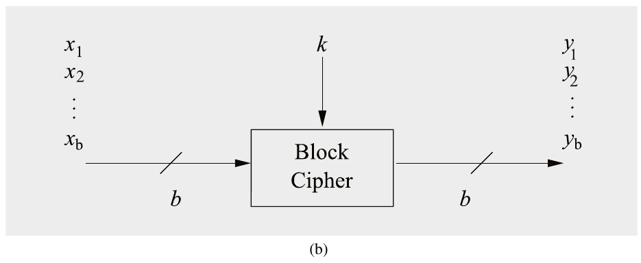

Hình 2.2 Nguyên lý mã hóa b bit bằng một stream cipher (a) và một block cipher (b)

Stream cipher mã hóa từng bit riêng lẻ. Điều này đạt được bằng cách cộng một bit từ một key stream vào một bit plaintext. Có các stream cipher đồng bộ (synchronous), trong đó key stream chỉ phụ thuộc vào key, và các stream cipher bất đồng bộ (asynchronous), trong đó key stream còn phụ thuộc vào ciphertext. Nếu có đường nét đứt trong Hình 2.3, stream cipher là loại bất đồng bộ. Hầu hết stream cipher thực tế là loại đồng bộ và Mục 2.4 của chương này sẽ giới thiệu ba cipher hiện đại thuộc loại này. Một ví dụ về stream cipher bất đồng bộ là mode cipher feedback (CFB), được giới thiệu trong Mục 5.1.4.

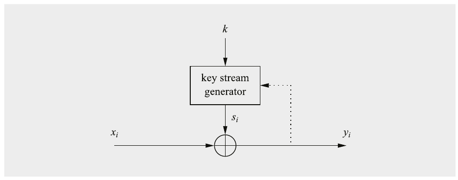

Hình 2.3 Stream cipher đồng bộ và bất đồng bộ

Block cipher mã hóa một block gồm b bit plaintext mỗi lần với cùng một key. Các cipher được xây dựng sao cho việc mã hóa bất kỳ bit plaintext nào trong một block cho trước đều phụ thuộc vào mọi bit plaintext khác trong cùng block. Trong thực tế, đại đa số block cipher hoặc có độ dài block 128 bit (16 byte) như Advanced Encryption Standard (AES), hoặc có độ dài block 64 bit (8 byte) như Data Encryption Standard (DES) hay triple DES (3DES). Hai cipher này lần lượt được giới thiệu trong Chương 4 và Chương 3.

Trong thực tế, đặc biệt để mã hóa truyền thông máy tính trên internet, block cipher được dùng thường xuyên hơn stream cipher. Trong những ngày đầu của cryptography hiện đại, khoảng những năm 1980 và 1990, người ta cho rằng stream cipher có thể mã hóa hiệu quả hơn block cipher. Chúng đặc biệt phù hợp với các ứng dụng có tài nguyên tính toán thấp, chẳng hạn điện thoại di động hay các thiết bị nhúng nhỏ khác. Hồi đó, stream cipher thường được hiện thực bằng hardware. Một ví dụ nổi bật về thuật toán như vậy là cipher A5/1, được dùng để mã hóa thoại trong tiêu chuẩn điện thoại di động GSM (sắp lỗi thời). Kể từ đó, nhiều block cipher được thiết kế đặc biệt với hiệu quả hardware trong đầu đã được đề xuất, chẳng hạn thuật toán PRESENT, được mô tả trong Mục 3.7.3. Đồng thời, có những stream cipher hiện đại rất phù hợp cho các hiện thực software high-speed, bao gồm Salsa20 (xem Mục 2.4.1) và ChaCha (xem Mục 2.4.2).

### 2.1.2 Mã hóa và giải mã bằng Stream Cipher

Như đã đề cập ở trên, stream cipher mã hóa từng bit plaintext riêng lẻ. Câu hỏi bây giờ là: Việc mã hóa một bit riêng lẻ hoạt động thế nào? Câu trả lời đơn giản đến bất ngờ: Mỗi bit x<sub>i</sub> được mã hóa bằng cách cộng một bit key stream bí mật s<sub>i</sub> modulo 2.

> Định nghĩa 2.1.1 Mã hóa và giải mã bằng Stream Cipher
>
> Plaintext, ciphertext và key stream gồm các bit riêng lẻ, tức là x<sub>i</sub>,y<sub>i</sub>,s<sub>i</sub> ∈ {0,1}.
>
> Mã hóa: y<sub>i</sub> = e<sub>s<sub>i</sub></sub>(x<sub>i</sub>) ≡ x<sub>i</sub> + s<sub>i</sub> mod 2
>
> Giải mã: x<sub>i</sub> = d<sub>s<sub>i</sub></sub>(y<sub>i</sub>) ≡ y<sub>i</sub> + s<sub>i</sub> mod 2

Vì các hàm mã hóa và giải mã đều là phép cộng đơn giản modulo 2, chúng ta có thể mô tả hoạt động cơ bản của một stream cipher như được thể hiện trong Hình 2.4. Lưu ý rằng chúng ta dùng một hình tròn có dấu cộng làm ký hiệu cho phép cộng modulo 2.

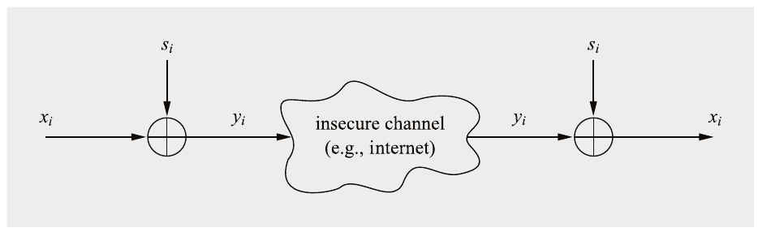

Hình 2.4 Mã hóa và giải mã bằng stream cipher

Chỉ cần nhìn các công thức trong định nghĩa, có ba nhận xét về hàm mã hóa và giải mã của stream cipher mà chúng ta nên làm rõ:

1. Vì sao mã hóa và giải mã là cùng một hàm?

2. Vì sao chúng ta có thể dùng một phép cộng modulo 2 đơn giản làm phép mã hóa?

3. Bản chất của các bit key stream s<sub>i</sub> là gì?

Thảo luận sau đây về ba điểm này sẽ cho chúng ta hiểu một số tính chất quan trọng của stream cipher.

#### Vì sao mã hóa và giải mã là cùng một hàm?

Lý do cho sự giống nhau giữa hàm mã hóa và hàm giải mã có thể dễ dàng được chỉ ra. Chúng ta thực hiện cái được gọi là chứng minh tính đúng (proof of correctness), tức là chúng ta chỉ ra rằng hàm giải mã thực sự tạo lại bit plaintext x<sub>i</sub>. Chúng ta biết bit ciphertext y<sub>i</sub> được tính bằng hàm mã hóa y<sub>i</sub> ≡ x<sub>i</sub> + s<sub>i</sub> mod 2. Chúng ta thay biểu thức mã hóa này vào hàm giải mã:

d<sub>s<sub>i</sub></sub>(y<sub>i</sub>) ≡ y<sub>i</sub> + s<sub>i</sub> mod 2

≡ (x<sub>i</sub> + s<sub>i</sub>) + s<sub>i</sub> mod 2

≡ x<sub>i</sub> + s<sub>i</sub> + s<sub>i</sub> mod 2

≡ x<sub>i</sub> + 2 s<sub>i</sub> mod 2

≡ x<sub>i</sub> + 0 mod 2

≡ x<sub>i</sub> mod 2 Q.E.D.

Mấu chốt ở đây là biểu thức (2 s<sub>i</sub> mod 2) luôn có giá trị không vì 2 ≡ 0 mod 2. Một cách hiểu khác như sau: Nếu s<sub>i</sub> có giá trị 0, thì 2s<sub>i</sub> = 2 · 0 ≡ 0 mod 2. Nếu s<sub>i</sub> = 1, ta có 2 s<sub>i</sub> = 2 · 1 = 2 ≡ 0 mod 2.

#### Vì sao phép cộng modulo 2 là một hàm mã hóa tốt?

Một giải thích toán học cho điều này được đưa ra trong bối cảnh one-time pad ở Mục 2.2.2. Tuy nhiên, đáng để xem kỹ hơn phép cộng modulo 2. Nếu làm số học modulo 2, các giá trị khả dĩ duy nhất là 0 và 1 (vì nếu bạn chia cho 2 chỉ có thể có hai số dư, 0 và 1). Do đó, chúng ta có thể coi số học modulo 2 như các hàm Boolean như logic AND, OR, NAND, v.v. Hãy xem bảng chân trị cho phép cộng modulo 2:

| x<sub>i</sub> s<sub>i</sub> | y<sub>i</sub> ≡ x<sub>i</sub> + s<sub>i</sub> mod 2 |
|---|---|
| 0 0 | 0 |
| 0 1 | 1 |
| 1 0 | 1 |
| 1 1 | 0 |

Điều này hẳn quen thuộc với hầu hết độc giả: Đây là bảng chân trị của cổng exclusive-OR, còn gọi là XOR. Đây là một sự thật quan trọng: Phép cộng modulo 2 tương đương với phép toán XOR. Phép toán XOR đóng vai trò lớn trong cryptography hiện đại và sẽ được dùng nhiều lần trong phần còn lại của cuốn sách.

Câu hỏi bây giờ là, vì sao phép toán XOR lại hữu ích như vậy, trái với, chẳng hạn, phép toán AND? Giả sử chúng ta muốn mã hóa bit plaintext x<sub>i</sub> = 0. Nhìn vào bảng chân trị, chúng ta thấy mình ở dòng thứ 1st hoặc 2nd:

| x<sub>i</sub> s<sub>i</sub> | y<sub>i</sub> |
|---|---|
| 0 0 | 0 |
| 0 1 | 1 |
| 1 0 | 1 |
| 1 1 | 0 |

Tùy theo bit key, ciphertext y<sub>i</sub> hoặc là không (s<sub>i</sub> = 0) hoặc là một (s<sub>i</sub> = 1). Nếu bit key s<sub>i</sub> hoạt động hoàn toàn ngẫu nhiên, tức là không thể đoán trước và có đúng 50% khả năng nhận mỗi giá trị 0 và 1, thì cả hai ciphertext khả dĩ cũng xuất hiện với khả năng 50%. Tương tự, nếu mã hóa bit plaintext x<sub>i</sub> = 1, chúng ta ở dòng 3 hoặc 4 của bảng chân trị. Một lần nữa, tùy theo giá trị của bit key stream s<sub>i</sub>, có 50% khả năng ciphertext nhận mỗi giá trị 0 và 1.

Chúng ta vừa quan sát thấy hàm XOR cân bằng hoàn hảo, tức là khi quan sát một giá trị output, có đúng 50% khả năng cho mọi giá trị của các bit input. Điều này phân biệt cổng XOR với các hàm Boolean khác như các cổng OR, AND hay NAND. Hơn nữa, các cổng AND và NAND không khả nghịch. Hãy xem một ví dụ rất đơn giản về mã hóa bằng stream cipher.

Ví dụ 2.1. Alice muốn mã hóa chữ A, trong đó chữ cái được cho ở mã ASCII. Giá trị ASCII của A là 65<sub>10</sub> = 1000001<sub>2</sub>. Ngoài ra, giả sử các bit key stream đầu tiên là (s<sub>0</sub>,...,s<sub>6</sub>) = 0101100.

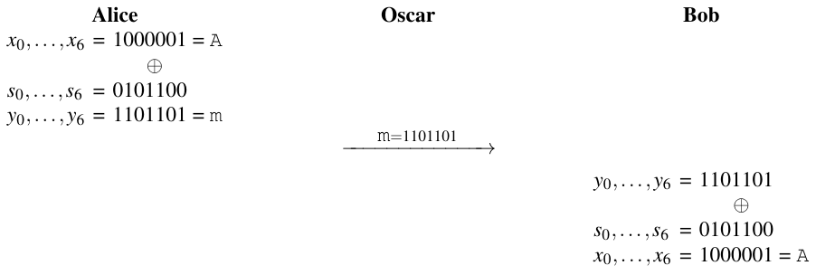

Lưu ý rằng phép mã hóa của Alice biến chữ hoa A thành chữ thường m. Oscar, kẻ tấn công nghe lén trên kênh, chỉ thấy chữ ciphertext m. Phép giải mã của Bob với cùng key stream tạo lại plaintext A.

◇

Cho đến giờ, stream cipher trông dễ đến khó tin: Người ta chỉ cần lấy plaintext, thực hiện phép XOR với key và thu được ciphertext. Ở phía nhận, Bob làm điều tương tự. Thứ “duy nhất” còn lại cần thảo luận là câu hỏi cuối cùng ở trên.

#### Chính xác thì bản chất của Key Stream là gì?

Hóa ra việc tạo ra các giá trị s<sub>i</sub>, được gọi là key stream, là vấn đề trung tâm đối với bảo mật của stream cipher. Thực tế, bảo mật của một stream cipher hoàn toàn phụ thuộc vào key stream. Các bit key stream s<sub>i</sub> không phải là chính các bit key. Vậy, làm sao chúng ta có được key stream? Tạo key stream gần như là toàn bộ ý nghĩa của stream cipher. Đây là một chủ đề lớn và được thảo luận ở phần sau của chương này. Tuy nhiên, chúng ta đã có thể đoán rằng một yêu cầu trung tâm cho các bit key stream là chúng phải trông như một dãy ngẫu nhiên đối với kẻ tấn công. Nếu không, kẻ tấn công Oscar có thể đoán các bit và tự giải mã. Do đó, trước hết chúng ta cần học thêm về số ngẫu nhiên.

## 2.2 Số ngẫu nhiên và một Stream Cipher không thể phá

### 2.2.1 Bộ sinh số ngẫu nhiên (Random Number Generators)

Như chúng ta đã thấy ở mục trước, phép mã hóa và giải mã thực tế của stream cipher cực kỳ đơn giản. Bảo mật của stream cipher phụ thuộc hoàn toàn vào một key stream “phù hợp” s<sub>0</sub>,s<sub>1</sub>,s<sub>2</sub>,... Vì tính ngẫu nhiên đóng vai trò lớn, trước hết chúng ta sẽ học về ba loại bộ sinh số ngẫu nhiên (RNG) quan trọng với chúng ta.

#### True Random Number Generator (TRNG)

True random number generator (TRNG) có đặc điểm là output của chúng không thể được tái tạo. Chẳng hạn, nếu chúng ta tung đồng xu 100 lần và ghi lại dãy 100 bit kết quả, gần như không thể có ai trên Trái Đất tạo ra được cùng dãy 100-bit đó. Khả năng thành công là 1/2<sup>100</sup>, một xác suất cực kỳ nhỏ. Lý tưởng nhất, TRNG dựa trên các quá trình vật lý không thể tái tạo. Các ví dụ bao gồm việc con người tung đồng xu hay gieo xúc xắc. Trong hệ thống máy tính, các CPU hiện đại thường được trang bị TRNG hardware-based, hoặc nếu không thì có một TPM (trusted platform module) trên bo mạch chủ chứa một TRNG. Trong các hệ thống máy tính không có TRNG hardware, các quá trình ngẫu nhiên bên trong máy tính được dùng làm nguồn entropy, chẳng hạn các phép đo thời gian fine-grained của interrupt hoặc dữ liệu ngẫu nhiên khác từ device driver. Trong cryptography, TRNG thường cần để tạo session key, sau đó được phân phối giữa Alice và Bob, nhưng cũng cho các mục đích khác như tạo nonce.

#### Pseudorandom Number Generator (PRNG) (tổng quát)

Pseudorandom number generator (PRNG) tạo ra các dãy được tính từ một giá trị seed ban đầu. Chúng thường được tính đệ quy theo cách sau:

s<sub>0</sub> = seed

s<sub>i+1</sub> = f(s<sub>i</sub>), i = 0,1,...

Một tổng quát hóa của điều này là các bộ sinh có dạng s<sub>i+1</sub> = f (s<sub>i</sub>,s<sub>i−1</sub>,...,s<sub>i−t</sub>), trong đó t là một số nguyên cố định. Một ví dụ phổ biến là linear congruential generator:

s<sub>0</sub> = seed

s<sub>i+1</sub> ≡ a s<sub>i</sub> + b mod m, i = 0,1,...

trong đó a, b, m là các hằng số nguyên. Lưu ý rằng PRNG không ngẫu nhiên theo nghĩa thực sự vì chúng có thể được tính toán và do đó hoàn toàn tất định. Một ví dụ được dùng rộng rãi là function rand() được dùng trong ANSI C. Nó có các tham số:

s<sub>0</sub> = 12345

s<sub>i+1</sub> ≡ 1103515245s<sub>i</sub> + 12345 mod 2<sup>31</sup>, i = 0,1,...

Một yêu cầu phổ biến của PRNG là chúng có các tính chất thống kê tốt, nghĩa là output của chúng xấp xỉ một dãy số ngẫu nhiên thực sự. Có nhiều phép kiểm định toán học, chẳng hạn chi-square test, có thể kiểm chứng hành vi thống kê của các dãy PRNG. Lưu ý rằng có rất, rất nhiều ứng dụng cho số giả ngẫu nhiên bên ngoài cryptography. Chẳng hạn, nhiều loại mô phỏng hay kiểm thử, chẳng hạn của phần mềm hay của chip VLSI, cần dữ liệu test ngẫu nhiên làm input. Đây là lý do vì sao một PRNG được đưa vào specification ANSI C.

#### Cryptographically Secure Pseudorandom Number Generator (CSPRNG)

Cryptographically secure pseudorandom number generator (CSPRNG) là một loại PRNG đặc biệt có thêm tính chất sau: Một CSPRNG là một PRNG không thể đoán trước (unpredictable). Một cách không chính thức, điều này có nghĩa là cho n bit output của key stream s<sub>i</sub>,s<sub>i+1</sub>,...,s<sub>i+n−1</sub>, trong đó n là một số nguyên nào đó, việc tính các bit tiếp theo s<sub>i+n</sub>,s<sub>i+n+1</sub>,... là không khả thi về mặt tính toán. Một định nghĩa chính xác hơn là cho n bit liên tiếp của key stream, không có thuật toán polynomial-time nào có thể dự đoán bit tiếp theo s<sub>n+1</sub> với khả năng thành công tốt hơn 50%. Một tính chất khác của CSPRNG là cho dãy trên, việc tính bất kỳ bit nào đứng trước s<sub>i−1</sub>,s<sub>i−2</sub>,... phải không khả thi về mặt tính toán.

Lưu ý rằng nhu cầu về tính không thể đoán trước của CSPRNG là riêng có của cryptography. Trong gần như mọi tình huống khác mà số giả ngẫu nhiên cần trong khoa học máy tính hay kỹ thuật, tính không thể đoán trước là không cần thiết. Hệ quả là sự phân biệt giữa PRNG và CSPRNG và tầm quan trọng của nó đối với stream cipher thường không rõ ràng với những non-cryptographers. Gần như mọi PRNG được thiết kế mà không có mục đích rõ ràng là làm stream cipher đều không phải CSPRNG.

### 2.2.2 One-Time Pad

Sau đây chúng ta thảo luận điều gì xảy ra nếu dùng ba loại số ngẫu nhiên làm bộ sinh cho dãy key stream s<sub>0</sub>,s<sub>1</sub>,s<sub>2</sub>,... của một stream cipher. Trước hết hãy định nghĩa một cipher hoàn hảo nên là gì.

> Định nghĩa 2.2.1 Unconditional Security (bảo mật vô điều kiện)
>
> Một cryptosystem an toàn vô điều kiện (unconditionally) hay an toàn theo lý thuyết thông tin (information-theoretically secure) nếu nó không thể bị phá ngay cả với tài nguyên tính toán vô hạn.

Unconditional security dựa trên lý thuyết thông tin và không giả định giới hạn nào về sức mạnh tính toán của kẻ tấn công. Đây có vẻ là một định nghĩa khá đơn giản. Thực tế nó đơn giản, nhưng các yêu cầu để một cipher an toàn vô điều kiện là cực lớn. Hãy xem xét nó bằng một thí nghiệm tưởng tượng (gedankenexperiment): Giả sử chúng ta có một thuật toán mã hóa symmetric (không quan trọng là block cipher hay stream cipher) với độ dài key 10,000 bit, và tấn công duy nhất hiệu quả là exhaustive key search, tức là brute-force attack. Từ thảo luận trong Mục 1.3.2, chúng ta nhớ rằng 128 bit là quá đủ cho bảo mật long-term. Vậy, một cipher với 10,000 bit có an toàn vô điều kiện không? Câu trả lời là một tiếng Không vang dội! Vì kẻ tấn công có thể có tài nguyên tính toán vô hạn, chúng ta có thể đơn giản giả định kẻ tấn công có 2<sup>10000</sup> máy tính và mỗi máy kiểm tra đúng một key. Điều này sẽ cho chúng ta một key đúng trong một bước thời gian. Tất nhiên, không đời nào có thể chế tạo được 2<sup>10000</sup> máy tính, con số quá lớn. (Người ta ước tính chỉ có “khoảng” 2<sup>266</sup> nguyên tử trong vũ trụ đã biết.) Cipher đó chỉ an toàn về mặt tính toán, chứ không an toàn vô điều kiện.

Dù vậy, bây giờ chúng tôi chỉ ra một cách xây dựng một cipher an toàn vô điều kiện khá đơn giản. Cipher này được gọi là one-time pad.

> Định nghĩa 2.2.2 One-Time Pad (OTP)
>
> Một stream cipher mà trong đó
>
> 1. key stream s<sub>0</sub>,s<sub>1</sub>,s<sub>2</sub>,... được tạo bởi một true random number generator, và
>
> 2. key stream chỉ được các bên giao tiếp hợp pháp biết, và
>
> 3. mỗi bit key stream s<sub>i</sub> chỉ được dùng một lần
>
> được gọi là one-time pad. Bản thân one-time pad an toàn vô điều kiện.

Rất dễ chỉ ra vì sao OTP an toàn vô điều kiện. Đây là phác thảo một chứng minh. Với mỗi bit ciphertext, chúng ta có một phương trình dạng:

y<sub>0</sub> ≡ x<sub>0</sub> + s<sub>0</sub> mod 2

y<sub>1</sub> ≡ x<sub>1</sub> + s<sub>1</sub> mod 2

⋮

Mỗi quan hệ riêng lẻ là một phương trình tuyến tính modulo 2 với hai ẩn. Không thể suy ra một nghiệm duy nhất cho các phương trình như vậy. Nếu kẻ tấn công biết giá trị của y<sub>0</sub>(0 hoặc 1), hắn không thể xác định giá trị của x<sub>0</sub>. Thực tế, các nghiệm x<sub>0</sub> = 0 và x<sub>0</sub> = 1 có khả năng chính xác như nhau nếu s<sub>0</sub> đến từ một nguồn thực sự ngẫu nhiên và có 50% khả năng nhận mỗi giá trị 0 và 1. Tình huống tương tự với phương trình thứ hai và mọi phương trình tiếp theo. Lưu ý rằng tình huống khác đi nếu các giá trị s<sub>i</sub> không thực sự ngẫu nhiên. Trong trường hợp này, có một quan hệ hàm nào đó giữa chúng, và các phương trình ở trên không độc lập. Dù vẫn có thể khó giải hệ phương trình, nó không an toàn chứng minh được (provably secure)!

Tuyệt, giờ chúng ta có một cipher đơn giản an toàn hoàn hảo. Có tin đồn rằng điện thoại đỏ giữa Nhà Trắng và Điện Kremlin đã được mã hóa bằng OTP trong Chiến tranh Lạnh. Hiển nhiên phải có điều gì đó không ổn vì OTP không được dùng cho trình duyệt web, mã hóa email, nhắn tin tức thời trên smartphone, hay các ứng dụng hiện đại quan trọng khác. Hãy xem các hệ quả của ba yêu cầu trong Định nghĩa 2.2.2. Yêu cầu thứ nhất có nghĩa là chúng ta cần một TRNG. Để có điều này, chúng ta cần một thiết bị, chẳng hạn dựa trên nhiễu trắng của một chất bán dẫn, tạo ra các bit thực sự ngẫu nhiên. Vì các PC tiêu chuẩn ngày nay thường có TRNG, yêu cầu này có thể được đáp ứng mà không tốn quá nhiều công sức. Yêu cầu thứ hai có nghĩa là Alice phải đưa các bit ngẫu nhiên tới Bob một cách an toàn. Trong thực tế, điều đó có thể có nghĩa là Alice lưu các bit ngẫu nhiên thực sự lên một USB stick hay một SSD di động và gửi chúng một cách an toàn, chẳng hạn bằng một người đưa tin đáng tin cậy, tới Bob. Điều này không tuyệt vời nhưng làm được trong một số ứng dụng. Yêu cầu thứ ba là phi thực tế nhất: Các bit key stream không thể được re-used. Điều này ngụ ý rằng chúng ta cần một bit key cho mỗi bit plaintext. Do đó, key của chúng ta dài bằng plaintext! Đây có lẽ là nhược điểm lớn nhất của OTP. Ngay cả khi Alice và Bob dùng chung 1 GByte số ngẫu nhiên thực sự, chúng ta nhanh chóng chạm giới hạn. Chỉ trao đổi vài file lớn cũng có thể dùng hết 1 GByte vật liệu key. Sau đó họ sẽ cần lặp lại quá trình trao đổi các bit key stream ngẫu nhiên thực sự cồng kềnh và chậm chạp, chẳng hạn bằng một người đưa tin đáng tin cậy.

Vì những lý do này, OTP hiếm khi được dùng trong thực tế. Tuy nhiên, chúng cho chúng ta một ý tưởng thiết kế tuyệt vời cho các cipher an toàn: Nếu XOR các bit thực sự ngẫu nhiên với plaintext, chúng ta có ciphertext chắc chắn không thể bị kẻ tấn công phá. Chúng ta sẽ thấy trong mục tiếp theo cách dùng sự thật này để xây dựng các stream cipher thực tế.

### 2.2.3 Hướng tới các Stream Cipher thực tế

Ở mục trước, chúng ta đã thấy OTP an toàn vô điều kiện, nhưng chúng có những nhược điểm khiến chúng phi thực tế. Điều chúng ta cố làm với các stream cipher thực tế là thay các bit key stream thực sự ngẫu nhiên bằng một bộ sinh số giả ngẫu nhiên trong đó key k đóng vai trò seed. Nguyên lý của các stream cipher thực tế được thể hiện trong Hình 2.5.

Trước khi chuyển sang các stream cipher được dùng trong thế giới thực, cần nhấn mạnh rằng các stream cipher thực tế không an toàn vô điều kiện. Thực tế, mọi thuật toán cryptographic thực tế được biết (stream cipher, block cipher, thuật toán public-key) đều không an toàn vô điều kiện. Điều tốt nhất chúng ta có thể nhắm tới là bảo mật tính toán (computational security), mà chúng ta định nghĩa như sau.

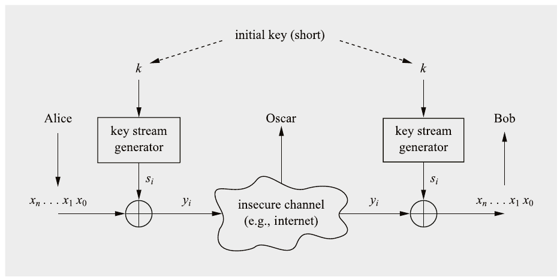

Hình 2.5 Các stream cipher thực tế

> Định nghĩa 2.2.3 Computational Security (bảo mật tính toán)
>
> Một cryptosystem an toàn về mặt tính toán nếu thuật toán tốt nhất được biết để phá nó cần ít nhất t phép toán.

Đây có vẻ là một định nghĩa hợp lý nhưng vẫn còn vài vấn đề với nó. Thứ nhất, chúng ta thường không biết thuật toán tốt nhất cho một tấn công cho trước là gì. Một ví dụ điển hình là scheme public-key RSA, có thể bị phá bằng cách phân tích thừa số các số nguyên lớn. Dù nhiều thuật toán phân tích thừa số đã được biết, chúng ta không biết liệu có tồn tại thuật toán nào tốt hơn hay không. Thứ hai, ngay cả khi đã biết một cận dưới cho độ phức tạp của một tấn công, chúng ta không biết liệu có thể có các tấn công khác, mạnh hơn, hay không. Chúng ta đã thấy điều này trong Mục 1.2.2 khi thảo luận về substitution cipher: Dù chúng ta biết độ phức tạp tính toán chính xác của một exhaustive key search, vẫn tồn tại các tấn công khác, mạnh hơn. Điều tốt nhất chúng ta có thể làm trong thực tế là thiết kế các scheme cryptographic mà người ta giả định là an toàn về mặt tính toán. Với symmetric cipher, điều này thường có nghĩa là người ta hy vọng không có phương pháp tấn công nào có độ phức tạp tốt hơn một exhaustive key search.

Hãy quay lại Hình 2.5. Thiết kế này mô phỏng (“hoạt động ở một mức độ nào đó giống”) một one-time pad. Nó có ưu điểm lớn so với OTP là Alice và Bob chỉ cần trao đổi một secret key dài tối đa vài 100 bit, và không phải dài bằng message chúng ta muốn mã hóa. Bây giờ chúng ta phải suy nghĩ cẩn thận về các tính chất của key stream s<sub>0</sub>,s<sub>1</sub>,s<sub>2</sub>,... do Alice và Bob tạo ra. Hiển nhiên, chúng ta cần một loại bộ sinh số ngẫu nhiên nào đó để suy ra key stream. Trước hết, chúng ta lưu ý rằng không thể dùng TRNG vì, theo định nghĩa, Alice và Bob sẽ không thể tạo ra cùng một key stream. Thay vào đó, chúng ta cần các bộ sinh số tất định, tức là giả ngẫu nhiên. Bây giờ chúng ta xem hai bộ sinh còn lại đã được giới thiệu ở mục trước.

#### Xây dựng Key Stream từ PRNG

Đây là một ý tưởng có vẻ hứa hẹn (nhưng thực ra khá tệ): Nhiều PRNG có các tính chất thống kê tốt, điều cần thiết cho một stream cipher mạnh. Nếu áp dụng các phép kiểm định thống kê lên dãy key stream, output nên hoạt động gần giống dãy bit tạo ra bởi việc tung đồng xu. Vì vậy, thật hấp dẫn khi giả định rằng một PRNG có thể được dùng để tạo key stream. Nhưng tất cả những điều này là không đủ cho một stream cipher vì đối thủ của chúng ta, Oscar, rất thông minh. Hãy xét tấn công sau.

Ví dụ 2.2. Giả sử một PRNG dựa trên linear congruential generator:

S<sub>0</sub> = seed

S<sub>i+1</sub> ≡ A S<sub>i</sub> + B mod m, i = 0,1,...

trong đó chúng ta chọn m dài 100 bit và S<sub>i</sub>,A,B ∈ {0,1,...,m − 1}. Lưu ý rằng PRNG này có thể có các tính chất thống kê xuất sắc nếu chúng ta chọn tham số cẩn thận. Modulus m là một phần của scheme mã hóa và được công khai. Secret key gồm các giá trị (A,B), mỗi giá trị dài 100 bit. Điều đó cho chúng ta độ dài key 200 bit, quá đủ để chống brute-force attack. Vì đây là một stream cipher, Alice có thể mã hóa:

y<sub>i</sub> ≡ x<sub>i</sub> + s<sub>i</sub> mod 2

trong đó s<sub>i</sub> là các bit của biểu diễn nhị phân của các ký hiệu output PRNG S<sub>j</sub>.

Nhưng Oscar có thể dễ dàng thực hiện một tấn công. Giả sử hắn biết 300 bit plaintext đầu tiên (đây chỉ là 300/8 = 37.5 byte), chẳng hạn thông tin header của file, hoặc hắn đoán một phần plaintext. Vì hắn chắc chắn biết ciphertext, bây giờ hắn có thể tính 300 bit key stream đầu tiên là:

s<sub>i</sub> ≡ y<sub>i</sub> + x<sub>i</sub> mod m, i = 1,2,...,300

300 bit này lập tức cho ba ký hiệu output đầu tiên của PRNG: S<sub>1</sub> = (s<sub>1</sub>,...,s<sub>100</sub>), S<sub>2</sub> = (s<sub>101</sub>,...,s<sub>200</sub>) và S<sub>3</sub> = (s<sub>201</sub>,...,s<sub>300</sub>). Bây giờ Oscar có thể tạo ra hai phương trình:

S<sub>2</sub> ≡ A S<sub>1</sub> + B mod m

S<sub>3</sub> ≡ A S<sub>2</sub> + B mod m

Đây là một hệ phương trình tuyến tính trên ℤ<sub>m</sub> với hai ẩn A và B. Nhưng hai giá trị đó chính là key, và chúng ta có thể lập tức giải hệ, thu được:

A ≡ (S<sub>2</sub> − S<sub>3</sub>)/(S<sub>1</sub> − S<sub>2</sub>) mod m

B ≡ S<sub>2</sub> − S<sub>1</sub>(S<sub>2</sub> − S<sub>3</sub>)/(S<sub>1</sub> − S<sub>2</sub>) mod m

Trong trường hợp gcd((S<sub>1</sub> − S<sub>2</sub>),m)) ≠ 1, chúng ta có nhiều nghiệm vì đây là một hệ phương trình trên ℤ<sub>m</sub>. Tuy nhiên, với một đoạn known plaintext thứ tư, key có thể được xác định duy nhất trong gần như mọi trường hợp. Hoặc, Oscar chỉ đơn giản thử mã hóa message với từng nghiệm trong số các nghiệm tìm được. Do đó, tóm lại: Nếu biết vài đoạn plaintext, chúng ta có thể tính key và giải mã toàn bộ ciphertext!

◇

Kiểu tấn công này là lý do khái niệm CSPRNG được phát minh.

#### Xây dựng Key Stream từ CSPRNG

Điều chúng ta cần làm để ngăn tấn công ở trên là dùng một CSPRNG, thứ bảo đảm key stream không thể đoán trước. Nhớ lại rằng điều này có nghĩa là cho n bit output đầu tiên của key stream s<sub>1</sub>,s<sub>2</sub>,...,s<sub>n</sub>, việc tính các bit s<sub>n+1</sub>,s<sub>n+2</sub>,... là không khả thi về mặt tính toán. Đáng tiếc, gần như mọi bộ sinh số giả ngẫu nhiên được dùng cho các ứng dụng bên ngoài cryptography đều không an toàn về mặt mật mã. Do đó, trong thực tế, chúng ta cần dùng các bộ sinh số giả ngẫu nhiên được thiết kế đặc biệt cho stream cipher.

Câu hỏi bây giờ là các stream cipher thực tế thực sự trông như thế nào. Có nhiều đề xuất stream cipher trong tài liệu. Chúng có thể được phân loại đại khái thành cipher tối ưu cho hiện thực software hoặc tối ưu cho hiện thực hardware. Trong trường hợp đầu, các cipher thường cần ít lệnh CPU để tính một bit key stream. Trong trường hợp sau, chúng có xu hướng dựa trên các phép toán có thể dễ dàng hiện thực bằng hardware. Một ví dụ phổ biến là shift register có feedback, được thảo luận ở mục tiếp theo. Một lớp stream cipher khác được xây dựng trên các pseudorandom function dựa trên phép cộng 32-bit, phép xoay và phép XOR, gọi là các phép toán add-rotate-XOR, và sẽ được thảo luận trong Mục 2.4. Một lớp stream cipher thứ ba dùng block cipher làm khối xây dựng. Các mode cipher feedback, output feedback và counter sẽ được giới thiệu trong Chương 5 là các ví dụ về stream cipher được suy ra từ block cipher.

## 2.3 Stream Cipher Shift Register-Based

Như chúng ta đã học cho đến giờ, các stream cipher thực tế dùng một dòng bit key s<sub>1</sub>,s<sub>2</sub>,... được tạo bởi bộ sinh key stream, thứ nên có các tính chất nhất định. Một cách thanh lịch để hiện thực các dãy giả ngẫu nhiên dài là dùng linear feedback shift register (LFSR). Chúng dễ dàng được hiện thực bằng hardware và nhiều, nhưng chắc chắn không phải tất cả, stream cipher dùng LFSR. Một ví dụ nổi bật là cipher A5/1, được chuẩn hóa để mã hóa thoại trong tiêu chuẩn truyền thông di động GSM (hơi lỗi thời). Như chúng ta sẽ thấy, dù một LFSR đơn thuần tạo ra một dãy có tính chất thống kê tốt, nó yếu về mặt mật mã. Tuy nhiên, kết hợp nhiều LFSR có thể tạo ra stream cipher an toàn. Trivium, được giới thiệu trong Mục 2.4.3, là một ví dụ về cipher như vậy. Cần nhấn mạnh rằng có nhiều cách xây dựng stream cipher, như chúng ta sẽ thấy trong Mục 2.4.

### 2.3.1 Linear Feedback Shift Register (LFSR)

Một LFSR gồm các phần tử lưu trữ có clock (flip-flops) và một đường feedback. Số phần tử lưu trữ cho chúng ta bậc (degree) của LFSR. Nói cách khác, một LFSR có m flip-flops được gọi là có bậc m. Mạng feedback tính input cho flip-flop cuối cùng dưới dạng XOR-sum của một số flip-flops nhất định trong shift register.

Ví dụ 2.3. LFSR đơn giản Chúng ta xét một LFSR bậc m = 3 với flip-flops FF<sub>2</sub>, FF<sub>1</sub>, FF<sub>0</sub>, và một đường feedback như được thể hiện trong Hình 2.6. Các bit trạng thái bên trong được ký hiệu là s<sub>i</sub> và được dịch sang phải một vị trí với mỗi nhịp clock. Bit trạng thái ngoài cùng bên phải cũng là bit output hiện tại. Bit trạng thái ngoài cùng bên trái được tính trong đường feedback, là tổng XOR của một số giá trị flip-flop trong chu kỳ clock trước. Vì XOR là một phép toán tuyến tính, các mạch như vậy được gọi là linear feedback shift register. Nếu giả định trạng thái ban đầu (s<sub>2</sub> = 1,s<sub>1</sub> = 0,s<sub>0</sub> = 0), Bảng 2.1 cho dãy trạng thái đầy đủ của LFSR. Lưu ý rằng cột ngoài cùng bên phải là output của LFSR. Có thể thấy từ ví dụ này rằng LFSR bắt đầu lặp lại sau chu kỳ clock 6. Điều này có nghĩa là output của LFSR có chu kỳ độ dài 7 và có dạng:

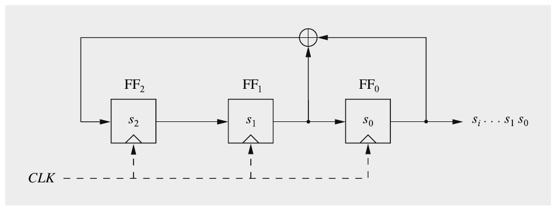

Hình 2.6 Linear feedback shift register bậc 3 với các giá trị ban đầu s<sub>2</sub>, s<sub>1</sub>, s<sub>0</sub>

Bảng 2.1 Dãy trạng thái của LFSR

| clk | FF2 | FF1 | FF0 = s<sub>i</sub> |
|---|---|---|---|
| 0 | 1 | 0 | 0 |
| 1 | 0 | 1 | 0 |
| 2 | 1 | 0 | 1 |
| 3 | 1 | 1 | 0 |
| 4 | 1 | 1 | 1 |
| 5 | 0 | 1 | 1 |
| 6 | 0 | 0 | 1 |
| 7 | 1 | 0 | 0 |
| 8 | 0 | 1 | 0 |

0010111 0010111 0010111...

Có một công thức đơn giản xác định hoạt động của LFSR này. Hãy xem các bit output s<sub>i</sub> được tính như thế nào, giả sử các bit trạng thái ban đầu s<sub>0</sub>,s<sub>1</sub>,s<sub>2</sub>:

s<sub>3</sub> ≡ s<sub>1</sub> + s<sub>0</sub> mod 2

s<sub>4</sub> ≡ s<sub>2</sub> + s<sub>1</sub> mod 2

s<sub>5</sub> ≡ s<sub>3</sub> + s<sub>2</sub> mod 2

⋮

Nói chung, bit output được tính là:

s<sub>i+3</sub> ≡ s<sub>i+1</sub> + s<sub>i</sub> mod 2

trong đó i = 0,1,2,...

◇

Tất nhiên đây là một ví dụ đơn giản. Tuy nhiên, chúng ta đã có thể quan sát nhiều tính chất quan trọng. Bây giờ chúng ta sẽ xem các LFSR tổng quát.

#### Mô tả toán học của LFSR

Dạng tổng quát của một LFSR bậc m được thể hiện trong Hình 2.7. Nó cho thấy m flip-flops và m vị trí feedback khả dĩ, tất cả được kết hợp bằng phép toán XOR. Việc một đường feedback có hoạt động hay không được xác định bởi các hệ số feedback p<sub>m−1</sub>,..., p<sub>0</sub>, p<sub>1</sub>, có chức năng sau:

■ Nếu p<sub>i</sub> = 1 (công tắc đóng), feedback hoạt động.

■ Nếu p<sub>i</sub> = 0 (công tắc mở), output của flip-flop tương ứng không được dùng cho feedback.

Với ký hiệu này, chúng ta có một mô tả toán học thanh lịch cho đường feedback. Nếu nhân output của flip-flop i với hệ số p<sub>i</sub> của nó, kết quả hoặc là giá trị output nếu p<sub>i</sub> = 1, tương ứng với công tắc đóng, hoặc là giá trị không nếu p<sub>i</sub> = 0, tương ứng với công tắc mở. Giá trị của các hệ số feedback là then chốt với dãy output do LFSR tạo ra.

Giả sử ban đầu LFSR được nạp các giá trị s<sub>m−1</sub>,...,s<sub>0</sub>. Bit output tiếp theo của LFSR s<sub>m</sub>, cũng là input của flip-flop ngoài cùng bên trái, có thể được tính bằng XOR-sum của các tích giữa output flip-flop và hệ số feedback tương ứng:

s<sub>m</sub> ≡ s<sub>m−1</sub>p<sub>m−1</sub>+···+s<sub>1</sub>p<sub>1</sub> + s<sub>0</sub>p<sub>0</sub> mod 2

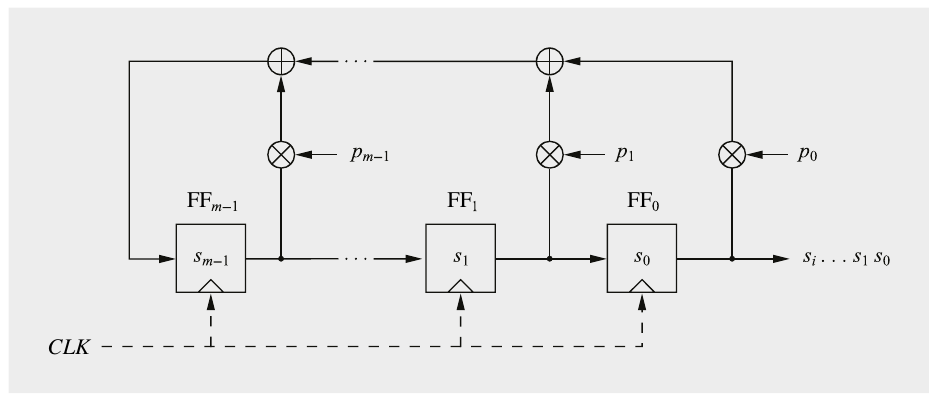

Hình 2.7 LFSR tổng quát với các hệ số feedback p<sub>i</sub> và các giá trị ban đầu s<sub>m−1</sub>,...,s<sub>0</sub>

Output LFSR tiếp theo có thể được tính là:

s<sub>m+1</sub> ≡ s<sub>m</sub>p<sub>m−1</sub>+···+s<sub>2</sub>p<sub>1</sub> + s<sub>1</sub>p<sub>0</sub> mod 2

Nói chung, dãy output có thể được mô tả là:

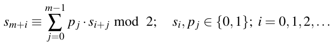 (2.1)

Rõ ràng, các giá trị output được cho bởi một tổ hợp của một số giá trị output trước đó. LFSR đôi khi được gọi là linear recurrence (hệ thức truy hồi tuyến tính).

Do số trạng thái lặp lại là hữu hạn, dãy output của một LFSR lặp lại theo chu kỳ. Điều này cũng đã được minh họa trong Ví dụ 2.3, nơi chu kỳ là 7. Hơn nữa, một LFSR có thể tạo ra các dãy output có độ dài khác nhau, tùy theo các hệ số feedback. Định lý sau cho chúng ta độ dài tối đa của một LFSR như hàm của bậc của nó.

> Định lý 2.3.1 Độ dài dãy tối đa do một LFSR bậc m tạo ra là 2<sup>m</sup> − 1.

Dễ dàng chỉ ra rằng định lý này đúng. Trạng thái của một LFSR được xác định duy nhất bởi m bit thanh ghi bên trong. Cho một trạng thái nhất định, LFSR chuyển sang trạng thái tiếp theo một cách tất định. Vì điều này, ngay khi một LFSR rơi vào một trạng thái trước đó, nó bắt đầu lặp lại. Vì một vector trạng thái m-bit chỉ có thể nhận 2<sup>m</sup> − 1 trạng thái khác không, độ dài dãy tối đa trước khi lặp lại là 2<sup>m</sup> − 1. Lưu ý rằng trạng thái all-zero phải bị loại trừ. Nếu một LFSR rơi vào trạng thái này, nó sẽ bị “kẹt” trong đó, tức là sẽ không bao giờ có thể rời khỏi nó. Lưu ý rằng chỉ một số cấu hình nhất định (p<sub>0</sub>,..., p<sub>m−1</sub>) tạo ra các LFSR maximum-length. Chúng tôi đưa ra một ví dụ nhỏ về điều này dưới đây.

Ví dụ 2.4. LFSR với dãy output maximum-length

Cho một LFSR bậc m = 4 và đường feedback (p<sub>3</sub> = 0, p<sub>2</sub> = 0, p<sub>1</sub> = 1, p<sub>0</sub> = 1), dãy output của LFSR có chu kỳ 2<sup>m</sup> − 1 = 15, tức là nó là một LFSR maximum-length. ◇

Ví dụ 2.5. LFSR với dãy output non-maximum

Cho một LFSR bậc m = 4 và (p<sub>3</sub> = 1, p<sub>2</sub> = 1, p<sub>1</sub> = 1, p<sub>0</sub> = 1), thì dãy output có chu kỳ 5; do đó, nó không phải là một LFSR maximum-length. ◇

Nền tảng toán học của các tính chất của dãy LFSR nằm ngoài phạm vi cuốn sách này. Tuy nhiên, chúng tôi kết thúc phần giới thiệu về LFSR bằng một số sự thật bổ sung. LFSR thường được đặc tả bằng đa thức dùng ký hiệu sau: Một LFSR với vector hệ số feedback (p<sub>m−1</sub>,..., p<sub>1</sub>,p<sub>0</sub>) được biểu diễn bởi đa thức:

P(x) = x<sup>m</sup> + p<sub>m−1</sub>x<sup>m−1</sup>+...+ p<sub>1</sub>x + p<sub>0</sub>

Chẳng hạn, LFSR từ ví dụ trên với các hệ số (p<sub>3</sub> = 0,p<sub>2</sub> = 0, p<sub>1</sub> = 1, p<sub>0</sub> = 1) có thể được đặc tả theo cách khác bằng đa thức x<sup>4</sup> + x + 1. Ký hiệu dạng đa thức có vẻ kỳ lạ này có vài ưu điểm. Chẳng hạn, các LFSR maximum-length có cái được gọi là primitive polynomial (đa thức nguyên thủy). Primitive polynomial là một loại irreducible polynomial (đa thức bất khả quy) đặc biệt. Irreducible polynomial gần như tương đương với số nguyên tố, tức là các nhân tử duy nhất của chúng là 1 và chính đa thức đó. Primitive polynomial có thể được tính tương đối dễ dàng. Do đó, các LFSR maximum-length có thể dễ dàng được tìm ra. Bảng 2.2 cho một primitive polynomial với mỗi giá trị của m trong khoảng từ m = 2,3,...,128. Làm ví dụ, ký hiệu (0,2,5) chỉ đa thức 1 + x<sup>2</sup> + x<sup>5</sup>. Lưu ý rằng có nhiều primitive polynomial cho mỗi bậc m cho trước. Chẳng hạn, tồn tại 69,273,666 primitive polynomial khác nhau bậc m = 31.

### 2.3.2 Known-Plaintext Attack nhắm vào một LFSR đơn lẻ

Như tên gọi chỉ ra, LFSR là tuyến tính. Các hệ thống tuyến tính bị chi phối bởi các quan hệ tuyến tính giữa input và output. Vì các phụ thuộc tuyến tính có thể được phân tích tương đối dễ dàng, đây có thể là một ưu điểm lớn trong nhiều lĩnh vực ứng dụng, chẳng hạn trong các hệ thống truyền thông. Tuy nhiên, một cryptosystem trong đó các bit key chỉ xuất hiện trong các quan hệ tuyến tính tạo ra một cipher rất không an toàn. Bây giờ chúng ta sẽ khảo sát hành vi tuyến tính của một LFSR dẫn tới một tấn công mạnh như thế nào.

Nếu dùng một LFSR làm stream cipher, secret key k là vector hệ số feedback (p<sub>m−1</sub>,..., p<sub>1</sub>, p<sub>0</sub>). Một tấn công khả thi nếu kẻ tấn công Oscar biết một ít plaintext và ciphertext tương ứng. Chúng ta giả định thêm rằng Oscar biết bậc m của LFSR. Tấn công hiệu quả đến mức hắn cũng có thể dễ dàng thử một số lượng lớn các giá trị m khả dĩ, nên giả định này không phải là một hạn chế lớn. Cho known plaintext là x<sub>0</sub>,x<sub>1</sub>,...,x<sub>2m−1</sub> và ciphertext tương ứng

Bảng 2.2 Primitive polynomial cho các LFSR maximum-length

(0,1,2) (0,1,3,4,24) (0,1,2,3,5,8,46) (0,1,5,7,68) (0,2,3,5,90) (0,1,2,3,6,8,112) (0,1,3) (0,3,25) (0,5,47) (0,2,5,6,69) (0,1,2,3,5,6,7,91) (0,2,3,5,113)

(0,1,4) (0,1,2,6,26) (0,1,2,4,5,7,48) (0,1,3,5,70) (0,2,5,6,92) (0,2,3,6,7,8,114) (0,2,5) (0,1,2,5,27) (0,4,5,6,49) (0,1,3,5,71) (0,2,93) (0,1,2,3,5,7,115) (0,1,6) (0,3,28) (0,2,3,4,50) (0,1,2,3,4,6,72) (0,1,5,6,94) (0,2,5,6,116)

(0,1,7) (0,2,29) (0,1,3,6,51) (0,2,3,4,73) (0,1,2,4,5,6,95) (0,1,2,5,117)

(0,2,3,4,8) (0,1,4,6,30) (0,3,52) (0,3,4,7,74) (0,2,3,4,6,7,96) (0,2,5,6,118)

(0,4,9) (0,3,31) (0,1,2,6,53) (0,1,3,6,75) (0,6,97) (0,8,119)

(0,3,10) (0,1,2,3,5,7,32) (0,2,3,4,5,6,54) (0,2,4,5,76) (0,1,2,3,4,7,98) (0,1,2,5,6,7,120) (0,2,11) (0,1,4,6,33) (0,1,2,6,55) (0,2,5,6,77) (0,4,5,7,99) (0,1,5,8,121)

(0,1,4,6,12) (0,1,2,5,6,7,34) (0,2,4,7,56) (0,1,2,7,78) (0,2,7,8,100) (0,1,2,6,122)

(0,1,3,4,13) (0,2,35) (0,2,3,5,57) (0,2,3,4,79) (0,1,6,7,101) (0,2,123)

(0,1,3,5,14) (0,1,2,4,5,6,36) (0,1,5,6,58) (0,1,2,3,5,7,80) (0,3,5,6,102) (0,5,6,7,124)

(0,1,15) (0,1,2,3,4,5,37) (0,1,3,4,5,6,59) (0,4,81) (0,2,3,4,5,7,103) (0,1,2,3,5,7,125) (0,2,3,5,16) (0,1,5,6,38) (0,1,60) (0,1,4,6,7,8,82) (0,2,3,4,5,6,8,9,104) (0,2,4,7,126)

(0,3,17) (0,4,39) (0,1,2,5,61) (0,2,4,7,83) (0,1,2,4,5,6,105) (0,1,127)

(0,1,2,5,18) (0,3,4,5,40) (0,3,5,6,62) (0,1,3,5,7,8,84) (0,1,5,6,106) (0,1,2,7,128)

(0,1,2,5,19) (0,3,41) (0,1,63) (0,1,2,8,85) (0,1,2,3,5,7,107)

(0,3,20) (0,1,2,3,4,5,42) (0,1,3,4,64) (0,2,5,6,86) (0,1,2,3,4,5,6,7,9,10,108)

(0,2,21) (0,3,4,6,43) (0,1,3,4,65) (0,1,5,7,87) (0,2,4,5,109)

(0,1,22) (0,2,5,6,44) (0,2,3,5,6,8,66) (0,1,3,4,5,8,88) (0,1,4,6,110)

(0,5,23) (0,1,3,4,45) (0,1,2,5,67) (0,3,5,6,89) (0,2,4,7,111)

là y<sub>0</sub>,y<sub>1</sub>,...,y<sub>2m−1</sub>. Với 2m cặp bit plaintext và ciphertext này, Oscar tái dựng 2m bit key stream đầu tiên:

s<sub>i</sub> ≡ x<sub>i</sub> + y<sub>i</sub> mod 2; i = 0,1,...,2m − 1.

Mục tiêu bây giờ là tìm key, tức là m hệ số feedback p<sub>i</sub>.

Phương trình (2.1) là một mô tả về quan hệ giữa các bit key chưa biết p<sub>i</sub> và output key stream. Chúng tôi nhắc lại phương trình ở đây cho tiện:

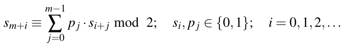

Lưu ý rằng chúng ta có một phương trình khác nhau cho mỗi giá trị của i. Hơn nữa, các phương trình độc lập tuyến tính. Với hiểu biết này, Oscar có thể tạo ra m phương trình cho m giá trị đầu tiên của i:

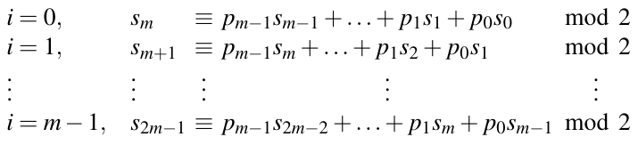 (2.2)

Giờ hắn có m phương trình tuyến tính với m ẩn p<sub>0</sub>, p<sub>1</sub>,..., p<sub>m−1</sub>. Hệ này có thể dễ dàng được Oscar giải bằng khử Gauss, nghịch đảo ma trận hoặc bất kỳ thuật toán nào khác để giải hệ phương trình tuyến tính. Ngay cả với các giá trị m lớn, việc này có thể dễ dàng được thực hiện với một PC tiêu chuẩn.

Tình huống này có hệ quả lớn: ngay khi Oscar biết 2m bit output của một LFSR bậc m, các hệ số p<sub>i</sub> có thể được xây dựng chính xác chỉ bằng cách giải một hệ phương trình tuyến tính. Một khi đã tính được các hệ số feedback này, hắn có thể “dựng” LFSR và nạp nó với bất kỳ m bit output liên tiếp nào hắn đã biết. Bây giờ Oscar có thể cho LFSR chạy theo clock và tạo ra toàn bộ dãy output. Vì tấn công mạnh này, bản thân các LFSR cực kỳ không an toàn! Chúng là một ví dụ tốt về một PRNG có tính chất thống kê tốt nhưng có tính chất mật mã tồi tệ. Dù vậy, không phải tất cả đã mất. Có nhiều stream cipher dùng tổ hợp nhiều LFSR để xây dựng các cryptosystem mạnh. Cipher Trivium trong Mục 2.4.3 là một ví dụ.

## 2.4 Các Stream Cipher thực tế

Dù stream cipher đã phổ biến trong “những ngày đầu” của cryptography hiện đại, khoảng những năm 1980, block cipher trở nên thống trị hơn trong những năm 1990. Sự phát triển này một phần là do các tấn công thành công nhắm vào nhiều stream cipher thời kỳ đầu. Đây là động lực chính cho project eSTREAM, được tổ chức bởi một mạng lưới các nhà cryptographer châu Âu. Năm 2004, eSTREAM đưa ra lời kêu gọi đề xuất stream cipher mới và quá trình lựa chọn kết thúc năm 2008. Các cipher được chia thành hai “profile”. Profile 1 chứa các stream cipher cho phép hiện thực software high-throughput. Các thuật toán Profile 2 là các stream cipher hardware-friendly, có số cổng logic và mức tiêu thụ điện thấp. Trong mục này, chúng tôi sẽ giới thiệu đại diện cho mỗi profile: Salsa20 cùng với biến thể ChaCha của nó (Profile 1) và Trivium (Profile 2).

### 2.4.1 Salsa20

Salsa20 là một họ stream cipher software-efficient được Daniel J. Bernstein phát triển năm 2005. Cipher dùng một pseudorandom function dựa trên phép cộng 32-bit, phép xoay và phép XOR. Các thuật toán như vậy được gọi là cipher add-rotate-XOR (ARX). Cipher nguyên bản có 20 vòng và được ký hiệu là Salsa20/20. Cipher này đã nhanh hơn AES trên hầu hết CPU. Sau đó, Bernstein giới thiệu hai biến thể Salsa20 với số vòng giảm, tên Salsa20/12 và Salsa20/8, còn nhanh hơn nữa. Không có tấn công nào được biết nhắm vào bất kỳ biến thể Salsa20 nào tốt hơn brute-force attack và cipher được coi là rất an toàn. Sau đây chúng tôi sẽ mô tả Salsa20 với 20 vòng.

#### Mã hóa và giải mã bằng Salsa20

Salsa20 hỗ trợ độ dài key 256 và 128 bit. Tuy nhiên, người thiết kế khuyến nghị 256 bit. Lõi của Salsa20 là một hàm với input 512-bit và output 512-bit. Cho cả mã hóa và giải mã, Salsa20 xử lý key, một nonce (viết tắt của “number used only once”) và một số thứ tự block 64-bit, và tạo ra một block key stream 512-bit. Như mọi stream cipher, kết quả của quá trình này được XOR-added với plaintext (mã hóa) hay ciphertext (giải mã). Vì Salsa20 tạo ra output 512 bit, người ta có thể mã hóa (hay giải mã) 512 bit plaintext hay ciphertext cùng lúc.

Mục đích chính của nonce là hai key stream do cipher tạo ra phải khác nhau, ngay cả khi key không thay đổi. Nếu không như vậy, tấn công sau trở nên khả thi: Nếu một kẻ tấn công có một known plaintext từ lần mã hóa đầu tiên, hắn có thể tính key stream tương ứng. Lần mã hóa thứ hai dùng cùng key stream giờ có thể bị giải ngay lập tức. Không có nonce thay đổi, phép mã hóa stream cipher có tính tất định cao. Nonce cũng thường được dùng cho IV (initialization vector), được dùng trong nhiều cấu trúc cipher. Các phương pháp tạo IV được thảo luận trong Mục 5.1.2. Chúng tôi lưu ý rằng nonce và IV không phải được giữ bí mật; Chỉ cần bảo đảm rằng nonce thay đổi cho mỗi session.

Mã hóa và giải mã có thể được biểu diễn như sau. Cho k là một dãy 32-byte (256 bit) hoặc 16-byte (128 bit). Cho n là một nonce 8-byte. Cho x là một message l-byte với một l nào đó ∈ {0,1,...,2<sup>70</sup>}. Phép mã hóa Salsa20 của một message x cho ra một ciphertext l-byte y:

y = Salsa20<sub>k</sub>(n) ⊕ x

Để giải mã, cùng key stream được dùng và XOR với ciphertext, tức là

x = Salsa20<sub>k</sub>(n) ⊕ y

Vì mỗi block chỉ phụ thuộc vào key, nonce và số thứ tự block, các block key stream có thể được tính độc lập với nhau và các block có thể được tính song song. Điều này có lợi cho các hiện thực high-speed của Salsa20.

#### Hàm lõi của Salsa20

Trạng thái bên trong 512-bit của Salsa20 gồm mười sáu word 32-bit y<sub>i</sub> và có thể được sắp xếp thành một ma trận 4-by-4:

| u<sub>0</sub> | u<sub>1</sub> | u<sub>2</sub> | u<sub>3</sub> |
|---|---|---|---|
| u<sub>4</sub> | u<sub>5</sub> | u<sub>6</sub> | u<sub>7</sub> |
| u<sub>8</sub> | u<sub>9</sub> | u<sub>10</sub> | u<sub>11</sub> |
| u<sub>12</sub> | u<sub>13</sub> | u<sub>14</sub> | u<sub>15</sub> |

Để bắt đầu quá trình mã hóa, trạng thái ban đầu của Salsa20 được xây dựng như sau. Tám word 32-bit được tạo từ key k = [k<sub>0</sub>k<sub>1</sub>k<sub>2</sub>k<sub>3</sub>k<sub>4</sub>k<sub>5</sub>k<sub>6</sub>k<sub>7</sub>], hai word chỉ vị trí trong stream p = [p<sub>0</sub>p<sub>1</sub>], hai word đến từ nonce n = [n<sub>0</sub>n<sub>1</sub>] và bốn word là một hằng số c = [c<sub>0</sub>c<sub>1</sub>c<sub>2</sub>c<sub>3</sub>]:

| c<sub>0</sub> | k<sub>0</sub> | k<sub>1</sub> | k<sub>2</sub> |
|---|---|---|---|
| k<sub>3</sub> | c<sub>1</sub> | n<sub>0</sub> | n<sub>1</sub> |
| p<sub>0</sub> | p<sub>1</sub> | c<sub>2</sub> | k<sub>4</sub> |
| k<sub>5</sub> | k<sub>6</sub> | k<sub>7</sub> | c<sub>3</sub> |

p có thể được xem như một bộ đếm chỉ vị trí của block 512-bit hiện tại trong khoảng gồm tất cả 2<sup>64</sup> block 512-bit của key stream. Hằng số c được cho bởi chuỗi mã ASCII “expand 32-byte k”. Nếu dùng một key 128-bit gồm 4 word k = [k<sub>0</sub>k<sub>1</sub>k<sub>2</sub>k<sub>3</sub>], cùng key đó được nối với chính nó để tạo thành 8 word cần thiết, tức là k = [k<sub>0</sub>k<sub>1</sub>k<sub>2</sub>k<sub>3</sub>k<sub>0</sub>k<sub>1</sub>k<sub>2</sub>k<sub>3</sub>].

Phép toán lõi trong Salsa20 là hàm quarter-round QR(a,b,c,d) và được thể hiện trong Hình 2.8. Nó lặp lại ba phép toán đơn giản trên các word 32-bit: phép cộng 32-bit modulo 2<sup>32</sup>, XOR 32-bit và một phép xoay 32-bit cố định c vị trí sang trái (ROTL<sup>c</sup>). Chúng tôi lưu ý rằng phép cộng modulo 2<sup>32</sup> đơn giản là phép cộng số nguyên thông thường của hai word, trong đó bit nhớ bị bỏ qua. Output four-word được tính từ input four-word bằng hàm quarter-round QR như sau:

b = b ⊕ ROTL<sup>7</sup>(a + d)

c = c ⊕ ROTL<sup>9</sup>(b + a)

d = d ⊕ ROTL<sup>13</sup>(c + b)

a = a ⊕ ROTL<sup>18</sup>(d + c)

Bốn quarter round tạo thành (không có gì ngạc nhiên) một vòng, và hai vòng liên tiếp được gọi là một double-round: Trong các vòng odd-numbered, QR được áp dụng cho từng cột trong bốn cột của ma trận 4-by-4. Trong các vòng even-numbered, QR được áp dụng cho từng hàng trong bốn hàng. Với input (v<sub>0</sub>,v<sub>1</sub>,...,v<sub>15</sub>), output (u<sub>0</sub>,u<sub>1</sub>,...,u<sub>15</sub>) của vòng thứ nhất (lẻ) của double-round được tính như sau:

(u<sub>0</sub>,u<sub>4</sub>,u<sub>8</sub>,u<sub>12</sub>) = QR(v<sub>0</sub>,v<sub>4</sub>,v<sub>8</sub>,v<sub>12</sub>)

(u<sub>5</sub>,u<sub>9</sub>,u<sub>13</sub>,u<sub>1</sub>) = QR(v<sub>5</sub>,v<sub>9</sub>,v<sub>13</sub>,v<sub>1</sub>)

(u<sub>10</sub>,u<sub>14</sub>,u<sub>2</sub>,u<sub>6</sub>) = QR(v<sub>10</sub>,v<sub>14</sub>,v<sub>2</sub>,v<sub>6</sub>)

(u<sub>15</sub>,u<sub>3</sub>,u<sub>7</sub>,u<sub>11</sub>) = QR(v<sub>15</sub>,v<sub>3</sub>,v<sub>7</sub>,v<sub>11</sub>)

Vòng thứ hai của double-round cho ra output (z<sub>0</sub>,z<sub>1</sub>,...,z<sub>15</sub>):

(z<sub>0</sub>,z<sub>1</sub>,z<sub>2</sub>,z<sub>3</sub>) = QR(u<sub>0</sub>,u<sub>1</sub>,u<sub>2</sub>,u<sub>3</sub>)

(z<sub>5</sub>,z<sub>6</sub>,z<sub>7</sub>,z<sub>4</sub>) = QR(u<sub>5</sub>,u<sub>6</sub>,u<sub>7</sub>,u<sub>4</sub>)

(z<sub>10</sub>,z<sub>11</sub>,z<sub>8</sub>,z<sub>9</sub>) = QR(u<sub>10</sub>,u<sub>11</sub>,u<sub>8</sub>,u<sub>9</sub>)

(z<sub>15</sub>,z<sub>12</sub>,z<sub>13</sub>,z<sub>14</sub>) = QR(u<sub>15</sub>,u<sub>12</sub>,u<sub>13</sub>,u<sub>14</sub>)

Hình 2.9 cho thấy một double round với việc áp dụng hàm quarter-round lên các hàng và colums *(ghi chú: sách in colums; đúng là columns)*. Để mã hóa hay giải mã, 20 vòng hay 10 double-rounds được áp dụng.

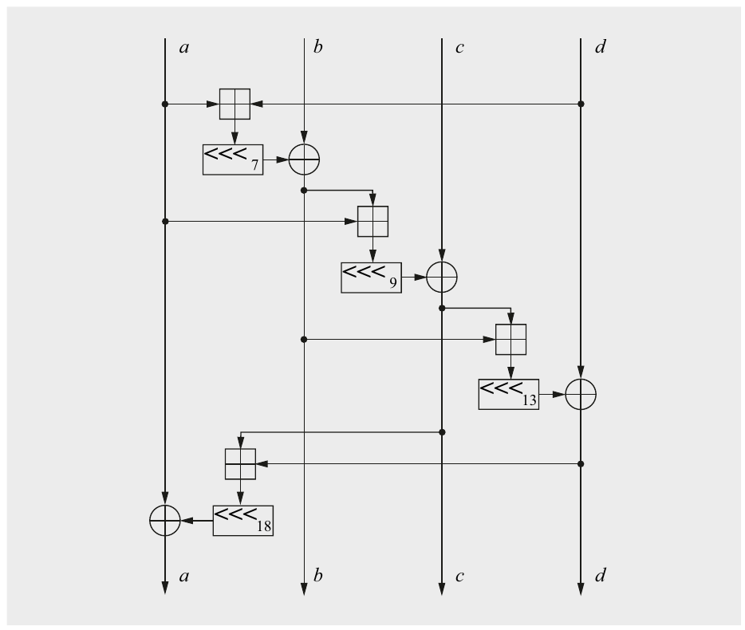

Hình 2.8 Hàm Quarter-round QR(a,b,c,d) của Salsa20

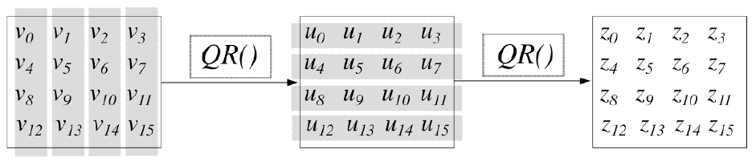

Hình 2.9 Hàm Double-round của Salsa20

#### Hiện thực

Vì Salsa20 là một cipher ARX, tức là cấu trúc bên trong của nó chỉ dùng phép cộng, phép xoay và phép XOR, nó cho phép các hiện thực software high-throughput rất gọn. Salsa20 với 20 vòng cần trung bình khoảng 4–14 chu kỳ mỗi byte với các stream dài, tùy loại CPU.

### 2.4.2 ChaCha

ChaCha là một stream cipher software-oriented nhanh khác, cũng được Bernstein phát triển năm 2008. Nó theo cùng các nguyên lý thiết kế cơ bản như Salsa20. Cipher có thể được cấu hình với tám (ChaCha8), mười hai (ChaCha12), hoặc hai mươi vòng (ChaCha20). Mục này tập trung vào ChaCha20 với hai mươi vòng và key 256-bit. Tương tự Salsa20, cũng tồn tại một phiên bản 128-bit.

#### Mã hóa và giải mã bằng ChaCha20

Mã hóa và giải mã bằng ChaCha được thực hiện theo cùng cách như với Salsa20: ChaCha tạo một hash 512-bit từ các giá trị input gồm một key, một nonce và một số thứ tự block. Giá trị hash được XOR với một plaintext hay ciphertext 512-bit để lần lượt mã hóa hay giải mã. Như với Salsa20, mỗi block key stream 512-bit có thể được tính độc lập và các block mã hóa hay giải mã có thể được tính song song.

Cho k là một dãy 32-byte (256 bit) hoặc 16-byte (128 bit). Cho n là một nonce 8-byte. Cho x là một message l-byte với một l nào đó ∈ 0,1,...,2<sup>70</sup>. Phép mã hóa ChaCha20 của message x với nonce n và key k cho ra một ciphertext l-byte y:

y = ChaCha20<sub>k</sub>(n) ⊕ x

Để giải mã, cùng key stream được dùng và XOR với ciphertext, tức là

x = ChaCha20<sub>k</sub>(n) ⊕ y

#### Hàm lõi của ChaCha20

Tương tự Salsa20, trạng thái ban đầu của ChaCha20 gồm một hằng số 128-bit c, một key 256-bit k, một bộ đếm 64-bit p và một nonce 64-bit n, mà chúng ta có thể sắp xếp trong một ma trận 4-by-4 các word 32-bit:

| c<sub>0</sub> | c<sub>1</sub> | c<sub>2</sub> | c<sub>3</sub> |
|---|---|---|---|
| k<sub>0</sub> | k<sub>1</sub> | k<sub>2</sub> | k<sub>3</sub> |
| k<sub>4</sub> | k<sub>5</sub> | k<sub>6</sub> | k<sub>7</sub> |
| p<sub>0</sub> | p<sub>1</sub> | n<sub>0</sub> | n<sub>1</sub> |

Chúng tôi lưu ý rằng thứ tự các giá trị input khác so với Salsa20. Hằng số c được cho bởi chuỗi mã ASCII “expand 32-byte k”.

Giống Salsa20, ChaCha20 dùng một hàm quarter-round QR(a,b,c,d) trên các giá trị input 32-bit a, b, c và d. Trong trường hợp ChaCha20, nó lặp lại 4 phép cộng modulo 2<sup>32</sup>, 4 phép XOR và 4 phép xoay trên các word trạng thái 32-bit. So với Salsa20, ChaCha áp dụng các phép toán theo thứ tự khác. Hơn nữa, mỗi word được cập nhật hai lần mỗi vòng:

a = a + b

d = ROTL<sup>16</sup>(d ⊕ a)

c = c + d

b = ROTL<sup>12</sup>(b ⊕ c)

a = a + b

d = ROTL<sup>8</sup>(d ⊕ a)

c = c + d

b = ROTL<sup>7</sup>(b ⊕ c)

Hình 2.10 cho thấy hàm quarter-round của ChaCha20.

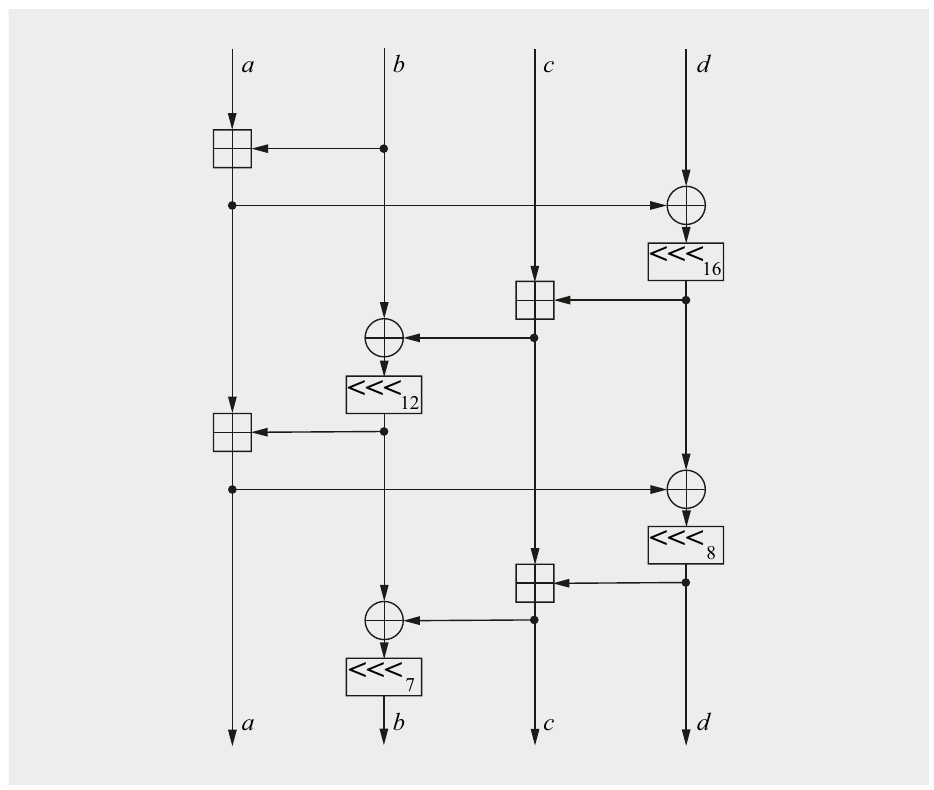

Hình 2.10 Hàm Quarter-round QR(a,b,c,d) của ChaCha20

Tương tự Salsa20, ChaCha20 thực hiện 10 lần lặp double round. Một lần nữa, mỗi double round gồm hai vòng liên tiếp, mỗi vòng lại gồm bốn quarter round QR. Nếu ký hiệu input là (v<sub>0</sub>,v<sub>1</sub>,...,v<sub>15</sub>), output (u<sub>0</sub>,u<sub>1</sub>,...,u<sub>15</sub>) của vòng thứ nhất (lẻ) của double-round được tính trên các cột của input như sau:

(u<sub>0</sub>,u<sub>4</sub>,u<sub>8</sub>,u<sub>12</sub>) = QR(v<sub>0</sub>,v<sub>4</sub>,v<sub>8</sub>,v<sub>12</sub>),

(u<sub>1</sub>,u<sub>5</sub>,u<sub>9</sub>,u<sub>13</sub>) = QR(v<sub>1</sub>,v<sub>5</sub>,v<sub>9</sub>,v<sub>13</sub>),

(u<sub>2</sub>,u<sub>6</sub>,u<sub>10</sub>,u<sub>14</sub>) = QR(v<sub>2</sub>,v<sub>6</sub>,v<sub>10</sub>,v<sub>14</sub>),

(u<sub>3</sub>,u<sub>7</sub>,u<sub>11</sub>,u<sub>15</sub>) = QR(v<sub>3</sub>,v<sub>7</sub>,v<sub>11</sub>,v<sub>15</sub>).

Vòng thứ hai của double-round cho ra output trung gian (z<sub>0</sub>,z<sub>1</sub>,...,z<sub>15</sub>):

(z<sub>0</sub>,z<sub>5</sub>,z<sub>10</sub>,z<sub>15</sub>) = QR(v<sub>0</sub>,v<sub>5</sub>,v<sub>10</sub>,v<sub>15</sub>),

(z<sub>1</sub>,z<sub>6</sub>,z<sub>11</sub>,z<sub>12</sub>) = QR(v<sub>1</sub>,v<sub>6</sub>,v<sub>11</sub>,v<sub>12</sub>),

(z<sub>2</sub>,z<sub>7</sub>,z<sub>8</sub>,z<sub>13</sub>) = QR(v<sub>2</sub>,v<sub>7</sub>,v<sub>8</sub>,v<sub>13</sub>),

(z<sub>3</sub>,z<sub>4</sub>,z<sub>9</sub>,z<sub>14</sub>) = QR(v<sub>3</sub>,v<sub>4</sub>,v<sub>9</sub>,v<sub>14</sub>).

#### Hiện thực

So với Salsa20, các vòng trong ChaCha có diffusion được cải thiện (xem Mục 3.1.1 để có thảo luận về diffusion trong symmetric cipher) trong khi vẫn duy trì hiệu năng tương tự. So với các hiện thực software của AES, ChaCha20 nhanh hơn khoảng ba lần trên các CPU không có bộ tăng tốc AES chuyên dụng. Giống một vòng Salsa20, một vòng ChaCha có 16 phép XOR, 16 phép cộng và 16 phép xoay word 32-bit. ChaCha20 với 20 vòng cần trung bình khoảng 4–15 chu kỳ mỗi byte với các stream dài, tùy loại processor.

### 2.4.3 Trivium

Giống Salsa20, Trivium cũng ra đời từ project eStream. Nó được thiết kế bởi Christophe De Cannière và Bart Preneel. Khác với Salsa20, nó là một cipher hardware-oriented. Điều này có nghĩa là các hiện thực hardware của cipher dùng ít tài nguyên (tức là cổng logic) và nên cho phép tốc độ mã hóa cao. Một khác biệt nữa so với Salsa20 là nó dùng key 80-bit.

Trivium dựa trên một tổ hợp của ba shift register. Dù đây là các linear feedback shift register, có các thành phần phi tuyến được dùng để kết hợp các thanh ghi, điều ngăn tấn công nhắm vào LFSR mà chúng ta đã nghiên cứu trong Mục 2.3.2.

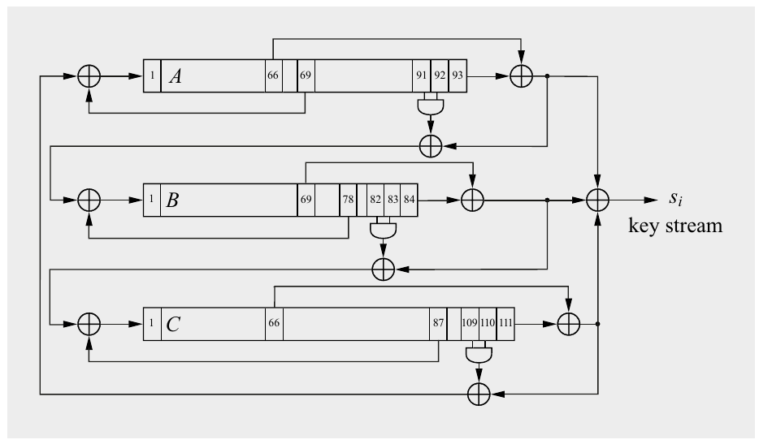

Hình 2.11 Cấu trúc bên trong của stream cipher Trivium

#### Hàm lõi của Trivium

Như được thể hiện trong Hình 2.11, trung tâm của Trivium là ba shift register, A, B và C. Độ dài bit của các thanh ghi lần lượt là 93, 84 và 111. XOR-sum của output cả ba thanh ghi tạo thành key stream s<sub>i</sub>. Một đặc điểm riêng của cipher là output của mỗi thanh ghi được nối với input của một thanh ghi khác. Do đó, các thanh ghi được sắp xếp theo kiểu circle-like. Cipher có thể được xem như gồm một thanh ghi vòng với tổng độ dài 93 + 84 + 111 = 288. Mỗi thanh ghi trong ba thanh ghi có cấu trúc tương tự, như được mô tả dưới đây.

Input của mỗi thanh ghi được tính là XOR-sum của hai bit:

1. Chẳng hạn, output của thanh ghi A là một phần input của thanh ghi B, như có thể thấy trong Hình 2.11.

2. Một bit thanh ghi tại một vị trí cụ thể được đưa ngược (feedback) về input. Các vị trí được cho trong Bảng 2.3. Chẳng hạn, bit 69 của thanh ghi A được đưa ngược về input của nó.

Output của mỗi thanh ghi được tính là XOR-sum của ba bit:

■ Bit thanh ghi ngoài cùng bên phải.

■ Một bit thanh ghi tại một vị trí cụ thể được đưa thẳng (feed forward) tới output. Các vị trí được cho trong Bảng 2.3. Chẳng hạn, bit 66 của thanh ghi A được đưa tới output của nó.

■ Output của một hàm logic AND có input là hai bit thanh ghi cụ thể. Một lần nữa, vị trí của các input cổng AND được cho trong Bảng 2.3.

Bảng 2.3 Đặc tả của Trivium

|  | độ dài thanh ghi | bit feedback | bit feedforward | input AND |
|---|---|---|---|---|
| A | 93 | 69 | 66 | 91, 92 |
| B | 84 | 78 | 69 | 82, 83 |
| C | 111 | 87 | 66 | 109, 110 |

Ngoài ra, Trivium có thể được mô tả bằng các công thức đệ quy sau:

a<sub>i</sub> ≡ c<sub>i−66</sub> + c<sub>i−111</sub> + c<sub>i−110</sub> · c<sub>i−109</sub> + a<sub>i−69</sub> mod 2

b<sub>i</sub> ≡ a<sub>i−66</sub> + a<sub>i−93</sub> + a<sub>i−92</sub> · a<sub>i−91</sub> + b<sub>i−78</sub> mod 2

c<sub>i</sub> ≡ b<sub>i−69</sub> + b<sub>i−84</sub> + b<sub>i−83</sub> · b<sub>i−82</sub> + c<sub>i−87</sub> mod 2

Các bit ngoài cùng bên trái a<sub>i</sub>, b<sub>i</sub> và c<sub>i</sub> là các input mới cho ba thanh ghi. Key stream khi đó được tính là tổng XOR của sáu bit thanh ghi, xem thêm Hình 2.11:

s<sub>i</sub> ≡ a<sub>i−66</sub> + a<sub>i−93</sub> + b<sub>i−69</sub> + b<sub>i−84</sub> + c<sub>i−66</sub> + c<sub>i−111</sub> mod 2

Lưu ý rằng phép toán AND bằng phép nhân trong số học modulo 2. Điều này trái với các LFSR đơn giản, vốn chỉ dùng XOR, tức là phép cộng modulo 2. Thực tế, các đường feed forward có phép toán AND là then chốt với bảo mật của Trivium vì chúng ngăn các tấn công khai thác tính tuyến tính của cipher, như tấn công được chỉ ra nhắm vào các LFSR đơn thuần trong Mục 2.3.2.

#### Mã hóa và giải mã bằng Trivium

Gần như mọi stream cipher hiện đại đều có hai tham số input: một key k và một initialization vector IV. Tham số trước là key thông thường được dùng trong mọi hệ thống symmetric cryptographic. IV đóng vai trò bộ ngẫu nhiên hóa và nên nhận một giá trị mới cho mỗi session mã hóa, tức là nó nên là một nonce (xem thảo luận về nonce trong stream cipher ở Mục 2.4.1). Bây giờ chúng ta xem chi tiết việc chạy Trivium.

Khởi tạo (Initialization) Ban đầu, một key 80-bit được nạp vào 80 vị trí ngoài cùng bên trái của thanh ghi A, và một IV 80-bit được nạp vào 80 vị trí ngoài cùng bên trái của thanh ghi B. Mọi bit thanh ghi khác được đặt bằng không ngoại trừ ba bit ngoài cùng bên phải của thanh ghi C, tức là các bit c<sub>109</sub>, c<sub>110</sub> và c<sub>111</sub>, được đặt bằng 1.

Giai đoạn Warm-Up Ở giai đoạn đầu, cipher được cho chạy clock 4 × 288 = 1152 lần, trong đó 288 là tổng độ dài của mọi thanh ghi. Không có output cipher nào được tạo ra. Giai đoạn warm-up cần thiết để ngăn kẻ tấn công tính ra key từ key stream. Nói cách khác, giai đoạn warm-up cần để ngẫu nhiên hóa cipher đủ mức. Nó bảo đảm rằng key stream phụ thuộc vào cả key k lẫn IV theo cách mà đối thủ không thể dự đoán.

Giai đoạn mã hóa (giải mã) Các bit được tạo ra từ đây trở đi, tức là bắt đầu với bit output của chu kỳ 1153, tạo thành key stream. Như trong mọi stream cipher, key stream được XOR với plainext *(ghi chú: sách in plainext; đúng là plaintext)* (mã hóa) hoặc ciphertext (giải mã).

Hiện thực Một đặc điểm hấp dẫn của Trivium là sự gọn nhẹ, đặc biệt nếu được hiện thực bằng hardware. Nó chủ yếu gồm một shift register 288-bit và vài cổng Boolean. Người ta ước tính rằng một hiện thực hardware của cipher chiếm diện tích khoảng từ 3500 tới 5500 gate equivalence, tùy mức độ song song hóa. (Một gate equivalence là diện tích chip mà một cổng NAND 2-input chiếm.) Chẳng hạn, một hiện thực với 4000 cổng tính key stream với tốc độ 16 bit/chu kỳ clock. Con số này nhỏ hơn đáng kể so với hầu hết block cipher như AES và thêm vào đó rất nhanh. Nếu giả định thiết kế hardware này chạy clock ở 500 MHz, tốc độ mã hóa sẽ là 16 bit × 500 MHz = 8 Gbit/s. Trong software, người ta ước tính rằng tính 8 bit output mất 12 chu kỳ trên một CPU Intel 1.5 GHz, cho tốc độ mã hóa lý thuyết 1 Gbit/s.

#### Bảo mật của Trivium

Tại thời điểm viết sách, không có tấn công nào được biết tốt hơn brute-force, tức là cần ít hơn 2<sup>80</sup> bước. Có một số tấn công nhắm vào các phiên bản Trivium bị làm yếu. Chẳng hạn, một key có thể được tính trong 2<sup>68</sup> bước trong trường hợp giai đoạn khởi tạo bị rút gọn còn 799 lần lặp (thay vì 1152 bước trong đặc tả Trivium). Cần nhớ rằng Trivium được phát triển để là một cipher rất nhỏ và hiệu quả và không dành cho các ứng dụng high-security. Có thể suy đoán rằng các kẻ tấn công nation-state lớn sẽ có thể thực hiện brute-force attack nhắm vào các cipher có 80 bit key trong một tương lai not-too-distant.

## 2.5 Thảo luận và đọc thêm (Discussion and Further Reading)

Tạo số ngẫu nhiên thực sự Trong chương này, chúng tôi đã giới thiệu các lớp RNG khác nhau, và chỉ ra rằng cryptographically secure pseudorandom number generator có tầm quan trọng trung tâm đối với stream cipher. Với các ứng dụng cryptographic khác, true random number generator thường cần thiết. Chẳng hạn, TRNG được dùng để tạo cryptographic key, sau đó được phân phối giữa các bên tham gia. Nhiều stream cipher và mode of operation dựa vào các giá trị ban đầu thường được tạo từ TRNG. Ngoài ra, nhiều protocol cần nonce (số chỉ dùng một lần), có thể đến từ TRNG. Mọi TRNG đều cần khai thác một nguồn entropy nào đó, tức là một quá trình nào đó hoạt động thực sự ngẫu nhiên. Nhiều thiết kế TRNG đã được đề xuất qua nhiều năm. Chúng có thể được phân loại thô thành các cách tiếp cận dùng hardware được thiết kế đặc biệt làm nguồn entropy vật lý hoặc các TRNG khai thác các thành phần có sẵn của hệ thống máy tính làm nguồn ngẫu nhiên. Các ví dụ về loại trước là các mạch điện tử có hành vi ngẫu nhiên, chẳng hạn dựa trên jitter trong mạch điện tử hoặc vài bộ dao động không tương quan. Nhiều CPU hiện đại được trang bị các TRNG hardware-based như vậy. Tài liệu tham khảo [165, Chương 5] chứa một khảo sát tốt về chủ đề này. Các ví dụ về loại sau là các hệ thống máy tính đo thời gian giữa các lần gõ phím, các system interrupt, hoặc thời điểm các gói tin tới network interface. Các nguồn entropy khả dĩ khác là checksum trên nội dung bộ nhớ hay đĩa cứng. Trên các hệ thống máy tính Linux-like, file /dev/random cung cấp các bit ngẫu nhiên được thu thập theo cách như vậy. Trong mọi trường hợp này, người ta phải cực kỳ cẩn thận để bảo đảm nguồn nhiễu thực sự có đủ entropy.

Có nhiều ví dụ về các thiết kế TRNG hóa ra có hành vi ngẫu nhiên kém và tạo thành một điểm yếu bảo mật nghiêm trọng, tùy cách chúng được dùng. Có các công cụ kiểm tra tính chất thống kê của các dãy output TRNG [91, 195]. Cũng có các tiêu chuẩn mà theo đó TRNG có thể được đánh giá chính thức [121].

Ghi chú lịch sử (Hirstorical Remark) về Stream Cipher và OTP Trong tài liệu, stream cipher thường được gán cho Gilbert Vernam, người đã phát triển khái niệm này năm 1917, dù khi đó chúng chưa được gọi là stream cipher. Ông đã chế tạo một máy điện cơ tự động mã hóa truyền thông teletypewriter. Plaintext được đưa vào máy dưới dạng một cuộn băng giấy, và key stream dưới dạng một cuộn băng thứ hai. Đây là lần đầu tiên mã hóa và truyền dẫn được tự động hóa trong một máy. Đôi khi, one-time pad cũng được gọi là Vernam cipher. Vernam học kỹ thuật điện tại Worcester Polytechnic Institute (WPI) ở Massachusetts, nơi, thật trùng hợp, một trong các tác giả của cuốn sách này là giáo sư trong những năm 1990. Sau đó, Joseph Mauborgne phát hiện ra rằng Vernam cipher không thể bị phá nếu key stream thực sự ngẫu nhiên và không được tái sử dụng, tức là nó trở thành một OTP. Để đọc thêm về máy của Vernam, cuốn sách của Kahn [156] được khuyến nghị. Gần đây hơn, người ta phát hiện ra rằng one-time pad đã được phát minh 35 năm trước máy của Vernam, năm 1882 bởi một chủ ngân hàng ở Sacramento tên Frank Miller [34].

Project eSTREAM Như đã đề cập ở đầu Mục 2.4, project eSTREAM [108] được khởi xướng năm 2004 để thúc đẩy việc phát triển các stream cipher mới an toàn hơn và hiệu quả hơn nhiều cấu trúc stream cipher trước đó. eSTREAM được tổ chức bởi European Network of Excellence in Cryptography (ECRYPT). Năm 2004, eSTREAM đưa ra lời kêu gọi đề xuất stream cipher mới và quá trình lựa chọn kết thúc năm 2008. Các cipher được chia thành hai “profile”, tùy theo ứng dụng dự định:

■ Profile 1: Stream cipher cho các ứng dụng software có yêu cầu throughput cao.

■ Profile 2: Stream cipher cho các ứng dụng hardware có tài nguyên hạn chế như bộ nhớ, số cổng logic hay mức tiêu thụ điện hạn chế.

Một số nhà cryptographer đã nhấn mạnh tầm quan trọng của việc đưa vào một phương pháp authentication, và do đó hai profile nữa cũng được đưa vào để xử lý các cipher cũng cung cấp authentication.

Tổng cộng 34 ứng viên stream cipher đã được nộp cho project eSTREAM. Ở cuối project, bốn cipher software-oriented (Profile 1) được thấy là có các tính chất mong muốn: HC-128, Rabbit, Salsa20/12 và SOSEMANUK. Về các cipher hardware-oriented (Profile 2), ba cipher sau được chọn: Grain v1, MICKEY v2 và Trivium. Mô tả thuật toán, source code và kết quả của quá trình đánh giá four-year có sẵn trực tuyến [108], và cuốn sách chính thức cung cấp thông tin chi tiết hơn [219]. Tài liệu tham khảo chính thức cho Salsa20 là [38] và [37] cho ChaCha.

Điều quan trọng cần nhớ là ECRYPT không phải là một cơ quan tiêu chuẩn hóa, nên vị thế của các cipher lọt vào chung kết eSTREAM không thể so với vị thế của AES, vốn ban đầu được NIST chuẩn hóa ở Mỹ (xem Mục 4.1). Dù vậy, các cipher ChaCha, một biến thể của thuật toán Salsa, đã được đặc tả như một tiêu chuẩn internet trong RFC 7539 [201] và là một phần của cipher suite TLS và của OpenSSH. Trivium đã được chuẩn hóa như một “lightweight cipher” trong ISO/IEC 29192-3:2012 [151].

Các stream cipher khác Dù nhiều stream cipher đã được đề xuất qua nhiều năm, nhiều thuật toán pre-eSTREAM không được xem xét kỹ lưỡng bằng các cipher eSTREAM. Bảo mật của nhiều stream cipher cũ đó chưa được biết, và nhiều trong số chúng đã bị phá. Trong trường hợp các stream cipher software-oriented cũ hơn, có thể nói cipher best-investigated là RC4 [217]. Năm 2015, việc dùng RC4 trong Transport Layer Security (TLS) đã bị cấm do các vấn đề bảo mật nghiêm trọng [6].

Trong trường hợp các cipher hardware-oriented, có rất nhiều thuật toán LFSR-based. Một lần nữa, nhiều cipher được đề xuất trước đây đã bị phá; xem tài liệu tham khảo [18, 126] để có phần giới thiệu. Trong số các thuật toán best-studied có A5/1 và A5/2, được dùng trong mạng di động GSM để mã hóa thoại giữa điện thoại di động và trạm gốc. A5/1, cipher được dùng ở hầu hết các quốc gia công nghiệp hóa, ban đầu được giữ bí mật nhưng đã bị reverse-engineered và công bố trên internet năm 1998. Cipher này ở mức an toàn sát ngưỡng vào thời điểm phát hành [49], trong khi A5/2 yếu hơn có những lỗ hổng nghiêm trọng hơn nhiều [25]. Không cipher nào trong hai cipher này được khuyến nghị dựa trên hiểu biết ngày nay về cryptanalysis. Với truyền thông di động 3G (hay UMTS), một cipher khác A5/3 (còn gọi là KASUMI) được dùng, nhưng nó là một block cipher.

## 2.6 Bài học rút ra (Lessons Learned)

■ Stream cipher là một phần quan trọng của cryptography hiện đại nhưng được dùng ít rộng rãi hơn block cipher một chút.

■ Bản thân one-time pad là một symmetric cipher an toàn chứng minh được. Tuy nhiên, nó rất phi thực tế với hầu hết ứng dụng vì độ dài key phải bằng độ dài message.

■ Stream cipher đôi khi cần ít tài nguyên hơn, chẳng hạn kích thước code hay diện tích chip, để hiện thực so với block cipher, và chúng có thể rất nhanh.

■ Các stream cipher an toàn và nhanh như ChaCha20 có thể được xây dựng từ các hàm gồm các phép toán add-rotate-XOR.

■ Các yêu cầu cho một cryptographically secure pseudorandom number generator khắt khe hơn nhiều so với các yêu cầu cho pseudorandom number generator dùng trong các lĩnh vực kỹ thuật khác như kiểm thử hay mô phỏng.

■ Các LFSR đơn lẻ tạo ra stream cipher kém dù có tính chất thống kê tốt. Tuy nhiên, kết hợp cẩn thận nhiều LFSR có thể cho ra các cipher mạnh.

## Bài tập

2.1. Stream cipher được mô tả trong Định nghĩa 2.1.1 có thể dễ dàng được tổng quát hóa để hoạt động trên các bảng chữ cái khác ngoài bảng nhị phân. Để mã hóa thủ công, một cipher đặc biệt hữu ích là stream cipher hoạt động trên các chữ cái.

1. Hãy xây dựng một scheme hoạt động với các chữ cái A, B,..., Z, được biểu diễn bởi các số 0,1,...,25. Key (stream) trông như thế nào? Các hàm mã hóa và giải mã là gì?

2. Giải mã ciphertext sau:

```
bsaspp kkuosr
```

đã được mã hóa bằng key:

```
rsidpy dkawoa
```

3. Chàng trai trẻ đã bị sát hại như thế nào?

2.2. Giả sử chúng ta lưu một one-time key trên một DVD dung lượng 1 Gbyte. Hãy thảo luận các hệ quả real-life của một hệ thống one-time pad (OTP). Đề cập các vấn đề như vòng đời của key, việc lưu trữ key trong vòng đời/sau vòng đời, phân phối key, tạo key, v.v.

2.3. Giả sử một phép mã hóa OTP-like với một key ngắn 128 bit. Key này sau đó được dùng định kỳ để mã hóa khối lượng lớn dữ liệu. Hãy mô tả một tấn công phá scheme này hoạt động như thế nào.

2.4. Thoạt nhìn, có vẻ như một exhaustive key search là khả thi nhắm vào một hệ thống OTP. Cho một message ngắn, giả sử 5 ký tự ASCII được biểu diễn bằng 40 bit, đã được mã hóa bằng một OTP 40-bit. Hãy giải thích chính xác vì sao một exhaustive key search sẽ không thành công dù có đủ tài nguyên tính toán. Đây là một nghịch lý vì chúng ta biết OTP an toàn vô điều kiện. Nghĩa là, hãy giải thích vì sao một brute-force attack không hiệu quả.

Lưu ý: Bạn phải giải quyết nghịch lý! Điều đó có nghĩa là các câu trả lời như “OTP an toàn vô điều kiện và do đó brute-force attack không hiệu quả” là không hợp lệ.

2.5. OTP có thể được dùng để mã hóa dữ liệu có độ dài tùy ý bằng cách mã hóa các ký hiệu nhị phân x<sub>i</sub> ∈ {0,1}. Hãy giải mã thủ công ciphertext sau. Ciphertext được cho ở dạng hệ thập lục phân:

```
26 34 05 18 0c 06 07 15 1c 2a 13 3c 0c 23 04 27 07 27 18
```

Key được cho bởi:

```
6a 51 71 6b 49 68 64 67 65 5a 67 68 64 4a 77 65 68 48 73
```

Hãy tính plaintext, được mã hóa bằng các ký hiệu ASCII.

2.6. OTP mang lại bảo mật chứng minh được. Hãy mô tả hai nhược điểm lớn của OTP khiến nó phi thực tế với hầu hết ứng dụng như mã hóa email hay instant messenging *(ghi chú: sách in messenging; đúng là messaging)*.

2.7. Bây giờ chúng ta sẽ phân tích một dãy số giả ngẫu nhiên được tạo bởi một LFSR bậc 3 được đặc trưng bởi (p<sub>2</sub> = 1, p<sub>1</sub> = 0, p<sub>0</sub> = 1).

1. Dãy được tạo từ initialization vector: (s<sub>2</sub> = 1,s<sub>1</sub> = 0,s<sub>0</sub> = 0) là gì?

2. Dãy được tạo từ initialization vector: (s<sub>2</sub> = 0,s<sub>1</sub> = 1,s<sub>0</sub> = 1) là gì?

3. Hai dãy liên quan với nhau thế nào?

2.8. Giả sử chúng ta có một stream cipher với chu kỳ khá ngắn. Chúng ta tình cờ biết chu kỳ dài 150–200 bit. Chúng ta giả định không biết gì khác về bên trong stream cipher. Đặc biệt, chúng ta không nên giả định nó là một LFSR đơn giản. Để đơn giản, giả sử văn bản tiếng Anh ở định dạng ASCII đang được mã hóa.

Hãy mô tả chi tiết cách tấn công một cipher như vậy. Chỉ rõ chính xác Oscar phải biết gì về plaintext/ciphertext, và hắn có thể giải mã toàn bộ ciphertext như thế nào.

2.9. Tính hai byte output đầu tiên của LFSR bậc 8 với đa thức feedback từ Bảng 2.2, trong đó initialization vector có giá trị FF ở dạng hệ thập lục phân.

2.10. Trong bài tập này, chúng ta sẽ nghiên cứu LFSR chi tiết hơn một chút. LFSR có ba loại:

■ Các LFSR tạo ra dãy maximum-length. Các LFSR này dựa trên primitive polynomial.

■ Các LFSR không tạo ra dãy maximum-length nhưng độ dài dãy độc lập với giá trị ban đầu của thanh ghi. Các LFSR này dựa trên irreducible polynomial không phải primitive. (Lưu ý rằng mọi primitive polynomial cũng là irreducible.)

■ Các LFSR không tạo ra dãy maximum-length và độ dài dãy phụ thuộc vào giá trị ban đầu của thanh ghi. Các LFSR này dựa trên reducible polynomial (đa thức khả quy).

Chúng ta sẽ nghiên cứu các ví dụ sau đây. Xác định mọi dãy được tạo bởi ba đa thức sau:

1. x<sup>4</sup> + x + 1

2. x<sup>4</sup> + x<sup>2</sup> + 1

3. x<sup>4</sup> + x<sup>3</sup> + x<sup>2</sup> + x + 1

Hãy vẽ LFSR tương ứng cho mỗi đa thức trong ba đa thức. Đa thức nào là primitive, đa thức nào chỉ là irreducible, và đa thức nào là reducible? Lưu ý rằng tổng độ dài của mọi dãy được tạo bởi mỗi LFSR luôn phải bằng 2<sup>m</sup> − 1.

2.11. Cho một stream cipher dựa trên một LFSR duy nhất làm bộ sinh key stream. LFSR có bậc 256.

1. Cần bao nhiêu cặp bit plaintext/ciphertext để thực hiện một tấn công thành công?

2. Hãy mô tả chi tiết mọi bước của tấn công và xây dựng các công thức cần được giải.

3. Key trong hệ thống này là gì? Vì sao không hợp lý khi dùng nội dung ban đầu của LFSR làm key hay làm một phần của key?

2.12. Chúng ta thực hiện một known-plaintext attack nhắm vào một stream cipher LFSR-based. Chúng ta biết plaintext được gửi là:

```
1001 0010 0110 1101 1001 0010 0110
```

Bằng cách nghe lén trên kênh, chúng ta quan sát được stream sau:

```
1011 1100 0011 0001 0010 1011 0001
```

1. Bậc m của bộ sinh key stream là bao nhiêu?

2. Initialization vector là gì?

3. Hãy xác định các hệ số feedback của LFSR.

4. Hãy vẽ sơ đồ mạch và kiểm chứng dãy output của LFSR.

2.13. Chúng ta muốn thực hiện một tấn công nhắm vào một stream cipher LFSR-based khác. Để xử lý chữ cái, mỗi chữ trong 26 chữ hoa và các số 0, 1, 2, 3, 4, 5 được biểu diễn bởi một vector 5-bit theo ánh xạ sau:

A ↔ 0 = 00000<sub>2</sub>

⋮

Z ↔ 25 = 11001<sub>2</sub>

0 ↔ 26 = 11010<sub>2</sub>

⋮

5 ↔ 31 = 11111<sub>2</sub>

Chúng ta tình cờ biết các sự thật sau về hệ thống:

■ Bậc của LFSR là m = 6.

■ Mọi message đều bắt đầu với header WPI.

Bây giờ chúng ta quan sát message sau trên kênh (ký hiệu thứ tư là một số không):

```
j5a0edj2b
```

1. Initialization vector là gì?

2. Các hệ số feedback của LFSR là gì?

3. Hãy viết một chương trình bằng ngôn ngữ lập trình yêu thích của bạn để tạo ra toàn bộ dãy, và tìm toàn bộ plaintext.

4. Thứ đứng sau WPI sống ở đâu?

5. Chúng ta đã thực hiện loại tấn công nào?

2.14. Trong bài tập này, chúng ta sẽ xem các bộ sinh số giả ngẫu nhiên dựa trên linear congruential generator (LCG). Như chúng ta đã thấy trong Mục 2.2.1, một LCG được cho bởi các phương trình:

z<sub>0</sub> ≡ seed

z<sub>i+1</sub> ≡ a · z<sub>i</sub> + b mod m, i = 0,1,...

Chúng ta giả định modulus m được công khai và key được tạo bởi các tham số seed, a và b.

Bây giờ chúng ta xét vấn đề nảy sinh nếu dùng một LCG làm bộ sinh key stream. Chúng ta giả định stream cipher được dùng để mã hóa ảnh ở định dạng GIF. Key stream z<sub>i</sub> mã hóa một plaintext x<sub>i</sub> như sau:

y<sub>i</sub> ≡ x<sub>i</sub> + z<sub>i</sub> mod m.

Vì file GIF gồm các giá trị 8-bit, chúng ta cần ít nhất 256 giá trị khả dĩ cho x<sub>i</sub>. Do đó, modulus nguyên tố m = 257 là một lựa chọn tốt.

Bây giờ, giả sử sáu byte đầu tiên trong header của một file ảnh GIF-image gồm các chữ cái GIF89a, trong đó mỗi chữ cái được mã hóa thành một ký tự ASCII 8-bit. Một kẻ tấn công lấy được một file GIF đã mã hóa tìm thấy các ciphertext sau ở đầu file: y<sub>1</sub> = 32, y<sub>2</sub> = 166 và y<sub>3</sub> = 87, tương ứng với các byte plaintext x<sub>1</sub> = G, x<sub>2</sub> = I và x<sub>3</sub> = F.

1. Hãy mô tả cách một kẻ tấn công có thể tính các tham số a,b cũng như seed với ba byte plaintext này. Hãy tính các tham số a,b và seed.

2. Tấn công này được gọi là gì? Các điều kiện tiên quyết cho một tấn công thành công là gì?

2.15. Linear congruential generator được mô tả trong Mục 2.2.1 có thể được mở rộng sao cho mỗi phần tử mới z<sub>i+1</sub> của key stream được tính từ hai phần tử trước z<sub>i</sub> và z<sub>i−1</sub>. Trong trường hợp này, cần hai giá trị seed z<sub>0</sub> và z<sub>1</sub> cũng như ba tham số a, b và c cùng với modulus m. Phương trình của bộ sinh được cho là:

z<sub>i+1</sub> ≡ a · z<sub>i</sub> + b · z<sub>i−1</sub> + c mod m

Key stream z<sub>i</sub> được dùng để mã hóa các chữ cái cho ở mã ASCII 8-bit theo kiểu character-by-character. Điều đó có nghĩa là với mỗi giá trị key stream z<sub>i</sub>, một ký tự plaintext x<sub>i</sub> được mã hóa thành y<sub>i</sub> ≡ x<sub>i</sub> + z<sub>i</sub> mod m.

Oscar, kẻ tấn công, nghe lén truyền thông và tình cờ biết rằng ciphertext chứa tên ALICE, bắt đầu tại vị trí i. Bây giờ Oscar quan sát được các ký hiệu ciphertext sau trên kênh:

y<sub>i</sub> = 69,y<sub>i+1</sub> = 47,y<sub>i+2</sub> = 3,y<sub>i+3</sub> = 88,y<sub>i+4</sub> = 217

Hắn cũng biết rằng modulus m = 257 đang được dùng. Hãy chỉ ra cách Oscar có thể tính các tham số a, b và c.

2.16. Chúng ta muốn dùng thuật toán Salsa20 với key 256-bit để mã hóa. Cho key k và nonce n chỉ gồm toàn số không và cho vị trí stream bắt đầu ở không. Hãy đưa ra trạng thái ban đầu 512-bit của Salsa20.

2.17. Bây giờ hãy xem kỹ hơn hàm quarter-round của ChaCha, tức là QR(a,b,c,d). Output của QR cho input sau là gì?

a = 0x00000001

b = 0x00000000

c = 0x00000000

d = 0x00000000

2.18. Giả sử IV và key của Trivium mỗi cái gồm 80 bit all-zero. Hãy tính 70 bit đầu tiên s<sub>1</sub>,...,s<sub>70</sub> trong giai đoạn warm-up của Trivium. Lưu ý rằng đây chỉ là các bit nội bộ, không được dùng để mã hóa vì giai đoạn warm-up kéo dài 1152 chu kỳ clock.
