# Chương 3 Data Encryption Standard (DES) và các lựa chọn thay thế (The Data Encryption Standard (DES) and Alternatives)

Data Encryption Standard, hay DES, được hình thành vào đầu những năm 1970 và có thể nói là thuật toán mã hóa hiện đại đầu tiên. Nó là block cipher phổ biến nhất trong những năm 1980 và 1990. Dù DES ở dạng cơ bản ngày nay không còn an toàn vì key space nhỏ, biến thể 3DES hay triple DES của nó vẫn được dùng trong những năm 2020 (xem Mục 3.7.2). 3DES chỉ đơn giản mã hóa dữ liệu ba lần liên tiếp bằng DES. Các nguyên lý thiết kế của DES đã truyền cảm hứng cho nhiều cipher hiện nay và, do đó, nghiên cứu nó giúp chúng ta hiểu nhiều thuật toán symmetric khác.

Trong chương này bạn sẽ học:

■ Quá trình thiết kế DES, rất hữu ích để hiểu sự tiến hóa về kỹ thuật và chính trị của cryptography hiện đại

■ Các ý tưởng thiết kế cơ bản của block cipher, bao gồm confusion và diffusion, là những tính chất quan trọng của mọi block cipher hiện đại

■ Cấu trúc bên trong của DES, bao gồm Feistel network, S-boxes và key schedule

■ Phân tích bảo mật của DES

■ Các lựa chọn thay thế cho DES, bao gồm 3DES và lightweight block cipher PRESENT

## 3.1 Giới thiệu về DES

Năm 1972, một hành động mang tính cách mạng nhẹ đã được thực hiện bởi U.S. National Bureau of Standards (NBS), nay gọi là National Institute of Standards and Technology (NIST): NBS khởi xướng một lời mời đề xuất cho một cipher được chuẩn hóa ở Mỹ. Ý tưởng là tìm một thuật toán cryptographic an toàn duy nhất có thể được dùng cho nhiều ứng dụng khác nhau. Cho đến thời điểm đó, các chính phủ luôn coi cryptography, và đặc biệt là cryptanalysis, quan trọng đối với an ninh quốc gia đến mức phải được giữ bí mật. Tuy nhiên, vào đầu những năm 1970, nhu cầu mã hóa cho các ứng dụng thương mại như ngân hàng đã trở nên cấp bách đến mức không thể bị bỏ qua mà không có hệ quả kinh tế.

NBS nhận được ứng viên hứa hẹn nhất năm 1974 từ một nhóm cryptographer làm việc tại IBM. Thuật toán IBM nộp dựa trên cipher Lucifer. Lucifer là một họ cipher được Horst Feistel phát triển vào cuối những năm 1960, và là một trong những ví dụ đầu tiên về block cipher hoạt động trên dữ liệu số. Lucifer là một Feistel cipher mã hóa các block 64 bit dùng kích thước key 128 bit. Để khảo sát bảo mật của các cipher được nộp, NBS đã yêu cầu sự giúp đỡ của National Security Agency (NSA), cơ quan khi đó thậm chí còn không thừa nhận sự tồn tại của mình[^1]. Có vẻ chắc chắn rằng NSA đã tác động tới các thay đổi đối với cipher, cipher được đổi tên thành DES. Một trong các thay đổi xảy ra là DES được thiết kế đặc biệt để chống lại differential cryptanalysis, một tấn công mà công chúng không biết tới cho đến năm 1990. Không rõ liệu nhóm IBM tự phát triển hiểu biết về differential cryptanalysis hay họ được NSA hướng dẫn. Người ta cho rằng NSA cũng đã thuyết phục IBM giảm độ dài key của Lucifer từ 128 bit xuống 56 bit, khiến cipher dễ bị tổn thương hơn nhiều trước brute-force attack.

Sự tham gia của NSA khiến một số người lo ngại vì người ta sợ rằng một backdoor bí mật, tức là một tính chất toán học mà nhờ đó DES có thể bị phá nhưng chỉ NSA biết, có thể là lý do thực sự cho các sửa đổi. Một phàn nàn lớn khác là việc giảm kích thước key. Một số người phỏng đoán rằng NSA sẽ có khả năng tìm kiếm qua một key space 256, qua đó phá nó bằng brute-force. Trong các thập kỷ sau, hầu hết những lo ngại này hóa ra là vô căn cứ. Mục 3.5 cung cấp thêm thông tin về các điểm yếu bảo mật thực sự và được cho là có của DES.

Bất chấp mọi chỉ trích và lo ngại, năm 1977 NBS cuối cùng đã công bố mọi đặc tả của cipher IBM đã sửa đổi ra công chúng dưới tên Data Encryption Standard (FIPS PUB 46). Dù cipher được mô tả xuống tới mức bit trong tiêu chuẩn, động cơ cho các phần của thiết kế DES (các tiêu chí thiết kế so-called), đặc biệt là việc chọn các substitution box, chưa bao giờ được công bố chính thức.

Với sự gia tăng nhanh chóng của máy tính cá nhân vào đầu những năm 1980 và mọi đặc tả của DES đều công khai, việc phân tích cấu trúc bên trong của cipher trở nên dễ dàng hơn. Trong giai đoạn này, cộng đồng nghiên cứu cryptography học thuật cũng phát triển và DES trải qua sự xem xét kỹ lưỡng lớn. Tuy nhiên, không có điểm yếu nghiêm trọng nào được tìm thấy cho tới năm 1990. Ban đầu, DES chỉ được chuẩn hóa trong 10 năm, đến năm 1987. Do DES được dùng rộng rãi và thiếu điểm yếu bảo mật, NIST đã tái khẳng định việc liên bang dùng cipher này đến năm 1999, khi nó cuối cùng được thay thế bởi Advanced Encryption Standard (AES).

### 3.1.1 Confusion và Diffusion

Trước khi xét các chi tiết của DES, sẽ bổ ích khi xem các phép toán cơ bản có thể được áp dụng để đạt được mã hóa mạnh. Theo nhà lý thuyết thông tin nổi tiếng Claude Shannon, có hai phép toán nguyên thủy mà nhờ đó có thể xây dựng các thuật toán mã hóa mạnh [232]:

1. Confusion là một phép toán mã hóa trong đó mối quan hệ giữa key và ciphertext bị che khuất. Ngày nay, một thành phần phổ biến để đạt confusion là phép thay thế (substitution), có trong cả DES lẫn AES.

2. Diffusion là một phép toán mã hóa trong đó ảnh hưởng của một ký hiệu plaintext được lan ra nhiều ký hiệu ciphertext với mục tiêu che giấu các tính chất thống kê của plaintext. Một thành phần diffusion đơn giản là hoán vị bit (bit permutation), được dùng thường xuyên trong DES. AES dùng phép toán MixColumn tiên tiến hơn.

Các cipher chỉ thực hiện confusion, như Shift Cipher (xem Mục 1.4.3) hay máy mã hóa Enigma của Thế chiến II, không an toàn. Các cipher chỉ thực hiện diffusion cũng vậy. Tuy nhiên, qua việc nối tiếp các phép toán như vậy, có thể xây dựng một cipher mạnh. Ý tưởng nối tiếp vài phép toán mã hóa cũng được Shannon đề xuất. Các cipher như vậy được gọi là product cipher. Mọi block cipher ngày nay đều là product cipher vì chúng gồm các vòng được áp dụng lặp lại lên dữ liệu (Hình 3.1).

Các block cipher hiện đại có tính chất diffusion xuất sắc. Ở mức cipher, điều này có nghĩa là thay đổi một bit plaintext dẫn tới trung bình thay đổi một nửa số bit output, tức là ciphertext thứ hai trông độc lập về thống kê với ciphertext thứ nhất. Đây là một tính chất quan trọng cần ghi nhớ khi làm việc với block cipher. Chúng tôi minh họa hành vi này với ví dụ đơn giản sau.

Ví dụ 3.1. Giả sử một block cipher đồ chơi có độ dài block 8 bit. Mã hóa hai plaintext x1 và x2, chỉ khác nhau một bit, nên dẫn tới tình huống gần như được thể hiện trong Hình 3.2.

Lưu ý rằng các block cipher hiện đại có độ dài block 64 hoặc 128 bit nhưng chúng thể hiện chính xác cùng hành vi nếu một bit input bị lật.

◇

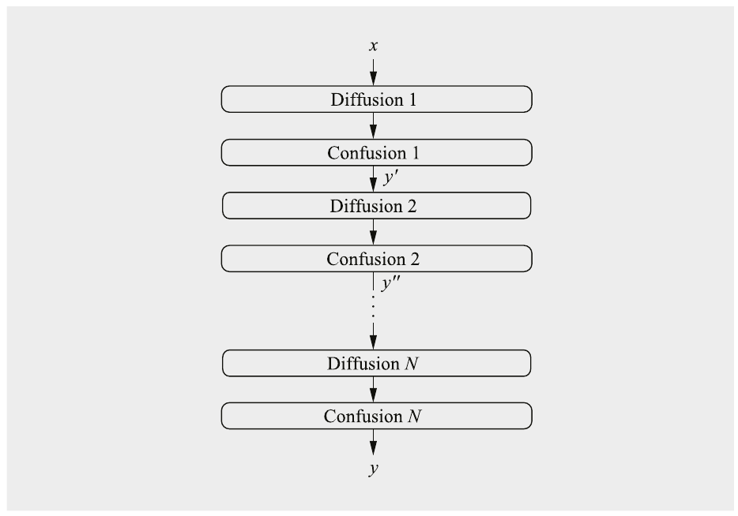

Hình 3.1 Nguyên lý của một product cipher N vòng, trong đó mỗi vòng thực hiện một phép toán confusion và một phép toán diffusion

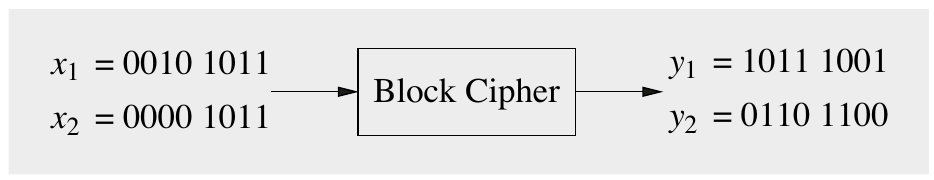

Hình 3.2 Nguyên lý diffusion của một block cipher: Một thay đổi one-bit ở input dẫn tới các output độc lập về thống kê

## 3.2 Tổng quan về thuật toán DES

DES là một cipher mã hóa các block độ dài 64 bit với một key kích thước 56 bit (Hình 3.3).

DES là một symmetric cipher, tức là cùng một key được dùng cho mã hóa và giải mã. DES, như gần như mọi block cipher hiện đại, là một thuật toán round-based. Với mỗi block plaintext, phép mã hóa được xử lý trong 16 vòng, tất cả đều thực hiện phép toán giống hệt nhau. Hình 3.4 cho thấy cấu trúc vòng của DES. Ở mỗi vòng, một subkey khác được dùng và mọi subkey ki đều được suy ra từ key chính k.

Bây giờ hãy xem chi tiết hơn bên trong DES, như được thể hiện trong Hình 3.5. Cấu trúc trong hình được gọi là một Feistel network. Nó có thể dẫn tới các cipher rất mạnh nếu được thiết kế cẩn thận. Feistel network cũng được dùng trong các block cipher hiện đại khác, nhưng chắc chắn không phải tất cả. (Thực tế, AES không phải là một Feistel cipher.) Ngoài sức mạnh mật mã tiềm năng, một ưu điểm của Feistel network là mã hóa và giải mã gần như là cùng một phép toán. Giải mã chỉ cần một key schedule đảo ngược, là một ưu điểm trong các hiện thực software và hardware. Chúng tôi thảo luận về Feistel network sau đây.

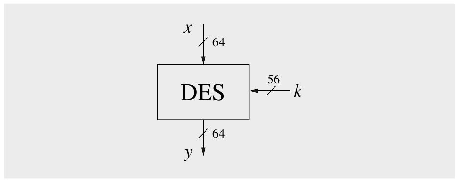

Hình 3.3 Block cipher DES

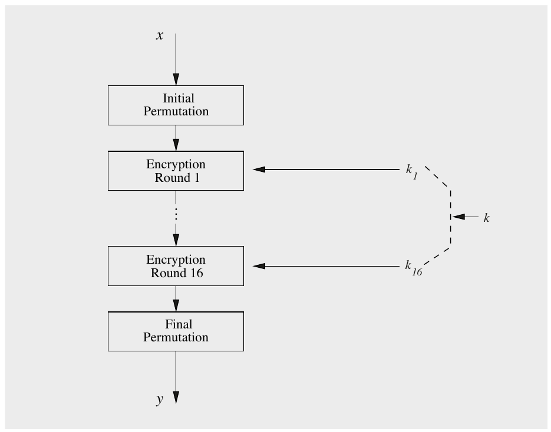

Hình 3.4 Cấu trúc vòng của DES

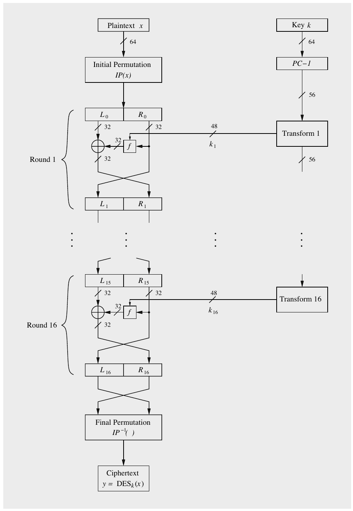

Hình 3.5 Cấu trúc Feistel của DES

Sau hoán vị bit ban đầu IP của một block plaintext 64-bit x, plaintext được chia thành hai nửa L0 và R0. Hai nửa 32-bit này là input của Feistel network, gồm 16 vòng. Nửa phải Ri được đưa vào hàm f. Output của hàm f được XOR (như thường lệ, ký hiệu bằng ký hiệu ⊕) với nửa trái 32-bit Li. Cuối cùng, nửa phải và nửa trái được hoán đổi. Quá trình này lặp lại ở vòng tiếp theo và có thể được biểu diễn là:

Li = Ri−1

Ri = Li−1 ⊕ f(Ri−1,ki)

trong đó i = 1,...,16. Sau vòng 16, các nửa 32-bit L16 và R16 lại được hoán đổi, và hoán vị cuối IP−1 là phép toán cuối cùng của DES. Như ký hiệu gợi ý, hoán vị cuối IP−1 là nghịch đảo của hoán vị ban đầu IP. Ở mỗi vòng, một round key ki được suy ra từ key chính 56-bit bằng cái được gọi là key schedule.

Điều then chốt cần lưu ý là cấu trúc Feistel chỉ mã hóa (giải mã) một nửa số bit input mỗi vòng, cụ thể là nửa trái của input. Nửa phải được sao chép sang vòng tiếp theo mà không thay đổi. Đặc biệt, nửa phải không được mã hóa bằng hàm f. Để hiểu rõ hơn cách hoạt động của Feistel cipher, cách diễn giải sau rất hữu ích: Hãy nghĩ về hàm f như một bộ sinh giả ngẫu nhiên với hai tham số input Ri−1 và ki. Output của bộ sinh giả ngẫu nhiên khi đó được dùng để mã hóa nửa trái Li−1 bằng một phép XOR. Như chúng ta đã thấy trong Chương 2, nếu output của hàm f không thể đoán trước với kẻ tấn công, điều này dẫn tới một phương pháp mã hóa mạnh.

Hai tính chất cơ bản của cipher được đề cập trong Mục 3.1.1, tức là confusion và diffusion, được hiện thực bên trong hàm f. Để chống lại các tấn công phân tích tiên tiến, hàm f phải được thiết kế cực kỳ cẩn thận. Một khi hàm f đã được thiết kế an toàn, bảo mật của một Feistel cipher tăng theo số bit key được dùng và số vòng.

Trước khi thảo luận chi tiết mọi thành phần của DES, đây là một mô tả đại số của Feistel network cho độc giả thiên về toán. Cấu trúc Feistel của mỗi vòng ánh xạ song ánh một block 64 bit input tới 64 bit output (tức là mọi input khả dĩ được ánh xạ duy nhất tới đúng một output, và ngược lại). Ánh xạ này vẫn là song ánh với một hàm f tùy ý, tức là ngay cả khi bản thân hàm f được nhúng vào không phải song ánh. Trong trường hợp DES, hàm f thực ra là một ánh xạ toàn ánh many-to-one. Nó dùng các khối xây dựng phi tuyến và ánh xạ 32 bit input tới 32 bit output dùng một round key 48-bit ki, với 1 ≤ i ≤ 16.

## 3.3 Cấu trúc bên trong của DES

Cấu trúc của DES như được mô tả trong Hình 3.5 cho thấy các hàm bên trong, mà chúng ta sẽ thảo luận trong mục này. Các khối xây dựng là hoán vị ban đầu và hoán vị cuối, các vòng DES thực sự với lõi của chúng, hàm f, và key schedule.

### 3.3.1 Hoán vị ban đầu và hoán vị cuối

Như được thể hiện trong Hình 3.6 và 3.7, hoán vị ban đầu IP và hoán vị cuối IP−1 là các hoán vị theo bit. Một hoán vị theo bit có thể được xem như việc đi dây chéo đơn giản. Thú vị là các hoán vị có thể được hiện thực rất dễ bằng hardware nhưng không đặc biệt nhanh trong software. Lưu ý rằng cả hai hoán vị hoàn toàn không làm tăng bảo mật của DES. Lý do cho hai hoán vị này trong DES hoàn toàn là về hiện thực: Mục đích ban đầu là giúp sắp xếp các bit plaintext và ciphertext theo byte dễ hơn để việc lấy dữ liệu dễ hơn cho các data bus 8-bit, vốn là kích thước thanh ghi state-of-the-art vào đầu những năm 1970.

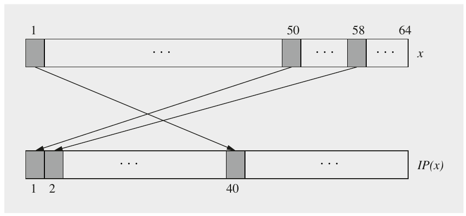

Hình 3.6 Các ví dụ về hoán đổi bit trong hoán vị ban đầu

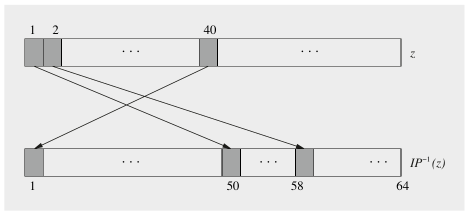

Hình 3.7 Các ví dụ về hoán đổi bit trong hoán vị cuối

Chi tiết của hoán vị IP được cho trong Bảng 3.1. Bảng này, như mọi bảng khác trong chương này, nên được đọc từ trái sang phải, từ trên xuống dưới. Bảng chỉ ra rằng bit input 58 được ánh xạ tới vị trí output 1, bit input 50 được ánh xạ tới vị trí output thứ hai, v.v. Hoán vị cuối IP−1 thực hiện phép toán ngược của IP như được thể hiện trong Bảng 3.2.

Bảng 3.1 Hoán vị ban đầu IP

Bảng 3.2 Hoán vị cuối IP−1

| IP |
|---|
| 58 50 42 34 26 18 10 2 |
| 60 52 44 36 28 20 12 4 |
| 62 54 46 38 30 22 14 6 |
| 64 56 48 40 32 24 16 8 |
| 57 49 41 33 25 17 9 1 |
| 59 51 43 35 27 19 11 3 |
| 61 53 45 37 29 21 13 5 |
| 63 55 47 39 31 23 15 7 |

| IP−1 |
|---|
| 40 8 48 16 56 24 64 32 |
| 39 7 47 15 55 23 63 31 |
| 38 6 46 14 54 22 62 30 |
| 37 5 45 13 53 21 61 29 |
| 36 4 44 12 52 20 60 28 |
| 35 3 43 11 51 19 59 27 |
| 34 2 42 10 50 18 58 26 |
| 33 1 41 9 49 17 57 25 |

### 3.3.2 Hàm f

Như đã đề cập trước đó, hàm f đóng vai trò then chốt đối với bảo mật của DES. Ở vòng i, nó nhận nửa phải Ri−1 của output vòng trước và round key hiện tại ki làm input. Output của hàm f được dùng như một XOR-mask để mã hóa các bit input nửa trái Li−1.

Cấu trúc của hàm f được thể hiện trong Hình 3.8. Trước hết, input 32-bit được mở rộng lên 48 bit bằng cách chia input thành tám block 4-bit và mở rộng mỗi block thành 6 bit. Việc này diễn ra bên trong E-box, một loại hoán vị đặc biệt. Block đầu tiên gồm các bit (1,2,3,4), block thứ hai gồm (5,6,7,8), v.v. Việc mở rộng lên sáu bit có thể thấy trong Hình 3.9.

Như được thể hiện trong Bảng 3.3, đúng 16 trong 32 bit input xuất hiện hai lần trong output. Tuy nhiên, một bit input không bao giờ xuất hiện hai lần trong cùng một block output 6-bit. Hộp mở rộng làm tăng hành vi diffusion của DES vì một số bit input ảnh hưởng tới hai vị trí output khác nhau.

Tiếp theo, kết quả 48-bit của phép mở rộng được XOR với round key ki, và tám block 6-bit được đưa vào tám substition box (hộp thay thế) khác nhau, thường được gọi là S-boxes. Mỗi S-box là một bảng tra ánh xạ một input 6-bit tới một output 4-bit. Các bảng lớn hơn sẽ tốt hơn về mặt mật mã nhưng chúng cũng trở nên lớn hơn nhiều; tám bảng 4-by-6 có lẽ gần với kích thước tối đa có thể đặt vừa trên một mạch tích hợp vào đầu những năm 1970, khi DES được thiết kế. Mỗi S-box chứa 26 = 64 mục, thường được biểu diễn bằng một bảng 16 cột và 4 hàng. Mỗi mục là một giá trị 4-bit. Mọi S-boxes được liệt kê trong Bảng 3.4 tới 3.11. Lưu ý rằng mọi S-boxes đều khác nhau. Các bảng được đọc như được chỉ ra trong Hình 3.10: bit có trọng số cao nhất (MSB) và bit có trọng số thấp nhất (LSB) của mỗi input 6-bit chọn hàng của bảng, trong khi bốn bit bên trong chọn cột. Các số nguyên 0,1,...,15 của mỗi mục trong bảng biểu diễn ký hiệu thập phân của một giá trị 4-bit.

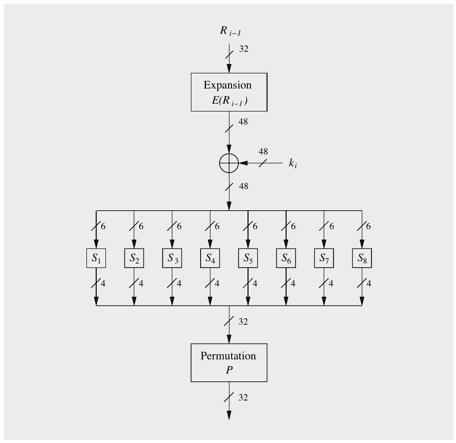

Hình 3.8 Sơ đồ khối của hàm f

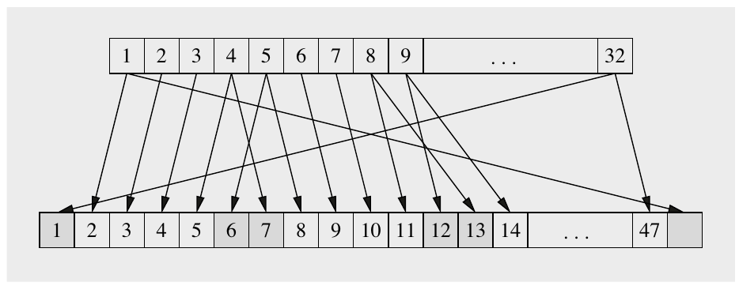

Hình 3.9 Các ví dụ về hoán đổi bit trong hàm mở rộng E

Bảng 3.3 Hoán vị mở rộng E

| E |
|---|
| 32 1 2 3 4 5 |
| 4 5 6 7 8 9 |
| 8 9 10 11 12 13 |
| 12 13 14 15 16 17 |
| 16 17 18 19 20 21 |
| 20 21 22 23 24 25 |
| 24 25 26 27 28 29 |
| 28 29 30 31 32 1 |

Ví dụ 3.2. Input S-box b = (100101)2 chỉ hàng 112 = 3 (tức là hàng thứ tư, đánh số bắt đầu từ 002) và cột 00102 = 2 (tức là cột thứ ba). Nếu input b được đưa vào S-box 1, output là S1(37 = 1001012) = 8 = 10002.

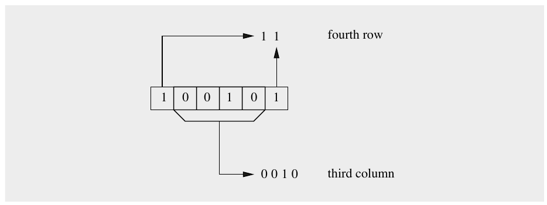

Hình 3.10 Ví dụ về việc giải mã input 1001012 bởi S-box 1

◇

Bảng 3.4 S-box S1

| S1 | 0 1 2 3 4 5 6 7 8 9 10 11 12 13 14 15 |
|---|---|
| 0 | 14 04 13 01 02 15 11 08 03 10 06 12 05 09 00 07 |
| 1 | 00 15 07 04 14 02 13 01 10 06 12 11 09 05 03 08 |
| 2 | 04 01 14 08 13 06 02 11 15 12 09 07 03 10 05 00 |
| 3 | 15 12 08 02 04 09 01 07 05 11 03 14 10 00 06 13 |

Bảng 3.5 S-box S2

| S2 | 0 1 2 3 4 5 6 7 8 9 10 11 12 13 14 15 |
|---|---|
| 0 | 15 01 08 14 06 11 03 04 09 07 02 13 12 00 05 10 |
| 1 | 03 13 04 07 15 02 08 14 12 00 01 10 06 09 11 05 |
| 2 | 00 14 07 11 10 04 13 01 05 08 12 06 09 03 02 15 |
| 3 | 13 08 10 01 03 15 04 02 11 06 07 12 00 05 14 09 |

Bảng 3.6 S-box S3

| S3 | 0 1 2 3 4 5 6 7 8 9 10 11 12 13 14 15 |
|---|---|
| 0 | 10 00 09 14 06 03 15 05 01 13 12 07 11 04 02 08 |
| 1 | 13 07 00 09 03 04 06 10 02 08 05 14 12 11 15 01 |
| 2 | 13 06 04 09 08 15 03 00 11 01 02 12 05 10 14 07 |
| 3 | 01 10 13 00 06 09 08 07 04 15 14 03 11 05 02 12 |

Bảng 3.7 S-box S4

| S4 | 0 1 2 3 4 5 6 7 8 9 10 11 12 13 14 15 |
|---|---|
| 0 | 07 13 14 03 00 06 09 10 01 02 08 05 11 12 04 15 |
| 1 | 13 08 11 05 06 15 00 03 04 07 02 12 01 10 14 09 |
| 2 | 10 06 09 00 12 11 07 13 15 01 03 14 05 02 08 04 |
| 3 | 03 15 00 06 10 01 13 08 09 04 05 11 12 07 02 14 |

Bảng 3.8 S-box S5

| S5 | 0 1 2 3 4 5 6 7 8 9 10 11 12 13 14 15 |
|---|---|
| 0 | 02 12 04 01 07 10 11 06 08 05 03 15 13 00 14 09 |
| 1 | 14 11 02 12 04 07 13 01 05 00 15 10 03 09 08 06 |
| 2 | 04 02 01 11 10 13 07 08 15 09 12 05 06 03 00 14 |
| 3 | 11 08 12 07 01 14 02 13 06 15 00 09 10 04 05 03 |

Bảng 3.9 S-box S6

| S6 | 0 1 2 3 4 5 6 7 8 9 10 11 12 13 14 15 |
|---|---|
| 0 | 12 01 10 15 09 02 06 08 00 13 03 04 14 07 05 11 |
| 1 | 10 15 04 02 07 12 09 05 06 01 13 14 00 11 03 08 |
| 2 | 09 14 15 05 02 08 12 03 07 00 04 10 01 13 11 06 |
| 3 | 04 03 02 12 09 05 15 10 11 14 01 07 06 00 08 13 |

Bảng 3.10 S-box S7

| S7 | 0 1 2 3 4 5 6 7 8 9 10 11 12 13 14 15 |
|---|---|
| 0 | 04 11 02 14 15 00 08 13 03 12 09 07 05 10 06 01 |
| 1 | 13 00 11 07 04 09 01 10 14 03 05 12 02 15 08 06 |
| 2 | 01 04 11 13 12 03 07 14 10 15 06 08 00 05 09 02 |
| 3 | 06 11 13 08 01 04 10 07 09 05 00 15 14 02 03 12 |

S-boxes là lõi của DES về mặt sức mạnh mật mã. Chúng là thành phần phi tuyến duy nhất trong thuật toán và cung cấp confusion.

Bảng 3.11 S-box S8

| S8 | 0 1 2 3 4 5 6 7 8 9 10 11 12 13 14 15 |
|---|---|
| 0 | 13 02 08 04 06 15 11 01 10 09 03 14 05 00 12 07 |
| 1 | 01 15 13 08 10 03 07 04 12 05 06 11 00 14 09 02 |
| 2 | 07 11 04 01 09 12 14 02 00 06 10 13 15 03 05 08 |
| 3 | 02 01 14 07 04 10 08 13 15 12 09 00 03 05 06 11 |

Dù toàn bộ đặc tả của DES đã được NBS/NIST công bố năm 1977, động cơ cho việc chọn các bảng S-box chưa bao giờ được tiết lộ hoàn toàn. Điều này thường làm nảy sinh suy đoán, đặc biệt về khả năng tồn tại một backdoor bí mật hoặc một điểm yếu được cố ý xây dựng nào đó có thể bị NSA khai thác. Tuy nhiên, ngày nay chúng ta biết rằng các S-boxes được thiết kế theo các tiêu chí được liệt kê dưới đây.

1. Mỗi S-box có sáu bit input và bốn bit output.

2. Không bit output đơn lẻ nào được quá gần với một tổ hợp tuyến tính của các bit input.

3. Nếu bit thấp nhất và bit cao nhất của input được cố định và bốn bit ở giữa thay đổi, mỗi giá trị output 4-bit khả dĩ phải xuất hiện đúng một lần.

4. Nếu hai input của một S-box khác nhau đúng một bit, output của chúng phải khác nhau ít nhất hai bit.

5. Nếu hai input của một S-box khác nhau ở hai bit giữa, output của chúng phải khác nhau ít nhất hai bit.

6. Nếu hai input của một S-box khác nhau ở hai bit đầu và giống nhau ở hai bit cuối, hai output phải khác nhau.

7. Với bất kỳ hiệu 6-bit khác không nào giữa các input, không quá 8 trong 32 cặp input có hiệu đó có thể dẫn tới cùng một hiệu output.

8. Một collision (hiệu output bằng không) tại output 32-bit của tám S-boxes chỉ có thể xảy ra với ba S-boxes kề nhau.

Lưu ý rằng một số tiêu chí thiết kế này mãi tới những năm 1990 mới được tiết lộ. Thêm thông tin về vấn đề giữ bí mật các tiêu chí thiết kế có trong Mục 3.5.

S-boxes là các thành phần then chốt nhất của DES vì chúng đưa tính phi tuyến vào cipher, tức là

S(a) ⊕ S(b) ≠ S(a ⊕ b)

Không có một khối xây dựng phi tuyến, kẻ tấn công có thể biểu diễn input và output của DES bằng một hệ phương trình tuyến tính trong đó các bit key là ẩn. Các hệ như vậy có thể dễ dàng được giải, một sự thật đã được dùng trong tấn công LFSR ở Mục 2.3.2. Tuy nhiên, các S-boxes được thiết kế cẩn thận để cũng chống lại các tấn công toán học tiên tiến, đặc biệt là differential cryptanalysis. Thú vị là differential cryptanalysis lần đầu được cộng đồng nghiên cứu phát hiện năm 1990. Vào thời điểm đó, nhóm IBM tuyên bố rằng tấn công đã được những người thiết kế biết tới ít nhất 16 năm trước, và rằng DES được thiết kế đặc biệt để chống lại differential cryptanalysis.

Cuối cùng, output 32-bit của các S-Boxes được hoán vị theo bit theo hoán vị P, được cho trong Bảng 3.12. Khác với hoán vị ban đầu IP và nghịch đảo IP−1 của nó, hoán vị P có một mục đích mật mã quan trọng. Nó đưa vào diffusion vì bốn bit output của mỗi S-box được hoán vị theo cách sao cho chúng ảnh hưởng tới vài S-boxes khác nhau ở vòng tiếp theo. Diffusion gây ra bởi phép mở rộng E và hoán vị P cùng với confusion gây ra bởi các S-boxes bảo đảm rằng mỗi bit trong 64 bit ở cuối vòng thứ năm là một hàm của mọi bit plaintext và mọi bit key. Hành vi này được gọi là avalanche effect (hiệu ứng tuyết lở).

Bảng 3.12 Hoán vị P bên trong hàm f

| P |
|---|
| 16 7 20 21 29 12 28 17 |
| 1 15 23 26 5 18 31 10 |
| 2 8 24 14 32 27 3 9 |
| 19 13 30 6 22 11 4 25 |

### 3.3.3 Key Schedule

Key schedule suy ra 16 round key ki, mỗi round key gồm 48 bit, từ key gốc 56-bit. Một thuật ngữ khác cho round key là subkey. Trước hết, lưu ý rằng key input của DES thường được nói là 64 bit, trong đó mỗi bit thứ tám được dùng làm bit parity lẻ cho bảy bit đứng trước, như được thể hiện trong Hình 3.11. Không rõ lắm vì sao DES được đặc tả theo cách đó. Dù sao đi nữa, tám bit parity không phải là các bit key thực sự và không làm tăng bảo mật. DES là một cipher 56-bit, không phải 64-bit!

Ở đầu key schedule, key 64-bit được giảm xuống 56 bit bằng cách bỏ qua mỗi bit thứ tám, tức là các bit parity bị loại bỏ trong hoán vị ban đầu PC–1, xem Hình 3.12. Một lần nữa, các bit parity chắc chắn không làm tăng key space. Tên PC–1 là viết tắt của “permuted choice one”. Các kết nối bit chính xác được hiện thực bởi PC–1 được cho trong Bảng 3.13.

Bảng 3.13 Hoán vị key ban đầu PC–1

| PC–1 |
|---|
| 57 49 41 33 25 17 9 1 |
| 58 50 42 34 26 18 10 2 |
| 59 51 43 35 27 19 11 3 |
| 60 52 44 36 63 55 47 39 |
| 31 23 15 7 62 54 46 38 |
| 30 22 14 6 61 53 45 37 |
| 29 21 13 5 28 20 12 4 |

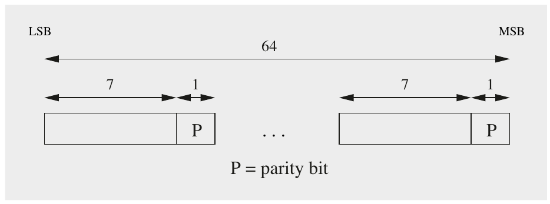

Hình 3.11 Vị trí của tám bit parity trong một key input 64-bit

Key 56-bit kết quả được chia thành hai nửa C0 và D0, và key schedule thực sự bắt đầu như được thể hiện trong Hình 3.12. Hai nửa 28-bit được dịch vòng (tức là xoay) sang trái một hoặc hai vị trí bit tùy theo vòng i theo quy tắc sau:

■ Ở các vòng i = 1,2,9,16, hai nửa được xoay trái một bit.

■ Ở các vòng khác với i ≠ 1,2,9,16, hai nửa được xoay trái hai bit.

Lưu ý rằng các phép xoay diễn ra bên trong nửa trái và nửa phải. Tổng số vị trí xoay là 4 · 1 + 12 · 2 = 28. Điều này dẫn tới tính chất thú vị là C0 = C16 và D0 = D16. Điều này rất hữu ích cho key schedule giải mã, nơi các subkey phải được tạo theo thứ tự ngược, như chúng ta sẽ thấy trong Mục 3.4.

Để suy ra các round key 48-bit ki, hai nửa lại được hoán vị theo bit bằng PC–2, viết tắt của “permuted choice 2”. PC–2 hoán vị 56 bit input đến từ Ci và Di và bỏ qua 8 bit trong số đó. Các kết nối bit chính xác của PC–2 được cho trong Bảng 3.14.

Bảng 3.14 Hoán vị round key PC–2

| PC–2 |
|---|
| 14 17 11 24 1 5 3 28 |
| 15 6 21 10 23 19 12 4 |
| 26 8 16 7 27 20 13 2 |
| 41 52 31 37 47 55 30 40 |
| 51 45 33 48 44 49 39 56 |
| 34 53 46 42 50 36 29 32 |

Lưu ý rằng mỗi round key là một tuyển chọn 48 bit đã hoán vị của key input k. Key schedule chỉ là một phương pháp hiện thực 16 hoán vị một cách có hệ thống. Đặc biệt bằng hardware, key schedule rất dễ hiện thực. Key schedule cũng được thiết kế sao cho mỗi bit trong 56 bit key được dùng trong các round key khác nhau; mỗi bit được dùng trong khoảng 14 trong 16 round key.

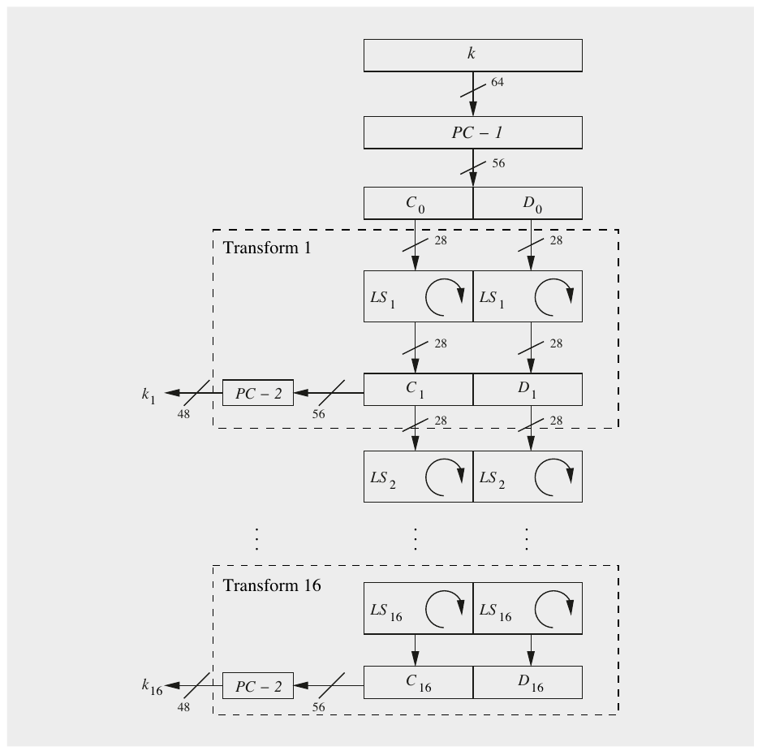

Hình 3.12 Key schedule cho mã hóa DES

## 3.4 Giải mã

Một ưu điểm của DES là giải mã về cơ bản là cùng hàm với mã hóa. Đây là tính chất của mọi Feistel cipher. Hình 3.13 cho thấy sơ đồ khối của giải mã DES. So với mã hóa, chỉ key schedule bị đảo ngược, tức là ở vòng giải mã 1, cần subkey 16; ở vòng 2, subkey 15; v.v. Do đó, khi ở chế độ giải mã, thuật toán key schedule phải tạo các round key theo dãy k16,k15,...,k1.

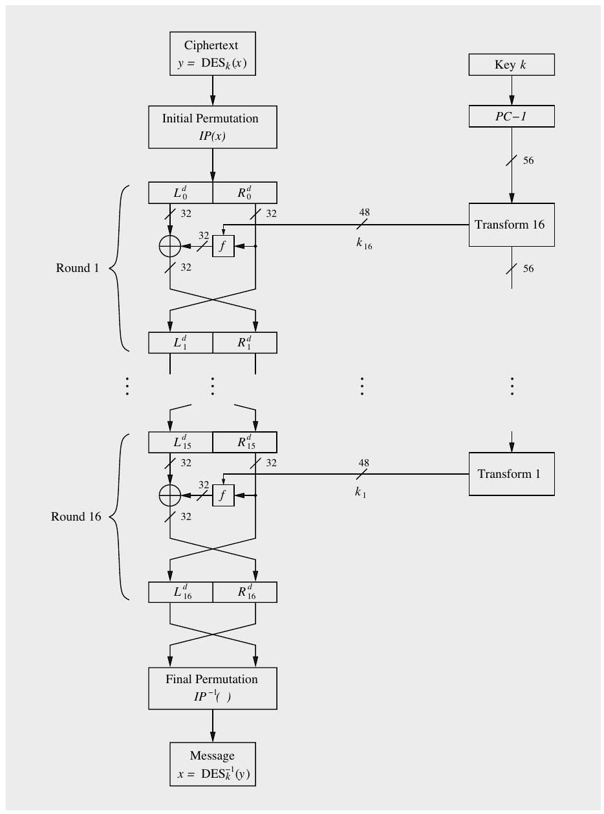

Hình 3.13 Giải mã DES

### Key Schedule đảo ngược

Câu hỏi đầu tiên chúng ta phải làm rõ là, cho key DES ban đầu k, làm sao có thể tạo k16 một cách hiệu quả? Lưu ý rằng chúng ta đã thấy ở trên C0 = C16 và D0 = D16. Do đó k16 có thể được suy ra trực tiếp từ PC–1.

k16 = PC–2(C16,D16)

= PC–2(C0,D0)

= PC–2(PC–1(k))

Để tính k15, chúng ta cần các biến trung gian C15 và D15, có thể được suy ra từ C16,D16 qua các phép dịch vòng phải (RS):

k15 = PC–2(C15,D15)

= PC–2(RS2(C16),RS2(D16))

= PC–2(RS2(C0),RS2(D0))

Các round key tiếp theo k14,k13,...,k1 được suy ra qua các phép dịch phải theo cách tương tự. Số bit dịch phải cho mỗi round key ở chế độ giải mã là:

■ Ở vòng giải mã 1, key không được xoay.

■ Ở các vòng giải mã 2, 9 và 16, hai nửa được xoay phải một bit.

■ Ở các vòng khác 3, 4, 5, 6, 7, 8, 10, 11, 12, 13, 14 và 15, hai nửa được xoay phải hai bit.

Hình 3.14 cho thấy key schedule đảo ngược cho giải mã.

### Giải mã trong Feistel Network

Chúng ta chưa đề cập câu hỏi cốt lõi: Vì sao hàm giải mã về cơ bản giống hàm mã hóa? Ý tưởng cơ bản là hàm giải mã đảo ngược phép mã hóa DES theo kiểu round-by-round. Điều đó có nghĩa là vòng giải mã 1 đảo ngược vòng mã hóa 16, vòng giải mã 2 đảo ngược vòng mã hóa 15, v.v. Trước hết hãy xem giai đoạn đầu của giải mã bằng cách nhìn vào Hình 3.13. Lưu ý rằng nửa phải và nửa trái được hoán đổi ở vòng cuối của DES:

(L0d,R0d) = IP(Y) = IP(IP−1(R16,L16)) = (R16,L16)

Và do đó:

L0d = R16

R0d = L16 = R15

Lưu ý rằng mọi biến trong routine giải mã được đánh dấu bằng chỉ số trên d, trong khi các biến mã hóa không có chỉ số trên. Phương trình suy ra chỉ đơn giản nói rằng input của vòng giải mã đầu tiên là output của vòng mã hóa cuối cùng vì hoán vị cuối và hoán vị ban đầu triệt tiêu nhau.

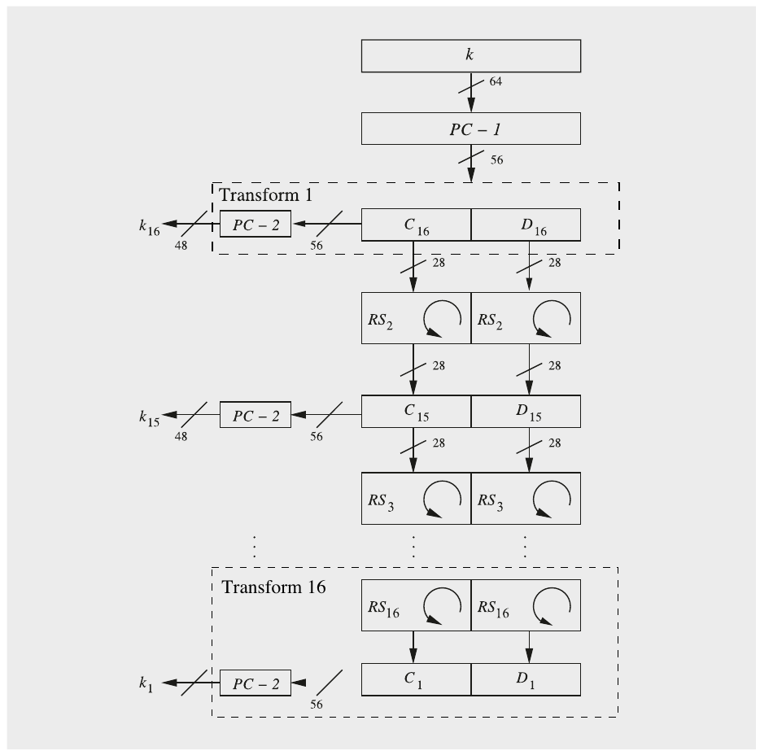

Hình 3.14 Key schedule đảo ngược cho giải mã DES

Bây giờ chúng ta sẽ chỉ ra rằng vòng giải mã đầu tiên đảo ngược vòng mã hóa cuối cùng. Để làm điều này, chúng ta phải biểu diễn các giá trị output (L1d,R1d) của vòng giải mã đầu tiên 1 theo các giá trị input của vòng mã hóa cuối cùng (L15,R15). Giá trị đầu tiên rất dễ:

L1d = R0d = L16 = R15

Bây giờ chúng ta xem R1d được tính như thế nào:

R1d = L0d ⊕ f (R0d,k16) = R16 ⊕ f(L16,k16)

= [L15 ⊕ f(R15,k16)] ⊕ f(R15,k16)

= L15 ⊕ [f(R15,k16) ⊕ f(R15,k16)] = L15

Bước then chốt được thể hiện ở phương trình cuối cùng ở trên: Hàm f được XOR hai lần vào L15 với các input giống hệt nhau (cụ thể là R15 và k16). Hai output này của hàm f triệt tiêu nhau, để R1d = L15. Do đó, sau vòng giải mã đầu tiên, thực tế chúng ta đã tính được cùng các giá trị chúng ta có trước vòng mã hóa cuối cùng. Như vậy, vòng giải mã đầu tiên đảo ngược vòng mã hóa cuối cùng. Đây là một quá trình lặp, tiếp tục ở 15 vòng giải mã tiếp theo và có thể được biểu diễn là:

Lid = R16−i,

Rid = L16−i,

trong đó i = 0,1,...,16. Đặc biệt, sau vòng giải mã cuối cùng:

L16d = R16−16 = R0

R16d = L0

Cuối cùng, ở cuối quá trình giải mã, chúng ta phải đảo ngược hoán vị ban đầu:

IP−1(R16d,L16d) = IP−1(L0,R0) = IP−1(IP(x)) = x

trong đó x là plaintext đã là input của phép mã hóa DES.

## 3.5 Bảo mật của DES

Như chúng ta đã thảo luận trong Mục 1.2.2, cipher có thể bị tấn công theo vài cách. Về các tấn công mật mã, chúng ta phân biệt giữa tấn công exhaustive key search (hay brute-force) và tấn công phân tích. Loại sau đã được minh họa bằng tấn công LFSR trong Mục 2.3.2, nơi chúng ta có thể dễ dàng phá một stream cipher bằng cách giải một hệ phương trình tuyến tính. Không lâu sau khi DES được đề xuất, hai chỉ trích lớn nhằm vào sức mạnh mật mã của DES xoay quanh hai lập luận:

1. Key space quá nhỏ, tức là thuật toán dễ bị tổn thương trước brute-force attack.

2. Các tiêu chí thiết kế của S-boxes bị giữ bí mật và có thể có một tấn công phân tích khai thác các tính chất toán học của S-boxes mà chỉ những người thiết kế DES biết.

Chúng tôi thảo luận cả hai loại tấn công dưới đây và nêu kết luận chính về bảo mật của DES ngay tại đây: Bất chấp cryptanalysis rất mạnh mẽ kể từ mid-1970s, các tấn công phân tích hiện tại không hiệu quả lắm. Tuy nhiên, DES có thể bị phá tương đối dễ dàng bằng một tấn công exhaustive key-search và, do đó, DES đơn thuần không còn phù hợp với hầu hết ứng dụng nữa.

### 3.5.1 Exhaustive Key Search

Chỉ trích đầu tiên ngày nay chắc chắn là có cơ sở. Cipher nguyên bản do IBM đề xuất có độ dài key 128 bit và thật đáng ngờ khi nó bị giảm xuống 56 bit. Tuyên bố chính thức rằng một cipher có độ dài key ngắn hơn giúp hiện thực thuật toán DES trên một chip duy nhất năm 1974 dễ hơn nghe không thuyết phục lắm. Để làm rõ, hãy nhớ lại nguyên lý của exhaustive key-search (hay brute-force attack).

> Định nghĩa 3.5.1 DES exhaustive key search
>
> Input: ít nhất một cặp plaintext–ciphertext (x,y)
>
> Output: k, sao cho y = DESk(x)
>
> Tấn công: Thử tất cả 256 key khả dĩ cho tới khi điều kiện sau được thỏa:
>
> DESki−1(y) ≟ x, i = 0,1,...,256 − 1

Lưu ý rằng có một khả năng nhỏ 1/28 là một key sai được tìm thấy, tức là một key k chỉ giải mã đúng một ciphertext y nhưng không giải mã đúng các ciphertext tiếp theo. Nếu muốn loại trừ khả năng này, kẻ tấn công phải kiểm tra key ứng viên như vậy với một cặp plaintext–ciphertext thứ hai. Thêm về điều này có trong Mục 5.2.

Máy tính thông thường không đặc biệt phù hợp để thực hiện 256 lần thử key cần thiết, nhưng các máy key-search special-purpose là một lựa chọn. Có vẻ rất có khả năng các tổ chức (chính phủ) lớn từ lâu đã có thể chế tạo các cỗ máy phá brute-force như vậy, có thể phá DES trong vài ngày. Năm 1977, Whitfield Diffie và Martin Hellman [94] ước tính rằng có thể chế tạo một máy exhaustive key-search với giá khoảng $20,000,000. Dù sau đó họ nói rằng ước tính chi phí của họ quá lạc quan, ngay từ đầu đã rõ rằng một cỗ máy phá có thể được chế tạo nếu có đủ kinh phí.

Tại phiên rump session của hội nghị CRYPTO 1993, Michael Wiener đã đề xuất thiết kế một máy key-search rất hiệu quả dùng kỹ thuật pipelining. Ông ước tính chi phí cho thiết kế của mình khoảng $1,000,000, và thời gian cần để tìm key là 1.5 ngày. Đây chỉ là một đề xuất, và máy không được chế tạo. Tuy nhiên, năm 1998, EFF (Electronic Frontier Foundation) đã chế tạo máy hardware Deep Crack, thực hiện một brute-force attack nhắm vào DES trong 56 giờ. Hình 3.15 cho thấy ảnh của Deep Crack. Máy gồm 1800 mạch tích hợp, mỗi mạch có 24 đơn vị key-test. Thời gian tìm kiếm trung bình của Deep Crack là 15 ngày, và máy được chế tạo với giá dưới $250,000. Việc phá thành công bằng Deep Crack được nhiều người coi là minh chứng chính thức rằng DES không còn an toàn trước các tấn công quyết tâm. Lưu ý rằng việc phá này không ngụ ý rằng một thuật toán yếu đã được dùng hơn 20 năm. Chỉ có thể chế tạo Deep Crack với giá tương đối thấp như vậy vì hardware số đã trở nên rẻ. Trong những năm 1980, sẽ không thể chế tạo một máy phá DES mà không tốn nhiều triệu đô la. Có thể suy đoán rằng chỉ các cơ quan chính phủ mới sẵn sàng đầu tư một khoản tiền như vậy cho việc phá mã.

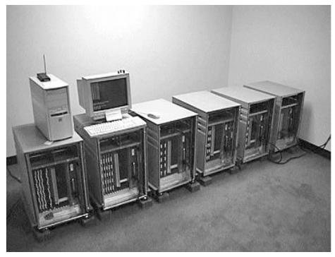

Hình 3.15 Deep Crack — máy exhaustive key-search hardware đã phá DES năm 1998 (in lại với sự cho phép của Paul Kocher)

Các brute-force attack nhắm vào DES cũng là một case study tuyệt vời về sự giảm liên tục của chi phí hardware. Năm 2006, máy COPACOBANA (Cost-Optimized Parallel Code-Breaker) được chế tạo dựa trên các mạch tích hợp thương mại bởi một nhóm nhà nghiên cứu từ các trường đại học Bochum và Kiel ở Đức (cả ba tác giả của cuốn sách này đều tham gia sâu vào nỗ lực này). COPACOBANA cho phép phá DES với thời gian tìm kiếm trung bình chưa tới bảy ngày. Phần thú vị của công trình này là máy có thể được chế tạo với chi phí hardware trong khoảng $10,000. Hình 3.16 cho thấy ảnh của COPACOBANA.

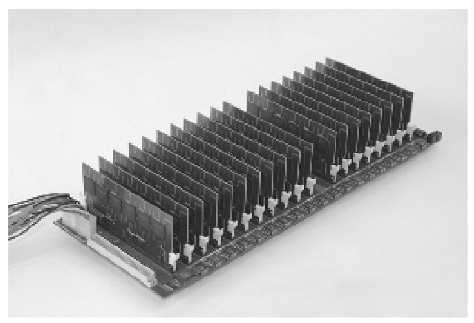

Hình 3.16 COPACOBANA — Một cỗ máy phá mã song song cost-optimized

Tóm lại, kích thước key 56 bit ngày nay quá ngắn để mã hóa dữ liệu mật. Do đó, single DES không nên được dùng nữa. Tuy nhiên, 3DES, tức là áp dụng DES ba lần liên tiếp, cho ra một cipher an toàn hơn nhiều, xem Mục 3.7.2. Lưu ý rằng 3DES hiện đang bị NIST loại bỏ dần và sẽ chính thức bị ngừng như một tiêu chuẩn Mỹ sau năm 2023.

### 3.5.2 Tấn công phân tích (Analytical Attacks)

Như đã được chỉ ra trong chương đầu, tấn công phân tích có thể rất mạnh. Kể từ khi DES ra đời vào mid-1970s, nhiều nhà nghiên cứu xuất sắc trong giới học thuật (và chắc chắn nhiều nhà nghiên cứu xuất sắc trong các cơ quan tình báo) đã cố tìm điểm yếu trong cấu trúc của DES cho phép phá cipher. Đó là một chiến thắng lớn của những người thiết kế DES khi không tìm thấy điểm yếu nào cho tới năm 1990. Năm đó, Eli Biham và Adi Shamir phát hiện ra cái được gọi là differential cryptanalysis (DC). Đây là một tấn công mạnh, về nguyên tắc áp dụng được cho mọi block cipher. Tuy nhiên, hóa ra các S-boxes của DES đặc biệt kháng cự được tấn công này. Thực tế, một thành viên của nhóm thiết kế IBM ban đầu đã tuyên bố sau khi DC được phát hiện rằng họ đã biết về tấn công này vào thời điểm thiết kế. Người ta cho rằng lý do các tiêu chí thiết kế S-box không được công khai là nhóm thiết kế không muốn công khai một tấn công mạnh như vậy. Nếu tuyên bố này đúng — và mọi tình tiết đều ủng hộ nó — điều đó có nghĩa là nhóm IBM và NSA đi trước cộng đồng nghiên cứu 15 năm. Tuy nhiên, cần lưu ý rằng trong những năm 1970 và 1980, tương đối ít người nghiên cứu tích cực về cryptography.

Năm 1993, một tấn công phân tích liên quan nhưng khác biệt đã được Mitsuru Matsui công bố, được đặt tên là linear cryptanalysis (LC). Tương tự differential cryptanalysis, hiệu quả của tấn công này phụ thuộc nhiều vào cấu trúc của S-boxes.

Ý nghĩa thực tế của hai tấn công phân tích nhắm vào DES này là gì? Hóa ra kẻ tấn công cần 247 cặp plaintext–ciphertext cho một tấn công DC thành công. Điều này giả định các block plaintext được chọn đặc biệt; với plaintext ngẫu nhiên cần 255 cặp! Trong trường hợp LC, kẻ tấn công cần 243 cặp plaintext–ciphertext. Mọi con số này có vẻ rất phi thực tế vì vài lý do. Thứ nhất, kẻ tấn công cần biết một số lượng cực lớn plaintext, tức là các mẩu dữ liệu lẽ ra đã được mã hóa và do đó bị che giấu khỏi kẻ tấn công. Thứ hai, thu thập và lưu trữ lượng dữ liệu như vậy mất nhiều thời gian và cần tài nguyên bộ nhớ đáng kể. Thứ ba, tấn công chỉ khôi phục được một key. (Đây thực ra là một trong nhiều lập luận cho việc đưa key freshness vào các ứng dụng cryptographic.) Kết quả của mọi lập luận này là có vẻ không khả năng DES có thể bị phá bằng DC hay LC trong các hệ thống real-world. Tuy nhiên, cả DC và LC đều là các tấn công rất mạnh áp dụng được cho nhiều block cipher khác. Bảng 3.15 cho tổng quan về các tấn công được đề xuất và đã thực hiện nhắm vào DES kể từ khi nó được chuẩn hóa. Một số mục liên quan tới cái được gọi là DES Challenges. Bắt đầu từ năm 1997, vài thử thách DES-breaking đã được công ty RSA Security tổ chức.

Bảng 3.15 Lịch sử các tấn công nhắm vào DES full-round

| Thời điểm | Các tấn công được đề xuất hoặc thực hiện |
|---|---|
| 1977 | W. Diffie và M. Hellman đề xuất ước tính chi phí cho máy key-search |
| 1990 | E. Biham và A. Shamir đề xuất differential cryptanalysis, cần 247 chosen plaintext |
| 1993 | M. Wiener đề xuất thiết kế hardware chi tiết cho máy key-search với thời gian tìm kiếm trung bình 36 h và chi phí ước tính $1,000,000 |
| 1993 | M. Matsui đề xuất linear cryptanalysis, cần 243 chosen ciphertext |
| Jun. 1997 | DES Challenge I bị phá bằng brute-force; nỗ lực phân tán trên internet mất 4.5 tháng |
| Feb. 1998 | DES Challenge II–1 bị phá bằng brute-force; nỗ lực phân tán trên internet mất 39 ngày |
| Jul. 1998 | DES Challenge II–2 bị phá bằng brute-force; Electronic Frontier Foundation đã chế tạo máy key-search Deep Crack với giá khoảng $250,000. Tấn công mất 56 h (trung bình 15 ngày) |
| Jan. 1999 | DES Challenge III bị phá bằng brute-force bởi nỗ lực internet phân tán kết hợp với Deep Crack và tổng thời gian tìm kiếm 22 giờ |
| Apr. 2006 | Các trường đại học Bochum và Kiel (cả hai ở Đức) chế tạo máy COPACOBANA key-search dựa trên các FPGA low-cost với khoảng $10,000. Thời gian tìm kiếm trung bình là 7 ngày. |

## 3.6 Hiện thực bằng Software và Hardware

Sau đây, chúng tôi đưa ra một đánh giá ngắn gọn về các đặc tính hiện thực DES bằng software và hardware. Khi nói về software, chúng tôi muốn nói tới các hiện thực DES chạy trên CPU desktop hoặc các vi xử lý nhúng như smart card hay thiết bị IoT. Hardware chỉ các hiện thực DES chạy trên IC như application-specific integrated circuit (ASIC) hay field programmable gate array (FPGA).

### Software

Một hiện thực software đơn giản bám theo luồng dữ liệu của hầu hết các mô tả DES, như được trình bày trong chương này, dẫn tới hiệu năng rất kém. Đó là do nhiều phép toán DES nguyên tử liên quan tới hoán vị bit, đặc biệt là các hoán vị E và P, vốn chậm trong software. Tương tự, các S-boxes nhỏ như dùng trong DES hiệu quả trong hardware nhưng chỉ hiệu quả ở mức vừa phải trên các CPU hiện đại. Đã có rất nhiều phương pháp được đề xuất để tăng tốc các hiện thực software DES. Ý tưởng chung là dùng các bảng có giá trị tính trước của vài phép toán DES, chẳng hạn của vài S-boxes và hoán vị. Các hiện thực tối ưu cần khoảng 240 chu kỳ để mã hóa một block trên CPU 32-bit. Trên một CPU 2-GHz, điều này tương ứng với throughput lý thuyết khoảng 533 Mbit/s. 3DES, an toàn hơn đáng kể so với single DES, chạy với tốc độ bằng một phần ba tốc độ DES. Lưu ý rằng các hiện thực non-optimized chậm hơn đáng kể, thường dưới 100 Mbit/s.

Một phương pháp đáng chú ý để tăng tốc các hiện thực software của DES là bit-slicing, được Eli Biham phát triển năm 1997. Tuy nhiên, hạn chế của bit-slicing là vài block được mã hóa song song, điều có thể là nhược điểm với một số mode of operation như mode Cipher Block Chaining (CBC) và Output Feedback (OFB) (xem Chương 5).

### Hardware

Một tiêu chí thiết kế cho DES là hiệu quả trong hardware. Các hoán vị như E, P, IP và IP−1 rất dễ hiện thực bằng hardware, vì chúng chỉ cần đi dây mà không cần logic. Các S-boxes 6-by-4 nhỏ cũng tương đối dễ hiện thực bằng hardware. Thông thường, chúng được hiện thực bằng logic Boolean, tức là các cổng logic. Trung bình, một S-box cần khoảng 100 cổng.

Một hiện thực tiết kiệm diện tích (area-efficient) của một vòng DES đơn lẻ có thể được làm với ít hơn 3000 cổng. Nếu muốn throughput cao, DES có thể được làm cho thực thi cực kỳ nhanh bằng cách đặt nhiều vòng trong một mạch, chẳng hạn bằng pipelining. Trên các ASIC và FPGA hiện đại, có thể đạt tốc độ throughput vài 100 Gbit/sec. Ở đầu kia của phổ hiệu năng, các hiện thực rất nhỏ với ít hơn 3000 cổng thậm chí vừa với các chip radio frequency identification (RFID) low-cost.

## 3.7 Các lựa chọn thay thế DES

Tồn tại hàng trăm block cipher khác. Dù nhiều cipher được đề xuất có điểm yếu bảo mật hoặc chưa được nghiên cứu kỹ, cũng có nhiều block cipher được tin là rất an toàn. Sau đây là một danh sách ngắn các lựa chọn thay thế DES được thảo luận.

### 3.7.1 Advanced Encryption Standard (AES) và các cipher lọt vào chung kết AES

Ngày nay, thuật toán được chọn cho rất, rất nhiều ứng dụng đã trở thành Advanced Encryption Standard (AES), sẽ được giới thiệu chi tiết trong chương tiếp theo. Với ba độ dài key 128, 192 và 256 bit, AES sẽ an toàn trước brute-force attack trong vài thập kỷ, và không có tấn công phân tích nào với bất kỳ khả năng thành công hợp lý nào được biết. Lưu ý rằng AES-128 có thể bị phá bằng máy tính lượng tử, nếu chúng trở nên khả dụng trong tương lai. Tuy nhiên, AES-192 và AES-256 được tin là cũng chống được tấn công bằng máy tính lượng tử. Mục 12.1 cung cấp thêm thông tin về vấn đề này.

AES là kết quả của một cuộc thi mở, và ở giai đoạn cuối của quá trình lựa chọn có bốn thuật toán chung kết khác. Đó là các block cipher Mars, RC6, Serpent và Twofish. Tất cả đều mạnh về mặt mật mã và khá nhanh, đặc biệt trong software. Dựa trên hiểu biết ngày nay, tất cả đều có thể được khuyến nghị. Những người thiết kế Mars, Serpent và Twofish luôn cho phép dùng cipher của họ royalty-free. Bằng sáng chế cho RC6 giờ cũng đã hết hạn.

### 3.7.2 Triple DES (3DES) và DESX

Triple DES, còn được ký hiệu là 3DES, TDES, Triple DEA hay TDEA, đã được dùng rộng rãi từ những năm 1990. 3DES đặc biệt phổ biến cho các ứng dụng trong ngành thanh toán. Tuy nhiên, 3DES sẽ bị loại bỏ dần cho các ứng dụng của chính phủ Mỹ năm 2023.

3DES gồm ba phép toán DES liên tiếp encrytion *(ghi chú: sách in encrytion; đúng là encryption)*-decryption-encryption (3DES-EDE):

y = DESk3(DESk2−1(DESk1(x)))

như được thể hiện trong Hình 3.17. Lý do dùng 3DES ở mode EDE là nó thực hiện một phép mã hóa single DES nếu k3 = k2 = k1, điều đáng mong muốn cho các hiện thực cũng cần hỗ trợ single DES vì lý do tương thích ngược. Có hai cách chọn ba key. Phương pháp được ưa chuộng ngày nay (và tự nhiên hơn) là chọn ba key độc lập k1, k2 và k3, được gọi là 3TDEA. Phương pháp thứ hai là chọn k2 riêng biệt và các key k1 = k3, được gọi là 2TDEA. Trong một số ứng dụng cũ, người ta coi là có lợi khi chỉ cần 112 bit vật liệu key cho 2TDEA, trái với 168 bit cho 3TDEA. Tuy nhiên, việc dùng 2TDEA không còn được khuyến khích.

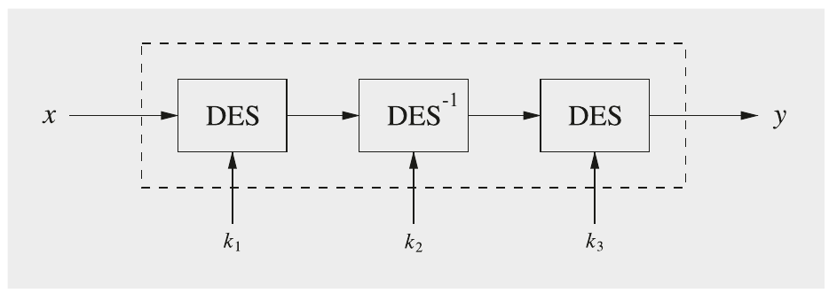

Hình 3.17 Triple DES (3DES-EDE)

3DES chống được brute-force attack và hầu hết các tấn công phân tích. Có những điểm yếu bảo mật tinh vi khi lượng lớn dữ liệu được mã hóa dưới cùng một key. Để tránh các tấn công như vậy, NIST bắt buộc không được mã hóa quá 220 block plaintext bằng 3TDEA dưới cùng một key. Về đặc tính hiện thực, 3DES rất hiệu quả trong hardware nhưng không đặc biệt hiệu quả trong software.

Người ta có thể thắc mắc vì sao không có phiên bản DES dùng double-encryption (“2DES”). Điều này liên quan tới meet-in-the-middle attack, được thảo luận trong Mục 5.3.1. Nói ngắn gọn, 2DES — đáng ngạc nhiên — không an toàn hơn đáng kể so với single DES.

DESX là một cách tiếp cận khác để tăng cường DES bằng key whitening. Để làm điều này, hai key 64-bit bổ sung k1 và k2 lần lượt được XOR với plaintext và ciphertext, trước và sau thuật toán DES. Điều này cho ra scheme mã hóa sau:

y = DESk,k1,k2(x) = DESk(x ⊕ k1) ⊕ k2

Sửa đổi đơn giản đến bất ngờ này khiến DES chống lại exhaustive key search tốt hơn nhiều. Thêm về key whitening được nói trong Mục 5.3.3.

### 3.7.3 Lightweight Cipher PRESENT

Từ khoảng năm 2007, vài thuật toán mã hóa mới được xếp vào loại “lightweight cipher” đã được đề xuất. Lightweight thường chỉ các thuật toán có độ phức tạp hiện thực rất thấp, đặc biệt trong hardware. Trivium (Mục 2.4.3) là một ví dụ về lightweight stream cipher. Một ứng viên block cipher hứa hẹn là PRESENT, được thiết kế đặc biệt cho các ứng dụng như thẻ RFID hay các thiết bị internet-of-things (IoT) khác, vốn cực kỳ hạn chế về điện năng hay chi phí. (Một trong các tác giả của cuốn sách đã tham gia thiết kế PRESENT.) Về các lightweight cipher khác và các nỗ lực chuẩn hóa của NIST trong lĩnh vực này, chúng tôi giới thiệu tới Mục 3.8.

Khác với DES, PRESENT không dựa trên Feistel network. Thay vào đó, nó là một substitution-permutation network (SP-network) và gồm 31 vòng. Chúng tôi lưu ý rằng AES cũng dựa trên một SP-network. Độ dài block là 64 bit, và hỗ trợ hai độ dài key 80 và 128 bit. Một sơ đồ khối của cipher được thể hiện trong Hình 3.18. Mỗi vòng trong 31 vòng gồm một phép XOR để đưa vào một round key Ki, một lớp thay thế phi tuyến (sBoxLayer) và một hoán vị theo bit tuyến tính (pLayer). Sau vòng cuối, subkey cuối k32 được áp dụng vào đường dữ liệu. Lớp phi tuyến dùng một S-box 4-bit S, được áp dụng 16 lần song song ở mỗi vòng. Key schedule tạo 32 round key từ key user-supplied. Đây là mã giả:

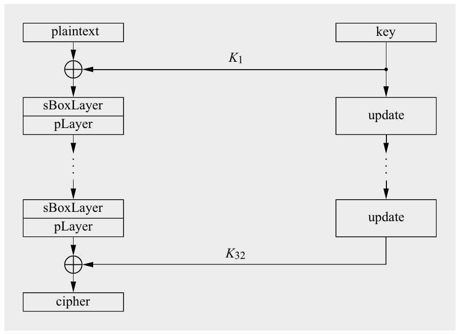

Hình 3.18 Cấu trúc bên trong của block cipher PRESENT

> Mã giả của block cipher PRESENT
>
> 1 generateRoundKeys()
>
> 2 FOR i = 1 TO 31
>
> 2.1 addRoundKey(STATE,Ki)
>
> 2.2 sBoxLayer(STATE)
>
> 2.3 pLayer(STATE)
>
> 3 addRoundKey(STATE,K32)

Chúng tôi thảo luận chi tiết ba bước của PRESENT dưới đây. Một lần nữa, chúng tôi khuyên bạn cũng xem sơ đồ trong Hình 3.18.

addRoundKey Ở đầu mỗi vòng, round key Ki được XOR với STATE hiện tại.

sBoxLayer PRESENT dùng một S-box 4-bit sang 4-bit duy nhất. Đây là hệ quả trực tiếp của việc theo đuổi hiệu quả hardware, vì một S-box như vậy cho phép hiện thực gọn hơn nhiều so với, chẳng hạn, một S-box 8-bit. Các mục S-box ở dạng hệ thập lục phân được cho trong Bảng 3.16.

Bảng 3.16 S-box của PRESENT ở dạng hệ thập lục phân

| x | 0 | 1 | 2 | 3 | 4 | 5 | 6 | 7 | 8 | 9 | A | B | C | D | E | F |
|---|---|---|---|---|---|---|---|---|---|---|---|---|---|---|---|---|
| S[x] | C | 5 | 6 | B | 9 | 0 | A | D | 3 | E | F | 8 | 4 | 7 | 1 | 2 |

Đường dữ liệu 64-bit (b63...b0) được gọi là state. Với sBoxLayer, sẽ hữu ích khi xem state như gồm mười sáu nibble 4-bit (w15...w0), trong đó wi = b4·i+3||b4·i+2|| b4·i+1||b4·i với 0 ≤ i ≤ 15, và output gồm mười sáu nibble S[wi].

pLayer Như trong DES, lớp trộn được chọn là một hoán vị bit, có thể được hiện thực cực kỳ gọn trong hardware. Hoán vị bit dùng trong PRESENT được cho bởi Bảng 3.17. Bit i của state input được chuyển tới vị trí bit P(i).

Bảng 3.17 Lớp hoán vị của PRESENT

| i | 0 | 1 | 2 | 3 | 4 | 5 | 6 | 7 | 8 | 9 | 10 | 11 | 12 | 13 | 14 | 15 |
|---|---|---|---|---|---|---|---|---|---|---|---|---|---|---|---|---|
| P(i) | 0 | 16 | 32 | 48 | 1 | 17 | 33 | 49 | 2 | 18 | 34 | 50 | 3 | 19 | 35 | 51 |
| i | 16 | 17 | 18 | 19 | 20 | 21 | 22 | 23 | 24 | 25 | 26 | 27 | 28 | 29 | 30 | 31 |
| P(i) | 4 | 20 | 36 | 52 | 5 | 21 | 37 | 53 | 6 | 22 | 38 | 54 | 7 | 23 | 39 | 55 |
| i | 32 | 33 | 34 | 35 | 36 | 37 | 38 | 39 | 40 | 41 | 42 | 43 | 44 | 45 | 46 | 47 |
| P(i) | 8 | 24 | 40 | 56 | 9 | 25 | 41 | 57 | 10 | 26 | 42 | 58 | 11 | 27 | 43 | 59 |
| i | 48 | 49 | 50 | 51 | 52 | 53 | 54 | 55 | 56 | 57 | 58 | 59 | 60 | 61 | 62 | 63 |
| P(i) | 12 | 28 | 44 | 60 | 13 | 29 | 45 | 61 | 14 | 30 | 46 | 62 | 15 | 31 | 47 | 63 |

Hoán vị bit khá đều đặn và thực ra có thể được biểu diễn là:

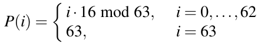

Key Schedule của PRESENT-80 Trước hết, chúng tôi mô tả key schedule cho PRESENT với key 80-bit. Độ dài key này hấp dẫn cho các ứng dụng chỉ có yêu cầu bảo mật short-term, chẳng hạn các thiết bị IoT low-cost. Với mọi ứng dụng khác, key 128-bit được khuyến nghị, được mô tả dưới đây. Key user-supplied được lưu trong một thanh ghi key K và được biểu diễn bởi 80 bit k79k78...k0. Ở vòng i, round key 64-bit Ki gồm 64 bit ngoài cùng bên trái của nội dung hiện tại của thanh ghi K. Do đó, ở vòng i ta có:

Ki = k79k78...k16

Subkey đầu tiên K1 là bản sao trực tiếp của 64 bit ngoài cùng bên trái của key user-supplied. Với các subkey tiếp theo K2,...,K32, thanh ghi key K = k79k78...k0 được cập nhật như sau:

Bước 1: [k79k78...k1k0] = [k18k17...k20k19]

Bước 2: [k79k78k77k76] = S[k79k78k77k76]

Bước 3: [k19k18k17k16k15] = [k19k18k17k16k15] ⊕ round_counter

Đây là giải thích về ba bước của key schedule:

■ Bước 1: Thanh ghi key được xoay 61 vị trí bit sang trái.

■ Bước 2: Bốn bit ngoài cùng bên trái được cho qua S-box của PRESENT.

■ Bước 3: Giá trị round_counter i được XOR với các bit k19k18k17k16k15 của K, trong đó bit có trọng số thấp nhất của round_counter nằm bên phải. Bộ đếm này là một số nguyên đơn giản nhận các giá trị (00001,00010,...,11111). Chẳng hạn, để suy ra K2, giá trị bộ đếm 00001 được dùng; với K3, giá trị bộ đếm 00010; v.v.

Key Schedule của PRESENT-128 Key được lưu trong một thanh ghi K và được biểu diễn bởi các bit k127k126...k0. Ở vòng i, round key 64-bit Ki gồm 64 bit ngoài cùng bên trái của nội dung hiện tại của thanh ghi K, tức là

Ki = k127k126...k64

Subkey đầu tiên K1 là bản sao trực tiếp của 64 bit ngoài cùng bên trái của key user-supplied. Với các subkey tiếp theo K2,...,K32, thanh ghi key K = k127k126...k0 được cập nhật như sau:

Bước 1: [k127k126...k1k0] = [k66k65...k68k67]

Bước 2: [k127k126k125k124] = S[k127k126k125k124]

Bước 3: [k123k122k121k120] = S[k123k122k121k120]

Bước 4: [k66k65k64k63k62] = [k66k65k64k63k62] ⊕ round_counter

Hiện thực và bảo mật PRESENT-80 có thể được hiện thực bằng hardware với diện tích khoảng 1600 gate equivalence, trong đó việc mã hóa một block plaintext 64-bit cần 32 chu kỳ clock. Làm ví dụ, ngay cả ở tốc độ clock tương đối chậm 1 MHz, khá điển hình trên các thiết bị low-cost, low-energy, vẫn đạt được throughput cao đáng kể là 2 Mbit/s. Có thể hiện thực cipher với chỉ khoảng 1000 gate equivalence, trong đó việc mã hóa một plaintext 64-bit cần 547 chu kỳ clock. Một hiện thực fully pipelined của PRESENT với 31 tầng mã hóa đạt throughput 64 bit mỗi chu kỳ clock, có thể cho throughput mã hóa hơn 50 Gbit/s.

Là kết quả của thiết kế tối ưu hardware quyết liệt (aggressively hardware-optimized) của PRESENT, hiệu năng software của nó chậm hơn so với nhiều cipher hiện đại khác như AES. Một hiện thực software tối ưu trên CPU Pentium III bằng C đạt throughput khoảng 60 Mbit/s ở tần số 1 GHz. Tuy nhiên, nó hoạt động khá tốt trên các vi xử lý nhỏ, phổ biến trong các sản phẩm tiêu dùng rẻ tiền.

Tại thời điểm viết sách, không có tấn công nào được biết nhắm vào phiên bản full-round của PRESENT tốt hơn brute-force attack.

## 3.8 Thảo luận và đọc thêm (Discussion and Further Reading)

Lịch sử DES và các tấn công Dù single DES (tức là non-3DES) hầu như không còn được dùng, lịch sử của nó giúp chúng ta hiểu sự tiến hóa của cryptography kể từ mid-1970s từ một ngành ít người biết gần như chỉ được nghiên cứu trong các tổ chức chính phủ thành một lĩnh vực mở với nhiều bên tham gia trong công nghiệp và học thuật. Một bản tóm tắt lịch sử DES có thể được tìm thấy trong [245]. Ngày nay, hai tấn công phân tích lớn được phát triển nhắm vào DES, differential cryptanalysis và linear cryptanalysis, nằm trong số các phương pháp tổng quát mạnh nhất để phá block cipher. Với độc giả quan tâm tới lý thuyết block cipher, bao gồm differential cryptanalysis và linear cryptanalysis, cuốn sách rất dễ tiếp cận [161] được khuyến nghị. Các tài liệu gốc cho differential cryptanalysis và linear cryptanalysis là [48, 181].

Như chúng ta đã thấy trong chương này, DES không nên được dùng nữa vì một brute-force attack có thể được thực hiện với chi phí thấp trong thời gian ngắn bằng hardware cryptanalytical. Hai máy được chế tạo bên ngoài chính phủ, Deep Crack và COPACOBANA, là các ví dụ bổ ích về cách chế tạo “siêu máy tính” low-cost cho các tác vụ tính toán được định nghĩa rất hẹp. Thêm thông tin về Deep Crack có thể được tìm thấy trong [118] và về COPACOBANA trong các bài báo [166, 137] và trực tuyến tại [76]. Trước đó, Michael Wiener đã đề xuất (nhưng không chế tạo) một máy key-search rất hiệu quả dùng kỹ thuật pipelining. Một bản cập nhật đề xuất của ông có thể được tìm thấy trong [252]. Độc giả quan tâm tới lĩnh vực hấp dẫn của các máy tính cryptanalytical nói chung nên xem chuỗi workshop SHARCS (Special-purpose Hardware for Attacking Cryptographic Systems), diễn ra không đều đặn từ năm 2005 tới năm 2012 [249].

Tháng Bảy năm 2017, NIST lần đầu nhắc tới việc cho 3DES nghỉ hưu [83], sau một phân tích bảo mật mới dựa trên các collision attack so-called. Nó được mô tả trong Tài liệu tham khảo [45]. Tấn công có thể được giảm nhẹ bằng cách giới hạn số block plaintext được mã hóa dưới một key. Tháng Mười Một năm 2017, NIST giới hạn việc dùng 3DES ở 220 block plaintext 64-bit (8 MB dữ liệu) với một bộ key duy nhất. Hệ quả là nó không nên được dùng cho TLS, IPsec hay các ứng dụng mã hóa file lớn nữa [26]. Tại thời điểm viết sách, 3DES (hay TDEA) đang bị NIST loại bỏ dần và sẽ chính thức bị ngừng như một tiêu chuẩn Mỹ sau năm 2023. Một hướng dẫn cho việc chuyển đổi khỏi 3DES được cung cấp trong [27].

Hiện thực DES Về hiện thực software của DES, một tài liệu tham khảo sớm là [47]. Các kỹ thuật tiên tiến hơn được mô tả trong [167]. Phương pháp mạnh bit-slicing, mà chúng tôi đã mô tả trong Mục 3.6, không chỉ áp dụng được cho DES mà còn cho hầu hết các cipher khác.

Về hiện thực hardware của DES, một tài liệu tham khảo sớm nhưng vẫn rất thú vị là [247]. Có nhiều mô tả về các hiện thực DES high-performance trên nhiều nền tảng hardware khác nhau, bao gồm FPGA [244], ASIC tiêu chuẩn cũng như các công nghệ bán dẫn kỳ lạ hơn [107].

Các lựa chọn thay thế DES và Lightweight Cipher Cần lưu ý rằng hàng trăm block cipher đã được đề xuất kể từ khi DES ra đời vào mid-1970s. DES đã ảnh hưởng tới thiết kế của nhiều thuật toán mã hóa khác, đặc biệt là những thuật toán được đề xuất trong những năm 1980 và 1990. Một số block cipher phổ biến nhất cũng dựa trên Feistel network. Các ví dụ về các Feistel cipher khác từ thời kỳ này bao gồm Blowfish, CAST, KASUMI, Mars, MISTY1, Twofish và RC6. Một cipher từ giai đoạn pre-2000 nổi tiếng và khác biệt rõ rệt so với DES là IDEA; nó dùng số học trong ba cấu trúc đại số khác nhau làm các phép toán nguyên tử. Dù vậy, block cipher được chọn cho nhiều ứng dụng ngày nay là AES, được giới thiệu trong chương tiếp theo.

DES là một ví dụ tốt về một block cipher rất hiệu quả trong hardware. Có những ứng dụng cực kỳ nhạy cảm về chi phí và hạn chế về điện năng, chẳng hạn thẻ RFID hay các thiết bị IoT low-cost khác, mà với chúng các lightweight cipher như vậy rất hấp dẫn. Các tài liệu tham khảo tốt cho PRESENT là [59, 221]. Ngoài PRESENT, các block cipher rất nhỏ khác được đề xuất bao gồm Clefia [77], HIGHT [144] và mCrypton [175]. PRESENT và Clefia đã được chuẩn hóa trong ISO/IEC 29192- 2 [150].

Năm 2015, NIST bắt đầu quá trình chuẩn hóa lightweight cipher. Năm 2019, 57 thuật toán ứng viên đã được nộp. Quá trình lựa chọn tiếp theo kéo dài qua ba vòng. Sau Vòng 2, mười thuật toán chung kết được công bố vào đầu năm 2021. Tháng Hai năm 2023, họ lightweight cipher Ascon được chọn làm tiêu chuẩn NIST tương lai. Thuật toán được thiết kế bởi một nhóm các nhà cryptographer châu Âu và mô tả cipher được cho trong [98]. Thú vị là Ascon không dùng cấu trúc Feistel (như DES) cũng không dùng substitution-permutation network (như AES và PRESENT) mà dùng cấu trúc sponge. Thêm về cấu trúc sponge sẽ được nói trong Mục 11.5.1 trong bối cảnh hash function SHA-3.

Trong số nhiều đề xuất lightweight cipher, các thuật toán Simon và Speck [31] đóng một vai trò đặc biệt. Chúng hiệu quả khi được hiện thực bằng software và hardware nhưng có lẽ chúng nổi tiếng nhất vì được NSA thiết kế. Đã có những tranh cãi quanh các nỗ lực đưa Simon và Speck vào các tiêu chuẩn công nghiệp của ISO [19], vì một số quốc gia lo ngại về các điểm yếu có thể có trong các cipher này.

## 3.9 Bài học rút ra (Lessons Learned)

■ DES là thuật toán mã hóa symmetric thống trị từ mid-1970s tới mid-1990s. Vì các cipher với key 56-bit không còn an toàn, Advanced Encryption Standard (AES) được tạo ra để thay thế DES.

■ DES chuẩn ngày nay có thể bị phá tương đối dễ dàng qua exhaustive key search do độ dài key ngắn 56 bit.

■ DES khá vững trước các tấn công phân tích đã biết: Trong thực tế, rất khó phá cipher bằng differential cryptanalysis hay linear cryptanalysis.

■ DES hiệu quả ở mức hợp lý trong software nhưng nhanh và nhỏ trong hardware.

■ Bằng cách mã hóa với DES ba lần liên tiếp, triple DES (3DES) được tạo ra, vẫn an toàn nếu lượng dữ liệu được mã hóa dưới một bộ key bị giới hạn.

■ Symmetric cipher “mặc định” ngày nay thường là AES. Ngoài ra, bốn cipher chung kết AES khác đều có vẻ rất an toàn và hiệu quả.

■ Từ khoảng năm 2005, vài đề xuất lightweight cipher đã được đưa ra. Chúng phù hợp cho các ứng dụng resource-constrained.

## Bài tập

3.1. Như đã nêu trong Mục 3.5.2, một tính chất quan trọng bảo đảm DES an toàn là các S-boxes phi tuyến. Trong bài tập này, chúng ta kiểm chứng tính chất này bằng cách tính output của S1 cho vài cặp input.

Chỉ ra rằng S1(x1) ⊕ S1(x2) ≠ S1(x1 ⊕ x2), trong đó “⊕” ký hiệu XOR theo bit, với:

1. x1 = 000000, x2 = 000001

2. x1 = 111111, x2 = 100000

3. x1 = 101010, x2 = 010101

3.2. S-box S4 có các tính chất đặc biệt:

1. Chỉ ra rằng hàng thứ 1st có thể được tính từ hàng thứ 0th với sự trợ giúp của ánh xạ sau:

(y1,y2,y3,y4) → (y2,y1,y4,y3) ⊕ (0,1,1,0)

trong đó (y1,y2,y3,y4) ký hiệu output nhị phân của S-box. Chỉ cần chỉ ra ánh xạ cho năm mục đầu tiên. Lưu ý rằng “hàng” chỉ cách biểu diễn tiêu chuẩn của S-boxes, mà chúng tôi cũng dùng trong cuốn sách này.

2. Chỉ ra rằng điều tương tự đúng với hàng 2 và 3.

3.3. Chúng ta muốn kiểm chứng rằng IP(·) và IP−1(·) thực sự là các phép toán ngược nhau. Chúng ta xét một vector x = (x1,x2,...,x64) gồm 64 bit. Chỉ ra rằng

IP−1(IP(x)) = x

đúng với năm bit đầu tiên của x, tức là với xi, i = 1,2,3,4,5.

3.4. Output của vòng đầu tiên của thuật toán DES là gì khi plaintext và key đều toàn bit không?

3.5. Output của vòng đầu tiên của thuật toán DES là gì khi plaintext và key đều toàn bit một?

3.6. Nhớ rằng với các block cipher tốt, điều đáng mong muốn là một thay đổi ở một bit input ảnh hưởng tới nhiều bit output, một tính chất được gọi là diffusion hay avalanche effect. Bây giờ chúng ta cố cảm nhận tính chất avalanche của DES. Chúng ta áp dụng một word input có “1” ở vị trí bit 57 và mọi bit khác cũng như key đều bằng không. (Lưu ý rằng word input phải chạy qua hoán vị ban đầu.)

1. Có bao nhiêu S-boxes nhận input khác so với trường hợp plaintext all-zero được cung cấp?

2. Số bit output tối thiểu của các S-boxes sẽ thay đổi theo các tiêu chí thiết kế S-box là bao nhiêu?

3. Output sau vòng đầu tiên là gì?

4. Bao nhiêu bit output sau vòng đầu tiên thực sự đã thay đổi so với trường hợp plaintext toàn bit không? (Lưu ý rằng ở đây chúng ta chỉ xét một vòng duy nhất. Sẽ có ngày càng nhiều khác biệt output sau mỗi vòng mới. Do đó có thuật ngữ avalanche effect.)

3.7. Avalanche effect cũng đáng mong muốn đối với key: Một thay đổi one-bit trong key nên dẫn tới một ciphertext khác biệt đáng kể nếu plaintext không đổi.

1. Giả sử một phép mã hóa với một key cho trước. Bây giờ giả sử bit key ở vị trí 1 (trước PC–1) bị lật. Những S-boxes nào ở những vòng nào bị ảnh hưởng bởi việc lật bit trong quá trình mã hóa DES?

2. Những S-boxes nào ở những vòng DES nào bị ảnh hưởng bởi việc lật bit này trong quá trình giải mã DES?

3.8. Trong bài tập này, chúng ta xem mối quan hệ giữa các round key DES và key gốc. Hóa ra mỗi bit trong 48 bit của mọi round key k1,...,k16 là ánh xạ trực tiếp của một bit của key input 64-bit gốc k.

1. Xác định những bit nào của k tạo nên hai bit đầu tiên của round key k1.

2. Xác định những bit nào của k tạo nên hai bit đầu tiên của round key k2.

3.9. Một key DES Kw được gọi là weak key nếu mã hóa và giải mã là các phép toán giống hệt nhau:

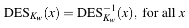 (3.1)

1. Mô tả mối quan hệ của các subkey trong thuật toán mã hóa và giải mã cần có để Phương trình (3.1) được thỏa.

2. Có bốn weak key DES. Đó là những key nào?

3. Khả năng một key được chọn ngẫu nhiên là weak là bao nhiêu?

3.10. DES có một tính chất khá bất ngờ liên quan tới phần bù theo bit của input và output của nó. Chúng ta khảo sát tính chất này trong bài tập này.

Chúng ta ký hiệu phần bù theo bit (tức là mọi bit đều bị lật) của một số A là A′. Cho ⊕ ký hiệu XOR theo bit. Chúng ta muốn chỉ ra rằng nếu

y = DESk(x)

thì

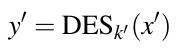 (3.2)

Điều này phát biểu rằng nếu lấy phần bù của plaintext và key, thì output ciphertext cũng sẽ là phần bù của ciphertext gốc.

Nhiệm vụ của bạn là chứng minh tính chất này. Chứng minh có thể được làm theo các bước sau:

1. Chỉ ra rằng với bất kỳ chuỗi bit A,B có độ dài bằng nhau,

A′ ⊕ B′ = A ⊕ B

và

A′ ⊕ B = (A ⊕ B)′

(Hai phép toán này cần cho một số bước tiếp theo.)

2. Chỉ ra rằng PC–1(k′) = (PC–1(k))′.

3. Chỉ ra rằng LSi(Ci−1′) = (LSi(Ci−1))′.

4. Dùng hai kết quả trên, chỉ ra rằng nếu ki là các subkey được tạo từ k, thì ki′ là các subkey của k′, trong đó i = 1,2,...,16.

5. Chỉ ra rằng IP(x′) = (IP(x))′.

6. Chỉ ra rằng E(Ri′) = (E(Ri))′.

7. Dùng mọi kết quả trước, chỉ ra rằng nếu Ri−1, Li−1 và ki tạo ra Ri, thì Ri−1′, Li−1′ và ki′ tạo ra Ri′.

8. Chỉ ra rằng Phương trình (3.2) đúng.

3.11. Giả sử chúng ta thực hiện một known-plaintext attack nhắm vào DES với một cặp plaintext và ciphertext. Chúng ta phải thử bao nhiêu key trong kịch bản worst-case nếu áp dụng exhaustive key search theo cách thẳng? Trung bình bao nhiêu key?

3.12. Trong bài tập này, chúng ta muốn nghiên cứu yêu cầu tần số clock cho một hiện thực hardware của DES trong các ứng dụng real-world. Tốc độ của một hiện thực DES chủ yếu được xác định bởi thời gian cần để tính một vòng. Khối hardware cho một vòng được dùng 16 lần liên tiếp để tạo ra output đã mã hóa. (Một cách tiếp cận khác là xây dựng một pipeline hardware với 16 tầng, dẫn tới chi phí hardware tăng 16-fold, nhưng trong bài tập này chúng ta không xem xét một hiện thực pipelined như vậy.)

1. Giả sử việc tính hàm vòng có thể được thực hiện trong một chu kỳ clock. Hãy xây dựng một biểu thức cho tần số clock cần thiết để mã hóa một dòng dữ liệu với tốc độ dữ liệu r [bit/giây]. Bỏ qua thời gian cần cho hoán vị ban đầu và hoán vị cuối.

2. Cần tần số clock bao nhiêu để mã hóa một liên kết mạng chạy ở tốc độ 1 Gb/sec? Tần số clock là bao nhiêu nếu muốn hỗ trợ tốc độ 8 Gb/sec?

3.13. Trong ví dụ này, chúng ta muốn cảm nhận việc thực hiện một brute-force attack trên một key 56-bit. Với mục đích này, chúng ta nghiên cứu máy key-search COPACOBANA (xem Mục 3.5.1).

1. Tính thời gian chạy của một exhaustive key search trung bình trên DES với giả định các chi tiết hiện thực sau:

■ Chúng ta dùng máy COPACOBANA với 20 module FPGA.

■ 6 FPGA mỗi module FPGA.

■ 4 DES engine mỗi FPGA.

■ Mỗi DES engine fully pipelined và có khả năng thực hiện một phép mã hóa mỗi chu kỳ clock.

■ Tần số clock 100 MHz.

2. Chúng ta cần bao nhiêu máy COPACOBANA nếu muốn có thời gian tìm kiếm trung bình một giờ? (Chúng tôi lưu ý rằng COPACOBANA được thiết kế năm 2006 và hardware hiện tại sẽ còn mạnh hơn.)

3. Vì sao bất kỳ thiết kế máy key-search nào cũng chỉ tạo thành một ngưỡng bảo mật trên? Ngưỡng bảo mật trên có nghĩa là một thước đo (độ phức tạp) mô tả mức bảo mật tối đa do một thuật toán cryptographic cho trước cung cấp.

3.14. Trong bài tập này, chúng ta nghiên cứu một trường hợp real-world về việc dẫn xuất key password-based yếu. Một chương trình mã hóa file thương mại từ đầu những năm 1990 đã dùng DES tiêu chuẩn với 56 bit key. Thời đó, thực hiện exhaustive key search khó hơn đáng kể so với ngày nay, và do đó độ dài key là đủ cho một số ứng dụng. Đáng tiếc, việc hiện thực tạo key bị lỗi, điều chúng ta sẽ phân tích. Giả sử chúng ta có thể thử 106 key mỗi giây trên một PC thông thường.

Key được tạo từ một mật khẩu gồm 8 ký tự? Key là phép nối đơn giản của 8 ký tự ASCII, cho ra 64 = 8 · 8 bit key. Với hoán vị PC–1 trong key schedule, bit có trọng số thấp nhất (LSB) của mỗi ký tự 8-bit bị bỏ qua, cho ra 56 bit key.

1. Kích thước key space là bao nhiêu nếu cả 8 ký tự đều là các ký tự ASCII 8-bit được chọn ngẫu nhiên? Một lần tìm key trung bình mất bao lâu với một PC duy nhất?

2. Bao nhiêu bit key được dùng nếu 8 ký tự là các ký tự ASCII 7-bit được chọn ngẫu nhiên (tức là bit có trọng số cao nhất luôn bằng không)? Một lần tìm key trung bình mất bao lâu với một PC duy nhất?

3. Key space lớn bao nhiêu nếu, ngoài hạn chế ở Phần 2, chỉ có chữ cái được dùng làm ký tự. Hơn nữa, đáng tiếc, mọi chữ cái đều được chuyển thành chữ hoa trước khi tạo key trong phần mềm. Một lần tìm key trung bình mất bao lâu với một PC duy nhất?

3.15. Bài tập này đề cập lightweight cipher PRESENT.

1. Tính state của PRESENT-80 sau khi thực thi một vòng. Chúng tôi khuyên dùng bảng dưới đây và giải bài bằng giấy và bút chì. Các giá trị sau được cho (ở dạng hệ thập lục phân):

■ plaintext = 0000 0000 0000 0000

■ key = BBBB 5555 5555 EEEE FFFF.

| Plaintext | 0000 0000 0000 0000 |
|---|---|
| Round key |  |
| State sau KeyAdd |  |
| State sau sBoxLayer |  |
| State sau pLayer |  |

2. Bây giờ hãy tính round key cho vòng thứ hai dùng bảng sau.

| Key | BBBB 5555 5555 EEEE FFFF |
|---|---|
| Key state sau khi xoay |  |
| Key state sau sBoxLayer |  |
| Key state sau CounterAdd |  |
| Round key cho Vòng 2 |  |

---

[^1]: Một câu đùa quen thuộc trong cộng đồng cryptographic là NSA là viết tắt của “no such agency” (không có cơ quan nào như vậy).
