# Chương 4 Advanced Encryption Standard (AES) (The Advanced Encryption Standard (AES))

Advanced Encryption Standard (AES) là symmetric cipher được dùng rộng rãi nhất ngày nay. Dù thuật ngữ “Standard” trong tên của nó ban đầu chỉ nói tới các ứng dụng của chính phủ Mỹ, block cipher AES đã được nhiều tiêu chuẩn công nghiệp chấp nhận và được dùng trong vô số hệ thống thương mại. Các ví dụ về tiêu chuẩn tích hợp AES là protocol bảo mật web TLS, tiêu chuẩn bảo mật internet IPsec và tiêu chuẩn mã hóa Wi-Fi IEEE 802.11i. Vô số ứng dụng khác, như ứng dụng nhắn tin tức thời WhatsApp, các trình quản lý mật khẩu và phần mềm mã hóa file cũng dùng block cipher này. Cho tới nay, chưa có tấn công nào nhắm vào AES tốt hơn đáng kể so với brute-force được biết tới.

Trong chương này, bạn sẽ học:

■ Quá trình thiết kế tiêu chuẩn mã hóa symmetric của Mỹ, AES

■ Hàm mã hóa và giải mã của AES

■ Cấu trúc bên trong của AES, cụ thể là:

□ lớp thay thế byte (byte substitution layer)

□ lớp khuếch tán (diffusion layer)

□ lớp cộng key (key addition layer)

□ key schedule

■ Các kiến thức cơ bản về Galois field

■ Hiệu quả của các hiện thực AES

## 4.1 Giới thiệu

Năm 1999, National Institute of Standards and Technology (NIST) của Mỹ chỉ ra rằng DES chỉ nên được dùng cho các hệ thống cũ, và thay vào đó nên dùng triple DES (3DES). Dù 3DES chống được brute-force attack với công nghệ ngày nay, nó có vài vấn đề. Thứ nhất, nó không hiệu quả lắm với các hiện thực software. Một nhược điểm nghiêm trọng hơn là kích thước block 64 bit, làm phát sinh một số tấn công (xem Mục 3.8) nếu các khối dữ liệu lớn được mã hóa. Kích thước block ngắn cũng khiến việc xây dựng một hash function từ 3DES khó hơn (xem Mục 11.3.1). Cuối cùng, nếu người ta lo ngại về các tấn công bằng máy tính lượng tử trong tương lai, độ dài key cỡ 256 bit là đáng mong muốn. Mọi cân nhắc này dẫn NIST tới kết luận rằng cần một block cipher hoàn toàn mới để thay thế DES.

Năm 1997, NIST kêu gọi đề xuất cho một Advanced Encryption Standard mới. Khác với quá trình phát triển DES, việc lựa chọn thuật toán AES là một quá trình mở do NIST quản lý. Trong ba vòng đánh giá liên tiếp, NIST và cộng đồng khoa học quốc tế đã thảo luận ưu và nhược điểm của các cipher được nộp và thu hẹp số lượng ứng viên tiềm năng. Năm 2001, NIST công bố cipher Rijndael là AES mới và ban hành nó như một tiêu chuẩn Mỹ (FIPS PUB 197). Rijndael được thiết kế bởi hai nhà cryptographer trẻ người Bỉ.

Trong lời kêu gọi đề xuất, các yêu cầu sau là bắt buộc với mọi ứng viên AES được nộp:

■ block cipher với kích thước block 128-bit,

■ phải hỗ trợ ba độ dài key: 128, 192 và 256 bit,

■ bảo mật so với các thuật toán được nộp khác,

■ hiệu quả trong software và hardware.

Lời mời nộp các thuật toán phù hợp và việc đánh giá tiếp theo để chọn người kế nhiệm DES là một quá trình công khai. Một niên biểu ngắn gọn của quá trình lựa chọn AES được cho ở đây:

■ Nhu cầu về một block cipher mới được NIST thông báo vào tháng Một năm 1997.

■ Lời kêu gọi chính thức cho AES được thông báo vào tháng Chín năm 1997.

■ Mười lăm thuật toán ứng viên đã được các nhà nghiên cứu từ nhiều quốc gia nộp trước tháng Tám năm 1998.

■ Tháng Tám năm 1999, năm thuật toán chung kết được công bố:

□ Mars của IBM Corporation,

□ RC6 của RSA Laboratories,

□ Rijndael, của Joan Daemen và Vincent Rijmen,

□ Serpent, của Ross Anderson, Eli Biham và Lars Knudsen,

□ Twofish, của Bruce Schneier, John Kelsey, Doug Whiting, David Wagner, Chris Hall và Niels Ferguson.

■ Ngày 2 tháng Mười, 2000, NIST công bố rằng họ đã chọn Rijndael làm AES.

■ Ngày 26 tháng Mười Một, 2001, AES chính thức được phê chuẩn làm tiêu chuẩn liên bang Mỹ.

Người ta kỳ vọng AES sẽ vẫn là thuật toán symmetric-key thống trị cho nhiều ứng dụng thương mại trong vài thập kỷ tới, đặc biệt ở thế giới phương Tây. Cũng đáng chú ý là năm 2003, National Security Agency (NSA) của Mỹ công bố rằng họ cho phép AES mã hóa tài liệu mật tới mức SECRET với mọi độ dài key và tới mức TOP SECRET với độ dài key 192 hoặc 256 bit. Trước thời điểm đó, chỉ các thuật toán non-public được dùng để mã hóa tài liệu mật.

## 4.2 Tổng quan về thuật toán AES

Cipher AES gần như giống hệt block cipher Rijndael. Kích thước block và key của Rijndael thay đổi giữa 128, 192 và 256 bit. Tuy nhiên, tiêu chuẩn AES chỉ yêu cầu kích thước block 128 bit. Do đó, chỉ Rijndael với độ dài block 128 bit được biết tới là thuật toán AES. Trong phần còn lại của chương này, chúng tôi chỉ thảo luận phiên bản chuẩn hóa của Rijndael với kích thước block 128 bit, xem Hình 4.1.

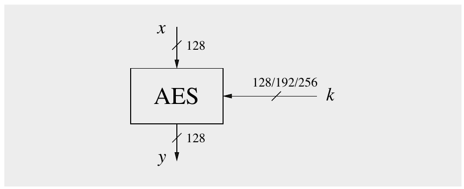

Hình 4.1 Các tham số input và output của AES

Ba độ dài key mà AES hỗ trợ là một yêu cầu thiết kế của NIST. Số vòng bên trong của cipher là một hàm của độ dài key, theo Bảng 4.1.

Bảng 4.1 Độ dài key và số vòng của AES

| độ dài key | # vòng = n<sub>r</sub> |
|---|---|
| 128 bit | 10 |
| 192 bit | 12 |
| 256 bit | 14 |

Khác với DES, AES không có cấu trúc Feistel. Feistel network không mã hóa toàn bộ một block mỗi lần lặp, ví dụ, trong DES, 64/2 = 32 bit được mã hóa trong một vòng. Ngược lại, AES mã hóa cả 128 bit trong một lần lặp. Đây là một lý do vì sao nó có số vòng tương đối nhỏ. Mỗi vòng AES gồm các lớp so-called. Chỉ có ba loại lớp khác nhau. Mỗi lớp thao tác trên cả 128 bit của đường dữ liệu. Đường dữ liệu cũng được gọi là state của thuật toán. Mỗi vòng, trừ vòng cuối, gồm tất cả các lớp như thể hiện trong Hình 4.2: plaintext được ký hiệu là x, ciphertext là y và số vòng là n<sub>r</sub>. Hơn nữa, vòng cuối n<sub>r</sub> không dùng phép biến đổi MixColumn, điều này làm cho scheme mã hóa và giải mã đối xứng.

Chúng tôi tiếp tục với mô tả ngắn gọn về các lớp:

Key addition layer Một round key 128-bit, hay subkey, được suy ra từ key chính trong key schedule, được XOR vào state.

Byte substitution layer (S-box) Mỗi phần tử của state được biến đổi phi tuyến bằng các lookup table có các tính chất toán học đặc biệt. Điều này đưa confusion vào dữ liệu, tức là nó bảo đảm rằng thay đổi ở từng bit dẫn tới thay đổi phi tuyến trong state.

Diffusion layer Lớp này cung cấp diffusion cho state, tức là nó bảo đảm rằng thay đổi ở từng bit lan truyền nhanh trên 128 bit của đường dữ liệu. Nó gồm hai lớp con, cả hai đều thực hiện các phép toán tuyến tính:

■ Lớp con ShiftRows hoán vị dữ liệu ở mức byte.

■ Lớp con MixColumn là một phép toán ma trận kết hợp (hay trộn) các khối bốn byte.

Key schedule tính các round key, hay subkey, (k<sub>0</sub>,k<sub>1</sub>,...,k<sub>n<sub>r</sub></sub>) từ key AES user-provided. Chúng tôi lưu ý rằng có n<sub>r</sub> + 1 subkey, ví dụ, với phiên bản 10-round (được dùng rộng rãi) của AES, có 11 subkey.

Trước khi mô tả các hàm bên trong của các lớp trong Mục 4.4, chúng ta phải giới thiệu một khái niệm toán học mới, cụ thể là Galois field.

## 4.3 Một chút toán học: Giới thiệu ngắn về Galois Field

Trong AES, số học Galois field được dùng trong hầu hết các lớp, đặc biệt là trong S-box và lớp MixColumn. Do đó, để hiểu sâu hơn về bên trong AES, chúng tôi đưa ra phần giới thiệu về Galois field ở mức cần thiết cho mục đích này trước khi tiếp tục với mô tả cipher thực sự trong Mục 4.4. Kiến thức nền về Galois field không bắt buộc để hiểu AES ở mức cơ bản, và độc giả quan tâm tới điều này có thể bỏ qua mục này.

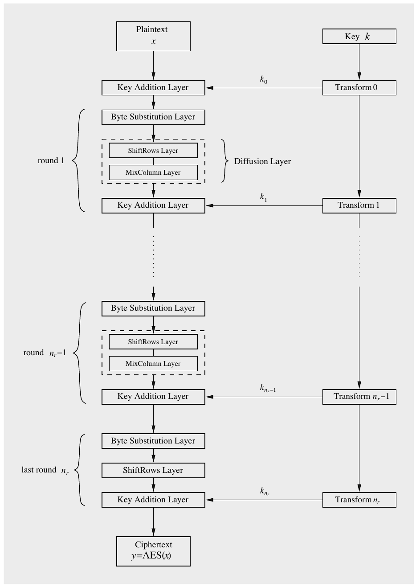

Hình 4.2 Sơ đồ khối mã hóa AES

### 4.3.1 Sự tồn tại của Finite Field

Một finite field, đôi khi còn được gọi là Galois field, là một tập hợp có số phần tử hữu hạn. Nói đại khái, một Galois field là một tập hữu hạn các phần tử trong đó chúng ta có thể cộng, trừ, nhân và nghịch đảo. Trước khi giới thiệu định nghĩa của field, trước hết chúng ta cần khái niệm về một cấu trúc đại số đơn giản hơn, group.

> Định nghĩa 4.3.1 Group
>
> Một group là một tập các phần tử G cùng với một phép toán ◦ kết hợp hai phần tử của G. Một group có các tính chất sau:
>
> 1. Phép toán group ◦ là đóng. Tức là, với mọi a,b ∈ G, ta có a ◦ b = c ∈ G.
>
> 2. Phép toán group có tính kết hợp. Tức là, a◦(b◦c) = (a◦b)◦c với mọi a,b,c ∈ G.
>
> 3. Có một phần tử 1 ∈ G, được gọi là phần tử trung hòa (hay phần tử đơn vị), sao cho a◦1 = 1◦ a = a với mọi a ∈ G.
>
> 4. Với mỗi a ∈ G tồn tại một phần tử a<sup>−1</sup> ∈ G, được gọi là inverse của a, sao cho a◦ a<sup>−1</sup> = a<sup>−1</sup>◦a = 1.
>
> 5. Một group G là abelian (hay giao hoán) nếu, thêm vào đó, a ◦ b = b ◦ a với mọi a,b ∈ G.

Một group là một tập với một phép toán và phép toán ngược tương ứng. Nếu phép toán được gọi là phép cộng, phép toán ngược là phép trừ; nếu phép toán là phép nhân, phép toán ngược là phép chia (hay phép nhân với phần tử inverse).

Ví dụ 4.1. Tập các số nguyên ℤ<sub>m</sub> = {0,1,...,m − 1} và phép cộng modulo m tạo thành một group với phần tử trung hòa 0. Mỗi phần tử a có một inverse −a sao cho a + (−a) ≡ 0 mod m. Lưu ý rằng tập này không tạo thành group với phép nhân vì không phải mọi phần tử a đều có inverse sao cho a a<sup>−1</sup> ≡ 1 mod m.

◇

Để có cả bốn phép toán số học cơ bản (tức là cộng, trừ, nhân, chia), chúng ta cần một tập chứa một abelian group cộng và một abelian group nhân. Đây là cái chúng ta gọi là field.

> Định nghĩa 4.3.2 Field
>
> Một field F là một tập các phần tử có các tính chất sau:
>
> ■ Mọi phần tử của F tạo thành một abelian group cộng với phép toán group “+” và phần tử trung hòa 0.
>
> ■ Mọi phần tử của F trừ 0 tạo thành một abelian group nhân với phép toán group “×” và phần tử trung hòa 1.
>
> ■ Khi hai phép toán group được kết hợp, luật phân phối được thỏa, tức là với mọi a,b,c ∈ F: a(b + c) = (ab) + (ac).

Ví dụ 4.2. Tập ℝ các số thực là một field với phần tử trung hòa 0 cho group cộng và phần tử trung hòa 1 cho group nhân. Mỗi số thực a có một inverse cộng, cụ thể là − a, và mỗi phần tử khác không a có một inverse nhân a<sup>−1</sup> = 1/a.

◇

Trong cryptography, chúng ta hầu như luôn quan tâm tới các field có số phần tử hữu hạn, mà chúng ta gọi là finite field hay Galois field. Số phần tử trong field được gọi là order hay cardinality của field. Định lý sau có tầm quan trọng nền tảng.

> Định lý 4.3.1 Một field có order q chỉ tồn tại nếu q là một lũy thừa số nguyên tố, tức là q = p<sup>m</sup>, với một số nguyên dương m và số nguyên tố p. p được gọi là characteristic của finite field.

Định lý này ngụ ý rằng có, chẳng hạn, các finite field với 11 phần tử, 81 phần tử (vì 81 = 3<sup>4</sup>) hoặc 256 phần tử (vì 256 = 2<sup>8</sup>, và 2 là số nguyên tố). Ngược lại, không có finite field nào với 12 phần tử vì 12 = 2<sup>2</sup> · 3, và do đó 12 không phải là lũy thừa số nguyên tố.

Trong tài liệu, các ký hiệu F và GF đều được dùng cho Galois field. Trong chương này, chúng tôi sẽ dùng ký hiệu sau, với GF (p<sup>m</sup>) ký hiệu một field có p<sup>m</sup> phần tử. Trong phần còn lại của mục này, chúng ta xem cách xây dựng finite field, và quan trọng hơn cho mục đích của chúng ta, cách làm số học trong chúng.

### 4.3.2 Prime Field

Các ví dụ trực quan nhất về finite field là những field có order nguyên tố, tức là các field với m = 1. Các phần tử của field GF(p) có thể đơn giản được biểu diễn bằng các số nguyên 0,1,..., p − 1. Hai phép toán của field là phép cộng số nguyên modulo và phép nhân số nguyên modulo p.

> Định lý 4.3.2 Cho p là số nguyên tố. Integer ring ℤ<sub>p</sub> được ký hiệu là GF(p) và được gọi là prime field, hay Galois field, với số phần tử là số nguyên tố. Mọi phần tử khác không của GF(p) đều có inverse. Số học trong GF(p) được thực hiện modulo p.

Điều này có nghĩa là nếu chúng ta xét integer ring ℤ<sub>m</sub> — đã được giới thiệu trong Mục 1.4.2 — và m tình cờ là số nguyên tố, thì ℤ<sub>m</sub> không chỉ là một ring mà còn là một finite field.

Để làm số học trong một prime field, chúng ta phải tuân theo các quy tắc của integer ring: Phép cộng và phép nhân được thực hiện modulo p, inverse cộng − a của bất kỳ phần tử a nào được định nghĩa bởi a + (−a) ≡ 0 mod p, và inverse nhân a<sup>−1</sup> của bất kỳ phần tử khác không a nào được định nghĩa là a · a<sup>−1</sup> ≡ 1 mod p. Hãy xem một ví dụ về prime field.

Ví dụ 4.3. Chúng ta xét các phần tử của finite field GF(5), nằm trong tập {0,1,2,3,4}. Các bảng dưới đây mô tả cách cộng và nhân hai phần tử bất kỳ, cũng như inverse cộng và inverse nhân của các phần tử field. Dùng các bảng này, chúng ta có thể thực hiện mọi phép tính trong field này mà không cần dùng phép rút gọn modulo một cách tường minh.

phép cộng

| + | 0 1 2 3 4 |
|---|---|
| 0 | 0 1 2 3 4 |
| 1 | 1 2 3 4 0 |
| 2 | 2 3 4 0 1 |
| 3 | 3 4 0 1 2 |
| 4 | 4 0 1 2 3 |

inverse cộng

−0 = 0

−1 = 4

−2 = 3

−3 = 2

−4 = 1

phép nhân

| × | 0 1 2 3 4 |
|---|---|
| 0 | 0 0 0 0 0 |
| 1 | 0 1 2 3 4 |
| 2 | 0 2 4 1 3 |
| 3 | 0 3 1 4 2 |
| 4 | 0 4 3 2 1 |

inverse nhân

0<sup>−1</sup> không tồn tại

1<sup>−1</sup> = 1

2<sup>−1</sup> = 3

3<sup>−1</sup> = 2

4<sup>−1</sup> = 4

◇

Một prime field rất quan trọng là GF(2), là finite field nhỏ nhất tồn tại. Hãy xem các bảng nhân và cộng của field này.

Ví dụ 4.4. Chúng ta xét finite field GF(2) và các phần tử của nó trong tập {0,1}. Số học được thực hiện đơn giản modulo 2, cho ra các bảng số học sau:

◇

phép cộng

| + | 0 1 |
|---|---|
| 0 | 0 1 |
| 1 | 1 0 |

phép nhân

| × | 0 1 |
|---|---|
| 0 | 0 0 |
| 1 | 0 1 |

Chúng ta đã thấy trong Chương 2 rằng phép cộng modulo 2, tức là phép cộng GF(2), tương đương với phép toán XOR. Từ ví dụ trên chúng ta biết rằng phép nhân GF(2) tương đương với phép toán logic AND.

### 4.3.3 Extension Field GF(2<sup>m</sup>)

AES dùng nhiều finite field với 256 phần tử, được ký hiệu là GF(2<sup>8</sup>). Field này được chọn vì mỗi phần tử của field có thể được biểu diễn bằng đúng một byte. Với S-box và các lớp MixColumn, AES coi mỗi byte của đường dữ liệu bên trong là một phần tử của field GF(2<sup>8</sup>) và thao tác dữ liệu bằng cách làm số học trong finite field này.

Nếu order của một finite field không phải số nguyên tố, và 2<sup>8</sup> rõ ràng không phải số nguyên tố, phép cộng và phép nhân không thể được hiện thực như phép cộng và phép nhân số nguyên modulo 2<sup>8</sup>. Các field như vậy với m > 1 được gọi là extension field. Để làm việc với extension field, chúng ta cần (1) một cách biểu diễn khác cho các phần tử field và (2) các quy tắc khác để làm số học với các phần tử. Chúng ta sẽ thấy dưới đây rằng các phần tử của extension field có thể được biểu diễn dưới dạng đa thức và việc tính toán trong extension field đạt được bằng cách thực hiện một loại số học đa thức nhất định.

Trong extension field GF (2<sup>m</sup>), các phần tử không được biểu diễn dưới dạng số nguyên mà là đa thức với hệ số trong GF(2). Các đa thức có bậc tối đa m − 1, nên có tổng cộng m hệ số cho mỗi phần tử. Trong field GF(2<sup>8</sup>), được dùng trong AES, mỗi phần tử A ∈ GF(2<sup>8</sup>) do đó được biểu diễn là:

A(x) = a<sub>7</sub>x<sup>7</sup>+···+a<sub>1</sub>x + a<sub>0</sub>, a<sub>i</sub> ∈ GF (2)

Lưu ý rằng có đúng 256 = 2<sup>8</sup> đa thức như vậy. Tập 256 đa thức này mã hóa các phần tử của finite field GF(2<sup>8</sup>). Cũng quan trọng là nhận thấy rằng mỗi đa thức có thể đơn giản được lưu ở dạng số như một vector 8-bit

A = (a<sub>7</sub>,a<sub>6</sub>,a<sub>5</sub>,a<sub>4</sub>,a<sub>3</sub>,a<sub>2</sub>,a<sub>1</sub>,a<sub>0</sub>)

Đặc biệt, chúng ta không phải lưu các lũy thừa x<sup>7</sup>, x<sup>6</sup>, v.v. Từ các vị trí bit có thể thấy rõ mỗi hệ số thuộc về lũy thừa x<sup>i</sup> nào.

### 4.3.4 Phép cộng và phép trừ trong GF (2<sup>m</sup>)

Bây giờ hãy xem phép cộng và phép trừ trong extension field. Key addition layer của AES dùng phép cộng. Hóa ra các phép toán này rất đơn giản. Chúng đạt được đơn giản bằng cách thực hiện phép cộng và phép trừ đa thức tiêu chuẩn: Chúng ta chỉ cộng hoặc trừ các hệ số có cùng lũy thừa của x. Các phép cộng hay trừ hệ số được thực hiện trong field nền GF(2).

> Định nghĩa 4.3.3 Phép cộng và phép trừ trong extension field
>
> Cho A(x),B(x) ∈ GF(2<sup>m</sup>). Tổng của hai phần tử khi đó được tính theo:
>
> 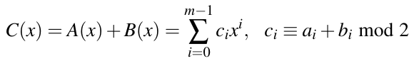
>
> và hiệu được tính theo:
>
> 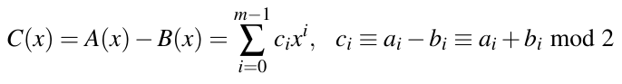

Lưu ý rằng chúng ta thực hiện phép cộng (hay trừ) modulo 2 với các hệ số. Hãy xem một ví dụ trong field GF(2<sup>8</sup>).

Ví dụ 4.5. Đây là cách tính tổng C(x) = A(x) + B(x) của hai phần tử từ GF(2<sup>8</sup>):

A(x) = x<sup>7</sup> + x<sup>6</sup> + x<sup>4</sup> + 1

B(x) = x<sup>4</sup> + x<sup>2</sup> + 1

C(x) = x<sup>7</sup> + x<sup>6</sup> + x<sup>2</sup>

◇

Như chúng ta đã thấy trong Chương 2, phép cộng và phép trừ modulo 2 là cùng một phép toán. Hơn nữa, phép cộng modulo 2 bằng với XOR theo bit. Do đó, nếu tính hiệu A(x) − B(x) của hai đa thức trong ví dụ trên, chúng ta sẽ được cùng kết quả như với tổng.

### 4.3.5 Phép nhân trong GF(2<sup>m</sup>)

Phép nhân trong GF (2<sup>8</sup>) là phép toán cốt lõi của lớp MixColumn của AES. Ở bước đầu tiên, hai phần tử (được biểu diễn bằng đa thức của chúng) của một finite field GF(2<sup>m</sup>) được nhân bằng quy tắc nhân đa thức tiêu chuẩn:

A(x) · B(x) = (a<sub>m−1</sub>x<sup>m−1</sup>+···+a<sub>0</sub>) · (b<sub>m−1</sub>x<sup>m−1</sup>+···+b<sub>0</sub>)

C<sup>′</sup>(x) = c<sub>2m−2</sub><sup>′</sup> x<sup>2m−2</sup>+···+c<sub>0</sub><sup>′</sup>

trong đó:

c<sub>0</sub><sup>′</sup> = a<sub>0</sub>b<sub>0</sub> mod 2

c<sub>1</sub><sup>′</sup> = a<sub>0</sub>b<sub>1</sub> + a<sub>1</sub>b<sub>0</sub> mod 2

⋮

c<sub>2m−2</sub><sup>′</sup> = a<sub>m−1</sub>b<sub>m−1</sub> mod 2

Lưu ý rằng mọi hệ số a<sub>i</sub>, b<sub>i</sub> và c<sub>i</sub> đều là phần tử của GF (2), và số học hệ số được thực hiện trong GF(2). Nói chung, đa thức tích C(x) sẽ có bậc cao hơn m − 1 và phải được rút gọn. Ý tưởng cơ bản là một cách tiếp cận tương tự trường hợp phép nhân trong prime field: Trong GF(p), chúng ta nhân hai số nguyên, chia kết quả cho một số nguyên tố, và chỉ xét phần dư. Đây là những gì chúng ta làm trong extension field: Tích của phép nhân được chia cho một đa thức nhất định, và chúng ta chỉ xét phần dư sau phép chia đa thức. Chúng ta cần các đa thức bất khả quy (irreducible polynomial) cho phép rút gọn modulo. Nhớ lại từ Mục 2.3.1 rằng các đa thức bất khả quy gần như tương đương với số nguyên tố, tức là các nhân tử duy nhất của chúng là 1 và chính đa thức đó.

> Định nghĩa 4.3.4 Phép nhân trong extension field
>
> Cho A(x),B(x) ∈ GF(2<sup>m</sup>) và cho
>
> 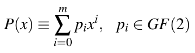
>
> là một đa thức bất khả quy bậc m. Phép nhân hai phần tử A(x),B(x) được thực hiện là
>
> C(x) ≡ A(x) · B(x) mod P(x)

Do đó, mỗi field GF(2<sup>m</sup>) cần một đa thức bất khả quy P(x) bậc m với hệ số từ GF(2). Lưu ý rằng không phải mọi đa thức đều bất khả quy. Chẳng hạn, đa thức x<sup>4</sup> + x<sup>3</sup> + x + 1 là khả quy vì

x<sup>4</sup> + x<sup>3</sup> + x + 1 = (x<sup>2</sup> + x + 1)(x<sup>2</sup> + 1)

và do đó không thể được dùng để xây dựng extension field GF(2<sup>4</sup>). Vì các đa thức nguyên thủy (primitive polynomial) là một loại đặc biệt của đa thức bất khả quy, các đa thức trong Bảng 2.2 có thể được dùng để xây dựng các field GF (2<sup>m</sup>). Với AES, đa thức bất khả quy

P(x) = x<sup>8</sup> + x<sup>4</sup> + x<sup>3</sup> + x + 1

được dùng. Nó là một phần của đặc tả AES.

Ví dụ 4.6. Chúng ta muốn nhân hai đa thức A(x) = x<sup>3</sup> + x<sup>2</sup> + 1 và B(x) = x<sup>2</sup> + x trong field GF(2<sup>4</sup>). Đa thức bất khả quy của Galois field này được cho là

P(x) = x<sup>4</sup> + x + 1

Tích đa thức thông thường được tính là:

C<sup>′</sup>(x) = A(x) · B(x) = x<sup>5</sup> + x<sup>3</sup> + x<sup>2</sup> + x

Bây giờ chúng ta có thể rút gọn C<sup>′</sup>(x) bằng phương pháp chia đa thức đã học ở trường. Tuy nhiên, đôi khi dễ hơn nếu rút gọn riêng từng số hạng bậc cao x<sup>4</sup> và x<sup>5</sup> bằng các tương đương sau:

x<sup>4</sup> = 1 · P(x) + (x + 1)

x<sup>4</sup> ≡ x + 1 mod P(x)

x<sup>5</sup> ≡ x<sup>2</sup> + x mod P(x)

Bây giờ, chúng ta chỉ cần chèn biểu thức đã rút gọn của x<sup>5</sup> vào kết quả trung gian C<sup>′</sup>(x):

C(x) ≡ x<sup>5</sup> + x<sup>3</sup> + x<sup>2</sup> + x mod P(x)

C(x) ≡ (x<sup>2</sup> + x) + (x<sup>3</sup> + x<sup>2</sup> + x) = x<sup>3</sup>

A(x) · B(x) ≡ x<sup>3</sup>

◇

Quan trọng là không nhầm lẫn phép nhân trong GF(2<sup>m</sup>) với phép nhân số nguyên, đặc biệt nếu chúng ta quan tâm tới các hiện thực software của Galois field. Nhớ lại rằng các đa thức, tức là các phần tử field, thường được lưu trong máy tính dưới dạng vector bit. Nếu xem phép nhân trong ví dụ trước, phép toán rất bất thường sau đang được thực hiện ở mức bit:

A · B = C

(x<sup>3</sup> + x<sup>2</sup> + 1) · (x<sup>2</sup> + x) = x<sup>3</sup>

(1 1 0 1) · (0 1 1 0) = (1 0 0 0)

Phép tính này không giống số học số nguyên. Nếu các đa thức được hiểu là số nguyên, tức là (1101)<sub>2</sub> = 13<sub>10</sub> và (0110)<sub>2</sub> = 6<sub>10</sub>, kết quả là (1001110)<sub>2</sub> = 78<sub>10</sub>, rõ ràng không giống tích phép nhân Galois field. Do đó, dù có thể biểu diễn các phần tử field dưới dạng kiểu dữ liệu số nguyên, chúng ta không thể dùng số học số nguyên mà máy tính cung cấp!

### 4.3.6 Phép nghịch đảo trong GF(2<sup>m</sup>)

Phép nghịch đảo trong GF(2<sup>8</sup>) là phép toán cốt lõi của lớp Byte Substitution, chứa các S-boxes của AES. Với một finite field GF(2<sup>m</sup>) cho trước và đa thức rút gọn bất khả quy tương ứng P(x), inverse A<sup>−1</sup> của một phần tử khác không A ∈ GF (2<sup>m</sup>) được định nghĩa bởi:

A<sup>−1</sup>(x) · A(x) ≡ 1 mod P(x)

Với các field nhỏ — trong thực tế, điều này thường có nghĩa là các field với 2<sup>16</sup> phần tử hoặc ít hơn — các lookup table chứa inverse tính trước của mọi phần tử field thường được dùng. Bảng 4.2 cho thấy các giá trị được dùng trong S-box của AES. Bảng chứa mọi inverse trong GF(2<sup>8</sup>) modulo P(x) = x<sup>8</sup> + x<sup>4</sup> + x<sup>3</sup> + x + 1 ở dạng hệ thập lục phân. Một trường hợp đặc biệt là mục cho phần tử field 0, mà inverse của nó không tồn tại. Tuy nhiên, với S-box của AES, cần một bảng thay thế được định nghĩa cho mọi giá trị input khả dĩ. Do đó, những người thiết kế định nghĩa S-box sao cho giá trị input 0 được ánh xạ tới giá trị output 0.

Bảng 4.2 Bảng inverse nhân trong GF (2<sup>8</sup>) cho các byte xy được dùng trong S-box của AES, với đa thức bất khả quy P(x) = x<sup>8</sup> + x<sup>4</sup> + x<sup>3</sup> + x + 1

```
                           Y
     0  1  2  3  4  5  6  7  8  9  A  B  C  D  E  F
  0 00 01 8D F6 CB 52 7B D1 E8 4F 29 C0 B0 E1 E5 C7
  1 74 B4 AA 4B 99 2B 60 5F 58 3F FD CC FF 40 EE B2
  2 3A 6E 5A F1 55 4D A8 C9 C1 0A 98 15 30 44 A2 C2
  3 2C 45 92 6C F3 39 66 42 F2 35 20 6F 77 BB 59 19
  4 1D FE 37 67 2D 31 F5 69 A7 64 AB 13 54 25 E9 09
  5 ED 5C 05 CA 4C 24 87 BF 18 3E 22 F0 51 EC 61 17
  6 16 5E AF D3 49 A6 36 43 F4 47 91 DF 33 93 21 3B
  7 79 B7 97 85 10 B5 BA 3C B6 70 D0 06 A1 FA 81 82
X 8 83 7E 7F 80 96 73 BE 56 9B 9E 95 D9 F7 02 B9 A4
  9 DE 6A 32 6D D8 8A 84 72 2A 14 9F 88 F9 DC 89 9A
  A FB 7C 2E C3 8F B8 65 48 26 C8 12 4A CE E7 D2 62
  B 0C E0 1F EF 11 75 78 71 A5 8E 76 3D BD BC 86 57
  C 0B 28 2F A3 DA D4 E4 0F A9 27 53 04 1B FC AC E6
  D 7A 07 AE 63 C5 DB E2 EA 94 8B C4 D5 9D F8 90 6B
  E B1 0D D6 EB C6 0E CF AD 08 4E D7 E3 5D 50 1E B3
  F 5B 23 38 34 68 46 03 8C DD 9C 7D A0 CD 1A 41 1C
```

Ví dụ 4.7. Từ Bảng 4.2, inverse của

x<sup>7</sup> + x<sup>6</sup> + x = (1100 0010)<sub>2</sub> = (C2)<sub>hex</sub> = (xy)

được cho bởi phần tử ở hàng C, cột 2:

(2F)<sub>hex</sub> = (0010 1111)<sub>2</sub> = x<sup>5</sup> + x<sup>3</sup> + x<sup>2</sup> + x + 1

Điều này có thể được kiểm chứng bằng phép nhân:

(x<sup>7</sup> + x<sup>6</sup> + x) · (x<sup>5</sup> + x<sup>3</sup> + x<sup>2</sup> + x + 1) ≡ 1 mod P(x)

◇

Lưu ý rằng bảng trên không chứa bản thân S-box, vốn phức tạp hơn một chút và sẽ được mô tả trong Mục 4.4.1.

Thay cho việc dùng lookup table, người ta cũng có thể tính inverse một cách tường minh. Thuật toán chính để tính inverse nhân là extended Euclidean algorithm, được giới thiệu trong Mục 6.3.1.

## 4.4 Cấu trúc bên trong của AES

Sau đây, chúng ta xem xét cấu trúc bên trong của AES. Hình 4.3 cho thấy sơ đồ khối của một vòng AES đơn lẻ. Input 16-byte (A<sub>0</sub>,...,A<sub>15</sub>) được đưa byte-wise vào S-box. Output 16-byte (B<sub>0</sub>,...,B<sub>15</sub>) được hoán vị byte-wise trong lớp ShiftRows và được trộn bởi phép biến đổi MixColumn c(x). Cuối cùng, subkey 128-bit k<sub>i</sub> được XOR với kết quả trung gian. Chúng tôi lưu ý rằng AES là một cipher byte-oriented. Điều này trái ngược với DES, vốn dùng nhiều hoán vị bit và do đó có thể được coi là có cấu trúc bit-oriented.

Để hiểu dữ liệu di chuyển qua AES như thế nào, trước hết chúng ta hình dung rằng state A (tức là đường dữ liệu 128-bit) gồm 16 byte A<sub>0</sub>,A<sub>1</sub>,...,A<sub>15</sub>, được sắp xếp thành một ma trận byte four-by-four:

| A<sub>0</sub> | A<sub>4</sub> | A<sub>8</sub> | A<sub>12</sub> |
|---|---|---|---|
| A<sub>1</sub> | A<sub>5</sub> | A<sub>9</sub> | A<sub>13</sub> |
| A<sub>2</sub> | A<sub>6</sub> | A<sub>10</sub> | A<sub>14</sub> |
| A<sub>3</sub> | A<sub>7</sub> | A<sub>11</sub> | A<sub>15</sub> |

Như chúng ta sẽ thấy dưới đây, AES thao tác trên các phần tử, cột hoặc hàng của ma trận state hiện tại. Tương tự, các byte key được sắp xếp thành một ma trận có bốn hàng và bốn (key 128-bit), sáu (key 192-bit) hoặc tám (key 256-bit) cột. Làm ví dụ, đây là ma trận state của một key 192-bit:

| K<sub>0</sub> | K<sub>4</sub> | K<sub>8</sub> | K<sub>12</sub> | K<sub>16</sub> | K<sub>20</sub> |
|---|---|---|---|---|---|
| K<sub>1</sub> | K<sub>5</sub> | K<sub>9</sub> | K<sub>13</sub> | K<sub>17</sub> | K<sub>21</sub> |
| K<sub>2</sub> | K<sub>6</sub> | K<sub>10</sub> | K<sub>14</sub> | K<sub>18</sub> | K<sub>22</sub> |
| K<sub>3</sub> | K<sub>7</sub> | K<sub>11</sub> | K<sub>15</sub> | K<sub>19</sub> | K<sub>23</sub> |

Bây giờ chúng ta thảo luận những gì xảy ra trong mỗi lớp.

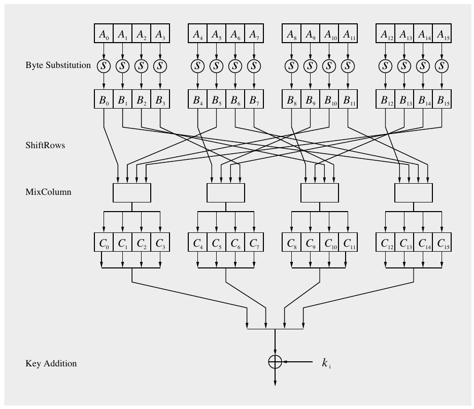

Hình 4.3 Hàm vòng AES cho các vòng 1,2,...,n<sub>r</sub> − 1

### 4.4.1 Byte Substitution Layer

Như thể hiện trong Hình 4.3, lớp đầu tiên trong mỗi vòng là lớp Byte Substitution. Lớp Byte Substitution có thể được xem như một hàng 16 S-boxes song song, mỗi cái có 8 bit input và output. Lưu ý rằng cả 16 S-boxes đều giống hệt nhau, khác với DES nơi tám S-boxes khác nhau được dùng. Trong lớp này, mỗi byte state A<sub>i</sub> được thay thế, tức là substitute, bởi một byte khác B<sub>i</sub>:

S(A<sub>i</sub>) = B<sub>i</sub>

S-box là phần tử phi tuyến duy nhất của AES, tức là ta có

ByteSub(A) + ByteSub(B) ≠ ByteSub(A + B)

với hai state A và B. Phép thay thế S-box là một ánh xạ song ánh, tức là mỗi phần tử trong 2<sup>8</sup> = 256 phần tử input khả dĩ được ánh xạ one-to-one tới một phần tử output. Điều này cho phép đảo ngược S-box một cách duy nhất, điều cần cho giải mã. Trong các hiện thực software, S-box thường được hiện thực như một lookup table 256-by-8-bit với các mục cố định, như cho trong Bảng 4.3.

Ví dụ 4.8. Giả sử byte input vào S-box là A<sub>i</sub> = (C2)<sub>hex</sub>, thì giá trị được thay thế là

S((C2)<sub>hex</sub>) = (25)<sub>hex</sub>

Ở mức bit — và nhớ rằng, điều duy nhất cuối cùng được quan tâm trong mã hóa là thao tác trên các bit — phép thay thế này có thể được mô tả là:

S(1100 0010) = (0010 0101) ◇

Bảng 4.3 S-box của AES: Các giá trị thay thế ở dạng hệ thập lục phân cho byte input (xy)

|  | y |
|---|---|
|  | 0 1 2 3 4 5 6 7 8 9 A B C D E F |
| 0 | 63 7C 77 7B F2 6B 6F C5 30 01 67 2B FE D7 AB 76 |
| 1 | CA 82 C9 7D FA 59 47 F0 AD D4 A2 AF 9C A4 72 C0 |
| 2 | B7 FD 93 26 36 3F F7 CC 34 A5 E5 F1 71 D8 31 15 |
| 3 | 04 C7 23 C3 18 96 05 9A 07 12 80 E2 EB 27 B2 75 |
| 4 | 09 83 2C 1A 1B 6E 5A A0 52 3B D6 B3 29 E3 2F 84 |
| 5 | 53 D1 00 ED 20 FC B1 5B 6A CB BE 39 4A 4C 58 CF |
| 6 | D0 EF AA FB 43 4D 33 85 45 F9 02 7F 50 3C 9F A8 |
| 7 | 51 A3 40 8F 92 9D 38 F5 BC B6 DA 21 10 FF F3 D2 |
| x 8 | CD 0C 13 EC 5F 97 44 17 C4 A7 7E 3D 64 5D 19 73 |
| 9 | 60 81 4F DC 22 2A 90 88 46 EE B8 14 DE 5E 0B DB |
| A | E0 32 3A 0A 49 06 24 5C C2 D3 AC 62 91 95 E4 79 |
| B | E7 C8 37 6D 8D D5 4E A9 6C 56 F4 EA 65 7A AE 08 |
| C | BA 78 25 2E 1C A6 B4 C6 E8 DD 74 1F 4B BD 8B 8A |
| D | 70 3E B5 66 48 03 F6 0E 61 35 57 B9 86 C1 1D 9E |
| E | E1 F8 98 11 69 D9 8E 94 9B 1E 87 E9 CE 55 28 DF |
| F | 8C A1 89 0D BF E6 42 68 41 99 2D 0F B0 54 BB 16 |

Dù S-box là song ánh, nó không có điểm bất động nào, tức là không có giá trị input A<sub>i</sub> nào sao cho S(A<sub>i</sub>) = A<sub>i</sub>. Ngay cả zero-input cũng không phải là điểm bất động: S(0000 0000) = (63)<sub>hex</sub> = (0110 0011).

Ví dụ 4.9. Giả sử input 16-byte vào lớp Byte Substitution là

(C2,C2,...,C2)

ở dạng hệ thập lục phân. Khi đó state output là

(25,25,...,25)

◇

Mô tả toán học của S-box Với độc giả quan tâm tới cách các mục của S-box được xây dựng, một mô tả chi tiết hơn sẽ theo sau. Tuy nhiên, mô tả này không cần thiết để hiểu AES ở mức cơ bản, và phần còn lại của tiểu mục này có thể được bỏ qua mà không có vấn đề gì. Khác với các S-boxes của DES, về cơ bản là các bảng ngẫu nhiên thỏa một số tính chất nhất định, các S-boxes của AES có cấu trúc đại số mạnh. Một S-box của AES có thể được xem như một phép biến đổi toán học two-step, như thể hiện trong Hình 4.4.

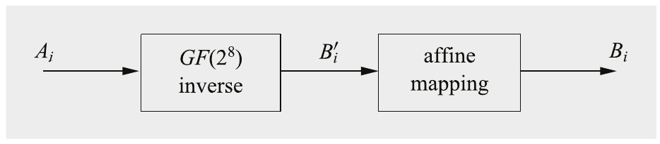

Hình 4.4 Hai phép toán bên trong S-box của AES tính hàm B<sub>i</sub> = S(A<sub>i</sub>)

Phần thứ nhất của phép thay thế là một phép nghịch đảo Galois field, phần toán học của nó đã được giới thiệu trong Mục 4.3.2. Với mỗi phần tử input A<sub>i</sub>, inverse được tính: B<sub>i</sub><sup>′</sup> = A<sub>i</sub><sup>−1</sup>, trong đó cả A<sub>i</sub> và B<sub>i</sub><sup>′</sup> được coi là các phần tử trong field GF(2<sup>8</sup>) với đa thức bất khả quy cố định P(x) = x<sup>8</sup> + x<sup>4</sup> + x<sup>3</sup> + x + 1. Một lookup table chứa mọi inverse được cho trong Bảng 4.2. Lưu ý rằng inverse của phần tử không không tồn tại. Tuy nhiên, với AES, người ta định nghĩa rằng phần tử không A<sub>i</sub> = 0 được ánh xạ tới chính nó.

Ở phần thứ hai của phép thay thế, mỗi byte B<sub>i</sub><sup>′</sup> được nhân với một bit-matrix hằng, sau đó cộng với một vector 8-bit hằng. Phép toán được mô tả bởi:

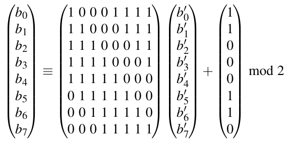

Lưu ý rằng B<sup>′</sup> = (b<sub>7</sub><sup>′</sup>,...,b<sub>0</sub><sup>′</sup>) là biểu diễn vector theo bit của B<sub>i</sub><sup>′</sup>(x) = A<sub>i</sub><sup>−1</sup>(x). Bước thứ hai này được gọi là một ánh xạ affine. Hãy xem một ví dụ về cách các phép tính S-box hoạt động.

Ví dụ 4.10. Giả sử input của S-box là A<sub>i</sub> = (1100 0010)<sub>2</sub> = (C2)<sub>hex</sub>. Từ Bảng 4.2, chúng ta có thể thấy inverse là:

A<sub>i</sub><sup>−1</sup> = B<sub>i</sub><sup>′</sup> = (2F)<sub>hex</sub> = (0010 1111)<sub>2</sub>

Bây giờ chúng ta đưa vector bit B<sub>i</sub><sup>′</sup> làm input vào phép biến đổi affine. Lưu ý rằng bit có trọng số thấp nhất b<sub>0</sub><sup>′</sup> của B<sub>i</sub><sup>′</sup> nằm ở vị trí ngoài cùng bên phải,

B<sub>i</sub> = (0010 0101) = (25)<sub>hex</sub>

Do đó, S((C2)<sub>hex</sub>) = (25)<sub>hex</sub>, chính xác là kết quả cũng được cho trong Bảng S-box 4.3.

◇

Nếu tính cả hai bước cho tất cả 256 phần tử input khả dĩ của S-box và lưu kết quả, ta thu được Bảng 4.3. Trong hầu hết các hiện thực AES, đặc biệt là trong hầu như mọi hiện thực software của AES, output của S-box không được tính tường minh như trình bày ở đây, mà thay vào đó các lookup table như Bảng 4.3 được dùng. Tuy nhiên, với các hiện thực hardware, đôi khi có lợi khi hiện thực S-boxes dưới dạng các mạch số thực sự tính inverse rồi đến ánh xạ affine.

Lợi thế của việc dùng phép nghịch đảo trong GF(2<sup>8</sup>) làm hàm cốt lõi của lớp Byte Substitution là nó cung cấp mức phi tuyến cao, điều này đến lượt nó cung cấp sự bảo vệ tối ưu trước một số tấn công phân tích mạnh nhất đã biết. Bước affine “phá hủy” cấu trúc đại số của Galois field, điều này đến lượt nó là cần thiết để ngăn các tấn công khai thác phép nghịch đảo finite field.

### 4.4.2 Diffusion Layer

Trong AES, lớp Diffusion gồm hai lớp con: phép biến đổi ShiftRows và phép biến đổi MixColumn. Nhớ lại rằng diffusion là sự lan tỏa ảnh hưởng của từng bit lên toàn bộ state. Khác với S-box phi tuyến, lớp diffusion thực hiện một phép toán tuyến tính trên các ma trận state A,B, tức là DIFF(A) + DIFF(B) = DIFF(A + B).

#### Lớp con ShiftRows

Phép biến đổi ShiftRows dịch vòng hàng thứ hai của ma trận state ba byte sang phải, hàng thứ ba hai byte sang phải và hàng thứ tư một byte sang phải. Hàng đầu tiên không bị thay đổi bởi phép biến đổi ShiftRows. Mục đích của phép biến đổi ShiftRows là tăng các tính chất diffusion của AES. Nếu input của lớp con ShiftRows được cho dưới dạng ma trận state B = (B<sub>0</sub>,B<sub>1</sub>,...,B<sub>15</sub>):

| B<sub>0</sub> | B<sub>4</sub> | B<sub>8</sub> | B<sub>12</sub> |
|---|---|---|---|
| B<sub>1</sub> | B<sub>5</sub> | B<sub>9</sub> | B<sub>13</sub> |
| B<sub>2</sub> | B<sub>6</sub> | B<sub>10</sub> | B<sub>14</sub> |
| B<sub>3</sub> | B<sub>7</sub> | B<sub>11</sub> | B<sub>15</sub> |

Output là state mới:

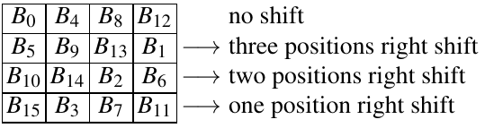 (4.1)

#### Lớp con MixColumn

Bước MixColumn là một phép biến đổi tuyến tính trộn mỗi cột của ma trận state. Vì mỗi byte input ảnh hưởng tới bốn byte output, phép toán MixColumn là thành phần diffusion chính trong AES. Sự kết hợp của các lớp con ShiftRows và MixColumn khiến cho chỉ sau ba vòng, mỗi byte của ma trận state đều phụ thuộc vào cả 16 byte plaintext.

Sau đây, chúng ta ký hiệu state input 16-byte là B và state output 16-byte là C:

MixColumn(B) = C

trong đó B là state sau phép toán ShiftRows như cho trong Biểu thức (4.1). Độc giả cũng có thể muốn xem lại Hình 4.3.

Bây giờ, mỗi cột 4-byte của (4.1) được coi là một vector và được nhân với một ma trận 4 × 4 cố định. Ma trận chứa các mục hằng. Phép nhân và phép cộng các hệ số được thực hiện trong GF(2<sup>8</sup>). Làm ví dụ, chúng tôi trình bày cách tính bốn byte output đầu tiên:

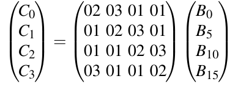 (4.2)

Cột thứ hai của các byte output (C<sub>4</sub>,C<sub>5</sub>,C<sub>6</sub>,C<sub>7</sub>) được tính bằng cách nhân bốn byte input (B<sub>4</sub>,B<sub>9</sub>,B<sub>14</sub>,B<sub>3</sub>) với cùng ma trận hằng, và cứ thế. Hình 4.3 cho thấy những byte input nào được dùng trong mỗi phép toán MixColumn trong bốn phép.

Bây giờ chúng ta thảo luận chi tiết phép nhân vector–ma trận tạo nên các phép toán MixColumn. Nhớ lại rằng mỗi byte state C<sub>i</sub> và B<sub>i</sub> là một giá trị 8-bit biểu diễn một phần tử từ GF(2<sup>8</sup>). Mọi phép tính số học liên quan tới các hệ số đều được thực hiện trong Galois field này. Với các hằng số trong ma trận, ký hiệu hệ thập lục phân được dùng: “01” chỉ đa thức GF(2<sup>8</sup>) với các hệ số (0000 0001), tức là phần tử 1 của Galois field; “02” chỉ đa thức với vector bit (0000 0010), tức là đa thức x; và “03” chỉ đa thức với vector bit (0000 0011), tức là phần tử Galois field x + 1.

Các phép cộng trong phép nhân vector–ma trận là các phép cộng GF(2<sup>8</sup>), đơn giản là XOR theo bit của các byte tương ứng. Với phép nhân các hằng số, chúng ta phải hiện thực các phép nhân với các hằng số 01, 02 và 03. Chúng khá hiệu quả, và thực ra, ba hằng số được chọn sao cho hiện thực software dễ dàng. Nhân với 01 là nhân với phần tử đơn vị và không cần phép toán tường minh nào. Nhân với 02 và 03 có thể được thực hiện qua table look-up trong hai bảng 256-by-8. Như một lựa chọn khác, nhân với 02 cũng có thể được hiện thực như phép nhân với x, tức là dịch trái một bit, và rút gọn modulo với P(x) = x<sup>8</sup> + x<sup>4</sup> + x<sup>3</sup> + x + 1. Tương tự, nhân với 03, biểu diễn đa thức (x + 1), có thể được hiện thực bằng một phép dịch trái một bit và cộng giá trị gốc, sau đó rút gọn modulo với P(x).

Ví dụ 4.11. Chúng ta xét hộp MixColumn ngoài cùng bên trái trong Hình 4.3 với bốn byte input:

B<sub>0</sub> = x<sup>3</sup> + x<sup>2</sup>; B<sub>5</sub> = x<sup>7</sup> + 1; B<sub>10</sub> = x<sup>5</sup> + x<sup>4</sup> + 1; B<sub>15</sub> = x<sup>5</sup> + x<sup>4</sup> + x<sup>3</sup>

Chúng tôi trình bày cách tính byte output đầu tiên:

C<sub>0</sub> = 02 B<sub>0</sub> + 03 B<sub>5</sub> + 01 B<sub>10</sub> + 01B<sub>15</sub>

Trước hết chúng ta tính trước các phép nhân 02 B<sub>0</sub> và 03 B<sub>5</sub>:

02 B<sub>0</sub> = x (x<sup>3</sup> + x<sup>2</sup>) = x<sup>4</sup> + x<sup>3</sup>

03 B<sub>5</sub> = (x + 1) (x<sup>7</sup> + 1) = x<sup>8</sup> + x<sup>7</sup> + x + 1

≡ x<sup>7</sup> + x<sup>4</sup> + x<sup>3</sup> mod P(x)

C<sub>0</sub> bây giờ suy ra từ việc cộng bốn số hạng:

02 · B<sub>0</sub> = x<sup>4</sup> + x<sup>3</sup>

03 · B<sub>5</sub> = x<sup>7</sup> + x<sup>4</sup> + x<sup>3</sup>

01 · B<sub>10</sub> = x<sup>5</sup> + x<sup>4</sup> + 1

01 · B<sub>15</sub> = x<sup>5</sup> + x<sup>4</sup> + x<sup>3</sup>

C<sub>0</sub> = x<sup>7</sup> + x<sup>3</sup> + 1

Các byte output khác có thể được tính theo cùng cách theo Phương trình (4.2), cho kết quả C<sub>1</sub> = x<sup>6</sup> + x<sup>5</sup> + x<sup>4</sup> + x<sup>3</sup> + x<sup>2</sup> + x, C<sub>2</sub> = x<sup>7</sup> + x<sup>5</sup> + x<sup>2</sup> + x + 1 và C<sub>3</sub> = x<sup>7</sup> + x<sup>6</sup> + x<sup>4</sup> + x<sup>2</sup>.

◇

### 4.4.3 Key Addition Layer

Hai input của lớp Key Addition là ma trận state 16-byte hiện tại và một subkey cũng gồm 16 byte (128 bit). Hai input được kết hợp qua một phép toán XOR theo bit. Lưu ý rằng phép toán XOR bằng với phép cộng trong Galois field GF (2). Các subkey được suy ra trong key schedule được mô tả dưới đây trong Mục 4.4.4.

### 4.4.4 Key Schedule

Key schedule lấy key input gốc (có độ dài 128, 192 hoặc 256 bit) và suy ra các subkey được dùng trong AES. Lưu ý rằng phép cộng XOR một subkey được dùng cả ở input và output của AES. Quá trình này đôi khi được gọi là key whitening. Số subkey bằng số vòng cộng một, do key cần cho key whitening ở lớp cộng key đầu tiên, xem Hình 4.2. Do đó, với độ dài key 128 bit, số vòng là n<sub>r</sub> = 10 và có 11 subkey, mỗi subkey 128 bit. AES với key 192-bit cần 13 subkey có độ dài 128 bit mỗi subkey, và AES với key 256-bit có 15 subkey. Các subkey của AES được tính đệ quy, tức là để suy ra subkey k<sub>i</sub>, phải biết subkey k<sub>i−1</sub>, v.v.

Key schedule của AES là word-oriented, trong đó một word bằng 32 bit. Các subkey được lưu trong một mảng mở rộng key W gồm các word. Có các key schedule khác nhau cho ba kích thước key AES khác nhau 128, 192 và 256 bit, tất cả đều khá giống nhau. Chúng tôi giới thiệu ba key schedule dưới đây.

#### Key Schedule cho AES key 128-Bit

Mỗi subkey 128-bit gồm 4 word. 11 subkey được lưu trong một mảng mở rộng key với 11 × 4 = 44 phần tử W[0],...,W [43]. Các subkey được tính như mô tả trong Hình 4.5. Các phần tử K<sub>0</sub>,...,K<sub>15</sub> ký hiệu các byte của key AES gốc.

Trước hết, chúng tôi lưu ý rằng subkey đầu tiên k<sub>0</sub> là key AES gốc, tức là key được sao chép vào bốn phần tử đầu tiên của mảng key W. Các phần tử mảng khác được tính như sau. Như có thể thấy trong hình, word ngoài cùng bên trái của một subkey W[4i], trong đó i = 1,...,10, được tính là:

W[4i] = W[4(i − 1)] ⊕ g(W[4i − 1])

Ở đây g là một hàm phi tuyến với input và output four-byte. Ba word còn lại của một subkey được tính đệ quy là:

W[4i + j] = W[4i + j − 1] ⊕ W[4(i − 1) + j]

trong đó i = 1,...,10 và j = 1,2,3. Hàm g xoay bốn byte input của nó, thực hiện thay thế S-box byte-wise, và cộng một hệ số vòng RC vào. Hệ số vòng là một phần tử của Galois field GF(2<sup>8</sup>), tức là một giá trị 8-bit. Nó chỉ được cộng vào byte ngoài cùng bên trái trong hàm g.

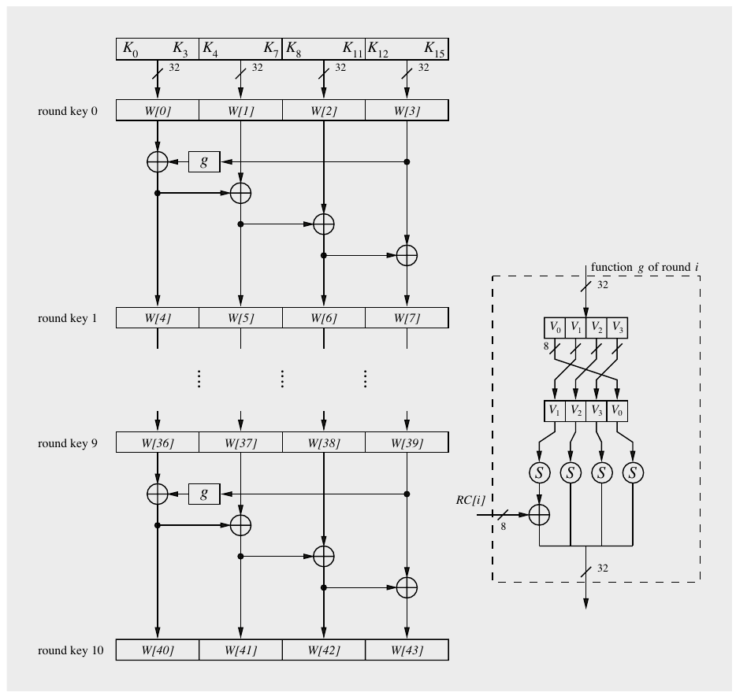

Hình 4.5 Key schedule của AES cho kích thước key 128-bit

Các hệ số vòng thay đổi từ vòng này sang vòng khác theo quy tắc sau:

RC[1] = x<sup>0</sup> = (0000 0001)<sub>2</sub>

RC[2] = x<sup>1</sup> = (0000 0010)<sub>2</sub>

RC[3] = x<sup>2</sup> = (0000 0100)<sub>2</sub>

⋮

RC[10] = x<sup>9</sup> = (0011 0110)<sub>2</sub>

Hàm g có hai mục đích. Thứ nhất, nó thêm tính phi tuyến vào key schedule. Thứ hai, nó loại bỏ tính đối xứng trong AES. Cả hai tính chất đều cần thiết để chặn một số tấn công block cipher nhất định.

#### Key Schedule cho AES key 192-Bit

AES với key 192-bit có 12 vòng và, do đó, 13 subkey mỗi subkey 128 bit. Các subkey cần 13 × 4 = 52 word, được lưu trong các phần tử mảng W[0],...,W [51]. Việc tính các phần tử mảng khá giống trường hợp key 128-bit và được thể hiện trong Hình 4.6. Có tám vòng key schedule. (Lưu ý rằng các vòng key schedule này không tương ứng với 12 vòng AES!) Mỗi lần lặp tính sáu word mới của mảng subkey W. Subkey cho vòng AES đầu tiên được tạo bởi các phần tử mảng (W[0],W[1],W[2],W[3]), subkey thứ hai bởi các phần tử (W[4],W[5],W[6],W[7]) và cứ thế. Tám hệ số vòng RC[i] là cần thiết trong hàm g. Chúng được tính như trong trường hợp 128-bit và chạy từ RC[1],...,RC[8].

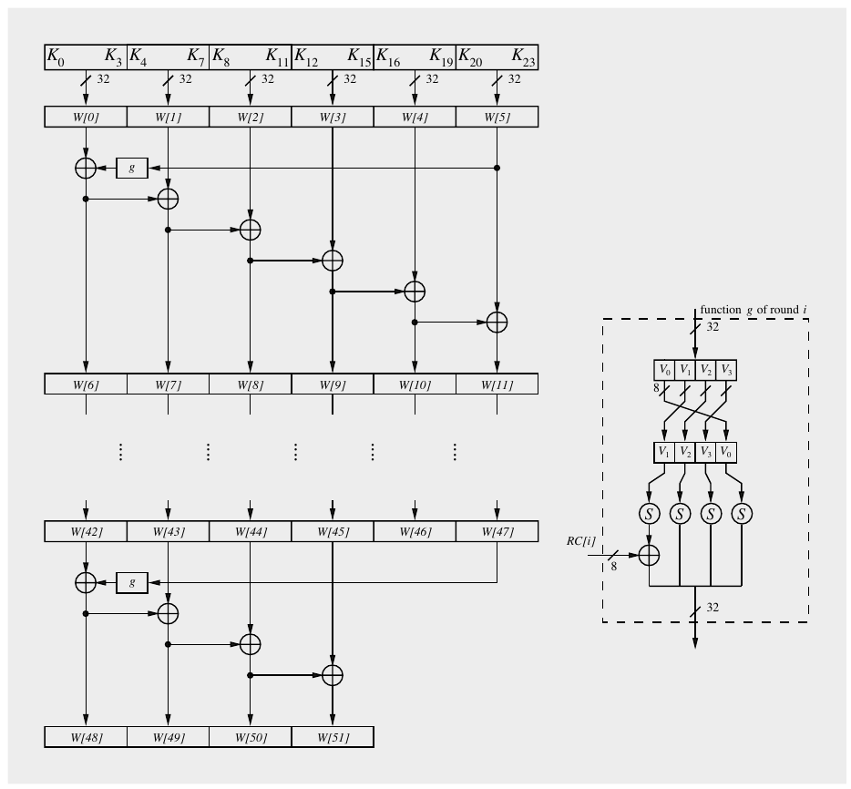

Hình 4.6 Key schedule của AES cho kích thước key 192-bit

#### Key Schedule cho AES key 256-Bit

AES với key 256-bit cần 15 subkey. Các subkey được lưu trong 15 × 4 = 60 word W[0],...,W [59]. Việc tính các phần tử mảng khá giống trường hợp key 128-bit và được thể hiện trong Hình 4.7. Key schedule có bảy vòng, trong đó mỗi vòng tính tám word cho các subkey. (Một lần nữa, lưu ý rằng các vòng key schedule này không tương ứng với 14 vòng AES.) Subkey cho vòng AES đầu tiên được tạo bởi các phần tử mảng (W [0],W [1],W[2],W[3]), subkey thứ hai bởi các phần tử (W[4],W[5],W [6],W [7]) và cứ thế. Bảy hệ số vòng RC[1],...,RC[7] trong hàm g là cần thiết và chúng được tính như trong trường hợp 128-bit. Key schedule này cũng có một hàm h với input và output 4-byte. Hàm áp dụng S-box lên cả bốn byte input.

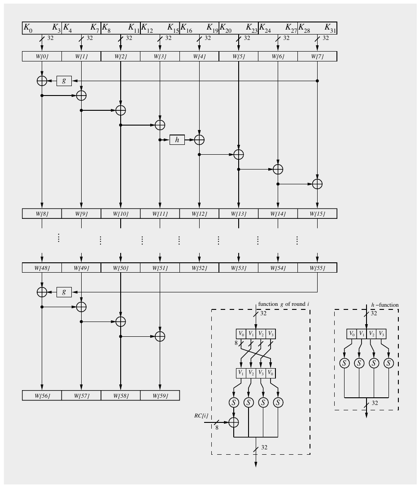

Hình 4.7 Key schedule của AES cho kích thước key 256-bit

Nói chung, khi hiện thực bất kỳ key schedule nào trong ba key schedule, có hai cách tiếp cận khác nhau:

1. Tính trước (Precomputation) Mọi subkey được mở rộng trước vào mảng W. Việc mã hóa (giải mã) một plaintext (ciphertext) được thực hiện sau đó. Cách tiếp cận này thường được dùng trong các hiện thực AES trên PC và server, nơi các khối dữ liệu lớn được mã hóa dưới một key. Lưu ý rằng cách tiếp cận này cần (n<sub>r</sub> + 1) · 16 byte bộ nhớ, ví dụ, 11 · 16 = 176 byte nếu kích thước key là 128 bit. Có những ứng dụng với bộ nhớ rất hạn chế, như các thiết bị nhỏ IoT-like, nơi việc tính trước này có thể khó khăn.

2. On-the-fly Một subkey mới được suy ra cho mỗi vòng AES mới trong quá trình mã hóa (giải mã) một plaintext (ciphertext). Lưu ý rằng khi giải mã ciphertext, subkey cuối cùng được XOR trước tiên với ciphertext. Do đó, cần suy ra đệ quy mọi subkey trước rồi mới bắt đầu giải mã ciphertext và tạo subkey on-the-fly. Do overhead này, việc giải mã một ciphertext luôn chậm hơn một chút so với việc mã hóa một plaintext khi dùng cách tạo subkey on-the-fly.

## 4.5 Giải mã

Vì AES không dựa trên Feistel network, mọi lớp đều thực sự phải được đảo ngược cho việc giải mã, tức là lớp Byte Substitution trở thành lớp Inv Byte Substitution, lớp ShiftRows trở thành lớp Inv ShiftRows, và lớp MixColumn trở thành lớp Inv MixColumn. Tuy nhiên, như chúng ta sẽ thấy, hóa ra các phép toán lớp ngược khá giống các phép toán lớp dùng cho mã hóa. Ngoài ra, thứ tự các subkey bị đảo ngược, tức là chúng ta cần một key schedule đảo ngược. Một sơ đồ khối của hàm giải mã được thể hiện trong Hình 4.8.

Vì vòng mã hóa cuối cùng không thực hiện phép toán MixColumn, vòng giải mã đầu tiên cũng không chứa lớp ngược tương ứng. Tuy nhiên, mọi vòng giải mã khác đều chứa tất cả các lớp AES. Sau đây, chúng tôi thảo luận các lớp ngược của vòng giải mã AES tổng quát (Hình 4.9). Vì phép toán XOR là nghịch đảo của chính nó, lớp cộng key ở chế độ giải mã giống như ở chế độ mã hóa: Nó gồm một hàng các cổng XOR đơn thuần.

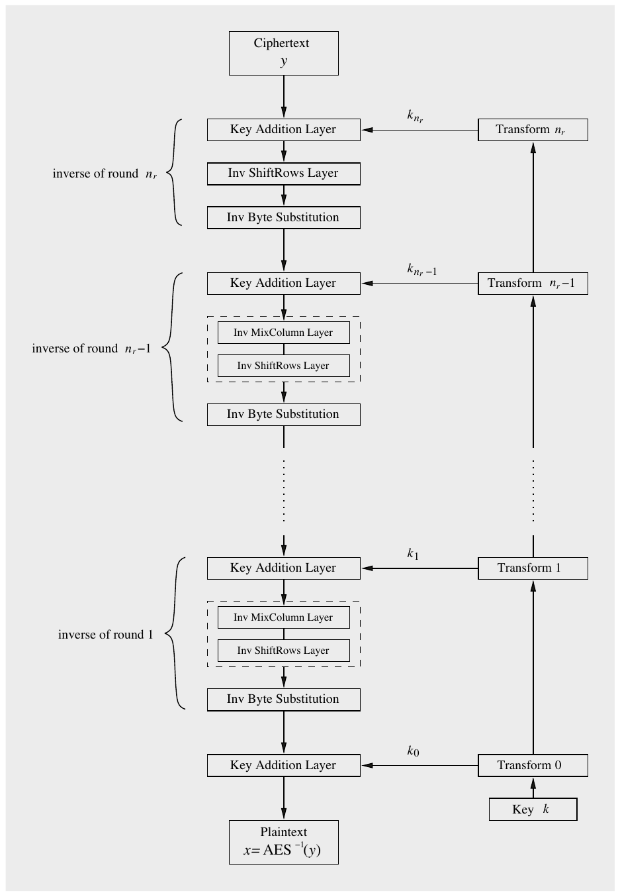

Hình 4.8 Sơ đồ khối giải mã AES

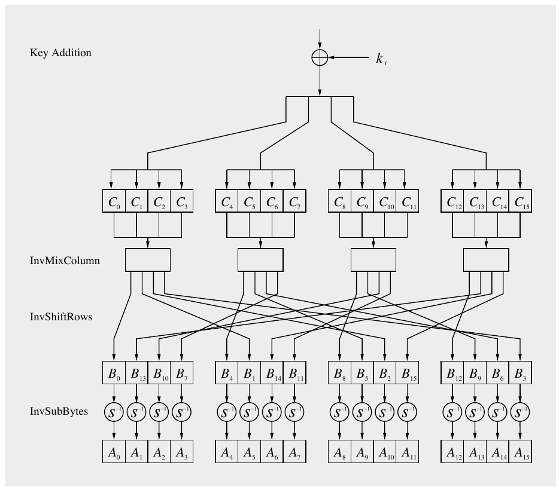

Hình 4.9 Hàm vòng giải mã AES

### Lớp con Inverse MixColumn

Sau khi cộng subkey, bước MixColumn ngược được áp dụng lên state (một lần nữa, ngoại lệ là vòng giải mã đầu tiên). Để đảo ngược phép toán MixColumn, phải dùng inverse của ma trận của nó. Input là một cột 4-byte của state C, được nhân với ma trận 4 × 4 nghịch đảo. Ma trận chứa các mục hằng. Phép nhân và phép cộng các hệ số được thực hiện trong GF(2<sup>8</sup>). Dưới đây là phép nhân vector-matrix cho hộp MixColumn ngoài cùng bên trái trong Hình 4.9:

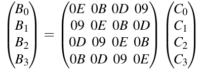

Cột thứ hai của các byte output (B<sub>4</sub>,B<sub>5</sub>,B<sub>6</sub>,B<sub>7</sub>) được tính bằng cách nhân bốn byte input (C<sub>4</sub>,C<sub>5</sub>,C<sub>6</sub>,C<sub>7</sub>) với cùng ma trận hằng, và cứ thế. Mỗi giá trị B<sub>i</sub> và C<sub>i</sub> là một phần tử từ GF(2<sup>8</sup>). Các hằng số cũng là phần tử từ GF(2<sup>8</sup>). Ký hiệu cho các hằng số là hệ thập lục phân và giống như ký hiệu được dùng cho lớp MixColumn, chẳng hạn:

0B = (0B)<sub>hex</sub> = (0000 1011)<sub>2</sub> = x<sup>3</sup> + x + 1

Các phép cộng trong phép nhân vector–ma trận là các phép XOR theo bit.

### Lớp con Inverse ShiftRows

Để đảo ngược phép toán ShiftRows của thuật toán mã hóa, chúng ta phải dịch các hàng của ma trận state theo hướng ngược lại. Hàng đầu tiên không bị thay đổi bởi phép biến đổi ShiftRows ngược. Nếu input của lớp con ShiftRows được cho dưới dạng ma trận state B = (B<sub>0</sub>,B<sub>1</sub>,...,B<sub>15</sub>):

| B<sub>0</sub> | B<sub>4</sub> | B<sub>8</sub> | B<sub>12</sub> |
|---|---|---|---|
| B<sub>1</sub> | B<sub>5</sub> | B<sub>9</sub> | B<sub>13</sub> |
| B<sub>2</sub> | B<sub>6</sub> | B<sub>10</sub> | B<sub>14</sub> |
| B<sub>3</sub> | B<sub>7</sub> | B<sub>11</sub> | B<sub>15</sub> |

thì lớp con ShiftRows ngược cho ra output:

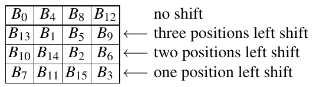

### Lớp Inverse Byte Substitution

S-box ngược phải dùng khi giải mã một ciphertext. Vì S-box của AES là một song ánh, tức là một ánh xạ one-to-one, có thể xây dựng một S-box ngược sao cho:

A<sub>i</sub> = S<sup>−1</sup>(B<sub>i</sub>) = S<sup>−1</sup>(S(A<sub>i</sub>))

trong đó A<sub>i</sub> và B<sub>i</sub> là các phần tử của ma trận state. Các mục của S-box ngược được cho trong Bảng 4.4. Với độc giả quan tâm tới chi tiết cách các mục của S-box ngược được xây dựng, chúng tôi đưa ra phần suy dẫn dưới đây. Tuy nhiên, để hiểu AES về mặt chức năng, phần còn lại của mục này có thể được bỏ qua.

Để đảo ngược phép thay thế S-box, trước hết chúng ta phải tính nghịch đảo của phép biến đổi affine, xem Hình 4.4. Để làm điều này, mỗi byte input B<sub>i</sub> được coi là một phần tử của GF(2<sup>8</sup>). Phép biến đổi affine ngược trên mỗi byte B<sub>i</sub> được cho bởi Phương trình (4.3), trong đó (b<sub>7</sub>,...,b<sub>0</sub>) là biểu diễn vector theo bit của B<sub>i</sub>(x), và (b<sub>7</sub><sup>′</sup>,...,b<sub>0</sub><sup>′</sup>) là kết quả sau phép biến đổi affine ngược:

Bảng 4.4 S-box ngược của AES: Các giá trị thay thế ở dạng hệ thập lục phân cho byte input (xy)

|  | y |
|---|---|
|  | 0 1 2 3 4 5 6 7 8 9 A B C D E F |
| 0 | 52 09 6A D5 30 36 A5 38 BF 40 A3 9E 81 F3 D7 FB |
| 1 | 7C E3 39 82 9B 2F FF 87 34 8E 43 44 C4 DE E9 CB |
| 2 | 54 7B 94 32 A6 C2 23 3D EE 4C 95 0B 42 FA C3 4E |
| 3 | 08 2E A1 66 28 D9 24 B2 76 5B A2 49 6D 8B D1 25 |
| 4 | 72 F8 F6 64 86 68 98 16 D4 A4 5C CC 5D 65 B6 92 |
| 5 | 6C 70 48 50 FD ED B9 DA 5E 15 46 57 A7 8D 9D 84 |
| 6 | 90 D8 AB 00 8C BC D3 0A F7 E4 58 05 B8 B3 45 06 |
| 7 | D0 2C 1E 8F CA 3F 0F 02 C1 AF BD 03 01 13 8A 6B |
| x 8 | 3A 91 11 41 4F 67 DC EA 97 F2 CF CE F0 B4 E6 73 |
| 9 | 96 AC 74 22 E7 AD 35 85 E2 F9 37 E8 1C 75 DF 6E |
| A | 47 F1 1A 71 1D 29 C5 89 6F B7 62 0E AA 18 BE 1B |
| B | FC 56 3E 4B C6 D2 79 20 9A DB C0 FE 78 CD 5A F4 |
| C | 1F DD A8 33 88 07 C7 31 B1 12 10 59 27 80 EC 5F |
| D | 60 51 7F A9 19 B5 4A 0D 2D E5 7A 9F 93 C9 9C EF |
| E | A0 E0 3B 4D AE 2A F5 B0 C8 EB BB 3C 83 53 99 61 |
| F | 17 2B 04 7E BA 77 D6 26 E1 69 14 63 55 21 0C 7D |

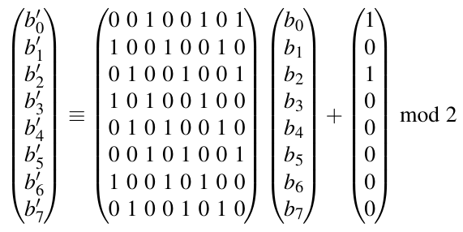 (4.3)

Ở bước thứ hai của phép toán S-box ngược, phép nghịch đảo Galois field phải được đảo ngược. Để làm điều này, lưu ý rằng A<sub>i</sub> = (A<sub>i</sub><sup>−1</sup>)<sup>−1</sup>. Điều này có nghĩa là phép nghịch đảo được đảo ngược bằng cách tính inverse lần nữa. Theo ký hiệu của chúng ta, do đó phải tính

A<sub>i</sub> = (B<sub>i</sub><sup>′</sup>)<sup>−1</sup> ∈ GF (2<sup>8</sup>)

với đa thức rút gọn cố định P(x) = x<sup>8</sup> + x<sup>4</sup> + x<sup>3</sup> + x + 1. Một lần nữa, phần tử không được ánh xạ tới chính nó. Vector A<sub>i</sub> = (a<sub>7</sub>,...,a<sub>0</sub>) (biểu diễn phần tử field a<sub>7</sub>x<sup>7</sup>+···+a<sub>1</sub>x + a<sub>0</sub>) là kết quả của phép thay thế:

A<sub>i</sub> = S<sup>−1</sup>(B<sub>i</sub>)

### Key Schedule giải mã

Vì vòng giải mã thứ nhất cần subkey cuối cùng, vòng giải mã thứ hai cần subkey second-to-last và cứ thế, chúng ta cần n<sub>r</sub> + 1 subkey theo thứ tự đảo ngược, như thể hiện trong Hình 4.8. Trong thực tế, điều này chủ yếu đạt được bằng cách tính toàn bộ key schedule trước và lưu cả 11, 13 hoặc 15 subkey, tùy theo số vòng AES đang dùng (điều này lại phụ thuộc vào ba độ dài key mà AES hỗ trợ). Việc tính trước này thường thêm một độ trễ nhỏ vào phép toán giải mã so với mã hóa.

## 4.6 Hiện thực bằng Software và Hardware

Dưới đây, chúng tôi bình luận ngắn gọn về hiệu quả của cipher AES đối với hiện thực software và hardware.

### Software

Khác với DES, AES có thiết kế software-friendly hơn nhiều. Một hiện thực AES đơn giản, bám trực tiếp theo mô tả data path-oriented trong chương này, rất phù hợp với các vi xử lý 8-bit, đôi khi được dùng trong các smart card đơn giản hoặc các thiết bị IoT low-cost. Với các CPU 32- và 64-bit, phổ biến trong smartphone, PC và server ngày nay, các hiện thực table-based được dùng rộng rãi. Ý tưởng cốt lõi là gộp mọi hàm vòng (trừ phép cộng key khá tầm thường) vào một table look-up. Điều này cho ra bốn bảng, mỗi bảng gồm 256 mục, trong đó mỗi mục rộng 32 bit. Các bảng này được gọi là T-Boxes. Thú vị là phương pháp bảng này đã được những người thiết kế Rijndael mô tả trong tài liệu AES gốc được nộp trong cuộc thi NIST. Bốn lần truy cập bảng cho ra 32 bit output của một vòng. Do đó, một vòng có thể được tính với 16 table look-ups. Trên một vi xử lý Intel 1.2-GHz, có thể đạt throughput 50 MByte/s (hay 400 Mbit/s). Trên nhiều vi xử lý của Intel và AMD, có các lệnh đặc biệt, gọi là AES-NI (Advanced Encryption Standard New Instructions), giúp tăng tốc việc tính AES. AES-NI cho phép throughput trong khoảng 2 GByte/s (hay 16 Gbit/s).

### Hardware

So với DES, AES cần nhiều tài nguyên hardware hơn để hiện thực. Tuy nhiên, nhờ mật độ tích hợp cao của các mạch tích hợp hiện đại, các mạch hardware cho AES vẫn khá nhỏ so với nhiều chức năng khác thường được hiện thực trong các mạch tích hợp hiện đại. Do đường dữ liệu rộng 128 bit, có thể được hiện thực song song, các hiện thực hardware của AES có thể đạt throughput rất cao trong công nghệ ASIC hoặc FPGA (field programmable gate array — đây là các thiết bị hardware lập trình được) hiện đại. Các hiện thực engine AES dùng một vòng duy nhất được lặp 10, 12 hoặc 14 lần (tùy theo độ dài key) có thể vượt throughput 10 Gbit/sec. Bằng cách hiện thực vài vòng như vậy song song và pipelining chúng, tốc độ có thể được tăng thêm. Có thể nói rằng mã hóa symmetric với các cipher ngày nay cực kỳ nhanh, không chỉ so với các cryptosystem asymmetric mà còn so với các thuật toán khác cần trong các hệ thống truyền thông hiện đại, như các scheme nén dữ liệu hay xử lý tín hiệu.

## 4.7 Thảo luận và đọc thêm (Discussion and Further Reading)

Thuật toán AES và bảo mật Một mô tả chi tiết về các nguyên lý thiết kế của AES có thể được tìm thấy trong cuốn sách [87], được viết bởi hai nhà phát minh Rijndael. Hơn hai thập kỷ sau khi được NIST chuẩn hóa, AES ngày nay được dùng cực kỳ rộng rãi trong thực tế. Như đã nhắc ở ngay đầu chương này, AES là một phần của protocol bảo mật web TLS, tiêu chuẩn bảo mật internet IPsec, tiêu chuẩn mã hóa Wi-Fi IEEE 802.11i, protocol mạng secure shell SSH, các ứng dụng nhắn tin tức thời WhatsApp và Signal, nhiều sản phẩm mã hóa ổ cứng và vô số sản phẩm bảo mật trên khắp thế giới. Ngoài vị trí độc nhất có lẽ là cipher most-used trên toàn thế giới, AES đã khơi nguồn những ý tưởng rất có ảnh hưởng về cách thiết kế các block cipher an toàn. Một ví dụ nổi bật là wide trail strategy [86], minh họa và làm rõ vai trò của lớp tuyến tính của một block cipher đối với khả năng chống lại nhiều tấn công thống kê. Có lẽ công bằng khi nói rằng đa số các block cipher thành công ngày nay đã vay mượn ý tưởng từ AES.

Hiện tại không có tấn công phân tích nào nhắm vào AES được biết có độ phức tạp nhỏ hơn brute-force attack. Một mô tả đại số tinh tế đã được tìm thấy trong [192], điều này lại dẫn tới những suy đoán rằng nó có thể dẫn tới các tấn công. Nghiên cứu sau đó cho thấy một tấn công thực ra không khả thi. Đến nay, giả định chung là cách tiếp cận này sẽ không đe dọa AES. Một bản tóm tắt tốt về các tấn công đại số có thể được tìm thấy trong [72]. Ngoài ra, đã có đề xuất cho nhiều tấn công khác, bao gồm square attack, impossible differential attack hay related-key attack. Các tấn công tốt nhất nhắm vào AES full-round có lẽ là biclique attack [58]. Chúng có thể được xem là các tấn công cải thiện độ phức tạp của brute-force attack bằng cách không phải lặp qua toàn bộ phép mã hóa AES cho mỗi key khả dĩ mà chỉ lặp qua các phần. Biclique attack cải thiện không đáng kể độ phức tạp của brute-force attack khoảng bốn lần, ví dụ, tấn công AES-128 mất khoảng 2<sup>126</sup> bước. Không tấn công nào được đề xuất tiến gần tới việc đe dọa AES full-size trong các bối cảnh thực tế..

Galois Field Tài liệu tham khảo tiêu chuẩn về toán học của finite field là [174]. Một phần giới thiệu rất dễ tiếp cận nhưng ngắn gọn cũng được cho trong [46]. International Workshop on the Arithmetic of Finite Fields (WAIFI) quan tâm tới cả ứng dụng và lý thuyết của Galois field [250].

Hiện thực AES Như đã nhắc trong Mục 4.6, nhiều hiện thực software dùng các lookup table đặc biệt (T-Boxes) để hiện thực AES. Một mô tả chi tiết sớm về việc xây dựng T-Boxes có thể được tìm thấy trong [85, Mục 5]. Một mô tả về hiện thực software high-speed trên CPU 32-bit và 64-bit được cho trong [183, 182]. Kỹ thuật bit-slicing, được phát triển trong bối cảnh DES, cũng áp dụng được cho AES và có thể dẫn tới code rất nhanh, như được chỉ ra trong [184].

Một dấu hiệu mạnh về tầm quan trọng của AES là việc đưa vào các lệnh AES đặc biệt cho CPU của AMD và Intel. Chúng là các phần mở rộng của kiến trúc tập lệnh x86, được gọi là Advanced Encryption Standard New Instructions (viết tắt AES-NI), ban đầu được Intel đề xuất năm 2008 [129]. Các lệnh cho phép các máy này tính các phép toán vòng AES đặc biệt nhanh.

Có rất nhiều tài liệu về hiện thực hardware của AES. Một phần giới thiệu tốt về lĩnh vực kiến trúc hardware AES được cho trong [165, Chương 10]. Làm ví dụ về sự đa dạng của các hiện thực AES, tài liệu tham khảo [127] mô tả một hiện thực FPGA rất nhỏ với 2.2 Mbit/s và một hiện thực FPGA pipelined rất nhanh với 25 Gbit/s. Cũng có thể dùng các khối DSP (tức là các đơn vị số học nhanh) có trên các FPGA hiện đại cho AES, cũng có thể cho throughput vượt 50 Gbit/s [99]. Ý tưởng cơ bản trong mọi kiến trúc high-speed là xử lý vài block plaintext song song bằng pipelining. Ở đầu kia của phổ hiệu năng là các kiến trúc lightweight được tối ưu cho các ứng dụng như các thiết bị IoT nhỏ. Ý tưởng cơ bản ở đây là tuần tự hóa đường dữ liệu, tức là một vòng được xử lý trong vài bước thời gian. Các tài liệu tham khảo tốt là [113, 71].

## 4.8 Bài học rút ra (Lessons Learned)

■ AES là một block cipher hiện đại hỗ trợ ba độ dài key 128, 192 và 256 bit. Nó cung cấp bảo mật long-term xuất sắc trước brute-force attack.

■ AES đã được nghiên cứu sâu rộng từ cuối những năm 1990 và không tìm thấy tấn công nào tốt hơn brute-force quá mức không đáng kể.

■ AES không dựa trên Feistel network. Các vòng AES dùng nhiều số học Galois field.

■ AES có hiệu năng xuất sắc trong software và hardware.

■ AES là một phần của vô số tiêu chuẩn mở, như IPsec hay TLS, ngoài việc là thuật toán mã hóa bắt buộc cho các ứng dụng của chính phủ Mỹ. Có vẻ cipher này sẽ tiếp tục là thuật toán mã hóa symmetric thống trị trong nhiều năm tới.

■ AES hiệu quả trong software và hardware.

## Bài tập

4.1. Cipher AES được NIST chuẩn hóa thành tiêu chuẩn Mỹ năm 2001 và sớm được nhiều tiêu chuẩn quốc tế chấp nhận. Ngày nay nó là symmetric cipher thống trị đang được dùng (ít nhất là ở thế giới phương Tây). Hãy trả lời các câu hỏi sau:

1. Sự phát triển của AES khác với của DES. Mô tả ngắn gọn các khác biệt trong lịch sử của AES so với của DES.

2. Phác thảo các sự kiện cơ bản của quá trình phát triển.

3. Tên của thuật toán được biết tới là AES là gì?

4. Ai đã phát triển thuật toán này, và các nhà phát minh của nó đến từ quốc gia nào?

5. Cipher hỗ trợ những kích thước block và độ dài key nào?

4.2. Trong thuật toán AES, một số phép tính được thực hiện trong Galois field. Với các bài tập sau, chúng ta luyện tập một số phép tính cơ bản.

Tính bảng nhân và bảng cộng cho prime field GF(7). Một bảng nhân là một bảng vuông (ở đây: 7 × 7) có các hàng và cột là mọi phần tử field. Mỗi mục của nó là tích của phần tử field ở hàng và cột tương ứng. Lưu ý rằng bảng đối xứng qua đường chéo. Một bảng cộng hoàn toàn tương tự nhưng chứa các tổng của các phần tử field làm mục.

4.3. Tạo bảng nhân cho extension field GF (2<sup>3</sup>) cho trường hợp đa thức bất khả quy là P(x) = x<sup>3</sup> + x + 1. Bảng nhân, trong trường hợp này, là một bảng 8 × 8. (Nhận xét: Bạn có thể làm việc này bằng tay hoặc viết một chương trình cho nó.)

4.4. Trong bài tập này, chúng ta xem phép cộng trong extension field. Tính A(x) + B(x) mod P(x) trong GF(2<sup>4</sup>) dùng đa thức bất khả quy P(x) = x<sup>4</sup> + x + 1. Điều gì sẽ xảy ra nếu chúng ta thay đổi đa thức rút gọn?

1. A(x) = x<sup>2</sup> + 1, B(x) = x<sup>3</sup> + x<sup>2</sup> + 1.

2. A(x) = x<sup>2</sup> + 1, B(x) = x + 1.

4.5. Bây giờ chúng ta xem phép nhân trong field GF(2<sup>4</sup>): Tính A(x) · B(x) mod P(x) trong GF(2<sup>4</sup>) dùng đa thức bất khả quy P(x) = x<sup>4</sup> + x + 1. Ảnh hưởng của việc chọn đa thức rút gọn lên phép tính trong trường hợp này là gì?

1. A(x) = x<sup>2</sup> + 1, B(x) = x<sup>3</sup> + x<sup>2</sup> + 1.

2. A(x) = x<sup>2</sup> + 1, B(x) = x + 1.

4.6. Tính trong GF(2<sup>8</sup>):

(x<sup>4</sup> + x + 1)/(x<sup>7</sup> + x<sup>6</sup> + x<sup>3</sup> + x<sup>2</sup>)

trong đó đa thức bất khả quy là đa thức được AES dùng, cụ thể là P(x) = x<sup>8</sup> + x<sup>4</sup>+ x<sup>3</sup> + x + 1. Lưu ý rằng Bảng 4.2 chứa danh sách mọi inverse nhân cho field này.

4.7. Chúng ta xét finite field GF(2<sup>4</sup>) với P(x) = x<sup>4</sup> + x + 1 là đa thức bất khả quy. Tìm inverse của A(x) = x và B(x) = x<sup>2</sup> + x. Bạn có thể tìm các inverse bằng cách thử và sai, tức là tìm kiếm brute-force, hoặc bằng cách áp dụng thuật toán Euclid cho đa thức. (Tuy nhiên, thuật toán Euclid chỉ được phác họa ngắn gọn trong chương này.) Kiểm chứng câu trả lời bằng cách nhân các inverse bạn tìm được lần lượt với A và B.

4.8. Tìm mọi đa thức bất khả quy

1. bậc 3 trên GF(2),

2. bậc 4 trên GF(2).

Cách tốt nhất để làm việc này là xét mọi đa thức bậc thấp hơn và kiểm tra xem bạn có thể tách chúng thành các nhân tử (khác 1 và chính đa thức đó) hay không. Lưu ý rằng chúng ta chỉ xét các đa thức bất khả quy monic, tức là các đa thức có hệ số cao nhất bằng một.

4.9. Chúng ta xét phần thứ nhất của phép toán ByteSub, tức là phép nghịch đảo Galois field.

1. Dùng Bảng 4.2, inverse của các byte 29, F3 và 01 là gì, trong đó mỗi byte được cho ở dạng hệ thập lục phân?

2. Kiểm chứng câu trả lời bằng cách thực hiện một phép nhân GF(2<sup>8</sup>) với câu trả lời của bạn và byte input. Lưu ý rằng trước hết bạn phải biểu diễn mỗi byte dưới dạng một đa thức trong GF(2<sup>8</sup>). MSB của mỗi byte biểu diễn hệ số x<sup>7</sup>.

4.10. Nhiệm vụ của bạn là tính S-box, tức là ByteSub, các giá trị cho các byte input 29, F3 và 01, trong đó mỗi byte được cho ở dạng hệ thập lục phân.

1. Trước hết, tra các inverse dùng Bảng 4.2 để có các giá trị B<sup>′</sup>. Bây giờ, thực hiện ánh xạ affine bằng cách tính phép nhân và phép cộng ma trận–vector.

2. Kiểm chứng kết quả dùng S-box trong Bảng 4.3.

3. Giá trị của S(0) là gì?

4.11. Chúng ta xét AES với key 128-bit. Output của vòng đầu tiên của AES là gì nếu input của lớp Byte Substitution đầu tiên gồm 128 bit một, và subkey đầu tiên (tức là k<sub>1</sub>) cũng gồm 128 bit một? Tốt nhất là bạn viết state output dưới dạng một mảng 4 × 4, như thể hiện trong Mục 4.4.

4.12. Sau đây, chúng ta kiểm tra tính chất diffusion của AES sau một vòng duy nhất. Cho X = (X<sub>0</sub>,X<sub>1</sub>,X<sub>2</sub>,X<sub>3</sub>) = (0x01000000, 0x00000000, 0x00000000, 0x00000000) là bốn word input (mỗi word 32 bit) vào AES với key 128-bit. Lưu ý rằng mọi bit input trừ một bit đều có giá trị không. Các subkey cho vòng đầu tiên được ký hiệu là W[0],...,W [7] với mỗi subkey 32 bit, và được cho bởi:

W[0] = (0x2B7E1516), W [1] = (0x28AED2A6),

W[2] = (0xABF71588), W [3] = (0x09CF4F3C),

W[4] = (0xA0FAFE17), W [5] = (0x88542CB1),

W[6] = (0x23A33939), W [7] = (0x2A6C7605).

Thực hiện các phép tính sau. Bạn có thể làm bằng tay hoặc viết một chương trình máy tính hoặc dùng một chương trình có sẵn.

1. Tính output của vòng đầu tiên của AES cho input X và các subkey W[0],...,W [7] đã cho. Cũng cung cấp mọi bước trung gian, tức là các output sau các lớp SubBytes, ShiftRows và MixColumns. Khuyến nghị bạn đưa mọi kết quả dưới dạng một mảng state 4 × 4.

2. Tính output của vòng đầu tiên của AES cho trường hợp mọi bit input đều bằng không.

3. Bao nhiêu bit output đã thay đổi? Lưu ý rằng chúng ta chỉ xét một vòng duy nhất — sau mỗi vòng tiếp theo, nhiều bit output hơn sẽ bị ảnh hưởng. Hành vi này được gọi là avalanche effect.

4.13. Chúng ta đang ở vòng thứ 9th của một phép giải mã AES-128. Nhiệm vụ của bạn là tính vòng cuối cùng và plaintext tương ứng. Key AES-128 được cho bởi:

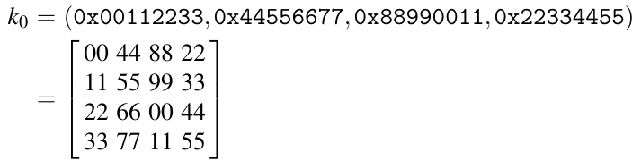

State sau phép thay thế byte ngược ở Vòng 9 là

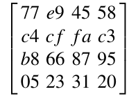

Với câu trả lời của bạn, cũng viết state output dưới dạng một mảng 4 × 4.

4.14. Sau đây, chúng ta giả sử AES với key 192-bit. Hơn nữa, giả sử chúng ta có các mạch tích hợp special-purpose có thể kiểm tra 3 · 10<sup>7</sup> key AES mỗi giây.

1. Nếu dùng 100,000 IC như vậy song song, một lần tìm key trung bình mất bao lâu? So sánh khoảng thời gian này với tuổi của vũ trụ (khoảng 10<sup>10</sup> năm).

2. Giả sử định luật Moore vẫn đúng trong vài năm tới, chúng ta phải đợi bao nhiêu năm cho tới khi có thể chế tạo một máy key-search thực hiện một lần tìm key trung bình của AES-192 trong 24 giờ? Một lần nữa, giả sử chúng ta dùng 100,000 IC song song.

4.15. Phép toán MixColumn có một tính chất hơi bất ngờ: Nếu bốn byte input đều có cùng giá trị, bốn byte output cũng đều giống nhau, và thêm vào đó có cùng giá trị với byte input. (Chúng tôi lưu ý rằng tính chất này không dẫn tới một điểm yếu bảo mật của AES.)

1. Chỉ ra rằng tính chất này đúng.

2. Tính xác suất để bốn byte input ngẫu nhiên nhận cùng giá trị.

3. Lập luận vì sao tình huống này (tức là cả bốn byte input của phép toán MixColumn đều giống nhau) hiếm xảy ra trong thực tế nếu AES được dùng với một key ngẫu nhiên.

4.16. Chỉ ra rằng hai ma trận hằng cho MixColumn và Inv MixColumn là nghịch đảo của nhau.

4.17. Trong bài tập này, chúng ta xem các phép tính trong lớp MixColumn ở mức bit. Như chúng ta đã thấy trong chương này, phép biến đổi MixColumn gồm một phép nhân ma trận–vector trong finite field GF(2<sup>8</sup>) với đa thức bất khả quy P(x) = x<sup>8</sup> + x<sup>4</sup> + x<sup>3</sup> + x + 1.

Cho b = (b<sub>7</sub>x<sup>7</sup>+...+b<sub>0</sub>) là một trong (bốn) byte input của phép nhân vector–ma trận. Trong phép nhân ma trận, byte b được nhân với các hằng số 01, 02 và 03. Chúng ta quan tâm tới các phương trình bit-level để tính ba phép nhân hằng đó. Chúng ta ký hiệu kết quả là d = (d<sub>7</sub>x<sup>7</sup>+...+d<sub>0</sub>). Nhiệm vụ của bạn là biểu diễn các bit d<sub>i</sub> theo các bit input b<sub>i</sub>.

1. Các phương trình để tính 8 bit của d = 01 · b.

2. Các phương trình để tính 8 bit của d = 02 · b.

3. Các phương trình để tính 8 bit của d = 03 · b.

Lưu ý rằng trong các đặc tả AES, “01” biểu diễn đa thức 1, “02” biểu diễn đa thức x, và “03” biểu diễn x + 1.

4.18. Bây giờ chúng ta xem độ phức tạp cổng (hay bit) của hàm MixColumn, dùng kết quả từ bài tập 4.17. Nhớ lại từ phần thảo luận về stream cipher rằng một cổng XOR 2-input thực hiện một phép cộng GF(2).

1. Cần bao nhiêu cổng XOR 2-input để thực hiện một phép nhân hằng với 01, 02 và 03, lần lượt, trong GF(2<sup>8</sup>)?

2. Độ phức tạp cổng tổng thể của một phép nhân ma trận–vector là bao nhiêu? (Độ phức tạp cổng quan trọng khi hiện thực AES bằng hardware.)

3. Độ phức tạp cổng tổng thể của một hiện thực hardware của toàn bộ lớp Diffusion là bao nhiêu? Lưu ý rằng các hoán vị không cần cổng nào.

4.19. Suy ra biểu diễn bit cho các hằng số vòng sau trong key schedule:

■ RC[8],

■ RC[9].
