# Chương 5 Tìm hiểu thêm về Block Cipher (More About Block Ciphers)

Một block cipher còn hơn nhiều so với chỉ là một thuật toán mã hóa. Nó có thể được dùng như một khối xây dựng đa năng mà với nó có thể hiện thực một tập đa dạng các cơ chế cryptographic. Chẳng hạn, chúng ta có thể dùng chúng để xây dựng các loại scheme mã hóa block-based khác nhau, và thậm chí có thể dùng block cipher để hiện thực stream cipher. Các cách mã hóa khác nhau được gọi là modes of operation và được thảo luận trong chương này. Block cipher cũng có thể được dùng để xây dựng hash function, message authentication code, còn được gọi là MAC, hay các protocol thiết lập key, tất cả sẽ được mô tả trong các chương sau. Cũng có những cách dùng khác cho block cipher, ví dụ, làm bộ sinh số giả ngẫu nhiên. Ngoài modes of operation, chương này cũng thảo luận hai kỹ thuật hữu ích để tăng bảo mật của block cipher, cụ thể là key whitening và mã hóa nhiều lần (multiple encryption).

Trong chương này, bạn sẽ học:

■ Các mode of operation quan trọng cho block cipher trong thực tế

■ Các cạm bẫy bảo mật khi dùng modes of operation

■ Các nguyên lý của key whitening

■ Vì sao mã hóa kép (double encryption) không phải là ý hay do meet-in-the-middle attack

■ Mã hóa ba lần (triple encryption)

## 5.1 Modes of Operation cho mã hóa và xác thực

Trong mục này, chúng tôi sẽ giới thiệu vài cách tiếp cận dùng block cipher để mã hóa dữ liệu, được gọi là modes of operation. Chúng tôi cũng sẽ thảo luận ngắn gọn các mode of operation được dùng để xác thực thông điệp. Tuy nhiên, các mode tương ứng sẽ được mô tả chi tiết trong Mục 13.3.

Modes of Operation cho mã hóa Trong các chương trước, chúng tôi đã giới thiệu cách AES, DES, 3DES và PRESENT mã hóa một block dữ liệu. Tất nhiên, trong thực tế người ta thường muốn mã hóa nhiều hơn một block plaintext 8-byte hay 16-byte duy nhất, ví dụ, khi mã hóa một email hay một file PDF. Có vài cách mã hóa plaintext dài bằng block cipher, bao gồm các mode of operation sau, sẽ được giới thiệu trong chương này:

■ Mode Electronic Code Book (ECB),

■ Mode Cipher Block Chaining (CBC),

■ Mode Cipher Feedback (CFB),

■ Mode Output Feedback (OFB),

■ Mode Counter (CTR),

■ XEX Tweakable Block Cipher with Ciphertext Stealing (XTS).

Mọi mode đều cung cấp tính bí mật cho một thông điệp được gửi từ Alice tới Bob. Chúng tôi lưu ý rằng các mode CFB và OFB dùng block cipher như một khối xây dựng cho một stream cipher. Chúng tôi cũng sẽ giới thiệu XTS, một mode đã được chuẩn hóa cho việc mã hóa dữ liệu trong các thiết bị lưu trữ như ổ cứng. Để đầy đủ, chúng tôi lưu ý rằng cũng có các mode cho các mục đích khác, ví dụ, các key wrapping mode KW, KWP và TKW, được dùng khi các key cryptographic cần được mã hóa.

Các mode ECB và CBC yêu cầu độ dài plaintext là bội số chính xác của kích thước block của cipher được dùng, ví dụ, bội số của 16 byte trong trường hợp AES. Nếu plaintext không có độ dài này, nó phải được padding. Có vài cách làm padding này trong thực tế. Một phương pháp padding khả dĩ là nối thêm một bit “1” duy nhất vào plaintext rồi nối thêm bao nhiêu bit “0” cần thiết để đạt bội số của độ dài block. Nếu plaintext là bội số chính xác của độ dài block, một block bổ sung chỉ gồm các bit padding được nối thêm.

Modes of Operation cho xác thực Trong thực tế, chúng ta thường không chỉ muốn giữ bí mật dữ liệu mà Bob cũng muốn biết thông điệp có thực sự đến từ Alice hay không. Điều này được gọi là xác thực thông điệp (message authentication) và các mode of operation sau cung cấp xác thực (CBC-MAC, CMAC), hoặc cả mã hóa lẫn xác thực (CCM, GCM):

■ CBC-MAC,

■ Cipher-based MAC (CMAC),

■ Cipher Block Chaining-Message Authentication Code (CCM),

■ Mode Galois Counter (GCM).

Các mode này cho phép bên nhận, Bob, xác định xem thông điệp có thực sự được tạo bởi một bên sở hữu key bí mật dùng chung hay không. Hơn nữa, xác thực cũng cho phép Bob phát hiện ciphertext có bị thay đổi trong khi truyền hay không. Các mode này là chủ đề của Mục 13.3.

### 5.1.1 Mode Electronic Codebook (ECB)

Mode Electronic Code Book (ECB) là cách đơn giản nhất để mã hóa một thông điệp bằng block cipher. Sau đây, cho ek(xi) ký hiệu phép mã hóa block plaintext xi với key k dùng một block cipher tùy ý. Cho ek−1(yi) ký hiệu phép giải mã block ciphertext yi với key k. Giả sử block cipher mã hóa (giải mã) các block có kích thước b bit. Các thông điệp vượt quá b bit được chia thành các block b-bit. Nếu độ dài thông điệp không phải bội số của b bit, nó phải được padding tới bội số của b bit trước khi mã hóa. Như thể hiện trong Hình 5.1, ở mode ECB mỗi block được mã hóa riêng biệt. Block cipher có thể là, chẳng hạn, AES hoặc 3DES.

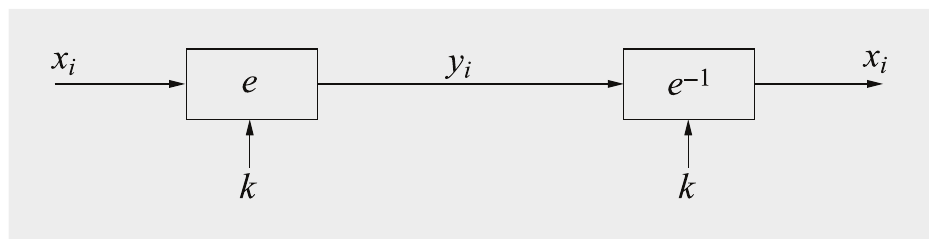

Hình 5.1 Mã hóa và giải mã ở mode ECB

Mã hóa và giải mã ở mode ECB được mô tả hình thức như sau.

> Định nghĩa 5.1.1 Electronic Codebook Mode (ECB)
>
> Cho e() là một block cipher có kích thước block b, và cho xi và yi là các chuỗi bit độ dài b.
>
> Mã hóa: yi = ek(xi), i ≥ 1
>
> Giải mã: xi = ek−1(yi), i ≥ 1

Dễ dàng kiểm chứng tính đúng đắn của mode ECB:

ek−1(yi) = ek−1(ek(xi)) = xi

Mode ECB có những ưu điểm. Không cần đồng bộ block giữa các bên mã hóa và giải mã Alice và Bob, tức là nếu bên nhận không nhận được mọi block đã mã hóa do sự cố truyền, vẫn có thể giải mã các block nhận được. Tương tự, lỗi bit, ví dụ do đường truyền nhiễu gây ra, chỉ ảnh hưởng tới block tương ứng chứ không ảnh hưởng các block tiếp theo. Ngoài ra, các block cipher chạy ở mode ECB có thể được song song hóa, ví dụ, một đơn vị mã hóa mã hóa (hoặc giải mã) block 1, đơn vị tiếp theo block 2, và cứ thế. Đây là một ưu điểm cho các bản triển khai high-speed. Chúng tôi lưu ý rằng các mode khác như CFB không cho phép song song hóa.

Tuy nhiên, như thường thấy trong cryptography, có một số điểm yếu bất ngờ liên quan tới mode ECB, mà chúng tôi sẽ thảo luận dưới đây. Vấn đề chính của mode ECB là nó mã hóa rất tất định (deterministic). Điều này có nghĩa là các block plaintext giống nhau cho ra các block ciphertext giống nhau, miễn là key không thay đổi. Mode ECB có thể được xem như một cuốn sổ mã (code book) khổng lồ — do đó có tên của mode — ánh xạ mỗi input tới một output nhất định. Tất nhiên, nếu key thay đổi thì toàn bộ sổ mã thay đổi nhưng miễn key còn tĩnh thì sổ cố định. Điều này có vài hệ quả không mong muốn. Thứ nhất, kẻ tấn công nhận ra cùng một thông điệp đã được gửi hai lần hay chưa đơn giản bằng cách nhìn ciphertext. Suy ra thông tin từ ciphertext theo cách này được gọi là traffic analysis. Chẳng hạn, nếu có một header cố định luôn đứng trước một thông điệp, header luôn cho ra cùng ciphertext. Từ đó, kẻ tấn công có thể, chẳng hạn, biết khi nào một thông điệp với header cụ thể này đã được gửi. Thứ hai, các block plaintext được mã hóa độc lập với các block trước. Nếu kẻ tấn công sắp xếp lại các block ciphertext, điều này có thể cho ra plaintext hợp lệ và việc sắp xếp lại có thể không bị phát hiện. Chúng tôi minh họa hai tấn công đơn giản khai thác các điểm yếu này của mode ECB. Mode ECB dễ bị substitution attack vì một khi một ánh xạ block plaintext sang ciphertext cụ thể xi → yi được biết, một chuỗi block ciphertext có thể dễ dàng bị thao túng. Chúng tôi minh họa cách một substitution attack có thể hoạt động trong thế giới thực. Hãy hình dung ví dụ sau về một giao dịch chuyển khoản điện tử giữa các ngân hàng.

Ví dụ 5.1. Substitution attack nhắm vào chuyển khoản ngân hàng điện tử

Giả sử một protocol đơn giản cho chuyển khoản giữa các ngân hàng (Hình 5.2). Có năm trường xác định một giao dịch chuyển khoản: ID và số tài khoản của ngân hàng gửi, ID và số tài khoản của ngân hàng nhận và số tiền. Bây giờ chúng ta giả sử (và đây là một đơn giản hóa lớn) rằng mỗi trường có đúng kích thước bằng độ rộng block cipher, ví dụ, 16 byte trong trường hợp AES. Hơn nữa, key mã hóa giữa hai ngân hàng không thay đổi quá thường xuyên. Do bản chất của mode ECB, kẻ tấn công có thể khai thác bản chất tất định của mode of operation này bằng cách thay thế đơn giản các block. Chi tiết tấn công như sau:

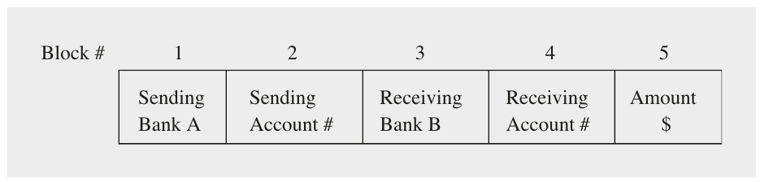

Hình 5.2 Protocol wire-transfer đơn giản có thể bị khai thác bởi một substitution attack nhắm vào mã hóa ECB

1. Kẻ tấn công, Oscar, mở một tài khoản ở ngân hàng A và một ở ngân hàng B.

2. Oscar nghe lén đường truyền đã mã hóa của mạng truyền thông ngân hàng.

3. Hắn gửi lặp lại các giao dịch chuyển $1.00 từ tài khoản của hắn ở ngân hàng A tới tài khoản của hắn ở ngân hàng B. Hắn quan sát các ciphertext đi qua mạng truyền thông. Dù không thể giải mã các block ciphertext random-looking, hắn có thể kiểm tra các block ciphertext lặp lại. Sau một thời gian hắn có thể nhận ra năm block của giao dịch của chính mình. Bây giờ hắn lưu các block 1, 3 và 4 của các giao dịch này. Đây là các phiên bản đã mã hóa của số ID của cả hai ngân hàng cũng như phiên bản đã mã hóa của tài khoản của hắn ở ngân hàng B.

4. Nhớ rằng hai ngân hàng không thay đổi key quá thường xuyên. Điều này có nghĩa là cùng một key được dùng cho nhiều giao dịch giữa A và B. Bằng cách so sánh các block 1 và 3 của mọi thông điệp tiếp theo với các block hắn đã lưu, Oscar nhận ra mọi giao dịch được thực hiện từ một tài khoản nào đó ở ngân hàng A tới một tài khoản nào đó ở ngân hàng B. Bây giờ hắn chỉ cần thay block 4 — chứa số tài khoản nhận — bằng block 4 hắn đã lưu trước đó. Block này chứa số tài khoản của Oscar ở dạng đã mã hóa. Hệ quả là mọi giao dịch từ một tài khoản nào đó của ngân hàng A tới một tài khoản nào đó của ngân hàng B đều bị chuyển hướng vào tài khoản của Oscar! Lưu ý rằng ngân hàng B giờ không có cách nào phát hiện block 4 đã bị thay thế trong một số giao dịch mà nó nhận.

5. OSCAR nhanh chóng rút tiền từ ngân hàng B và bay tới một quốc gia có thái độ dễ dãi về việc dẫn độ tội phạm white-collar.

◇

Điều thú vị về tấn công này là nó hoạt động hoàn toàn mà không cần phá bản thân block cipher. Vì vậy, ngay cả khi chúng ta dùng AES với key 256-bit và ngay cả khi mã hóa mỗi block, giả sử, 1000 lần, điều này cũng không ngăn được tấn công. Lưu ý rằng tấn công này chỉ hoạt động nếu key giữa ngân hàng A và B không thay đổi quá thường xuyên. Đây là một lý do khác vì sao key freshness là ý hay.

Cần nhấn mạnh rằng tính bí mật do block cipher cung cấp không bị phá trực tiếp: Các thông điệp mà Oscar không biết vẫn được giữ bí mật. Hắn chỉ thay các phần của ciphertext bằng các phần của một số ciphertext khác (trước đó). Điều này được gọi là vi phạm tính toàn vẹn (integrity) của thông điệp. Có các kỹ thuật để bảo toàn tính toàn vẹn thông điệp, cụ thể là message authentication code (MAC) và digital signature. Cả hai đều được dùng rộng rãi trong thực tế để ngăn một tấn công như vậy và lần lượt được giới thiệu trong Chương 13 và 10. Cũng có các mode of operation với xác thực thông điệp built-in, được gọi là authenticated encryption. Mục 13.3.3 và 13.3.4 mô tả hai mode authenticated encryption.

Bây giờ chúng ta xem một ứng dụng có vấn đề khác của mode ECB.

Ví dụ 5.2. Mã hóa bitmap ở mode ECB

Hình 5.3 cho thấy phiên bản gốc của một ảnh bitmap ở trên với phiên bản ECB-encrypted ở dưới. Ngay lập tức có thể thấy có rò rỉ thông tin lớn: Chữ trong hình vẫn đọc được từ ảnh đã mã hóa dù chúng tôi đã dùng AES với key 256-bit để mã hóa. Lý do của điều này, một lần nữa, là nhược điểm lớn của mode ECB: Các plaintext giống nhau được ánh xạ tới các ciphertext giống nhau. Đây là những gì xảy ra trong ví dụ. Để mã hóa, ảnh được chia thành các ô vuông nhỏ, được mã hóa riêng lẻ. Nền chủ yếu gồm các block plaintext (trắng) giống nhau, cho ra một nền uniform-looking khá đều trong ảnh ciphertext. Mặt khác, mọi block plaintext chứa một phần của các chữ cái (đen) cho ra các ciphertext random-looking. Các ciphertext random-looking này dễ dàng được mắt người phân biệt với nền đồng đều.

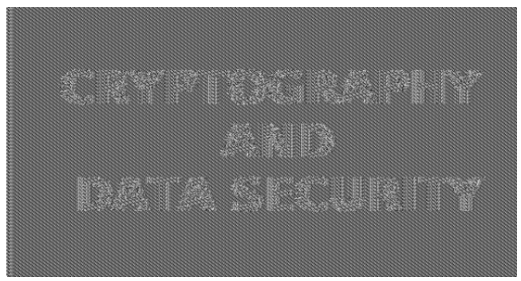

Hình 5.3 Ảnh gốc (trên) và ảnh được mã hóa dùng AES với key 256-bit ở mode ECB (dưới)

◇

Điểm yếu này tương tự tấn công vào substitution cipher đã được giới thiệu trong Ví dụ 5.1. Trong cả hai trường hợp, các tính chất thống kê trong plaintext được bảo toàn trong ciphertext. Lưu ý rằng khác với một tấn công nhắm vào substitution cipher hay tấn công chuyển khoản ngân hàng ở trên, trong trường hợp này kẻ tấn công không phải làm gì cả. Mắt người tự động tận dụng thông tin thống kê.

Cả hai tấn công trên đều là ví dụ về điểm yếu của một scheme mã hóa tất định. Do đó, nói chung nên tạo ra các ciphertext khác nhau mỗi lần chúng ta mã hóa cùng một plaintext. Hành vi này được gọi là mã hóa xác suất (probabilistic encryption). Điều này có thể đạt được bằng cách đưa vào một dạng ngẫu nhiên nào đó, thường ở dạng một initialization vector (IV). Các mode of operation sau mã hóa theo kiểu xác suất nhờ một IV.

### 5.1.2 Cipher Block Chaining Mode (CBC) và Initialization Vector

Có hai ý tưởng chính đằng sau mode cipher block chaining (CBC). Thứ nhất, các phép mã hóa của mọi block được “xích lại với nhau” sao cho ciphertext yi không chỉ phụ thuộc vào block xi mà còn vào mọi block plaintext trước đó. Thứ hai, phép mã hóa được ngẫu nhiên hóa bằng cách dùng một initialization vector (IV). Đây là chi tiết của mode CBC.

Ciphertext yi, là kết quả của việc mã hóa block plaintext xi, được đưa ngược về input của cipher và XOR với block plaintext tiếp theo xi+1. Tổng XOR này sau đó được mã hóa, cho ra ciphertext tiếp theo yi+1, sau đó có thể được dùng để mã hóa xi+2, và cứ thế. Quá trình này được thể hiện ở phía left-hand của Hình 5.4. Với block plaintext đầu tiên x1 không có ciphertext trước đó. Trong trường hợp này, một IV được cộng vào plaintext đầu tiên, điều này cũng cho phép chúng ta làm cho mỗi phép mã hóa CBC có tính xác suất. Lưu ý rằng ciphertext đầu tiên y1 phụ thuộc vào plaintext x1 và IV. Ciphertext thứ hai phụ thuộc vào IV, x1 và x2. Ciphertext thứ ba y3 phụ thuộc vào IV và x1,x2,x3, và cứ thế. Ciphertext cuối cùng là một hàm của mọi block plaintext và IV.

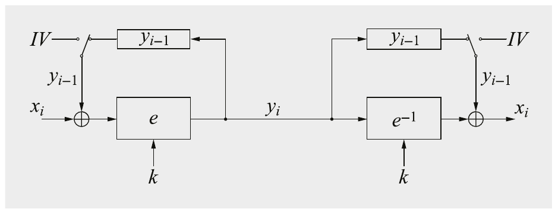

Hình 5.4 Mã hóa và giải mã ở mode CBC

Khi giải mã một block ciphertext yi ở mode CBC, chúng ta phải đảo ngược hai phép toán đã làm ở phía mã hóa. Thứ nhất, chúng ta phải hoàn tác phép mã hóa block cipher bằng cách áp dụng hàm giải mã e−1. Sau đó chúng ta phải hoàn tác phép XOR bằng cách XOR lại với block ciphertext đúng. Điều này có thể được biểu diễn cho các block tổng quát yi là ek−1(yi) = xi ⊕ yi−1. Phía right-hand của Hình 5.4 cho thấy quá trình này. Một lần nữa, nếu block ciphertext đầu tiên y1 được giải mã, kết quả phải được XOR với initialization vector IV để xác định block plaintext x1, tức là x1 = IV ⊕ ek−1(y1). Toàn bộ quá trình mã hóa và giải mã có thể được mô tả như sau:

> Định nghĩa 5.1.2 Cipher block chaining mode (CBC)
>
> Cho ek(x) là một block cipher có kích thước block b; cho xi và yi là các chuỗi bit độ dài b; và IV là một nonce độ dài b.
>
> Mã hóa (block đầu tiên): y1 = ek(x1 ⊕ IV)
>
> Mã hóa (các block khác): yi = ek(xi ⊕ yi−1), i ≥ 2
>
> Giải mã (block đầu tiên): x1 = ek−1(y1) ⊕ IV
>
> Giải mã (các block khác): xi = ek−1(yi) ⊕ yi−1, i ≥ 2

Bây giờ chúng ta kiểm chứng tính đúng đắn của mode, tức là chỉ ra rằng phép giải mã thực sự đảo ngược phép mã hóa. Với việc giải mã block đầu tiên y1, ta được:

d(y1) = ek−1(y1) ⊕ IV = ek−1(ek(x1 ⊕ IV)) ⊕ IV = (x1 ⊕ IV) ⊕ IV = x1

Với việc giải mã mọi block tiếp theo yi, i ≥ 2, ta được:

d(yi) = ek−1(yi) ⊕ yi−1 = ek−1(ek(xi ⊕ yi−1)) ⊕ yi−1 = (xi ⊕ yi−1) ⊕ yi−1 = xi

Initialization vector IV Nếu chọn một IV mới mỗi lần mã hóa, mode CBC trở thành một scheme mã hóa xác suất. Nếu mã hóa một chuỗi block x1,...,xt một lần với IV thứ nhất và lần thứ hai với một IV khác, hai chuỗi ciphertext thu được trông hoàn toàn không liên quan gì tới nhau đối với kẻ tấn công. Lưu ý rằng chúng ta không phải giữ bí mật IV. Tuy nhiên, trong hầu hết trường hợp, chúng ta muốn IV là một nonce, tức là một số chỉ được dùng một lần. Có nhiều cách khác nhau để tạo và thỏa thuận các giá trị khởi tạo. Trong trường hợp đơn giản nhất, một bên chọn một số ngẫu nhiên và truyền nó dạng rõ tới bên kia trước khi việc mã hóa thực sự bắt đầu. Hoặc nó có thể là một giá trị bộ đếm mà Alice và Bob biết, và nó được tăng mỗi khi một phiên mới bắt đầu (điều này yêu cầu giá trị bộ đếm phải được lưu giữa các phiên). IV cũng có thể được suy ra từ các giá trị như số ID của Alice và Bob, ví dụ, địa chỉ IP của họ, cùng với thời gian hiện tại. Để tăng cường bất kỳ phương pháp nào trong số này, chúng ta có thể lấy một giá trị như mô tả ở trên, ECB-encrypt nó một lần bằng block cipher với key mà Alice và Bob biết, và dùng ciphertext thu được làm IV. Có một số tấn công nâng cao cũng yêu cầu IV không thể đoán trước.

Thật bổ ích khi thảo luận xem substitution attack nhắm vào chuyển khoản ngân hàng đã hoạt động với mode ECB có áp dụng được cho mode CBC hay không. Nếu IV được chọn đúng cách cho mỗi giao dịch chuyển khoản, tấn công sẽ hoàn toàn không hoạt động vì Oscar sẽ không nhận ra bất kỳ mẫu nào trong ciphertext. Để lập luận, hãy xem tình huống nếu IV được giữ nguyên cho vài giao dịch (điều không nên xảy ra nếu IV được chọn đúng). Trong trường hợp này, hắn sẽ nhận ra các giao dịch từ tài khoản của hắn ở ngân hàng A tới tài khoản của hắn ở ngân hàng B. Tuy nhiên, nếu hắn thay block ciphertext 4, là số tài khoản đã mã hóa của hắn, trong các giao dịch chuyển khoản khác đi từ A tới B, ngân hàng B sẽ giải mã các block 4 và 5 thành một giá trị ngẫu nhiên nào đó. Dù tiền sẽ không bị chuyển hướng vào tài khoản của Oscar, nó có thể bị chuyển hướng tới một tài khoản ngẫu nhiên khác. Số tiền cũng sẽ là một giá trị ngẫu nhiên. Điều này rõ ràng cũng rất không mong muốn đối với các ngân hàng. Ví dụ này cho thấy rằng dù Oscar không thể thực hiện các thao túng cụ thể, những thay đổi ciphertext do hắn gây ra có thể gây ra các thay đổi ngẫu nhiên trong plaintext, có thể có hậu quả tiêu cực lớn. Do đó, trong nhiều, nếu không phải hầu hết, hệ thống real-world, bản thân mã hóa là không đủ: Chúng ta cũng phải bảo vệ tính toàn vẹn của thông điệp. Như đã nhắc ở trên, message authentication code (MAC) và digital signature cung cấp tính toàn vẹn thông điệp. Cũng có các mode cho authenticated encryption, cung cấp mã hóa và xác thực trong một lượt, xem Mục 13.3.3 và 13.3.4.

### 5.1.3 Mode Output Feedback (OFB)

Ở mode output feedback (OFB), một block cipher được dùng để xây dựng một scheme mã hóa stream cipher. Scheme này được thể hiện trong Hình 5.5. Lưu ý rằng ở mode OFB, key stream không được tạo theo từng bit mà theo kiểu từng block. Output của cipher cho chúng ta b bit key stream, trong đó b là độ rộng của block cipher được dùng, mà với chúng có thể mã hóa b bit plaintext bằng phép XOR.

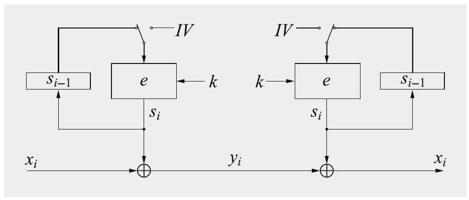

Hình 5.5 Mã hóa và giải mã ở mode OFB

Ý tưởng đằng sau mode OFB khá đơn giản. Chúng ta bắt đầu bằng cách mã hóa một IV bằng block cipher. Output của cipher cho chúng ta tập b bit key stream đầu tiên, ký hiệu là s1. Block bit key stream tiếp theo được tính bằng cách đưa output cipher trước đó ngược vào block cipher và mã hóa nó. Quá trình này được lặp lại như thể hiện trong Hình 5.5.

Mode OFB tạo thành một synchronous stream cipher (xem Hình 2.3) vì key stream không phụ thuộc vào plaintext hay ciphertext. Thực ra, việc dùng mode OFB khá giống với việc dùng một stream cipher tiêu chuẩn như Salsa20 hay ChaCha. Vì mode OFB tạo thành một stream cipher, mã hóa và giải mã là cùng một phép toán. Như có thể thấy ở phần right-hand của Hình 5.5, bên nhận không dùng block cipher ở chế độ giải mã, mà với nó chúng ta sẽ dùng ký hiệu e−1(), để giải mã ciphertext. Đó là vì phép mã hóa thực sự được thực hiện bởi hàm XOR. Để đảo ngược nó, tức là để giải mã ciphertex *(ghi chú: sách in ciphertex; đúng là ciphertext)*, chúng ta chỉ cần thực hiện một hàm XOR khác ở phía nhận. Điều này trái ngược với mode ECB và CBC, nơi dữ liệu thực sự được giải mã bởi block cipher.

Mã hóa và giải mã dùng scheme OFB có thể được biểu diễn như sau.

> Định nghĩa 5.1.3 Output feedback mode (OFB)
>
> Cho ek(x) là một block cipher có kích thước block b; cho xi, yi và si là các chuỗi bit độ dài b; và IV là một nonce độ dài b.
>
> Mã hóa (block đầu tiên): s1 = ek(IV) và y1 = s1 ⊕ x1
>
> Mã hóa (các block khác): si = ek(si−1) và yi = si ⊕ xi, i ≥ 2
>
> Giải mã (block đầu tiên): s1 = ek(IV) và x1 = s1 ⊕ y1
>
> Giải mã (các block khác): si = ek(si−1) và xi = si ⊕ yi, i ≥ 2

Do việc dùng một IV, phép mã hóa OFB cũng không tất định và, do đó, mã hóa cùng một plaintext hai lần cho ra các ciphertext khác nhau. Như trong trường hợp mode CBC, IV nên là một nonce. Một ưu điểm của mode OFB là các phép tính block cipher độc lập với plaintext. Do đó, có thể tính trước một hoặc vài block si của vật liệu key stream.

### 5.1.4 Mode Cipher Feedback (CFB)

Mode cipher feedback (CFB) cũng dùng một block cipher như một khối xây dựng cho một stream cipher. Nó tương tự mode OFB nhưng thay vì đưa ngược key stream, ciphertext được đưa ngược. (Một tên chính xác hơn sẽ là “Ciphertext Feedback mode” nếu theo thuật ngữ của cuốn sách này.) Như ở mode OFB, key stream không được tạo theo từng bit mà theo kiểu từng block. Ý tưởng đằng sau mode CFB như sau: Để tạo block key stream đầu tiên s1, chúng ta mã hóa một IV. Với mọi block key stream tiếp theo s2,s3,..., chúng ta mã hóa ciphertext trước đó. Scheme này được thể hiện trong Hình 5.6.

Vì mode CFB tạo thành một stream cipher, mã hóa và giải mã là cùng một phép toán. Mode CFB là một ví dụ về asynchronous stream cipher (xem Hình 2.3) vì output của stream cipher cũng là một hàm của ciphertext.

Mô tả hình thức của mode CFB như sau.

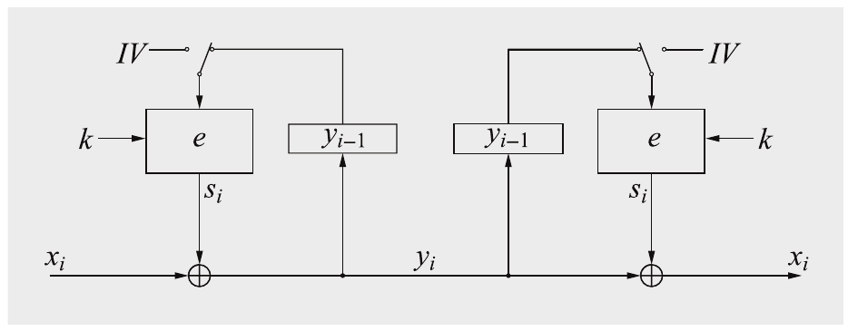

Hình 5.6 Mã hóa và giải mã ở mode CFB

> Định nghĩa 5.1.4 Cipher feedback mode (CFB)
>
> Cho ek(x) là một block cipher có kích thước block b; cho xi và yi là các chuỗi bit độ dài b; và IV là một nonce độ dài b.
>
> Mã hóa (block đầu tiên): y1 = ek(IV) ⊕ x1
>
> Mã hóa (các block khác): yi = ek(yi−1) ⊕ xi, i ≥ 2
>
> Giải mã (block đầu tiên): x1 = ek(IV) ⊕ y1
>
> Giải mã (các block khác): xi = ek(yi−1) ⊕ yi, i ≥ 2

Do việc dùng một IV, phép mã hóa CFB cũng không tất định; do đó, mã hóa cùng một plaintext hai lần cho ra các ciphertext khác nhau. Như trong trường hợp các mode CBC và OFB, IV nên là một nonce.

Một biến thể của mode CFB có thể được dùng trong các tình huống cần mã hóa các block plaintext ngắn. Hãy lấy việc mã hóa liên kết giữa một bàn phím (từ xa) và một máy tính làm ví dụ. Các plaintext do bàn phím tạo ra thường chỉ dài 1 byte, ví dụ, một ký tự ASCII. Trong trường hợp này, chỉ 8 bit của key stream được dùng để mã hóa (không quan trọng chúng ta chọn những bit nào vì tất cả đều an toàn), và ciphertext cũng chỉ gồm 1 byte. Việc đưa ngược ciphertext làm input cho block cipher hơi phức tạp và hoạt động như sau. Input block cipher trước đó được dịch 8 vị trí bit sang trái, và 8 vị trí có trọng số thấp nhất của thanh ghi input được điền bằng byte ciphertext. Quá trình này lặp lại. Tất nhiên, cách tiếp cận này không chỉ hoạt động cho các block plaintext độ dài 8 mà cho bất kỳ độ dài nào ngắn hơn output của cipher.

### 5.1.5 Mode Counter (CTR)

Một mode khác dùng block cipher như một stream cipher là mode counter (CTR). Như ở các mode OFB và CFB, key stream được tính theo kiểu từng block. Input của block cipher là một bộ đếm, nhận một giá trị khác mỗi lần block cipher tính một block key stream mới. Hình 5.7 cho thấy nguyên lý.

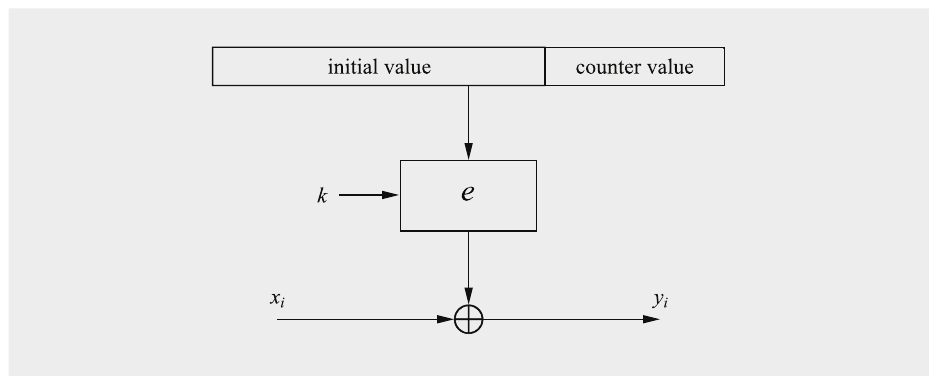

Hình 5.7 Mã hóa và giải mã ở mode counter

Chúng ta phải cẩn thận về cách khởi tạo input cho block cipher. Chúng ta phải ngăn việc dùng cùng một giá trị input hai lần. Nếu không, nếu kẻ tấn công biết một trong hai plaintext đã được mã hóa với cùng input, hắn có thể tính block key stream và do đó giải mã ngay ciphertext kia. Để đạt tính duy nhất này,cách tiếp cận sau thường được dùng trong thực tế. Giả sử một block cipher với độ rộng input 128 bit như AES. Trước hết chúng ta chọn một IV là một nonce với độ dài nhỏ hơn độ dài block, ví dụ, 96 bit. 32 bit còn lại sau đó được dùng bởi một bộ đếm với giá trị CTR, được khởi tạo bằng không. Với mỗi block được mã hóa trong phiên, bộ đếm được tăng nhưng IV giữ nguyên. Trong ví dụ này, số block có thể mã hóa mà không cần chọn IV mới là 232. Vì mỗi block gồm 16 byte, tối đa 16 × 232 = 236 byte, hay khoảng 64 Gigabyte, có thể được mã hóa trước khi phải tạo một IV mới. Đây là mô tả hình thức của mode counter với cách xây dựng input cipher như vừa giới thiệu.

> Định nghĩa 5.1.5 Counter mode (CTR)
>
> Cho ek(x) là một block cipher có kích thước block b, và cho xi và yi là các chuỗi bit độ dài b. Phép nối giá trị khởi tạo IV và bộ đếm CTRi được ký hiệu là (IV ||CTRi) và là một chuỗi bit độ dài b.
>
> Mã hóa: yi = ek(IV ||CTRi) ⊕ xi, i ≥ 1
>
> Giải mã: xi = ek(IV ||CTRi) ⊕ yi, i ≥ 1

Lưu ý rằng chuỗi (IV ||CTR1) không phải giữ bí mật. Chẳng hạn, nó có thể được Alice tạo và gửi tới Bob cùng với block ciphertext đầu tiên. Bộ đếm CTR có thể là một bộ đếm số nguyên thông thường hoặc một hàm phức tạp hơn một chút như một LFSR maximum-length.

Một đặc điểm hấp dẫn của mode counter là nó có thể được song song hóa vì, khác với mode OFB hay CFB, nó không cần phản hồi nào. Chẳng hạn, chúng ta có thể có hai engine block cipher chạy song song, trong đó block cipher thứ nhất mã hóa giá trị bộ đếm CTR1 và cái kia CTR2 cùng lúc. Khi hai engine block cipher xong, engine thứ nhất mã hóa giá trị CTR3 và cái kia CTR4, và cứ thế. Scheme này cho phép chúng ta mã hóa với tốc độ dữ liệu gấp đôi một bản triển khai đơn lẻ. Tất nhiên, chúng ta có thể có hơn hai block cipher chạy song song, tăng speed-up tương ứng. Với các ứng dụng có yêu cầu throughput cao, ví dụ, trong các mạng với tốc độ dữ liệu trong khoảng Gigabit mỗi giây, các mode mã hóa có thể song song hóa thường đáng mong muốn.

### 5.1.6 XTS-AES

Khác với các mode of operation đã giới thiệu tới giờ, mode XTS-AES được thiết kế cho một kịch bản ứng dụng cụ thể: XTS-AES được tối ưu cho việc mã hóa dữ liệu trên các thiết bị lưu trữ như ổ cứng và dùng block cipher AES như một khối xây dựng. Từ viết tắt XTS là XEX Tweakable Block Cipher with Ciphertext Stealing trong đó XEX là dạng viết tắt của XOR-Encrypt-XOR. Mode mã hóa lưu trữ này được thiết kế đặc biệt để cho phép truy cập ngẫu nhiên và độc lập tới các block dữ liệu đã mã hóa trên thiết bị lưu trữ. Với bất kỳ mode of operation chaining-based nào chúng ta đã thấy trước đó trong chương này, rõ ràng không thể chỉ mã hóa hay giải mã các block riêng lẻ.

Mode này mã hóa một luồng dữ liệu được chia thành các đơn vị dữ liệu (data unit) liên tiếp có kích thước bằng nhau, sau đó được lưu trên thiết bị lưu trữ. Độ dài của data unit thường dựa trên kích thước block hay sector của thiết bị lưu trữ. Data unit nên có độ dài tối thiểu 128 bit.

Ý tưởng cốt lõi đằng sau mode này là nó nâng cấp block cipher AES thành một tweakable block cipher so-called. Tweak có thể được coi là một input khác cho block cipher ngoài dữ liệu plaintext và key bí mật. Bằng cách đó block cipher có thể chấp nhận một input 128-bit khác chứa vị trí logic của data unit (tức là địa chỉ vật lý của block dữ liệu) trên thiết bị lưu trữ trong quá trình mã hóa. Với cách tiếp cận này, ngay cả hai plaintext giống nhau được lưu ở các vị trí khác nhau trên thiết bị lưu trữ cũng cho ra hai ciphertext (hoàn toàn) khác nhau. Điều này ngăn đối thủ thu được bất kỳ thông tin nào từ ciphertext. Vì quá trình mã hóa chỉ phụ thuộc vào tweak và do đó vào địa chỉ vật lý của dữ liệu đã mã hóa, nó cho phép song song hóa và pipelining trong các bản triển khai. Quy trình mã hóa của một data unit được thể hiện trong Hình 5.8 và được định nghĩa như sau.

> Định nghĩa 5.1.6 Mã hóa XTS-AES
>
> Cho trước block cipher AES với độ dài key 128 hoặc 256 bit. Key XTS k là phép nối của hai subkey AES có kích thước bằng nhau k1 và k2, tức là k = (k1||k2), trong đó k có 256 hoặc 512 bit.
>
> Cho x là một data unit gồm các block plaintext x1,...,xn, và các ciphertext tương ứng y1,...,yn. Mỗi block plaintext 128-bit được gán một giá trị bộ đếm j = 1,...,n trên mỗi data unit.
>
> Cuối cùng chúng ta ký hiệu bằng i giá trị tweak 128-bit xác định vị trí (tức là địa chỉ vật lý) của data unit trên thiết bị lưu trữ.
>
> Mã hóa
>
> 1. T = AESk2(i)⊗αj
>
> 2. yj = AESk1(xj ⊕ T) ⊕ T

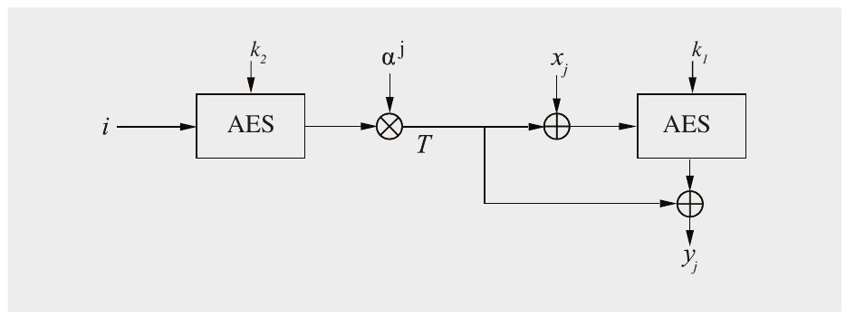

Hình 5.8 Mã hóa XTS-AES của một data unit

Mode dùng một phép nhân trong Galois Field GF (2128) để tính một mask T. Mask được XOR vào plaintext và ciphertext và phụ thuộc vào cả tweak i lẫn bộ đếm j. Để tính T, output 16-byte của tweak đã mã hóa AESk2(i) được biểu diễn như một phần tử của GF(2128) và được nhân với αj modulo đa thức bất khả quy x128 + x7 + x2 + x + 1, trong đó α = x là một phần tử nguyên thủy của Galois field. Chúng tôi lưu ý rằng với một data unit cho trước, tweak i chỉ được mã hóa một lần nhưng một giá trị mask T khác được tính cho mỗi block plaintext 128-bit xj thông qua giá trị j thay đổi. Giải mã ở mode XTS-AES rất giống mã hóa.

Nếu data unit không phải bội số của 128 bit, ciphertext stealing so-called được dùng để padding block plaintext cuối cùng [145].

## 5.2 Xem lại Exhaustive Key Search

Trong Mục 3.5.1, chúng ta đã thấy rằng cho trước một cặp plaintext–ciphertext (x1,y1), một key DES có thể được tìm bằng exhaustive search dùng thuật toán đơn giản:

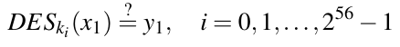 (5.1)

Tuy nhiên, trong thực tế, một lần tìm key thường phức tạp hơn. Hơi bất ngờ là một brute-force attack có thể cho ra kết quả dương tính giả, tức là các key ki được tìm thấy không phải là key Alice dùng để mã hóa, nhưng chúng vẫn thực hiện mã hóa đúng trong Phương trình (5.1). Khả năng điều này xảy ra liên quan tới kích thước tương đối của key space và plaintext space.

Để tìm key đúng, cần vài cặp plaintext–ciphertext. Độ dài plaintext tương ứng cần để phá cipher bằng brute-force attack được gọi là unicity distance.

Trước hết hãy xem vì sao một cặp (x1,y1) có thể không đủ để xác định key đúng. Để minh họa, chúng ta giả sử một cipher có độ rộng block 64 bit và kích thước key 80 bit (PRESENT là một cipher có các tham số như vậy). Nếu mã hóa x1 dưới tất cả 280 key khả dĩ, chúng ta thu được 280 ciphertext. Tuy nhiên, chỉ tồn tại 264 ciphertext khác nhau, và do đó một số key phải ánh xạ x1 tới các ciphertext giống nhau. Nếu chạy qua mọi key cho một cặp plaintext-ciphertext cho trước, trung bình chúng ta tìm được 280/264 = 216 key thực hiện ánh xạ ek(x1) = y1. Ước tính này hợp lệ vì việc mã hóa một plaintext với một key cho trước có thể được xem như một lựa chọn ngẫu nhiên một chuỗi ciphertext 64-bit. Hiện tượng có nhiều “đường đi” giữa một plaintext và ciphertext cho trước được mô tả trong Hình 5.9, trong đó k(i) ký hiệu các key ánh xạ x1 tới y1. Các key này có thể được coi là các key ứng viên.

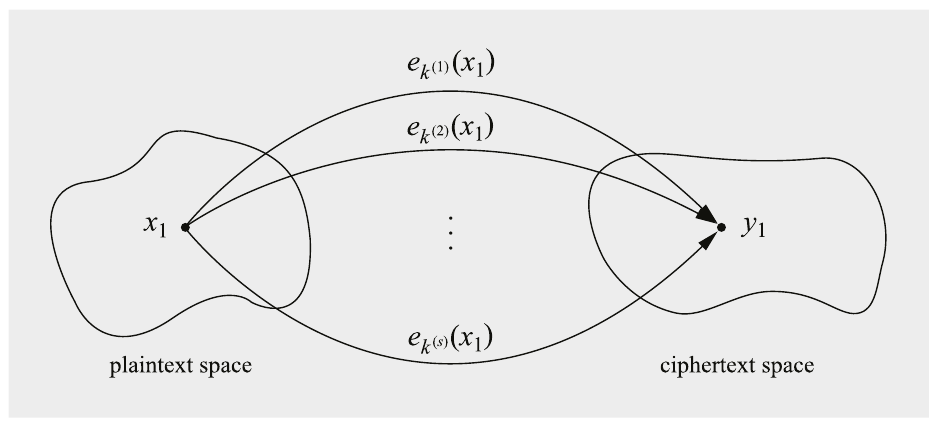

Hình 5.9 Nhiều key ánh xạ giữa một plaintext và một ciphertext

Trong số khoảng 216 key ứng viên k(i) có key đúng đã được Alice dùng để mã hóa. Hãy gọi key này là target key. Để xác định target key, chúng ta cần một cặp plaintext–ciphertext thứ hai (x2,y2). Một lần nữa, có khoảng 216 key ứng viên ánh xạ x2 tới y2. Một trong số chúng là target key. Các key khác có thể được xem như được rút ngẫu nhiên từ 280 key khả dĩ. Điều then chốt cần lưu ý là target key phải có mặt trong cả hai tập key ứng viên. Để xác định hiệu quả của một brute-force attack, câu hỏi then chốt bây giờ là: Khả năng một key khác (sai!) nằm trong cả hai tập là bao nhiêu? Câu trả lời được cho bởi định lý sau.

> Định lý 5.2.1 Cho một block cipher với độ dài key κ bit và kích thước block n bit, cũng như t cặp plaintext–ciphertext (x1,y1),...,(xt,yt), số key sai kỳ vọng mã hóa mọi plaintext thành các ciphertext tương ứng là:
>
> 2κ−tn

Quay lại ví dụ của chúng ta và giả sử hai cặp plaintext–ciphertext, khả năng có một key sai kf thực hiện cả hai phép mã hóa ekf(x1) = y1 và ekf (x2) = y2 là:

280−2·64 = 2−48

Giá trị này nhỏ tới mức với hầu như mọi mục đích thực tế, chỉ cần kiểm tra hai cặp plaintext–ciphertext là đủ. Nếu kẻ tấn công chọn kiểm tra ba cặp, khả năng có key sai giảm xuống 280−3·64 = 2−112. Như chúng ta thấy từ ví dụ này, khả năng báo động giả giảm nhanh theo số t cặp plaintext–ciphertext. Trong thực tế, thường chúng ta chỉ cần vài cặp.

Định lý trên không chỉ quan trọng nếu xét một block cipher riêng lẻ mà còn nếu thực hiện mã hóa nhiều lần với một cipher. Vấn đề này được bàn ở mục sau.

## 5.3 Tăng cường bảo mật của Block Cipher

Trong một số tình huống, chúng ta muốn tăng bảo mật của block cipher, ví dụ, nếu một cipher như DES có sẵn trong hardware hay software vì lý do tương thích cũ trong một ứng dụng cho trước. Chúng tôi thảo luận hai cách tiếp cận tổng quát để tăng cường một cipher: mã hóa nhiều lần và key whitening. Mã hóa nhiều lần, tức là mã hóa một plaintext hơn một lần, vốn đã là một nguyên lý thiết kế nền tảng của block cipher, vì hàm vòng được áp dụng nhiều lần cho cipher. Trực giác cho chúng ta biết rằng bảo mật của một block cipher trước cả brute-force lẫn tấn công phân tích tăng lên khi thực hiện nhiều phép mã hóa liên tiếp. Dù điều này đúng về nguyên tắc, có một vài sự thật bất ngờ. Chẳng hạn, mã hóa kép hầu như không tăng khả năng chống brute-force so với mã hóa đơn nếu kẻ tấn công có nhiều không gian lưu trữ. Chúng ta nghiên cứu sự thật phản trực giác này trong mục tiếp theo. Một cách tiếp cận rất đơn giản nhưng hiệu quả khác để tăng khả năng chống brute-force của block cipher được gọi là key whitening; nó cũng được thảo luận dưới đây.

Chúng tôi lưu ý rằng khi dùng AES, chúng ta đã có ba mức bảo mật khác nhau được cho bởi các độ dài key 128, 192 và 256 bit. Vì không có tấn công thực tế nào được biết nhắm vào AES với bất kỳ độ dài key nào trong số đó, dường như không có lý do gì để mã hóa nhiều lần với AES cho các hệ thống thực tế. Tuy nhiên, với một số cipher cũ được chọn, đặc biệt là DES, mã hóa nhiều lần có thể là một công cụ hữu ích.

### 5.3.1 Mã hóa kép và Meet-in-the-Middle Attack

Giả sử một block cipher với độ dài key κ bit. Với mã hóa kép, một plaintext x trước hết được mã hóa với key kL, và ciphertext thu được lại được mã hóa dùng một key thứ hai kR. Scheme này được thể hiện trong Hình 5.10.

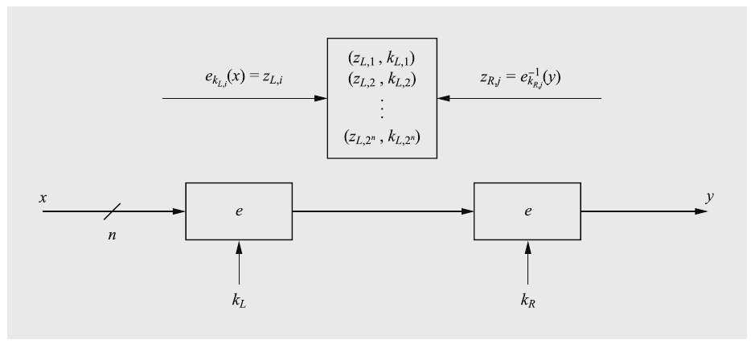

Hình 5.10 Mã hóa kép và meet-in-the-middle attack

Một brute-force attack ngây thơ (naïve) sẽ cần tìm qua mọi tổ hợp khả dĩ của cả hai key, tức là độ dài key hiệu dụng sẽ là 2κ và một exhaustive key search sẽ cần 2κ · 2κ = 22κ phép mã hóa (hay giải mã). Tuy nhiên, dùng meet-in-the-middle attack, key space bị giảm mạnh. Đây là một tấn công divide-and-conquer trong đó Oscar trước hết tấn công brute-force phép mã hóa ở phía left-hand, cần 2κ phép toán cipher, rồi phép mã hóa bên phải, lại cần 2κ phép toán. Nếu hắn thành công với tấn công này, tổng độ phức tạp là 2κ + 2κ = 2 · 2κ = 2κ+1. Con số này chỉ tốn gấp đôi một lần tìm key của mã hóa đơn và tất nhiên ít phức tạp hơn rất nhiều so với thực hiện 22κ phép tìm kiếm.

Tấn công có hai giai đoạn. Ở giai đoạn thứ nhất, phép mã hóa bên trái bị brute-forced và một lookup table được tính. Ở giai đoạn thứ hai, kẻ tấn công cố tìm một khớp trong bảng, điều này để lộ cả hai key mã hóa. Đây là chi tiết của meet-in-the-middle attack.

Giai đoạn I: Tính bảng Với một plaintext x1 cho trước, tính một lookup table cho mọi cặp (kL,i,zL,i), trong đó ekL,i(x1) = zL,i và i = 1,2,...,2κ. Các phép tính này được biểu thị bởi mũi tên trái trong hình. Các zL,i là các giá trị trung gian xuất hiện giữa hai phép mã hóa. Danh sách này nên được sắp xếp theo các giá trị zL,i. Số mục trong bảng là 2κ, với mỗi mục rộng n + κ bit. Lưu ý rằng một trong các key chúng ta dùng trong quá trình xây dựng bảng phải là target key đúng, nhưng chúng ta vẫn chưa biết đó là key nào.

Giai đoạn II: Khớp key Để tìm target key, bây giờ chúng ta giải mã y1, tức là thực hiện các phép tính được biểu thị bởi mũi tên phải trong hình. Chúng ta chọn key khả dĩ đầu tiên kR,1, ví dụ, key all-zero, và tính:

ekR,1−1 (y1) = zR,1

Bây giờ chúng ta kiểm tra xem zR,1 có bằng bất kỳ giá trị zL,i nào trong bảng đã tính ở giai đoạn thứ nhất hay không. Nếu nó không có trong bảng, chúng ta tăng key lên kR,2, giải mã y1 lần nữa, và kiểm tra xem giá trị này có trong bảng không. Chúng ta tiếp tục cho tới khi có một khớp. Một khớp như vậy cũng được gọi là một collision của hai giá trị, tức là zL,i = zR,j. Điều này cho chúng ta hai key: Giá trị zL,i gắn với key kL,i từ phép mã hóa bên trái, và kR,j là key chúng ta vừa kiểm tra trong phép giải mã đến từ phía bên phải. Điều này có nghĩa là tồn tại một cặp key (kL,i,kR,j) thực hiện mã hóa kép:

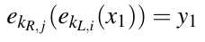 (5.2)

Như đã thảo luận trong Mục 5.2, có khả năng đây không phải là cặp target key chúng ta đang tìm nếu có vài cặp key khả dĩ thực hiện ánh xạ x1 → y1. Do đó, chúng ta phải kiểm chứng thêm các key ứng viên bằng cách mã hóa vài cặp plaintext–ciphertext theo Phương trình (5.2). Nếu việc kiểm chứng thất bại với bất kỳ cặp nào (x1,y1),(x2,y2),..., chúng ta quay lại đầu Giai đoạn II và tăng key kR lần nữa và tiếp tục tìm kiếm.

Hãy thảo luận ngắn gọn chúng ta sẽ cần bao nhiêu cặp plaintext–ciphertext để loại trừ các key sai với khả năng cao. Xét về nhiều ánh xạ giữa một plaintext và một ciphertext như mô tả trong Hình 5.9, mã hóa kép có thể được mô hình hóa như một cipher với 2κ bit key và n bit block. Trong thực tế, người ta thường có 2κ > n, trong trường hợp đó chúng ta cần vài cặp plaintext–ciphertext. Định lý 5.2.1 có thể dễ dàng được áp dụng cho trường hợp mã hóa nhiều lần, cho chúng ta một chỉ dẫn hữu ích về số cặp (x,y) nên có sẵn.

> Định lý 5.3.1 Cho trước l phép mã hóa liên tiếp với một block cipher có độ dài key κ bit và kích thước block n bit, cũng như t cặp plaintext–ciphertext (x1,y1),...,(xt,yt). Số key sai kỳ vọng mã hóa mọi plaintext thành các ciphertext tương ứng được cho bởi:
>
> 2lκ−tn

Hãy xem một ví dụ.

Ví dụ 5.3. Làm ví dụ, nếu chúng ta double-encrypt với DES và chọn kiểm tra ba cặp plaintext–ciphertext, khả năng một cặp key sai sống sót qua cả ba lần kiểm tra key là:

22·56−3·64 = 2−80

◇

Hãy xem xét độ phức tạp tính toán của meet-in-the-middle attack. Ở giai đoạn thứ nhất của tấn công, tương ứng với mũi tên trái trong Hình 5.10, chúng ta thực hiện 2κ phép mã hóa và lưu chúng trong 2κ vị trí bộ nhớ. Ở giai đoạn thứ hai, tương ứng với mũi tên phải trong hình, chúng ta thực hiện tối đa 2κ phép giải mã và table look-ups. Chúng ta bỏ qua các phép kiểm tra multiple-key ở giai đoạn này. Tổng chi phí cho meet-in-the-middle attack là:

số phép mã hóa và giải mã = 2κ + 2κ = 2κ+1

số vị trí lưu trữ = 2κ

So sánh với 2κ phép mã hóa hoặc giải mã và về cơ bản không có chi phí lưu trữ trong trường hợp brute-force attack nhắm vào mã hóa đơn. Dù yêu cầu lưu trữ tăng lên khá nhiều, chi phí tính toán và bộ nhớ vẫn chỉ tỉ lệ với 2κ. Do đó, người ta tin rộng rãi rằng mã hóa kép không đáng công sức. Thay vào đó, nên dùng mã hóa ba lần; phương pháp này được mô tả trong mục sau.

Lưu ý rằng để phân tích độ phức tạp chính xác hơn của meet-in-the-middle attack, chúng ta cũng cần tính tới chi phí sắp xếp các mục bảng trong Giai đoạn I cũng như các table look-ups trong Giai đoạn II. Tuy nhiên, cho mục đích của chúng ta, có thể bỏ qua các chi phí bổ sung này.

### 5.3.2 Mã hóa ba lần (Triple Encryption)

So với mã hóa kép, một cách tiếp cận an toàn hơn nhiều là mã hóa một block dữ liệu ba lần liên tiếp:

y = ek3(ek2(ek1(x)))

Trong thực tế, phiên bản mã hóa ba lần sau thường được dùng:

y = ek1(ek2−1(ek3(x)))

Loại mã hóa ba lần này đôi khi được gọi là encryption–decryption–encryption (EDE). Lý do của điều này không liên quan gì tới bảo mật. Nếu k1 = k2, phép toán thực sự được thực hiện là

y = ek3(x)

tức là mã hóa đơn. Vì đôi khi đáng mong muốn khi một bản triển khai có thể thực hiện cả mã hóa ba lần và mã hóa đơn, ví dụ, để tương tác với các hệ thống cũ, EDE là lựa chọn phổ biến cho mã hóa ba lần. Mã hóa ba lần trong thực tế đặc biệt liên quan tới trường hợp DES, được gọi là 3DES hay triple DES và được mô tả trong Mục 3.7.2.

Tất nhiên, chúng ta vẫn có thể thực hiện một meet-in-the-middle attack như thể hiện trong Hình 5.11. Một lần nữa, chúng ta giả sử κ bit mỗi key. Vấn đề với kẻ tấn công là cô ta phải tính một lookup table sau phép mã hóa thứ nhất hoặc sau phép mã hóa thứ hai. Trong cả hai trường hợp, kẻ tấn công phải tính hai phép mã hóa hoặc giải mã liên tiếp để tới được lookup table. Đây chính là sức mạnh cryptographic của mã hóa ba lần: Có 22k khả năng để chạy qua mọi key khả dĩ của hai phép mã hóa hoặc giải mã. Trong trường hợp 3DES, điều này buộc kẻ tấn công thực hiện 2112 lần kiểm tra key, nằm ngoài tầm với của công nghệ hiện tại. Tóm lại, meet-in-the-middle attack giảm độ dài key hiệu dụng của mã hóa ba lần từ 3κ xuống 2κ. Vì điều này, người ta thường nói rằng độ dài key hiệu dụng của 3DES là 112 bit trái với 3 · 56 = 168 bit thực sự được dùng làm key input cho cipher.

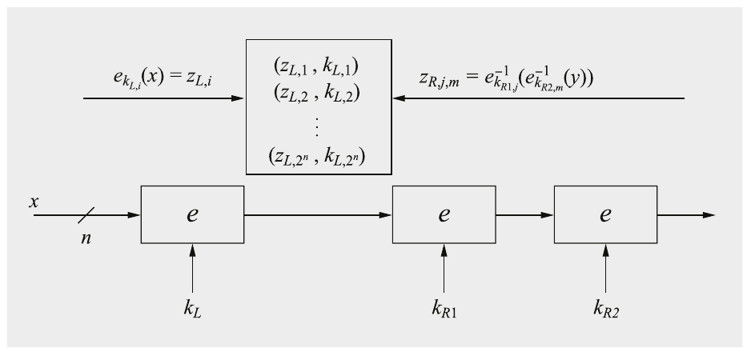

Hình 5.11 Mã hóa ba lần và phác họa một meet-in-the-middle attack

### 5.3.3 Key Whitening

Dùng một kỹ thuật cực kỳ đơn giản gọi là key whitening, có thể làm cho các block cipher như DES chống brute-force attack tốt hơn nhiều. Scheme cơ bản được thể hiện trong Hình 5.12.

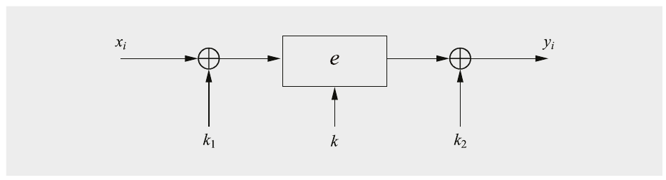

Hình 5.12 Key whitening của một block cipher

Ngoài key cipher thông thường k, hai whitening key k1 và k2 được dùng để XOR-mask plaintext và ciphertext. Quá trình này có thể được biểu diễn như sau.

> Định nghĩa 5.3.1 Key whitening cho block cipher
>
> Mã hóa: y = ek,k1,k2(x) = ek(x ⊕ k1) ⊕ k2
>
> Giải mã: x = ek,k1,k2−1 (y) = ek−1(y ⊕ k2) ⊕ k1

Cần nhấn mạnh rằng key whitening không tăng cường block cipher trước hầu hết các tấn công phân tích như linear và differential cryptanalysis. Điều này trái ngược với mã hóa nhiều lần, thường cũng tăng khả năng chống tấn công phân tích. Do đó, key whitening không phải là “thuốc chữa” cho các cipher vốn yếu. Ứng dụng chính của nó là cho các cipher mạnh trước tấn công phân tích nhưng có key space quá ngắn. Ví dụ điển hình của một cipher như vậy là DES. Một biến thể của DES dùng key whitening là DESX. Trong trường hợp DESX, key k2 được suy ra từ k và k1. Lưu ý rằng hầu hết các block cipher hiện đại như AES đã áp dụng key whitening bên trong bằng cách cộng một subkey trước vòng đầu tiên và sau vòng cuối cùng.

Bây giờ hãy thảo luận về bảo mật của key whitening. Một brute-force attack ngây thơ (naïve) nhắm vào scheme cần 2κ+2n bước tìm kiếm, trong đó κ là độ dài bit của key và n là kích thước block. Dùng meet-in-the-middle attack đã giới thiệu trong Mục 5.3.1, khối lượng tính toán có thể được giảm xuống khoảng 2κ+n bước, cộng với việc lưu trữ 2n tập dữ liệu. Tuy nhiên, nếu đối thủ Oscar có thể thu thập 2m cặp plaintext–ciphertext, tồn tại một tấn công nâng cao hơn với độ phức tạp tính toán

2κ+n−m

phép toán cipher. Dù chúng tôi không giới thiệu tấn công ở đây, chúng tôi sẽ thảo luận ngắn gọn các hệ quả của nó nếu áp dụng key whitening cho DES. Chúng ta giả sử kẻ tấn công biết 2m cặp plaintext–ciphertext. Lưu ý rằng người thiết kế một hệ thống bảo mật thường có thể kiểm soát bao nhiêu cặp plaintext–ciphertext được tạo trước khi một key mới được thiết lập. Do đó, kẻ tấn công thường không thể tăng tham số m tùy ý. Ngoài ra, vì số plaintext đã biết tăng theo hàm mũ với m, các giá trị vượt quá, giả sử, m = 40, có vẻ khá phi thực tế. Làm ví dụ thực tế, hãy giả sử key whitening của DES, và Oscar có thể thu thập tối đa 232 plaintext (tức là khoảng 34 GB dữ liệu). Bây giờ hắn phải thực hiện

256+64−32 = 288

phép tính DES. Có thể suy đoán rằng 288 phép mã hóa là ở ngưỡng những gì các cơ quan chính phủ lớn có thể làm. Do đó, dù key-whitening hữu ích đối với một kỹ thuật đơn giản đến bất ngờ như vậy, nó không cung cấp bảo mật long-term nếu được dùng cùng với DES.

## 5.4 Thảo luận và đọc thêm (Discussion and Further Reading)

Modes of Operation của NIST Sau việc lựa chọn AES, National Institute of Standards and Technology (NIST) của Mỹ đã hỗ trợ quá trình đánh giá các mode of operation mới trong một loạt các ấn phẩm đặc biệt và workshop [194]. Bảng 5.1 cho tổng quan về các mode of operation liên quan nhất được NIST chuẩn hóa. Các NIST Special Publication 800-38 A–F mô tả năm mode cho tính bí mật của dữ liệu (ECB, CBC, CFB, OFB, CTR), một mode cho mã hóa lưu trữ (XTS-AES), một mode cho xác thực (CMAC), hai mode kết hợp cho tính bí mật và xác thực (CCM, GCM), và ba mode cho key wrapping (KW, KWP, TKW). Các mode CMAC, CCM và GCM được mô tả trong Chương 13. Các mode NIST được dùng rộng rãi trong thực tế và là một phần của nhiều tiêu chuẩn công nghiệp, ví dụ, cho mạng máy tính hay ngân hàng. Chúng tôi lưu ý rằng tiêu chuẩn NIST XTS-AES tham chiếu tới IEEE Standard 1619-2018 [145] và dựa trên tweakable block cipher XEX (XOR Encrypt XOR), do Phillip Rogaway đề xuất [220]. Đề xuất XEX gốc chỉ có thể mã hóa các thông điệp là bội số chính xác của các block 128-bit, trong khi mode XTS-AES của NIST cho phép dữ liệu input có độ dài tùy ý.

Bảng 5.1 Các modes of operation của NIST trong Special Publications 800-38

| SP 800-38 | A [101] | B [105] | C [103] | D [102] | E [104] | F [106] |
|---|---|---|---|---|---|---|
| các mode | ECB, CBC, CFB, OFB, CTR | CMAC | CCM | GCM, GMAC | XTS-AES | KW, KWP, TKW |
| tính bí mật | ✓ |  | ✓ | (✓) | ✓ |  |
| xác thực |  | ✓ | ✓ | ✓ |  |  |
| key wrap |  |  |  |  |  | ✓ |

Các key wrapping mode (KW, KWP, TKW) Key wrapping mô tả các phương pháp bảo vệ tính bí mật cũng như tính xác thực và tính toàn vẹn của các key cryptographic. Mode AES Key Wrap (KW) là một mode of operation authenticated encryption tất định. Biến thể của nó với một scheme padding bên trong được gọi là AES Key Wrap With Padding (KWP).

Thành phần chính của các key wrap mode là một block cipher. Key cho block cipher bên dưới được gọi là key encryption key (KEK), ký hiệu K. Với các mode KW và KWP, block cipher bên dưới phải có kích thước key 128 bit trở lên, điều tất nhiên đúng với AES. Với TKW, block cipher bên dưới được quy định là 3DES, và do đó kích thước block là 64 bit. KEK phải được giữ bí mật và độ dài key của nó ảnh hưởng trực tiếp tới bảo mật của các thuật toán trước brute-force attack.

Về mô tả đầy đủ của AES Key Wrap (KW) và các biến thể KWP và TKW, chúng tôi giới thiệu tới tài liệu NIST [106].

Authenticated Encryption và các ứng dụng khác của Block Cipher Ứng dụng quan trọng nhất của block cipher trong thực tế, ngoài mã hóa dữ liệu, là Message Authentication Code (MAC), được thảo luận trong Chương 13. Ngoài mode xác thực thông điệp CMAC, được liệt kê trong bảng trên và mô tả trong Mục 13.3.2, có vài MAC khác được xây dựng bằng block cipher, bao gồm OMAC và PMAC. Authenticated Encryption (AE) dùng block cipher để mã hóa và tạo MAC cùng lúc nhằm cung cấp cả tính bí mật lẫn xác thực. Bảng trên chứa hai mode như vậy, CCM và GCM, được mô tả trong Mục 13.3.3 và 13.3.4. Các mode authenticated encryption khác bao gồm mode EAX, mode OCB và mode GC.

Một ứng dụng khác của block cipher là Cryptographically Secure Pseudo Random Number Generator (CSPRNG). Thực ra, các mode stream cipher được giới thiệu trong chương này, mode OFB, CFB và CTR, tạo thành các CSPRNG. Cũng có các tiêu chuẩn như [13, Phụ lục A.2.4] quy định tường minh các bộ sinh số ngẫu nhiên từ block cipher.

Block cipher cũng có thể được dùng để xây dựng các hash function cryptographic, như được thảo luận trong Chương 11.

Brute-Force và tấn công bằng máy tính lượng tử Dù không có lối tắt thuật toán nào cho brute-force attack, có những phương pháp hiệu quả nếu phải thực hiện vài exhaustive key search. Các phương pháp đó được gọi là time–memory tradeoff attack (TMTO). Ý tưởng chung là mã hóa một plaintext cố định dưới một số lượng lớn key và lưu một số kết quả trung gian nhất định. Đây là giai đoạn tính trước, thường ít nhất cũng phức tạp như một brute-force attack đơn lẻ và cho ra các lookup table lớn. Ở giai đoạn online, một lần tìm kiếm qua các bảng diễn ra nhanh hơn đáng kể so với brute-force attack. Do đó, sau giai đoạn tính trước, các key riêng lẻ có thể được tìm nhanh hơn nhiều. Các TMTO attack ban đầu được Martin Hellman đề xuất [141] và được cải tiến với việc đưa vào distinguished point bởi Ronald Rivest [218]. Sau đó, rainbow table được Philippe Oechslin đề xuất để cải tiến thêm các TMTO attack [206]. Một yếu tố hạn chế của TMTO attack trong thực tế là với mỗi tấn công riêng lẻ, yêu cầu cùng một mẩu plaintext đã biết đã được mã hóa, ví dụ, một header file.

Việc tấn công block cipher (hay stream cipher) bằng máy tính lượng tử có thể trở nên khả dụng trong tương lai được thảo luận trong Mục 12.1. Nhận xét chính là một máy tính lượng tử tiềm năng sẽ chỉ cần 2n/2 bước để thực hiện một lần tìm key trên một cipher với key n-bit, dùng thuật toán Grover [128].

## 5.5 Bài học rút ra (Lessons Learned)

■ Có nhiều cách khác nhau để mã hóa bằng block cipher. Các mode of operation có những ưu và nhược điểm riêng.

■ Một số mode of operation biến một block cipher thành một stream cipher.

■ Mode ECB đơn giản có các điểm yếu bảo mật, độc lập với block cipher bên dưới.

■ Mode counter cho phép song song hóa mã hóa và do đó phù hợp cho các bản triển khai high-speed.

■ Mã hóa kép với một block cipher cho trước chỉ cải thiện không đáng kể khả năng chống brute-force attack.

■ Mã hóa ba lần với một block cipher cho trước gần như tăng gấp đôi độ dài key hiệu dụng. Chẳng hạn, triple DES (3DES) có độ dài key hiệu dụng 112 bit.

## Bài tập

5.1. Giả sử một toy block cipher e() để mã hóa các block 5-bit. Hàm mã hóa là một hoán vị bit, phụ thuộc vào key. Chúng ta giả sử rằng với một key cho trước, phép mã hóa (hoán vị) như sau:

e(b1b2b3b4b5) = (b2b5b4b1b3)

Mã hóa thông điệp x = 01101 11011 11010 00110 với năm mode of operation khác nhau ECB, CBC, CFB, OFB và CTR, và đưa ra ciphertext y tương ứng. Dùng IV = 11001 làm initialization vector.

5.2. Chúng ta xét các tấn công exhaustive key-search trên block cipher trong đó key dài k bit. Độ dài block là n bit, với n lớn hơn nhiều so với k.

1. Exhaustive key search thường cần plaintext đã biết. Cần bao nhiêu cặp plaintext–ciphertext để phá thành công block cipher chạy ở mode ECB? Cần bao nhiêu bước trong trường hợp xấu nhất?

2. Giả sử initialization vector IV để chạy block cipher ở mode CBC là đã biết (điều này trong thực tế đúng vì IV được truyền không mã hóa). Bây giờ cần bao nhiêu cặp plaintext–ciphertext để phá cipher bằng cách thực hiện exhaustive key search? Tối đa cần bao nhiêu bước? Mô tả ngắn gọn tấn công.

3. Cần bao nhiêu cặp plaintext–ciphertext nếu bạn không biết IV?

4. Phá một block cipher ở mode CBC bằng exhaustive key search có khó hơn đáng kể so với phá một block cipher ECB-mode không?

5.3. Trong một công ty, mọi file được gửi trên mạng nội bộ đều được tự động mã hóa bằng AES-128 ở mode CBC. Một key cố định được dùng, và IV được thay đổi mỗi ngày một lần. Mã hóa mạng là file-based, nên IV được dùng ở đầu mỗi file.

Bằng cách xâm nhập hệ thống, bạn tìm được key AES-128 cố định nhưng không biết IV hiện tại. Hôm nay, bạn đã nghe lén được và thu được hai file khác nhau, một file có nội dung chưa biết và một file được biết là file tạm được tạo tự động, chỉ chứa giá trị 0xFF. Mô tả ngắn gọn làm thế nào có thể thu được initialization vector chưa biết và làm thế nào bạn có thể giải mã file chưa biết.

5.4. Giữ bí mật IV ở mode OFB không làm exhaustive key search phức tạp hơn. Mô tả cách chúng ta có thể thực hiện brute-force attack với IV chưa biết. Các yêu cầu về plaintext và ciphertext là gì?

5.5. Mô tả cách mode OFB có thể bị tấn công nếu IV không khác nhau cho mỗi lần thực thi phép mã hóa.

5.6. Đề xuất một thay đổi đơn giản cho mode OFB để mã hóa mỗi lần một byte plaintext, ví dụ, để mã hóa các lần gõ phím từ một bàn phím từ xa. Block cipher được dùng là AES. Thực hiện một phép toán block cipher cho mỗi byte plaintext mới. Vẽ sơ đồ khối của scheme của bạn và đặc biệt chú ý tới các độ dài bit được dùng trong sơ đồ.

5.7. Như thường thấy trong cryptography, rất dễ làm yếu một scheme có vẻ mạnh bằng những sửa đổi nhỏ. Giả sử một biến thể của mode OFB trong đó chúng ta chỉ đưa ngược 8 bit có trọng số cao nhất của output cipher. Chúng ta dùng AES và điền 120 bit input còn lại của cipher bằng các số 0s.

1. Vì sao scheme này yếu nếu chúng ta mã hóa các khối plaintext tương đối lớn, giả sử 100 kByte? Số plaintext đã biết tối đa mà kẻ tấn công cần để phá hoàn toàn scheme là bao nhiêu?

2. Cho byte phản hồi được ký hiệu là FB. Scheme có trở nên mạnh hơn về mặt cryptographic nếu chúng ta đưa ngược giá trị 128-bit FB,FB,...,FB vào input (tức là chúng ta sao chép byte phản hồi 16 lần và dùng nó làm input AES) không?

5.8. Trong phần lý thuyết, một biến thể của mode CFB được đề xuất để mã hóa từng byte riêng lẻ. Vẽ sơ đồ khối cho mode này khi dùng AES làm block cipher. Chỉ ra độ rộng (tính bằng bit) của mỗi đường trong sơ đồ của bạn.

5.9. Chúng ta đang dùng AES ở mode counter để mã hóa một ổ cứng dung lượng 1 TB. Độ dài tối đa của IV là bao nhiêu?

5.10. Đôi khi lan truyền lỗi là một vấn đề khi chọn một mode of operation trong thực tế. Để phân tích sự lan truyền lỗi, hãy giả sử một lỗi bit (tức là thay một bit “0” bằng một bit “1” hoặc ngược lại) trong một block ciphertext yi. Alice đang gửi thông điệp tới Bob.

1. Giả sử một lỗi xảy ra trong quá trình truyền ở một block ciphertext, giả sử yi. Những block plaintext nào bị ảnh hưởng ở phía Bob khi dùng mode ECB?

2. Một lần nữa, giả sử block yi chứa một lỗi phát sinh trong khi truyền. Những block plaintext nào bị ảnh hưởng ở phía Bob khi dùng mode CBC?

3. Giả sử có một lỗi trong plaintext xi ở phía Alice. Những block plaintext nào bị ảnh hưởng ở phía Bob khi dùng mode CBC?

4. Giả sử một lỗi single-bit xảy ra khi truyền một ký tự ciphertext ở mode CFB 8-bit. Lỗi lan truyền bao xa? Mô tả chính xác mỗi block bị ảnh hưởng như thế nào.

5. Đưa ra tổng quan về ảnh hưởng của lỗi bit trong một block ciphertext với các mode ECB, CBC, CFB, OFB và CTR. Phân biệt giữa lỗi bit ngẫu nhiên và lỗi bit cụ thể khi giải mã yi. Lỗi bit cụ thể nghĩa là các lỗi ở cùng (các) vị trí như (các) lỗi bit gốc.

5.11. Ngoài các lỗi bit đơn giản, việc xóa hoặc chèn một bit trong khi truyền có thể gây ra ảnh hưởng còn nghiêm trọng hơn với nhiều mode of operation vì việc đồng bộ các block bị phá vỡ. Trong hầu hết trường hợp, việc giải mã các block tiếp theo sẽ sai. Một trường hợp đặc biệt là mode CFB với độ rộng phản hồi 1 bit. Chỉ ra rằng sự đồng bộ được tự động khôi phục sau κ + 1 bước, trong đó κ là kích thước block của block cipher.

5.12. Bây giờ chúng ta phân tích bảo mật của DES với mã hóa kép (2DES) bằng cách ước tính chi phí. Phép mã hóa được mô tả bởi biểu thức sau:

2DES(x) = DESK2(DESK1(x))

1. Trước hết, hãy giả sử một lần tìm key mà không xây dựng lookup table. Với mục đích này, toàn bộ key space được trải bởi K1 và K2 phải được tìm. Một máy key-search để phá 2DES (trường hợp xấu nhất) trong 1 tuần tốn bao nhiêu?

Giả sử chúng ta có các ASIC có thể kiểm tra 107 key mỗi giây với chi phí $5 mỗi IC. Hơn nữa, giả sử overhead 50% để chế tạo máy key-search.

2. Bây giờ hãy xét meet-in-the-middle attack (hay time-memory tradeoff attack) đã được giới thiệu trong chương này, trong đó chúng ta có thể dùng lookup table. Hãy trả lời các câu hỏi sau:

■ Cần lưu bao nhiêu mục?

■ Cần lưu bao nhiêu byte (không phải bit!) cho mỗi mục?

■ Một lần tìm key trong một tuần tốn bao nhiêu? Lưu ý rằng key space phải được tìm trước khi lấp đầy hoàn toàn bộ nhớ. Sau đó chúng ta có thể bắt đầu tìm key space của key thứ hai. Giả sử cùng hardware cho cả hai key space.

Để ước tính chi phí sơ bộ, giả sử các chi phí sau cho không gian ổ cứng: $5/1 TByte, trong đó 1 TByte = 1012 Byte.

3. Giả sử cả chi phí xử lý lẫn giá lưu trữ đều giảm theo định luật Moore, tức là chúng giảm 50% mỗi 18 tháng, khi nào tổng chi phí giảm xuống dưới $1 triệu?

5.13. Cho e là một block cipher với kích thước block n = 64 bit và độ dài key κ = 80 bit. Một ví dụ thực tế của cipher như vậy là PRESENT. Chúng ta giả sử thuật toán không có điểm yếu toán học nào có thể bị khai thác. Bây giờ hãy xem hình sau thể hiện một scheme mã hóa ba lần:

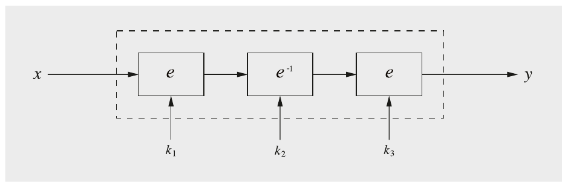

1. Đưa ra một biểu thức cho phép mã hóa và giải mã.

2. Vì sao scheme này dùng mode encryption-decryption-encryption (EDE) (trái với mã hóa ba lần)? Lựa chọn này có tăng bảo mật so với mã hóa ba lần không?

3. Một brute-force attack đơn giản trên cipher này ở mode EDE phức tạp đến đâu? So sánh độ phức tạp tính toán và yêu cầu lưu trữ với độ phức tạp của một meet-in-the-middle (MITM) attack. Độ dài key hiệu dụng của phép mã hóa ba lần này là bao nhiêu? Bạn có nghĩ rằng một trong hai tấn công này khả thi với máy tính ngày nay không?

4. Cần bao nhiêu block plaintext cho MITM attack để tìm key đúng với xác suất cao?

5.14. Hãy tưởng tượng rằng người ngoài hành tinh — thay vì bắt cóc người Trái Đất và làm những thí nghiệm kỳ lạ trên họ — thả xuống hành tinh Trái Đất một máy tính đặc biệt phù hợp cho việc tìm key AES. Thực ra, nó mạnh tới mức chúng ta có thể tìm qua 128, 192 và 256 bit key trong vài ngày. Đưa ra chỉ dẫn về số cặp plaintext–ciphertext mà người ngoài hành tinh cần để họ có thể loại trừ các key sai với khả năng hợp lý. (Nhận xét: Vì sự tồn tại của cả người ngoài hành tinh lẫn máy tính human-built cho các độ dài key như vậy có vẻ cực kỳ khó xảy ra tại thời điểm viết sách, bài tập này là khoa học viễn tưởng thuần túy.)

5.15. Trong bài tập này, bạn sẽ tấn công một scheme mã hóa nhiều lần symmetric với các cặp plain- and ciphertext cho trước.

1. Bạn muốn phá một scheme mã hóa dùng mã hóa ba lần AES-192 với độ dài block n = 128 bit và độ dài key k = 192 bit. Cần bao nhiêu cặp plaintext/ciphertext để giảm xác suất thu được một key ứng viên sai K′ trong brute-force attack xuống tối đa Pr(K′ ≠ K) = 2−20?

2. Giả sử một block cipher với độ dài block n = 80 và một scheme mã hóa kép (l = 2). Độ dài key tối đa của block cipher là bao nhiêu để bạn có thể tấn công cipher với tỉ lệ lỗi hiệu dụng Pr(K′ ≠ K) = 2−10 ≈ 1/1024?

3. Ước tính xác suất thành công trong trường hợp mã hóa kép với AES-256 (tức là độ dài block n = 128 bit và độ dài key k = 256 bit) với bốn cặp ciphertext cho trước trong tay?

5.16. 3DES với ba key khác nhau có thể bị phá với khoảng 22k phép mã hóa và 2k ô nhớ, trong đó k = 56. Thiết kế tấn công tương ứng. Cần có bao nhiêu cặp (x,y) để xác suất xác định một bộ ba key sai (k1,k2,k3) đủ thấp?

5.17. Đây là cơ hội để bạn phá một cryptosystem. Như chúng ta đã biết, cryptography là một lĩnh vực khó nhằn. Bài tập sau minh họa việc biến một scheme mạnh thành một scheme yếu bằng những sửa đổi nhỏ dễ dàng đến mức nào.

Chúng ta đã thấy trong chương này rằng key whitening là một kỹ thuật tốt để tăng cường block cipher trước brute-force attack. Bây giờ chúng ta xem biến thể sau của key whitening nhắm vào DES, mà chúng ta sẽ gọi là DESA:

DESAk,k1(x) = DESk(x) ⊕ k1

Dù phương pháp này trông giống key whitening, nó hầu như không tăng thêm bảo mật. Nhiệm vụ của bạn là chỉ ra rằng phá scheme này gần như khó bằng một brute-force attack nhắm vào single DES. Giả sử bạn có vài cặp plaintext-?ciphertext.

5.18. Bây giờ hãy xét một brute-force attack trên một block cipher với độ dài key k. Block cipher được dùng ở mode OFB. Initialization vector không được biết. Mô tả cần bao nhiêu (i) plaintext và (ii) ciphertext để phá cipher bằng brute-force attack. Trong trường hợp xấu nhất, cần bao nhiêu bước?

5.19. Vẽ sơ đồ quá trình giải mã của mode XTR-AES. Chỉ cần thể hiện phép mã hóa của một data unit, tương tự Hình 5.8.
