# Chương 6 Nhập môn mật mã khóa công khai (Introduction to Public-Key Cryptography)

Khi bắt đầu tìm hiểu public-key cryptography, hãy nhớ rằng thuật ngữ public-key cryptography được dùng thay thế cho asymmetric cryptography; cả hai đều chỉ chính xác cùng một thứ và được dùng như từ đồng nghĩa.

Như đã nêu trong Chương 1, symmetric cryptography đã được dùng ít nhất 4000 năm. Public-key cryptography, ngược lại, khá mới. Nó được Whitfield Diffie, Martin Hellman và Ralph Merkle giới thiệu công khai năm 1976. Hai thập kỷ sau, năm 1997, các tài liệu của Anh được giải mật đã tiết lộ rằng các nhà nghiên cứu James Ellis, Clifford Cocks và Graham Williamson từ Government Communications Headquarters (GCHQ) của Vương quốc Anh đã phát hiện và hiện thực nguyên lý public-key cryptography sớm hơn vài năm, năm 1972. Tuy nhiên, vẫn còn tranh luận liệu GCHQ có nhận thức đầy đủ các hệ quả far-reaching của public-key cryptography đối với các ứng dụng bảo mật thương mại hay không.

Trong chương này, bạn sẽ học:

■ Lược sử public-key cryptography

■ Ưu và nhược điểm của public-key cryptography

■ Một số chủ đề number-theoretical cần để hiểu các thuật toán public-key, quan trọng nhất là extended Euclidean algorithm

## 6.1 Symmetric so với Asymmetric Cryptography

Trong chương này, chúng ta sẽ thấy rằng các thuật toán asymmetric, tức là public-key, rất khác các thuật toán symmetric như AES hay DES. Hầu hết các thuật toán public-key dựa trên các hàm number-theoretic. Điều này khá khác với symmetric cipher, nơi mục tiêu thường là không có một mô tả toán học gọn giữa input và output. Dù các cấu trúc toán học thường được dùng cho các khối nhỏ bên trong symmetric cipher, chẳng hạn, trong S-box của AES, điều này không có nghĩa là toàn bộ cipher có một mô tả toán học gọn.

### Xem lại Symmetric Cryptography

Để hiểu nguyên lý của asymmetric cryptography, trước hết hãy nhớ lại scheme mã hóa symmetric cơ bản trong Hình 6.1.

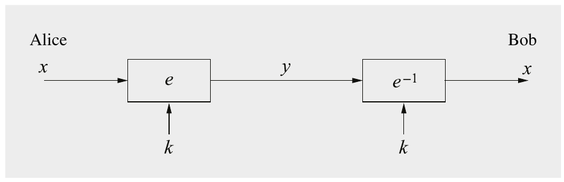

Hình 6.1 Nguyên lý mã hóa symmetric-key

Một hệ thống như vậy là đối xứng xét theo hai tính chất:

1. Cùng một key bí mật được dùng cho mã hóa và giải mã.

2. Các hàm mã hóa và giải mã rất giống nhau (trong trường hợp DES chúng về cơ bản là giống hệt).

Có một phép so sánh đơn giản cho symmetric cryptography, như thể hiện trong Hình 6.2. Giả sử có một chiếc két sắt với ổ khóa chắc chắn. Chỉ Alice và Bob có một bản sao chìa khóa của ổ khóa. Hành động mã hóa một thông điệp có thể được xem như đặt thông điệp vào két. Để đọc, tức là giải mã, thông điệp, Bob dùng chìa khóa của mình và mở két.

Các thuật toán symmetric hiện đại như AES hay 3DES rất an toàn, nhanh và được dùng rộng rãi. Tuy nhiên, có vài thiếu sót liên quan tới các scheme symmetric-key, như được thảo luận dưới đây.

Vấn đề phân phối key (Key Distribution Problem) Key phải được thiết lập giữa Alice và Bob dùng một kênh an toàn. Hãy nhớ rằng liên kết truyền thông cho thông điệp không an toàn, nên gửi key trực tiếp qua kênh — vốn là cách thuận tiện nhất để vận chuyển nó — là không thể làm được.

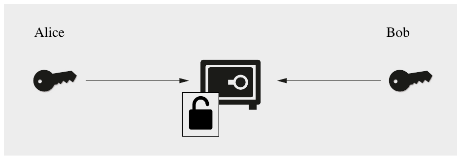

Hình 6.2 Phép so sánh cho mã hóa symmetric: một chiếc két mà cả Alice và Bob đều có chìa khóa

Số lượng key Ngay cả khi giải quyết được vấn đề phân phối key, chúng ta có thể phải xử lý một số lượng key rất lớn. Nếu mỗi cặp người dùng cần một key riêng cho truyền thông an toàn trong một mạng với n người dùng, có

(n · (n − 1))/2

key, và mỗi người dùng phải lưu trữ an toàn n − 1 key. Ngay cả với các mạng mid-size, giả sử, một tập đoàn với 2000 người, điều này cần khoảng 2 triệu key phải được tạo và vận chuyển qua các kênh an toàn. Thêm về vấn đề này có trong Mục 14.1. (Có những cách thông minh hơn để xử lý key trong các mạng symmetric cryptography, như được trình bày chi tiết trong Mục 14.3; tuy nhiên, các cách tiếp cận đó có những vấn đề khác như single point of failure.)

Không bảo vệ trước gian lận của Alice hay Bob Alice và Bob có cùng khả năng, vì họ sở hữu cùng một key. Hệ quả là symmetric cryptography không thể được dùng trong các tình huống mà chúng ta muốn ngăn gian lận bởi Alice hoặc Bob trái với gian lận bởi một người ngoài như Oscar. Chẳng hạn, trong các ứng dụng e-commerce, thường quan trọng là chứng minh rằng Alice thực sự đã gửi một thông điệp nhất định, giả sử, một đơn hàng online cho một TV màn hình phẳng. Nếu chúng ta chỉ dùng symmetric cryptography và Alice đổi ý sau đó, cô ấy luôn có thể khẳng định rằng Bob, người bán, đã tạo sai đơn đặt hàng điện tử. Ngăn chặn điều này được gọi là non-repudiation (chống chối bỏ) và có thể đạt được bằng asymmetric cryptography, như được thảo luận trong Mục 10.1.1, hoặc bằng digital signature, mà chúng tôi giới thiệu trong Chương 10.

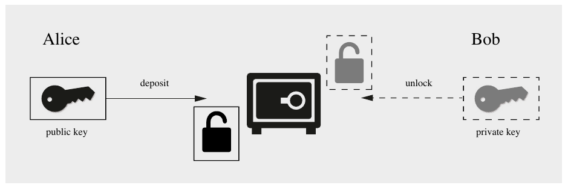

Hình 6.3 Phép so sánh cho mã hóa public-key: một chiếc két với một ổ khóa công khai để gửi thông điệp vào và một ổ khóa bí mật để lấy thông điệp ra

### Các nguyên lý của Asymmetric Cryptography — Mã hóa và vận chuyển key

Để khắc phục những nhược điểm này, Whitfield Diffie, Martin Hellman và Ralph Merkle đã đưa ra một đề xuất mang tính cách mạng dựa trên ý tưởng sau: Không cần thiết key mà người mã hóa thông điệp (đó là Alice trong ví dụ của chúng ta) sở hữu phải bí mật. Phần then chốt là Bob, người nhận, chỉ có thể giải mã bằng một key bí mật. Để hiện thực một hệ thống như vậy, Bob công bố một key mã hóa công khai, mà mọi người đều biết. Bob cũng có một key bí mật tương ứng, được dùng để giải mã. Do đó, key k của Bob gồm hai phần, một phần công khai, kpub, và một phần riêng, kpr.

Một phép so sánh đơn giản cho một hệ thống như vậy được thể hiện trong Hình 6.3. Hệ thống này hoạt động khá giống với hòm thư cũ quen thuộc ở góc phố: Mọi người đều có thể bỏ thư vào hòm, tức là mã hóa, nhưng chỉ người có chìa khóa riêng (bí mật) mới có thể lấy thư ra, tức là giải mã. Nếu giả sử chúng ta có các cryptosystem với chức năng như vậy, một protocol cơ bản cho mã hóa public-key trông như Hình 6.4.

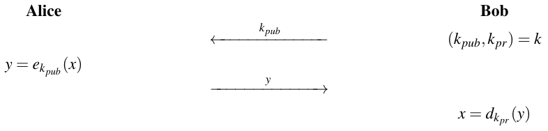

Hình 6.4 Protocol cơ bản cho mã hóa public-key

Nhìn vào protocol đó, người ta có thể lập luận rằng dù chúng ta có thể mã hóa một thông điệp mà không cần kênh bí mật để thiết lập key, chúng ta vẫn không thể trao đổi một key nếu muốn mã hóa bằng, giả sử, AES. Tuy nhiên, protocol có thể dễ dàng được sửa đổi cho mục đích này. Những gì chúng ta phải làm là mã hóa một key symmetric, ví dụ, một key AES, dùng thuật toán public-key. Khi key symmetric đã được Bob giải mã, cả hai bên có thể dùng nó để mã hóa và giải mã thông điệp bằng symmetric cipher. Hình 6.5 cho thấy một protocol vận chuyển key cơ bản trong đó chúng ta dùng AES làm symmetric cipher để minh họa (tất nhiên, có thể dùng bất kỳ thuật toán symmetric nào khác trong một protocol như vậy). Ưu điểm chính của protocol trong Hình 6.5 so với protocol trong Hình 6.4 là payload được mã hóa bằng một symmetric cipher, thường nhanh hơn nhiều so với một thuật toán asymmetric, như chúng ta sẽ thảo luận sau.

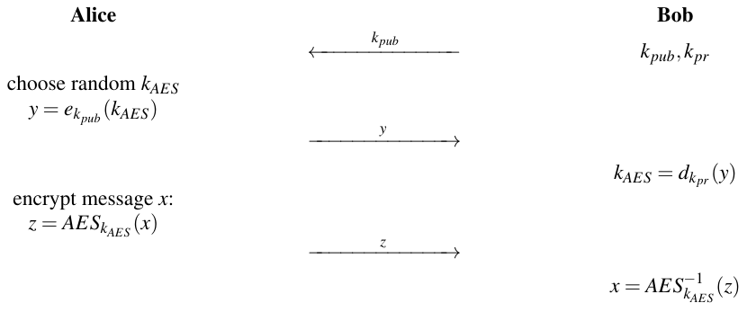

Hình 6.5 Protocol vận chuyển key đơn giản (với AES làm ví dụ về symmetric cipher)

Trong thực tế, key symmetric ngắn hơn key asymmetric và cần được padding để làm input cho mã hóa asymmetric. Dù điều này có thể được làm bằng cách áp dụng các scheme padding chung, sẽ có lợi khi xem việc cung cấp một key bí mật cho mã hóa symmetric bằng mã hóa asymmetric như một primitive kết hợp duy nhất. Chúng tôi gọi một primitive chuyên dụng như vậy là key encapsulation mechanism (KEM). Khác với các hàm mã hóa thuần túy chúng ta đã thấy trước đây, KEM không nhận một thông điệp làm input. Thay vào đó, KEM có khả năng tự generationg *(ghi chú: sách in generationg; đúng là generating)* một giá trị ngẫu nhiên (mà sau này chúng ta dùng làm key bí mật symmetric), giá trị này sau đó được đưa vào một hàm mã hóa asymmetric tương ứng. Bằng cách này, Alice chỉ cần gọi một hàm duy nhất encapsulate để tạo vật liệu key ngẫu nhiên được mã hóa asymmetric trực tiếp. Sau khi Bob nhận được vật liệu key đã mã hóa này, Bob chạy hàm tương ứng decapsulate để giải mã và mở gói vật liệu key, mà Alice và Bob sau đó dùng chung cho việc mã hóa symmetric khối lượng dữ liệu lớn tiếp theo. Chúng tôi sẽ giải thích chi tiết cách KEM được dùng và khởi tạo trong bối cảnh RSA (xem Mục 7.8) và post-quantum cryptography (xem Chương 12).

Từ thảo luận cho tới giờ, đã rõ rằng asymmetric cryptography là một công cụ đáng mong muốn để xây dựng các giải pháp bảo mật. Câu hỏi not-so-small còn lại là làm thế nào để xây dựng các thuật toán public-key. Trong Chương 7, 8 và 9, chúng tôi giới thiệu các scheme asymmetric hiện đang được dùng. Tất cả đều được xây dựng từ một nguyên lý chung, one-way function. Một one-way function về cơ bản là một hàm dễ tính trên mọi input, nhưng khó đảo ngược khi cho output của một input ngẫu nhiên. Định nghĩa không chính thức như sau.

> Định nghĩa 6.1.1 One-way function
>
> Một hàm f là một one-way function nếu:
>
> 1. y = f(x) dễ tính về mặt tính toán, và
>
> 2. x = f−1(y) bất khả thi về mặt tính toán.

Rõ ràng, các tính từ “dễ” và “bất khả thi” không đặc biệt chính xác. Theo nghĩa của lý thuyết độ phức tạp tính toán, một hàm là dễ tính nếu nó có thể được tính trong thời gian đa thức, tức là thời gian chạy của nó là một biểu thức đa thức. Để hữu ích trong các scheme cryptographic thực tế, phép tính y = f(x) phải đủ nhanh để không dẫn tới thời gian thực thi chậm không chấp nhận được trong một ứng dụng. Phép tính nghịch đảo x = f−1(y) phải rất tốn kém về mặt tính toán trong trường hợp trung bình. Điều này có nghĩa là không khả thi để tính nó trong bất kỳ khoảng thời gian hợp lý nào, giả sử, 10,000 năm, khi dùng thuật toán tốt nhất đã biết và mọi tài nguyên máy tính trên hành tinh Trái Đất.

Có vài one-way function phổ biến được các scheme public-key hiện đang dùng sử dụng. Thứ nhất là bài toán phân tích thừa số nguyên (integer factorization problem), mà RSA dựa trên. Cho hai số nguyên tố lớn, dễ tính tích. Tuy nhiên, rất khó phân tích thừa số tích thu được trên các nền tảng tính toán thông thường. Thực ra, nếu mỗi số nguyên tố có 300 chữ số thập phân trở lên, tích thu được không thể được phân tích ngay cả với hàng nghìn máy tính (cổ điển) chạy trong nhiều năm. Một one-way function khác được dùng rộng rãi là bài toán logarit rời rạc (discrete logarithm problem), mà các scheme như trao đổi key Diffie-Hellman và elliptic curve dựa trên. Điều này không trực quan bằng và được giới thiệu trong Chương 8. Chúng tôi lưu ý rằng với tiềm năng của các máy tính lượng tử mạnh trong tương lai, chúng ta cần xem xét lại bảo mật của bất kỳ one-way function nào kể trên. Chúng tôi sẽ thảo luận vấn đề này và các giải pháp thay thế trong Chương 12.

## 6.2 Các khía cạnh thực tế của Public-Key Cryptography

Public-key algorithm sẽ được giới thiệu trong các chương sau vì có một số kiến thức toán học chúng ta phải học trước. Tuy nhiên, rất thú vị khi xem xét các cơ chế bảo mật chính mà public-key cryptography cho phép, điều chúng tôi đề cập trong mục này.

### 6.2.1 Các cơ chế bảo mật

Như đã chỉ ra trước đó trong chương này, các scheme public-key có thể được dùng để mã hóa dữ liệu. Hóa ra chúng ta có thể làm nhiều việc khác với các thuật toán public-key. Các chức năng chính mà chúng có thể cung cấp được liệt kê dưới đây:

> Các cơ chế bảo mật chính của thuật toán Public-Key:
>
> Thiết lập key (Key Establishment) Có các protocol để thiết lập key bí mật qua một kênh không an toàn. Các ví dụ về protocol như vậy bao gồm trao đổi key Diffie–Hellman (DHKE), protocol vận chuyển key RSA và các key encapsulation mechanism.
>
> Non-repudiation Việc cung cấp non-repudiation có thể được hiện thực bằng các thuật toán digital signature, ví dụ, RSA, DSA hoặc ECDSA.
>
> Tính toàn vẹn (Integrity) Các thuật toán digital signature cũng có thể bảo đảm tính toàn vẹn của thông điệp.
>
> Định danh (Identification) Chúng ta có thể định danh các thực thể dùng các protocol challenge-and-response cùng với digital signature, ví dụ, trong các ứng dụng như smart card cho ngân hàng hay cho điện thoại di động.
>
> Mã hóa (Encryption) Chúng ta có thể mã hóa thông điệp dùng các thuật toán như RSA hay Elgamal.

Chúng tôi lưu ý rằng mã hóa, tính toàn vẹn thông điệp và định danh cũng có thể đạt được bằng symmetric cipher, nhưng chúng không giỏi quản lý key và non-repudiation cực kỳ khó với chúng. Có vẻ như các scheme public-key có thể cung cấp mọi chức năng mà các ứng dụng bảo mật hiện đại yêu cầu. Dù điều này đúng về nguyên tắc, nhược điểm lớn trong thực tế là mã hóa dữ liệu rất tốn tính toán — hay nói nôm na: cực kỳ chậm — với các thuật toán public-key. Hầu hết block và stream cipher có thể mã hóa nhanh hơn khoảng một trăm tới một nghìn lần so với các thuật toán public-key. Do đó, có phần trớ trêu, public-key cryptography hiếm khi được dùng cho ứng dụng lâu đời nhất của cryptography, cụ thể là việc mã hóa dữ liệu thực sự. Mặt khác, các thuật toán symmetric kém trong việc cung cấp chức năng non-repudiation và thiết lập key. Để tận dụng điểm mạnh của cả hai, hầu hết các protocol thực tế là protocol lai kết hợp cả thuật toán symmetric và public-key. Các ví dụ bao gồm protocol TLS thường được dùng cho các kết nối internet an toàn, hoặc nhiều protocol mã hóa end-to-end được dùng bởi các ứng dụng nhắn tin tức thời như WhatsApp.

### 6.2.2 Vấn đề còn lại: Tính xác thực của Public Key

Từ thảo luận cho tới giờ, chúng ta đã thấy rằng một ưu điểm lớn của các scheme asymmetric là chúng ta có thể phân phối public key qua các kênh không an toàn, như thể hiện trong các protocol trong Hình 6.4 và 6.5. Tuy nhiên, trong thực tế, mọi thứ phức tạp hơn một chút vì chúng ta vẫn phải bảo đảm tính xác thực của public key. Nói cách khác: Chúng ta có thực sự biết một public key nhất định thuộc về một người nhất định không? Trong thực tế, vấn đề này thường được giải quyết bằng cái được gọi là certificate. Nói đại khái, certificate gắn một public key với một danh tính nhất định. Đây là một vấn đề lớn trong nhiều ứng dụng bảo mật, ví dụ, khi thực hiện các giao dịch e-commerce trên internet. Chúng tôi thảo luận chủ đề này chi tiết hơn trong Mục 14.4.2.

Một vấn đề khác, không mang tính nền tảng bằng, là các thuật toán public-key cần key rất dài, dẫn tới thời gian thực thi chậm. Vấn đề độ dài key và bảo mật được thảo luận dưới đây.

### 6.2.3 Các thuật toán Public-Key quan trọng

Trong các chương trước, chúng ta đã học về một số block cipher, DES, AES và PRESENT, và một vài stream cipher. Tuy nhiên, tồn tại nhiều thuật toán symmetric khác. Vài trăm cipher đã được đề xuất qua nhiều năm và nhiều cipher mạnh về mặt mật mã, như được thảo luận trong Mục 3.7. Tình hình khá khác với các thuật toán asymmetric. Chỉ có ba họ thuật toán public-key chính hiện đang được dùng trong thực tế. Chúng có thể được phân loại dựa trên one-way function bên dưới. Chúng tôi lưu ý rằng nếu máy tính lượng tử trở nên khả dụng trong tương lai, cả ba họ thuật toán dưới đây đều có thể bị phá. Khi đó, người ta phải dùng cái được gọi là post-quantum cryptography (PQC), một cái tên (hoa mỹ) cho các thuật toán public-key thay thế có vẻ chống được tấn công bằng máy tính lượng tử. Chương 12 sẽ giới thiệu các scheme PQC.

> Các họ thuật toán Public-Key có ý nghĩa thực tế (khi không có máy tính lượng tử)
>
> Các scheme Integer-Factorization Vài scheme public-key dựa trên thực tế rằng rất khó phân tích thừa số các số nguyên lớn. Đại diện nổi bật nhất của họ thuật toán này là RSA.
>
> Các scheme logarit rời rạc (Discrete Logarithm) Có vài thuật toán dựa trên cái được gọi là bài toán logarit rời rạc trong finite field. Các ví dụ nổi bật nhất bao gồm trao đổi key Diffie–Hellman, mã hóa Elgamal và Digital Signature Algorithm (DSA).
>
> Các scheme Elliptic Curve (EC) Một sự tổng quát hóa của thuật toán logarit rời rạc là các scheme public-key elliptic curve. Các ví dụ phổ biến nhất bao gồm trao đổi key Elliptic Curve Diffie–Hellman (ECDH) và Elliptic Curve Digital Signature Algorithm (ECDSA).

Hai họ đầu tiên được đề xuất vào mid-1970s, và elliptic curve được đề xuất vào mid-1980s. Hiện không có tấn công nào được biết nhắm vào bất kỳ scheme nào với máy tính cổ điển nếu các tham số, đặc biệt là độ dài toán hạng và key, được chọn cẩn thận. (Một lần nữa, nếu máy tính lượng tử large-scale trở nên khả dụng trong tương lai, các scheme sẽ không còn an toàn.) Các scheme cryptographic thuộc mỗi họ sẽ lần lượt được giới thiệu trong Chương 7, 8 và 9. Quan trọng là lưu ý rằng mỗi họ trong ba họ đều có thể được dùng để cung cấp các cơ chế public-key chính là thiết lập key, non-repudiation qua digital signature và mã hóa dữ liệu.

### 6.2.4 Độ dài key và mức bảo mật

Cả ba họ thuật toán public-key đã được thiết lập đều dựa trên các hàm number-theoretic. Một đặc điểm phân biệt của chúng là chúng cần số học với toán hạng và key rất dài. Không ngạc nhiên, toán hạng và key càng dài, các thuật toán càng an toàn. Để so sánh các thuật toán khác nhau, người ta thường xét mức bảo mật (security level). Một thuật toán được nói là có “mức bảo mật n bit” nếu tấn công tốt nhất đã biết cần 2n bước. Đây là một định nghĩa khá tự nhiên vì các thuật toán symmetric với mức bảo mật n có key độ dài n bit. Tuy nhiên, mối quan hệ giữa sức mạnh mật mã và bảo mật không đơn giản như vậy trong trường hợp asymmetric. Bảng 6.1 cho thấy các độ dài bit khuyến nghị cho các thuật toán public-key với bốn mức bảo mật 80, 128, 192 và 256 bit. Chúng ta thấy từ bảng rằng các scheme RSA-like và các scheme logarit rời rạc cần toán hạng và key rất dài. Độ dài key của các scheme elliptic curve nhỏ hơn đáng kể, nhưng vẫn dài gấp đôi so với symmetric cipher có cùng sức mạnh mật mã. Bảng giả định các tấn công khi không có máy tính lượng tử. Như đã nhắc ở trên, nếu máy tính lượng tử full-size trở nên khả dụng trong tương lai, ba scheme public-key trong bảng có thể dễ dàng bị phá.

Bảng 6.1 Độ dài bit của các thuật toán public-key cho các mức bảo mật khác nhau

| Họ thuật toán | Cryptosystem |  | Mức | bảo mật (bit) |  |
|---|---|---|---|---|---|
|  |  | (80) | 128 | 192 | 256 |
| Phân tích thừa số nguyên | RSA | (1024 bits) | 3072 bits | 7680 bits | 15360 bits |
| Logarit rời rạc | DH, DSA, Elgamal | (1024 bits) | 3072 bits | 7680 bits | 15360 bits |
| Elliptic curve | ECDH, ECDSA | (160 bits) | 256 bits | 384 bits | 512 bits |
| Symmetric-key | ví dụ, AES | (80 bits) | 128 bits | 192 bits | 256 bits |

Tại thời điểm viết sách, người ta cho rằng mức bảo mật 80 bit không cung cấp bảo mật long-term và, do đó, các giá trị được đặt trong ngoặc. Bạn có thể muốn so sánh bảng này với Bảng 1.2, cung cấp thông tin về các ước tính bảo mật của các thuật toán symmetric-key. Để cung cấp bảo mật long-term, tức là bảo mật cho khoảng thời gian vài thập kỷ, nên chọn mức bảo mật 128 bit, điều này cần key khá dài cho cả ba họ thuật toán asymmetric.

Một hệ quả không mong muốn của các toán hạng dài là các scheme public-key cực kỳ nặng về số học. Như đã nhắc trước đó, không hiếm khi một phép toán public-key, giả sử một digital signature, chậm hơn 2–3 bậc độ lớn so với việc mã hóa một block bằng AES hay 3DES. Hơn nữa, độ phức tạp tính toán của ba họ thuật toán tăng gần như theo lập phương của độ dài bit. Làm ví dụ, tăng độ dài bit từ 2048 lên 4096 trong một software tạo chữ ký RSA cho trước dẫn tới thực thi chậm hơn 23 = 8 lần! Trên các PC hiện đại, thời gian thực thi trong khoảng vài mili giây là phổ biến, điều không gây vấn đề cho nhiều ứng dụng. Tuy nhiên, hiệu năng public-key có thể là một nút cổ chai nghiêm trọng hơn trong các thiết bị hạn chế nơi CPU nhỏ phổ biến, ví dụ, điện thoại di động hay smart card, hoặc trên các cloud server, nơi chúng ta muốn tính nhiều phép toán public-key mỗi giây. Chương 7, 8 và 9 giới thiệu vài kỹ thuật để triển khai các thuật toán public-key hiệu quả ở mức hợp lý.

## 6.3 Lý thuyết số thiết yếu cho các thuật toán Public-Key

Bây giờ chúng ta sẽ học một vài kỹ thuật từ lý thuyết số thiết yếu cho public-key cryptography. Chúng tôi giới thiệu thuật toán Euclid, hàm phi của Euler cũng như Định lý nhỏ Fermat và định lý Euler. Tất cả đều quan trọng cho các thuật toán asymmetric, đặc biệt là để hiểu scheme RSA.

### 6.3.1 Thuật toán Euclid (Euclidean Algorithm)

Chúng ta bắt đầu với bài toán tính ước chung lớn nhất (greatest common divisor, gcd). Gcd của hai số nguyên dương r0 và r1 được ký hiệu là

gcd(r0,r1)

và là số dương lớn nhất chia hết cả r0 và r1. Chẳng hạn gcd(21,9) = 3. Với các số nhỏ, gcd dễ tính bằng cách phân tích thừa số cả hai số và tìm thừa số chung lớn nhất.

Ví dụ 6.1. Cho r0 = 84 và r1 = 30. Phân tích thừa số cho ra:

r0 = 84 = 2 · 2 · 3 · 7

r1 = 30 = 2 · 3 · 5

Gcd là tích của mọi thừa số nguyên tố chung:

2 · 3 = 6 = gcd(30,84)

◇

Tuy nhiên, với các số lớn xuất hiện trong các scheme public-key, phân tích thừa số thường không khả thi, và một thuật toán hiệu quả hơn được dùng để tính gcd, thuật toán Euclid. Thuật toán, còn được gọi là Euclid’s algorithm, dựa trên nhận xét đơn giản rằng nếu r0 và r1 có một ước chung g, thì bất kỳ tổ hợp tuyến tính nào của r0 và r1 đều chia hết cho g. Đặc biệt, ta có:

gcd(r0,r1) = gcd(r0 − r1,r1) = g,

trong đó chúng ta giả sử r0 > r1, và cả hai số đều là số nguyên dương. Tính chất này có thể dễ dàng được chỉ ra: Cho gcd(r0,r1) = g. Vì g chia hết cả r0 và r1, ta có thể viết r0 = g · x và r1 = g · y, trong đó x > y, và x và y là các số nguyên nguyên tố cùng nhau, tức là chúng không có thừa số chung. Hơn nữa, dễ chỉ ra rằng (x − y) và y cũng nguyên tố cùng nhau. Từ đó suy ra:

gcd(r0 − r1,r1) = gcd(g · (x − y),g · y) = g

Hãy kiểm chứng tính chất này với các số từ ví dụ trước.

Ví dụ 6.2. Một lần nữa, cho r0 = 84 và r1 = 30. Bây giờ chúng ta xem gcd của (r0 − r1) và r1:

r0 − r1 = 54 = 2 · 3 · 3 · 3

r1 = 30 = 2 · 3 · 5

Thừa số chung lớn nhất vẫn là 2 · 3 = 6 = gcd(30,54) = gcd(30,84).

◇

Cũng suy ra ngay rằng chúng ta có thể áp dụng quá trình này lặp đi lặp lại:

gcd(r0,r1) = gcd(r0 − r1,r1) = gcd(r0 − 2r1,r1) =···= gcd(r0 − m r1,r1)

miễn là (r0 − m r1) > 0. Thuật toán dùng ít bước nhất nếu chúng ta chọn giá trị lớn nhất cho m. Đây là trường hợp nếu chúng ta tính:

gcd(r0,r1) = gcd(r0 mod r1,r1)

Vì số hạng thứ nhất (r0 mod r1) nhỏ hơn số hạng thứ hai r1, chúng ta thường hoán đổi chúng:

gcd(r0,r1) = gcd(r1,r0 mod r1)

Nhận xét cốt lõi từ quá trình này là chúng ta có thể quy bài toán tìm gcd của hai số cho trước về bài toán tìm gcd của hai số nhỏ hơn. Quá trình này có thể được áp dụng đệ quy cho tới khi cuối cùng ta được gcd(rl,0) = rl. Vì mỗi lần lặp bảo toàn gcd của bước lặp trước, hóa ra gcd cuối cùng này là gcd của bài toán gốc, tức là

gcd(r0,r1) =···= gcd(rl,0) = rl

Trước hết chúng tôi trình bày một số ví dụ về tìm gcd bằng thuật toán Euclid rồi thảo luận thuật toán một cách hình thức hơn một chút.

Ví dụ 6.3. Cho r0 = 27 và r1 = 21. Hình 6.6 cho chúng ta một chút cảm nhận về thuật toán bằng cách cho thấy độ dài của các tham số co lại ở mỗi lần lặp như thế nào. Các phần tô bóng trong lần lặp là các số dư mới r2 = 6 (lần lặp thứ nhất), và r3 = 3 (lần lặp thứ hai), tạo thành các số hạng input cho các lần lặp tiếp theo. Lưu ý rằng ở lần lặp cuối cùng số dư là r4 = 0, cho biết thuật toán kết thúc. ◇

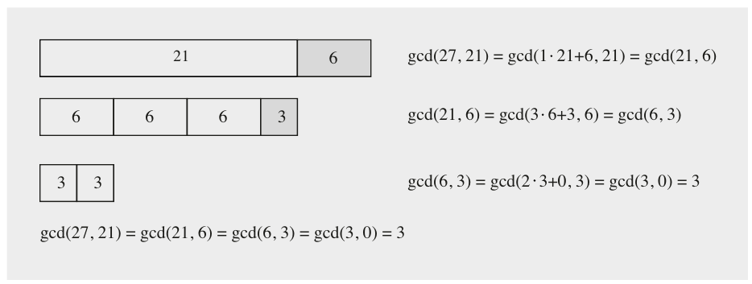

Hình 6.6 Thuật toán Euclid cho các giá trị input r0 = 27 và r1 = 21

Cũng hữu ích khi xem thuật toán Euclid với các số lớn hơn một chút, như trong Ví dụ 6.4.

Ví dụ 6.4. Cho r0 = 973 và r1 = 301. Gcd khi đó được tính là

| 973 = 3 · 301 + 70 | gcd(973,301) = gcd(301,70) |
|---|---|
| 301 = 4 · 70 + 21 | gcd(301,70) = gcd(70,21) |
| 70 = 3 · 21 + 7 | gcd(70,21) = gcd(21,7) |
| 21 = 3 · 7 + 0 | gcd(21,7) = gcd(7,0) = 7 |

◇

Đến giờ chúng ta đã có ý niệm về Euclid’s algorithm, và có thể đưa ra một mô tả hình thức hơn của thuật toán dưới dạng mã giả.

> Thuật toán Euclid (Euclidean Algorithm)
>
> Input: các số nguyên dương r0 và r1 với r0 > r1
>
> Output: gcd(r0,r1)
>
> Khởi tạo: i = 1
>
> Thuật toán:
>
> 1 DO
>
> 1.1 i = i + 1
>
> 1.2 ri = ri−2 mod ri−1
>
> WHILE ri ≠ 0
>
> 2 RETURN
>
> gcd(r0,r1) = ri−1

Lưu ý rằng thuật toán kết thúc nếu một số dư với giá trị rl = 0 được tính. (Chỉ số “l” là gợi nhớ cho “last iteration” (lần lặp cuối)). Số dư được tính ở lần lặp trước, ký hiệu là rl−1, là gcd của bài toán gốc.

Thuật toán Euclid rất hiệu quả, ngay cả với các số rất dài thường được dùng trong public-key cryptography. Số lần lặp gần bằng số chữ số của các toán hạng input. Điều đó có nghĩa là, chẳng hạn, số lần lặp của một phép tính gcd với các số 2048-bit là 2048 nhân một hằng số. Tất nhiên, các thuật toán với vài nghìn lần lặp có thể dễ dàng được thực thi trên các PC ngày nay, khiến thuật toán hiệu quả trong thực tế.

### 6.3.2 Thuật toán Euclid mở rộng (Extended Euclidean Algorithm)

Cho tới giờ, chúng ta đã thấy rằng việc tìm gcd của hai số nguyên r0 và r1 có thể được làm bằng cách rút gọn đệ quy các toán hạng. Tuy nhiên, hóa ra tìm gcd không phải là ứng dụng chính của thuật toán Euclid. Một phần mở rộng của thuật toán cho phép chúng ta tính các inverse modulo, có tầm quan trọng lớn trong public-key cryptography. Ngoài việc tính gcd, extended Euclidean algorithm (EEA) tính một tổ hợp tuyến tính có dạng:

gcd(r0,r1) = s · r0 + t · r1

trong đó s và t là các hệ số nguyên. Phương trình này thường được gọi là phương trình Diophantine.

Câu hỏi bây giờ là: Làm thế nào để tính hai hệ số s và t? Ý tưởng đằng sau thuật toán là chúng ta thực thi thuật toán Euclid tiêu chuẩn, nhưng biểu diễn số dư hiện tại ri ở mỗi lần lặp như một tổ hợp tuyến tính có dạng

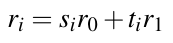 (6.1)

Nếu làm được điều này, chúng ta kết thúc ở lần lặp cuối với phương trình:

rl = gcd(r0,r1) = slr0 + tlr1 = sr0 + tr1

Điều này có nghĩa là hệ số cuối cùng sl là hệ số s trong Phương trình (6.1) mà chúng ta đang tìm, và cũng tl = t. Hãy xem một ví dụ.

Ví dụ 6.5. Chúng ta xét extended Euclidean algorithm với cùng các giá trị như trong ví dụ trước, r0 = 973 và r1 = 301. Ở phía left-hand, chúng ta tính thuật toán Euclid tiêu chuẩn, tức là tính các số dư mới r2,r3,... Ngoài ra, chúng ta phải tính thương nguyên qi−1 ở mỗi lần lặp. Ở phía right-hand, chúng ta tính các hệ số si và ti sao cho ri = sir0 + tir1. Các hệ số luôn được thể hiện trong ngoặc vuông.

| i | ri−2 = qi−1 · ri−1 + ri | ri = [si] r0 + [ti] r1 |
|---|---|---|
| 2 | 973 = 3 · 301 + 70 | 70 = [1] r0 + [−3] r1 |
| 3 | 301 = 4 · 70 + 21 | 21 = 301 − 4 · 70  = r1 − 4(1r0 − 3 r1)  = [−4] r0 + [13] r1 |
| 4 | 70 = 3 · 21 + 7 | 7 = 70 − 3 · 21  = (1r0 − 3r1) − 3(−4r0 + 13r1)  = [13] r0 + [−42] r1 |
|  | 21 = 3 · 7 + 0 |  |

Thuật toán đã tính ba tham số gcd(973,301) = 7, s = 13 và t = −42. Tính đúng đắn có thể được kiểm chứng bằng:

gcd(973,301) = [13] 973 + [−42] 301 = 12649 − 12642 = 7

◇

Bạn nên quan sát kỹ các bước đại số diễn ra ở cột bên phải của ví dụ trên. Đặc biệt, lưu ý rằng tổ hợp tuyến tính ở phía right-hand luôn được xây dựng với sự trợ giúp của các tổ hợp tuyến tính trước đó. Bây giờ chúng ta sẽ suy ra các công thức đệ quy để tính si và ri ở mỗi lần lặp. Giả sử chúng ta đang ở lần lặp với chỉ số i. Ở hai lần lặp trước, chúng ta đã tính các giá trị

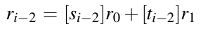 (6.2)

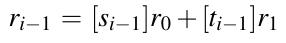 (6.3)

Ở lần lặp hiện tại i, trước hết chúng ta tính thương qi−1 và số dư mới ri từ ri−1 và ri−2:

ri−2 = qi−1 · ri−1 + ri

Phương trình này có thể được viết lại là:

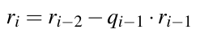 (6.4)

Nhớ rằng mục tiêu của chúng ta là biểu diễn số dư mới ri như một tổ hợp tuyến tính của r0 và r1 như thể hiện trong Phương trình (6.1). Bước cốt lõi để đạt điều này diễn ra bây giờ: trong Phương trình (6.4), chúng ta thay ri−2 bằng Phương trình (6.2) và ri−1 bằng Phương trình (6.3):

ri = (si−2r0 + ti−2r1) − qi−1(si−1r0 + ti−1r1)

Nếu sắp xếp lại các số hạng, chúng ta được kết quả mong muốn:

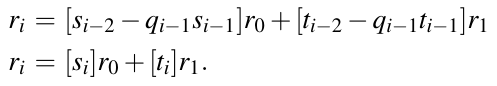 (6.5)

Phương trình (6.5) cũng cho chúng ta ngay các công thức đệ quy để tính si và ti, cụ thể là si = si−2 − qi−1si−1 và ti = ti−2 − qi−1ti−1. Các phép đệ quy này hợp lệ với các giá trị chỉ số i ≥ 2. Như mọi phép đệ quy, chúng ta cần các giá trị khởi đầu cho s0,s1,t0,t1. Có thể chỉ ra rằng các giá trị khởi tạo này (mà chúng ta suy ra trong Bài tập 6.13) là s0 = 1,s1 = 0,t0 = 0,t1 = 1.

> Thuật toán Euclid mở rộng (Extended Euclidean Algorithm, EEA)
>
> Input: các số nguyên dương r0 và r1 với r0 > r1
>
> Output: gcd(r0,r1), cũng như s và t sao cho gcd(r0,r1) = s · r0 + t · r1.
>
> Khởi tạo:
>
> s0 = 1 t0 = 0
>
> s1 = 0 t1 = 1
>
> i = 1
>
> Thuật toán:
>
> 1 DO
>
> 1.1 i = i + 1
>
> 1.2 ri ≡ ri−2 mod ri−1
>
> 1.3 qi−1 = (ri−2 − ri)/ri−1
>
> 1.4 si = si−2 − qi−1 · si−1
>
> 1.5 ti = ti−2 − qi−1 · ti−1
>
> WHILE ri ≠ 0
>
> 2 RETURN
>
> gcd(r0,r1) = ri−1
>
> s = si−1
>
> t = ti−1

Như đã nhắc ở trên, ứng dụng chính của EEA trong asymmetric cryptography là tính inverse modulo của một số nguyên. Chúng ta đã gặp bài toán này trong bối cảnh affine cipher ở Chương 1. Với affine cipher, chúng ta được yêu cầu tìm inverse của giá trị key a modulo 26. Với thuật toán Euclid, điều này rất đơn giản. Giả sử chúng ta muốn tính inverse của r1 mod r0 trong đó r1 < r0. Nhớ lại từ Mục 1.4.2 rằng inverse chỉ tồn tại nếu gcd(r0,r1) = 1. Do đó, nếu áp dụng EEA, ta được s · r0 + t · r1 = 1 = gcd(r0,r1). Lấy phương trình này modulo r0, ta được:

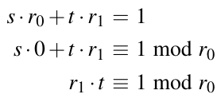 (6.6)

Phương trình (6.6) chính xác là định nghĩa inverse của r1! Điều này có nghĩa là bản thân t là inverse của r1:

t ≡ r1−1 mod r0

Do đó, nếu cần tính một inverse a−1 mod m, chúng ta áp dụng EEA với các tham số input m và a. Giá trị output t được tính chính là inverse. Hãy xem một ví dụ.

Ví dụ 6.6. Mục tiêu của chúng ta là tính 12−1 mod 67. Các giá trị 12 và 67 nguyên tố cùng nhau, tức là gcd(67,12) = 1. Nếu áp dụng EEA, ta được các hệ số s và t trong gcd(67,12) = 1 = s · 67 + t · 12. Bắt đầu với các giá trị r0 = 67 và r1 = 12, thuật toán tiến hành như sau:

| i | qi−1 ri | si ti |
|---|---|---|
| 2 | 5 7 | 1 -5 |
| 3 | 1 5 | -1 6 |
| 4 | 1 2 | 2 -11 |
| 5 | 2 1 | -5 28 |

Điều này cho chúng ta tổ hợp tuyến tính

−5 · 67 + 28 · 12 = 1

Như đã chỉ ra ở trên, inverse của 12 suy ra từ đây là

12−1 ≡ 28 mod 67

Kết quả này có thể dễ dàng được kiểm chứng

28 · 12 = 336 ≡ 1 mod 67

◇

Lưu ý rằng hệ số s không cần thiết và trong thực tế thường không được tính. Cũng lưu ý rằng kết quả của thuật toán có thể là một giá trị âm cho t. Tuy nhiên, kết quả vẫn đúng. Chúng ta phải tính t = t + r0, là một phép toán hợp lệ vì t ≡ t + r0 mod r0.

Để đầy đủ, chúng tôi trình bày cách EEA cũng có thể được dùng để tính inverse nhân trong Galois field GF(2m). Trong cryptography hiện đại, điều này chủ yếu liên quan tới việc suy ra các S-Boxes của AES và đôi khi cho các thuật toán public-key elliptic curve. EEA có thể được dùng hoàn toàn tương tự với đa thức thay vì số nguyên. Nếu muốn tính một inverse trong một finite field GF(2m), các input của thuật toán là phần tử field A(x) và đa thức bất khả quy P(x). EEA tính các đa thức phụ s(x) và t(x), cũng như ước chung lớn nhất gcd(P(x),A(x)) sao cho:

s(x)P(x) + t(x)A(x) = gcd(P(x),A(x)) = 1

Lưu ý rằng vì P(x) bất khả quy, gcd luôn bằng 1. Nếu lấy phương trình trên và rút gọn cả hai vế modulo P(x), dễ thấy rằng đa thức phụ t(x) bằng inverse của A(x):

s(x)0 + t(x)A(x) ≡ 1 mod P(x)

t(x) ≡ A−1(x) mod P(x)

Ở đây chúng tôi đưa ra một ví dụ về thuật toán cho field nhỏ GF(23).

Ví dụ 6.7. Chúng ta đang tìm inverse của A(x) = x2 trong finite field GF(23) với P(x) = x3 + x + 1. Các giá trị khởi tạo cho đa thức t(x) là: t0(x) = 0, t1(x) = 1.

| Lần lặp | ri−2(x) = [qi−1(x)]ri−1(x) + [ri(x)] | ti(x) |
|---|---|---|
| 2 | x3 + x + 1 = [x]x2 + [x + 1] | t2 = t0 − q1t1 = 0 − x1 ≡ x |
| 3 | x2 = [x] (x + 1) + [x] | t3 = t1 − q2t2 = 1 − x(x) ≡ 1 + x2 |
| 4 | x + 1 = [1]x + [1] | t4 = t2 − q3t3 = x − 1(1 + x2) t4 ≡ 1 + x + x2 |
| 5 | x = [x]1 + [0] | Kết thúc vì r5 = 0 |

Lưu ý rằng các hệ số đa thức được tính trong GF(2), và vì phép cộng và phép trừ là cùng một phép toán, chúng ta luôn có thể thay một hệ số âm (như −x) bằng một hệ số dương. Thương mới và số dư mới được tính ở mỗi lần lặp được thể hiện trong ngoặc vuông ở trên. Các đa thức ti(x) được tính theo công thức đệ quy đã được dùng để tính các số nguyên ti trước đó trong mục này. EEA kết thúc nếu số dư bằng 0, đó là trường hợp ở lần lặp với chỉ số 5. Inverse bây giờ được cho bởi giá trị ti(x) cuối cùng được tính, tức là t4(x):

A−1(x) = t(x) = t4(x) = x2 + x + 1

Đây là phép kiểm tra rằng t(x) thực sự là inverse của x2, trong đó chúng ta dùng các tính chất x3 ≡ x + 1 mod P(x) và x4 ≡ x2 + x mod P(x):

t4(x) · x2 = x4 + x3 + x2

≡ (x2 + x) + (x + 1) + x2 mod P(x)

≡ 1 mod P(x)

◇

Lưu ý rằng ở mỗi lần lặp của EEA, người ta dùng phép chia dài (không thể hiện ở trên) để xác định thương mới qi−1(x) và số dư mới ri(x).

Dưới đây là thuật toán mã giả cho EEA với đa thức trong GF (2) có thể được dùng để tính inverse trong GF (2m).

> Thuật toán Euclid mở rộng cho đa thức trên GF(2)
>
> Input: các đa thức khác không r0(x) và r1(x) với deg(r1) ≤ deg(r0).
>
> Output: gcd(r0,r1), cũng như các đa thức s(x) và t(x) sao cho gcd(r0,r1) = s(x) · r0(x) + t(x) · r1(x).
>
> Khởi tạo
>
> s0 = 1 t0 = 0
>
> s1 = 0 t1 = 1
>
> i = 1
>
> Thuật toán
>
> 1 DO
>
> 1.1 i = i + 1
>
> 1.2 j = deg(ri−2) − deg(ri−1)
>
> 1.3 IF j ≥ 0
>
> ri = ri−2 + xjri−1
>
> ti = ti−2 + xjti−1
>
> si = si−2 + xjsi−1
>
> 1.4 ELSE
>
> ri = ri−1 + x−jri−2
>
> ti = ti−1 + x−jti−2
>
> si = si−1 + x−jsi−2
>
> WHILE ri ≠ 0
>
> 2 RETURN
>
> gcd(r0,r1) = ri−1
>
> s(x) = si−1
>
> t(x) = ti−1

Bảng inverse 4.2 trong Chương 4 đã được tính bằng extended Euclidean algorithm.

### 6.3.3 Hàm phi của Euler (Euler’s Phi Function)

Bây giờ, chúng ta sẽ xem một công cụ khác hữu ích cho các cryptosystem public-key, đặc biệt là cho RSA. Chúng ta xét ring ℤm, tức là tập các số nguyên {0,1,...,m − 1}. Chúng ta quan tâm tới bài toán (lúc này có vẻ kỳ lạ) là biết có bao nhiêu số trong tập này nguyên tố cùng nhau với m. Đại lượng này được cho bởi hàm phi của Euler, được định nghĩa như sau.

> Định nghĩa 6.3.1 Hàm phi của Euler (Euler’s Phi Function)
>
> Số các số nguyên trong ℤm nguyên tố cùng nhau với m được ký hiệu là Φ(m).

Trước hết chúng ta xem một số ví dụ và tính hàm phi của Euler bằng cách thực sự đếm mọi số nguyên trong ℤm nguyên tố cùng nhau với m.

Ví dụ 6.8. Cho m = 6. Tập tương ứng là ℤ6 = {0,1,2,3,4,5}.

gcd(0,6) = 6

gcd(1,6) = 1 ⋆

gcd(2,6) = 2

gcd(3,6) = 3

gcd(4,6) = 2

gcd(5,6) = 1 ⋆

Vì có hai số trong tập nguyên tố cùng nhau với 6, cụ thể là 1 và 5, hàm phi nhận giá trị Φ(6) = 2.

◇

Đây là một ví dụ khác.

Ví dụ 6.9. Cho m = 5. Tập tương ứng là ℤ5 = {0,1,2,3,4}.

gcd(0,5) = 5

gcd(1,5) = 1 ⋆

gcd(2,5) = 1 ⋆

gcd(3,5) = 1 ⋆

gcd(4,5) = 1 ⋆

Lần này chúng ta có bốn số nguyên tố cùng nhau với 5, do đó, Φ(5) = 4.

◇

Từ các ví dụ trên, chúng ta có thể đoán rằng tính hàm phi của Euler bằng cách chạy qua mọi phần tử và tính gcd là cực kỳ chậm nếu các số lớn. Thực ra, tính hàm phi của Euler theo cách ngây thơ (naïve) này hoàn toàn nằm ngoài tầm với đối với các số lớn xuất hiện trong public-key cryptography. May mắn là tồn tại một hệ thức để tính nó dễ dàng hơn nhiều nếu chúng ta biết phân tích thừa số của m, được cho trong định lý sau.

> Định lý 6.3.1 Cho m có phân tích thừa số chính tắc sau
>
> m = p1e1 · p2e2 ·...· pnen
>
> trong đó các pi là các số nguyên tố phân biệt và ei là các số nguyên dương, khi đó
>
> 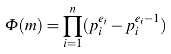

Vì giá trị của n, tức là số thừa số nguyên tố phân biệt, luôn khá nhỏ ngay cả với các số m lớn, việc tính ký hiệu tích ∏ dễ về mặt tính toán. Hãy xem một ví dụ trong đó chúng ta tính hàm phi của Euler dùng định lý.

Ví dụ 6.10. Cho m = 240. Phân tích thừa số chính tắc của 240 là

m = 240 = 16 · 15 = 24 · 3 · 5 = p1e1 · p2e2 · p3e3

Có ba thừa số nguyên tố phân biệt, tức là n = 3. Giá trị của hàm phi Euler khi đó suy ra là:

Φ(m) = (24 − 23)(31 − 30)(51 − 50) = 8 · 2 · 4 = 64.

Điều đó có nghĩa là 64 số nguyên trong khoảng {0,1,...,239} nguyên tố cùng nhau với m = 240. Phương pháp thay thế, vốn đòi hỏi chúng ta tính gcd 240 lần, sẽ chậm hơn nhiều ngay cả với số nhỏ này.

◇

Cần nhấn mạnh rằng chúng ta cần biết phân tích thừa số của m để tính nhanh hàm phi của Euler theo cách này. Như chúng ta sẽ thấy trong chương tiếp theo, tính chất này là cốt lõi của scheme public-key RSA: Nếu biết phân tích thừa số của một số nhất định, chúng ta có thể tính hàm phi của Euler và giải mã ciphertext. Ngược lại, nếu không biết phân tích thừa số, chúng ta không thể tính hàm phi và, do đó, không thể giải mã. Trong RSA, chủ sở hữu private key biết phân tích thừa số nhưng không ai khác biết.

### 6.3.4 Định lý nhỏ Fermat và định lý Euler

Tiếp theo chúng tôi mô tả hai định lý khá hữu ích trong public-key cryptography. Chúng ta bắt đầu với Định lý nhỏ Fermat (Fermat’s Little Theorem).[^1] Định lý hữu ích cho việc kiểm tra tính nguyên tố và trong nhiều khía cạnh khác của public-key cryptography. Định lý cho một kết quả có vẻ bất ngờ nếu chúng ta thực hiện lũy thừa modulo một số nguyên.

> Định lý 6.3.2 Định lý nhỏ Fermat (Fermat’s Little Theorem)
>
> Cho a là một số nguyên và p là một số nguyên tố, khi đó:
>
> ap ≡ a mod p

Chúng tôi lưu ý rằng số học trong finite field GF(p) được thực hiện modulo p, và do đó, định lý đúng với mọi số nguyên a là phần tử của một finite field GF (p). Định lý có thể được phát biểu dưới dạng:

ap−1 ≡ 1 mod p

điều thường hữu ích trong cryptography. Một ứng dụng là tính inverse trong một finite field. Chúng ta có thể viết lại phương trình thành a · ap−2 ≡ 1 mod p. Đây chính xác là định nghĩa của inverse nhân. Do đó, chúng ta ngay lập tức có một cách tính inverse của một số nguyên a modulo một số nguyên tố:

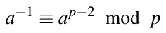 (6.7)

Chúng tôi lưu ý rằng phương pháp nghịch đảo này chỉ đúng nếu p là số nguyên tố. Hãy xem một ví dụ.

Ví dụ 6.11. Cho p = 7 và a = 2. Chúng ta có thể tính inverse của a là:

ap−2 = 25 = 32 ≡ 4 mod 7.

Điều này dễ kiểm chứng: 2 · 4 ≡ 1 mod 7

◇

Thực hiện phép lũy thừa trong Phương trình (6.7) thường chậm hơn dùng extended Euclidean algorithm. Tuy nhiên, có những tình huống mà dùng Định lý nhỏ Fermat có lợi, ví dụ, trên smart card hoặc các thiết bị khác vốn đã có bộ tăng tốc hardware cho phép lũy thừa nhanh. Điều này không hiếm vì nhiều thuật toán public-key cần phép lũy thừa, như chúng ta sẽ thấy trong các chương sau.

Một sự tổng quát hóa của Định lý nhỏ Fermat cho modulo là số nguyên bất kỳ, tức là modulo không nhất thiết là số nguyên tố, là định lý Euler.

> Định lý 6.3.3 Định lý Euler (Euler’s Theorem)
>
> Cho a và m là các số nguyên với gcd(a,m) = 1, khi đó:
>
> aΦ(m) ≡ 1 mod m

Vì định lý được định nghĩa modulo m, nó áp dụng được cho các integer ring ℤm. Bây giờ chúng tôi trình bày một ví dụ về định lý Euler với các giá trị nhỏ.

Ví dụ 6.12. Cho m = 12 và a = 5. Trước hết, chúng ta tính hàm phi của Euler của m:

Φ(12) = Φ(22 · 3) = (22 − 21)(31 − 30) = (4 − 2)(3 − 1) = 4

Bây giờ chúng ta có thể kiểm chứng định lý Euler:

5Φ(12) = 54 = 252 = 625 ≡ 1 mod 12

◇

Dễ chỉ ra rằng Định lý nhỏ Fermat là một trường hợp đặc biệt của định lý Euler. Nếu p là số nguyên tố, ta có Φ(p) = (p1 − p0) = p − 1. Nếu dùng giá trị này cho định lý Euler, ta được: aΦ(p) = ap−1 ≡ 1 mod p, chính xác là Định lý nhỏ Fermat.

## 6.4 Thảo luận và đọc thêm (Discussion and Further Reading)

Public-Key Cryptography nói chung Asymmetric cryptography được giới thiệu trong bài báo mang tính bước ngoặt của Whitfield Diffie và Martin Hellman [93]. Ralph Merkle đã độc lập phát minh ra khái niệm asymmetric cryptography nhưng đề xuất một thuật toán public-key hoàn toàn khác [190]. Có một vài bài tường thuật tốt về lịch sử public-key cryptography. Bài viết [92] của Diffie được khuyến nghị. Một tổng quan tốt khác về public-key cryptography là [199]. Một lịch sử rất bổ ích và chi tiết về elliptic curve cryptography, bao gồm cuộc cạnh tranh tương đối gay gắt giữa RSA và ECC trong những năm 1990, được mô tả trong [162]. Các phát triển gần đây hơn trong asymmetric cryptography được theo dõi qua chuỗi hội nghị Conference on Public-Key Cryptography (PKC).

Các thuật toán Public-Key khác Ngoài ba họ scheme asymmetric đã được thiết lập được giới thiệu trong cuốn sách này, còn tồn tại vài họ khác. Thứ nhất, có các thuật toán đã bị phá hoặc được tin là không an toàn, ví dụ, các scheme knapsack. Thứ hai, có các tổng quát hóa của các thuật toán đã được thiết lập, ví dụ, hyperelliptic curve, algebraic variety hay các scheme non-RSA factoring-based. Các scheme này dùng cùng one-way function, tức là phân tích thừa số nguyên hoặc logarit rời rạc trong một số group nhất định. Thứ ba, có các thuật toán asymmetric dựa trên các one-way function khác và được tin là an toàn. Một số scheme đó đã thu hút sự chú ý lớn trong những năm gần đây vì chúng có tiềm năng chống được tấn công bằng máy tính lượng tử. Chúng được gọi là các scheme post-quantum cryptography, và sẽ được thảo luận rất chi tiết trong Chương 12. Lý do chúng chưa được dùng trong pratice *(ghi chú: sách in pratice; đúng là practice)* cho tới nay là chúng thường có những vấn đề thực tế, như key rất dài.

Một scheme public-key khác với các tính chất rất thú vị (và không được đề cập trong cuốn sách này) là pairing-based cryptography. Ý tưởng cơ bản là dùng ánh xạ giữa hai group cryptographic hữu ích cho phép các scheme cryptographic mới dựa trên việc quy một bài toán trong một group về một bài toán khác, thường dễ hơn, trong group kia. Ban đầu pairing được dùng cho cryptanalysis. Sau đó pairing cũng đã được dùng để xây dựng các scheme cryptographic hiệu quả cho mã hóa identity-based hay mã hóa attribute-based. Đặc biệt, các protocol cryptographic dựa trên Weil pairing và Tate pairing trên elliptic curve đã thu hút sự chú ý.

Lý thuyết số sơ cấp Về toán học được giới thiệu trong chương này, các cuốn sách nhập môn về lý thuyết số được khuyến nghị trong Mục 1.5 là nguồn tốt để đọc thêm. Về mặt thực tế, extended Euclidean algorithm (EEA) là quan trọng nhất, vì hầu như mọi bản triển khai của các scheme public-key đều tích hợp nó, đặc biệt cho phép nghịch đảo modulo. Một kỹ thuật tăng tốc quan trọng cho scheme là binary EEA. Ưu điểm của nó so với EEA tiêu chuẩn là nó thay các phép chia bằng phép dịch bit. Điều này hấp dẫn với các số rất dài xuất hiện trong các scheme public-key.

## 6.5 Bài học rút ra (Lessons Learned)

■ Public-key algorithm có những khả năng mà symmetric cipher không có, đặc biệt là digital signature và các chức năng thiết lập key.

■ Public-key algorithm nặng về tính toán (một cách nói nhẹ nhàng rằng chúng chậm), và do đó không phù hợp cho mã hóa khối lượng dữ liệu lớn.

■ Chỉ có ba họ scheme public-key được dùng rộng rãi ngày nay. (Điều này trái ngược với hàng trăm thuật toán symmetric đang tồn tại.)

■ Nếu máy tính lượng tử large-scale trở nên khả dụng trong tương lai, ba scheme public-key đã được thiết lập cần được thay bằng các thuật toán post-quantum.

■ Extended Euclidean algorithm cho phép chúng ta tính nhanh inverse modulo, điều quan trọng cho hầu như mọi scheme public-key.

■ Hàm phi của Euler cho chúng ta số phần tử nhỏ hơn một số nguyên n nguyên tố cùng nhau với n. Đây là một hàm quan trọng cho scheme cryptographic RSA.

## Bài tập

6.1. Như chúng ta đã thấy trong chương này, public-key cryptography có thể được dùng cho mã hóa và trao đổi key. Hơn nữa, nó có một số tính chất (như non-repudiation) mà secret-key cryptography không cung cấp.

Vậy vì sao chúng ta vẫn dùng symmetric-key cryptography trong hầu hết các ứng dụng thực tế?

6.2. Trong bài tập này, chúng ta muốn so sánh hiệu năng tính toán của các thuật toán symmetric và asymmetric. Giả sử một thư viện public-key nhanh như OpenSSL có thể giải mã dữ liệu với tốc độ 2.5 MByte/sec dùng thuật toán RSA trên một PC hiện đại. Trên cùng máy, AES có thể giải mã với tốc độ 2.5 GByte/sec. Giả sử chúng ta muốn giải mã một bộ phim được lưu trên đĩa Blu-ray. Bộ phim cần 50 GByte dung lượng lưu trữ. Việc giải mã mất bao lâu với mỗi thuật toán?

6.3. Giả sử một công ty (nhỏ) với 120 nhân viên. Một chính sách bảo mật mới yêu cầu mọi liên lạc email giữa mọi nhân viên phải được mã hóa bằng một symmetric cipher. Cần bao nhiêu key nếu phải có một kênh an toàn riêng giữa mọi cặp bên liên lạc khả dĩ?

6.4. Trong public-key cryptography, mức bảo mật mong muốn ảnh hưởng trực tiếp tới hiệu năng của thuật toán tương ứng (xem Mục 6.2.4). Bây giờ chúng ta phân tích mối quan hệ giữa mức bảo mật và thời gian chạy.

Giả sử một web server cho một cửa hàng online có thể dùng RSA hoặc ECC để tạo chữ ký. Hơn nữa, giả sử việc tạo chữ ký cho RSA-1024 và ECC-160 lần lượt mất 15.7 ms và 1.3 ms.

1. Xác định mức tăng thời gian chạy cho việc tạo chữ ký nếu mức bảo mật của RSA tăng từ 1024 bit lên 3072 bit.

2. Thời gian chạy của RSA tăng thế nào từ 1024 bit lên 15,360 bit?

3. Xác định các con số này cho các mức bảo mật tương ứng của ECC.

4. Mô tả sự khác biệt giữa RSA và ECC khi tăng mức bảo mật.

Gợi ý: Nhớ rằng độ phức tạp tính toán của cả RSA và ECC tăng theo lập phương của độ dài bit. Bạn có thể muốn dùng Bảng 6.1 để xác định độ dài bit thích hợp cho ECC, khi cho trước mức bảo mật của RSA.

6.5. Dùng dạng cơ bản của thuật toán Euclid, tính ước chung lớn nhất của

1. 7469 và 2464

2. 2689 và 4001

3. 286,875 và 333,200

Với bài tập này, chỉ dùng máy tính bỏ túi. Thể hiện mọi bước lặp của thuật toán Euclid, tức là đừng chỉ viết ra đáp án, vốn chỉ là một con số. Ngoài ra, với mỗi gcd, đưa ra chuỗi các phép tính gcd dưới dạng:

gcd(r0,r1) = gcd(r1,r2) =···

6.6. Dùng extended Euclidean algorithm, tính ước chung lớn nhất và các tham số s và t của

1. 198 và 243

2. 1819 và 3587

3. 2931 và 5451

4. 12,351 và 42,343

Với mỗi bài, kiểm tra xem s r0 + t r1 = gcd(r0,r1) có thực sự được thỏa không. Quy tắc giống như bài tập trước: Dùng máy tính bỏ túi và thể hiện những gì xảy ra ở mỗi bước lặp.

6.7. Với thuật toán Euclid, cuối cùng chúng ta có một thuật toán hiệu quả để tìm inverse nhân trong Zm tốt hơn nhiều so với tìm kiếm vét cạn. Tìm các inverse trong Zm của các phần tử a modulo m sau:

1. a = 7, m = 26 (Lưu ý: các inverse modulo 7 hữu ích cho affine cipher)

2. a = 19, m = 999

Lưu ý rằng các inverse một lần nữa phải là phần tử trong Zm và bạn có thể dễ dàng kiểm chứng câu trả lời.

6.8. Xác định φ(m), với m = 12,15,26, theo định nghĩa: Kiểm tra với mỗi số nguyên dương n nhỏ hơn m xem gcd(n,m) = 1 hay không. (Bạn không phải áp dụng thuật toán Euclid.)

6.9. Xây dựng công thức cho φ(m) cho các trường hợp đặc biệt khi

1. m là số nguyên tố

2. m = p · q, trong đó p và q là số nguyên tố. Trường hợp này có tầm quan trọng lớn cho cryptosystem RSA. Kiểm chứng công thức của bạn với m = 15 và m = 26 bằng các kết quả từ bài tập trước.

6.10. Tính inverse a−1 mod n bằng Định lý Fermat (nếu áp dụng được) hoặc Định lý Euler:

■ a = 4, n = 7

■ a = 5, n = 12

■ a = 6, n = 13

6.11. Kiểm chứng rằng Định lý Euler đúng trong Zm, m = 6,9, với mọi phần tử a mà gcd(a,m) = 1. Cũng kiểm chứng rằng định lý không đúng với các phần tử a mà gcd(a,m) ≠ 1.

6.12. Với affine cipher trong Chương 1, inverse nhân của một phần tử modulo 26 có thể được tìm là

a−1 ≡ a11 mod 26

Suy ra hệ thức này bằng cách dùng Định lý Euler.

6.13. Extended Euclidean algorithm có các điều kiện ban đầu s0 = 1,s1 = 0,t0 = 0,t1 = 1. Suy ra các điều kiện này. Sẽ hữu ích khi xem công thức lặp tổng quát cho thuật toán Euclid đã được suy ra như thế nào trong chương này.

6.14. Trong bài tập này, chúng ta sẽ dùng thuật toán Euclid cho các phép kiểm tra độ trơn (smoothness test) của các hợp số. Smoothness test được dùng, ví dụ, trong các tấn công nhắm vào các scheme asymmetric dựa trên bài toán phân tích thừa số, đặc biệt là RSA. Các số N là “(B1,B2)-smooth” là các hợp số có thừa số nguyên tố không lớn hơn B1 và lũy thừa nguyên tố không lớn hơn B2, trong đó:

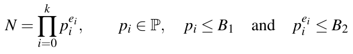

Bây giờ, chúng ta sẽ kiểm tra độ trơn của một số N.

1. Tính tích P của mọi lũy thừa nguyên tố lớn nhất thỏa các điều kiện trên với B1 = 30 và B2 = 250, tức là

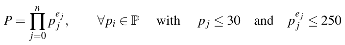

Nhận xét: Vì N sẽ chỉ gồm một vài lũy thừa nguyên tố so với P (gồm mọi lũy thừa nguyên tố), N << P sẽ đúng trong hầu hết trường hợp. Máy tính bỏ túi của bạn có thể không xử lý được các số lớn như vậy và bạn có thể cần dùng một phần mềm có thể tính các số có kích thước đó.

2. Tính gcd(P, N) với N = 29,716.

3. Điều kiện cho độ trơn liên quan tới gcd(P, N) là gì?

4. N = 29,716 có smooth với (B1,B2) = (40,300) không?

5. N = 103,730 có smooth không? Nếu không, đưa ra mọi thừa số nguyên tố lớn hơn B1 và mọi lũy thừa nguyên tố lớn hơn B2.

---

[^1]: Bạn không nên nhầm lẫn điều này với Định lý cuối cùng của Fermat (Fermat’s Last Theorem), một trong những bài toán number-theoretical nổi tiếng nhất, đã được chứng minh vào đầu những năm 1990 sau 350 năm.
