# Chương 7 Cryptosystem RSA (The RSA Cryptosystem)

Sau khi Whitfield Diffie và Martin Hellman giới thiệu public-key cryptography trong bài báo mang tính bước ngoặt năm 1976 của họ, một nhánh mới của cryptography đột nhiên mở ra. Hệ quả là các nhà cryptographer bắt đầu tìm kiếm các phương pháp để hiện thực mã hóa public-key. Năm 1977, Ronald Rivest, Adi Shamir và Leonard Adleman (xem Hình 7.1) đề xuất một scheme đã trở thành thuật toán cryptographic asymmetric được dùng rộng rãi nhất trong những năm 1980 và 1990, cụ thể là RSA. Ngay cả ngày nay, RSA vẫn rất phổ biến trong thực tế.

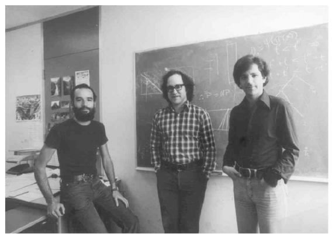

Hình 7.1 Một bức ảnh thời kỳ đầu của Adi Shamir, Ron Rivest và Leonard Adleman (từ trái sang phải, in lại với sự cho phép của Ron Rivest)

Trong chương này, bạn sẽ học:

■ RSA hoạt động như thế nào

■ Các khía cạnh thực tế của RSA, như tính toán các tham số, và mã hóa và giải mã nhanh

■ Các ước tính bảo mật và cạm bẫy khi hiện thực RSA

■ Các khía cạnh tính toán

## 7.1 Giới thiệu

Scheme cryptographic RSA, đôi khi được gọi là thuật toán Rivest–Shamir–Adleman, trong một thời gian dài là scheme cryptographic asymmetric phổ biến nhất. Ngày nay, elliptic curve và các scheme logarit rời rạc cũng được dùng rộng rãi. RSA đã được cấp bằng sáng chế ở Mỹ (nhưng không ở phần còn lại của thế giới) cho tới năm 2000.

Có nhiều ứng dụng cho RSA, nhưng trong thực tế nó thường được dùng nhất cho:

■ mã hóa các mẩu dữ liệu nhỏ, đặc biệt cho vận chuyển key,

■ digital signature, được thảo luận trong Chương 10, ví dụ, cho các digital certificate trên internet.

Tuy nhiên, cần lưu ý rằng mã hóa RSA không nhằm thay thế symmetric cipher vì nó chậm hơn vài bậc độ lớn so với các cipher như AES. Đó là do có nhiều phép tính liên quan tới việc thực hiện RSA (hay bất kỳ thuật toán public-key nào khác) như chúng ta sẽ học sau trong chương này. Do đó, công dụng chính của tính năng mã hóa là trao đổi an toàn một key cho một symmetric cipher (vận chuyển key). Trong thực tế, RSA thường được dùng cùng với một symmetric cipher như AES, trong đó symmetric cipher thực hiện việc mã hóa khối lượng dữ liệu lớn thực sự.

Hàm one-way function bên dưới của RSA là bài toán phân tích thừa số nguyên: Nhân hai số nguyên tố lớn dễ về mặt tính toán (thực ra, bạn có thể làm bằng giấy và bút chì), nhưng phân tích thừa số tích thu được rất khó. Định lý Euler (Định lý 6.3.3) và hàm phi của Euler đóng vai trò quan trọng trong RSA. Sau đây, trước hết chúng tôi mô tả cách mã hóa, giải mã và tạo key hoạt động, sau đó nói về các khía cạnh thực tế của RSA.

## 7.2 Mã hóa và giải mã

Mã hóa và giải mã RSA được thực hiện trong integer ring ℤn, và các phép tính modulo đóng vai trò trung tâm. Nhớ lại rằng ring và modular arithmetic trong ring đã được giới thiệu trong Mục 1.4.2. RSA mã hóa một plaintext x, trong đó chúng ta coi chuỗi bit biểu diễn x là một phần tử trong ℤn = {0,1,...,n − 1}. Hệ quả là giá trị nhị phân của plaintext x phải nhỏ hơn n. Điều tương tự đúng với ciphertext. Mã hóa với public key và giải mã với private key như được trình bày dưới đây.

> Mã hóa RSA Cho trước public key (n,e) = kpub và plaintext x, hàm mã hóa là:
>
> 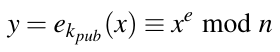 (7.1)
>
> trong đó x,y ∈ ℤn.
>
> Giải mã RSA Cho trước private key d = kpr và ciphertext y, hàm giải mã là:
>
> 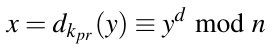 (7.2)
>
> trong đó x,y ∈ ℤn.

Trong thực tế, x, y, n và d là các số rất dài, thường từ 2048 bit trở lên. Giá trị e đôi khi được gọi là số mũ mã hóa (encryption exponent) hay số mũ công khai (public exponent), và private key d đôi khi được gọi là số mũ giải mã (decryption exponent) hay số mũ riêng (private exponent). Nếu Alice muốn gửi một thông điệp đã mã hóa tới Bob, Alice cần có public key (n,e) của Bob, và Bob giải mã bằng private key d của mình. Chúng tôi thảo luận trong Mục 7.3 cách tạo ba tham số then chốt d, e và n này.

Ngay cả khi chưa biết thêm chi tiết, chúng ta đã có thể nêu một vài yêu cầu cho cryptosystem RSA:

1. Vì kẻ tấn công có quyền truy cập public key, việc xác định private key d khi cho trước các giá trị public-key e và n phải bất khả thi về mặt tính toán.

2. Vì x chỉ duy nhất tới kích thước của modulus n, chúng ta không thể mã hóa nhiều hơn l bit với một phép mã hóa RSA, trong đó l là độ dài bit của n.

3. Việc tính xe mod n, tức là mã hóa, và yd mod n, tức là giải mã, phải tương đối dễ. Điều này có nghĩa là chúng ta cần một phương pháp lũy thừa nhanh với các số rất dài.

4. Với một n cho trước, phải có nhiều cặp private-key/public-key, nếu không kẻ tấn công có thể thực hiện brute-force attack. (Hóa ra yêu cầu này dễ thỏa.)

## 7.3 Tạo key và chứng minh tính đúng đắn

Một đặc điểm phân biệt của mọi scheme asymmetric là có một giai đoạn set-up trong đó public key và private key được tính. Tùy theo scheme asymmetric, việc tạo key có thể khá phức tạp. Như một nhận xét, chúng tôi lưu ý rằng tạo key thường không phải là vấn đề với block cipher hay stream cipher.

Đây là các bước liên quan tới việc tính public key và private key cho cryptosystem RSA.

> Tạo key RSA (RSA Key Generation)
>
> Output: public key: kpub = (n,e) và private key: kpr = (d)
>
> 1. Chọn hai số nguyên tố lớn p và q.
>
> 2. Tính n = p · q.
>
> 3. Tính Φ(n) = (p − 1)(q − 1).
>
> 4. Chọn số mũ công khai e ∈ {1,2,...,Φ(n) − 1} sao cho
>
> gcd(e,Φ(n)) = 1
>
> 5. Tính private key d sao cho
>
> d · e ≡ 1 mod Φ(n)

Điều kiện gcd(e,Φ(n)) = 1 bảo đảm rằng inverse của e tồn tại modulo Φ(n), nên luôn có một private key d.

Hai phần của việc tạo key là non-trivial: Bước 1, trong đó hai số nguyên tố lớn được chọn, cũng như Bước 4 và 5 trong đó public key và private key được tính. Việc tạo số nguyên tố ở Bước 1 khá thách thức và được đề cập trong Mục 7.6. Việc tính các key d và e có thể được làm cùng lúc dùng extended Euclidean algorithm (EEA). Trong thực tế, người ta thường bắt đầu bằng cách chọn trước một tham số công khai e trong khoảng 0 < e < Φ(n). Giá trị e phải thỏa điều kiện gcd(e,Φ(n)) = 1. Rõ ràng, nên loại trừ e = 1 vì điều này sẽ cho ra y = x. Khi đã chọn n, chúng ta áp dụng EEA với các tham số input n và e và thu được hệ thức:

gcd(Φ(n),e) = s · Φ(n) + t · e

Nếu gcd(e,Φ(n)) = 1, chúng ta biết rằng e là một public key hợp lệ. Hơn nữa, chúng ta cũng biết rằng tham số t được tính bởi extended Euclidean algorithm là inverse của e, và do đó:

d ≡ t mod Φ(n)

Nếu e và Φ(n) không nguyên tố cùng nhau, chúng ta chỉ cần chọn một giá trị mới cho e và lặp lại quá trình. Lưu ý rằng hệ số s của EEA không cần cho RSA và không cần được tính.

Bây giờ chúng ta xem RSA hoạt động như thế nào bằng cách trình bày một ví dụ với các giá trị đồ chơi.

Ví dụ 7.1. Alice muốn gửi một thông điệp đã mã hóa tới Bob. Bob trước hết tính các tham số RSA của mình ở các Bước 1–5. Sau đó anh ấy gửi cho Alice public key của mình. Alice mã hóa thông điệp (x = 4) và gửi ciphertext y tới Bob. Bob giải mã y bằng private key của mình.

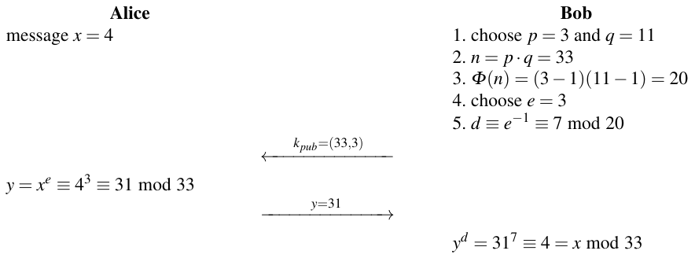

Lưu ý rằng số mũ riêng và số mũ công khai thỏa điều kiện e · d = 3 · 7 ≡ 1 mod Φ(n).

◇

Các tham số RSA thực tế lớn hơn rất, rất nhiều. Như có thể thấy từ Bảng 6.1, modulus RSA n phải dài ít nhất 2048 bit, dẫn tới độ dài bit cho p và q là 1024. Để có cảm nhận về các số trong khoảng này, chúng tôi đưa ra dưới đây một ví dụ về một instance RSA trong đó n là 1024 bit (độ dài bit này đã được dùng trong một thời gian dài):

p = E0DFD2C2A288ACEBC705EFAB30E4447541A8C5A47A37185C5A9 CB98389CE4DE19199AA3069B404FD98C801568CB9170EB712BF 10B4955CE9C9DC8CE6855C6123h

q = EBE0FCF21866FD9A9F0D72F7994875A8D92E67AEE4B515136B2 A778A8048B149828AEA30BD0BA34B977982A3D42168F594CA99 F3981DDABFAB2369F229640115h

n = CF33188211FDF6052BDBB1A37235E0ABB5978A45C71FD381A91 AD12FC76DA0544C47568AC83D855D47CA8D8A779579AB72E635 D0B0AAAC22D28341E998E90F82122A2C06090F43A37E0203C2B 72E401FD06890EC8EAD4F07E686E906F01B2468AE7B30CBD670 255C1FEDE1A2762CF4392C0759499CC0ABECFF008728D9A11ADFh

e = 40B028E1E4CCF07537643101FF72444A0BE1D7682F1EDB553E3 AB4F6DD8293CA1945DB12D796AE9244D60565C2EB692A89B888 1D58D278562ED60066DD8211E67315CF89857167206120405B0 8B54D10D4EC4ED4253C75FA74098FE3F7FB751FF5121353C554 391E114C85B56A9725E9BD5685D6C9C7EED8EE442366353DC39h

d = C21A93EE751A8D4FBFD77285D79D6768C58EBF283743D2889A3 95F266C78F4A28E86F545960C2CE01EB8AD5246905163B28D0B 8BAABB959CC03F4EC499186168AE9ED6D88058898907E61C7CC CC584D65D801CFE32DFC983707F87F5AA6AE4B9E77B9CE630E2 C0DF05841B5E4984D059A35D7270D500514891F7B77B804BED81h

Điều thú vị là thông điệp x trước hết được nâng lên lũy thừa e-th khi mã hóa và kết quả y được nâng lên lũy thừa d -th khi giải mã, và kết quả của việc này lại bằng thông điệp x. Biểu diễn trong một phương trình duy nhất, quá trình này là:

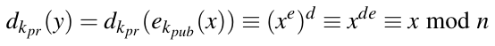 (7.3)

Đây là bản chất của RSA. Bây giờ chúng ta sẽ chứng minh vì sao scheme RSA hoạt động, tức là chứng minh tính đúng đắn (proof of correctness) so-called.

Chứng minh. Chúng ta cần chỉ ra rằng giải mã là hàm ngược của mã hóa, dkpr(ekpub(x)) = x. Chúng ta bắt đầu với quy tắc xây dựng cho public key và private key: d · e ≡ 1 mod Φ(n). Theo định nghĩa của toán tử modulo, điều này tương đương với:

d · e = 1 + t · Φ(n),

trong đó t là một số nguyên nào đó. Chèn biểu thức này vào Phương trình (7.3):

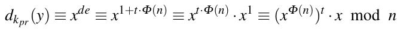 (7.4)

Điều này có nghĩa là chúng ta phải chứng minh rằng x ≡ (xΦ(n))t · x mod n. Bây giờ chúng ta dùng Định lý Euler từ Mục 6.3.3, phát biểu rằng nếu gcd(x,n) = 1 thì 1 ≡ xΦ(n) mod n. Một tổng quát hóa nhỏ suy ra ngay:

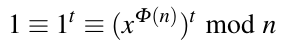 (7.5)

trong đó t là một số nguyên bất kỳ. Để chứng minh, chúng ta phân biệt hai trường hợp:

Trường hợp thứ nhất: gcd(x,n) = 1

Định lý Euler đúng ở đây và chúng ta có thể chèn Phương trình (7.5) vào (7.4):

dkpr(y) ≡ (xΦ(n))t · x ≡ 1 · x ≡ x mod n q.e.d.

Phần này của chứng minh xác lập rằng giải mã thực sự là hàm ngược của mã hóa với các giá trị plaintext x nguyên tố cùng nhau với modulus RSA n. Bây giờ chúng tôi đưa ra chứng minh cho trường hợp còn lại.

Trường hợp thứ hai: gcd(x,n) = gcd(x,p · q) ≠ 1

Vì p và q là số nguyên tố, x phải có một trong hai làm thừa số:

x = r · p or x = s · q

trong đó r, s là các số nguyên sao cho r < q và s < p. Không mất tính tổng quát, chúng ta giả sử x = r · p, từ đó suy ra gcd(x,q) = 1. Định lý Euler đúng dưới dạng sau:

1 ≡ 1t ≡ (xΦ(q))t mod q

trong đó t là một số nguyên dương bất kỳ. Bây giờ chúng ta xem lại số hạng (xΦ(n))t:

(xΦ(n))t ≡ (x(q−1)(p−1))t ≡ ((xΦ(q))t)p−1 ≡ 1(p−1) = 1 mod q

Dùng định nghĩa của toán tử modulo, điều này tương đương với:

(xΦ(n))t = 1 + u · q

trong đó u là một số nguyên nào đó. Chúng ta nhân phương trình này với x:

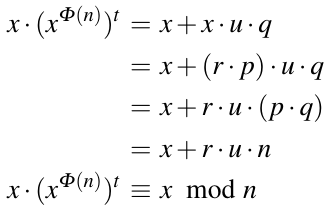 (7.6)

Chèn Phương trình (7.6) vào Phương trình (7.4) cho ra kết quả mong muốn:

dkpr = (xΦ(n))t · x ≡ x mod n

□

Nếu chứng minh này có vẻ hơi dài, hãy nhớ rằng tính đúng đắn của RSA đơn giản được bảo đảm bởi Bước 5 của giai đoạn tạo key RSA. Chứng minh trở nên đơn giản hơn khi dùng Định lý số dư Trung Hoa (Chinese Remainder Theorem), mà chúng tôi chưa giới thiệu.

## 7.4 Mã hóa và giải mã: Lũy thừa nhanh

Khác với các thuật toán symmetric như AES, DES hay stream cipher, các thuật toán public-key dựa trên số học với các số rất dài. Trừ khi chú ý kỹ cách hiện thực các phép tính cần thiết, chúng ta dễ dàng kết thúc với các scheme quá chậm để dùng thực tế. Nếu xem mã hóa và giải mã RSA trong Phương trình (7.1) và (7.2), chúng ta thấy rằng cả hai đều dựa trên lũy thừa modulo. Chúng tôi nhắc lại cả hai phép toán ở đây cho tiện:

y = ekpub(x) ≡ xe mod n (mã hóa)

x = dkpr(y) ≡ yd mod n (giải mã)

Một cách lũy thừa đơn giản trông như sau:

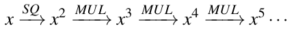

trong đó SQ ký hiệu bình phương và MUL phép nhân. Đáng tiếc, các số mũ e và d nói chung là các số rất lớn. Các số mũ thường được chọn trong khoảng 2048...3072 bit hoặc thậm chí lớn hơn. (Số mũ công khai e đôi khi được chọn là một giá trị nhỏ, nhưng d luôn rất dài.) Do đó, lũy thừa đơn giản như trình bày ở trên sẽ cần khoảng 22048 phép nhân hoặc nhiều hơn. Vì số nguyên tử trong vũ trụ quan sát được ước tính khoảng 2300, việc tính 22048 phép nhân để thiết lập một phiên an toàn cho trình duyệt web của chúng ta không hấp dẫn lắm. Câu hỏi trung tâm là liệu có các phương pháp lũy thừa nhanh hơn đáng kể hay không. May mắn là câu trả lời là có. Nếu không chúng ta có thể quên RSA và nhiều cryptosystem public-key khác đang dùng ngày nay, vì tất cả đều dựa vào lũy thừa. Một phương pháp như vậy là thuật toán square-and-multiply. Trước hết chúng tôi trình bày một vài ví dụ minh họa với các số nhỏ trước khi trình bày thuật toán thực sự.

Ví dụ 7.2. Hãy xem cần bao nhiêu phép nhân để tính phép lũy thừa đơn giản x8. Với phương pháp đơn giản:

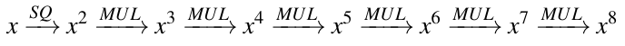

chúng ta cần bảy phép nhân và bình phương. Ngoài ra, chúng ta có thể làm nhanh hơn:

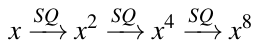

chỉ cần ba phép bình phương và một phép bình phương gần như phức tạp ngang một phép nhân.

◇

Phương pháp nhanh này hoạt động tốt nhưng bị giới hạn ở các số mũ là lũy thừa của 2, tức là các giá trị e và d có dạng 2i. Bây giờ câu hỏi là liệu chúng ta có thể mở rộng phương pháp cho các số mũ tùy ý hay không. Hãy xem một ví dụ khác.

Ví dụ 7.3. Lần này chúng ta có số mũ tổng quát hơn 26, tức là chúng ta muốn tính x26. Một lần nữa, phương pháp ngây thơ (naïve) sẽ cần 25 phép nhân. Một cách nhanh hơn như sau:

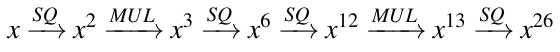

Cách tiếp cận này cần tổng cộng sáu phép toán, hai phép nhân và bốn phép bình phương.

◇

Nhìn vào ví dụ cuối, chúng ta thấy rằng có thể đạt kết quả mong muốn bằng cách thực hiện hai phép toán cơ bản:

1. bình phương kết quả hiện tại,

2. nhân kết quả hiện tại với phần tử cơ sở x.

Trong ví dụ trên, chúng ta đã tính chuỗi SQ, MUL, SQ, SQ, MUL, SQ. Tuy nhiên, chúng ta không biết chuỗi trong đó các phép bình phương và phép nhân phải được thực hiện cho các số mũ khác. Một giải pháp là thuật toán square-and-multiply. Nó cung cấp một cách có hệ thống để tìm chuỗi trong đó chúng ta phải thực hiện các phép bình phương và phép nhân với x để tính xH. Nói đại khái, thuật toán hoạt động như sau:

Thuật toán dựa trên việc quét các bit của số mũ từ trái (bit có trọng số cao nhất) sang phải (bit có trọng số thấp nhất). Ở mỗi lần lặp, tức là với mỗi bit số mũ, kết quả hiện tại được bình phương. Nếu và chỉ nếu bit số mũ đang được quét có giá trị 1, một phép nhân kết quả hiện tại với x được thực thi sau phép bình phương. Sau mỗi phép toán, một phép rút gọn modulo được thực hiện.

Điều này có vẻ là một quy tắc đơn giản nhưng hơi kỳ lạ. Để hiểu rõ hơn, hãy xem lại ví dụ ở trên. Lần này, hãy chú ý kỹ các bit số mũ.

Ví dụ 7.4. Chúng ta lại xét phép lũy thừa x26. Với thuật toán square-and-multiply, biểu diễn nhị phân của số mũ là then chốt:

x26 = x110102 = x(h4h3h2h1 h0)2.

Thuật toán quét các bit số mũ, bắt đầu từ bên trái với h4 và kết thúc với bit ngoài cùng bên phải h0.

Bước

\#0 x = x12 thiết lập ban đầu, bit được xử lý: h4 = 1

\#1a (x1)2 = x2 = x102 SQ, bit được xử lý: h3

\#1b x2 · x = x3 = x102x12 = x112 MUL, vì h3 = 1

\#2a (x3)2 = x6 = (x112)2 = x1102 SQ, bit được xử lý: h2

\#2b không MUL, vì h2 = 0

\#3a (x6)2 = x12 = (x1102)2 = x11002 SQ, bit được xử lý: h1

\#3b x12 · x = x13 = x11002x12 = x11012 MUL, vì h1 = 1

\#4a (x13)2 = x26 = (x11012)2 = x110102 SQ, bit được xử lý: h0

\#4b không MUL, vì h0 = 0

Để hiểu thuật toán, sẽ hữu ích khi quan sát kỹ biểu diễn nhị phân của số mũ thay đổi như thế nào. Chúng ta thấy rằng phép toán cơ bản thứ nhất, bình phương, dẫn tới một phép dịch trái của số mũ, với một số 0 được đặt ở vị trí ngoài cùng bên phải. Phép toán cơ bản kia, nhân với x, dẫn tới việc điền một số 1 vào vị trí ngoài cùng bên phải của số mũ. Hãy so sánh các số mũ được tô sáng thay đổi thế nào từ lần lặp này sang lần lặp khác.

◇

Đây là mã giả cho thuật toán square-and-multiply:

> Thuật toán Square-and-Multiply cho lũy thừa modulo
>
> Input:
>
> phần tử cơ sở x
>
> số mũ H = ∑i=0t hi2i, với hi ∈ 0,1 và ht = 1
>
> modulus n
>
> Output: xH mod n
>
> Khởi tạo: r = x
>
> Thuật toán:
>
> 1 FOR i = t − 1 DOWNTO 0
>
> 1.1 r ≡ r2 mod n
>
> IF hi = 1
>
> 1.2 r ≡ r · x mod n
>
> 2 RETURN (r)

Phép rút gọn modulo được áp dụng sau mỗi phép nhân và bình phương để giữ các kết quả trung gian nhỏ. Sẽ hữu ích khi so sánh mã giả này với mô tả bằng lời của thuật toán ở trên.

Bây giờ chúng ta xác định độ phức tạp của thuật toán square-and-multiply với một số mũ H có độ dài bit t + 1, tức là ⌈log2H⌉ = t + 1. Số phép bình phương độc lập với giá trị thực của H, nhưng số phép nhân bằng Hamming weight, tức là số bit một trong biểu diễn nhị phân của nó. Do đó, chúng tôi đưa ra ở đây số phép nhân trung bình, ký hiệu là MUL:

\#SQ = t

\#MUL = 0.5 t

Vì các số mũ được dùng trong cryptography thường có tính chất ngẫu nhiên tốt, giả định rằng một nửa số bit của chúng có giá trị một thường là một xấp xỉ hợp lệ.

Ví dụ 7.5. Trung bình cần bao nhiêu phép toán cho một phép lũy thừa với số mũ 2048-bit?

Lũy thừa đơn giản cần 22048 ≈ 10600 phép nhân. Điều đó hoàn toàn bất khả thi, bất kể chúng ta có trong tay tài nguyên máy tính nào. Tuy nhiên, thuật toán square-and-multiply chỉ cần

1.5 · 2048 = 3072

phép bình phương và phép nhân trung bình. Đây là một ví dụ ấn tượng về sự khác biệt giữa một thuật toán có độ phức tạp tuyến tính (lũy thừa đơn giản) và độ phức tạp logarit (thuật toán square-and-multiply). Tuy nhiên, hãy nhớ rằng mỗi phép trong 3072 phép bình phương và phép nhân riêng lẻ đều liên quan tới các số 2048-bit. Điều đó có nghĩa là số phép toán số nguyên trên CPU cao hơn nhiều so với 3072 nhưng chắc chắn làm được trên các máy tính hiện đại.

◇

## 7.5 Các kỹ thuật Speed-Up cho RSA

Như chúng ta đã học trong Mục 7.4, RSA liên quan tới phép lũy thừa với các số rất dài. Ngay cả khi số học low-level gồm phép nhân và bình phương modulo cũng như thuật toán square-and-multiply được hiện thực cẩn thận, việc thực hiện một phép lũy thừa RSA đầy đủ với các toán hạng dài 2048 bit trở lên vẫn nặng về tính toán. Do đó, người ta đã nghiên cứu các kỹ thuật speed-up cho RSA từ khi nó được phát minh. Chúng tôi giới thiệu hai kỹ thuật tăng tốc tổng quát phổ biến nhất dưới đây.

### 7.5.1 Mã hóa nhanh với số mũ công khai ngắn

Một mẹo đơn giản đến bất ngờ và rất mạnh có thể được dùng khi liên quan tới các phép toán RSA với public key e. Trong thực tế, đó là mã hóa và, như chúng ta sẽ học sau, kiểm chứng một digital signature RSA. Trong tình huống này, public key e có thể được chọn là một giá trị rất nhỏ. Trong thực tế, ba giá trị e = 3, e = 17 và e = 216 + 1 có tầm quan trọng đặc biệt. Các độ phức tạp thu được khi dùng các public key này được cho trong Bảng 7.1.

Bảng 7.1 Độ phức tạp của lũy thừa RSA với số mũ công khai ngắn

| public key e | e dạng chuỗi nhị phân | #MUL + #SQ |
|---|---|---|
| 3 | 112 | 2 |
| 17 | 100012 | 5 |
| 216 + 1 | 1 0000 0000 0000 00012 | 17 |

Các độ phức tạp này nên được so sánh với 1.5 t phép nhân và bình phương cần cho các số mũ có độ dài đầy đủ. Ở đây t + 1 là độ dài bit của modulus RSA n, tức là ⌈log2n⌉ = t + 1. Chúng tôi lưu ý rằng cả ba số mũ liệt kê ở trên đều có Hamming weight thấp, tức là số bit một trong biểu diễn nhị phân. Điều này dẫn tới số phép toán đặc biệt thấp để thực hiện một phép lũy thừa. Thú vị là RSA vẫn an toàn nếu dùng các số mũ ngắn như vậy. Lưu ý rằng nói chung, private key d vẫn có độ dài bit đầy đủ t + 1 dù e ngắn.

Một hệ quả quan trọng của việc dùng số mũ công khai ngắn là mã hóa một thông điệp và kiểm chứng một chữ ký RSA là các phép toán rất nhanh. Thực ra, với hai phép toán này, RSA trong hầu như mọi trường hợp thực tế là scheme public-key nhanh nhất hiện có. Đáng tiếc, không có cách dễ dàng như vậy để tăng tốc RSA khi liên quan tới private key d, tức là cho giải mã và tạo chữ ký. Do đó, hai phép toán này có xu hướng chậm. Các thuật toán public-key khác, đặc biệt là elliptic curve, thường nhanh hơn nhiều cho hai phép toán này. Mục sau cho thấy cách chúng ta có thể đạt một mức speed-up vừa phải hơn khi dùng số mũ riêng d.

### 7.5.2 Giải mã nhanh với Định lý số dư Trung Hoa (Chinese Remainder Theorem)

Chúng ta không thể chọn một private key ngắn mà không làm tổn hại bảo mật của RSA. Nếu chọn các key d ngắn như các key trong trường hợp mã hóa ở mục trên, kẻ tấn công có thể đơn giản brute-force mọi số khả dĩ tới một độ dài bit cho trước, tức là 50 bit. Nhưng ngay cả khi các số lớn hơn, giả sử 128 bit, vẫn có các tấn công khôi phục key. Thực ra, có thể chỉ ra rằng private key phải có độ dài ít nhất 0.3 t bit, trong đó t là độ dài bit của modulus n. Trong thực tế, e thường được chọn ngắn và d có độ dài bit đầy đủ. Thay vào đó, người ta áp dụng một phương pháp dựa trên Định lý số dư Trung Hoa (Chinese Remainder Theorem, CRT). Chúng tôi không giới thiệu bản thân CRT ở đây mà chỉ cách nó được áp dụng để tăng tốc giải mã RSA và tạo chữ ký.

Mục tiêu của chúng ta là thực hiện phép lũy thừa yd mod n một cách hiệu quả. Trước hết chúng tôi lưu ý rằng bên sở hữu private key cũng biết các số nguyên tố p và q. Ý tưởng cơ bản của CRT là thay vì làm số học với một modulus “dài” n, chúng ta thực hiện hai phép lũy thừa riêng lẻ modulo hai số nguyên tố “ngắn” p và q. Đây là một loại số học biến đổi. Như mọi phép biến đổi, có ba bước: biến đổi vào miền CRT, tính toán trong miền CRT, và biến đổi ngược kết quả. Ba bước đó được giải thích dưới đây.

#### Biến đổi input vào miền CRT

Chúng ta chỉ cần rút gọn phần tử cơ sở x modulo hai thừa số p và q của modulus n, và thu được cái được gọi là biểu diễn modulo của y.

yp ≡ y mod p

yq ≡ y mod q

#### Lũy thừa trong miền CRT

Với các phiên bản rút gọn của y, chúng ta thực hiện hai phép lũy thừa sau:

xp ≡ ypdp mod p

xq ≡ yqdq mod q

trong đó hai số mũ mới được cho bởi:

dp ≡ d mod (p − 1)

dq ≡ d mod (q − 1)

Lưu ý rằng cả hai số mũ trong miền biến đổi, dp và dq, lần lượt bị chặn bởi p và q. Điều tương tự đúng với các kết quả đã biến đổi xp và xq. Vì hai số nguyên tố trong thực tế được chọn có độ dài bit gần bằng nhau, hai số mũ cũng như xp và xq có độ dài bit khoảng một nửa của n.

#### Biến đổi ngược về miền bài toán

Bước còn lại bây giờ là ghép kết quả cuối cùng x từ biểu diễn modulo (xp,xq) của nó. Điều này suy ra từ CRT và có thể được làm như sau:

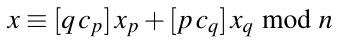 (7.7)

trong đó các hệ số cp và cq được tính là:

cp ≡ q−1 mod p, cq ≡ p−1 mod q

Vì các số nguyên tố rất ít khi thay đổi đối với một hiện thực RSA cho trước, hai biểu thức trong ngoặc trong Phương trình (7.7) có thể được tính trước. Sau khi tính trước, toàn bộ phép biến đổi ngược đạt được chỉ với hai phép nhân modulo và một phép cộng modulo.

Trước khi xét độ phức tạp của RSA với CRT, hãy xem một ví dụ với các tham số đồ chơi.

Ví dụ 7.6. Cho các tham số RSA được cho bởi:

p = 11 e = 7

q = 13 d ≡ e−1 ≡ 103 mod 120

n = p · q = 143

Bây giờ chúng ta tính một phép giải mã RSA cho ciphertext y = 15 dùng CRT, tức là giá trị yd ≡ 15103 mod 143. Ở bước thứ nhất, chúng ta tính biểu diễn modulo của y:

yp ≡ 15 ≡ 4 mod 11

yq ≡ 15 ≡ 2 mod 13

Ở bước thứ hai, chúng ta thực hiện phép lũy thừa trong miền biến đổi với các số mũ ngắn. Chúng là:

dp ≡ 103 ≡ 3 mod 10

dq ≡ 103 ≡ 7 mod 12

Đây là các phép lũy thừa:

xp ≡ ypdp = 43 = 64 ≡ 9 mod 11

xq ≡ yqdq = 27 = 128 ≡ 11 mod 13

Ở bước cuối, chúng ta phải tính x từ biểu diễn modulo (xp,xq) của nó. Để làm điều này, chúng ta cần các hệ số:

cp = 13−1 ≡ 2−1 ≡ 6 mod 11 cq = 11−1 ≡ 6 mod 13

Plaintext x bây giờ suy ra là:

x ≡ [qcp]xp + [pcq]xq mod n

x ≡ [13 · 6]9 + [11 · 6]11 mod 143

x ≡ 702 + 726 = 1428 ≡ 141 mod 143

◇

Nếu muốn kiểm chứng kết quả, bạn có thể tính yd mod 143 dùng thuật toán square-and-multiply.

Bây giờ chúng ta sẽ xác lập độ phức tạp tính toán của phương pháp CRT. Nếu xem ba bước liên quan tới phép lũy thừa CRT-based, chúng ta kết luận rằng với một phân tích độ phức tạp thực tế, phép biến đổi và phép biến đổi ngược có thể được bỏ qua vì các phép toán liên quan không đáng kể so với các phép lũy thừa thực sự trong miền biến đổi. Cho tiện, chúng tôi nhắc lại các phép lũy thừa CRT này ở đây:

xp ≡ ypdp mod p

xq ≡ yqdq mod q

Nếu giả sử n có t + 1 bit, cả p và q đều dài khoảng t/2 bit. Mọi số liên quan tới các phép lũy thừa CRT, tức là xp, xq, dp và dq, lần lượt bị chặn kích thước bởi p và q, và do đó cũng có độ dài khoảng t/2 bit. Nếu dùng thuật toán square-and-multiply cho hai phép lũy thừa, mỗi phép cần trung bình khoảng 1.5 t/2 phép nhân và bình phương modulo. Cộng lại, số phép nhân và bình phương do đó là:

\#SQ +#MUL = 2 · 1.5 t/2 = 1.5t

Điều này có vẻ chính xác là cùng độ phức tạp tính toán như phép lũy thừa thông thường không có CRT. Tuy nhiên, mỗi phép nhân và bình phương liên quan tới các số có độ dài bằng một nửa modulus, tức là chỉ t/2 bit. Điều này trái ngược với các phép toán không có CRT, trong đó mỗi phép nhân được thực hiện với các biến t-bit. Vì độ phức tạp của phép nhân giảm theo bình phương độ dài bit, mỗi phép nhân t/2-bit nhanh hơn bốn lần so với một phép nhân t-bit.[^1] Do đó, tổng speed-up thu được qua CRT là hệ số 4. Mức speed-up hệ số bốn này có thể rất giá trị trong thực tế. Vì hầu như không có nhược điểm nào, các phép lũy thừa CRT-based được dùng trong nhiều sản phẩm cryptographic, ví dụ, cho mã hóa trình duyệt web. Phương pháp cũng đặc biệt giá trị cho các hiện thực trên smart card hoặc các thiết bị IoT nhỏ, vốn chỉ được trang bị các vi xử lý nhỏ. Ở đây, việc ký số thường cần thiết, liên quan tới key bí mật d. Bằng cách áp dụng CRT cho việc tính chữ ký, thiết bị nhúng nhanh gấp bốn lần. Chẳng hạn, nếu một phép lũy thừa RSA 2048-bit thông thường mất 3 giây, dùng CRT giảm thời gian đó xuống 0.75 giây. Sự tăng tốc này có thể tạo nên khác biệt giữa một sản phẩm được khách hàng chấp nhận cao (0.75 s) và một sản phẩm có độ trễ không chấp nhận được cho nhiều ứng dụng (3 s). Ví dụ này là một minh chứng tốt về việc lý thuyết số cơ bản có thể có ảnh hưởng trực tiếp trong thế giới thực như thế nào.

## 7.6 Tìm số nguyên tố lớn

Có một khía cạnh thực tế quan trọng của RSA mà chúng ta chưa thảo luận: tạo các số nguyên tố p và q ở Bước 1 của việc tạo key, xem Mục 7.3. Vì tích của chúng là modulus RSA n = p · q, hai số nguyên tố phải có độ dài bit khoảng một nửa của n. Chẳng hạn, nếu muốn thiết lập RSA với modulus độ dài ⌈log2n⌉ = 2048, p và q phải có độ dài bit khoảng 1024 bit. Cách tiếp cận chung là tạo ngẫu nhiên các số nguyên rồi kiểm tra tính nguyên tố của chúng, như mô tả trong Hình 7.2, trong đó RNG là viết tắt của random number generator. RNG phải non-predictable vì kẻ tấn công có thể tính hay đoán một trong hai số nguyên tố có thể dễ dàng phá RSA, như chúng ta sẽ thấy sau trong chương này.

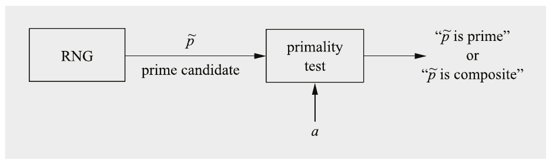

Hình 7.2 Cách tiếp cận cơ bản để tạo số nguyên tố cho RSA

Để cách tiếp cận này hoạt động, chúng ta phải trả lời hai câu hỏi:

1. Chúng ta phải kiểm tra bao nhiêu số nguyên ngẫu nhiên trước khi có một số nguyên tố? (Nếu khả năng gặp số nguyên tố quá nhỏ, có thể mất quá lâu.)

2. Chúng ta có thể kiểm tra nhanh đến mức nào xem một số nguyên ngẫu nhiên có phải số nguyên tố không? (Một lần nữa, nếu phép kiểm tra quá chậm, cách tiếp cận là không thực tế.)

Hóa ra cả hai bước đều nhanh ở mức hợp lý, như được thảo luận dưới đây.

### 7.6.1 Số nguyên tố phổ biến đến mức nào?

Trước hết chúng tôi sẽ trả lời câu hỏi liệu khả năng một số nguyên p được chọn ngẫu nhiên là số nguyên tố có đủ cao hay không. Chúng ta biết từ việc nhìn vài số nguyên dương đầu tiên rằng các số nguyên tố trở nên thưa hơn khi giá trị tăng:

2,3,5,7,11,13,17,19,23,29,31,37,...

Câu hỏi là liệu vẫn còn cơ hội hợp lý để một số ngẫu nhiên với, giả sử, 1024 bit, là số nguyên tố hay không. May mắn là đúng như vậy. Cơ hội để một số nguyên p̃ được chọn ngẫu nhiên là số nguyên tố suy ra từ định lý số nguyên tố (prime number theorem) nổi tiếng và xấp xỉ 1/ln(p̃). Trong thực tế, chúng ta chỉ kiểm tra các số lẻ nên khả năng tăng gấp đôi. Do đó, xác suất để một số lẻ ngẫu nhiên p̃ là số nguyên tố là:

P(p̃ là số nguyên tố) ≈ 2/ln(p̃)

Để có cảm nhận tốt hơn về ý nghĩa của xác suất này cho các số nguyên tố RSA, hãy xem một ví dụ.

Ví dụ 7.7. Với RSA có modulus 2048-bit n, các số nguyên tố p và q mỗi số phải có độ dài khoảng 1024 bit, tức là p,q ≈ 21024. Xác suất để một số lẻ ngẫu nhiên p̃ là số nguyên tố là

P(p̃ là số nguyên tố) ≈ 2/(ln(21024)) = 2/(1024 ln(2)) ≈ 1/354

Điều này có nghĩa là chúng ta kỳ vọng kiểm tra 354 số lẻ ngẫu nhiên trước khi tìm được một số nguyên tố. Nếu phép kiểm tra tính nguyên tố nhanh ở mức hợp lý, 354 lần kiểm tra là khả thi.

◇

Khả năng các số nguyên là số nguyên tố giảm chậm, tỉ lệ với độ dài bit của số nguyên. Điều này có nghĩa là ngay cả với các tham số RSA rất dài, giả sử với 4096 bit, mật độ số nguyên tố vẫn đủ cao.

### 7.6.2 Kiểm tra tính nguyên tố (Primality Test)

Bước còn lại chúng ta phải làm là quyết định xem các số nguyên p̃ được tạo ngẫu nhiên có phải là số nguyên tố không. Ý tưởng đầu tiên có thể là phân tích thừa số số đang xét. Tuy nhiên, với các số được dùng trong RSA, phân tích thừa số là không khả thi vì p và q quá lớn. (Thực ra, chúng ta đặc biệt chọn các số không thể phân tích thừa số vì phân tích thừa số n là tấn công tốt nhất đã biết nhắm vào RSA.) Tuy nhiên, tình hình không vô vọng. Nhớ rằng chúng ta không quan tâm tới phân tích thừa số của p̃. Thay vào đó chúng ta chỉ cần phát biểu (nhị phân) liệu số đang được kiểm tra có phải là số nguyên tố hay không. Hóa ra các phép kiểm tra tính nguyên tố như vậy dễ hơn rất, rất nhiều về mặt tính toán so với phân tích thừa số. Các ví dụ về phép kiểm tra tính nguyên tố là phép kiểm tra Fermat, phép kiểm tra Miller–Rabin hoặc các biến thể của chúng. Chúng tôi giới thiệu các thuật toán kiểm tra tính nguyên tố trong mục này.

Các phép kiểm tra tính nguyên tố thực tế hoạt động hơi bất thường: Nếu số nguyên p̃ đang xét được đưa vào một thuật toán kiểm tra tính nguyên tố, câu trả lời là hoặc

1. “p̃ là hợp số” (tức là không phải số nguyên tố), luôn là một phát biểu đúng, hoặc

2. “p̃ là số nguyên tố”, chỉ đúng với một xác suất nhất định.

Nếu output của thuật toán là “hợp số”, tình hình rõ ràng: Số nguyên đang xét không phải số nguyên tố và có thể bị loại bỏ. Nếu phát biểu output là “số nguyên tố”, p̃ có lẽ là số nguyên tố. Tuy nhiên, trong những trường hợp hiếm, một số nguyên dẫn tới phát biểu “số nguyên tố” nhưng nó nói dối, tức là nó cho ra một câu trả lời dương sai. Có một cách xử lý hành vi này. Các phép kiểm tra tính nguyên tố thực tế là các thuật toán xác suất. Điều đó có nghĩa là chúng có một tham số thứ hai a làm input có thể được chọn ngẫu nhiên. Nếu một hợp số p̃ cùng với một tham số a cho ra phát biểu sai “p̃ là số nguyên tố”, chúng ta lặp lại phép kiểm tra lần thứ hai với một giá trị khác cho a. Chiến lược chung là kiểm tra một ứng viên nguyên tố p̃ nhiều lần với vài giá trị ngẫu nhiên khác nhau a sao cho khả năng cặp (p̃,a) nói dối mọi lần là đủ nhỏ, giả sử, nhỏ hơn 2−80. Nhớ rằng ngay khi phát biểu “p̃ là hợp số” xuất hiện, chúng ta biết chắc chắn rằng p̃ không phải số nguyên tố và có thể loại bỏ nó.

#### Phép kiểm tra tính nguyên tố Fermat

Một phép kiểm tra tính nguyên tố dựa trên Định lý nhỏ Fermat, Định lý (6.3.2).

> Phép kiểm tra tính nguyên tố Fermat (Fermat Primality Test)
>
> Input: ứng viên nguyên tố p̃ và tham số bảo mật s
>
> Output: phát biểu “p̃ là hợp số” hoặc “p̃ có khả năng là số nguyên tố”
>
> Thuật toán:
>
> 1 FOR i = 1 TO s
>
> 1.1 chọn ngẫu nhiên a ∈ {2,3,..., p̃ −2}
>
> 1.2 IF ap̃−1 ≢ 1 mod p̃
>
> 1.3 RETURN (“p̃ là hợp số”)
>
> 2 RETURN (“p̃ có khả năng là số nguyên tố”)

Ý tưởng đằng sau phép kiểm tra là định lý đúng với mọi số nguyên tố. Do đó, nếu tìm được một số mà ap̃−1 ≢ 1 ở Bước 1.2, chắc chắn nó không phải số nguyên tố. Tuy nhiên, điều ngược lại không đúng. Có thể có những hợp số thực sự thỏa điều kiện ap̃−1 ≡ 1. Để phát hiện chúng, thuật toán được chạy s lần với các giá trị a khác nhau.

Đáng tiếc, có một số hợp số nhất định hoạt động như số nguyên tố trong phép kiểm tra Fermat với nhiều giá trị a. Đó là các số Carmichael. Cho một số Carmichael C, biểu thức sau đúng với mọi số nguyên a mà gcd(a,C) = 1:

aC−1 ≡ 1 mod C

Các hợp số đặc biệt như vậy rất hiếm. Chẳng hạn, chỉ tồn tại khoảng 100,000 số Carmichael dưới 1015.

Ví dụ 7.8. Số Carmichael

n = 561 = 3 · 11 · 17 là một số Carmichael vì

a560 ≡ 1 mod 561

với mọi a mà gcd(a,561) = 1.

◇

Nếu các thừa số nguyên tố của một số Carmichael đều lớn, chỉ có ít cơ số a mà với chúng phép kiểm tra Fermat phát hiện được số đó thực ra là hợp số. Vì lý do này, phép kiểm tra Miller–Rabin mạnh hơn thường được dùng trong thực tế để tạo số nguyên tố RSA.

#### Phép kiểm tra tính nguyên tố Miller–Rabin

Khác với phép kiểm tra Fermat, phép kiểm tra Miller–Rabin không có hợp số nào mà với chúng một số lượng lớn phần tử cơ sở a cho ra phát biểu “số nguyên tố”. Phép kiểm tra dựa trên định lý sau.

> Định lý 7.6.1 Cho phân tích của một ứng viên nguyên tố lẻ p̃
>
> p̃−1 = 2ur
>
> trong đó r lẻ. Nếu chúng ta có thể tìm một số nguyên a sao cho
>
> ar ≢ 1 mod p̃ và ar 2j ≢ p̃ −1 mod p̃
>
> với mọi j = {0,1,...,u − 1}, thì p̃ là hợp số. Ngược lại, có lẽ nó là số nguyên tố.

Chúng ta có thể biến điều này thành một phép kiểm tra tính nguyên tố hiệu quả.

> Phép kiểm tra tính nguyên tố Miller–Rabin (Miller–Rabin Primality Test)
>
> Input: ứng viên nguyên tố p̃ với p̃−1 = 2ur và tham số bảo mật s
>
> Output: phát biểu “p̃ là hợp số” hoặc “p̃ có khả năng là số nguyên tố”
>
> Thuật toán:
>
> 1 FOR i = 1 TO s
>
> chọn ngẫu nhiên a ∈ {2,3,..., p̃−2}
>
> 1.2 z ≡ ar mod p̃
>
> 1.3 IF z ≢ 1 AND z ≢ p̃ −1
>
> j = 1
>
> 1.4 WHILE j ≤ u − 1 AND z ≢ p̃−1
>
> z ≡ z2 mod p̃
>
> 1.5 IF z ≡ 1 RETURN (“p̃ là hợp số”)
>
> ELSE j = j + 1
>
> 1.6 IF z ≢ p̃ −1 RETURN (“p̃ là hợp số”)
>
> 2 RETURN (“p̃ có khả năng là số nguyên tố”)

Bước 1.2 được tính bằng thuật toán square-and-multiply. Câu lệnh IF ở Bước 1.3 kiểm tra định lý cho trường hợp j = 0. Vòng lặp WHILE ở Bước 1.4 và câu lệnh IF ở Bước 1.5 kiểm tra vế right-hand của định lý cho các giá trị j = 1,...,u − 1. Cuối cùng, câu lệnh IF ở Bước 1.6 kiểm tra vế phải của định lý cho j = u.

Vẫn có thể xảy ra việc một hợp số p̃ cho ra phát biểu sai “số nguyên tố”. Tuy nhiên, khả năng này giảm nhanh khi chúng ta chạy phép kiểm tra với vài phần tử cơ sở ngẫu nhiên khác nhau a. Số lần chạy được cho bởi tham số bảo mật s trong phép kiểm tra Miller–Rabin. Bảng 7.2 cho thấy phải chọn bao nhiêu giá trị a khác nhau để có xác suất nhỏ hơn 2−80 rằng một hợp số bị phát hiện sai là số nguyên tố.

Bảng 7.2 Số lần chạy trong phép kiểm tra tính nguyên tố Miller–Rabin cho xác suất lỗi nhỏ hơn 2−80

| Độ dài bit của p̃ | Tham số bảo mật s |
|---|---|
| 250 | 11 |
| 300 | 9 |
| 400 | 6 |
| 500 | 5 |
| 600 | 3 |

Ví dụ 7.9. Phép kiểm tra Miller–Rabin

Cho p̃ = 91. Chúng ta viết p̃ là p̃−1 = 21 · 45. Chúng ta chọn tham số bảo mật s = 4. Bây giờ, chúng ta chọn s lần một giá trị ngẫu nhiên a:

1. Cho a = 12: z = 1245 ≡ 90 mod 91, do đó, p̃ có khả năng là số nguyên tố.

2. Cho a = 17: z = 1745 ≡ 90 mod 91, do đó, p̃ có khả năng là số nguyên tố.

3. Cho a = 38: z = 3845 ≡ 90 mod 91, do đó, p̃ có khả năng là số nguyên tố.

4. Cho a = 39: z = 3945 ≡ 78 mod 91, do đó, p̃ là hợp số.

Vì các số 12, 17 và 38 cho ra các phát biểu sai cho ứng viên nguyên tố p̃ = 91, chúng được gọi là “liars for 91” (kẻ nói dối cho số đó).

◇

## 7.7 RSA trong thực tế: Padding

Những gì chúng tôi mô tả tới giờ là hệ thống “schoolbook RSA” so-called, có vài điểm yếu. Để giảm thiểu chúng, RSA phải được dùng với một scheme padding trong thực tế. Các tính chất sau của schoolbook RSA là có vấn đề:

■ Mã hóa RSA là tất định, tức là với một key cụ thể, một plaintext cụ thể luôn được ánh xạ tới một ciphertext cụ thể. Kẻ tấn công có thể suy ra các tính chất thống kê của plaintext từ ciphertext. Hơn nữa, cho trước một số cặp plaintext–ciphertext, thông tin một phần có thể được suy ra từ các ciphertext mới được mã hóa với cùng key.

■ Các giá trị plaintext x = 0, x = 1 hoặc x = −1 tạo ra các ciphertext bằng 0, 1 hoặc −1.

■ Số mũ công khai e nhỏ và plaintext x nhỏ có thể bị tấn công nếu không dùng padding hoặc dùng padding yếu. Tuy nhiên, không có tấn công nào được biết nhắm vào các số mũ công khai nhỏ như 216 + 1.

■ RSA có một tính chất không mong muốn khác, cụ thể là nó malleable.

Một scheme cryptographic được nói là malleable nếu kẻ tấn công Oscar có khả năng biến đổi ciphertext thành một ciphertext khác dẫn tới một phép biến đổi đã biết của plaintext. Lưu ý rằng kẻ tấn công không giải mã ciphertext mà chỉ có khả năng thao túng plaintext theo cách có thể đoán trước. Điều này dễ dàng đạt được trong trường hợp RSA nếu kẻ tấn công thay ciphertext y bằng sey, trong đó s là một số nguyên nào đó. Nếu bên nhận giải mã ciphertext đã bị thao túng, anh ta tính:

(sey)d ≡ sed xed ≡ s x mod n

Dù Oscar không thể giải mã ciphertext, những thao túng có chủ đích như vậy vẫn có thể gây hại. Chẳng hạn, nếu x là một số tiền cần chuyển hay giá trị của một hợp đồng, bằng cách chọn s = 2 Oscar có thể nhân đôi chính xác số tiền theo cách mà bên nhận không phát hiện.

Một giải pháp khả dĩ cho hầu hết các vấn đề mà RSA có là dùng padding, nhúng một cấu trúc ngẫu nhiên vào plaintext trước khi mã hóa. Các kỹ thuật hiện đại như Optimal Asymmetric Encryption Padding (OAEP) để padding các thông điệp RSA được đặc tả và chuẩn hóa trong Public-Key Cryptography Standard #1 (PKCS #1). Chúng tôi sẽ giải thích tiêu chuẩn padding này dưới đây.

Hình 7.3 cho thấy nguyên lý của OAEP. Để bảo vệ trước các tấn công được phác họa ở trên, hai chuỗi được thêm vào thông điệp m trước khi mã hóa:

■ Một số ngẫu nhiên rand gồm r bit, ví dụ, r = 128. Chuỗi ngẫu nhiên biến RSA từ một scheme mã hóa tất định thành một scheme mã hóa xác suất.

■ Một chuỗi all-zero gồm z bit. Chuỗi này ngăn các tấn công malleability.

Vì mục tiêu là mã hóa bằng RSA, kết quả của padding OAEP được thể hiện phải bằng độ dài bit |n| của modulus RSA n. Do đó ta có:

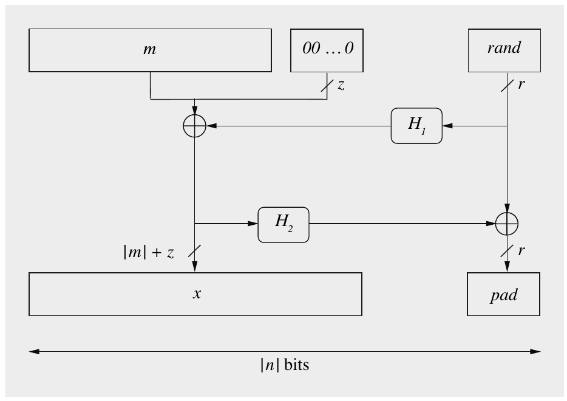

Hình 7.3 Nguyên lý của scheme Optimal Asymmetric Encryption Padding (OAEP) cho một thông điệp m

\|n| = |m| + z + r

Điều này ngụ ý rằng thông điệp m ngắn hơn modulus RSA n.

OAEP kết hợp ba input m, r và chuỗi không như thể hiện trong in Hình 7.3. H1 và H2 là các hash function với độ dài output lần lượt là |m| + z và r. Trong tiêu chuẩn OAEP, H1 và H2 được gọi là các mask generation function thay vì hash function vì loại sau được định nghĩa có một độ dài output cụ thể. Tuy nhiên, trong thực tế các hash function như SHA-2 (xem Mục 11.4) có thể được dùng nhiều lần với một bộ đếm làm input một phần để đạt độ dài bit mong muốn. Chúng tôi lưu ý rằng cùng một hash function có thể được dùng để hiện thực H1 và H2.

Mã hóa một thông điệp m bằng RSA và padding hoạt động như sau:

> Mã hóa RSA với OAEP
>
> Cho trước một thông điệp m và public key kpub = (n,e), hàm mã hóa là:
>
> y = ekpub(m) ≡ (x||pad)e mod n
>
> trong đó
>
> x = (m||00...0) ⊕ H1(rand)
>
> pad = rand ⊕ H2(x)

Hai thanh song song “||” ký hiệu phép nối hai chuỗi bit. Việc giải mã ciphertext nhận được y được thực hiện như sau:

> Giải mã RSA với OAEP
>
> Cho trước private key kpr = d và ciphertext y, quá trình giải mã là:
>
> 1. Giải mã RSA: dkpr(y) = yd ≡ x||pad mod n
>
> 2. tính lại rand = H2(x) ⊕ pad
>
> 3. tính lại m||00...0 = x ⊕ H1(rand)
>
> 4. kiểm chứng rằng chuỗi không từ Bước 3 thực sự chứa z bit không

Scheme OAEP tạo thành một Feistel network two-round (xem Hình 3.5). Ở Vòng 1, giá trị rand được dùng để “mã hóa” thông điệp m và chuỗi không. Kết quả của quá trình này, tức là (m||00...0) ⊕ H1(rand), được dùng ở Vòng 2 để mã hóa chính giá trị rand. Hàm f -function, vốn then chốt trong mọi Feistel network (một lần nữa, xem Hình 3.5), là H1 ở Vòng 1 và H2 ở Vòng 2.

Cuối cùng, chúng tôi lưu ý rằng một số chi tiết của scheme OAEP như được đặc tả trong Tiêu chuẩn PKCS #1 đã được bỏ qua cho rõ ràng. Rất khuyến nghị độc giả tham khảo tài liệu trước khi hiện thực OAEP.

## 7.8 Key Encapsulation

Như chúng ta đã thấy trong Chương 6, các scheme mã hóa asymmetric có thể được dùng để xây dựng một kênh an toàn để phân phối key. Trong thực tế, điều này thường có nghĩa là: Một key symmetric được trao đổi với sự trợ giúp của một scheme mã hóa public-key để cho phép cả hai bên mã hóa và giải mã các thông điệp lớn dùng các symmetric cipher nhanh hơn nhiều. Tuy nhiên, mã hóa trực tiếp một key symmetric, ví dụ, một key 128-bit cho AES, cần padding key để làm input cho một phép mã hóa asymmetric như RSA-2048. Dù padding như scheme OAEP được mô tả ở mục trước là khả thi, trong thực tế người ta thường thích dùng một kỹ thuật mã hóa đơn giản hơn gọi là key encapsulation mechanism (KEM) để trao đổi một key symmetric. (Một lý do để không dùng scheme padding là các chứng minh bảo mật có xu hướng dễ hơn khi không có padding, một chủ đề không được đề cập trong cuốn sách này.) Với KEM, một giá trị ngẫu nhiên trước hết được trao đổi an toàn giữa Alice và Bob. Chính xác hơn, Alice thực hiện phép toán encapsulation của KEM tạo ra một giá trị ngẫu nhiên được mã hóa trực tiếp bằng một scheme mã hóa asymmetric. Bob, ở phía bên kia, nhận gói đã mã hóa và dùng phép toán decapsulation của KEM để giải mã giá trị ngẫu nhiên bằng private key của mình. Thứ hai, giá trị ngẫu nhiên được cả Alice và Bob dùng để suy ra key symmetric với sự trợ giúp của một key derivation function (KDF) như một hash function cryptographic. Một ví dụ về mã hóa KEM được thể hiện trong Hình 7.4. RSA hoặc một scheme mã hóa public-key khác như Elgamal (xem Mục 8.5) hoặc một thuật toán PQC từ Bảng 12.1 có thể được dùng cho giai đoạn thứ nhất của protocol.

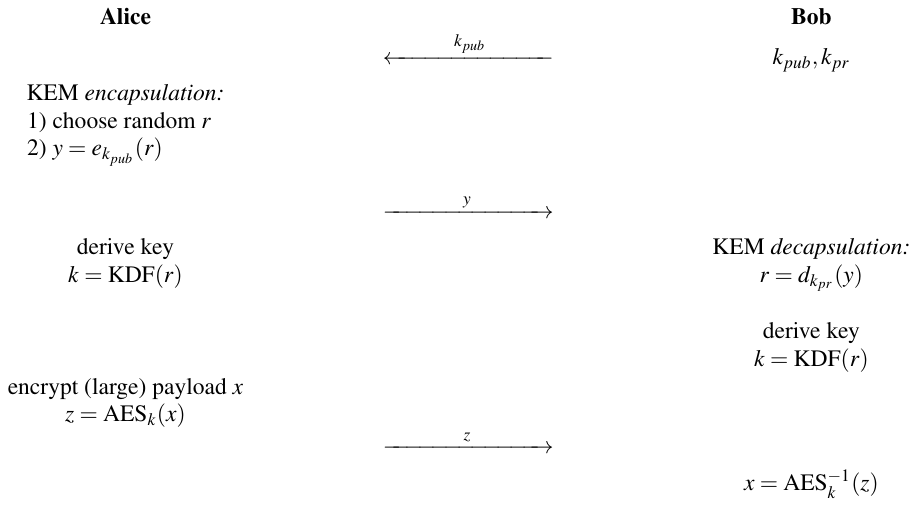

Hình 7.4 Key encapsulation mechanism với mã hóa public-key, với AES được dùng làm ví dụ symmetric cipher

## 7.9 Các tấn công

Nhiều tấn công đã được đề xuất nhắm vào RSA kể từ khi nó được phát minh năm 1977. Không tấn công nào nghiêm trọng nếu RSA được hiện thực cẩn thận, và hơn nữa, chúng thường khai thác các điểm yếu trong cách RSA được hiện thực hoặc sử dụng chứ không phải bản thân thuật toán RSA. Có ba họ tấn công tổng quát nhắm vào RSA:

1. Tấn công protocol (Protocol attacks)

2. Tấn công toán học (Mathematical attacks)

3. Side-channel attacks (tấn công kênh kề)

Chúng tôi bình luận về từng họ dưới đây.

### Tấn công Protocol

Tấn công protocol khai thác các điểm yếu trong cách RSA được sử dụng. Đã có vài tấn công protocol qua nhiều năm. Trong số những tấn công better-known có các tấn công khai thác tính malleability của RSA, đã được giới thiệu ở mục trước. Nhiều tấn công trong số đó có thể tránh được bằng padding. Các tiêu chuẩn bảo mật hiện đại mô tả chính xác RSA nên được dùng như thế nào, và nếu các hướng dẫn đó được tuân theo, tấn công protocol sẽ không khả thi.

### Tấn công toán học

Phương pháp cryptanalytical toán học tốt nhất chúng ta biết là phân tích thừa số modulus. Kẻ tấn công, Oscar, biết modulus n, public key e và ciphertext y. Mục tiêu của hắn là tính private key d, có tính chất e · d ≡ 1 mod Φ(n). Có vẻ như hắn chỉ cần áp dụng extended Euclidean algorithm và tính d. Tuy nhiên, hắn không biết giá trị của Φ(n). Đây là lúc phân tích thừa số xuất hiện: Cách tốt nhất để có giá trị này là phân tích n thành các số nguyên tố p và q. Nếu Oscar làm được điều này, tấn công thành công khá dễ dàng trong ba bước:

Φ(n) = (p − 1)(q − 1)

d−1 ≡ e mod Φ(n)

x ≡ yd mod n

Để ngăn tấn công này, modulus phải đủ lớn. Đây là lý do duy nhất vì sao cần modulus 2048 bit trở lên cho RSA. Việc đề xuất scheme RSA năm 1977 đã khơi dậy nhiều quan tâm tới bài toán cũ về phân tích thừa số nguyên. Thực ra, tiến bộ lớn đạt được trong phân tích thừa số trong bốn thập kỷ qua rất có thể đã không xảy ra nếu không có RSA. Bảng 7.3 cho thấy tóm tắt các kỷ lục phân tích thừa số RSA đã xảy ra kể từ đầu những năm 1990. Những tiến bộ này khả thi chủ yếu nhờ cải tiến trong các thuật toán phân tích thừa số, và ở mức độ ít hơn nhờ công nghệ máy tính được cải thiện. Dù phân tích thừa số đã trở nên dễ hơn so với những gì những người thiết kế RSA đã giả định vào mid-1970s, việc phân tích thừa số các modulus RSA vượt quá một kích thước nhất định vẫn nằm ngoài tầm với.

Bảng 7.3 Một số kỷ lục phân tích thừa số RSA từ năm 1991

| Số chữ số thập phân | Độ dài bit | Thời điểm |
|---|---|---|
| 100 | 330 | Apr 1991 |
| 110 | 364 | Apr 1992 |
| 120 | 397 | Jul 1993 |
| 129 | 426 | Apr 1994 |
| 140 | 463 | Feb 1999 |
| 174 | 576 | Dec 2003 |
| 200 | 663 | May 2005 |
| 212 | 704 | Jul 2012 |
| 232 | 768 | Dec 2009 |
| 250 | 829 | Feb 2020 |

Các phân tích thừa số RSA-576 và RSA-768 trong bảng thuộc về RSA Factoring Challenge, được RSA Laboratories công bố năm 1991 và có giải thưởng tiền mặt. Nhà khoa học Thorsten Kleinjung và các cộng sự đã tham gia sâu vào cả hai nỗ lực phân tích thừa số. Việc phân tích thừa số 768-bit cũng đáng chú ý vì RSA với độ dài modulus như vậy đã từng được dùng trong các hệ thống thực tế. Cần lưu ý rằng phân tích thừa số cần tài nguyên đáng kể. RSA-768 mất mười tháng và tính toán khổng lồ, do bốn cụm máy tính cung cấp. Có ý nghĩa lịch sử là modulus 129-digit đã được công bố trong một chuyên mục của Martin Gardner trên Scientific American năm 1977. Người ta ước tính rằng các thuật toán phân tích thừa số tốt nhất thời đó sẽ mất 40 nghìn tỷ (4 · 1013) năm. Tuy nhiên, các phương pháp phân tích thừa số đã cải thiện đáng kể, đặc biệt trong những năm 1980 và 1990, và thực tế chỉ mất chưa tới 30 năm.

Độ dài chính xác mà một modulus RSA nên có là chủ đề của nhiều cuộc thảo luận trong những năm 1990 và đầu những năm 2000. Tại thời điểm viết sách, giới học thuật tin rằng có thể phân tích thừa số các số 1024-bit (một độ dài modulus phổ biến cách đây không lâu) trong khoảng 10 năm, và các tổ chức tình báo có thể có khả năng làm điều đó thậm chí sớm hơn. Do đó, khuyến nghị chọn các tham số RSA trong khoảng 2048–4096 bit cho bảo mật long-term. Lưu ý rằng trong tương lai, máy tính lượng tử large-scale có thể phá RSA, như chúng ta sẽ thảo luận trong Chương 12.

### Tấn công Side-Channel

Một họ tấn công thứ ba và hoàn toàn khác là tấn công side-channel. Chúng khai thác thông tin về private key bị rò rỉ qua các kênh vật lý như mức tiêu thụ điện năng hay hành vi thời gian. Để quan sát các kênh như vậy, kẻ tấn công thường phải có quyền truy cập trực tiếp vào hiện thực RSA, ví dụ, trong một điện thoại di động hay một thiết bị IoT. Dù phân tích side-channel là một lĩnh vực nghiên cứu lớn và sôi động trong cryptography hiện đại và nằm ngoài phạm vi cuốn sách này, chúng tôi trình bày một tấn công đặc biệt sâu sắc nhắm vào RSA dưới đây.

Hình 7.5 cho thấy power trace của một hiện thực RSA trên một vi xử lý. Chính xác hơn, nó cho thấy dòng điện mà vi xử lý tiêu thụ theo thời gian. Mục tiêu của chúng ta là trích xuất private key d được dùng trong quá trình giải mã RSA. Chúng ta thấy rõ các khoảng hoạt động cao xen giữa các giai đoạn ngắn hoạt động ít hơn. Vì khối lượng tính toán chính của RSA là phép bình phương (S) và phép nhân (M) trong quá trình lũy thừa, chúng ta kết luận rằng các khoảng high-activity tương ứng với hai phép toán đó. Nếu nhìn kỹ hơn power trace, chúng ta thấy có các khoảng high-activity ngắn và các khoảng khác dài hơn. Thực ra, các khoảng dài hơn có vẻ dài khoảng gấp đôi. Hành vi này được giải thích bởi thuật toán square-and-multiply (xem Mục 7.4). Nếu một bit số mũ có giá trị 0, chỉ một phép bình phương được thực hiện. Nếu một bit số mũ có giá trị 1, một phép bình phương cùng với một phép nhân được tính. Nhưng hành vi thời gian này ngay lập tức để lộ key: Một giai đoạn hoạt động dài tương ứng với giá trị bit 1 của private key, và một giai đoạn ngắn tương ứng với một bit key có giá trị 0. Như thể hiện trong hình, chúng ta có thể xác định số mũ bí mật đơn giản bằng cách nhìn power trace. Do đó chúng ta có thể biết 12 bit sau của private key bằng cách nhìn trace:

các phép toán: S SM SM S SM S S SM SM SM S SM

private key: 0 1 1 0 1 0 0 1 1 1 0 1

Dựa trên quan sát này, người ta có thể dễ dàng tìm mọi 2048 bit của một private key full-length trong một bối cảnh real-world. Trong các giai đoạn ngắn với hoạt động thấp, thuật toán square-and-multiply quét và xử lý các bit số mũ trước khi kích hoạt chuỗi bình phương hoặc squaring-and-multiplication tiếp theo.

Tấn công cụ thể này được phân loại là simple power analysis hay SPA. Có vài biện pháp đối phó để ngăn tấn công. Một biện pháp đơn giản là thực thi một phép nhân với các biến giả sau một phép bình phương, tương ứng với một bit số mũ 0. Điều này cho ra một power profile (và thời gian chạy) độc lập với số mũ. Tuy nhiên, các biện pháp đối phó với các tấn công side-channel nâng cao hơn không đơn giản như vậy.

## 7.10 Hiện thực bằng Software và Hardware

RSA là ví dụ điển hình (gần như theo nghĩa đen — prime example) cho một thuật toán public-key cực kỳ nặng về tính toán. Do đó, việc hiện thực các thuật toán public-key quan trọng hơn nhiều so với các symmetric cipher như 3DES và AES, vốn nhanh hơn đáng kể. Để hình dung khối lượng tính toán, chúng tôi xây dựng một ước tính sơ bộ về số phép nhân số nguyên cần cho một phép toán RSA.

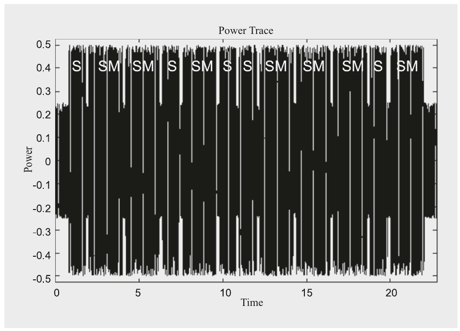

Hình 7.5 Power trace của một hiện thực RSA

Chúng ta giả sử một modulus RSA 2048-bit. Để giải mã, chúng ta cần trung bình 3072 phép bình phương và nhân, mỗi phép liên quan tới các toán hạng 2048-bit. Giả sử một CPU 32-bit trong đó mỗi toán hạng được biểu diễn bằng 2048/32 = 64 thanh ghi. Một phép nhân long-number duy nhất cần 642 = 4096 phép nhân số nguyên vì chúng ta phải nhân mọi thanh ghi của toán hạng thứ nhất với mọi thanh ghi của toán hạng thứ hai. Ngoài ra, chúng ta phải rút gọn modulo mỗi phép nhân này. Các thuật toán tốt nhất để làm điều này cũng cần khoảng 642 = 4096 phép nhân số nguyên. Do đó, tổng cộng, CPU phải thực hiện khoảng 4096 + 4096 = 8192 phép nhân số nguyên cho một phép nhân long-number duy nhất với rút gọn modulo. Vì chúng ta có 3072 phép như vậy, số phép nhân số nguyên cho một lần giải mã là:

\#(32-bit mult) = 3072 × 8192 = 25,165,824

Nhiều CPU desktop cho phép phép nhân với toán hạng 64-bit, giảm số phép nhân đi bốn lần. Nhưng ngay cả khi đó, vì phép nhân số nguyên thường là các lệnh chậm nhất trên CPU, nhu cầu tính toán là đáng kể. Lưu ý rằng hầu hết các scheme public-key khác có độ phức tạp tương đương.

Nhu cầu tính toán cực kỳ cao của RSA thực tế đã là một trở ngại nghiêm trọng cho việc áp dụng nó trong thực tế sau khi được phát minh. Thực hiện hàng trăm nghìn phép nhân số nguyên là điều không thể với các máy tính 1970s-style. Lựa chọn duy nhất cho các hiện thực RSA với thời gian chạy chấp nhận được là hiện thực RSA trên các chip hardware đặc biệt cho tới khoảng mid- tới cuối những năm 1980. Ngay cả những người phát minh RSA cũng đã nghiên cứu các kiến trúc hardware trong những ngày đầu của thuật toán. Từ đó, nhiều nghiên cứu đã tập trung vào các cách thực hiện nhanh số học số nguyên modulo. Với khả năng khổng lồ của các chip VLSI state-of-the-art, một phép toán RSA ngày nay có thể được thực hiện trong 100 µs hoặc ít hơn.

Tương tự, nhờ định luật Moore, các hiện thực RSA bằng software đã trở nên khả thi từ cuối những năm 1980. Một phép giải mã điển hình trên một CPU 3 GHz mất khoảng 1.6 ms cho RSA-2048. Dù đây là thời gian chấp nhận được cho nhiều ứng dụng, nó vẫn quá chậm cho mã hóa khối lượng dữ liệu lớn, vì nó tương ứng với một tốc độ mã hóa không ấn tượng chỉ 2048 bits/1.6 ms = 160 kbyte/s. Điều này rõ ràng quá chậm cho hầu hết các ứng dụng ngày nay nơi ngay cả các gói dữ liệu vừa phải cũng ở mức megabyte. Vì lý do này, RSA và các thuật toán public-key khác không được dùng cho mã hóa khối lượng dữ liệu lớn. Thay vào đó, các thuật toán symmetric được dùng, thường nhanh hơn 1000 lần.

## 7.11 Thảo luận và đọc thêm (Discussion and Further Reading)

RSA và các biến thể Cryptosystem RSA được dùng rộng rãi trong thực tế và được chuẩn hóa tốt trong các tiêu chuẩn như PKCS#1 [224]. Qua nhiều năm, vài biến thể đã được đề xuất. Một tổng quát hóa là dùng một modulus gồm nhiều hơn hai số nguyên tố như modulus multipower dạng n = p2q [243] hoặc modulus multifactor trong đó n = p q r [74]. Trong cả hai trường hợp, có thể đạt các speed-ups tính toán khoảng 2–3 lần.

Vài scheme cryptographic khác dựa trên bài toán phân tích thừa số nguyên. Một scheme nổi bật là scheme Rabin [213]. Khác với RSA, có thể chỉ ra rằng scheme Rabin tương đương với phân tích thừa số. Do đó, người ta nói rằng cryptosystem này an toàn có thể chứng minh (provably secure). Các scheme khác dựa vào độ khó của phân tích thừa số nguyên bao gồm scheme mã hóa xác suất của Blum–Goldwasser [57] và bộ sinh số giả ngẫu nhiên Blum Blum Shub [56]. Cuốn Handbook of Applied Cryptography [189] mô tả mọi scheme được nhắc tới dưới một hình thức mạch lạc.

Hiện thực Hiệu năng thực tế của một hiện thực RSA phụ thuộc nhiều vào hiệu quả của số học được dùng. Nói chung, có thể đạt speed-ups ở hai cấp. Ở cấp cao hơn, cải tiến thuật toán square-and-multiply là một lựa chọn. Một trong các phương pháp nhanh nhất là lũy thừa sliding-window, cho cải thiện khoảng 25% so với thuật toán square-and-multiply. Một tổng hợp tốt về các phương pháp lũy thừa được cho trong [189, Chương 14]. Tuy nhiên, tất cả các phương pháp này và bản thân thuật toán square-and-multiply đều cho thời gian chạy phụ thuộc vào số mũ. Điều này thường có thể dẫn tới rò rỉ giá trị số mũ, đặc biệt là của private key, qua các tấn công simple power analysis (xem Mục 7.9) hoặc timing attack (xem bên dưới). Vì lý do này, các kỹ thuật tăng tốc cho thuật toán square-and-multiply đã trở nên ít phổ biến hơn và các hiện thực constant-time thường được ưa chuộng.

Ở tầng thấp hơn, phép nhân và bình phương modulo với các số dài có thể được cải thiện. Một tập kỹ thuật liên quan tới các thuật toán hiệu quả cho rút gọn modulo. Trong thực tế, Montgomery reduction là lựa chọn phổ biến nhất; xem [69] để có một trình bày tốt về các kỹ thuật software và [109] cho hardware. Vài lựa chọn thay thế phương pháp Montgomery cũng đã được đề xuất qua nhiều năm [193], [189, Chương 14]. Một hướng khác để tăng tốc số học long-number là áp dụng các phương pháp nhân nhanh. Các kỹ thuật phổ như fast Fourier transform (FFT) thường không áp dụng được vì các toán hạng vẫn quá ngắn, nhưng các phương pháp như thuật toán Karatsuba [157] rất hữu ích. Tài liệu tham khảo [35] cho một trình bày toàn diện nhưng khá nặng toán học về lĩnh vực thuật toán nhân, và [251] mô tả phương pháp Karatsuba từ góc nhìn thực tế.

Các tấn công Việc phá RSA bằng phân tích đã là chủ đề nghiên cứu sâu rộng từ cuối những năm 1970. Đặc biệt trong những năm 1980, tiến bộ lớn trong các thuật toán phân tích thừa số đã đạt được, phần lớn được thúc đẩy bởi RSA. Đã có nhiều nỗ lực khác để phá RSA bằng toán học, bao gồm các tấn công nhắm vào số mũ riêng ngắn. Một khảo sát tốt được cho trong [62]. Bắt đầu từ khoảng chuyển giao thiên niên kỷ, các đề xuất đã được đưa ra để chế tạo các máy tính đặc biệt với mục đích duy nhất là phá RSA. Các đề xuất bao gồm một máy phân tích thừa số quang điện tử [230] và vài kiến trúc khác dựa trên công nghệ bán dẫn thông thường [231, 120]. Một tấn công phân tích thừa số khác khả thi nếu hai số nguyên tố p và q quá gần nhau. Tính chất này cho phép dùng cái được gọi là Fermat factorization. Một tấn công number-theoretical khác khả thi nếu số mũ ngắn (xem Mục 7.5.1) được dùng mà không có padding. Một cách khác nữa để phá RSA trở nên khả thi nếu private key d được chọn quá ngắn. Wiener’s attack áp dụng được cho số mũ riêng d < 1/3 n1/4, trong đó n là modulus RSA.

Ngoài bảo mật của bản thân thuật toán, một hiện thực đúng đắn của việc tạo số nguyên tố là then chốt. Việc chọn các số nguyên tố bí mật cần một nguồn ngẫu nhiên tốt. Một tấn công thú vị có thể được thực hiện nếu hai instance RSA dùng chung một trong hai số nguyên tố, tức là nếu thuật toán RSA thứ nhất dùng n1 = (p,q1) và thuật toán thứ hai n2 = (p,q2). Đối thủ khi đó có thể suy ra ngay số nguyên tố bí mật bằng cách tính gcd(n1,n2) = p, và do đó phân tích thừa số n. Trong một thế giới lý tưởng, điều này không được phép xảy ra nhưng có thể xảy ra trong thực tế, ví dụ, nếu các số nguyên tố RSA được tạo bởi một server dùng một bộ sinh số ngẫu nhiên thực bị lỗi. Xem Bài tập 7.17 để có một ví dụ đồ chơi về tấn công. Hơi bất ngờ là tấn công này đã được hai nhóm phát hiện độc lập năm 2012 [142, 171] — tức là 35 năm sau khi RSA được phát minh. Các tác giả của Tài liệu tham khảo [142] đã thực hiện thành công một tấn công vào các key yếu trong các thiết bị mạng. Họ đã chỉ ra được rằng 0.75% certificate TLS dùng chung key do entropy không đủ trong quá trình tạo key.

Side-channel attack đã được nghiên cứu có hệ thống trong giới học thuật và công nghiệp từ cuối những năm 1990. RSA và hầu hết các scheme symmetric và asymmetric khác dễ bị tổn thương trước differential power analysis (DPA), mạnh hơn simple power analysis (SPA) được trình bày trong chương này. Mặt khác, các biện pháp đối phó DPA dễ hiện thực cho các thuật toán public-key hơn là cho symmetric cipher. Một điểm khởi đầu tốt là “cuốn sách DPA” [180]. Các tấn công implementation-based liên quan là fault injection attack và timing attack. Loại sau có thể là mối đe dọa nghiêm trọng nhắm vào các scheme asymmetric exponentiation-based như RSA. Cần nhấn mạnh rằng một cryptosystem có thể rất mạnh về mặt toán học nhưng vẫn dễ bị tổn thương trước các tấn công side-channel.

## 7.12 Bài học rút ra (Lessons Learned)

■ RSA là một trong ba họ cryptosystem public-key đang được dùng ngày nay (hai họ kia là các scheme elliptic curve- và discrete logarithm-based).

■ RSA chủ yếu được dùng cho vận chuyển key, tức là mã hóa các key symmetric, và digital signature.

■ Public key e có thể là một số nguyên ngắn. Private key d cần có độ dài đầy đủ của modulus. Do đó, mã hóa có thể nhanh hơn đáng kể so với giải mã.

■ RSA dựa vào bài toán phân tích thừa số nguyên. Có vẻ có khả năng các modulus RSA 1024-bit sẽ sớm có thể bị phân tích thừa số trong cộng đồng học thuật. Nên dùng RSA với modulus 2048-bit, và 3072 hoặc 4096 bit nếu mong muốn bảo mật long-term, ví dụ, trước các kẻ tấn công nation-state.

■ “Schoolbook RSA” cho phép vài tấn công và trong thực tế chỉ nên dùng RSA với padding.

■ RSA (cũng như ECC và các scheme logarit rời rạc) sẽ trở nên không an toàn nếu máy tính lượng tử full-size trở nên khả dụng trong tương lai.

## Bài tập

7.1. Cho hai số nguyên tố p = 41 và q = 17 làm tham số thiết lập cho RSA.

1. Tham số nào trong e1 = 32,e2 = 49 là một số mũ RSA hợp lệ? Giải thích lựa chọn của bạn.

2. Tính private key tương ứng kpr = (p,q,d). Dùng extended Euclidean algorithm cho phép nghịch đảo và thể hiện mọi bước tính.

7.2. Tính lũy thừa modulo hiệu quả là trung tâm của việc dùng RSA trong thực tế. Tính các phép lũy thừa xe mod m sau dùng thuật toán square-and-multiply:

1. x = 2, e = 79, m = 101

2. x = 3, e = 197, m = 101

3. x = 5, e = 54, m = 151

4. x = 8, e = 127, m = 151

Sau mỗi bước lặp, thể hiện số mũ của kết quả trung gian ở dạng nhị phân.

7.3. Mã hóa và giải mã bằng thuật toán RSA với các tham số hệ thống sau:

1. p = 3, q = 11, d = 7, x = 5

2. p = 5, q = 11, e = 3, x = 9

Ở giai đoạn này chỉ dùng máy tính bỏ túi.

7.4. Một nhược điểm lớn của các thuật toán public-key là chúng tương đối chậm. Trong Mục 7.5.1, chúng ta đã học rằng một kỹ thuật tăng tốc là dùng số mũ ngắn e. Chúng ta nghiên cứu số mũ ngắn chi tiết hơn trong bài tập này.

1. Giả sử rằng trong một hiện thực cryptosystem RSA, một phép bình phương modulo mất 75% thời gian của một phép nhân modulo. Một phép mã hóa trung bình nhanh hơn bao nhiêu nếu thay vì một public key 2048-bit, số mũ ngắn e = 216 + 1 được dùng? Giả sử thuật toán square-and-multiply được dùng trong cả hai trường hợp.

2. Hầu hết các số mũ ngắn có dạng e = 2n + 1. Dùng các số mũ dạng 2n − 1 có lợi không? Giải thích câu trả lời.

3. Tính phép lũy thừa xe mod 29 với x = 5 và cả hai biến thể của e từ Phần 2 của bài tập này với n = 4. Dùng thuật toán square-and-multiply và thể hiện mỗi bước tính.

7.5. Trong thực tế, các số mũ ngắn e = 3, 17 và 216 + 1 thường được dùng.

1. Vì sao chúng ta không thể dùng ba số mũ ngắn này làm giá trị cho private key d trong các ứng dụng mà chúng ta muốn tăng tốc giải mã?

2. Độ dài bit tối thiểu cho private key của RSA-2048 để ngăn Wiener’s attack (xem đoạn “Các tấn công” trong Mục 7.11) là bao nhiêu?

3. Một sự thật thú vị khi làm việc với số mũ công khai ngắn là private key là một số dài gần với modulus n. Chỉ ra rằng với số mũ công khai nhỏ e, độ dài bit của private key d ít nhất là

\|φ(n)| − |e|

trong đó ký hiệu |x| chỉ độ dài bit của toán hạng x. Ngoài ra, chỉ ra rằng |φ(n)| = |n| trong hầu như mọi trường hợp.

7.6. Kiểm chứng ví dụ RSA với CRT trong Mục 7.5.2 bằng cách tính yd = 15103 mod 143 dùng thuật toán square-and-multiply.

7.7. Một scheme mã hóa RSA có các tham số thiết lập p = 31 và q = 37. Public key là e = 17.

1. Giải mã ciphertext y = 2 dùng CRT.

2. Kiểm chứng kết quả bằng cách mã hóa plaintext mà không dùng CRT.

7.8. Các kích thước modulus RSA phổ biến là 2048, 3072 và 4092 bit.

1. Trung bình chúng ta phải kiểm tra bao nhiêu số nguyên lẻ ngẫu nhiên cho tới khi kỳ vọng tìm được một số nguyên tố?

2. Suy ra một công thức đơn giản cho kích thước modulus RSA tùy ý bất kỳ.

7.9. Một trong những ứng dụng hấp dẫn nhất của các thuật toán public-key là thiết lập một session key an toàn cho một thuật toán private-key như AES qua một kênh không an toàn.

Giả sử Bob có một cặp khóa public/private cho cryptosystem RSA. Xây dựng một protocol đơn giản dùng RSA cho phép hai bên Alice và Bob thỏa thuận một key bí mật dùng chung. Ai xác định key trong protocol này, Alice, Bob, hay cả hai?

7.10. Trong thực tế, đôi khi đáng mong muốn khi cả hai bên liên lạc đều ảnh hưởng tới việc chọn session key. Chẳng hạn, điều này ngăn bên kia chọn một key là weak key cho một thuật toán symmetric. Một số block cipher như DES và IDEA có weak key. Các thông điệp được mã hóa bằng weak key có thể được khôi phục tương đối dễ từ ciphertext.

Xây dựng một protocol tương tự protocol trên trong đó cả hai bên đều ảnh hưởng tới key. Giả sử cả Alice và Bob đều có một cặp khóa public/private cho cryptosystem RSA. Lưu ý rằng có vài cách tiếp cận hợp lệ cho bài toán này. Chỉ trình bày một cách.

7.11. Trong bài tập này, bạn được yêu cầu tấn công một thông điệp RSA-encrypted. Bạn là kẻ tấn công và bạn thu được ciphertext y = 1141 bằng cách nghe lén kênh. Public key là kpub = (n,e) = (2623,2111).

1. Xét công thức mã hóa. Mọi biến trừ plaintext x đều đã biết. Vì sao bạn không thể đơn giản giải phương trình cho x?

2. Để xác định private key d, bạn phải tính d ≡ e−1 mod Φ(n). Có một biểu thức hiệu quả để tính Φ(n). Chúng ta có thể dùng công thức này ở đây không?

3. Tính plaintext x bằng cách tính private key d qua việc phân tích thừa số n. (Gợi ý: Phân tích thừa số với các modulus RSA nhỏ như vậy có thể được làm qua tìm kiếm vét cạn với một danh sách mọi số nguyên tố nhỏ và một chương trình đơn giản kiểm tra số nguyên tố nào tới √n là thừa số của n.) Cách tiếp cận này có còn phù hợp cho các số có độ dài 2048 bit trở lên không?

7.12. Bây giờ chúng tôi chỉ ra cách một tấn công với chosen ciphertext có thể được dùng để phá một phép mã hóa RSA.

1. Chỉ ra rằng tính chất nhân đúng với RSA, tức là chỉ ra rằng tích của hai ciphertext y1 và y2 bằng phép mã hóa của tích hai plaintext tương ứng x1 và x2.

Trong một số hoàn cảnh nhất định, tính chất này có thể bị kẻ tấn công khai thác.

2. Giả sử Oscar nghe lén và thu được một ciphertext y1, là phiên bản đã mã hóa của một thông điệp x1 được gửi từ Alice tới Bob. Oscar muốn biết plaintext x1.

Oscar tính một thông điệp trông vô hại t, mà hắn mã hóa. Chúng ta giả sử rằng hắn có thể thu được bản giải mã của một ciphertext mà hắn gửi tới Bob, ví dụ, bằng cách có quyền truy cập máy tính của Bob tại một thời điểm nhất định. Chỉ ra cách Oscar có thể xây dựng một ciphertext y sao cho hắn có thể dùng bản giải mã của nó để tính x1.

7.13. Trong bài tập này, chúng tôi minh họa vấn đề của việc dùng thiếu thận trọng các cryptosystem không xác suất, như schoolbook RSA. Không xác suất (nonprobabilistic) nghĩa là cùng một plaintext ánh xạ tới cùng một ciphertext. Điều này cho phép traffic analysis (tức là rút ra một số kết luận về plaintext chỉ bằng cách quan sát ciphertext) và trong một số trường hợp thậm chí phá hoàn toàn cryptoystem *(ghi chú: sách in cryptoystem; đúng là cryptosystem)*. Điều sau đặc biệt đúng nếu số plaintext khả dĩ nhỏ. Giả sử tình huống sau:

Alice muốn gửi một thông điệp tới Bob được mã hóa bằng public key (n,e) của anh ấy. Cô ấy quyết định dùng bảng ASCII để gán một số cho mỗi ký tự (space → 32, ! → 33,..., A → 65, B → 66,..., ∼ → 126) và mã hóa chúng riêng biệt.

1. Oscar nghe lén ciphertext được truyền. Mô tả cách hắn có thể giải mã thành công thông điệp bằng cách khai thác tính chất không xác suất của RSA.

2. Public key RSA của Bob là (n,e) = (3763,11). Giải mã ciphertext

y = 2514,1125,333,3696,2514,2929,3368,2514

với tấn công được đề xuất ở 1. Để đơn giản, giả sử Alice chỉ chọn các chữ cái hoa A,...,Z khi mã hóa.

3. Tấn công có còn khả thi nếu chúng ta dùng padding OAEP không? Giải thích chính xác câu trả lời của bạn.

7.14. Modulus của RSA đã được tăng lên qua nhiều năm để chặn các tấn công phân tích thừa số ngày càng cải tiến. Như người ta có thể giả định, các thuật toán public-key trở nên chậm hơn khi độ dài modulus tăng. Chúng ta nghiên cứu mối quan hệ giữa độ dài modulus và hiệu năng trong bài tập này. Hiệu năng của RSA, và của hầu như mọi thuật toán public-key khác, phụ thuộc vào tốc độ thực hiện phép lũy thừa modulo với các số lớn.

1. Giả sử một phép nhân hoặc bình phương modulo với các số k-bit mất c · k2 chu kỳ clock, trong đó c là một hằng số. Trung bình mã hóa/giải mã RSA với 1024 bit chậm hơn bao nhiêu so với RSA với 512 bit? Chỉ xét bản thân mã hóa/giải mã với một số mũ có độ dài đầy đủ và thuật toán square-and-multiply.

2. Trong thực tế, thuật toán Karatsuba, có độ phức tạp tiệm cận tỉ lệ với klog2 3, thường được dùng cho phép nhân long-number trong cryptography. Giả sử kỹ thuật nâng cao hơn này cần c′ · klog2 3 = c′ · k1.585 chu kỳ clock cho phép nhân hoặc bình phương, trong đó c′ là một hằng số. Tỉ lệ giữa mã hóa RSA với 1024 bit và RSA với 512 bit là bao nhiêu nếu thuật toán Karatsuba được dùng trong cả hai trường hợp? Một lần nữa, giả sử các số mũ full-length được dùng.

7.15. (Bài tập nâng cao!) Có những cách cải tiến thuật toán square-and-multiply, tức là giảm số phép toán cần thiết. Dù số phép bình phương là cố định, số phép nhân có thể được giảm. Nhiệm vụ của bạn là đưa ra một phiên bản sửa đổi của thuật toán square-and-multiply cần ít phép nhân hơn. Đưa ra mô tả chi tiết về cách thuật toán mới hoạt động và độ phức tạp là bao nhiêu (số phép toán).

Gợi ý: Hãy thử xây dựng một tổng quát hóa của thuật toán square-and-multiply xử lý nhiều hơn một bit mỗi lần. Ý tưởng cơ bản là xử lý k (ví dụ, k = 3) bit số mũ mỗi lần lặp thay vì một bit như trong thuật toán square-and-multiply gốc.

7.16. Bây giờ hãy nghiên cứu các tấn công side-channel nhắm vào RSA. Trong một hiện thực RSA đơn giản không có biện pháp đối phó nào với rò rỉ side-channel, việc phân tích mức tiêu thụ dòng điện của vi điều khiển trong phần giải mã trực tiếp cho ra số mũ riêng. Hình 7.5 trong Mục 7.9 cho thấy mức tiêu thụ điện năng của một hiện thực thuật toán square-and-multiply. Nếu vi điều khiển tính một phép bình phương hoặc một phép nhân, mức tiêu thụ điện năng tăng. Do các khoảng nhỏ giữa các vòng lặp, mỗi lần lặp đều có thể được xác định. Hơn nữa, với mỗi vòng, chúng ta có thể xác định liệu một phép bình phương đơn lẻ (thời gian ngắn) hay một phép bình phương theo sau là một phép nhân (thời gian dài) đang được tính.

1. Giả sử thuật toán square-and-multiply đã được hiện thực sao cho số mũ được quét từ trái sang phải. Hơn nữa, giả sử các giá trị khởi đầu đã được khởi tạo. Số mũ riêng d là gì?

2. Key này thuộc về thiết lập RSA với các số nguyên tố p = 67 và q = 103 và e = 257. Kiểm chứng kết quả của bạn. (Lưu ý rằng trong thực tế kẻ tấn công sẽ không biết các giá trị p và q.)

7.17. Có một lỗ hổng trong RSA nếu các số nguyên tố bị re-used. Giả sử một certificate server tạo các cặp key RSA (kpub = (n,e),kpr = d) cho người dùng. Tất nhiên, để tạo các public key, server tính n = p q, trong đó p và q là hai số nguyên tố lớn. Server không tiết lộ các số nguyên tố ra thế giới bên ngoài, ngay cả cho chủ sở hữu private key.

Hai người dùng, User 1 và User 2, thu được các cặp key (kpub1 = (n1,e1),kpr1 = d1) và (kpub2 = (n2,e2),kpr2 = d2). Do một bộ sinh ngẫu nhiên thực bị lỗi, n1 được tính là n1 = p1 q1 và n2 là n2 = p1q2, tức là p1 được dùng cho cả hai cặp key.

1. Mô tả cách kẻ tấn công có thể tính cả hai private key nếu hắn có cả hai public key, vốn tất nhiên được biết công khai. (Gợi ý: Bạn phải dùng thuật toán Euclid.)

2. Bạn tra hai public key kpub1 = (4757,17) và kpub2 = (2059,129) trong một cơ sở dữ liệu certificate. Bằng cách nghe lén đường dây, bạn quan sát thấy User 1 nhận ciphertext y1 = (0,1884,429) và User 2 nhận y2 = (1186,836,0,1114,137,46). Nhiệm vụ của bạn là phá hệ thống và khôi phục các chữ cái thực tạo nên hai plaintext x1 và x2. Ánh xạ giữa chữ cái và số plaintext rất đơn giản (xem thêm Bảng 1.3):

A → 0,B → 1,...,Z → 25

Mỗi chữ cái được mã hóa riêng bằng RSA, tức là plaintext thứ nhất gồm ba chữ cái và plaintext thứ hai gồm sáu chữ cái.

(Nhận xét: Ở dạng cơ bản này, RSA mã hóa giá trị plaintext 0 thành ciphertext 0, đó là một điểm yếu. Trong thực tế, người ta dùng các kỹ thuật bổ sung, đặc biệt là padding, để ngăn điều này.)

7.18. Phép kiểm tra tính nguyên tố Fermat

1. Phát biểu định lý số nguyên tố.

2. Chỉ ra rằng các số sau không phải số nguyên tố với sự trợ giúp của phép kiểm tra tính nguyên tố Fermat, tức là tìm một số a sao cho gcd(a,n) = 1 với a(n−1) ≠ 1 mod n

a. 221

b. 323

c. 143

3. Tìm hiểu xem có những phép kiểm tra tính nguyên tố nào khác và nêu tên thêm ba phép.

7.19. Ngày nay, RSA thường được dùng với 2048, 3072 hoặc 4096 bit. Độ dài bit của các số nguyên tố tương ứng trong cả ba trường hợp là bao nhiêu? Với mỗi độ dài bit, tính xác suất để một số lẻ ngẫu nhiên là số nguyên tố dùng định lý số nguyên tố.

7.20. Tình cờ bạn biết rằng các đồng nghiệp đang lên kế hoạch một bữa tiệc bí mật ở nhà một người nào đó và bạn không được mời. Không hay chút nào! Để tới đúng địa điểm, bạn nghe lén các đồng nghiệp. May mắn là bạn lấy được email mà các đồng nghiệp thân mến của bạn trao đổi.

Đáng tiếc, email này được mã hóa RSA. Bạn có thông tin sau:

■ kpub = (n,e) = (1271,11)

■ Ciphertext: [955, 458, 562, 911, 914, 269, 690]

Plaintext là tên được mã hóa ASCII của chủ nhà tổ chức bữa tiệc. Mỗi ciphertext chứa một ký hiệu ASCII đã mã hóa.

Phá RSA qua phân tích thừa số, tìm địa điểm của bữa tiệc, và gây bất ngờ cho các đồng nghiệp của bạn!

---

[^1]: Lý do cho độ phức tạp bậc hai dễ thấy với ví dụ sau. Nếu nhân một số thập phân 4-digit abcd với một số khác wxyz, chúng ta nhân mỗi chữ số của toán hạng thứ nhất với mỗi chữ số của toán hạng thứ hai, tổng cộng 42 = 16 phép nhân chữ số. Mặt khác, nếu nhân hai số có hai chữ số, tức là ab nhân wx, chỉ cần 22 = 4 phép nhân sơ cấp.
