# Chương 8 Các cryptosystem dựa trên bài toán logarit rời rạc (Cryptosystems Based on the Discrete Logarithm Problem)

Trong chương trước, chúng ta đã học về scheme public-key RSA, dựa trên độ khó của việc phân tích thừa số các số nguyên lớn. Bài toán phân tích thừa số nguyên được nói là one-way function của RSA. Như đã giải thích trước đó, một hàm f là one-way nếu dễ về mặt tính toán để tính hàm f(x) = y, nhưng bất khả thi về mặt tính toán để tính hàm ngược f−1(y) = x. Câu hỏi là liệu chúng ta có thể tìm các one-way function khác để xây dựng các scheme cryptographic asymmetric hay không. Hóa ra hầu hết các thuật toán public-key non-RSA có ý nghĩa thực tế đều dựa trên một one-way function khác, bài toán logarit rời rạc (discrete logarithm problem).

Trong chương này, bạn sẽ học:

■ Trao đổi key Diffie–Hellman

■ Cyclic group, quan trọng để hiểu sâu hơn về trao đổi key Diffie–Hellman

■ Bài toán logarit rời rạc, có tầm quan trọng nền tảng cho nhiều thuật toán public-key thực tế

■ Mã hóa dùng scheme Elgamal

Ngoài trao đổi key Diffie–Hellman và scheme mã hóa Elgamal được giới thiệu trong chương này, scheme digital signature Elgamal (xem Mục 10.3) và Digital Signature Algorithm (xem Mục 10.2) cũng dựa trên bài toán logarit rời rạc, cũng như các cryptosystem dựa trên elliptic curve (Chương 9).

## 8.1 Trao đổi key Diffie–Hellman

Trao đổi key Diffie–Hellman (DHKE), được Whitfield Diffie và Martin Hellman đề xuất năm 1976, là scheme asymmetric đầu tiên được công bố trong tài liệu mở. Hai nhà phát minh đã chịu ảnh hưởng từ công trình của Ralph Merkle. Nó cung cấp một giải pháp thực tế cho vấn đề phân phối key, tức là nó cho phép hai bên suy ra một key bí mật chung bằng cách liên lạc qua một kênh không an toàn[^1].

Kỹ thuật thỏa thuận key nền tảng này được triển khai cho nhiều protocol cryptographic mở và được dùng rộng rãi như Secure Shell (SSH), Transport Layer Security (TLS) và Internet Protocol Security (IPSec). DHKE là một ứng dụng rất ấn tượng của bài toán logarit rời rạc, mà chúng ta sẽ nghiên cứu trong các mục tiếp theo.

Ý tưởng cơ bản đằng sau DHKE là, với một số nguyên tố p, phép lũy thừa trong ℤp∗ là một one-way function và phép lũy thừa có tính giao hoán, tức là

k ≡ (αx)y ≡ (αy)x mod p

Như chúng ta sẽ thấy, giá trị k ≡ (αx)y ≡ (αy)x mod p là bí mật chung trong DHKE, có thể được dùng làm session key giữa hai bên.

Bây giờ hãy xem protocol trao đổi key Diffie–Hellman trên ℤp∗ hoạt động như thế nào. Trong protocol này, có hai bên, Alice và Bob, muốn thiết lập một key bí mật dùng chung. Có thể có một bên thứ ba đáng tin cậy chọn đúng cách và công bố các tham số công khai cần cho việc trao đổi key. Tuy nhiên, cũng có thể Alice hoặc Bob tạo các tham số công khai và trao đổi chúng.

Nói chính xác, DHKE gồm hai protocol, protocol set-up và protocol chính. Protocol set-up gồm các bước sau:

> Set-up Diffie–Hellman
>
> 1. Chọn một số nguyên tố lớn p.
>
> 2. Chọn một số nguyên α ∈ {2,3,..., p − 2}.
>
> 3. Công bố p và α.

Hai giá trị này đôi khi được gọi là domain parameter. Sau đây, chúng ta giả sử Alice và Bob sở hữu các domain parameter (p,α) được chọn đúng cách. Bây giờ, họ có thể tạo một key bí mật chung k với protocol trao đổi key sau:

> Trao đổi key Diffie–Hellman
>
> 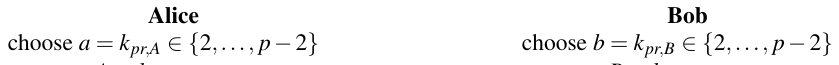
>
> tính A = kpub,A ≡ αa mod p tính B = kpub,B ≡ αb mod p
>
> 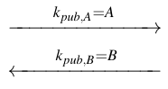
>
> kAB = kpub,Bkpr,A ≡ Ba mod p kAB = kpub,Akpr,B ≡ Ab mod p

Key chung kAB có thể được dùng để thiết lập liên lạc an toàn giữa Alice và Bob, ví dụ, với các thuật toán symmetric như AES, 3DES hoặc một stream cipher. Đây là chứng minh rằng protocol đơn giản đến bất ngờ này là đúng, tức là Alice và Bob thực sự tính cùng một session key kAB.

Chứng minh. Alice tính

Ba ≡ (αb)a ≡ αab mod p

trong khi Bob tính

Ab ≡ (αa)b ≡ αab mod p

và do đó Alice và Bob dùng chung session key kAB ≡ αab mod p. □

Bây giờ chúng ta xem một ví dụ đơn giản về DHKE với các số nhỏ.

Ví dụ 8.1. Các domain parameter Diffie–Hellman là p = 29 và α = 2. Protocol diễn ra như sau:

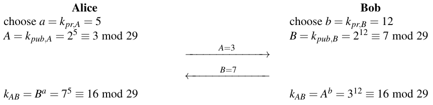

Bí mật chung kAB = 16 mà cả hai bên tính có thể được dùng cho các phép toán cryptographic tiếp theo, ví dụ, làm session key cho mã hóa symmetric.

◇

Các khía cạnh tính toán của DHKE khá giống với của RSA. Trong giai đoạn set-up, chúng ta tạo p dùng các thuật toán prime-finding xác suất đã thảo luận trong Mục 7.6. Như thể hiện trong Bảng 6.1, p nên có độ dài tương tự modulus RSA n, tức là 2048 bit trở lên, để cung cấp bảo mật long-term. Số nguyên α cần là primitive, một tính chất đặc biệt của một phần tử trong ℤp∗; chúng tôi giải thích các phần tử nguyên thủy (primitive element) sau trong Mục 8.2.2. Session key kAB được tính trong protocol có cùng độ dài bit với p. Nếu muốn dùng nó làm key symmetric cho các thuật toán như AES, chúng ta có thể đơn giản lấy 128 bit có trọng số cao nhất. Ngoài ra, chúng ta có thể áp dụng một hash function lên kAB và dùng các phần pre-agreed của output làm key symmetric.

Trong protocol thực sự, trước hết chúng ta phải chọn các private key a và b. Chúng nên đến từ một bộ sinh số ngẫu nhiên thực để ngăn kẻ tấn công đoán chúng. Để tính các public key A và B cũng như để tính session key, cả hai bên có thể dùng thuật toán square-and-multiply, đã được giới thiệu trong Mục 7.4. Các public key thường được tính trước. Phép tính chính cần làm cho một lần trao đổi key do đó là phép lũy thừa cho session key. Nói chung, vì độ dài bit và các phép tính của RSA và DHKE rất giống nhau, chúng có thời gian chạy tương đương. Tuy nhiên, mẹo dùng số mũ công khai ngắn trình bày trong Mục 7.5.1 không áp dụng được cho DHKE.

Những gì chúng ta thảo luận tới giờ là protocol DHKE cổ điển trong group ℤp∗ với một số nguyên tố p. Protocol có thể được tổng quát hóa, đặc biệt cho các group của elliptic curve. Điều này dẫn tới elliptic curve cryptography, đã trở nên rất phổ biến cho các scheme asymmetric trong thực tế. Để hiểu rõ hơn elliptic curve cũng như các scheme như mã hóa Elgamal vốn cũng liên quan chặt chẽ tới DHKE, chúng tôi giới thiệu bài toán logarit rời rạc trong các mục sau. Bài toán này là cơ sở toán học cho DHKE. Sau khi giới thiệu bài toán logarit rời rạc, chúng ta sẽ quay lại DHKE và thảo luận bảo mật của nó bằng một cách tiếp cận tổng quát hơn.

## 8.2 Một chút đại số trừu tượng

Mục này giới thiệu một số kiến thức nền tảng của đại số trừu tượng, đặc biệt là khái niệm group, subgroup, finite group và cyclic group, vốn thiết yếu để hiểu các thuật toán public-key dựa trên bài toán logarit rời rạc.

### 8.2.1 Group

Cho tiện, chúng tôi nhắc lại định nghĩa group đã giới thiệu trong Mục 4.3.1.

> Định nghĩa 8.2.1 Group
>
> Một group là một tập các phần tử G cùng với một phép toán ◦ kết hợp hai phần tử của G. Một group có các tính chất sau.
>
> 1. Phép toán group ◦ là đóng. Tức là, với mọi a,b, ∈ G, ta có a ◦ b = c ∈ G.
>
> 2. Phép toán group có tính kết hợp. Tức là, a◦(b◦c) = (a◦b)◦c với mọi a,b,c ∈ G.
>
> 3. Có một phần tử 1 ∈ G, được gọi là phần tử trung hòa (hay phần tử đơn vị), sao cho a◦1 = 1◦ a = a với mọi a ∈ G.
>
> 4. Với mỗi a ∈ G tồn tại một phần tử a−1 ∈ G, được gọi là inverse của a, sao cho a◦ a−1 = a−1◦a = 1.
>
> 5. Một group G là abelian (hay giao hoán) nếu, thêm vào đó, a ◦ b = b ◦ a với mọi a,b ∈ G.

Lưu ý rằng trong cryptography chúng ta dùng cả group nhân, trong đó phép toán “◦” ký hiệu phép nhân, và group cộng, trong đó “◦” ký hiệu phép cộng. Ký hiệu sau được dùng cho elliptic curve, như chúng ta sẽ thấy trong Chương 9.

Ví dụ 8.2. Để minh họa định nghĩa group, chúng ta xét các ví dụ sau.

■ (ℤ,+) là một group, tức là tập mọi số nguyên ℤ = {...,−2,−1,0,1,2,...} cùng với phép cộng thông thường tạo thành một abelian group, trong đó e = 0 là phần tử đơn vị và −a là inverse của một phần tử a ∈ ℤ.

■ (ℤ không có 0,·) không phải là group, tức là tập số nguyên ℤ (loại trừ phần tử 0) và phép nhân thông thường không tạo thành group vì không tồn tại inverse a−1 cho một phần tử a ∈ ℤ trừ các phần tử − 1 và 1.

■ (ℂ không có 0,·) là một group, tức là tập số phức u + iv với u,v ∈ ℝ và u và v không đồng thời bằng không và i2 = −1 cùng với phép nhân phức được định nghĩa bởi

(u1 + iv1) · (u2 + iv2) = (u1u2 − v1v2) + i(u1v2 + v1u2)

tạo thành một abelian group. Phần tử đơn vị của group này là e = 1, và inverse a−1 của một phần tử a = u + iv ∈ ℂ được cho bởi a−1 = (u − iv)/(u2 + v2).

◇

Không group nào trong ví dụ đóng vai trò đáng kể trong cryptography vì chúng ta cần các group có số phần tử hữu hạn. Bây giờ hãy xét group ℤn∗, rất quan trọng cho nhiều scheme cryptographic như DHKE, mã hóa Elgamal, Digital Signature Algorithm và nhiều scheme khác.

> Định lý 8.2.1
>
> Tập ℤn∗, gồm mọi số nguyên i = 1,...,n − 1 mà gcd(i,n) = 1, tạo thành một abelian group dưới phép nhân modulo n. Phần tử đơn vị là e = 1.

Hãy minh họa định lý bằng một ví dụ.

Ví dụ 8.3. Với n = 9, ℤn∗ gồm các phần tử {1,2,4,5,7,8}. Bằng cách tính bảng nhân cho ℤ9∗, được mô tả trong Bảng 8.1, chúng ta có thể dễ dàng kiểm tra hầu hết các điều kiện từ Định nghĩa 8.2.1.

Bảng 8.1 Bảng nhân cho ℤ9∗

| × mod 9 | 1 2 4 5 7 8 |
|---|---|
| 1 | 1 2 4 5 7 8 |
| 2 | 2 4 8 1 5 7 |
| 4 | 4 8 7 2 1 5 |
| 5 | 5 1 2 7 8 4 |
| 7 | 7 5 1 8 4 2 |
| 8 | 8 7 5 4 2 1 |

Điều kiện 1 (tính đóng) được thỏa, vì bảng chỉ gồm các số nguyên là phần tử của ℤ9∗. Với group này, Điều kiện 3 (phần tử đơn vị) và 4 (inverse) cũng đúng, vì mỗi hàng và mỗi cột của bảng là một hoán vị của các phần tử của ℤ9∗. Từ tính đối xứng qua đường chéo chính, tức là phần tử ở hàng i và cột j bằng phần tử ở hàng j và cột i, chúng ta có thể thấy rằng Điều kiện 5 (tính giao hoán) được thỏa. Điều kiện 2 (tính kết hợp) không thể được suy trực tiếp từ bảng, nhưng suy ra từ tính kết hợp của phép nhân trong ℤn. ◇

Chúng tôi lưu ý rằng inverse a−1 của mỗi phần tử a ∈ ℤn∗ có thể được tính bằng extended Euclidean algorithm, xem Mục 6.3.2.

### 8.2.2 Cyclic Group

Trong cryptography, chúng ta hầu như luôn làm việc với các cấu trúc hữu hạn. Chẳng hạn, với AES, chúng ta cần một finite field. Bây giờ chúng tôi đưa ra định nghĩa của một finite group.

> Định nghĩa 8.2.2 Finite Group
>
> Một group (G, ◦) là hữu hạn nếu nó có số phần tử hữu hạn. Chúng ta ký hiệu cardinality hay order của group G là |G|.

Ví dụ 8.4. Các ví dụ về finite group là:

■ (ℤn,+): Cardinality của ℤn là |ℤn| = n vì ℤn = {0,1,2,...,n − 1}.

■ (ℤn∗,·): Nhớ rằng ℤn∗ được định nghĩa là tập các số nguyên dương nhỏ hơn n nguyên tố cùng nhau với n. Do đó, cardinality của ℤn∗ bằng hàm phi của Euler tính tại n, tức là |ℤn∗| = Φ(n). Chẳng hạn, group ℤ9∗ có cardinality Φ(9) = 32 − 31 = 6. Điều này có thể được kiểm chứng bằng ví dụ trước, nơi chúng ta thấy ℤ9∗ gồm sáu phần tử {1,2,4,5,7,8}.

◇

Phần còn lại của mục này đề cập các group đặc biệt, cụ thể là cyclic group, vốn là cơ sở cho các cryptosystem logarithm-based rời rạc. Chúng ta bắt đầu với định nghĩa sau.

> Định nghĩa 8.2.3 Order của một phần tử
>
> Order ord(a) của một phần tử a của một group (G,◦) là số nguyên dương nhỏ nhất k sao cho
>
> 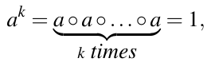
>
> trong đó 1 là phần tử đơn vị của G.

Chúng ta xem xét định nghĩa này qua một ví dụ.

Ví dụ 8.5. Chúng ta thử xác định order của a = 3 trong group ℤ11∗. Để làm điều này, chúng ta tiếp tục tính các lũy thừa của a cho tới khi thu được phần tử đơn vị 1.

a1 = 3

a2 = a · a = 3 · 3 = 9

a3 = a2 · a = 9 · 3 = 27 ≡ 5 mod 11

a4 = a3 · a = 5 · 3 = 15 ≡ 4 mod 11

a5 = a4 · a = 4 · 3 = 12 ≡ 1 mod 11

Do đó, ord(3) = 5.

◇

Người ta có thể hỏi điều gì xảy ra nếu chúng ta tiếp tục nhân kết quả với a:

a6 = a5 · a ≡ 1 · a ≡ 3 mod 11

a7 = a5 · a2 ≡ 1 · a2 ≡ 9 mod 11

a8 = a5 · a3 ≡ 1 · a3 ≡ 5 mod 11

a9 = a5 · a4 ≡ 1 · a4 ≡ 4 mod 11

a10 = a5 · a5 ≡ 1 · 1 ≡ 1 mod 11

a11 = a10 · a ≡ 1 · a ≡ 3 mod 11

⋮

Như chúng ta thấy, các lũy thừa của a chạy qua chuỗi {3,9,5,4,1} vô hạn lần. Hành vi tuần hoàn này dẫn tới định nghĩa sau.

> Định nghĩa 8.2.4 Cyclic Group
>
> Một group G chứa một phần tử α với order cực đại ord(α) = |G| được nói là cyclic. Các phần tử có order cực đại được gọi là phần tử nguyên thủy (primitive element) hay generator.

Một phần tử α của một group G có order cực đại được gọi là generator vì mọi phần tử a của G đều có thể được viết dưới dạng một lũy thừa αi = a với một i nào đó, tức là α sinh ra toàn bộ group. Hãy kiểm chứng các tính chất này bằng cách xét ví dụ sau.

Ví dụ 8.6. Chúng ta muốn kiểm tra xem a = 2 có tình cờ là một phần tử nguyên thủy của ℤ11∗ = {1,2,3,4,5,6,7,8,9,10} không. Cardinality của group là |ℤ11∗ | = Φ(11) = 10. Hãy xem mọi phần tử được sinh bởi các lũy thừa của phần tử a = 2:

a = 2 a6 ≡ 9 mod 11

a2 = 4 a7 ≡ 7 mod 11

a3 = 8 a8 ≡ 3 mod 11

a4 ≡ 5 mod 11 a9 ≡ 6 mod 11

a5 ≡ 10 mod 11 a10 ≡ 1 mod 11

Suy ra rằng

ord(a) = 10 = |ℤ11∗ |

Điều này ngụ ý rằng (i) a = 2 là một phần tử nguyên thủy và (ii) |ℤ11∗ | là cyclic.

Bây giờ chúng ta muốn kiểm chứng xem các lũy thừa của a = 2 có thực sự sinh ra mọi phần tử của group ℤ11∗ không. Hãy xem lại mọi giá trị ai.

| i | 1 2 3 4 5 6 7 8 9 10 |
|---|---|
| ai | 2 4 8 5 10 9 7 3 6 1 |

Nhìn vào hàng dưới cùng, chúng ta thấy rằng các lũy thừa ai thực sự sinh ra mọi phần tử của group ℤ11∗. Chúng tôi lưu ý rằng thứ tự chúng được sinh ra trông khá tùy ý. Mối quan hệ có vẻ ngẫu nhiên giữa số mũ i và các phần tử group là cơ sở cho các cryptosystem như DHKE.

◇

Từ ví dụ này, chúng ta kết luận rằng group ℤ11∗ có phần tử 2 là generator. Quan trọng là nhấn mạnh rằng số 2 không nhất thiết là generator trong các cyclic group khác ℤn∗. Chẳng hạn, trong ℤ7∗, ord(2) = 3, và do đó phần tử 2 không phải là generator trong group đó.

Cyclic group có những tính chất thú vị. Các tính chất quan trọng nhất cho ứng dụng cryptographic được cho trong các định lý sau.

> Định lý 8.2.2 Với mọi số nguyên tố p, (ℤp∗,·) là một abelian finite cyclic group.

Định lý này phát biểu rằng group nhân của mọi prime field là cyclic. Điều này có hệ quả far-reaching trong cryptography, nơi các group này là phổ biến nhất để xây dựng các cryptosystem logarithm-based rời rạc. Dù có vẻ vô hại, định lý này có tầm liên quan real-world lớn vì gần như mọi trình duyệt web đều dùng một cryptosystem trên ℤp∗ để hiện thực các kết nối an toàn.

> Định lý 8.2.3
>
> Cho G là một finite cyclic group. Khi đó, với mọi a ∈ G, ta có:
>
> 1. a|G| = 1
>
> 2. ord(a) chia hết |G|

Tính chất thứ nhất là một tổng quát hóa của Định lý nhỏ Fermat cho mọi cyclic group. Tính chất thứ hai phát biểu rằng trong một cyclic group chỉ tồn tại các order phần tử chia hết cardinality của group. Tính chất sau rất hữu ích trong thực tế.

Ví dụ 8.7. Chúng ta lại xét group ℤ11∗, có cardinality |ℤ11∗ | = 10. Các order phần tử duy nhất trong group này là 1, 2, 5 và 10, vì đó là các số nguyên duy nhất chia hết 10. Chúng ta có thể kiểm chứng tính chất này bằng cách xem order của mỗi phần tử trong group:

ord(1) = 1 ord(6) = 10

ord(2) = 10 ord(7) = 10

ord(3) = 5 ord(8) = 10

ord(4) = 5 ord(9) = 5

ord(5) = 5 ord(10) = 2

Thực vậy, chỉ có các order chia hết 10 xuất hiện.

◇

> Định lý 8.2.4 Cho G là một finite cyclic group. Khi đó, ta có
>
> 1. Số phần tử nguyên thủy của G là Φ(|G|).
>
> 2. Nếu |G| là số nguyên tố, thì mọi phần tử a ≠ 1 ∈ G đều là nguyên thủy.

Chúng ta có thể quan sát tính chất thứ nhất trong ví dụ trên. Vì

Φ(10) = (5 − 1)(2 − 1) = 4,

số phần tử nguyên thủy là bốn, đó là các phần tử 2, 6, 7 và 8. Tính chất thứ hai suy ra từ định lý trước. Nếu cardinality của group là số nguyên tố, các order phần tử khả dĩ duy nhất là 1 và chính cardinality. Vì chỉ phần tử 1 có thể có order một, mọi phần tử khác có order p.

### 8.2.3 Subgroup

Trong mục này, chúng ta xét các tập con của các group (cyclic) mà bản thân chúng là group. Các tập như vậy được gọi là subgroup. Để kiểm tra xem một tập con H của một group G có phải là subgroup không, người ta phải kiểm chứng xem mọi tính chất của định nghĩa group trong Mục 8.2.1 có đúng với H hay không. Trong trường hợp cyclic group, có một cách dễ dàng để sinh subgroup.

> Định lý 8.2.5 Định lý Cyclic Subgroup
>
> Cho (G,◦) là một cyclic group. Khi đó mọi phần tử a ∈ G với ord(a) = s là một phần tử nguyên thủy của một cyclic subgroup với s phần tử.

Định lý này cho chúng ta biết rằng bất kỳ phần tử nào của một cyclic group đều là generator của một subgroup, mà bản thân subgroup này cũng cyclic.

Ví dụ 8.8. Hãy xem xét định lý trên bằng cách xét một subgroup của G = ℤ11∗. Trong một ví dụ trước, chúng ta thấy ord(3) = 5, và các lũy thừa của 3 sinh ra tập con H = {1,3,4,5,9}. Bây giờ chúng ta kiểm chứng xem tập này có thực sự là một group không bằng cách xem bảng nhân của nó, được thể hiện trong Bảng 8.2.

Bảng 8.2 Bảng nhân cho subgroup H = {1,3,4,5,9}

| × mod 11 | 1 3 4 5 9 |
|---|---|
| 1 | 1 3 4 5 9 |
| 3 | 3 9 1 4 5 |
| 4 | 4 1 5 9 3 |
| 5 | 5 4 9 3 1 |
| 9 | 9 5 3 1 4 |

H đóng dưới phép nhân modulo 11 (Điều kiện 1), vì bảng chỉ gồm các số nguyên là phần tử của H. Phép toán group có tính kết hợp và giao hoán, suy ra từ các quy tắc nhân thông thường (lần lượt Điều kiện 2 và 5). Phần tử trung hòa là 1 (Điều kiện 3), và, với mọi phần tử a ∈ H, tồn tại một inverse a−1, cũng là phần tử của H (Điều kiện 4). Sự thật này có thể quan sát được, vì mọi hàng và mọi cột của bảng đều chứa phần tử đơn vị. Do đó, H là một subgroup của ℤ11∗, mà chúng tôi minh họa trong Hình 8.1. Chính xác hơn, nó là một subgroup có order nguyên tố 5. Cần lưu ý rằng 3 không phải là generator duy nhất của H, mà còn có 4, 5 và 9, điều suy ra từ Định lý 8.2.4.

◇

Một trường hợp đặc biệt quan trọng là các subgroup có order nguyên tố. Nếu cardinality của group được ký hiệu là q, mọi phần tử non-one có order q theo Định lý 8.2.4. Từ Định lý Cyclic Subgroup, chúng ta biết rằng mỗi phần tử a ∈ G của một group G sinh ra một subgroup H. Bằng cách dùng Định lý 8.2.3, một định lý được gọi là định lý Lagrange suy ra.

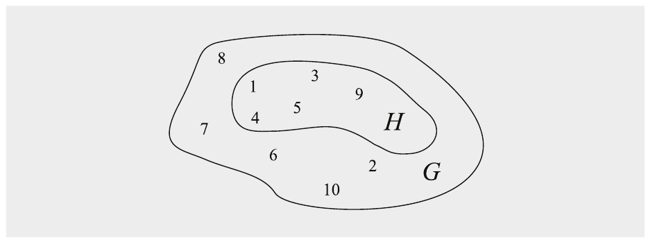

Hình 8.1 Subgroup H của cyclic group G = ℤ11∗

> Định lý 8.2.6 Định lý Lagrange (Lagrange’s theorem)
>
> Cho H là một subgroup của G. Khi đó |H| chia hết |G|.

Bây giờ hãy xét một ứng dụng của định lý Lagrange.

Ví dụ 8.9. Cyclic group ℤ11∗ có cardinality |ℤ11∗ | = 10. Do đó, các subgroup của ℤ11∗ có cardinality 1, 2, 5 và 10, là các ước thực sự của 10. Mọi subgroup H của ℤ11∗ và các generator α của chúng được cho dưới đây:

| subgroup | các phần tử | phần tử nguyên thủy |
|---|---|---|
| H1 | {1} | α = 1 |
| H2 | {1,10} | α = 10 |
| H3 | {1,3,4,5,9} | α = 3,4,5,9 |
| H4 = ℤ11∗ | {1,2,3,4,5,6,7,8,9,10} | α = 2,6,7,8 |

◇

Định lý cuối cùng sau đây của mục này mô tả đầy đủ các subgroup của một finite cyclic group.

> Định lý 8.2.7
>
> Cho G là một finite cyclic group có order n và cho α là một generator của G. Khi đó, với mọi số nguyên k chia hết n, tồn tại đúng một cyclic subgroup H của G có order k. Subgroup này được sinh bởi αn/k. H gồm chính xác các phần tử a ∈ G thỏa điều kiện ak = 1. Không có subgroup nào khác.

Định lý này ngay lập tức cho phép chúng ta xây dựng một subgroup từ một cyclic group cho trước. Chúng ta chỉ cần một phần tử nguyên thủy và cardinality n của group. Bây giờ người ta có thể đơn giản tính αn/k và thu được một generator của subgroup với k phần tử.

Ví dụ 8.10. Chúng ta lại xét cyclic group ℤ11∗. Chúng ta đã thấy trước đó rằng α = 8 là một phần tử nguyên thủy trong group. Nếu muốn có một generator β cho subgroup có order 2, chúng ta tính:

β = αn/k = 810/2 = 85 = 32768 ≡ 10 mod 11

Bây giờ chúng ta kiểm chứng rằng phần tử 10 thực sự sinh ra subgroup với hai phần tử: β1 = 10, β2 = 100 ≡ 1 mod 11, β3 ≡ 10 mod 11, v.v. Tất nhiên có những cách thông minh hơn để tính 85 mod 11, ví dụ, 85 = 82828 ≡ (−2)(−2)8 ≡ 32 ≡ 10 mod 11.

◇

## 8.3 Bài toán logarit rời rạc

Sau phần giới thiệu hơi dài về cyclic group, người ta có thể thắc mắc chúng liên quan thế nào tới protocol DHKE khá đơn giản. Hóa ra one-way function bên dưới của DHKE, bài toán logarit rời rạc (discrete logarithm problem, DLP), có thể được giải thích dễ nhất bằng cyclic group.

### 8.3.1 Bài toán logarit rời rạc trong Prime Field

Chúng ta bắt đầu với DLP trên ℤp∗, trong đó p là số nguyên tố.

> Định nghĩa 8.3.1 Bài toán logarit rời rạc (DLP) trong ℤp∗
>
> Cho trước finite cyclic group ℤp∗ có order p − 1, một phần tử nguyên thủy α ∈ ℤp∗ và một phần tử khác β ∈ ℤp∗. DLP là bài toán tìm số nguyên 1 ≤ x ≤ p − 1 sao cho:
>
> αx ≡ β mod p

Nhớ lại từ Mục 8.2.2 rằng một số nguyên x như vậy phải tồn tại vì α là một phần tử nguyên thủy và mỗi phần tử group có thể được biểu diễn dưới dạng lũy thừa của bất kỳ phần tử nguyên thủy nào. Số nguyên x này được gọi là logarit rời rạc của β cơ số α, và chúng ta có thể viết hình thức:

x = logαβ mod p

Tính logarit rời rạc modulo một số nguyên tố là một bài toán rất khó nếu các tham số đủ lớn. Vì phép lũy thừa αx ≡ β mod p dễ về mặt tính toán, điều này tạo thành một one-way function.

Ví dụ 8.11. Chúng ta xét một logarit rời rạc trong group ℤ47∗, trong đó α = 5 là một phần tử nguyên thủy. Với β = 41, DLP là: Tìm số nguyên dương x sao cho

5x ≡ 41 mod 47

Ngay cả với các số nhỏ như vậy, việc xác định x không hoàn toàn đơn giản. Bằng một brute-force attack, tức là thử có hệ thống mọi giá trị khả dĩ cho x, chúng ta thu được nghiệm x = 15.

◇

Trong thực tế, thường đáng mong muốn có một DLP trong các group có cardinality nguyên tố để ngăn tấn công Pohlig–Hellman (xem Mục 8.3.3). Vì các group ℤp∗ có cardinality p − 1, rõ ràng không phải số nguyên tố, người ta thường dùng DLP trong các subgroup của ℤp∗ có order nguyên tố, thay vì dùng chính group ℤp∗. Chúng tôi minh họa điều này bằng một ví dụ.

Ví dụ 8.12. Chúng ta xét group ℤ47∗, có cardinality 46. Do đó các subgroup trong ℤ47∗ có cardinality 23, 2, hoặc 1.

Vì 23 là số nguyên tố, mọi phần tử trong subgroup với 23 phần tử đều là generator. Hãy chọn phần tử α = 2 trong subgroup này. Một DLP khả dĩ được cho với β = 36 (cũng nằm trong subgroup): Tìm số nguyên dương x, 1 ≤ x ≤ 23, sao cho

2x ≡ 36 mod 47

Bằng một brute-force attack, chúng ta thu được nghiệm x = 17.

◇

### 8.3.2 Bài toán logarit rời rạc tổng quát

Đặc điểm làm cho DLP đặc biệt hữu ích trong cryptography là nó không bị giới hạn ở group nhân ℤp∗ với một số nguyên tố p, mà có thể được định nghĩa trên bất kỳ cyclic group nào. Điều này được gọi là bài toán logarit rời rạc tổng quát (generalized discrete logarithm problem, GDLP).

> Định nghĩa 8.3.2 Bài toán logarit rời rạc tổng quát
>
> Cho trước một finite cyclic group G với phép toán group ◦ và cardinality n. Chúng ta xét một phần tử nguyên thủy α ∈ G và một phần tử khác β ∈ G. Bài toán logarit rời rạc là tìm số nguyên x, trong đó 1 ≤ x ≤ n, sao cho:
>
> 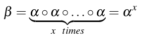

Như trong trường hợp DLP trong ℤp∗, một số nguyên x như vậy phải tồn tại vì α là một phần tử nguyên thủy, và do đó, mỗi phần tử của group G có thể được sinh bằng cách áp dụng lặp lại phép toán group lên α.

Quan trọng là nhận ra rằng có những cyclic group trong đó DLP không khó. Các group như vậy không thể được dùng cho một cryptosystem public-key, vì DLP không phải là một one-way function.

Ví dụ 8.13. Thay vì group nhân, chúng ta xét group cộng của các số nguyên modulo một số nguyên tố. Chẳng hạn, nếu chọn số nguyên tố p = 11, G = (ℤ11,+) là một finite cyclic group với phần tử nguyên thủy α = 2. Đây là cách α sinh ra group:

| i | 1 2 3 4 5 6 7 8 9 10 11 |
|---|---|
| iα | 2 4 6 8 10 1 3 5 7 9 0 |

Bây giờ chúng ta thử giải DLP cho phần tử β = 3, tức là phải tính số nguyên 1 ≤ x ≤ 11 sao cho

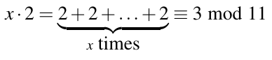

Đây là cách một “tấn công” nhắm vào DLP này hoạt động. Dù phép toán group là phép cộng, chúng ta có thể biểu diễn mối quan hệ giữa α, β và logarit rời rạc x dưới dạng phép nhân:

x · 2 ≡ 3 mod 11

Để giải x, chúng ta chỉ cần nghịch đảo phần tử nguyên thủy α:

x ≡ 2−13 mod 11

Dùng, ví dụ, extended Euclidean algorithm, chúng ta có thể tính 2−1 ≡ 6 mod 11 và logarit rời rạc suy ra là:

x = 2−1 · 3 = 6 · 3 = 18 ≡ 7 mod 11

Logarit rời rạc có thể được kiểm chứng bằng cách xem bảng nhỏ được cho ở trên.

Chúng ta có thể tổng quát hóa điều trên cho bất kỳ group (ℤn,+) nào với n tùy ý và các phần tử α,β ∈ ℤn. Do đó, chúng ta kết luận rằng DLP tổng quát dễ về mặt tính toán trên ℤn nếu phép cộng là phép toán group. Lý do DLP có thể được giải dễ dàng là chúng ta có các phép toán toán học không thuộc group cộng, cụ thể là phép nhân và phép nghịch đảo, có thể được dùng để phá DLP.

◇

Sau phản ví dụ này, bây giờ chúng tôi liệt kê các DLP đã được đề xuất để dùng trong cryptography:

1. Group nhân của prime field ℤp, hoặc một subgroup của nó. Chẳng hạn, DHKE cổ điển dùng cách tiếp cận này, cũng như mã hóa Elgamal và Digital Signature Algorithm (DSA). Đây là các loại hệ thống logarit rời rạc lâu đời nhất và được dùng rộng rãi nhất.

2. Cyclic group được tạo bởi một elliptic curve. Các cryptosystem elliptic curve được giới thiệu trong Chương 9. Chúng đã trở nên cực kỳ được dùng rộng rãi từ chuyển giao thiên niên kỷ và thường là scheme public-key được chọn cho các ứng dụng mới như ứng dụng smartphone hay tiền mã hóa.

3. Group nhân của một Galois field GF(2m), hoặc một subgroup của nó. Các group này có thể được dùng hoàn toàn tương tự các group nhân của prime field, và các scheme như DHKE có thể được hiện thực với chúng. Chúng không phổ biến lắm trong thực tế vì các tấn công nhắm vào chúng mạnh hơn một chút so với các tấn công nhắm vào DLP trong ℤp. Do đó, DLP trên GF(2m) cần độ dài bit dài hơn cho cùng mức bảo mật so với DLP trên ℤp.

4. Hyperelliptic curve hoặc algebraic variety, có thể được xem như một tổng quát hóa của elliptic curve. Chúng hiện hiếm khi được dùng trong thực tế, nhưng đặc biệt hyperelliptic curve có một số ưu điểm như độ dài toán hạng ngắn.

Đã có những đề xuất cho các cryptosystem DLP-based khác qua nhiều năm, nhưng không cái nào thực sự được quan tâm trong thực tế. Thường thì người ta phát hiện ra rằng bài toán DL bên dưới không đủ khó.

### 8.3.3 Các tấn công nhắm vào bài toán logarit rời rạc

Mục này giới thiệu các phương pháp giải bài toán logarit rời rạc, là điều mà đối thủ cần làm để tấn công một cryptosystem; độc giả chỉ quan tâm tới việc dùng các scheme logarit rời rạc theo hướng xây dựng có thể bỏ qua mục này.

Như chúng ta đã thấy, bảo mật của nhiều primitive asymmetric dựa trên độ khó của việc tính DLP trong cyclic group, tức là tính x cho α và β trong G cho trước sao cho

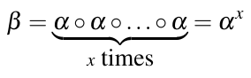

được thỏa. Cần ghi nhớ rằng dù vài thuật toán tấn công đã được biết, có thể có các thuật toán tốt hơn, mạnh hơn để giải DLP trong tương lai. Tình hình tương tự độ khó của phân tích thừa số nguyên, là one-way function bên dưới RSA. Không ai thực sự biết phương pháp phân tích thừa số tốt nhất khả dĩ là gì. Với DLP, có một số kết quả tổng quát thú vị về độ khó tính toán của nó. Mục này đưa ra tổng quan ngắn gọn về các thuật toán tính logarit rời rạc, có thể được phân loại thành thuật toán generic và thuật toán nongeneric.

#### Thuật toán Generic

Các thuật toán DL generic là các phương pháp chỉ dùng phép toán group và không dùng cấu trúc đại số nào khác của group đang xét. Vì chúng không khai thác các tính chất đặc biệt của group, chúng hoạt động trong bất kỳ cyclic group nào. Các thuật toán generic cho bài toán logarit rời rạc có thể được chia thành hai lớp. Lớp thứ nhất gồm các thuật toán có thời gian chạy phụ thuộc vào kích thước của cyclic group, như tìm kiếm brute-force, thuật toán baby-step giant-step, và phương pháp rho của Pollard. Lớp thứ hai là các thuật toán có thời gian chạy phụ thuộc vào kích thước các thừa số nguyên tố của order group, như thuật toán Pohlig–Hellman.

Tìm kiếm Brute-Force

Tìm kiếm brute-force là cách ngây thơ (naïve) nhất và tốn kém tính toán nhất để tính logarit rời rạc logαβ. Chúng ta chỉ đơn giản tính lần lượt các lũy thừa của generator α cho tới khi kết quả bằng β:

α1 ≟ β

α2 ≟ β

⋮

αx ≟ β

Với một số mũ ngẫu nhiên x, chúng ta kỳ vọng tìm được nghiệm đúng sau khi kiểm tra một nửa mọi x khả dĩ. Điều này cho chúng ta độ phức tạp O(|G|) bước[^2], trong đó |G| là cardinality của group.

Do đó, cardinality |G| của group bên dưới phải đủ lớn để tránh các brute-force attack nhắm vào các cryptosystem DL-based trong thực tế. Chẳng hạn, trong trường hợp group ℤp∗ với một số nguyên tố p, vốn là cơ sở cho DHKE, trung bình cần (p − 1)/2 lần kiểm tra để tính một logarit rời rạc. Do đó, |G| = p − 1 nên nằm trong khoảng 2128 để tìm kiếm brute-force bất khả thi với công nghệ máy tính ngày nay. Tất nhiên, cân nhắc này chỉ đúng nếu brute-force attack là tấn công khả thi duy nhất, điều không đúng. Tồn tại các thuật toán mạnh hơn để giải logarit rời rạc, như chúng ta sẽ thấy dưới đây.

Phương pháp Baby-Step Giant-Step của Shanks

Thuật toán của Shanks là một time-memory tradeoff, giảm thời gian chạy của tìm kiếm brute-force với cái giá là bộ nhớ bổ sung. Ý tưởng dựa trên việc viết lại logarit rời rạc x = logαβ dưới dạng biểu diễn two-digit:

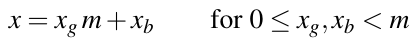 (8.1)

Số nguyên m được chọn là căn bậc hai của order group, tức là m ≈ √|G|. Bây giờ chúng ta có thể viết logarit rời rạc là β = αx = αxg m+xb, dẫn tới

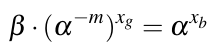 (8.2)

Ý tưởng của thuật toán là tìm một nghiệm (xg,xb) cho Phương trình (8.2), từ đó logarit rời rạc suy ra trực tiếp theo Phương trình (8.1). Ý tưởng cốt lõi của thuật toán là Phương trình (8.2) có thể được giải bằng cách tìm xg và xb riêng biệt, tức là dùng cách tiếp cận divide-and-conquer. Ở giai đoạn thứ nhất của thuật toán, chúng ta tính và lưu mọi giá trị αxb, trong đó 0 ≤ xb < m. Đây là giai đoạn baby-step, cần m ≈ √|G| bước (phép toán group) và không gian lưu trữ cho m ≈ √|G| phần tử group.

Ở giai đoạn giant-step, thuật toán kiểm tra với mọi xg trong khoảng 0 ≤ xg < m xem điều kiện sau có được thỏa không

β · (α−m)xg ≟ αxb

với một mục đã lưu αxb nào đó được tính trong giai đoạn baby-step. Trong trường hợp khớp, tức là β · (α−m)xg,0 = αxb,0 với một cặp (xg,0,xb,0) nào đó, logarit rời rạc được cho bởi

x = xg,0m + xb,0

Phương pháp baby-step giant-step cần O(√|G|) bước tính toán và một lượng bộ nhớ bằng như vậy. Trong một group có order 2128, kẻ tấn công chỉ cần khoảng 264 = √2128 phép tính và vị trí bộ nhớ, điều mà các đối thủ quyết tâm ngày nay có thể làm được. Do đó, để có độ phức tạp tấn công 2128, một group phải có cardinality ít nhất |G| ≥ 2256. Với các group G = ℤp∗, số nguyên tố p do đó nên có độ dài ít nhất 256 bit. Tuy nhiên, có những tấn công mạnh hơn nhắm vào DLP trong ℤp∗, buộc độ dài bit của p phải còn lớn hơn.

Phương pháp Rho của Pollard

Phương pháp rho của Pollard có cùng thời gian chạy kỳ vọng O(√|G|) như thuật toán baby-step giant-step, nhưng chỉ có yêu cầu bộ nhớ không đáng kể. Phương pháp là một thuật toán xác suất dựa trên birthday paradox (xem Mục 11.2.3). Chúng tôi sẽ chỉ phác họa thuật toán ở đây. Ý tưởng cơ bản là sinh giả ngẫu nhiên các phần tử group có dạng αi · βj. Với mỗi phần tử, chúng ta theo dõi các giá trị i và j. Chúng ta tiếp tục cho tới khi thu được một collision của hai phần tử, tức là cho tới khi có:

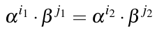 (8.3)

Nếu thay β = αx và so sánh các số mũ ở hai vế của phương trình, collision dẫn tới hệ thức i1 + x j1 ≡ i2 + x j2 mod |G|; lưu ý rằng chúng ta đang ở trong một cyclic group với |G| phần tử và phải lấy số mũ modulo |G|. Từ đây, logarit rời rạc có thể dễ dàng được tính là:

x ≡ (i2 − i1)/(j1 − j2) mod |G|

Một chi tiết quan trọng, mà chúng tôi bỏ qua ở đây, là cách chính xác để tìm collision trong Phương trình (8.3) (việc sinh giả ngẫu nhiên các phần tử là một bước đi ngẫu nhiên qua group). Điều này có thể được minh họa bằng hình dạng của chữ cái Hy Lạp rho, do đó có tên của tấn công này.

Phương pháp rho của Pollard có tầm quan trọng thực tế lớn, vì nó hiện là thuật toán tốt nhất đã biết để tính logarit rời rạc trong các group elliptic curve. Vì phương pháp có độ phức tạp tấn công O(√|G|) phép tính, các group elliptic curve nên có kích thước ít nhất 2256. Thực ra, các cryptosystem elliptic curve với toán hạng 256-bit rất phổ biến trong thực tế. Với DLP trong ℤp∗, các tấn công mạnh hơn nhiều đã được biết như chúng ta sẽ thấy dưới đây.

Thuật toán Pohlig–Hellman

Phương pháp Pohlig–Hellman là một thuật toán dựa trên Định lý số dư Trung Hoa (xem Mục 7.5.2); nó khai thác một phân tích thừa số khả dĩ của order của group. Nó thường không được dùng riêng, mà kết hợp với một trong các thuật toán tấn công DLP khác trong mục này. Cho

\|G| = p1e1 · p2e2 ·...· plel

là phân tích thừa số nguyên tố của order group |G|. Một lần nữa, chúng ta cố tính một logarit rời rạc x = logα β trong G. Ý tưởng cơ bản là, thay vì làm việc với group lớn G, người ta tính các logarit rời rạc nhỏ hơn xi ≡ x mod piei trong mỗi subgroup có order piei. Logarit rời rạc mong muốn x sau đó có thể được tính từ mọi xi, i = 1,...,l, dùng Định lý số dư Trung Hoa. Mỗi DLP nhỏ riêng lẻ xi có thể được tính bằng phương pháp rho của Pollard hoặc thuật toán baby-step giant-step.

Thời gian chạy của thuật toán rõ ràng phụ thuộc vào các thừa số nguyên tố của order group. Để ngăn tấn công, order group phải có thừa số nguyên tố lớn nhất trong khoảng 2256. Một hệ quả thực tế quan trọng của thuật toán Pohlig–Hellman là người ta cần biết phân tích thừa số nguyên tố của order group. Đặc biệt trong trường hợp các cryptosystem elliptic curve, việc tính order của cyclic group không phải lúc nào cũng dễ.

#### Thuật toán Nongeneric: Phương pháp Index-Calculus

Mọi thuật toán được giới thiệu tới giờ đều hoàn toàn độc lập với group bị tấn công, tức là chúng hoạt động cho logarit rời rạc được định nghĩa trên bất kỳ cyclic group nào. Các thuật toán Non-generic khai thác hiệu quả các tính chất đặc biệt, tức là cấu trúc vốn có của một số group nhất định. Điều này có thể dẫn tới các tấn công mạnh hơn nhiều. Thuật toán nongeneric quan trọng nhất là phương pháp index-calculus.

Cả thuật toán baby-step giant-step và phương pháp rho của Pollard đều có thời gian chạy hàm mũ theo độ dài bit của order group, khoảng 2n/2 bước, trong đó n là độ dài bit của |G|. Điều này rất có lợi cho người thiết kế cryptographic so với cryptanalyst. Chẳng hạn, tăng order group chỉ thêm 20 bit làm tăng nỗ lực tấn công lên 1024 = 210 lần. Đây là một lý do chính vì sao elliptic curve có hành vi bảo mật long-term tốt hơn RSA hay các cryptosystem dựa trên DLP trong ℤp∗. Câu hỏi là liệu có các thuật toán mạnh hơn cho DLP trong một số group cụ thể nhất định không. Câu trả lời là có.

Phương pháp index-calculus là một thuật toán rất hiệu quả để tính logarit rời rạc trong các cyclic group ℤp∗ và GF(2m)∗. Nó có thời gian chạy dưới hàm mũ (subexponential). Chúng tôi sẽ không giới thiệu phương pháp ở đây, mà chỉ đưa ra một mô tả rất ngắn gọn. Phương pháp index-calculus phụ thuộc vào tính chất rằng một phần đáng kể các phần tử trong G có thể được biểu diễn hiệu quả dưới dạng tích của các phần tử của một tập con nhỏ của G. Với group ℤp∗, điều này có nghĩa là nhiều phần tử nên biểu diễn được dưới dạng tích của các số nguyên tố nhỏ. Tính chất này được thỏa bởi các group ℤp∗ và GF(2m)∗. Tuy nhiên, hiện chúng ta chưa biết cách làm tương tự cho các group elliptic curve.

Phương pháp index-calculus mạnh tới mức, để cung cấp bảo mật 128 bit, tức là kẻ tấn công phải thực hiện 2128 bước, số nguyên tố p của một DLP trong ℤp∗ phải dài ít nhất 3072 bit, xem Bảng 6.1 trong chương trước. Bảng 8.3 cho tổng quan về các kỷ lục DLP đạt được kể từ đầu những năm 1990. Phương pháp index-calculus mạnh hơn khi giải DLP trong GF(2m)∗. Do đó, độ dài bit phải được chọn dài hơn một chút để đạt cùng mức bảo mật, xem nhận xét trong Mục 8.6. Vì lý do đó, các scheme DLP trong GF(2m)∗ hiếm khi được dùng trong thực tế.

Bảng 8.3 Một số kỷ lục tính logarit rời rạc trong ℤp∗

| Số chữ số thập phân | Độ dài bit | Năm |
|---|---|---|
| 58 | 193 | 1991 |
| 65 | 216 | 1996 |
| 85 | 282 | 1998 |
| 100 | 332 | 1999 |
| 120 | 399 | 2001 |
| 135 | 448 | 2006 |
| 160 | 532 | 2007 |
| 180 | 596 | 2014 |
| 232 | 768 | 2016 |
| 240 | 795 | 2019 |

## 8.4 Bảo mật của trao đổi key Diffie–Hellman

Sau phần giới thiệu bài toán logarit rời rạc, giờ chúng ta đã được chuẩn bị tốt để thảo luận bảo mật của DHKE từ Mục 8.1. Trước hết, cần lưu ý rằng một protocol dùng phiên bản cơ bản của DHKE không an toàn trước các tấn công chủ động. Nếu kẻ tấn công Oscar có thể sửa đổi thông điệp hoặc tạo thông điệp giả, Oscar có thể đánh bại protocol bằng một man-in-the-middle attack so-called, được thảo luận trong Mục 14.4.1.

Bây giờ hãy xét các khả năng của một đối thủ thụ động, tức là Oscar chỉ có thể nghe, nhưng không thể thay đổi thông điệp. Mục tiêu của hắn là tính session key kAB mà Alice và Bob dùng chung. Oscar thu được thông tin gì từ việc quan sát protocol? Chắc chắn, Oscar biết α và p, vì đây là các domain parameter công khai được chọn trong protocol set-up. Ngoài ra, Oscar có thể thu được các giá trị A = kpub,A và B = kpub,B bằng cách nghe lén kênh trong một lần thực thi protocol trao đổi key. Do đó, câu hỏi là liệu hắn có khả năng tính k = αab từ α, p, A ≡ αa mod p và B ≡ αb mod p hay không. Bài toán này được gọi là bài toán Diffie–Hellman (DHP). Như bài toán logarit rời rạc, nó có thể được tổng quát hóa cho các finite cyclic group tùy ý. Đây là một phát biểu hình thức hơn của DHP.

> Định nghĩa 8.4.1 Bài toán Diffie–Hellman tổng quát (DHP)
>
> Cho trước một finite cyclic group G có order n, một phần tử nguyên thủy α ∈ G và hai phần tử A = αa và B = αb trong G. Bài toán Diffie–Hellman là tìm phần tử group αab.

Một cách tiếp cận tổng quát để giải bài toán Diffie–Hellman như sau. Để minh họa, chúng ta xét DHP trong group nhân ℤp∗. Giả sử — và đó là một “giả sử” lớn — Oscar biết một phương pháp hiệu quả để tính logarit rời rạc trong ℤp∗. Khi đó, hắn cũng có thể giải bài toán Diffie–Hellman và thu được key kAB qua hai bước sau:

1. Tính private key của Alice a = kpr,A bằng cách giải bài toán logarit rời rạc: a ≡ logαA mod p.

2. Tính session key kAB ≡ Ba mod p.

Đáng tiếc (từ góc nhìn của Oscar), như chúng ta biết từ Mục 8.3.3, việc tính bài toán logarit rời rạc là bất khả thi nếu p đủ lớn, tức là tấn công được phác họa không hoạt động trong thực tế.

Quan trọng là lưu ý rằng chưa biết liệu giải DLP có phải là cách duy nhất để giải DHP không. Về lý thuyết, có thể tồn tại một phương pháp khác để giải DHP mà không cần tính logarit rời rạc. Tình hình tương tự RSA, nơi cũng chưa biết liệu phân tích thừa số có phải là cách tốt nhất để phá RSA không. Tuy nhiên, dù chưa được chứng minh theo nghĩa toán học chặt chẽ, người ta thường giả định rằng giải DLP hiệu quả là chiến lược khả thi duy nhất để giải DHP hiệu quả.

Do đó, để bảo đảm bảo mật của DHKE trong thực tế, chúng ta phải chắc chắn rằng DLP tương ứng không thể được giải. Điều này đạt được bằng cách chọn p đủ lớn để phương pháp index-calculus không thể tính DLP. Bằng cách tham khảo Bảng 6.1, chúng ta thấy rằng mức bảo mật 80 bit đạt được với các số nguyên tố độ dài 1024 bit, và cho bảo mật 128-bit chúng ta cần khoảng 3072 bit. Một yêu cầu bổ sung là, để ngăn tấn công Pohlig–Hellman, order p − 1 của cyclic group không được phân tích thành chỉ các thừa số nguyên tố nhỏ. Mỗi subgroup được tạo bởi các thừa số của p − 1 có thể bị tấn công bằng phương pháp baby-step giant-step hoặc phương pháp rho của Pollards’s, nhưng không bằng phương pháp index-calculus. Do đó, thừa số nguyên tố nhỏ nhất của p − 1 phải dài ít nhất 160 bit cho mức bảo mật 80-bit, và ít nhất 256 bit cho mức bảo mật 128 bit.

## 8.5 Scheme mã hóa Elgamal

Scheme mã hóa Elgamal được Taher Elgamal đề xuất năm 1985 [110]. Nó cũng thường được gọi là mã hóa Elgamal. Nó có thể được xem như một mở rộng của protocol DHKE. Không ngạc nhiên, bảo mật của nó cũng dựa trên độ khó của DLP và DHP. Chúng ta xét scheme mã hóa Elgamal trên group ℤp∗, trong đó p là số nguyên tố. Tuy nhiên, nó cũng có thể được áp dụng cho các cyclic group khác trong đó DLP và DHP khó giải.

### 8.5.1 Từ trao đổi key Diffie–Hellman tới mã hóa Elgamal

Để hiểu scheme Elgamal, rất hữu ích khi thấy nó suy ra gần như ngay lập tức từ DHKE như thế nào. Chúng ta xét hai bên, Alice và Bob. Nếu Alice muốn gửi một thông điệp đã mã hóa x tới Bob, cả hai bên trước hết thực hiện một trao đổi key Diffie–Hellman để suy ra một key dùng chung kM. Để làm điều này, chúng ta giả sử rằng một số nguyên tố lớn p và một phần tử nguyên thủy α đã được tạo. Bây giờ, ý tưởng mới là Alice dùng key này như một mặt nạ nhân để mã hóa x thành y ≡ x · kM mod p. Quá trình này được mô tả dưới đây.

> Nguyên lý mã hóa Elgamal
>
> 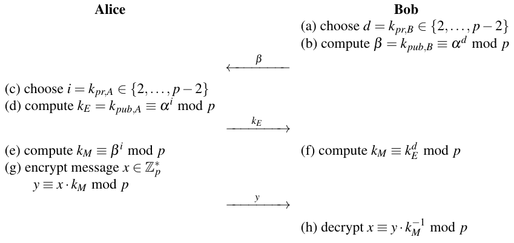

Protocol gồm hai giai đoạn, DHKE cổ điển (Bước a–f) theo sau là mã hóa và giải mã thông điệp (lần lượt Bước g và h). Bob tính private key d và public key β của mình. Cặp key này không thay đổi, tức là nó có thể được dùng để mã hóa nhiều thông điệp. Tuy nhiên, Alice phải tạo một cặp public/private-key mới cho việc mã hóa mỗi thông điệp. Private key của cô ấy được ký hiệu là i và public key của cô ấy là kE. Key sau là một key ephemeral, tức là tạm thời, do đó có chỉ số “E”. Key chung được ký hiệu là kM vì nó được dùng để che (mask) plaintext.

Để mã hóa thực sự, Alice đơn giản nhân thông điệp plaintext x với masking key kM trong ℤp∗. Ở phía nhận, Bob đảo ngược phép mã hóa bằng cách multipliying *(ghi chú: sách in multipliying; đúng là multiplying)* với mặt nạ nghịch đảo. Lưu ý rằng một tính chất của cyclic group là, cho bất kỳ key kM ∈ ℤp∗, mỗi thông điệp x ánh xạ tới một ciphertext khác y nếu hai giá trị được nhân với nhau. Hơn nữa, nếu key kM được rút ngẫu nhiên từ ℤp∗, mọi ciphertext y ∈ {1,2,..., p − 1} đều có khả năng như nhau.

### 8.5.2 Protocol Elgamal

Bây giờ chúng tôi đưa ra một mô tả có cấu trúc hơn một chút về scheme. Chúng ta phân biệt ba giai đoạn. Giai đoạn set-up được thực thi một lần bởi bên phát hành public key và sẽ nhận thông điệp. Giai đoạn mã hóa và giai đoạn giải mã được thực thi mỗi khi một thông điệp được gửi. Khác với DHKE, không cần bên thứ ba đáng tin cậy nào để chọn một số nguyên tố và phần tử nguyên thủy. Bob tạo chúng và công khai chúng, chẳng hạn đặt chúng trong một cơ sở dữ liệu hoặc trên website của anh ấy.

> Protocol mã hóa Elgamal
>
> 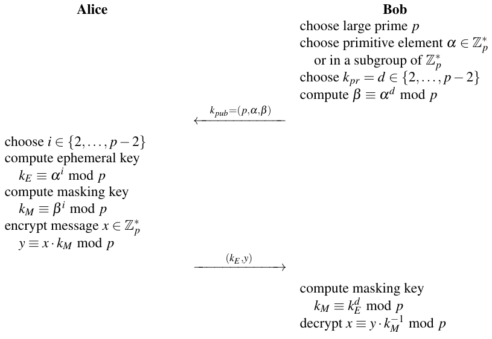

Protocol mã hóa Elgamal thực sự sắp xếp lại thứ tự các phép toán từ cách tiếp cận ngây thơ (naïve) Diffie–Hellman–inspired mà chúng ta đã thấy trước đó. Bây giờ, Alice chỉ phải gửi một thông điệp tới Bob, trái với hai thông điệp trong protocol trước.

Ciphertext gồm hai phần, ephemeral key kE, và plaintext đã được che y. Nói chung, mọi tham số có độ dài bit ⌈log2p⌉, do đó ciphertext (kE,y) dài gấp đôi thông điệp. Do đó, hệ số mở rộng thông điệp của mã hóa Elgamal là hai. Bây giờ chúng ta chứng minh tính đúng đắn của protocol Elgamal.

Chứng minh. Chúng ta phải chỉ ra rằng dkpr(kE,y) thực sự cho ra thông điệp gốc x.

dkpr(kE,y) ≡ y · (kM)−1 mod p

≡ [x · kM] · (kEd)−1 mod p

≡ [x · (αd)i][(αi)d]−1 mod p

≡ x · αd·i−d·i ≡ x mod p

□

Hãy xem một ví dụ với các số nhỏ.

Ví dụ 8.14. Trong ví dụ này, Bob tạo các key Elgamal và Alice mã hóa thông điệp x = 26.

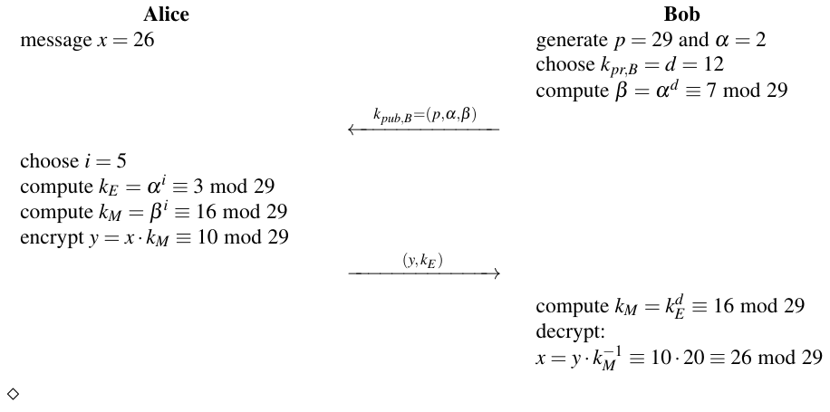

Quan trọng là lưu ý rằng, khác với phiên bản schoolbook của scheme RSA, Elgamal là một scheme mã hóa xác suất, tức là mã hóa hai thông điệp giống nhau x1 và x2, trong đó x1 = x2, dùng cùng public key cho ra hai ciphertext khác nhau y1 ≠ y2 với khả năng cực kỳ cao. Đó là vì i được chọn ngẫu nhiên từ {2,3,···, p − 2} cho mỗi lần mã hóa, và do đó session key kM = βi được dùng để mã hóa cũng là một phần tử ngẫu nhiên trong tập rất lớn này. Do đó, tìm kiếm brute-force cho cả session key kM lẫn plaintext x đều không khả thi với p đủ lớn, tức là ngày nay thường ít nhất là một số 2048-bit.

### 8.5.3 Các khía cạnh tính toán

Tạo key Trong quá trình tạo key bởi bên nhận (Bob trong ví dụ của chúng ta), một số nguyên tố p phải được tạo, và public key và private key phải được tính. Vì bảo mật của Elgamal cũng phụ thuộc vào DLP, p cần có các tính chất đã thảo luận trong Mục 8.3.3. Đặc biệt, nó phải ít nhất 2048 bit. Các thuật toán prime-finding đã thảo luận trong Mục 7.6 có thể được dùng để tạo một số nguyên tố như vậy. Private key nên được tạo bởi một bộ sinh số ngẫu nhiên thực. Public key cần một phép lũy thừa, mà với nó có thể dùng một cách lũy thừa hiệu quả như thuật toán square-and-multiply (xem Mục 7.4). Mã hóa Trong quy trình mã hóa, cần hai phép lũy thừa modulo và một phép nhân modulo để tính ephemeral key và masking key, cũng như để mã hóa thông điệp. Mọi toán hạng liên quan có độ dài bit ⌈log2p⌉. Để lũy thừa hiệu quả, nên áp dụng thuật toán square-and-multiply. Quan trọng là lưu ý rằng hai phép lũy thừa, chiếm gần như mọi phép tính cần thiết, độc lập với plaintext. Do đó, trong một số ứng dụng chúng có thể được tính trước vào những lúc tải tính toán thấp, được lưu và dùng khi cần mã hóa thực sự. Đây có thể là một ưu điểm lớn trong thực tế.

Giải mã Các bước chính của giải mã là một phép lũy thừa kM ≡ kd mod p, dùng thuật toán square-and-multiply, theo sau là một phép nghịch đảo kM được thực hiện bằng extended Euclidean algorithm. Tuy nhiên, có một lối tắt dựa trên Định lý nhỏ Fermat kết hợp hai bước này thành một. Từ định lý, đã được giới thiệu trong Mục 6.3.4, suy ra rằng

kEp−1 ≡ 1 mod p

với mọi kE ∈ ℤp∗. Bây giờ chúng ta có thể gộp Bước 1 và 2 của giải mã như sau:

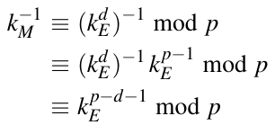 (8.4)

Tương đương (8.4) cho phép chúng ta tính inverse của masking key bằng một phép lũy thừa duy nhất với số mũ (p − d − 1). Sau đó, cần một phép nhân modulo để khôi phục x ≡ y · kM−1 mod p. Hệ quả là việc giải mã về cơ bản cần một lần thực thi thuật toán square-and-multiply theo sau là một phép nhân modulo duy nhất để revover *(ghi chú: sách in revover; đúng là recover)* plaintext.

### 8.5.4 Bảo mật

Nếu muốn đánh giá bảo mật của scheme mã hóa Elgamal, quan trọng là phân biệt giữa tấn công thụ động, tức là listen-only, và tấn công chủ động, cho phép Oscar tạo và thay đổi thông điệp.

#### Tấn công thụ động

Bảo mật của scheme mã hóa Elgamal trước các tấn công thụ động, tức là khôi phục x từ thông tin p, α, β = αd, kE = αi và y = x · βi thu được bằng nghe lén, dựa vào độ khó của DHP (xem Mục 8.4). Hiện chưa biết phương pháp nào giải DHP ngoài việc tính logarit rời rạc. Nếu giả sử Oscar có sức mạnh siêu nhiên và thực sự có thể tính DLP, hắn có hai cách tấn công scheme Elgamal.

■ Khôi phục x bằng cách tìm key bí mật d của Bob:

d ≡ logα β mod p

Bước này giải DLP, điều bất khả thi về mặt tính toán nếu các tham số được chọn đúng. Tuy nhiên, nếu Oscar thành công, hắn có thể giải mã plaintext bằng cách thực hiện cùng các bước như bên nhận, Bob:

x ≡ y · (kEd)−1 mod p

■ Ngoài ra, thay vì tính số mũ bí mật d của Bob, Oscar có thể cố khôi phục số mũ ngẫu nhiên i của Alice:

i ≡ logαk mod p

Một lần nữa, bước này là giải bài toán logarit rời rạc. Nếu Oscar thành công, hắn có thể tính plaintext:

x ≡ y · (βi)−1 mod p

Trong cả hai trường hợp, Oscar phải giải DLP trong finite cyclic group ℤp∗. Khác với elliptic curve, phương pháp index-calculus mạnh hơn (Mục 8.3.3) có thể được áp dụng ở đây. Do đó, để bảo đảm bảo mật của scheme Elgamal trên ℤp∗ ngày nay, p nên có độ dài ít nhất 2048 bit.

Cũng như trong protocol DHKE, chúng ta phải cẩn thận để không trở thành nạn nhân của cái được gọi là small subgroup attack. Để chống lại tấn công này, chúng ta dùng các phần tử nguyên thủy α sinh ra một subgroup có order nguyên tố. Trong các group như vậy, mọi phần tử đều nguyên thủy và không tồn tại subgroup nhỏ. Bài tập 8.18 minh họa các cạm bẫy của small subgroup attack bằng một ví dụ.

#### Tấn công chủ động

Như trong mọi scheme asymmetric khác, phải bảo đảm rằng các public key là xác thực. Điều này có nghĩa là bên mã hóa, Alice trong ví dụ của chúng ta, thực sự có public key thuộc về Bob thật. Nếu Oscar thuyết phục được Alice rằng key của hắn là của Bob, hắn có thể dễ dàng tấn công scheme. Để ngăn tấn công, có thể dùng certificate, một chủ đề được thảo luận trong Chương 14.

Một tấn công khác trở nên khả thi nếu số mũ bí mật i bị dùng lại. Giả sử Alice dùng giá trị i để encrypto *(ghi chú: sách in encrypto; đúng là encrypt)* hai thông điệp liên tiếp, x1 và x2. Trong trường hợp này, hai masking key giống nhau, cụ thể là kM = βi. Khi đó, hai ephemeral key cũng giống hệt nhau. Cô ấy gửi hai ciphertext (y1,kE) và (y2,kE) qua kênh, và, nếu Oscar biết hoặc có thể đoán thông điệp thứ nhất, hắn có thể tính masking key là kM ≡ y1x1−1 mod p. Với điều này, hắn có thể giải mã x2:

x2 ≡ y2 kM−1 mod p

Bất kỳ thông điệp nào khác được mã hóa với cùng giá trị i cũng có thể được khôi phục theo cách này. Hệ quả là phải cẩn thận để số mũ bí mật i không lặp lại. Chẳng hạn, nếu người ta dùng một PRNG an toàn về mặt cryptographic (như được giới thiệu trong Mục 2.2.1), nhưng với cùng giá trị seed mỗi khi một phiên được khởi tạo, cùng một chuỗi giá trị i sẽ được dùng cho mọi lần mã hóa, một sự thật mà Oscar có thể khai thác. Lưu ý rằng Oscar có thể phát hiện việc dùng lại số mũ bí mật vì chúng dẫn tới các ephemeral key giống hệt nhau.

Một tấn công chủ động khác nhắm vào Elgamal khai thác tính malleability của nó. Nếu Oscar quan sát ciphertext (kE,y), hắn có thể thay nó bằng

(kE,s · y)

trong đó s là một số nguyên nào đó. Bên nhận sẽ tính

dkpr(kE,s y) ≡ s · y · kM−1 mod p

≡ s(x · kM) · kM−1 mod p

≡ s · x mod p

Do đó, văn bản được giải mã cũng là một bội số của s. Tình hình hoàn toàn giống như tấn công khai thác tính malleability của RSA được giới thiệu trong Mục 7.7. Oscar không thể giải mã ciphertext, nhưng hắn có thể thao túng nó theo một cách cụ thể. Chẳng hạn, hắn có thể nhân đôi hoặc nhân ba giá trị nguyên của kết quả giải mã bằng cách chọn lần lượt s = 2 hoặc s = 3. Như trong trường hợp RSA, mã hóa schoolbook Elgamal thường không được dùng trong thực tế, và một số padding được đưa vào để ngăn các loại tấn công này.

## 8.6 Thảo luận và đọc thêm (Discussion and Further Reading)

Trao đổi key Diffie–Hellman và mã hóa Elgamal DHKE được giới thiệu trong bài báo mang tính bước ngoặt [93], cũng mô tả khái niệm public-key cryptography. Do phát hiện độc lập về asymmetric cryptography của Ralph Merkle, năm 2003 Hellman đã đề nghị rằng thuật toán nên được đặt tên là “Diffie–Hellman–Merkle key exchange”. Tuy nhiên, cái tên này không được phổ biến. Trong Chương 14 của cuốn sách này, sẽ nói thêm về DHKE trong bối cảnh thiết lập key. Scheme được chuẩn hóa trong ANSI X9.42 [14] và được dùng trong nhiều protocol bảo mật như TLS. Một đặc điểm hấp dẫn của DHKE là nó có thể được tổng quát hóa cho bất kỳ cyclic group nào, không chỉ cho group nhân của một prime field thường được dùng làm ví dụ trong chương này. Trong thực tế, group phổ biến nhất ngoài ℤp∗ là DHKE trên một elliptic curve, được trình bày trong Mục 9.3.

Mặc định, DHKE là một protocol two-party, nhưng có thể được mở rộng thành một thỏa thuận key nhóm trong đó nhiều hơn hai bên thiết lập một key Diffie–Hellman chung, xem, ví dụ, [65].

Mã hóa Elgamal được Taher Elgamal đề xuất năm 1985 [110] được dùng rộng rãi. Chẳng hạn, Elgamal là một phần của GNU Privacy Guard (GnuPG) miễn phí, OpenSSL, Pretty Good Privacy (PGP) và các phần mềm cryptographic khác. Các tấn công chủ động nhắm vào scheme mã hóa Elgamal như mô tả trong Mục 8.5.4 có yêu cầu khá mạnh, tỏ ra khá khó trong thực tế. Tồn tại các scheme liên quan tới Elgamal nhưng có các tính chất bảo mật hình thức mạnh hơn. Chúng bao gồm, ví dụ, Cramer–Shoup System [81], và scheme DHAES [7] do Abdalla, Bellare và Rogaway đề xuất; chúng an toàn trước các tấn công chosen- ciphertext dưới một số giả định nhất định.

Bài toán logarit rời rạc Chương này đã phác họa các thuật toán tấn công quan trọng nhất để giải các bài toán logarit rời rạc (DLP). Một tổng quan tốt về chúng, bao gồm các tài liệu tham khảo thêm, được cho trong [246]. Chúng tôi cũng đã thảo luận mối quan hệ giữa bài toán Diffie–Hellman (DHP) và DLP. Mối quan hệ này là một vấn đề có tầm quan trọng lớn cho nền tảng của cryptography. Các đóng góp chính nghiên cứu điều này là [61, 186]. Các biến thể của number field sieve và function field sieve là các phương pháp tốt nhất đã biết để giải DLP. Chúng có chung một cấu trúc và có thể được chia thành vài giai đoạn. Chỉ giai đoạn cuối phụ thuộc vào DLP thực sự được tính. Do đó, việc tính vài DLP trong một field dựa trên một số nguyên tố cố định p có thể được thực thi nhanh hơn nhiều vì các phép tính của hầu hết các giai đoạn có thể được dùng lại. Bảng 8.3 liệt kê các kỷ lục đáng chú ý trong việc tính logarit rời rạc trong ℤp.

Tính DLP trong group nhân của các extension field GF(2m) dễ hơn về mặt tính toán so với trong các prime field ℤp với cùng độ dài bit. Với các giá trị m nguyên tố, kỷ lục tại thời điểm viết sách là một phép tính logarit rời rạc trong GF(21279) do Thorsten Kleinjung thực hiện [160]. Nếu m là hợp số, các phép tính DLP dễ hơn đáng kể. Chẳng hạn, năm 2013, một nhóm Pháp và một nhóm Ireland đã có thể giải DLP cho các field GF(26120) và GF(26168) [117]. Lưu ý rằng cả hai số mũ đều là hợp số: 6120 = 23 · 32 · 5 · 17 và 6168 = 23 · 3 · 257. Vì lý do đó, chủ yếu các prime field ℤp được dùng trong thực tế cho các cryptosystem DLP-based. Các bản tóm tắt tốt về hiện trạng các phép tính DLP có thể được tìm thấy trong [117] và [155].

Ý tưởng dùng DLP trong các group khác ℤp∗ được khai thác trong elliptic curve cryptography, một chủ đề được đề cập trong Chương 9. Các cryptoystems *(ghi chú: sách in cryptoystems; đúng là cryptosystems)* khác dựa trên DLP tổng quát bao gồm hyperelliptic curve, mà một trình bày toàn diện có thể được tìm thấy trong [73]. Thay vì dùng prime field ℤp, cũng có thể dùng một số extension field nhất định, vốn có ưu điểm về tính toán. Hai trong số các hệ thống logarit rời rạc better-studied trên extension field là Lucas-Based Cryptosystems [55] và Efficient and Compact Subgroup Trace Representation (XTR) [172].

## 8.7 Bài học rút ra (Lessons Learned)

■ Protocol Diffie–Hellman là một phương pháp được dùng rộng rãi để trao đổi key. Nó dựa trên bài toán logarit rời rạc trong finite field.

■ Với protocol Diffie–Hellman trong ℤp, số nguyên tố p nên dài ít nhất 2048 bit. Để đạt mức bảo mật 128 bit (là mức AES với key 128-bit cung cấp), số nguyên tố nên có 3072 bit.

■ Bài toán logarit rời rạc là một trong những one-way function quan trọng nhất trong asymmetric cryptography hiện đại. Trong thực tế, DLP trên group nhân của prime field ℤp hoặc group của một elliptic curve được dùng thường xuyên nhất.

■ Elgamal là một mã hóa xác suất có thể được xem như một mở rộng của DHKE.

■ Các cryptosystem logarit rời rạc (cũng như RSA và các scheme elliptic curve) sẽ trở nên không an toàn nếu máy tính lượng tử full-size trở nên khả dụng trong tương lai.

## Bài tập

8.1. Hiểu group, cyclic group và subgroup là quan trọng cho việc dùng các cryptosystem public-key dựa trên bài toán logarit rời rạc. Đó là lý do chúng ta sẽ luyện tập một số phép tính số học trong các cấu trúc như vậy trong bài tập này và vài bài tập tiếp theo.

Hãy bắt đầu với một bài dễ. Xác định order của mọi phần tử của các group nhân của:

1. ℤ5∗

2. ℤ7∗

3. ℤ13∗

Tạo một danh sách với hai cột cho mỗi group, trong đó mỗi hàng chứa một phần tử a và order ord(a).

(Gợi ý: Để làm quen với cyclic group và các tính chất của chúng, nên tính mọi order “bằng tay”, tức là chỉ dùng máy tính bỏ túi. Nếu bạn muốn rèn lại kỹ năng tính nhẩm, hãy cố gắng không dùng máy tính bất cứ khi nào có thể, đặc biệt là cho hai group đầu tiên.)

8.2. Chúng ta xét group ℤ53∗. Các order phần tử khả dĩ là gì? Có bao nhiêu phần tử cho mỗi order?

8.3. Bây giờ chúng ta nghiên cứu các group từ Bài tập 8.1.

1. Mỗi group nhân có bao nhiêu phần tử?

2. Mọi order ở trên có chia hết số phần tử trong group nhân tương ứng không?

3. Những phần tử nào từ Bài tập 8.1 là phần tử nguyên thủy?

4. Kiểm chứng cho mỗi group rằng số phần tử nguyên thủy được cho bởi φ(|ℤp∗|).

8.4. Trong bài tập này, chúng ta muốn xác định các phần tử nguyên thủy (generator) của một group nhân vì chúng quan trọng cho DHKE và nhiều scheme public-key khác dựa trên bài toán DL. Bạn được cho một số nguyên tố p = 4969 và group nhân tương ứng ℤ4969∗.

1. Xác định có bao nhiêu generator tồn tại trong ℤ4969∗.

2. Xác suất để một phần tử được chọn ngẫu nhiên a ∈ ℤ4969∗ là generator là bao nhiêu?

3. Xác định generator nhỏ nhất a ∈ ℤ4969∗ với a > 1000. Gợi ý: Việc xác định có thể được làm một cách ngây thơ (naïvely) qua kiểm tra mọi thừa số khả dĩ của cardinality group p − 1, hoặc hiệu quả hơn bằng cách kiểm tra rằng a(p−1)/qi ≠ 1 mod p với mọi thừa số nguyên tố qi với p − 1 = ∏qiei. Bạn có thể đơn giản bắt đầu với a = 1001 và lặp lại các bước này cho tới khi tìm được một generator của ℤ4969∗.

8.5. Tính hai public key và key chung kAB cho scheme DHKE với các tham số p = 467, α = 2, và

1. a = 3, b = 5

2. a = 400, b = 134

3. a = 228, b = 57

Trong mọi trường hợp, thực hiện phép tính key chung cho cả Alice và Bob. Đây cũng là một cách kiểm tra hoàn hảo cho kết quả của bạn.

8.6. Bây giờ chúng ta thiết kế một scheme DHKE khác với cùng số nguyên tố p = 467 như trong Bài tập 8.5. Tuy nhiên, lần này chúng ta dùng phần tử α = 4. Phần tử 4 có order 233 và do đó sinh ra một subgroup với 233 phần tử. Tính kAB cho

1. a = 400, b = 134

2. a = 167, b = 134

Vì sao các session key giống hệt nhau?

8.7. Trong protocol DHKE, các private key được chọn từ tập

{2,..., p − 2}

Vì sao các giá trị 1 và p − 1 bị loại trừ? Mô tả điểm yếu của hai giá trị này.

8.8. Cho một thuật toán DHKE. Modulus p có 1024 bit và α là một generator của một subgroup trong đó ord(α) ≈ 2160.

1. Giá trị tối đa mà các private key nên có là bao nhiêu?

2. Việc tính session key trung bình mất bao lâu nếu một phép nhân modulo mất 700 µs và một phép bình phương modulo 400 µs? Giả sử các public key đã được tính.

3. Một kỹ thuật tăng tốc well-known cho các hệ thống logarit rời rạc dùng các phần tử nguyên thủy ngắn. Bây giờ chúng ta giả sử α là một phần tử ngắn như vậy (ví dụ, một số nguyên 16-bit). Giả sử phép nhân modulo với α bây giờ chỉ mất 30 µs. Việc tính public key bây giờ mất bao lâu? Vì sao thời gian cho một phép bình phương modulo vẫn như trên nếu chúng ta áp dụng thuật toán square-and-multiply?

8.9. Bài tập này minh họa điều gì có thể sai nếu chọn một generator có một số tính chất không mong muốn.

1. Chỉ ra rằng order của một phần tử a ∈ ℤp với a = p − 1 luôn là 2.

2. Subgroup nào được sinh bởi a?

3. Mô tả ngắn gọn một tấn công đơn giản vào DHKE khai thác tính chất này.

8.10. Chúng ta xét một protocol DHKE trên Galois field GF(2m). Mọi phép tính số học được thực hiện trong GF(25), với P(x) = x5 + x2 + 1 là đa thức field bất khả quy. Phần tử nguyên thủy cho scheme Diffie–Hellman là α = x2. Các private key là a = 3 và b = 12. Session key kAB là gì?

8.11. Trong chương này, chúng ta đã thấy rằng protocol Diffie–Hellman an toàn ngang bài toán Diffie–Hellman, vốn có lẽ khó ngang bài toán logarit rời rạc trong group ℤp∗. Tuy nhiên, điều này chỉ đúng với các tấn công thụ động, tức là nếu Oscar chỉ có khả năng nghe lén. Nếu Oscar có thể thao túng thông điệp giữa Alice và Bob, protocol thỏa thuận key có thể dễ dàng bị phá! Xây dựng một tấn công chủ động nhắm vào protocol thỏa thuận key Diffie–Hellman với Oscar là kẻ đứng giữa (man in the middle).

8.12. Viết một chương trình tính logarit rời rạc trong ℤp∗ bằng tìm kiếm vét cạn. Các tham số input cho chương trình của bạn là p,α,β. Chương trình tính x trong đó β = αx mod p.

Tính nghiệm của log10612375 trong ℤ24691.

8.13. Mã hóa các thông điệp sau bằng cryptosystem Elgamal (p = 467 và α = 2):

1. kpr = d = 105, i = 213, x = 33

2. kpr = d = 105, i = 123, x = 33

3. kpr = d = 300, i = 45, x = 248

4. kpr = d = 300, i = 47, x = 248

Bây giờ giải mã mọi ciphertext và thể hiện mọi bước.

8.14. Giả sử Bob gửi một thông điệp Elgamal-encrypted tới Alice gồm hai mẩu plaintext. Vì Bob lười, anh ấy áp dụng scheme sai và dùng cùng tham số i cho mọi thông điệp. Giả sử chúng ta biết rằng mỗi plaintext của Bob bắt đầu bằng số x1 = 21, tình cờ là ID của Bob. Bây giờ chúng ta thu được các ciphertext sau:

(kE,1 = 6,y1 = 12)

(kE,2 = 6,y2 = 14)

Các tham số Elgamal là p = 31,α = 3,β = 18. Xác định plaintext thứ hai x2.

8.15. Cho một cryptosystem Elgamal. Bob cố tỏ ra đặc biệt thông minh và chọn bộ sinh giả ngẫu nhiên sau để tính các giá trị i mới:

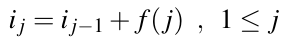 (8.5)

trong đó f (j) là một hàm giả ngẫu nhiên “phức tạp” nhưng đã biết (chẳng hạn, f(j) có thể là một hash function cryptographic như SHA-2) và i0 là một số ngẫu nhiên thực mà Oscar không biết.

Bob mã hóa n thông điệp xj như sau:

kEj ≡ αij mod p

yj ≡ xj · βij mod p

trong đó 1 ≤ j ≤ n. Giả sử plaintext cuối cùng xn và mọi ciphertext đều được Oscar biết.

Đưa ra một công thức mà Oscar có thể dùng để tính bất kỳ thông điệp xj nào, 1 ≤ j ≤ n − 1. Tất nhiên, theo nguyên lý Kerckhoffs, Oscar biết phương pháp xây dựng được trình bày ở trên, bao gồm hàm f ().

8.16. Cho một scheme mã hóa Elgamal với các tham số công khai kpub = (p,α,β) và một private key chưa biết kpr = d. Do một bản triển khai sai của bộ sinh số ngẫu nhiên của bên mã hóa, hệ thức sau đúng cho hai key tạm thời:

kM,j+1 ≡ kM,j2 mod p

Cho n ciphertext liên tiếp

(kE1,y1),(kE2,y2),...,(kEn,yn)

thuộc về các plaintext

x1,x2,...,xn

Hơn nữa, plaintext thứ nhất x1 đã biết (ví dụ, thông tin header).

1. Mô tả cách kẻ tấn công có thể tính các plaintext x1,x2,...,xn từ các biến đã cho.

2. Kẻ tấn công có thể tính private key d từ thông tin đã cho không? Giải thích câu trả lời.

8.17. Xét bốn ví dụ từ Bài tập 8.13, chúng ta thấy rằng scheme Elgamal không tất định: Một plaintext x cho trước có nhiều ciphertext hợp lệ, ví dụ, cả x = 33 và x = 248 đều có cùng ciphertext trong bài tập.

1. Vì sao scheme mã hóa Elgamal không tất định?

2. Có bao nhiêu ciphertext hợp lệ cho mỗi thông điệp x (biểu thức tổng quát)? Có bao nhiêu cho hệ thống trong Bài tập 8.13 (đáp số)?

3. Hệ thống cryptographic schoolbook RSA có không tất định không một khi public key đã được chọn?

8.18. Chúng ta khảo sát các điểm yếu phát sinh trong mã hóa Elgamal nếu dùng một public key có order nhỏ. Chúng ta xem ví dụ sau. Giả sử Bob dùng group ℤ29∗ với phần tử nguyên thủy α = 2. Public key của anh ấy là β = 28.

1. Order của public key là bao nhiêu?

2. Những masking key kM nào là khả dĩ?

3. Alice mã hóa một thông điệp văn bản. Mỗi ký tự được mã hóa theo quy tắc đơn giản a → 0,..., z → 25. Ba ký hiệu ciphertext bổ sung là các umlaut: ä → 26, ö → 27, ü → 28. Cô ấy truyền 11 ciphertext sau (kE,y):

(3,15),(19,14),(6,15),(1,4),(22,13),(4,7),

(13,4),(3,21),(18,17),(26,25),(7,17)

Giải mã thông điệp mà không tính private key của Bob. Chỉ cần nhìn ciphertext và dùng sự thật rằng chỉ có rất ít masking key và một chút phỏng đoán.

8.19. Trong bài tập này, chúng tôi sẽ giới thiệu exponentiation cipher Pohlig–Hellmann. Nó được giới thiệu năm 1978 và là một thuật toán mã hóa symmetric dựa trên các modular exponentations *(ghi chú: sách in exponentations; đúng là exponentiations)*, một phép toán chúng ta biết từ RSA và DHKE. Cipher chống được các known-plaintext attack. Từ góc độ thực tế, nó chưa bao giờ trở nên quan trọng vì nó kém hiệu quả hơn nhiều so với các block cipher như AES hay stream cipher. Tuy nhiên, từ góc độ sư phạm, cipher Pohlig-Hellman khá có giá trị vì nó kết hợp bài toán logarit rời rạc với một symmetric cipher mà không cần giải thích khái niệm trừu tượng hơn của public-key cryptography.

Scheme exponentiation cipher Pohlig–Hellmann hoạt động như sau: Cho một số nguyên tố (đủ lớn) p và một key e, Alice và Bob thực hiện:

Mã hóa: y ≡ xe mod p

Giải mã: x ≡ xd mod p, trong đó d ≡ e−1 mod p − 1

1. Tính phép mã hóa của x = {S,Y,M,M,E,T,R,I,C} với p = 29 và e = 9. Bạn có thể giả sử một ánh xạ đơn giản từ chữ cái sang số, ví dụ, A = 0,B = 1,···,Z = 25.

2. Tính key d tương ứng để giải mã và chỉ ra rằng phép giải mã y cho ra plaintext x.

3. Mã hóa và giải mã có hoạt động với mọi e không?

4. Scheme có còn an toàn không nếu Oscar biết key mã hóa e và số nguyên tố p?

5. Oscar có thể tấn công scheme nếu hắn có được một cặp plaintext và ciphertext mà không biết key e không?

8.20. Giải bài toán logarit rời rạc (tổng quát) không khó trong mọi group. Bây giờ hãy xét group cộng của các số nguyên modulo một số nguyên tố (ℤp,+).

1. Định nghĩa của bài toán logarit rời rạc tổng quát cho group cụ thể này là gì? (xem Định nghĩa 8.3.2)

2. Mô tả một phương pháp để giải hiệu quả bài toán logarit rời rạc tổng quát trong group (ℤp,+).

8.21. Với DHKE, chúng ta chọn generator α cũng như các private key kpr,A và kpr,B, là các phần tử trong {2,3,..., p − 2}.

1. Chỉ ra rằng nói chung chúng ta không thể chọn p − 1 làm private key. Tính αp−1 mod p cho các tham số DHKE tùy ý α, p.

2. Order của phần tử α = p − 1 là bao nhiêu? Subgroup nào được sinh từ α = p − 1?

8.22. Tính logarit rời rạc sau trong ℤ113∗ bằng phương pháp Baby-Step Giant-Step. Giải thích câu trả lời nếu không thể tính.

1. α = 10, β = 98

2. α = 10, β = 99

3. α = 7, β = 98

---

[^1]: Kênh cần được xác thực, một vấn đề sẽ được thảo luận chi tiết trong Mục 14.4.

[^2]: Chúng tôi dùng ký hiệu “big-Oh” phổ biến ở đây. Một hàm độ phức tạp f(x) có ký hiệu big-Oh O(g(x)) nếu f(x) ≤ c · g(x) với một hằng số c nào đó và với các giá trị input x lớn hơn một giá trị x0 nào đó.
