# Chương 9 Các cryptosystem Elliptic Curve (Elliptic Curve Cryptosystems)

Elliptic Curve Cryptography (ECC) cùng với RSA và các scheme logarit rời rạc tạo thành họ thuật toán public-key thứ ba hiện đang được dùng rộng rãi. ECC được Neal Koblitz và Victor Miller giới thiệu độc lập vào mid- 1980s, tức là khoảng 10 năm sau RSA và trao đổi key Diffie–Hellman.

ECC dựa trên bài toán logarit rời rạc tổng quát, và do đó các DL-protocols như trao đổi key Diffie–Hellman cũng có thể được hiện thực bằng elliptic curve. ECC cung cấp cùng mức bảo mật như RSA hay các hệ thống logarit rời rạc với các toán hạng ngắn hơn đáng kể (khoảng 256–512 bit so với 2048–4096 bit). Trong nhiều trường hợp, ECC có ưu thế về hiệu năng (ít phép tính hơn) và ưu thế về băng thông (key và chữ ký ngắn hơn) so với RSA và các scheme logarit rời rạc cổ điển. Điều này đã làm cho ECC cực kỳ phổ biến trong nhiều ứng dụng gần đây hơn như digital signature cho tiền mã hóa hay trao đổi key trong các ứng dụng nhắn tin điện tử. Cần lưu ý rằng các phép toán RSA liên quan tới public key ngắn như được giới thiệu trong Mục 7.5.1 vẫn nhanh hơn nhiều so với các phép toán ECC.

Toán học của elliptic curve phức tạp hơn đáng kể so với của RSA và các scheme DL. Một số chủ đề, ví dụ, đếm điểm trên elliptic curve, vượt ra ngoài phạm vi cuốn sách này. Do đó, trọng tâm của chương này là giải thích các kiến thức cơ bản về ECC một cách rõ ràng mà không có quá nhiều chi tiết toán học, để độc giả hiểu được các chức năng quan trọng nhất của các cryptosystem dựa trên elliptic curve.

Trong chương này, bạn sẽ học:

■ Ưu và nhược điểm cơ bản của ECC so với RSA và các scheme DL

■ Elliptic curve là gì và cách tính toán với nó

■ Cách xây dựng một bài toán DL với một elliptic curve

■ Các protocol có thể được hiện thực với elliptic curve

■ Các ước tính bảo mật và hiệu năng hiện tại của các cryptosystem dựa trên elliptic curve

## 9.1 Cách tính toán với Elliptic Curve

Chúng tôi bắt đầu bằng một phần giới thiệu ngắn về khái niệm toán học của elliptic curve, độc lập với các ứng dụng cryptographic của chúng. ECC dựa trên bài toán logarit rời rạc tổng quát. Do đó, điều chúng ta cố làm trước tiên là tìm một cyclic group mà với nó có thể xây dựng một cryptosystem DL. Tất nhiên, chỉ sự tồn tại của một cyclic group là không đủ. Bài toán DL trong group này cũng phải khó về mặt tính toán, tức là nó phải có các tính chất one-way tốt.

Chúng ta bắt đầu bằng cách xét một số đa thức nhất định (tức là các hàm với tổng các lũy thừa của x và y), và vẽ chúng trên tập số thực.

Ví dụ 9.1. Hãy xem phương trình đa thức x2 + y2 = r2 trên tập số thực ℝ.

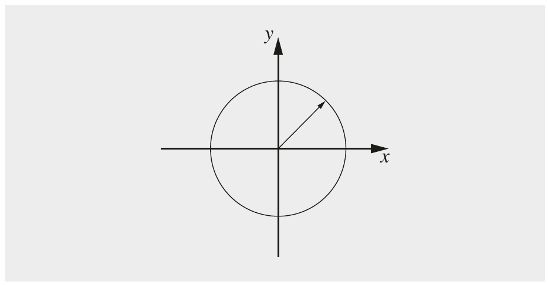

Hình 9.1 Đồ thị mọi điểm (x,y) là nghiệm của phương trình x2 + y2 = r2 trên ℝ

Nếu vẽ mọi cặp (x,y) thỏa phương trình này trong một hệ tọa độ Descartes, chúng ta thu được một đường tròn như thể hiện trong Hình 9.1.

◇

Bây giờ chúng ta xem một phương trình đa thức khác trên tập số thực.

Ví dụ 9.2. Một tổng quát hóa nhỏ của phương trình đường tròn là đưa các hệ số vào hai số hạng x2 và y2, tức là chúng ta xem tập nghiệm của phương trình a · x2 + b · y2 = c trên tập số thực.

Hóa ra chúng ta thu được một hình elip, như thể hiện trong Hình 9.2.

◇

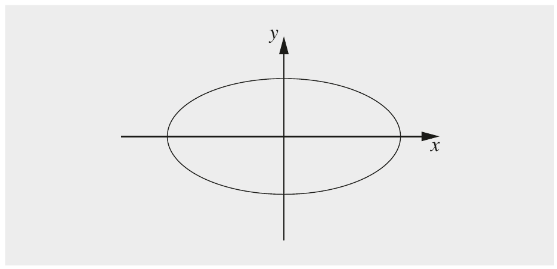

Hình 9.2 Đồ thị mọi điểm (x,y) thỏa phương trình a · x2 + b · y2 = c trên ℝ

### 9.1.1 Định nghĩa Elliptic Curve

Từ hai ví dụ trên, chúng ta kết luận rằng có thể tạo một số loại đường cong nhất định bằng các phương trình đa thức. Với “đường cong”, chúng tôi muốn nói tới tập các điểm (x,y) là nghiệm của các phương trình. Chẳng hạn, điểm (x = r,y = 0) thỏa phương trình đường tròn và do đó nằm trong tập. Mặt khác, điểm (x = r/2,y = r/2) không phải là nghiệm của đa thức x2 + y2 = r2 và do đó không phải là phần tử của tập. Một elliptic curve là một loại phương trình đa thức đặc biệt. Để dùng cho cryptography, chúng ta cần xét đường cong không phải trên tập số thực mà trên một finite field. Lựa chọn phổ biến nhất là các prime field GF (p) (xem Mục 4.3.2), trong đó mọi phép tính số học được thực hiện modulo một số nguyên tố p.

> Định nghĩa 9.1.1 Elliptic Curve
>
> Elliptic curve trên ℤp với một số nguyên tố p > 3 là tập mọi cặp (x,y) ∈ ℤp thỏa
>
> 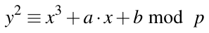 (9.1)
>
> cùng với một điểm ảo ở vô cực O, trong đó
>
> a,b ∈ ℤp
>
> và điều kiện 4 · a3 + 27 · b2 ≠ 0 mod p.

Định nghĩa elliptic curve yêu cầu đường cong là không kỳ dị (nonsingular). Về mặt hình học, điều này có nghĩa là đồ thị không có self-intersections hay đỉnh nhọn, điều đạt được nếu biệt thức của đường cong − 16(4a3 + 27b2) khác không.

Để dùng cho cryptography, chúng ta quan tâm tới việc nghiên cứu đường cong trên một prime field như trong định nghĩa. Tuy nhiên, nếu vẽ một elliptic curve như vậy trên ℤp, chúng ta không thu được thứ gì dù chỉ hơi giống một đường cong. Tuy nhiên, không gì ngăn chúng ta lấy một phương trình elliptic curve và vẽ nó trên tập số thực. Trong trường hợp này, chúng ta thu được các đường cong thực sự, như thể hiện trong ví dụ sau.

Ví dụ 9.3. Trong Hình 9.3 (a-d), các elliptic curve khác nhau trên tập số thực được thể hiện.

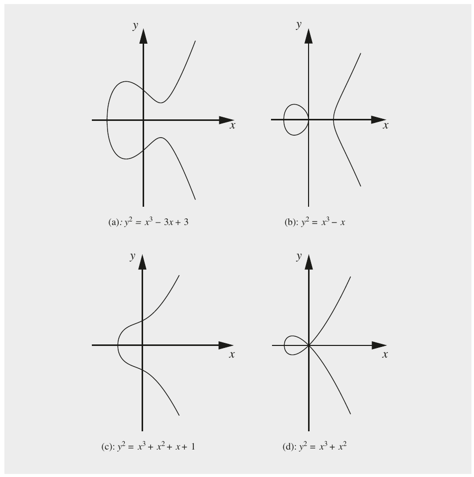

Hình 9.3 Các ví dụ về elliptic curve trên tập số thực

◇

Chúng ta nhận thấy vài điều từ các đồ thị elliptic curve này.[^1] Thứ nhất, elliptic curve đối xứng qua x-axis. Điều này suy ra trực tiếp từ thực tế rằng với mọi giá trị xi nằm trên elliptic curve, cả

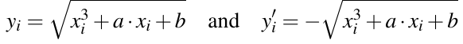

đều là nghiệm. Thứ hai, có từ một tới ba giao điểm với x-axis. Điều này suy ra từ thực tế rằng đó là một phương trình bậc ba nếu chúng ta giải với y = 0.

Bây giờ chúng ta quay lại mục tiêu ban đầu là tìm một đường cong với một cyclic group lớn, điều cần để xây dựng một bài toán logarit rời rạc. Nhiệm vụ đầu tiên để tìm một group đã xong, cụ thể là xác định một tập phần tử. Trong trường hợp elliptic curve, các phần tử group là các điểm thỏa Phương trình (9.1). Câu hỏi tiếp theo là: Làm thế nào để định nghĩa một phép toán group với các điểm đó? Tất nhiên, chúng ta phải bảo đảm rằng các luật group từ Định nghĩa 4.3.1 trong Mục 4.3 đúng với phép toán.

### 9.1.2 Các phép toán group trên Elliptic Curve

Hãy ký hiệu phép toán group bằng ký hiệu cộng[^2] “+”. “Phép cộng” có nghĩa là cho hai điểm và tọa độ của chúng, giả sử P = (x1,y1) và Q = (x2,y2), chúng ta phải tính tọa độ của một điểm thứ ba R sao cho:

P + Q = R

(x1,y1) + (x2,y2) = (x3,y3)

Như chúng ta sẽ thấy dưới đây, hóa ra phép cộng này trông khá tùy ý. May mắn là có một cách diễn giải hình học đẹp của phép cộng nếu xét một đường cong được định nghĩa trên tập số thực. Với cách diễn giải hình học này, chúng ta phải phân biệt hai trường hợp: cộng hai điểm phân biệt (gọi là point addition) và cộng một điểm với chính nó (gọi là point doubling).

Point Addition P + Q Đây là trường hợp chúng ta tính R = P + Q và P ≠ Q. Cách dựng như sau: Vẽ một đường thẳng qua P và Q và thu được giao điểm thứ ba giữa elliptic curve và đường thẳng. Lấy đối xứng giao điểm thứ ba này qua x-axis. Điểm đối xứng này, theo định nghĩa, là điểm R. Hình 9.4 cho thấy point addition trên một elliptic curve trên tập số thực.

Point Doubling P + P Đây là trường hợp chúng ta tính P + Q nhưng P = Q. Do đó, chúng ta có thể viết R = P + P = 2P. Ở đây cần một cách dựng hơi khác. Chúng ta vẽ tiếp tuyến qua P và thu được giao điểm thứ hai giữa đường thẳng này và elliptic curve. Chúng ta lấy đối xứng giao điểm thứ hai qua x-axis. Điểm đối xứng này là kết quả R của phép doubling. Hình 9.5 cho thấy phép doubling một điểm trên một elliptic curve trên tập số thực.

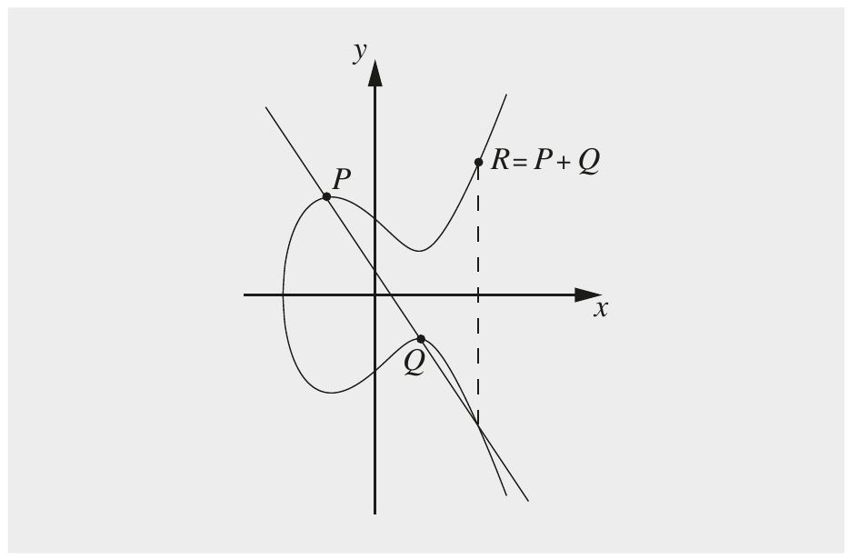

Hình 9.4 Point addition trên một elliptic curve trên tập số thực

Bạn có thể thắc mắc vì sao các phép toán group có dạng arbitrary-looking như vậy. Về mặt lịch sử, phương pháp tangent-and-chord này đã được dùng để dựng một điểm thứ ba nếu hai điểm đã biết, trong khi chỉ dùng bốn phép toán đại số tiêu chuẩn cộng, trừ, nhân và chia. Hóa ra nếu các điểm trên elliptic curve được cộng theo chính cách này, tập các điểm cũng thỏa hầu hết các điều kiện cần cho một group, tức là tính đóng, tính kết hợp, sự tồn tại của phần tử đơn vị và sự tồn tại của inverse.

Tất nhiên, trong một cryptosystem chúng ta không thể thực hiện các phép dựng hình học. Tuy nhiên, bằng cách áp dụng hình học tọa độ đơn giản, chúng ta có thể biểu diễn cả hai phép dựng hình học ở trên qua các biểu thức giải tích, tức là các công thức. Như đã nêu ở trên, các công thức này chỉ liên quan tới bốn phép toán đại số cơ bản. Các phép toán này có thể được thực hiện trong bất kỳ field nào, không chỉ trên field số thực (xem Mục 4.3). Đặc biệt, chúng ta có thể lấy phương trình đường cong ở trên, nhưng bây giờ xét nó trên các prime field GF(p) thay vì trên tập số thực. Điều này cho ra các biểu thức giải tích sau cho phép toán group.

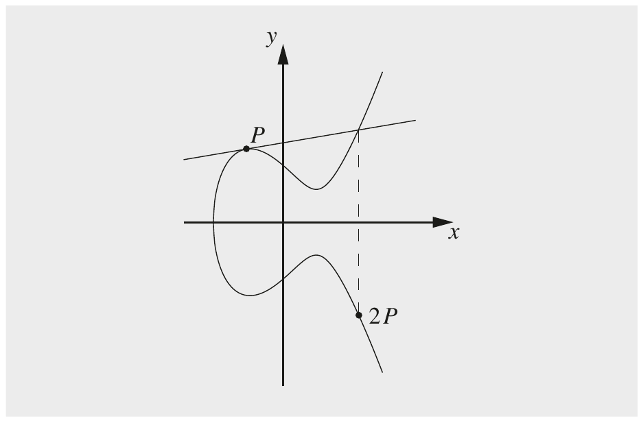

Hình 9.5 Point doubling trên một elliptic curve trên tập số thực

> Point Addition và Point Doubling trên Elliptic Curve
>
> x3 ≡ s2 − x1 − x2 mod p
>
> y3 ≡ s(x1 − x3) − y1 mod p
>
> trong đó
>
> s ≡ (y2 − y1)/(x2 − x1) mod p; nếu P ≠ Q (point addition)
>
> s ≡ (3x12 + a)/(2y1) mod p; nếu P = Q (point doubling)

Lưu ý rằng tham số s là độ dốc của đường thẳng qua P và Q trong trường hợp point addition và là độ dốc của tiếp tuyến qua P trong trường hợp point doubling.

Dù chúng ta đã có bước tiến lớn hướng tới việc thiết lập một finite group, chúng ta vẫn chưa tới đích. Một thứ vẫn còn thiếu là một phần tử đơn vị (hay trung hòa) O sao cho:

P + O = P

với mọi điểm P trên elliptic curve. Hóa ra không có điểm (x,y) nào thỏa điều kiện. Thay vào đó, chúng ta định nghĩa một điểm trừu tượng ở vô cực làm phần tử trung hòa O. Điểm ở vô cực này có thể được hình dung như một điểm nằm về phía vô cực “dương” dọc theo y-axis hoặc về phía vô cực “âm” dọc theo y-axis.

Bây giờ khi đã có phần tử trung hòa, chúng ta cũng có thể định nghĩa inverse −P của bất kỳ phần tử group P nào theo định nghĩa group:

P + (−P) = O

Câu hỏi là làm thế nào để tìm −P? Nếu áp dụng phương pháp tangent-and-chord ở trên, hóa ra inverse của điểm P = (xp,yp) là điểm

−P = (xp,−yp)

tức là điểm đối xứng của P qua x-axis. Hình 9.6 cho thấy điểm P cùng với inverse của nó.

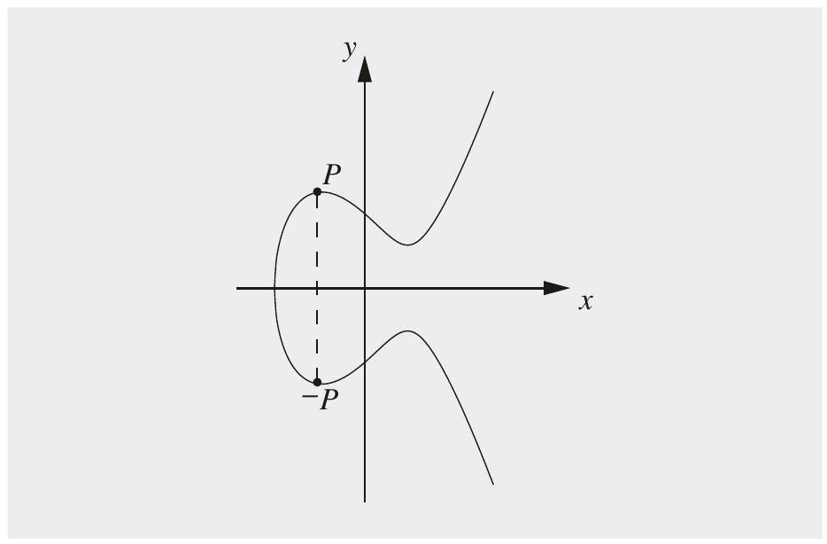

Hình 9.6 Inverse của một điểm P trên một elliptic curve

Lưu ý rằng tìm inverse của một điểm P = (xp,yp) bây giờ rất đơn giản. Chúng ta chỉ cần lấy giá trị âm của tọa độ y. Trong trường hợp elliptic curve trên một prime field GF(p), là trường hợp thú vị nhất trong cryptography, điều này dễ dàng đạt được vì − yp ≡ p − yp mod p, do đó:

−P = (xp, p − yp)

Bây giờ khi đã định nghĩa mọi tính chất group cho elliptic curve, chúng ta có thể xem một ví dụ về phép toán group.

Ví dụ 9.4. Chúng ta xét một đường cong trên field nhỏ ℤ17:

E: y2 ≡ x3 + 2x + 2 mod 17

Chúng ta muốn double điểm P = (5,1).

2P = P + P = (5,1) + (5,1) = (x3,y3)

s = (3x12 + a)/(2y1) = (2 · 1)−1(3 · 52 + 2) = 2−1 · 9 ≡ 9 · 9 ≡ 13 mod 17

x3 = s2 − x1 − x2 = 132 − 5 − 5 = 159 ≡ 6 mod 17

y3 = s(x1 − x3) − y1 = 13(5 − 6) − 1 = −14 ≡ 3 mod 17

2P = (5,1) + (5,1) = (6,3)

Để minh họa, chúng ta kiểm chứng xem kết quả 2P = (6,3) có thực sự là một điểm trên đường cong không bằng cách chèn tọa độ vào phương trình đường cong:

y2 ≡ x3 + 2 · x + 2 mod 17

y2 ≡ 63 + 2 · 6 + 2 mod 17

y2 = 230 ≡ 9 mod 17

Điều này đúng vì y2 = 32 = 9. ◇

## 9.2 Xây dựng bài toán logarit rời rạc với Elliptic Curve

Những gì chúng ta đã làm tới giờ là thiết lập các phép toán group (point addition và doubling), chúng ta đã đưa ra một phần tử đơn vị, và đã chỉ ra cách tìm inverse cho bất kỳ điểm nào trên đường cong. Do đó, giờ chúng ta đã có mọi thứ cần thiết để dẫn tới định lý sau.

> Định lý 9.2.1 Các điểm trên một elliptic curve cùng với O tạo thành một group với các cyclic subgroup. Dưới một số điều kiện nhất định, mọi điểm trên một elliptic curve tạo thành một cyclic group.

Lưu ý rằng chúng tôi chưa chứng minh định lý. Định lý cực kỳ hữu ích vì chúng ta hiểu rõ các tính chất của cyclic group. Đặc biệt, chúng ta biết rằng theo định nghĩa phải tồn tại một phần tử nguyên thủy sao cho các lũy thừa của nó sinh ra toàn bộ group. Hơn nữa, chúng ta biết khá rõ cách xây dựng cryptosystem từ cyclic group. Đây là một ví dụ về cyclic group của một elliptic curve.

Ví dụ 9.5. Chúng ta muốn tìm mọi điểm trên đường cong:

E: y2 ≡ x3 + 2 · x + 2 mod 17

Tình cờ là mọi điểm trên đường cong tạo thành một cyclic group và order là #E = 19. Với đường cong cụ thể này, order group là số nguyên tố và, theo Định lý 8.2.4, mọi phần tử đều nguyên thủy.

Như trong ví dụ trước, chúng ta bắt đầu với phần tử nguyên thủy P = (5,1). Bây giờ chúng ta tính mọi “lũy thừa” của P. Chính xác hơn, vì phép toán group là phép cộng, chúng ta tính P, 2P, 3P,...,(#E)P. Đây là danh sách các phần tử chúng ta thu được:

2P = (5,1) + (5,1) = (6,3) 11P = (13,10)

3P = 2P + P = (10,6) 12P = (0,11)

4P = (3,1) 13P = (16,4)

5P = (9,16) 14P = (9,1)

6P = (16,13) 15P = (3,16)

7P = (0,6) 16P = (10,11)

8P = (13,7) 17P = (6,14)

9P = (7,6) 18P = (5,16)

10P = (7,11) 19P = O

Nếu tiếp tục cộng P vào kết quả trước, cấu trúc tuần hoàn trở nên rõ ràng:

20P = 19P + P = O + P = P

21P = 2P

⋮

Cũng bổ ích khi xem phép tính cuối cùng ở trên, đã cho ra:

18P + P = O

Điều này có nghĩa là P = (5,1) là inverse của 18P = (5,16), và ngược lại. Điều này dễ kiểm chứng. Chúng ta phải kiểm tra xem hai tọa độ x có giống nhau không và hai tọa độ y có là inverse cộng của nhau modulo 17 không. Điều kiện thứ nhất rõ ràng đúng và điều kiện thứ hai cũng vậy, vì

−1 ≡ 16 mod 17

◇

Để thiết lập các cryptosystem logarit rời rạc, quan trọng là biết order của group. Dù tính chính xác số điểm trên một đường cong là một nhiệm vụ khó, chúng ta biết số xấp xỉ nhờ định lý Hasse.

> Định lý 9.2.2 Định lý Hasse (Hasse’s theorem)
>
> Cho một elliptic curve E modulo p, số điểm trên đường cong được ký hiệu là #E và bị chặn bởi:
>
> p + 1 − 2√p ≤ #E ≤ p + 1 + 2√p

Định lý Hasse, còn được gọi là cận Hasse (Hasse’s bound), phát biểu rằng số điểm gần như nằm trong khoảng của số nguyên tố p. Điều này có hệ quả thực tế lớn. Chẳng hạn, nếu cần một elliptic curve với 2256 phần tử, chúng ta phải dùng một số nguyên tố có độ dài khoảng 256 bit.

Bây giờ hãy chuyển sự chú ý sang chi tiết của việc thiết lập bài toán logarit rời rạc elliptic curve. Để làm điều này, chúng ta có thể tiến hành như mô tả trong Chương 8.

> Định nghĩa 9.2.1 Bài toán logarit rời rạc Elliptic Curve (Elliptic Curve Discrete Logarithm Problem) (ECDLP)
>
> Cho trước một elliptic curve E. Chúng ta xét một phần tử nguyên thủy P và một phần tử khác T. Bài toán DL là tìm số nguyên d, trong đó 1 ≤ d ≤ #E, sao cho:
>
> 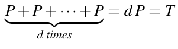 (9.2)

Trong các cryptosystem, d là private key, là một số nguyên, trong khi public key T là một điểm trên đường cong với tọa độ T = (xT,yT). Ngược lại, trong trường hợp bài toán DL trong ℤp∗, cả hai key đều là số nguyên. Phép toán trong Phương trình (9.2) được gọi là point multiplication hay scalar multiplication, vì chúng ta có thể viết hình thức T = d P. Tuy nhiên, thuật ngữ này có thể gây hiểu lầm, vì chúng ta không thể nhân trực tiếp số nguyên d với một điểm đường cong P. Thay vào đó, d P chỉ là một ký hiệu tiện lợi cho việc áp dụng lặp lại phép toán group trong Phương trình (9.2)[^3]. Bây giờ hãy xem một ví dụ về ECDLP.

Ví dụ 9.6. Chúng ta muốn giải một bài toán logarit rời rạc trên đường cong y2 ≡ x3+ 2x + 2 mod 17, cũng đã được dùng trong ví dụ trước. Cho trước phần tử nguyên thủy P = (5,1) và điểm T = (16,4). Do đó DLP đang xét là số nguyên d trong biểu thức:

d P = T

Trong trường hợp này, chúng ta có thể đơn giản dùng bảng đã được lập trước đó, cho thấy nghiệm của DLP này là d = 13 vì:

13P = (16,4)

Point multiplication tương tự phép lũy thừa trong group nhân. Để thực hiện hiệu quả, chúng ta có thể trực tiếp áp dụng thuật toán square-and-multiply, đã được giới thiệu trong Mục 7.4. Khác biệt duy nhất là phép bình phương trở thành doubling và phép nhân trở thành phép cộng P. Đây là thuật toán:

> Thuật toán Double-and-Add cho Point Multiplication
>
> Input: elliptic curve E cùng với một điểm P
>
> một scalar d = ∑i=0t di2i với di ∈ 0,1 và dt = 1
>
> Output: T = d P
>
> Khởi tạo:
>
> T = P
>
> Thuật toán:
>
> 1 FOR i = t − 1 DOWNTO 0
>
> 1.1 T = T + T
>
> IF di = 1
>
> 1.2 T = T + P
>
> 2 RETURN (T)

Với một scalar ngẫu nhiên có độ dài t + 1 bit, thuật toán cần trung bình 1.5 t phép point doubling và addition. Diễn đạt bằng lời, thuật toán quét biểu diễn bit của scalar d từ trái sang phải. Nó thực hiện một phép doubling ở mỗi lần lặp và chỉ khi bit hiện tại có giá trị 1 nó mới thực hiện phép cộng P. Hãy xem một ví dụ.

Ví dụ 9.7. Chúng ta xét scalar multiplication 26 P, có biểu diễn nhị phân sau:

26P = (110102)P = (d4d3d2d1d0)2P

Thuật toán quét các bit scalar bắt đầu từ bên trái với d4 và kết thúc với bit ngoài cùng bên phải d0.

Bước

\#0 P = 12P thiết lập ban đầu, bit được xử lý: d4 = 1

\#1a P + P = 2P = 102P DOUBLE, bit được xử lý: d3

\#1b 2P + P = 3P = 102P + 12P = 112P ADD, vì d3 = 1

\#2a 3P + 3P = 6P = 2(112P) = 1102P DOUBLE, bit được xử lý: d2

\#2b không ADD, vì d2 = 0

\#3a 6P + 6P = 12P = 2(1102P) = 11002P DOUBLE, bit được xử lý: d1

\#3b 12P + P = 13P = 11002P + 12P = 11012P ADD, vì d1 = 1

\#4a 13P + 13P = 26P = 2(11012P) = 110102P DOUBLE, bit được xử lý: d0

\#4b không ADD, vì d0 = 0

Thật bổ ích khi quan sát biểu diễn nhị phân của số mũ thay đổi thế nào, được thể hiện bằng chữ đậm ở trên. Chúng ta thấy rằng doubling dẫn tới một phép dịch trái của scalar, với một số 0 được đặt ở vị trí ngoài cùng bên phải. Bằng cách thực hiện phép cộng với P, một số 1 được thay vào vị trí ngoài cùng bên phải của scalar. Hãy so sánh các số mũ được tô sáng thay đổi thế nào từ lần lặp này sang lần lặp khác. ◇

Nếu quay lại elliptic curve trên tập số thực, có một cách diễn giải hình học đẹp cho ECDLP: Cho một điểm bắt đầu P, chúng ta tính 2P, 3P,..., d P = T, thực chất là nhảy qua nhảy lại trên elliptic curve. Sau đó chúng ta công bố điểm bắt đầu P (một domain parameter công khai) và điểm cuối T (public key). Để phá cryptosystem, kẻ tấn công phải tìm ra chúng ta đã “nhảy” bao nhiêu lần trên elliptic curve. Số lần nhảy là bí mật d, private key.

## 9.3 Trao đổi key Diffie–Hellman với Elliptic Curve

Hoàn toàn tương tự trao đổi key Diffie–Hellman (DHKE) thông thường được giới thiệu trong Mục 8.1, bây giờ chúng ta có thể hiện thực một trao đổi key dùng elliptic curve. Điều này được gọi là trao đổi key Diffie–Hellman elliptic curve, hay ECDH. Trước hết chúng ta phải thỏa thuận các domain parameter, tức là một elliptic curve phù hợp để làm việc trên đó và một điểm trên đường cong là phần tử nguyên thủy.

> Các Domain Parameter của ECDH
>
> 1. Chọn một số nguyên tố p và elliptic curve
>
> E: y2 ≡ x3 + a · x + b mod p
>
> 2. Chọn một phần tử nguyên thủy P = (xP,yP)
>
> Số nguyên tố p, đường cong được cho bởi các hệ số a,b, và phần tử nguyên thủy P là các domain parameter.

Lưu ý rằng trong thực tế, tìm một elliptic curve phù hợp là một nhiệm vụ khá phức tạp. Các đường cong phải thể hiện một số tính chất nhất định để an toàn. Thêm về điều này được nói dưới đây. Việc trao đổi key thực sự được thực hiện hoàn toàn tương tự cách nó được làm trong protocol Diffie–Hellman thông thường.

> Trao đổi key Diffie–Hellman Elliptic Curve (ECDH)
>
> 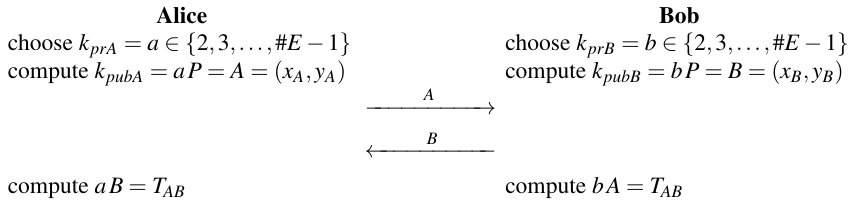

Ở cuối protocol[^4], Alice và Bob dùng chung bí mật chung: TAB = (xAB,yAB), là một điểm trên đường cong. Tính đúng đắn của protocol dễ chứng minh.

Chứng minh. Alice tính

a B = a(b P)

trong khi Bob tính

b A = b(a P).

Vì point addition có tính kết hợp (nhớ rằng tính kết hợp là một trong các tính chất group), cả hai bên tính cùng một kết quả, cụ thể là điểm TAB = a b P. □ Như có thể thấy trong protocol, Alice và Bob lần lượt chọn các private key a và b, là hai số nguyên lớn. Với các private key, cả hai tạo các public key tương ứng A và B, là các điểm trên đường cong. Các public key được tính bằng point multiplication. Hai bên trao đổi các tham số công khai này với nhau. Bí mật chung TAB sau đó được cả Alice và Bob tính bằng cách thực hiện một point multiplication thứ hai liên quan tới public key họ nhận được và tham số bí mật của chính họ. Bí mật chung TAB có thể được dùng để suy ra một session key, ví dụ, làm input cho thuật toán AES. Lưu ý rằng hai tọa độ (xAB,yAB) không độc lập với nhau: Cho xAB, tọa độ kia có thể được tính đơn giản bằng cách chèn giá trị x vào phương trình elliptic curve. Do đó, chỉ một trong hai tọa độ nên được dùng để suy ra session key. Hãy xem một ví dụ với các số nhỏ.

Ví dụ 9.8. Chúng ta xét ECDH với các domain parameter sau. Elliptic curve là y2 ≡ x3 + 2x + 2 mod 17, tạo thành một cyclic group có order #E = 19. Phần tử nguyên thủy là P = (5,1). Protocol diễn ra như sau:

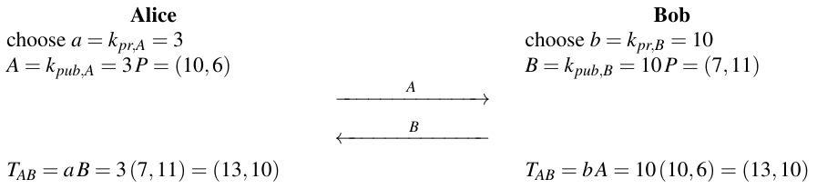

Hai scalar multiplication mà Alice và Bob đều thực hiện cần thuật toán double-and-add.

◇

Một trong các tọa độ của bí mật chung TAB bây giờ có thể được dùng làm session key. Trong thực tế, thường x-coordinate được hash rồi được dùng làm key symmetric. Thông thường, không cần mọi bit. Chẳng hạn, trong một scheme ECC 256-bit, hash x-coordinate bằng SHA-512 (xem Mục 11.4) cho ra một output 512-bit trong đó chỉ 128 bit sẽ được dùng làm key AES.

Lưu ý rằng elliptic curve không bị giới hạn ở DHKE. Thực ra, hầu như mọi protocol logarit rời rạc khác, đặc biệt là digital signature và mã hóa, ví dụ, các biến thể của Elgamal, cũng có thể được hiện thực. Elliptic Curve Digital Signature Algorithm (ECDSA) được dùng rộng rãi sẽ được giới thiệu trong Mục 10.5.1.

## 9.4 Bảo mật

Lý do chúng ta dùng elliptic curve là ECDLP có các đặc tính one-way xuất sắc. Nếu kẻ tấn công Oscar muốn phá ECDH, hắn có thông tin sau: các domain parameter E, p, P, cũng như các public key A và B. Hắn muốn tính bí mật chung giữa Alice và Bob TAB = a · b · P. Điều này được gọi là bài toán Diffie–Hellman elliptic curve (ECDHP). Có vẻ chỉ có một cách tính ECDHP, cụ thể là giải một trong hai bài toán logarit rời rạc:

a = logPA hoặc b = logPB

Nếu elliptic curve được chọn cẩn thận, các tấn công tốt nhất đã biết nhắm vào ECDLP yếu hơn đáng kể so với các thuật toán tốt nhất để giải bài toán DL modulo p và các thuật toán phân tích thừa số tốt nhất được dùng cho các tấn công RSA. Đặc biệt, thuật toán index-calculus, cho phép một tấn công mạnh nhắm vào DLP modulo p, không áp dụng được với elliptic curve. Với các elliptic curve được chọn cẩn thận, các tấn công còn lại duy nhất là các thuật toán DL generic, tức là phương pháp baby-step giant-step của Shanks và phương pháp rho của Pollard, đã được giới thiệu trong Mục 8.3.3. Vì số bước cần cho một tấn công như vậy gần bằng căn bậc hai của cardinality group, nên dùng order group ít nhất 2256. Theo định lý Hasse, điều này yêu cầu số nguyên tố p được dùng cho elliptic curve phải dài khoảng 256 bit. Nếu tấn công một group như vậy bằng các thuật toán generic, chúng ta cần khoảng √2256 = 2128 bước.

Cần nhấn mạnh rằng bảo mật này chỉ đạt được nếu dùng các elliptic curve mạnh về mặt cryptographic. Có vài họ đường cong có điểm yếu cryptographic, ví dụ, supersingular curve. Tuy nhiên, chúng tương đối dễ nhận ra.

## 9.5 Triển khai bằng Software và Hardware

Trước khi dùng ECC, cần xác định một đường cong với các tính chất cryptographic tốt. Trong thực tế, một yêu cầu cốt lõi là cyclic group (hoặc subgroup) được tạo bởi các điểm đường cong có order nguyên tố. Hơn nữa, một số tính chất toán học dẫn tới điểm yếu cryptographic phải được loại trừ. Vì việc bảo đảm mọi tính chất này là một nhiệm vụ non-trivial và đòi hỏi nhiều tính toán, các đường cong được chuẩn hóa thường được dùng trong thực tế.

Khi triển khai elliptic curve, sẽ hữu ích khi xem một scheme ECC như một cấu trúc gồm bốn tầng. Ở tầng dưới cùng, các phép toán finite field được thực hiện. Với elliptic curve trên prime field GF(p) — là lựa chọn field chính trong thực tế — bản triển khai phải hỗ trợ số học modulo với các số dài cho bốn phép toán field cộng, trừ, nhân và nghịch đảo. Ở tầng tiếp theo, hai phép toán group point doubling và point addition được triển khai. Chúng dùng số học được cung cấp ở tầng dưới cùng. Ở tầng thứ ba, scalar multiplication được triển khai, dùng các phép toán group của tầng trước. Tầng trên cùng triển khai protocol thực sự, ví dụ, ECDH hoặc ECDSA. Quan trọng là lưu ý rằng hai cấu trúc đại số hữu hạn hoàn toàn khác nhau liên quan tới một cryptosystem elliptic curve. Có finite field GF(p) mà trên đó đường cong được định nghĩa, và có cyclic group được tạo bởi các điểm trên đường cong.

Trong software, một bản triển khai ECC 256-bit được tối ưu cao trên một CPU 3-GHz, 64-bit có thể mất khoảng 2 ms cho một point multiplication. Throughput chậm hơn do vi xử lý nhỏ hơn hoặc thuật toán ít tối ưu hơn là phổ biến với hiệu năng trong khoảng 10 ms. Với các ứng dụng high-performance, ví dụ, cho các internet server phải thực hiện một số lượng lớn chữ ký elliptic curve mỗi giây, các bản triển khai hardware là đáng mong muốn. Các con số hiệu năng điển hình cho các bản triển khai nhanh nằm trong khoảng 40–100 µs để tính một point multiplication.

Ở đầu kia của phổ hiệu năng, ECC cũng là một lựa chọn hấp dẫn cho các thuật toán public-key cho các ứng dụng lightweight như thiết bị IoT nhỏ hay IC trong hộ chiếu điện tử. Trong hardware, các engine ECC rất gọn là khả thi, chỉ cần khoảng 10,000 gate equivalence và chạy với tốc độ vài chục mili giây cho một point multiplication. Dù các engine ECC lớn hơn nhiều so với bản triển khai của các symmetric cipher như AES hay 3DES, chúng nhỏ hơn đáng kể so với các bản triển khai RSA hay DLP.

Độ phức tạp tính toán của ECC là bậc ba theo độ dài bit của số nguyên tố được dùng. Đó là do phép nhân modulo, phép toán chính ở tầng dưới cùng, là bậc hai theo độ dài bit, và scalar multiplication (tức là với thuật toán double-and-add) đóng góp thêm một chiều tuyến tính, nên tổng cộng chúng ta có độ phức tạp bậc ba. Điều này ngụ ý rằng tăng gấp đôi độ dài bit của một bản triển khai ECC dẫn tới suy giảm hiệu năng khoảng 23 = 8 lần. Các hệ thống RSA và DL thể hiện cùng hành vi run-time bậc ba. Ưu điểm của ECC so với hai họ public-key phổ biến kia là các tham số phải tăng chậm hơn nhiều để tăng mức bảo mật. Chẳng hạn, tăng gấp đôi nỗ lực của kẻ tấn công cho một hệ thống ECC cho trước cần tăng độ dài tham số thêm 2 bit, trong khi các scheme RSA hay DL cần tăng 20–30 bit. Hành vi này là do chỉ có các tấn công generic (xem Mục 8.3.3) được biết cho các cryptosystem ECC, trong khi có các thuật toán mạnh hơn để tấn công RSA và các scheme DL.

## 9.6 Thảo luận và đọc thêm (Discussion and Further Reading)

Lịch sử và nhận xét chung Như đã nhắc ở đầu chương này, ECC được phát minh độc lập năm 1987 bởi Neal Koblitz và năm 1986 bởi Victor Miller. Trong những năm 1990 đã có nhiều suy đoán về bảo mật và tính thực tiễn của ECC, đặc biệt nếu so với RSA. Sau một giai đoạn nghiên cứu chuyên sâu, ngày nay nó được coi là rất an toàn nếu các tham số được chọn đúng, giống như RSA và các scheme DL. Một bước quan trọng để xây dựng niềm tin vào ECC là việc ban hành hai tiêu chuẩn ngân hàng ANSI cho elliptic curve digital signature và thiết lập key lần lượt vào năm 1999 và 2001 [15, 16]. Thú vị là trong Suite B — một tập các thuật toán cryptographic được NSA chọn để dùng trong các hệ thống của chính phủ Mỹ được đề xuất năm 2005 — các scheme ECC là các thuật toán asymmetric duy nhất được cho phép. Commercial National Security Algorithm Suite (CNSA Suite), được công bố năm 2018, thay thế các thuật toán Suite B [205]. CNSA bao gồm RSA với modulus ít nhất 3072-bit ngoài ECC.

Khoảng từ chuyển giao thiên niên kỷ, ECC đã liên tục giành “thị phần” so với RSA và các scheme DLP thông thường. Đến nay, tình hình gần như ngược lại so với cuối những năm 1990, tức là lựa chọn đầu tiên khi chọn một scheme public-key thường là ECC cho nhiều ứng dụng. Các ứng dụng được triển khai rộng rãi dùng elliptic curve bao gồm các ứng dụng nhắn tin di động, tiền mã hóa, các protocol bảo mật web TLS và IPsec, và vô số thiết bị nhúng và IoT. Tài liệu tham khảo [162] mô tả sự phát triển lịch sử của ECC về các khía cạnh khoa học và thương mại, và là một bài đọc xuất sắc.

Với độc giả quan tâm tới việc hiểu sâu hơn về elliptic curve cryptography, các cuốn sách [53, 52, 139, 73, 140] được khuyến nghị. RFC 6090 cung cấp tổng quan về các thuật toán ECC nền tảng [84]. Bài báo tổng quan [164], dù hiện giờ hơi cũ, cung cấp một bản tóm tắt xuất sắc về ECC. Với các phát triển gần đây hơn, Workshop on Elliptic Curve Cryptography (ECC) thường niên được khuyến nghị như một nguồn tài nguyên xuất sắc [1]. Workshop bao gồm cả các chủ đề lý thuyết và ứng dụng liên quan tới ECC và các scheme cryptographic liên quan. Cũng có một khối lượng tài liệu đáng kể về toán học của elliptic curve [234, 163, 235], bất kể việc dùng chúng trong cryptography.

Bản triển khai Trong vài năm đầu sau khi ECC được phát minh, scheme được tin là phức tạp hơn về mặt tính toán so với các thuật toán public-key hiện có, đặc biệt là RSA. Giả định này có phần trớ trêu khi nhìn lại, khi các scheme ECC ngày nay thường nhanh hơn các scheme public-key khác. Trong những năm 1990, các kỹ thuật triển khai nhanh cho ECC đã được nghiên cứu sâu rộng, dẫn tới những cải thiện hiệu năng đáng kể. Cuốn sách [139] là điểm khởi đầu xuất sắc cho các kỹ thuật như vậy.

Để triển khai hiệu quả một hệ thống ECC, có thể cải thiện ở tầng số học finite field, ở tầng phép toán group và ở tầng point multiplication. Có rất nhiều kỹ thuật và sau đây là tóm tắt một số phương pháp tăng tốc phổ biến. Với các đường cong trên GF(p), đôi khi các số nguyên tố đặc biệt được dùng cho phép rút gọn modulo nhanh. Một ví dụ nổi bật là Curve25519, dùng số nguyên tố p = 2255 − 19 cùng với đường cong y2 ≡ x3 + 486,662 x2 + x [36]. Có cả một họ số nguyên tố tương tự, gọi là generalized Mersenne prime. Đó là các số nguyên tố như p = 2192 − 264 − 1 hoặc p = 2256 − 2224 + 2192 + 296 − 1, cũng cho phép rút gọn modulo rất nhanh và là một phần của tiêu chuẩn digitial *(ghi chú: sách in digitial; đúng là digital)* signature FIPS 186-4 của NIST [197]. Nếu dùng các số nguyên tố không có cấu trúc đặc biệt, các thuật toán như Montgomery reduction, được nhắc tới trong Mục 7.11, có thể được dùng để triển khai rút gọn modulo. Về ECC trên các field GF(2m), các thuật toán số học hiệu quả được mô tả trong Tài liệu tham khảo [139]. Ở tầng phép toán group, có thể có vài tối ưu. Một tối ưu phổ biến là chuyển từ tọa độ affine, đã được giới thiệu trong chương này, sang tọa độ projective, trong đó mỗi điểm được biểu diễn dưới dạng bộ ba (x,y,z). Ưu điểm của chúng là không cần phép nghịch đảo trong phép toán group. Tuy nhiên, số phép nhân tăng lên. Ở tầng tiếp theo, các kỹ thuật scalar multiplication nhanh có thể được áp dụng. Các phiên bản cải tiến của thuật toán double-and-add, tận dụng thực tế rằng cộng hay trừ một điểm có chi phí gần như giống nhau, thường được áp dụng. Một lần nữa, một tổng hợp xuất sắc về các kỹ thuật tính toán hiệu quả cho ECC là cuốn sách [139]. Như trường hợp với RSA và thuật toán square-and-multiply, ECC trở nên dễ bị tổn thương trước các tấn công side-channel nếu dùng thuật toán double-and-add generic. Vì point doubling và point addition có hành vi thời gian chạy khác nhau, kẻ tấn công có thể phân biệt chúng bằng cách quan sát mức tiêu thụ điện năng hay bức xạ điện từ. Điều này đến lượt nó dẫn tới rò rỉ thông tin về private key, được dùng trong thuật toán double-and-add. Các biện pháp đối phó bao gồm che (masking) private key hoặc làm cho thời gian chạy độc lập với private key, tức là dùng các bản triển khai constant-time. Cũng có những đường cong dẫn tới bản triển khai an toàn một cách tự nhiên hơn, xem đoạn “Tiêu chuẩn” bên dưới.

Tiêu chuẩn Như đã nhắc trong Mục 9.5, các đường cong được chuẩn hóa thường được dùng trong thực tế. Một tập đường cong được dùng rộng rãi được cung cấp trong U.S. FIPS Standard [197, Phụ lục D]. Cũng có các tiêu chuẩn khác với các đường cong được khuyến nghị, bao gồm các tiêu chuẩn ANSI X9.62 và X9.63, các đường cong Brainpool (một nhóm làm việc của Đức) và ANSSI FRP256V1, một tiêu chuẩn của Pháp. Trong thực tế, có thể xảy ra việc các đường cong mathematically-secure, tức là các đường cong mà ECDLP rất khó, trở nên không an toàn do lỗi trong bản triển khai, chẳng hạn vì timing side-channels. Bernstein và Lange thảo luận vấn đề này và liệt kê một số đường cong mà các bản triển khai đúng đắn dễ đạt được hơn, bao gồm Curve25519 đã nhắc ở trên [42].

Các đường cong đặc biệt và biến thể Trong chương này, elliptic curve trên prime field GF(p) đã được giới thiệu. Chúng trong thực tế thường được ưa chuộng hơn ECC với các finite field khác. Tuy nhiên, binary field GF(2m) cũng đôi khi được dùng và thực sự được NIST chuẩn hóa. Các binary field như vậy có đặc tính triển khai tốt trong hardware, nhưng đồng thời có những lo ngại về các điểm yếu tiềm ẩn. Một loại elliptic curve đặc biệt cho phép point multiplication đặc biệt nhanh là Koblitz curve [238]. Đó là các đường cong trên GF(2m) trong đó các hệ số có giá trị 0 hoặc 1. Các đường cong khác có tính chất tốt để xây dựng cryptosystem bao gồm Edward curve và Montgomery curve. Tài liệu NIST [239] cung cấp một tổng quan tốt về các đường cong như vậy về mặt sử dụng thực tế. Kỳ lạ hơn là elliptic curve trên optimum extension field, tức là các field dạng GF(pm), trong đó p > 2 và có dạng đặc biệt [24].

Cũng có các ứng dụng cryptographic nâng cao hơn dựa trên elliptic curve, bao gồm mã hóa identity-based (IBE) [60] hay các cryptosystem dựa trên isogeny [78]. Elliptic curve cũng cho phép tổng quát hóa. Nói chính xác, chúng là một trường hợp đặc biệt của hyperelliptic curve, cũng có thể được dùng để xây dựng các cryptosystem logarit rời rạc [73]. Một bản tóm tắt các kỹ thuật triển khai cho hyperelliptic curve được cho trong [253].

## 9.7 Bài học rút ra (Lessons Learned)

■ Elliptic Curve Cryptography (ECC) dựa trên bài toán logarit rời rạc. Các phép tính cần thiết được thực hiện trong một finite field thường là prime field, tức là mọi phép tính số học được thực hiện modulo một số nguyên tố.

■ Trong thực tế, ECC thường được dùng nhất cho trao đổi key và digital signature.

■ Với nhiều ứng dụng mới, ECC là scheme public-key được chọn.

■ ECC cung cấp cùng mức bảo mật như RSA hay các hệ thống logarit rời rạc trên ℤp∗ với các toán hạng ngắn hơn đáng kể (khoảng 256 bit so với 3072 bit), dẫn tới key, ciphertext và chữ ký ngắn hơn.

■ Trong nhiều trường hợp, ECC có ưu thế hiệu năng so với các thuật toán public-key khác. Tuy nhiên, kiểm chứng chữ ký với key RSA ngắn vẫn nhanh hơn đáng kể so với ECC.

■ ECC cũng như RSA và các scheme logarit rời rạc thông thường sẽ trở nên không an toàn trong tương lai trong trường hợp máy tính lượng tử full-size trở nên khả dụng.

## Bài tập

9.1. Chỉ ra rằng điều kiện 4a3 + 27b2 ≠ 0 mod p được thỏa cho đường cong

y2 ≡ x3 + 2x + 2 mod 17

9.2. Thực hiện các phép point addition

1. (13,7) + (6,3)

2. (13,7) + (13,7)

trong group của đường cong y2 ≡ x3 + 2x + 2 mod 17. Chỉ dùng máy tính bỏ túi.

9.3. Trong chương này, elliptic curve y2 ≡ x3 + 2x + 2 mod 17 được cho với #E = 19. Kiểm chứng định lý Hasse cho đường cong này.

9.4. Hãy xét lại elliptic curve y2 ≡ x3 + 2x + 2 mod 17, các điểm của nó được thể hiện trong Ví dụ 9.5. Vì sao mọi điểm đều là phần tử nguyên thủy?

Lưu ý: Nói chung không đúng rằng mọi phần tử của một elliptic curve đều nguyên thủy.

9.5. Cho E là một elliptic curve được định nghĩa trên ℤ7:

E: y2 = x3 + 3x + 2

1. Tính mọi điểm trên E trên ℤ7.

2. Order của group là bao nhiêu? (Gợi ý: Đừng bỏ sót phần tử trung hòa O.)

3. Cho phần tử α = (0,3), xác định order của α. α có phải là phần tử nguyên thủy không?

9.6. Cho các elliptic curve sau:

E1: y2 ≡ x3 + 5x + 4 mod 11

E2: y2 ≡ x3 + 15x + 29 mod 28

E3: y2 ≡ x3 + 12x + 11 mod 13

Đường cong nào phù hợp để dùng trong một cryptosystem? Giải thích câu trả lời!

Nhận xét: Bạn không cần xét các thuộc tính security-relevant như kích thước số nguyên tố v.v.

9.7. Cho một elliptic curve có order group 16. Chỉ ra rằng có thể xác định order của bất kỳ phần tử α nào với tối đa ba phép point doubling.

9.8. Trong thực tế, a và k đều là các số nguyên rất dài trong khoảng p ≈ 2256···2512, và việc tính một scalar multiplication T = a · P được làm bằng thuật toán double-and-add như thể hiện trong Mục 9.2.

1. Minh họa cách thuật toán hoạt động với a = 19 và với a = 160. Đừng thực hiện các phép toán elliptic curve, mà giữ P là một biến.

2. Trung bình cần bao nhiêu (i) phép point addition và (ii) phép point doubling cho một point multiplication? Giả sử mọi số nguyên có n = ⌈log2p⌉ bit.

3. Giả sử mọi số nguyên có độ dài n = 256 bit, tức là p là một số nguyên tố 256-bit. Giả sử một phép toán group (addition hoặc doubling) cần 20 µsec. Thời gian cho một phép double-and-add trung bình là bao nhiêu?

9.9. Cho một đường cong E trên ℤ11:

y2 ≡ x3 + 9x + 1 mod 11

1. Xác định mọi điểm trên đường cong E và order ord(E).

2. Tính 2P và 3P với P = (2,4).

9.10. Chúng ta xem các điểm có order hai.

1. Tính chất của các điểm có order hai trên một elliptic curve E là gì?

2. Cho một số nguyên tố p với p > 3 và một elliptic curve E: y2 = x3 + (p − 1)x. Tìm mọi điểm có order hai trên E. Giải thích câu trả lời.

9.11. Cho một elliptic curve E trên ℤ29 và phần tử nguyên thủy P = (8,10):

E: y2 ≡ x3 + 4x + 20 mod 29

Tính point multiplication sau k · P dùng thuật toán double-and-add. Đưa ra các kết quả trung gian sau mỗi bước.

1. k = 9

2. k = 20

9.12. Cho cùng đường cong như trong Bài tập 9.11. Order của đường cong này được biết là #E = 37. Cũng cho điểm Q = 15 · P = (14,23) trên đường cong. Xác định kết quả của các point multiplication sau bằng cách dùng càng ít phép toán group càng tốt, tức là tận dụng thông minh điểm đã biết Q. Nêu rõ cách bạn đơn giản hóa phép tính mỗi lần. (Gợi ý: Ngoài việc dùng Q, hãy dùng thực tế rằng dễ tính − P.)

1. 16 · P

2. 38 · P

3. 53 · P

4. 14 · P + 4 · Q

5. 23 · P + 11 · Q

Bạn sẽ có thể thực hiện các scalar multiplication với ít bước hơn đáng kể so với việc áp dụng đơn giản thuật toán double-and-add.

9.13. Nhiệm vụ của bạn là tính session key trong một protocol DHKE dựa trên elliptic curve. Private key của bạn là a = 6. Bạn nhận public key của Bob B = (5,9). Elliptic curve được dùng được định nghĩa bởi:

y2 ≡ x3 + x + 6 mod 11

9.14. Một ví dụ về DHKE elliptic curve được cho trong Mục 9.3. Kiểm chứng hai scalar multiplication mà Alice thực hiện. Thể hiện các kết quả trung gian trong phép toán group.

9.15. Sau DHKE, Alice và Bob sở hữu một điểm bí mật chung R = (x,y). Modulus của elliptic curve được dùng là một số nguyên tố 64-bit. (Nhận xét: Bài tập này dùng một số nguyên tố nhỏ phi thực tế để minh họa; trong thực tế modulus nên có 256 bit trở lên.) Bây giờ chúng ta muốn suy ra một session key cho một block cipher 128-bit như AES. Session key được tính như sau:

KAB = h(x||y)

trong đó h là một hash function và “||” ký hiệu phép nối hai giá trị. Mô tả một brute-force attack hiệu quả nhắm vào symmetric cipher. Trong trường hợp này, bao nhiêu bit key thực sự ngẫu nhiên? (Gợi ý: Bạn không cần mô tả chi tiết toán học. Đưa ra danh sách các bước cần thiết. Giả sử bạn có một hàm tính căn bậc hai modulo p.)

9.16. Suy ra công thức cho point addition trên elliptic curve. Tức là, cho tọa độ của P và Q, tìm tọa độ của R = (x3,y3).

Gợi ý: Trước hết, tìm phương trình của đường thẳng qua hai điểm. Chèn phương trình này vào phương trình elliptic curve. Tại một thời điểm nào đó, bạn phải tìm nghiệm của một đa thức bậc ba x3 + a2x2 + a1x + a0. Nếu ba nghiệm được ký hiệu là x0,x1,x2, bạn có thể dùng thực tế rằng x0 + x1 + x2 = −a2.

---

[^1]: Lưu ý rằng elliptic curve không phải là hình elip. Chúng đóng vai trò trong việc xác định chu vi của hình elip, do đó có tên này.

[^2]: Lưu ý rằng việc chọn gọi phép toán là “phép cộng” hoàn toàn tùy ý; chúng ta cũng có thể gọi nó là phép nhân. Tuy nhiên, trong tài liệu toán học, elliptic curve được nghiên cứu như các group cộng.

[^3]: Lưu ý rằng ký hiệu “+” được chọn tùy ý để ký hiệu phép toán group. Nếu chúng ta chọn ký hiệu nhân thay vào đó, ECDLP sẽ có dạng Pd = T, điều sẽ nhất quán hơn với bài toán DL thông thường trong ℤp∗.

[^4]: Lưu ý rằng các biến a và b xuất hiện trong các công thức khác nhau và có ý nghĩa khác nhau: chúng tôi dùng a và b cho các hệ số trong phương trình elliptic curve cũng như cho các giá trị của private key trong protocol Diffie-Hellman. Chúng tôi chọn như vậy để nhất quán với ký hiệu trong Chương 8.
