# Chương 10 Digital Signature (Digital Signatures)

Digital signature là một công cụ cryptographic quan trọng và được dùng rộng rãi ngày nay. Các ứng dụng trải từ digital certificate cho duyệt web an toàn tới cập nhật software an toàn tới việc ký các hợp đồng số có giá trị pháp lý. Cùng với thiết lập key qua các kênh không an toàn, chúng là cơ chế quan trọng nhất mà public-key cryptography được dùng cho.

Digital signature có chung một số chức năng với chữ ký tay. Đặc biệt, chúng cung cấp một phương pháp để enssure *(ghi chú: sách in enssure; đúng là ensure)* rằng một thông điệp là xác thực đối với một người dùng, tức là nó thực sự xuất phát từ người khẳng định đã tạo ra thông điệp. Tuy nhiên, chúng thực ra cung cấp nhiều chức năng hơn thế, như chúng ta sẽ thảo luận trong chương này.

Trong chương này, bạn sẽ học:

■ Nguyên lý của digital signature

■ Các dịch vụ bảo mật (security service), tức là các mục tiêu cụ thể mà một hệ thống bảo mật có thể đạt được

■ Scheme digital signature RSA

■ Scheme digital signature Elgamal và hai mở rộng của nó, digital signature algorithm (DSA) và elliptic curve digital signature algorithm (ECDSA)

## 10.1 Giới thiệu

Trong mục này, trước hết chúng tôi đưa ra một ví dụ gợi động cơ để cho thấy vì sao cần digital signature và vì sao chúng phải dựa trên asymmetric cryptography. Sau đó chúng tôi xây dựng các nguyên lý của digital signature. Các thuật toán chữ ký thực sự được giới thiệu trong các mục tiếp theo.

### 10.1.1 Màu xe kỳ quặc, hay: Vì sao Symmetric Cryptography là không đủ

Các scheme cryptographic mà chúng ta gặp tới giờ có hai mục tiêu chính: hoặc mã hóa dữ liệu (ví dụ, với mã hóa AES, 3DES hoặc RSA) hoặc thiết lập một key dùng chung (ví dụ, với trao đổi key Diffie–Hellman). Người ta có thể bị cám dỗ nghĩ rằng giờ chúng ta đã ở vị trí hiện thực được bất kỳ cơ chế bảo mật nào cần trong thực tế. Tuy nhiên, có nhiều nhu cầu bảo mật khác ngoài mã hóa và trao đổi key. Chúng được gọi là security service và được thảo luận chi tiết trong Mục 10.1.3. Trước hết chúng ta xét một bối cảnh trong đó symmetric cryptography không cung cấp được một chức năng bảo mật mong muốn.

Giả sử Alice muốn gửi một thông điệp tới Bob và hai người dùng chung một key bí mật. Nếu họ mã hóa bằng một symmetric cipher tốt như AES, họ có thể yên tâm rằng một bên thứ ba, Oscar, không thể biết plaintext. Như chúng ta sẽ học trong Chương 13, họ cũng có thể dùng một message authentication code, sẽ bảo đảm với Bob rằng thông điệp thực sự đến từ Alice chứ không phải từ Oscar. Message authentication code cũng dựa trên symmetric cryptography. Tới giờ vẫn tốt: Có vẻ symmetric cryptography có thể bảo vệ trước hầu hết các tấn công có thể xảy ra. Nhưng cho tới nay chúng ta luôn giả định rằng kẻ xấu là một bên bên ngoài (mà chúng ta gọi là Oscar). Tuy nhiên, trong thực tế thường có trường hợp Alice và Bob thực sự muốn liên lạc an toàn với nhau, nhưng đồng thời họ có thể muốn lừa dối nhau. Hóa ra các scheme symmetric-key không bảo vệ hai bên khỏi nhau. Để hiểu rõ hơn tình huống, chúng ta xét kịch bản sau.

Giả sử Alice sở hữu một đại lý xe mới nơi bạn có thể chọn và đặt xe online. Chúng ta giả sử rằng Bob, khách hàng, và Alice, đại lý, đã thiết lập một bí mật dùng chung kAB, ví dụ, bằng trao đổi key Diffie–Hellman. Bây giờ Bob chỉ định chiếc xe mà anh ấy thích, bao gồm lựa chọn màu hồng cho nội thất và màu cam cho ngoại thất — những lựa chọn mà hầu hết mọi người sẽ không đưa ra. Anh ấy gửi mẫu đơn đặt hàng AES-encrypted tới Alice. Cô ấy giải mã đơn hàng và vui vì đã bán được một mẫu xe nữa với giá $50,000. Khi xe được giao ba tuần sau, Bob đổi ý về lựa chọn của mình, một phần vì người phối ngẫu dọa ly dị sau khi thấy chiếc xe. Không may cho Bob (và gia đình anh ấy), Alice có chính sách “không trả lại”. Là một đại lý xe giàu kinh nghiệm, cô ấy biết quá rõ rằng sẽ không dễ bán một chiếc xe pink-orange, và do đó cô ấy quyết không có ngoại lệ nào. Vì Bob bây giờ khẳng định rằng anh ấy chưa bao giờ đặt chiếc xe, cô ấy không còn lựa chọn nào khác ngoài kiện anh ấy. Trước thẩm phán, luật sư của Alice trình bày đơn đặt xe số của Bob cùng với phiên bản đã mã hóa của nó. Rõ ràng, luật sư lập luận, Bob phải là người tạo đơn hàng vì anh ấy sở hữu kAB mà với nó ciphertext đã được tạo. Tuy nhiên, nếu luật sư của Bob đáng đồng tiền, anh ta sẽ kiên nhẫn giải thích với thẩm phán rằng đại lý xe, Alice, cũng biết kAB và Alice thực ra có động cơ lớn để tạo các đơn đặt xe giả. Hóa ra thẩm phán không có cách nào biết cặp plaintext–ciphertext được tạo bởi Bob hay Alice! Với luật pháp ở hầu hết các quốc gia, Bob có lẽ thoát được với sự không trung thực của mình.

Điều này nghe có vẻ là một kịch bản khá đặc thù và hơi giả tạo, nhưng thực tế không phải vậy. Có rất, rất nhiều tình huống mà điều quan trọng là chứng minh với một bên thứ ba trung lập, tức là một người đóng vai thẩm phán, rằng một trong hai (hoặc nhiều) bên đã tạo một thông điệp. Với chứng minh, chúng tôi muốn nói rằng thẩm phán có thể kết luận không chút nghi ngờ ai đã tạo thông điệp, ngay cả khi mọi bên đều có khả năng không trung thực. Vì sao chúng ta không thể dùng một scheme symmetric-key (phức tạp) nào đó để đạt mục tiêu này? Giải thích high-level rất đơn giản: Chính vì chúng ta có một thiết lập đối xứng, Alice và Bob có cùng kiến thức (cụ thể là về key) và do đó cùng khả năng. Mọi thứ Alice có thể làm, Bob cũng có thể làm. Do đó, một bên thứ ba trung lập không thể phân biệt một phép toán cryptographic nhất định đã được thực hiện bởi Alice hay bởi Bob hay bởi cả hai.

Giải pháp cho vấn đề này là dùng public-key cryptography. Thiết lập bất đối xứng vốn có trong các thuật toán public-key có thể cho phép một thẩm phán phân biệt giữa các hành động mà chỉ một người có thể thực hiện (cụ thể là người sở hữu private key), và các hành động mà cả hai có thể làm (cụ thể là các phép tính liên quan tới public key). Hóa ra digital signature là các scheme public-key, có các tính chất cần thiết để giải quyết tình huống các bên tham gia gian lận. Trong ví dụ xe internet-ordered ở trên, Bob lẽ ra đã được yêu cầu ký số đơn hàng của mình bằng private key của anh ấy.

### 10.1.2 Nguyên lý của Digital Signature

Tính chất chứng minh rằng một người nhất định đã tạo một thông điệp rõ ràng cũng rất quan trọng bên ngoài lĩnh vực số. Trong thế giới thực, “analog”, điều này đạt được bằng chữ ký tay trên giấy. Chẳng hạn, nếu chúng ta ký một hợp đồng hoặc ký một tấm séc, bên nhận có thể chứng minh với thẩm phán rằng chúng ta thực sự đã ký thông điệp. (Tất nhiên, người ta có thể cố giả mạo chữ ký, nhưng có những rào cản pháp lý và xã hội ngăn hầu hết mọi người thậm chí cố gắng làm điều đó.) Như với chữ ký tay thông thường, chỉ người tạo một thông điệp số mới phải có khả năng tạo chữ ký hợp lệ. Để đạt điều này bằng các primitive cryptographic, chúng ta phải dùng public-key cryptography. Ý tưởng cơ bản là người ký thông điệp dùng một private key, và bên nhận dùng public key tương ứng. Nguyên lý của một scheme digital signature được thể hiện trong Hình 10.1. Chúng tôi lưu ý rằng có các scheme chữ ký post-quantum cryptography hoạt động hơi khác so với thể hiện trong hình. Chúng được giới thiệu trong Mục 12.4.

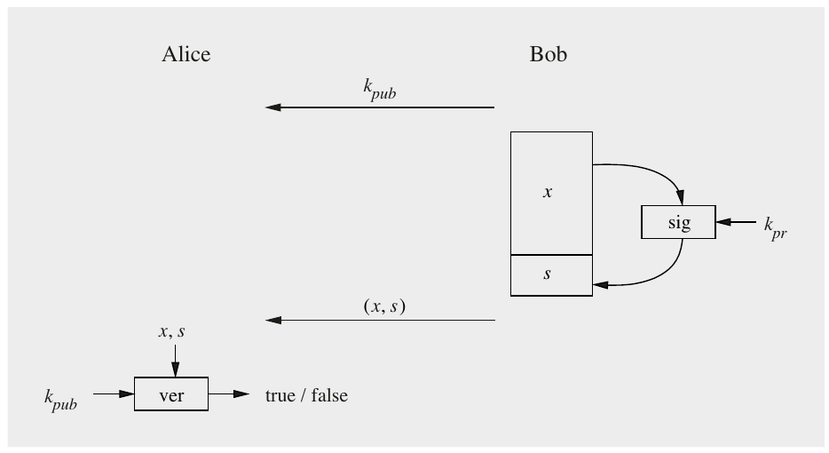

Hình 10.1 Nguyên lý của digital signature, gồm việc ký và kiểm chứng một thông điệp

Quá trình bắt đầu với việc Bob ký thông điệp x. Thuật toán chữ ký là một hàm của private key của Bob, kpr. Do đó, giả sử anh ấy thực sự giữ private key của mình riêng tư, chỉ Bob có thể ký một thông điệp x thay mặt anh ấy. Để gắn một chữ ký với thông điệp, x cũng là một input của thuật toán chữ ký. Sau khi ký thông điệp, chữ ký s được nối vào thông điệp x và cặp (x,s) được gửi tới Alice. Quan trọng là lưu ý rằng bản thân một digital signature không có giá trị gì trừ khi nó đi kèm thông điệp. Một digital signature không có thông điệp tương đương với một chữ ký tay trên một mẩu giấy không có hợp đồng hay tấm séc lẽ ra phải được ký.

Bản thân digital signature chỉ là một giá trị nguyên (lớn), chẳng hạn, một chuỗi 2048 bit. Chữ ký chỉ hữu ích với Alice nếu cô ấy có cách kiểm chứng chữ ký có hợp lệ hay không. Để làm điều này, cần một hàm kiểm chứng, nhận cả x và chữ ký s làm input. Để liên kết chữ ký với Bob, hàm cũng cần public key của anh ấy. Dù hàm kiểm chứng có input dài, output duy nhất của nó là phát biểu nhị phân “true” hoặc “false”. Nếu x thực sự đã được ký bằng private key thuộc về public key kiểm chứng, output là true, nếu không nó là false.

Từ những quan sát tổng quát này, chúng ta có thể dễ dàng xây dựng một protocol digital signature tổng quát:

> Protocol digital signature cơ bản
>
> 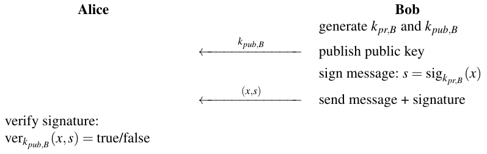

Từ thiết lập này, tính chất cốt lõi của digital signature suy ra: Một thông điệp đã ký có thể được truy ngược một cách rõ ràng về người tạo ra nó vì một chữ ký hợp lệ chỉ có thể được tính bằng private key duy nhất của người ký. Chỉ người ký có khả năng tạo chữ ký thay mặt mình. Do đó, chúng ta có thể chứng minh rằng bên ký thực sự đã tạo thông điệp. Một chứng minh như vậy thậm chí có thể có ý nghĩa pháp lý, chẳng hạn, thông qua Electronic Signatures in Global and National Commerce Act (ESIGN) ở Mỹ hoặc eIDAS (electronic IDentification, Authentication and trust Services) ở EU. Chúng tôi lưu ý rằng protocol cơ bản ở trên không cung cấp tính bí mật nào cho thông điệp vì thông điệp x được gửi dạng rõ. Tất nhiên, thông điệp có thể được giữ bí mật bằng cách mã hóa thêm nó, ví dụ, bằng AES hoặc một symmetric cipher mạnh khác.

Mỗi họ trong ba họ thuật toán public-key phổ biến, cụ thể là phân tích thừa số nguyên, logarit rời rạc và elliptic curve, đều cho phép chúng ta xây dựng digital signature. Trong phần còn lại của chương này, chúng ta học về hầu hết các scheme chữ ký có ý nghĩa thực tế.

### 10.1.3 Security Service

Rất bổ ích khi thảo luận chi tiết hơn các chức năng bảo mật mà chúng ta có thể đạt được với digital signature. Thực ra, tại điểm này chúng ta sẽ tạm rời digital signature và tự hỏi một cách tổng quát: Các mục tiêu bảo mật khả dĩ mà một hệ thống bảo mật có thể có là gì? Các mục tiêu của một hệ thống bảo mật được gọi là security service. Có nhiều security service, nhưng các security service phổ biến nhất mà nhiều ứng dụng yêu cầu như sau:

1. Tính bí mật (Confidentiality): Thông tin được giữ bí mật với mọi bên trừ các bên được ủy quyền.

2. Tính toàn vẹn (Integrity): Thông điệp không bị sửa đổi trong khi truyền.

3. Xác thực thông điệp (Message Authentication) hay xác thực nguồn gốc dữ liệu (Data Origin Authentication): Người gửi một thông điệp là xác thực.

4. Non-repudiation: Người gửi một thông điệp không thể chối bỏ việc tạo ra thông điệp.

Tính bí mật, tính toàn vẹn và tính sẵn sàng (xem bên dưới) đôi khi được gọi là bộ ba CIA, vì chúng được coi là đặc biệt quan trọng để bảo mật một hệ thống. Các ứng dụng khác nhau đòi hỏi các tập security service khác nhau. Chẳng hạn, với email cá nhân, ba service đầu tiên là đáng mong muốn, trong khi một hệ thống email doanh nghiệp có thể cũng yêu cầu non-repudiation. Làm ví dụ khác, nếu muốn bảo mật cập nhật software cho một smartphone, các mục tiêu chính có thể là tính toàn vẹn và xác thực thông điệp vì nhà sản xuất chủ yếu muốn bảo đảm chỉ các bản cập nhật gốc được nạp vào thiết bị cầm tay, trong khi tính bí mật không cần thiết vì bản thân software dù sao cũng được phổ biến rộng rãi. Chúng tôi lưu ý rằng xác thực thông điệp luôn ngụ ý tính toàn vẹn dữ liệu; điều ngược lại không đúng.

Bốn security service có thể đạt được theo cách ít nhiều đơn giản với các scheme được giới thiệu trong cuốn sách này: Với tính bí mật, người ta chủ yếu dùng symmetric cipher và ít thường xuyên hơn là mã hóa asymmetric. Tính toàn vẹn và xác thực thông điệp được cung cấp bởi digital signature và message authentication code, được giới thiệu trong Chương 13. Non-repudiation có thể đạt được bằng digital signature, như đã thảo luận ở trên.

Ngoài bốn security service cốt lõi còn có vài service khác:

5. Định danh (Identification) hay xác thực thực thể (entity authentication): Thiết lập và kiểm chứng danh tính của một thực thể, ví dụ, một người, một máy tính hay một thẻ tín dụng.

6. Kiểm soát truy cập (Access control): Giới hạn truy cập tài nguyên cho các thực thể có đặc quyền.

7. Tính sẵn sàng (Availability): Bảo đảm hệ thống điện tử sẵn sàng một cách tin cậy.

8. Kiểm toán (Auditing): Cung cấp bằng chứng về các hoạt động security-relevant, ví dụ, bằng cách lưu log về một số sự kiện nhất định.

9. Bảo mật vật lý (Physical security): Cung cấp bảo vệ trước sự can thiệp vật lý và/hoặc phản ứng với các nỗ lực can thiệp vật lý.

10. Ẩn danh (Anonymity): Cung cấp bảo vệ trước việc phát hiện và lạm dụng danh tính.

Như trong trường hợp bốn security service cốt lõi, những security service nâng cao nào được mong muốn trong một hệ thống cho trước phụ thuộc nhiều vào ứng dụng. Chẳng hạn, tính ẩn danh có thể không đáng mong muốn cho email cá nhân vì chúng được cho là có người gửi xác định rõ ràng. Mặt khác, các hệ thống liên lạc car-to-car để tránh va chạm (một trong nhiều ứng dụng mới thú vị cho cryptography mà chúng ta sẽ sớm thấy) cần giữ xe và người lái ẩn danh để tránh bị theo dõi. Làm ví dụ thêm, để bảo mật hệ điều hành của một máy tính, kiểm soát truy cập tới một số phần nhất định của hệ thống máy tính thường có tầm quan trọng tối cao. Hầu hết nhưng không phải tất cả các service nâng cao này có thể đạt được bằng các thuật toán cryptographic trong cuốn sách này. Tuy nhiên, trong một số trường hợp, cần dùng các cách tiếp cận non-cryptographic. Chẳng hạn, tính sẵn sàng thường đạt được bằng cách dùng dư thừa, ví dụ, chạy song song các hệ thống tính toán hoặc lưu trữ dư thừa. Các giải pháp như vậy chỉ liên quan gián tiếp, nếu có, tới cryptography.

### 10.1.4 Ứng dụng của Digital Signature

Như chúng ta đã thấy tới giờ, các security service cơ bản như tính xác thực và non-repudiation có thể đạt được bằng digital signature. Trong thực tế, digital signature không chỉ giới hạn ở việc ký các thông điệp email để cung cấp tính xác thực lẫn nhau cho các đối tác liên lạc. Thực ra, digital signature cho phép nhiều ứng dụng quan trọng khó hiện thực bằng cách khác. Chúng tôi sẽ thảo luận ngắn gọn ba trường hợp sử dụng nổi bật dưới đây, certificate, secure boot và secure firmware update cũng như các protocol proof-of-knowledge. Chúng tôi lưu ý rằng có nhiều ứng dụng digital signature khác ngoài những ứng dụng được nhắc tới.

Certificate Với digital signature, vấn đề public key xác thực là cấp bách: Làm thế nào Alice có thể yên tâm rằng cô ấy sở hữu public key đúng của Bob? Hay, nói cách khác, làm thế nào ngăn Oscar chèn các public key giả để thực hiện một tấn công? Certificate gắn một danh tính (ví dụ, địa chỉ email của Bob) với một public key. Chúng dựa trên digital signature và là một trong các ứng dụng chính của digital signature. Chúng tôi sẽ giới thiệu chi tiết certificate và ứng dụng của chúng trong Chương 14.

Secure Boot và Secure Firmware Update Các hệ thống IT đáng tin cậy đòi hỏi tính toàn vẹn và tính xác thực của software và các bản cập nhật của nó. Mục tiêu bảo mật chính ở đây là bảo đảm rằng chỉ software (well-functioning và well-tested) từ nhà cung cấp gốc chạy trên một máy tính cụ thể và nó không thể bị thay đổi mà không được phép. Nhiều hệ thống máy tính hiện đại dùng digital signature để kiểm tra tính toàn vẹn và tính xác thực của firmware trong quá trình boot-up và cập nhật software. Một phép kiểm tra như vậy cần được làm mỗi lần một hệ thống được khởi động và được gọi là authenticated boot hay trusted boot. Ưu điểm lớn của digital signature là trên hệ thống máy tính của mỗi người dùng — và có thể có nhiều triệu hệ thống như vậy — chỉ cần cài public key, vốn không cần được bảo vệ. Mặt khác, chỉ nhà cung cấp software có thể tạo các bản cập nhật hợp lệ bằng private key. Cũng có các tiêu chuẩn cho secure boot, như Unified Extensible Firmware Interface (UEFI), được dùng rộng rãi trong công nghiệp.

Protocol Proof-of-Knowledge Giả sử một tình huống trong đó Alice cần chứng minh với Bob rằng cô ấy thực sự là người cô ấy tự nhận. Để làm điều này, cô ấy muốn thuyết phục Bob rằng cô ấy sở hữu một bí mật cụ thể mà không tiết lộ nó. Điều này trái ngược với các scheme password-based, trong đó bí mật (tức là mật khẩu) được đưa cho bên kiểm chứng. Một chứng minh như vậy được gọi là proof of knowlege *(ghi chú: sách in knowlege; đúng là knowledge)*. Ví dụ sau cho thấy một biến thể của protocol challenge-response được dùng rộng rãi.

Ví dụ 10.1. Giả sử Bob muốn bảo đảm rằng anh ấy đang liên lạc với Alice. Để làm điều này, anh ấy gửi một giá trị ngẫu nhiên (nonce) tới Alice. Alice ký giá trị ngẫu nhiên bằng private key của cô ấy và gửi chữ ký lại cho Bob. Bob kiểm chứng chữ ký của Alice với sự trợ giúp của public key của cô ấy.

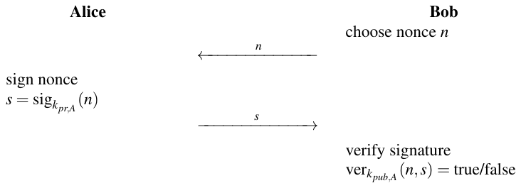

Bob có thể kết luận từ chữ ký hợp lệ rằng Alice biết một bí mật, cụ thể là private key của cô ấy. Điều đó có nghĩa là Alice đã cung cấp một proof of knowledge. Nonce bảo đảm tính mới (freshness) trong protocol này và ngăn các replay attack trong đó kẻ tấn công dùng lại các thông điệp đã gửi trước đó.

◇

Các ứng dụng của loại protocol này bao gồm, ví dụ, smart card để xác thực với máy ATM hoặc để ra vào tòa nhà. Ưu điểm trong thiết lập này là private key nhạy cảm nằm an toàn bên trong smart card và key kiểm chứng không cần bảo vệ đặc biệt. Chúng tôi lưu ý rằng các protocol challenge-response cũng có thể được hiện thực bằng các primitive symmetric với một Message Authentication Code (MAC), như đã thảo luận trong Bài tập 13.6.

## 10.2 Scheme chữ ký RSA

Scheme chữ ký RSA dựa trên mã hóa RSA, đã được giới thiệu trong Chương 7. Bảo mật của nó dựa vào bài toán phân tích thừa số nguyên, tức là độ khó của việc phân tích thừa số tích của hai số nguyên tố lớn. Từ khi được đề xuất năm 1978, scheme chữ ký RSA đã được dùng rộng rãi trong thực tế.

### 10.2.1 Digital Signature Schoolbook RSA

Trước hết chúng tôi trình bày dạng cơ bản của digital signature RSA, do đó có từ định tính “schoolbook”. Trong thực tế, phải dùng padding để ngăn một số tấn công nhất định, như được thảo luận trong Mục 10.2.3.

Giả sử Bob muốn gửi một thông điệp đã ký x tới Alice. Anh ấy tạo cùng các key RSA đã được dùng cho mã hóa RSA như thể hiện trong Mục 7.3. Ở cuối set-up, anh ấy có các tham số sau:

> Các key RSA
>
> ■ Private key của Bob: kpr = (d)
>
> ■ Public key của Bob: kpub = (n,e)

Protocol chữ ký thực sự được trình bày dưới đây. Thông điệp x được ký nằm trong khoảng (1,2,...,n − 1).

> Protocol digital signature RSA cơ bản
>
> 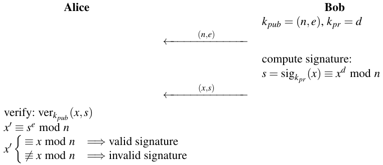

Như có thể thấy từ protocol, Bob tính chữ ký s cho một thông điệp x bằng cách RSA-encrypting x với private key kpr = d của mình. Bob là bên duy nhất có thể áp dụng kpr, và do đó quyền sở hữu kpr xác thực anh ấy là tác giả của thông điệp đã ký. Bob nối chữ ký s vào thông điệp x và gửi cả hai tới Alice. Alice nhận thông điệp đã ký và RSA-decrypts s dùng public key kpub của Bob, cho ra x′. Nếu x và x′ khớp, Alice biết hai điều quan trọng: Thứ nhất, tác giả của thông điệp đã sở hữu key bí mật của Bob, và nếu chỉ Bob có quyền truy cập key, thì chính anh ấy đã ký thông điệp. Điều này được gọi là xác thực thông điệp. Thứ hai, thông điệp không bị thay đổi trong khi truyền, nên tính toàn vẹn thông điệp được bảo đảm. Nhớ lại từ mục trước rằng đây là hai trong các security service nền tảng thường cần trong thực tế.

Chứng minh. Bây giờ chúng tôi đưa ra chứng minh tính đúng đắn, tức là chỉ ra rằng quá trình kiểm chứng cho ra phát biểu “true” nếu thông điệp và chữ ký không bị thay đổi trong khi truyền. Chúng ta bắt đầu từ phép toán kiểm chứng se mod n:

se = (xd)e = xde ≡ x mod n

Do mối quan hệ toán học giữa private key và public key, cụ thể là

d e ≡ 1 mod φ(n)

nâng bất kỳ số nguyên x ∈ ℤn lên lũy thừa (d e)-th đều cho lại chính số nguyên đó. Chứng minh điều này có thể được tìm thấy trong Mục 7.3. □

Vai trò của public key và private key bị hoán đổi so với scheme mã hóa RSA. Trong khi mã hóa RSA áp dụng public key cho thông điệp x, scheme chữ ký áp dụng private key kpr. Ở phía bên kia của kênh liên lạc, giải mã RSA cần bên nhận dùng private key, trong khi scheme digital signature áp dụng public key để kiểm chứng.

Hãy xem một ví dụ với các số nhỏ.

Ví dụ 10.2. Giả sử Bob muốn gửi một thông điệp đã ký (x = 4) tới Alice. Các bước đầu tiên hoàn toàn giống như với mã hóa RSA: Bob tính các tham số RSA của mình và gửi public key tới Alice. Khác với scheme mã hóa, private key được dùng để ký trong khi public key cần để kiểm chứng chữ ký.

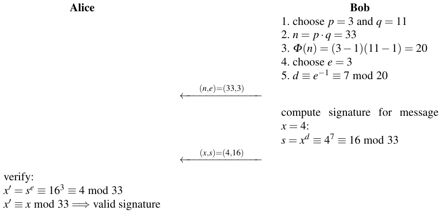

Alice có thể kết luận từ chữ ký hợp lệ rằng Bob đã tạo thông điệp và nó không bị thay đổi trong khi truyền, tức là xác thực thông điệp và tính toàn vẹn thông điệp được bảo đảm.

◇

Cần lưu ý rằng chúng tôi chỉ giới thiệu một scheme digital signature. Đặc biệt, bản thân thông điệp không được mã hóa và, do đó, không có tính bí mật. Nếu cần security service này, thông điệp cùng với chữ ký nên được mã hóa, ví dụ, dùng một thuật toán symmetric như AES.

### 10.2.2 Các khía cạnh tính toán

Trước hết, chúng tôi lưu ý rằng chữ ký dài bằng modulus n, tức là khoảng ⌈log2n⌉ bit. Như đã thảo luận trước đó, n nên có ít nhất 2048 bit. Dù độ dài chữ ký như vậy không phải là vấn đề trong hầu hết các ứng dụng, nó có thể không mong muốn trong các hệ thống bị hạn chế về băng thông và/hoặc năng lượng, ví dụ, các thiết bị IoT nhỏ.

Quá trình tạo key giống hệt quá trình chúng ta đã dùng cho mã hóa RSA, đã được thảo luận chi tiết trong Chương 7. Để tính và kiểm chứng chữ ký, thuật toán square-and-multiply được giới thiệu trong Mục 7.4 được dùng. Các kỹ thuật tăng tốc cho RSA được giới thiệu trong Mục 7.5 cũng áp dụng được cho scheme digital signature. Đặc biệt thú vị là các public key ngắn e, chẳng hạn, lựa chọn e = 216 + 1. Điều này làm cho việc kiểm chứng là một phép toán rất nhanh. Vì trong nhiều kịch bản thực tế một thông điệp chỉ được ký một lần nhưng được kiểm chứng nhiều lần, việc kiểm chứng rất nhanh là hữu ích. Đây là trường hợp, ví dụ, trong các public-key infrastructure, vốn dùng certificate. Certificate chỉ được ký một lần nhưng được kiểm chứng lặp đi lặp lại mỗi khi một người dùng dùng các key asymmetric của mình (xem Mục 14.5).

### 10.2.3 Bảo mật

Để có một scheme chữ ký an toàn, phải bảo đảm rằng bản thân thuật toán RSA không thể bị phá về mặt toán học. Để làm điều này, bài toán phân tích thừa số phải khó về mặt tính toán, điều đạt được bằng cách chọn các số nguyên tố p và q đủ lớn. Trong thực tế, điều này có nghĩa là cả hai số nguyên tố nên có độ dài tối thiểu 1024 bit, dẫn tới modulus n có ít nhất 2048 bit. Ngoài ra, như trong mọi scheme asymmetric khác, phải bảo đảm rằng các public key là xác thực. Điều này có nghĩa là bên kiểm chứng thực sự có public key gắn với private key ký. Nếu kẻ tấn công thành công trong việc cung cấp cho bên kiểm chứng một public key sai được cho là thuộc về người ký, kẻ tấn công có thể ký thông điệp thay mặt cô ấy/anh ấy (her/his). Để ngăn tấn công này, certificate được dùng trong thực tế, một chủ đề được thảo luận trong Mục 14.4.2.

#### Existential Forgery

Một tấn công khả thi với một số scheme chữ ký là existential forgery attack. Scheme chữ ký schoolbook RSA cho phép tấn công này, trong đó đối thủ có thể tạo một chữ ký hợp lệ cho một thông điệp ngẫu nhiên x. Tấn công hoạt động như sau:

> Existential Forgery Attack nhắm vào Digital Signature RSA
>
> 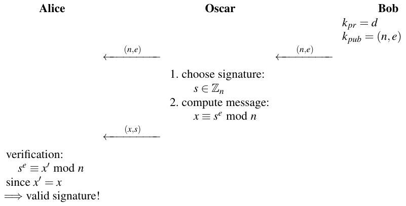

Kẻ tấn công mạo danh Bob, tức là Oscar khẳng định với Alice rằng hắn thực sự là Bob. Vì Alice thực hiện chính xác các phép tính giống như Oscar, cô ấy sẽ kiểm chứng chữ ký là đúng. Tuy nhiên, bằng cách nhìn kỹ các Bước 1 và 2 mà Oscar thực hiện, người ta thấy rằng tấn công hơi kỳ lạ. Kẻ tấn công chọn chữ ký trước rồi mới tính thông điệp. Hệ quả là hắn không thể kiểm soát ngữ nghĩa của thông điệp x. Chẳng hạn, Oscar không thể tạo một thông điệp như “Chuyển $1000 vào tài khoản của Oscar”. Tuy nhiên, việc một quá trình kiểm chứng tự động không nhận ra sự giả mạo chắc chắn không phải là một đặc điểm đáng mong muốn. Vì lý do này, chữ ký schoolbook RSA hiếm khi được dùng trong thực tế, và các scheme padding được áp dụng để ngăn tấn công này và các tấn công khác.

### RSA Padding: Probabilistic Signature Standard (PSS)

Tấn công trên có thể được ngăn bằng cách chỉ cho phép một số định dạng thông điệp nhất định. Nói chung, việc định dạng áp đặt một quy tắc cho phép bên kiểm chứng, Alice trong các ví dụ của chúng ta, phân biệt giữa thông điệp hợp lệ và không hợp lệ. Việc định dạng như vậy được gọi là padding. Chẳng hạn, một quy tắc định dạng đơn giản có thể quy định rằng mọi thông điệp x có 100 bit cuối với giá trị không (hoặc bất kỳ mẫu bit cụ thể nào khác). Nếu Oscar chọn các giá trị chữ ký s và tính “thông điệp” x ≡ se mod n, cực kỳ khó xảy ra việc x có định dạng cụ thể này. Nếu chúng ta yêu cầu một mẫu cụ thể cho 100 bit cuối, cơ hội để x có định dạng này là 2−100, thấp hơn đáng kể so với việc trúng bất kỳ xổ số nào.

Bây giờ chúng ta xem một scheme padding được dùng rộng rãi trong thực tế. Lưu ý rằng một scheme padding cho mã hóa RSA đã được thảo luận trong Mục 7.7. Probabilistic signature scheme (RSA-PSS) là một mở rộng của digital signature schoolbook RSA. Nó kết hợp việc ký với padding thông điệp, được gọi là encoding. Hình 10.2 mô tả quy trình encoding, được biết tới là Encoding Method for Signature with Appendix (EMSA) Probabilistic Signature Scheme (PSS).

Bây giờ hãy xem chi tiết hơn quy trình. Để nhất quán với thuật ngữ được dùng trong các tiêu chuẩn, chúng ta ký hiệu thông điệp là M thay vì x. Như có thể thấy trong hình, hầu như luôn luôn trong thực tế, bản thân thông điệp không được ký trực tiếp mà là phiên bản đã hash của nó. Hash function tính một dấu vân tay số (digital fingerprint) của thông điệp. Dấu vân tay có độ dài cố định, ví dụ, 256 bit. Hash function nhận thông điệp có độ dài tùy ý làm input. Thêm về hash function và vai trò của chúng trong digital signature có trong Chương 11. Dưới đây là chi tiết của scheme EMSA.

> Encoding cho EMSA Probabilistic Signature Scheme
>
> Cho |n| là kích thước modulus RSA tính bằng bit. Thông điệp đã encode EM có độ dài ⌈(|n| − 1)/8⌉ byte sao cho độ dài bit của EM tối đa là |n| − 1 bit.
>
> 1. Tạo một giá trị ngẫu nhiên salt.
>
> 2. Tạo một chuỗi M′ bằng cách nối một padding cố định padding1, giá trị hash mHash = h(M) và salt.
>
> 3. Tính một giá trị hash H của chuỗi M′.
>
> 4. Nối một padding cố định padding2 và giá trị salt để tạo một khối dữ liệu DB.
>
> 5. Áp dụng một mask generation function MGF lên hash của chuỗi M′ để tính giá trị mask dbMask. Trong thực tế, một hash function như SHA-2 thường được dùng làm MGF.
>
> 6. XOR giá trị mask dbMask và khối dữ liệu DB để tính maskedDB.
>
> 7. Thông điệp đã encode EM thu được bằng cách nối maskedDB, giá trị hash H và padding cố định bc.

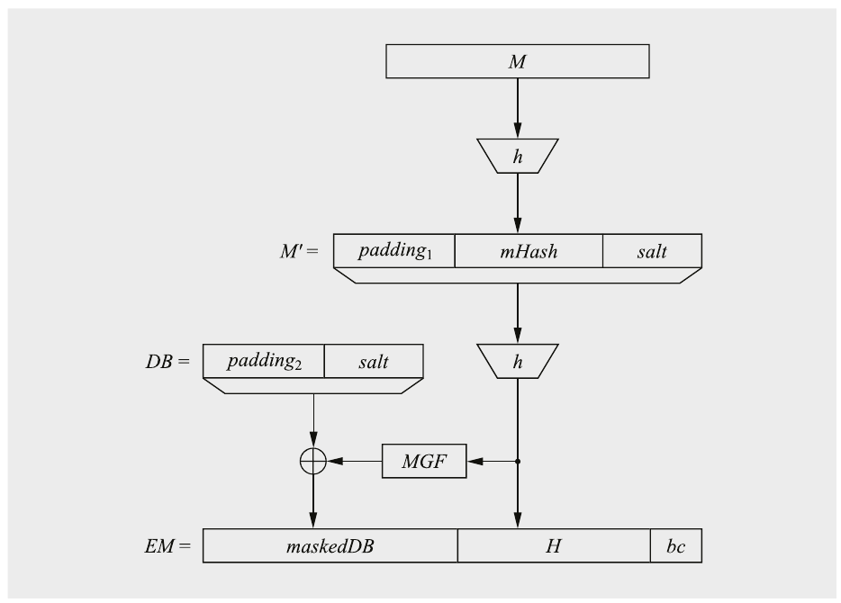

Hình 10.2 Nguyên lý của encoding EMSA-PSS

Sau khi encode, phép toán ký RSA thực sự được áp dụng cho thông điệp đã encode EM, ví dụ,

s = sigkpr(M) ≡ EMd mod n

Chúng tôi lưu ý rằng người gửi phải truyền giá trị salt cùng với thông điệp và chữ ký.

Phép toán kiểm chứng diễn ra theo cách tương tự: Bên nhận dùng các giá trị salt, padding1 và padding2 cùng với thông điệp nhận được M để tạo lại giá trị EM và kiểm tra xem encoding EMSA-PSS của thông điệp có đúng không. Sau đó, phép toán kiểm chứng RSA được thực hiện trên giá trị EM. Bên nhận biết các giá trị padding1 và padding2 từ tiêu chuẩn.

Về bản chất, giá trị H trong EM là phiên bản đã hash của thông điệp. Bằng cách thêm một giá trị ngẫu nhiên salt trước lần hash thứ hai, giá trị đã encode trở nên có tính xác suất. Hệ quả là nếu encode và ký cùng một thông điệp hai lần, chúng ta thu được các chữ ký khác nhau, là một đặc điểm đáng mong muốn.

## 10.3 Scheme Digital Signature Elgamal

Scheme chữ ký Elgamal, được công bố năm 1985, dựa trên độ khó của việc tính logarit rời rạc (xem Mục 8.3). Khác với RSA, nơi mã hóa và digital signature là các phép toán gần như giống hệt nhau, digital signature Elgamal khá khác với scheme mã hóa cùng tên.

### 10.3.1 Digital Signature Schoolbook Elgamal

Như mọi scheme asymmetric, digital signature Elgamal gồm một giai đoạn tạo key và việc thực thi scheme thực sự.

#### Tạo key

Chúng ta bắt đầu bằng cách tìm một số nguyên tố lớn p và xây dựng một bài toán logarit rời rạc như sau:

> Tạo key cho Digital Signature Elgamal
>
> 1. Chọn một số nguyên tố lớn p.
>
> 2. Chọn một phần tử nguyên thủy α của ℤp∗ hoặc của một subgroup của ℤp∗.
>
> 3. Chọn một số nguyên ngẫu nhiên d ∈ {2,3,..., p − 2}.
>
> 4. Tính β ≡ αd mod p.

Public key bây giờ được tạo bởi kpub = (p,α,β), và private key bởi kpr = d.

#### Ký và kiểm chứng

Dùng private key và các tham số của public key, chữ ký:

sigkpr(x,kE) = (r,s)

cho một thông điệp x được tính trong quá trình ký. Lưu ý rằng nó gồm hai số nguyên r và s. Việc ký gồm hai bước chính: chọn một giá trị ngẫu nhiên kE, tạo thành một private key ephemeral, và tính chữ ký thực sự của x.

> Tạo chữ ký Elgamal
>
> 1. Chọn một ephemeral key ngẫu nhiên kE ∈ {2,..., p − 2} sao cho gcd(kE, p − 1) = 1.
>
> 2. Tính các tham số chữ ký:
>
> r ≡ αkE mod p
>
> s ≡ (x − d · r)kE−1 mod (p − 1)

Ở phía nhận, chữ ký được kiểm chứng là verkpub(x,(r, s)) dùng public key, chữ ký và thông điệp.

> Kiểm chứng chữ ký Elgamal
>
> 1. Tính giá trị
>
> t ≡ βr · rs mod p
>
> 2. Việc kiểm chứng suy ra từ:
>
> 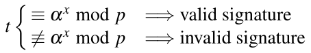

Bên kiểm chứng chỉ chấp nhận một chữ ký (r,s) nếu hệ thức βr · rs ≡ αx mod p được thỏa. Nếu không, việc kiểm chứng thất bại. Để hiểu các quy tắc trông khá tùy ý để tính các tham số chữ ký r và s cũng như việc kiểm chứng, sẽ hữu ích khi nghiên cứu chứng minh tính đúng đắn sau.

Chứng minh. Để chứng minh tính đúng đắn, chúng ta chỉ ra rằng quá trình kiểm chứng cho ra phát biểu “true” nếu bên kiểm chứng dùng public key đúng và thông điệp đúng, và nếu các tham số chữ ký (r, s) được chọn như quy định. Chúng ta bắt đầu với phương trình kiểm chứng:

βr · rs ≡ (αd)r(αkE)s mod p

≡ αd r+kE s mod p

Chữ ký được coi là hợp lệ nếu biểu thức này bằng αx:

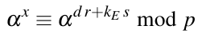 (10.1)

Theo Định lý nhỏ Fermat, hệ thức trong Phương trình (10.1) đúng nếu các số mũ ở hai vế của biểu thức bằng nhau modulo p − 1:

x ≡ d r + kEs mod (p − 1)

từ đó suy ra quy tắc xây dựng tham số chữ ký s:

s ≡ (x − d · r)kE−1 mod (p − 1)

□

Điều kiện gcd(kE, p − 1) = 1 là cần thiết vì chúng ta phải tìm inverse của ephemeral key modulo p − 1 khi tính s. Hãy xem một ví dụ với các số nhỏ.

Ví dụ 10.3. Một lần nữa, Bob muốn gửi một thông điệp tới Alice. Lần này, nó nên được ký bằng scheme digital signature Elgamal. Quá trình ký và kiểm chứng như sau:

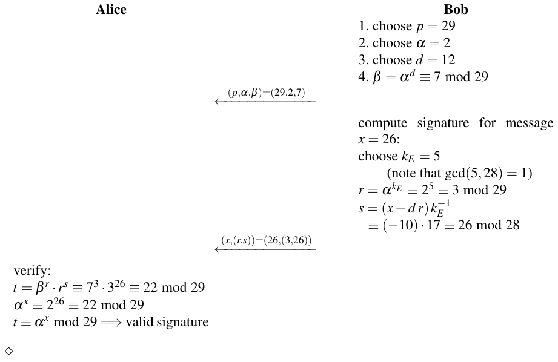

### 10.3.2 Các khía cạnh tính toán

Giai đoạn tạo key giống hệt giai đoạn set-up của mã hóa Elgamal, mà chúng tôi đã giới thiệu trong Mục 8.5.2. Vì bảo mật của scheme chữ ký dựa vào bài toán logarit rời rạc, p cần có các tính chất đã thảo luận trong Mục 8.3.3. Đặc biệt, nó nên có độ dài ít nhất 2048 bit để bảo đảm rằng logarit rời rạc không thể được tính. Số nguyên tố có thể được tạo bằng các thuật toán prime-finding được giới thiệu trong Mục 7.6. Private key nên được tạo bởi một bộ sinh số ngẫu nhiên thực. Public key cần một phép lũy thừa dùng thuật toán square-and-multiply.

Chữ ký gồm cặp (r, s). Cả hai có độ dài bit gần bằng p, nên tổng độ dài của bộ (x,(r, s)) dài khoảng ba lần bản thân thông điệp x. Tính r cần một phép lũy thừa modulo p, có thể đạt được bằng thuật toán square-and-multiply. Phép toán chính khi tính s là phép nghịch đảo kE. Điều này có thể được làm bằng extended Euclidean algorithm. Có thể speed-up qua tính trước. Người ký có thể tạo ephemeral key kE và r trước và lưu cả hai giá trị. Khi một thông điệp cần được ký, chúng có thể được lấy ra và dùng để tính s. Bên kiểm chứng thực hiện hai phép lũy thừa, lại được tính bằng thuật toán square-and-multiply, và một phép nhân.

### 10.3.3 Bảo mật

Trước hết, chúng ta phải bảo đảm rằng bên kiểm chứng có public key đúng. Nếu không, tấn công được phác họa trong Mục 10.2.3 có thể áp dụng. Các tấn công khác được mô tả dưới đây.

#### Tính logarit rời rạc

Bảo mật của scheme chữ ký dựa vào bài toán logarit rời rạc (DLP). Nếu Oscar có khả năng tính logarit rời rạc, hắn có thể tính private key d từ β cũng như ephemeral key kE từ r. Với kiến thức này, hắn có thể ký các thông điệp tùy ý thay mặt người ký. Do đó, các tham số Elgamal phải được chọn sao cho DLP khó giải. Chúng tôi giới thiệu độc giả tới Mục 8.3.3 để có thảo luận về các tấn công logarit rời rạc khả dĩ. Một trong các yêu cầu then chốt là số nguyên tố p nên dài ít nhất 2048 bit. Chúng ta cũng phải bảo đảm rằng các small subgroup attack không khả thi. Để chống lại tấn công này, trong thực tế các phần tử nguyên thủy α được dùng để sinh một subgroup có order nguyên tố. Trong các group như vậy, mọi phần tử đều nguyên thủy và không tồn tại subgroup nhỏ.

#### Dùng lại Ephemeral Key

Nếu người ký dùng lại ephemeral key kE, kẻ tấn công có thể dễ dàng tính private key d. Điều này cấu thành việc phá hoàn toàn hệ thống. Đây là cách tấn công hoạt động.

Oscar quan sát hai digital signature và thông điệp có dạng (x,(r,s)). Nếu hai thông điệp x1 và x2 có cùng ephemeral key kE, Oscar có thể phát hiện điều này vì hai giá trị r giống nhau vì chúng được xây dựng là r1 ≡ r2 ≡ αkE mod p. Hai giá trị s khác nhau, và Oscar thu được hai biểu thức sau:

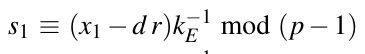 (10.2)

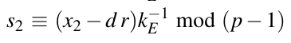 (10.3)

Đây là một hệ phương trình với hai ẩn d, là private key của Bob (!), và ephemeral key kE. Bằng cách nhân cả hai phương trình với kE, nó trở thành một hệ phương trình tuyến tính có thể được giải dễ dàng. Oscar chỉ cần trừ phương trình thứ hai khỏi phương trình thứ nhất, cho ra:

s1 − s2 ≡ (x1 − x2)kE−1 mod (p − 1)

từ đó ephemeral key suy ra là

kE ≡ (x1 − x2)/(s1 − s2) mod (p − 1)

Nếu gcd(s1 − s2, p − 1) ≠ 1, phương trình có nhiều nghiệm cho kE, và Oscar phải kiểm chứng nghiệm nào đúng. Trong mọi trường hợp, dùng kE, Oscar bây giờ cũng có thể tính private key qua Phương trình (10.2) hoặc Phương trình (10.3):

d ≡ (x1 − s1kE)/r mod (p − 1)

Với kiến thức về private key d và public key, Oscar bây giờ có thể tự do ký bất kỳ tài liệu nào thay mặt Bob. Để tránh tấn công, nên dùng các ephemeral key mới đến từ một bộ sinh số ngẫu nhiên cho mỗi digital signature. Một ví dụ tấn công với các số nhỏ được cho trong ví dụ tiếp theo.

Ví dụ 10.4. Hãy giả sử tình huống trong đó Oscar nghe lén hai thông điệp sau đã được ký trước đó bằng private key của Bob và dùng cùng ephemeral key kE:

1. (x1,(r,s1)) = (26,(3,26))

2. (x2,(r,s2)) = (13,(3,1))

Ngoài ra, Oscar biết public key của Bob, được cho là

(p,α,β) = (29,2,7).

Với thông tin này, Oscar bây giờ có thể tính ephemeral key

kE ≡ (x1 − x2)/(s1 − s2) mod (p − 1)

≡ (26 − 13)/(26 − 1) ≡ 13 · 9

≡ 5 mod 28

và cuối cùng làm lộ private key d của Bob:

d ≡ (x1 − s1 · kE)/r mod (p − 1)

≡ (26 − 26 · 5)/3 ≡ 8 · 19

≡ 12 mod 28

◇

#### Existential Forgery Attack

Tương tự trường hợp digital signature RSA, cũng có thể kẻ tấn công tạo một chữ ký hợp lệ cho một thông điệp ngẫu nhiên x. Kẻ tấn công, Oscar, mạo danh Bob, tức là Oscar khẳng định với Alice rằng hắn thực sự là Bob. Tấn công hoạt động như sau:

> Existential Forgery Attack nhắm vào Digital Signature Elgamal
>
> 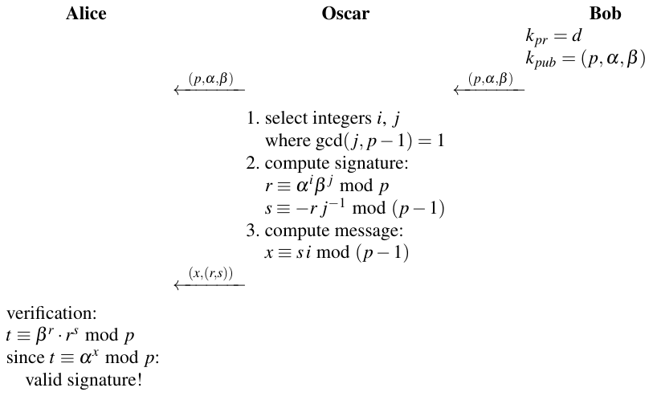

Việc kiểm chứng cho ra phát biểu “true” vì điều sau đúng:

t ≡ βr · rs mod p

≡ αd r · rs mod p

≡ αd r · α(i+d j)s mod p

≡ αd r · α(i+d j)(−r j−1) mod p

≡ αd r−d r · α−r i j−1 mod p

≡ αs i mod p

Vì thông điệp được xây dựng là x ≡ s i mod (p − 1), biểu thức cuối bằng

αs i ≡ αx mod p

đó chính xác là điều kiện của Alice để chấp nhận chữ ký là hợp lệ.

Kẻ tấn công tính ở Bước 3 thông điệp x, mà ngữ nghĩa của nó hắn không thể kiểm soát. Do đó, Oscar chỉ có thể tính các chữ ký hợp lệ cho các thông điệp giả ngẫu nhiên.

Tấn công không khả thi nếu thông điệp được hash, điều mà trong thực tế rất thường xảy ra. Thay vì dùng trực tiếp thông điệp để tính chữ ký, người ta áp dụng một hash function lên thông điệp trước khi ký, tức là phương trình ký trở thành:

s ≡ (h(x) − d · r)kE−1 mod (p − 1)

Thêm về hash có thể được tìm thấy trong Chương 11.

## 10.4 Digital Signature Algorithm (DSA)

Thuật toán chữ ký Elgamal nguyên bản được mô tả trong mục trước hiếm khi được thấy trong thực tế. Thay vào đó, một biến thể phổ biến hơn nhiều là Digital Signature Algorithm, hay DSA. Nó cũng được biết tới là U.S. Digital Signature Standard (DSS). Dù NIST, U.S. National Institute of Standards and Technology, đã ngừng khuyến nghị DSA làm scheme chữ ký năm 2020, nó vẫn được dùng trong nhiều hệ thống cũ. (Ngày nay NIST khuyến nghị dùng chữ ký RSA hoặc ECDSA, xem Mục 10.5.) Các ưu điểm chính của DSA so với scheme chữ ký Elgamal là chữ ký ngắn hơn modulus, ví dụ, 448 bit khi modulus là 2048 bit, và một số tấn công có thể đe dọa scheme Elgamal không áp dụng được.

### 10.4.1 Thuật toán DSA

Sau đây chúng tôi giới thiệu thuật toán DSA với độ dài bit 2048 bit. Lưu ý rằng một phiên bản 3072-bit cũng là một phần của tiêu chuẩn.

#### Tạo key

Các key cho DSA được tính như sau:

> Tạo key cho DSA
>
> 1. Tạo một số nguyên tố p với 22047 < p < 22048.
>
> 2. Tìm một ước nguyên tố q của p − 1 với 2223 < q < 2224.
>
> 3. Tìm một phần tử α với ord(α) = q, tức là α sinh ra subgroup với q phần tử.
>
> 4. Chọn một số nguyên ngẫu nhiên d với 0 < d < q.
>
> 5. Tính β ≡ αd mod p.
>
> Các key bây giờ là:
>
> kpub = (p,q,α,β)
>
> kpr = (d)

Ý tưởng trung tâm của DSA là có hai cyclic group liên quan. Một là cyclic group lớn ℤp∗, order của nó có độ dài 2048 bit. Group thứ hai là subgroup 224-bit của ℤq∗. Thiết lập này cho ra chữ ký ngắn hơn, như chúng ta thấy dưới đây.

Ngoài số nguyên tố p 2048-bit và số nguyên tố q 224-bit, có hai tổ hợp độ dài bit khả dĩ khác cho các số nguyên tố p và q, được thể hiện trong Bảng 10.1. Chúng tôi lưu ý rằng phiên bản 1024-bit không còn cung cấp bảo mật long-term và không nên được dùng trong thực tế ngày nay.

Bảng 10.1 Độ dài bit của các tham số quan trọng của DSA

| p | q | chữ ký |
|---|---|---|
| 1024 | 160 | 320 |
| 2048 | 224 | 448 |
| 3072 | 256 | 512 |

Nếu cần một trong các độ dài bit khác, chỉ Bước 1 và 2 của giai đoạn tạo key phải được điều chỉnh tương ứng. Thêm về vấn đề độ dài bit sẽ được nói trong Mục 10.4.3 dưới đây.

#### Ký và kiểm chứng

Như trong scheme chữ ký Elgamal, chữ ký DSA gồm một cặp số nguyên (r, s). Vì mỗi tham số trong hai tham số chỉ dài 224 bit, tổng độ dài chữ ký là 448 bit. Dùng public key và private key, chữ ký cho một thông điệp x được tính như sau:

> Tạo chữ ký DSA
>
> 1. Chọn một số nguyên làm ephemeral key ngẫu nhiên kE với 0 < kE < q.
>
> 2. Tính r ≡ (αkE mod p) mod q.
>
> 3. Tính s ≡ (SHA(x) + d · r)kE−1 mod q.

Thông điệp x được hash bằng hash function SHA-2 để tính s. Các hash function, bao gồm SHA-2, được mô tả trong Chương 11. Hiện tại chỉ cần biết rằng SHA-2 nén x và tính một dấu vân tay dài ít nhất 224 bit. Dấu vân tay này có thể được coi là một đại diện của x.

Quá trình kiểm chứng chữ ký như sau:

> Kiểm chứng chữ ký DSA
>
> 1. Tính giá trị phụ w ≡ s−1 mod q.
>
> 2. Tính giá trị phụ u1 ≡ w · SHA(x) mod q.
>
> 3. Tính giá trị phụ u2 ≡ w · r mod q.
>
> 4. Tính v ≡ (αu1 · βu2 mod p) mod q.
>
> 5. Việc kiểm chứng verkpub(x,(r, s)) suy ra từ:
>
> 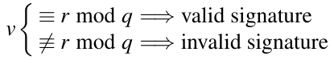

Bên kiểm chứng chỉ chấp nhận một chữ ký (r, s) nếu v ≡ r mod q được thỏa. Nếu không, việc kiểm chứng thất bại. Trong trường hợp này, hoặc thông điệp hoặc chữ ký có thể đã bị sửa đổi hoặc bên kiểm chứng không sở hữu public key đúng. Trong mọi trường hợp, chữ ký nên được coi là không hợp lệ.

Chứng minh. Chúng ta chỉ ra rằng một chữ ký (r, s) thỏa điều kiện kiểm chứng v ≡ r mod q. Chúng ta bắt đầu với tham số chữ ký s:

s ≡ (SHA(x) + d r)kE−1 mod q

tương đương với:

kE ≡ s−1SHA(x) + d s−1r mod q

Vế right-hand có thể được biểu diễn theo các giá trị phụ u1 và u2:

kE ≡ u1 + d u2 mod q

Chúng ta có thể nâng α lên mỗi vế của phương trình nếu rút gọn modulo p:

αkE mod p ≡ αu1+d u2 mod p

Vì giá trị public key β được tính là β ≡ αd mod p, chúng ta có thể viết:

αkE mod p ≡ αu1βu2 mod p

Bây giờ chúng ta rút gọn cả hai vế của phương trình modulo q:

(αkE mod p) mod q ≡ (αu1βu2 mod p) mod q

Vì r được xây dựng là r ≡ (αkE mod p) mod q và v ≡ (αu1βu2 mod p) mod q, biểu thức này giống hệt điều kiện để kiểm chứng một chữ ký là hợp lệ:

r ≡ v mod q

□

Hãy xem một ví dụ với các số nhỏ.

Ví dụ 10.5. Bob muốn gửi một thông điệp x tới Alice cần được ký bằng thuật toán DSA. Giả sử giá trị hash của x là h(x) = 26. Khi đó quá trình ký và kiểm chứng như sau:

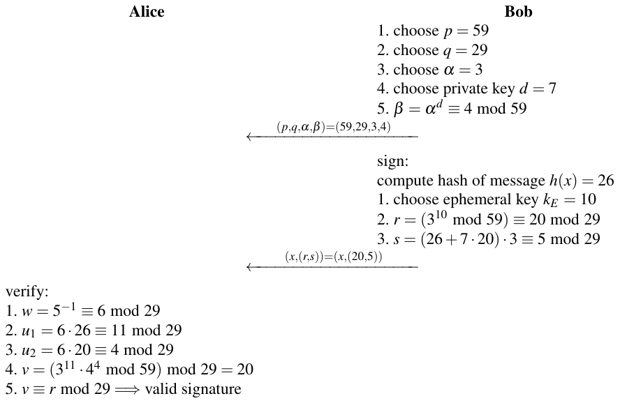

Trong ví dụ này, subgroup có order nguyên tố q = 29, trong khi cyclic group “lớn” modulo p có 58 phần tử. Chúng tôi lưu ý rằng 58 = 2 · 29. Chúng ta đã giả định một hash function hư cấu h(x) tính ra giá trị hash 26 cho thông điệp.

◇

### 10.4.2 Các khía cạnh tính toán

Bây giờ chúng tôi thảo luận các phép tính liên quan tới scheme DSA. Phần đòi hỏi nhiều nhất là giai đoạn tạo key. Tuy nhiên, giai đoạn này chỉ phải được thực thi một lần lúc set-up.

#### Tạo key

Thách thức trong giai đoạn tạo key là tìm một cyclic group ℤp∗ với độ dài bit 2048, và có một subgroup nguyên tố trong khoảng 2224. Điều kiện này được thỏa nếu p − 1 có một thừa số nguyên tố q dài 224 bit. Cách tiếp cận chung để tạo các tham số như vậy là trước hết tìm số nguyên tố q 224-bit rồi xây dựng số nguyên tố lớn hơn p từ nó. Dưới đây là thuật toán prime-generating, dùng phép kiểm tra tính nguyên tố Miller-Rabin từ Mục 7.6.2 như một chương trình con. Lưu ý rằng scheme NIST-specified hơi khác.

> Tạo số nguyên tố cho DSA
>
> Output: hai số nguyên tố (p,q), trong đó 22047 < p < 22048 và 2223 < q < 2224, sao cho p − 1 là bội số của q.
>
> Khởi tạo: i = 1
>
> Thuật toán:
>
> 1 tìm số nguyên tố q với 2223 < q < 2224 dùng thuật toán Miller–Rabin
>
> 2 FOR i = 1 TO 4096
>
> 2.1 tạo số nguyên ngẫu nhiên M với 22047 < M < 22048
>
> 2.2 Mr ≡ M mod 2q
>
> 2.3 p − 1 ≡ M − Mr (lưu ý rằng p − 1 là bội số của 2q.)
>
> IF p là số nguyên tố (dùng phép kiểm tra tính nguyên tố Miller–Rabin)
>
> 2.4 RETURN (p, q)
>
> 2.5 i = i + 1
>
> 3 GOTO Bước 1

Việc chọn 2q làm modulus ở Bước 2.2 bảo đảm rằng các ứng viên nguyên tố được tạo ở Bước 2.3 là số lẻ. Vì p − 1 chia hết cho 2q, nó cũng chia hết cho q. Nếu p là số nguyên tố, ℤp∗ do đó có một subgroup có order q.

#### Ký

Trong quá trình ký, chúng ta tính các tham số r và s. Tính r trước hết liên quan tới việc tính αkE mod p bằng thuật toán square-and-multiply. Vì kE chỉ có 224 bit, trung bình cần khoảng 1.5 · 224 = 336 phép bình phương và nhân, dù số học được thực hiện với các số 2048-bit. Kết quả, cũng có độ dài 2048 bit, sau đó được rút gọn xuống 224 bit bởi phép toán “ mod q”. Tính s chỉ liên quan tới các số 224-bit. Bước tốn kém nhất là phép nghịch đảo kE.

Trong các phép toán này, phép lũy thừa là tốn kém nhất về độ phức tạp tính toán. Vì tham số r không phụ thuộc vào thông điệp, nó có thể được tính trước để việc ký thực sự có thể là một phép toán tương đối nhanh.

#### Kiểm chứng

Tính các tham số phụ w, u1 và u2 chỉ liên quan tới các toán hạng 224-bit, khiến chúng tương đối nhanh. Các phép toán tốn kém nhất là các phép lũy thừa trong biểu thức v ≡ (αu1 · βu2 mod p) mod q.

### 10.4.3 Bảo mật

Một khía cạnh thú vị của DSA là chúng ta phải bảo vệ trước hai tấn công logarit rời rạc khác nhau. Nếu kẻ tấn công muốn phá scheme, hắn có thể cố tính private key d bằng cách giải logarit rời rạc trong cyclic group lớn modulo p:

d ≡ logα β mod p

Phương pháp mạnh nhất cho việc này là tấn công index-calculus, đã được phác họa trong Mục 8.3.3. Để chặn tấn công này, p phải dài ít nhất 2048 bit. Nhớ rằng cho mức bảo mật cao hơn, các số nguyên tố có độ dài 3072 bit cũng khả dĩ.

Tấn công logarit rời rạc thứ hai nhắm vào DSA là khai thác thực tế rằng α chỉ sinh ra một subgroup nhỏ có order q. Do đó, có vẻ hứa hẹn khi chỉ tấn công subgroup, có kích thước khoảng 2224, thay vì cyclic group lớn với khoảng 22048 phần tử được tạo bởi p. Tuy nhiên, hóa ra tấn công index-calculus mạnh không áp dụng được nếu Oscar muốn khai thác tính chất subgroup. Điều tốt nhất hắn có thể làm là thực hiện một trong các tấn công DLP generic, tức là phương pháp baby-step giant-step hoặc phương pháp rho của Pollard (xem Mục 8.3.3). Đây là các square root attack so-called, và vì subgroup có order khoảng 2224, các tấn công này cung cấp mức bảo mật √2224 = 2112. Bảng 10.2 cho thấy các độ dài NIST-specified của các số nguyên tố p và q cùng với mức bảo mật thu được. Mức bảo mật của hash function cũng phải khớp với của bài toán logarit rời rạc. Vì sức mạnh cryptographic của một hash function chủ yếu được xác định bởi độ dài bit của output hash, output hash tối thiểu cũng được cho trong bảng. Thêm về bảo mật của hash function sẽ được nói trong Chương 11.

Cần nhấn mạnh rằng kỷ lục cho các phép tính logarit rời rạc gần 800 bit (xem Bảng 8.3 trong Mục 8.3.3), nên biến thể DSA 1024-bit không nên được dùng. Các biến thể 2048-bit và 3072-bit được tin là cung cấp bảo mật long-term.

Bảng 10.2 Độ dài bit và mức bảo mật cho DSA

| p | q | Output hash (tối thiểu) | Mức bảo mật |
|---|---|---|---|
| 1024 | 160 | 160 | 80 |
| 2048 | 224 | 224 | 112 |
| 3072 | 256 | 256 | 128 |

Ngoài các tấn công logarit rời rạc, DSA trở nên dễ bị tổn thương nếu ephemeral key được dùng lại. Tấn công này hoàn toàn tương tự trường hợp digital signature Elgamal. Do đó, phải bảo đảm rằng một key kE mới được genererated *(ghi chú: sách in genererated; đúng là generated)* ngẫu nhiên được dùng trong mỗi phép toán ký.

## 10.5 Elliptic Curve Digital Signature Algorithm (ECDSA)

Như đã thảo luận trong Chương 9, elliptic curve có vài ưu điểm so với RSA và so với các scheme DL như Elgamal hay DSA. Đặc biệt, khi không có tấn công mạnh nào nhắm vào các cryptosystem elliptic curve (ECC), có thể chọn độ dài bit trong khoảng 256–512 bit, cung cấp bảo mật tương đương RSA và các scheme DL 2048–4096-bit. Độ dài bit ngắn hơn của ECC thường dẫn tới thời gian xử lý ngắn hơn và chữ ký ngắn hơn. Vì những lý do này, Elliptic Curve Digital Signature Algorithm (ECDSA) đã được American National Standards Institute (ANSI) chuẩn hóa ở Mỹ năm 1998 và sau đó cũng được NIST chuẩn hóa.

### 10.5.1 Thuật toán ECDSA

Các bước trong tiêu chuẩn ECDSA về mặt khái niệm liên quan chặt chẽ tới scheme DSA. Tuy nhiên, bài toán logarit rời rạc của nó được xây dựng trong group của một elliptic curve. Do đó, số học để thực sự tính một chữ ký ECDSA hoàn toàn khác với số học dùng cho DSA.

Tiêu chuẩn ECDSA được định nghĩa cho elliptic curve trên các prime field ℤp và Galois field GF(2m). Loại trước thường được ưa chuộng trong thực tế, và chúng tôi sẽ chỉ giới thiệu loại này dưới đây.

#### Tạo key

Các key cho ECDSA được tính như sau:

> Tạo key cho ECDSA
>
> 1. Dùng một elliptic curve E với
>
> ■ modulus p
>
> ■ các hệ số a và b
>
> ■ một điểm A sinh ra một cyclic group có order nguyên tố q
>
> 2. Chọn một số nguyên ngẫu nhiên d với 0 < d < q.
>
> 3. Tính B = d A.
>
> Các key bây giờ là:
>
> kpub = (p,a,b,q,A,B)
>
> kpr = (d)

Lưu ý rằng chúng ta đã thiết lập một bài toán logarit rời rạc trong đó số nguyên d là private key và kết quả của scalar multiplication, điểm B, là public key. Tương tự DSA, cyclic group có order q, nên có kích thước ít nhất 224 bit, hoặc hơn cho các mức bảo mật cao hơn.

#### Ký và kiểm chứng

Như DSA, một chữ ký ECDSA gồm một cặp số nguyên (r, s). Mỗi giá trị có cùng độ dài bit với q, tạo nên các chữ ký khá gọn. Dùng public key và private key, chữ ký cho một thông điệp x được tính như sau:

> Tạo chữ ký ECDSA
>
> 1. Chọn một số nguyên làm ephemeral key ngẫu nhiên kE với 0 < kE < q
>
> 2. Tính R = kEA = (xR,yR)
>
> 3. Cho r = xR
>
> 4. Tính s ≡ (h(x) + d · r)kE−1 mod q

Ở Bước 3, x-coordinate của điểm R được gán cho biến r. Thông điệp x phải được hash bằng hàm h để tính s. Độ dài output của hash function phải ít nhất dài bằng q. Thêm về hash function sẽ được nói trong Chương 11. Hiện tại chỉ cần biết rằng hash function nén x và tính một dấu vân tay có thể được xem như một đại diện của x.

Quá trình kiểm chứng chữ ký như sau:

> Kiểm chứng chữ ký ECDSA
>
> 1. Tính giá trị phụ w ≡ s−1 mod q
>
> 2. Tính giá trị phụ u1 ≡ w · h(x) mod q
>
> 3. Tính giá trị phụ u2 ≡ w · r mod q
>
> 4. Tính P = u1A + u2B
>
> 5. Việc kiểm chứng verkpub(x,(r, s)) suy ra từ:
>
> 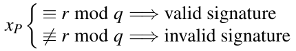

Ở bước cuối, ký hiệu xP chỉ x-coordinate của điểm P. Bên kiểm chứng chấp nhận một chữ ký (r, s) nếu xP có cùng giá trị với tham số chữ ký r modulo q. Nếu không, chữ ký nên được coi là không hợp lệ.

Chứng minh. Chúng ta chỉ ra rằng một chữ ký (r,s) thỏa điều kiện kiểm chứng ECDSA r ≡ xP mod q. Chúng ta bắt đầu với tham số chữ ký s:

s ≡ (h(x) + d r)kE−1 mod q

tương đương với:

kE ≡ s−1h(x) + d s−1r mod q

Vế right-hand có thể được biểu diễn theo các giá trị phụ u1 và u2:

kE ≡ u1 + d u2 mod q

Vì điểm A sinh ra một cyclic group có order q, chúng ta có thể nhân cả hai vế của phương trình với A:

kEA = (u1 + d u2)A

Vì phép toán group có tính kết hợp, chúng ta có thể viết

kEA = u1A + d u2A

và

kEA = u1A + u2B

Những gì chúng ta đã chỉ ra tới giờ là biểu thức u1A + u2B bằng kEA nếu chữ ký và key (và thông điệp) đúng đã được dùng. Nhưng đây chính xác là điều kiện chúng ta kiểm tra trong quá trình kiểm chứng bằng cách so sánh các x-coordinates của P = u1A + u2B và R = kEA.

□

Dùng elliptic curve nhỏ từ Chương 9, chúng ta xem một ví dụ ECDSA đơn giản.

Ví dụ 10.6. Bob muốn gửi một thông điệp tới Alice cần được ký bằng thuật toán ECDSA. Chúng ta giả sử rằng thông điệp có giá trị hash h(x) = 26. Quá trình ký và kiểm chứng như sau:

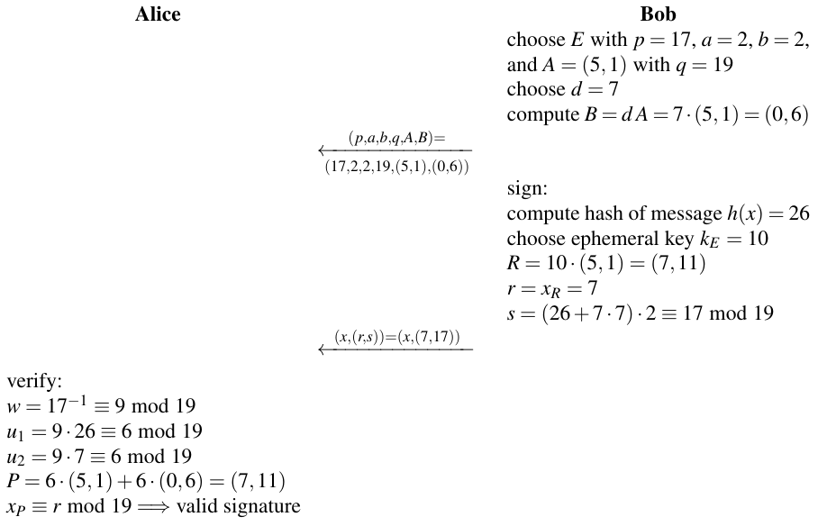

Lưu ý rằng chúng ta đã dùng elliptic curve

E: y2 ≡ x3 + 2x + 2 mod 17

được thảo luận trong Mục 9.2. Vì mọi điểm của đường cong tạo thành một cyclic group có order 19, tức là một số nguyên tố, không có subgroup nào và do đó trong trường hợp này q = #E = 19.

◇

### 10.5.2 Các khía cạnh tính toán

Bây giờ chúng tôi thảo luận các phép tính liên quan tới ba giai đoạn của scheme ECDSA.

Tạo key Như đã nhắc trước đó, tìm một elliptic curve với các tính chất cryptographic tốt là một nhiệm vụ không tầm thường. Trong thực tế, các đường cong được chuẩn hóa như các đường cong do NIST đề xuất hoặc các đường cong do cộng đồng học thuật đề xuất như Curve25519 thường được dùng (xem Mục 9.6). Phép tính còn lại trong giai đoạn tạo key là một point multiplication, có thể được làm bằng thuật toán double-and-add.

Ký Trong quá trình ký, trước hết chúng ta tính điểm R, cần một point multiplication, và từ đó r suy ra ngay. Với tham số s, chúng ta phải nghịch đảo ephemeral key, điều được làm bằng extended Euclidean algorithm. Các phép toán chính khác là hash thông điệp và một phép rút gọn modulo q.

Point multiplication, trong hầu hết trường hợp cho tới nay là phép toán arithmetic-intensive nhất, có thể được tính trước bằng cách chọn ephemeral key từ trước, ví dụ, trong thời gian rảnh của CPU. Do đó, trong các tình huống mà tính trước là một lựa chọn, việc ký trở thành một phép toán rất nhanh.

Người ta cũng phải tính hash của thông điệp. Với các thông điệp dài, điều này có thể cần nhiều phép tính và có thể chi phối quá trình ký.

Kiểm chứng Tính các tham số phụ w, u1 và u2 liên quan tới số học modulo đơn giản. Khối lượng tính toán chính xảy ra khi tính P = u1A + u2B. Điều này có thể được thực hiện bằng hai point multiplication riêng biệt. Tuy nhiên, có các phương pháp chuyên biệt cho lũy thừa đồng thời (nhớ từ Chương 9 rằng point multiplication liên quan chặt chẽ tới lũy thừa) nhanh hơn hai point multiplication riêng lẻ.

Hash của thông điệp cũng phải được tính. Tương tự quá trình ký, nếu thông điệp dài, việc hash có thể trở thành yếu tố tính toán chi phối trong quá trình kiểm chứng.

### 10.5.3 Bảo mật

Với điều kiện các tham số elliptic curve được chọn đúng, tấn công phân tích chính nhắm vào ECDSA cố giải bài toán logarit rời rạc elliptic curve. Nếu kẻ tấn công có khả năng làm điều này, hắn có thể tính private key d và/hoặc ephemeral key. Nhớ lại từ Mục 8.3.3 rằng các tấn công ECC tốt nhất đã biết có độ phức tạp tỉ lệ với căn bậc hai của kích thước group trong đó bài toán DL được định nghĩa, tức là tỉ lệ với √q. Độ dài tham số của ECDSA và các mức bảo mật tương ứng được cho trong Bảng 10.3. Số nguyên tố p thường chỉ lớn hơn q một chút, nên mọi phép tính số học được thực hiện với các toán hạng có độ dài bit gần bằng q.

Mức bảo mật của hash function cũng phải khớp với của bài toán logarit rời rạc. Sức mạnh cryptographic của một hash function chủ yếu được xác định bởi độ dài output của nó. Thêm về bảo mật của hash function sẽ được nói trong Chương 11.

Các mức bảo mật 128, 192 và 256 được chọn để khớp với bảo mật do AES cung cấp với ba kích thước key tương ứng, và mức bảo mật 112-bit khớp với độ dài key hiệu dụng của 3DES.

Các tấn công tinh vi hơn nhắm vào ECDSA cũng khả thi. Chẳng hạn, ở đầu quá trình kiểm chứng phải kiểm tra xem r,s ∈ {1,2,...,q} để ngăn một tấn công nhất định. Ngoài ra, các điểm yếu protocol-based, ví dụ, dùng lại ephemeral key, phải được ngăn chặn.

Bảng 10.3 Độ dài bit và mức bảo mật của ECDSA

| q | Output hash (tối thiểu) | Mức bảo mật |
|---|---|---|
| 192 | 192 | 96 |
| 224 | 224 | 112 |
| 256 | 256 | 128 |
| 384 | 384 | 192 |
| 512 | 512 | 256 |

## 10.6 Thảo luận và đọc thêm (Discussion and Further Reading)

Các thuật toán cho Digital Signature Scheme digital signature thực tế đầu tiên được giới thiệu trong “bài báo RSA” gốc của Rivest, Shamir và Adleman [216]. Digital signature RSA đã được nhiều tổ chức chuẩn hóa từ lâu, xem, ví dụ, [148]. Chữ ký RSA đã là, và với nhiều ứng dụng vẫn là, thuật toán được dùng rộng rãi nhất, đặc biệt cho certificate trên internet.

Digital signature Elgamal được công bố năm 1985 trong [110]. Nhiều biến thể của scheme này là khả dĩ và đã được đề xuất qua nhiều năm. Để có một bản tóm tắt gọn, xem [189, Note 11.70].

DSS, hay Digital Signature Standard, là một tập các thuật toán chữ ký được chính phủ Mỹ phê chuẩn. Nó được công bố năm 1994. Thuật toán DSA được đề xuất năm 1991 và lúc đầu là scheme duy nhất của DSS. Có hai động cơ khả dĩ để chính phủ tạo tiêu chuẩn này như một lựa chọn thay thế RSA, vốn là tiêu chuẩn de facto cho chữ ký vào thời điểm đó. Thứ nhất, RSA khi đó đã được cấp bằng sáng chế và có một lựa chọn thay thế miễn phí là hấp dẫn cho công nghiệp Mỹ. Thứ hai, các hiện thực digital signature RSA cũng có thể được dùng để mã hóa. Điều này không đáng mong muốn (từ góc nhìn của chính phủ Mỹ) vì khi đó vẫn còn các hạn chế xuất khẩu khá nghiêm ngặt cho cryptography ở Mỹ. Ngược lại, một hiện thực DSA chỉ có thể được dùng để ký chứ không để mã hóa, và việc xuất khẩu các hệ thống chỉ có chức năng chữ ký dễ hơn. Tiêu chuẩn gốc năm 1994 được gọi là FIPS 186, đã được sửa đổi vài lần. Phiên bản mới nhất của tiêu chuẩn có chứa DSA là FIPS 186-4. Tuy nhiên, phiên bản hiện tại, FIPS 186-5 [198], không cho phép DSA và chỉ liệt kê ECDSA và RSA làm thuật toán chữ ký.

Ngoài các thuật toán được thảo luận trong chương này, tồn tại vài scheme digital signature khác. Chúng bao gồm, ví dụ, chữ ký Rabin [213], chữ ký Fiat–Shamir [114], chữ ký Pointcheval–Stern [208] và chữ ký Schnorr [228].

Digital signature trong thực tế Có một sự tương tác thú vị giữa xã hội và cryptography hiện đại qua các luật về digital signature. Về cơ bản chúng bảo đảm rằng một digital signature có ý nghĩa ràng buộc pháp lý. Chẳng hạn, một hợp đồng điện tử được ký số có thể được thực thi theo cùng cách như một hợp đồng được ký thông thường ở dạng giấy. Khoảng chuyển giao thiên niên kỷ, nhiều quốc gia đã ban hành các luật tương ứng. Đó là thời điểm “thế giới mới dũng cảm” của internet mở ra những cơ hội dường như vô tận để kinh doanh online, và các luật digital signature có vẻ then chốt để cho phép các giao dịch kinh doanh đáng tin cậy qua internet. Các ví dụ về luật digital signature là Electronic Signatures in Global and National Commerce Act (ESIGN) ở Mỹ [212], hay eIDAS (electronic IDentification, Authentication and trust Services) rộng hơn nhiều của Liên minh châu Âu [112].

Một vấn đề then chốt khi dùng digital signature trong thế giới thực là các private key, đặc biệt nếu được dùng trong một bối cảnh có ý nghĩa pháp lý, phải được giữ bí mật nghiêm ngặt. Điều này cần một cách an toàn để lưu trữ vật liệu key nhạy cảm này. Một cách để thỏa yêu cầu này là dùng smart card làm vật chứa an toàn cho key bí mật. Private key không bao giờ rời smart card, và chữ ký được thực hiện trong CPU bên trong smart card. Với các ứng dụng có yêu cầu bảo mật cao, các smart card tamper-resistant được bảo vệ trước vài loại tấn công hardware. Tài liệu tham khảo [214] cung cấp cái nhìn sâu về các khía cạnh khác nhau của công nghệ smart card.

## 10.7 Bài học rút ra (Lessons Learned)

■ Digital signature cung cấp tính toàn vẹn thông điệp, xác thực thông điệp và non-repudiation.

■ Rất khó cung cấp non-repudiation mà không có digital signature, ví dụ, bằng symmetric cryptography.

■ RSA và Elliptic Curve Digital Signature Standard (ECDSA) hiện là các thuật toán digital signature được dùng rộng rãi nhất.

■ So với RSA, ECDSA có ưu điểm là chữ ký ngắn hơn nhiều.

■ Việc kiểm chứng RSA có thể được làm với public key ngắn e. Do đó, trong thực tế, kiểm chứng RSA thường nhanh hơn ký.

■ Để ngăn một số tấn công nhất định, RSA nên được dùng với padding.

■ Modulus của các scheme chữ ký RSA và DSA nên dài ít nhất 2048 bit. Để có bảo mật long-term thực sự, nên chọn modulus có độ dài 3072 bit. Ngược lại, ECDSA đạt cùng hoặc cao hơn mức bảo mật với độ dài bit trong khoảng 256-512 bit.

## Bài tập

10.1. Trong bài tập này, chúng ta xét một số khía cạnh cơ bản của security service.

1. Trong Mục 10.1.3, chúng tôi phát biểu rằng xác thực người gửi (hay thông điệp) luôn ngụ ý tính toàn vẹn dữ liệu. Vì sao? Điều ngược lại có đúng không, tức là tính toàn vẹn dữ liệu có ngụ ý xác thực người gửi không?

2. Tính bí mật có luôn bảo đảm tính toàn vẹn không?

Giải thích mọi câu trả lời của bạn.

10.2. Một họa sĩ nảy ra một ý tưởng kinh doanh mới: Anh ấy muốn cung cấp tranh vẽ theo yêu cầu từ ảnh. Cả ảnh và tranh sẽ được truyền ở dạng số qua internet. Một mối lo của anh ấy là sự kín đáo đối với khách hàng, vì những bức ảnh có thể gây ngượng, ví dụ, ảnh khỏa thân, có thể được gửi tới anh ấy. Do đó, dữ liệu ảnh không được để bên thứ ba truy cập trong khi truyền. Họa sĩ cần nhiều tuần để tạo một bức tranh, và do đó anh ấy muốn bảo đảm rằng mình không bị lừa bởi ai đó gửi ảnh dưới tên giả. Anh ấy cũng muốn yên tâm rằng bức tranh chắc chắn sẽ được khách hàng chấp nhận và cô ấy không thể chối bỏ đơn đặt hàng.

1. Những security service cơ bản nào trong bốn service là cần thiết cho liên lạc giữa khách hàng và họa sĩ. Đưa ra một lời giải thích one-sentence cho mỗi security service.

2. Những primitive cryptographic nào (ví dụ, mã hóa symmetric) có thể được dùng để đạt các security service? Giả sử vài megabyte dữ liệu phải được truyền cho mỗi bức ảnh.

10.3. Trong bài tập này, chúng ta xem scheme chữ ký RSA.

1. Tính chữ ký RSA cho thông điệp x = 1234 và modulus n = 11111. Chọn e nhỏ nhất có thể.

2. Lợi ích của việc chọn một số mũ công khai nhỏ e là gì? Giải thích câu trả lời!

10.4. Tính các chữ ký RSA cho các thông điệp x dưới đây với public key (n,e) = (2183,97) và private key (d) = (409). Kiểm tra kết quả bằng cách kiểm chứng các chữ ký.

1. x = 55

2. x = 584

10.5. Cho một scheme chữ ký RSA với public key (n = 9797,e = 131), chữ ký nào sau đây là hợp lệ?

1. (x = 123,sig(x) = 6292)

2. (x = 4333,sig(x) = 4768)

3. (x = 4333,sig(x) = 1424)

10.6. Cho một scheme chữ ký RSA với public key (n = 9797,e = 131), chỉ ra cách Oscar có thể thực hiện một existential forgery attack bằng cách đưa ra một ví dụ.

10.7. Trong một scheme digital signature RSA, Bob ký các thông điệp xi và gửi chúng cùng với các chữ ký si và public key của anh ấy tới Alice. Public key của Bob là cặp (n,e); private key của anh ấy là d.

Oscar có thể thực hiện một man-in-the-middle attack, tức là hắn có thể thay public key của Bob bằng public key của chính hắn trong khi truyền trên kênh. Mục tiêu của hắn là thay đổi thông điệp và cung cấp cho chúng một digital signature sẽ được kiểm tra đúng ở phía Alice. Chỉ ra mọi thứ Oscar phải làm để tấn công thành công.

10.8. Cho một scheme chữ ký RSA với padding EMSA-PSS như thể hiện trong Mục 10.2.3. Mô tả step-by-step quá trình kiểm chứng phải được thực hiện bởi bên nhận một chữ ký đã được encode EMSA-PSS.

10.9. Trong bài tập này, chúng ta nghiên cứu nỗ lực tính toán cần để (i) ký một thông điệp và (ii) kiểm chứng một chữ ký. Chúng ta xem thuật toán digital signature schoolbok *(ghi chú: sách in schoolbok; đúng là schoolbook)* RSA.

1. Trung bình chúng ta cần bao nhiêu phép nhân để thực hiện (i) ký một thông điệp với số mũ tổng quát, và (ii) kiểm chứng một chữ ký với số mũ ngắn e = 216 + 1? Giả sử n có l = ⌈log2n⌉ bit. Giả sử thuật toán square-and-multiply được dùng cho cả ký và kiểm chứng. Suy ra các biểu thức tổng quát với l là biến.

2. Việc nào mất nhiều thời gian hơn, ký hay kiểm chứng?

3. Bây giờ chúng ta suy ra các ước tính cho tốc độ của hiện thực software thực tế. Dùng mô hình thời gian sau cho phép nhân: Máy tính hoạt động với các cấu trúc dữ liệu 32-bit. Do đó, mỗi biến full-length, đặc biệt là n và x, được biểu diễn bằng một mảng với m = ⌈l/32⌉ phần tử (với x là cơ số của phép lũy thừa). Chúng ta giả sử rằng một phép nhân hoặc bình phương hai biến này modulo n mất m2 đơn vị thời gian (một đơn vị thời gian là chu kỳ clock nhân một hằng số lớn hơn 1 phụ thuộc vào hiện thực). Lưu ý rằng bạn không bao giờ nhân với các số mũ d và e. Điều đó có nghĩa là độ dài bit của số mũ không ảnh hưởng tới thời gian thực hiện một phép bình phương hoặc phép nhân modulo riêng lẻ.

Mất bao lâu để tính một chữ ký/kiểm chứng một chữ ký nếu đơn vị thời gian trên một máy tính nhất định là 100 ns, và n có 1024 bit? Mất bao lâu nếu n có 2048 bit?

4. Smart card thường được dùng để tính digital signature. Smart card với vi xử lý 32-bit phổ biến trong thực tế. Cần đơn vị thời gian bao nhiêu để thực hiện một lần tạo chữ ký trong 0.5 s nếu n có (i) 1024 bit và (ii) 2048 bit? Vì các vi xử lý này không thể chạy clock quá, giả sử, 80 MHz, thời gian yêu cầu có thực tế không?

10.10. Bây giờ chúng ta xét scheme chữ ký Elgamal. Cho private key của Bob Kpr = d = 67 và public key tương ứng Kpub = (p,α,β) = (97,23,15).

1. Tính chữ ký (r,s) và việc kiểm chứng tương ứng cho một thông điệp từ Bob tới Alice với các thông điệp x và ephemeral key kE sau:

a. x = 17 và kE = 31

b. x = 17 và kE = 49

c. x = 85 và kE = 77

2. Bạn nhận hai thông điệp x1 và x2 với các chữ ký tương ứng (ri,si) được cho là từ Bob. Kiểm chứng xem các thông điệp (x1,r1,s1) = (22,37,33) và (x2,r2,s2) = (82,13,65) có thực sự xuất phát từ anh ấy không.

3. So sánh scbeme *(ghi chú: sách in scbeme; đúng là scheme)* chữ ký RSA với scheme chữ ký Elgamal. Nêu một số ưu và nhược điểm của mỗi scheme?

10.11. Cho một scheme chữ ký Elgamal với p = 31, α = 3 và β = 6. Bạn nhận thông điệp x = 10 hai lần với các chữ ký (r, s):

(i) (17,5)

(ii) (13,15)

1. Cả hai chữ ký có hợp lệ không?

2. Có bao nhiêu chữ ký hợp lệ cho mỗi thông điệp x với các tham số cụ thể ở trên?

10.12. Cho một scheme chữ ký Elgamal với các tham số công khai (p = 97,α = 23,β = 15). Chỉ ra cách Oscar có thể thực hiện một existential forgery attack bằng cách đưa ra một ví dụ về một chữ ký hợp lệ.

10.13. Cho một scheme chữ ký Elgamal với các tham số công khai p,α ∈ ℤp∗ và một private key chưa biết d. Do một hiện thực software sai, có sự phụ thuộc sau giữa hai ephemeral key liên tiếp:

kEi+1 = kEi + 1

Giả sử hai chữ ký liên tiếp cho các plaintext x1 và x2 được cho: (r1,s1) và (r2,s2). Giải thích cách kẻ tấn công có thể tính private key với các giá trị này.

10.14. Các tham số của một scheme DSA được cho bởi p = 59,q = 29,α = 3, và private key của Bob là d = 23. Thể hiện quá trình ký (bởi Bob) và kiểm chứng (bởi Alice) cho các thông điệp đã hash h(x) và ephemeral key kE sau:

1. h(x) = 17,kE = 25

2. h(x) = 2,kE = 13

3. h(x) = 21,kE = 8

10.15. Chỉ ra cách DSA có thể bị tấn công nếu cùng ephemeral key được dùng để ký hai thông điệp khác nhau.

10.16. Chúng ta xét scheme ECDSA. Các tham số là đường cong E: y2 ≡ x3 + 2x + 2 mod 17, điểm A = (5,1) có order q = 19 và private d = 10 của Bob. Thể hiện quá trình ký (bởi Bob) và kiểm chứng (bởi Alice) cho các thông điệp đã hash h(x) và ephemeral key kE sau:

1. h(x) = 12,kE = 11

2. h(x) = 4,kE = 13

3. h(x) = 9,kE = 8

10.17. Bob nhận thấy rằng ai đó có thể ký thông điệp dưới tên anh ấy. Khi kiểm tra software chữ ký của mình, anh ấy nhận thấy rằng bộ sinh số ngẫu nhiên luôn chọn cùng ephemeral key cho scheme chữ ký Elgamal. Vì hiện thực của anh ấy thiếu một TRNG tốt, Bob hiện thực biện pháp đối phó sau. Anh ấy sửa đổi bộ sinh số ngẫu nhiên sao cho key mới được tính bằng cách nhân giá trị của key trước với 3, tức là

kE(i+1) = 3 · kE(i)

Hơn nữa, anh ấy kiểm chứng rằng điều kiện gcd được thỏa: gcd(kE, p − 1) = 1. Trong trường hợp gcd không bằng 1, Bob nhân key lại với 3. Mô tả cách kẻ tấn công có thể tính key bí mật d nếu hắn có được hai thông điệp liên tiếp và các bộ chữ ký, mỗi bộ gồm (x,r, s).

Gợi ý: Trong bài tập này, không có giá trị cụ thể nào cho các tham số được cho. Nhiệm vụ của bạn là đưa ra một lời giải tổng quát.
