# Chương 11 Hash Function (Hash Functions)

Hash function là một primitive quan trọng trong cryptography và được dùng rộng rãi trong thực tế. Chúng tính một digest của một thông điệp, là một chuỗi bit ngắn, fixed-length. Với một thông điệp cụ thể, giá trị hash này có thể được xem như một dấu vân tay của thông điệp, tức là một biểu diễn duy nhất của thông điệp đó. Khác với mọi thuật toán cryptographic khác được giới thiệu trong cuốn sách này, hash function không có key.

Có nhiều ứng dụng của hash function trong cryptography. Chúng là một phần thiết yếu của các scheme digital signature, message authentication code (xem Chương 13) và PQC-algorithms (xem Chương 12). Nhưng chúng cũng được dùng rộng rãi cho các ứng dụng cryptographic khác, ví dụ, hash function là một thành phần trung tâm của tiền mã hóa và của việc sinh số pseudo-random, lưu trữ mật khẩu hay kiểm chứng file.

Trong chương này, bạn sẽ học:

■ Vì sao hash function cần thiết trong các scheme digital signature

■ Các tính chất quan trọng của hash function

■ Một phân tích bảo mật của hash function, bao gồm giới thiệu về birthday paradox

■ Tổng quan về các họ hash function khác nhau

■ Các hash function widley *(ghi chú: sách in widley; đúng là widely)* được dùng nhất SHA-2 và SHA-3 hoạt động chi tiết như thế nào

## 11.1 Động cơ: Ký các thông điệp dài

Dù hash function có nhiều ứng dụng trong cryptography hiện đại, một động cơ tốt cho chúng là vai trò chúng đóng trong việc dùng digital signature trong thực tế. Các ứng dụng quan trọng khác của hash function được thảo luận trong Mục 11.6.

Trong chương trước, chúng tôi đã giới thiệu các scheme chữ ký dựa trên thuật toán asymmetric RSA, bài toán logarit rời rạc và elliptic curve. Với mọi scheme, độ dài plaintext bị giới hạn. Chẳng hạn, trong trường hợp RSA, thông điệp không thể lớn hơn modulus, vốn trong thực tế thường dài từ 2048 tới 3072 bit. Nhớ rằng điều này chỉ tương ứng với 256–384 byte. Cho tới giờ, chúng ta đã bỏ qua thực tế rằng hầu hết các thông điệp trong thực tế, ví dụ, email hay file PDF, lớn hơn (nhiều). Câu hỏi nảy sinh lúc này rất đơn giản: Làm thế nào chúng ta tính hiệu quả chữ ký của các thông điệp lớn? Một cách tiếp cận trực quan sẽ tương tự mode ECB cho block cipher: Chia thông điệp x thành các block x<sub>i</sub> có kích thước bằng hoặc nhỏ hơn độ dài input cho phép của thuật toán chữ ký, và ký từng block riêng biệt, như mô tả trong Hình 11.1.

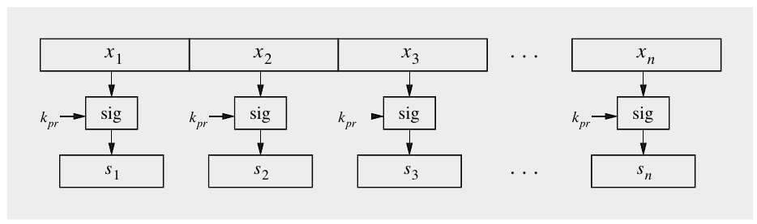

Hình 11.1 Cách tiếp cận không an toàn để ký các thông điệp dài

Tuy nhiên, cách tiếp cận này gây ra ba vấn đề nghiêm trọng:

Vấn đề 1: Tải tính toán cao Digital signature dựa trên các phép toán asymmetric nặng về tính toán như lũy thừa modulo các số nguyên lớn. Ngay cả khi một phép toán đơn lẻ tốn ít thời gian (và năng lượng, điều liên quan trong các ứng dụng di động), việc ký các thông điệp lớn, ví dụ, file đính kèm email hay file đa phương tiện, sẽ mất quá lâu trên các máy tính hiện tại. Hơn nữa, không chỉ người ký phải tính chữ ký, mà bên kiểm chứng cũng phải tốn lượng thời gian và năng lượng tương tự để kiểm chứng chữ ký.

Vấn đề 2: Overhead băng thông Rõ ràng, cách tiếp cận ngây thơ (naïve) này làm tăng mạnh overhead liên lạc vì không chỉ thông điệp phải được gửi mà còn nhiều chữ ký, có độ dài gần như bằng nhau. Chẳng hạn, một file 1 MB sẽ cho ra một chữ ký RSA dài 1 MB, nên tổng cộng 2 MB phải được truyền.

Vấn đề 3: Hạn chế bảo mật Đây là vấn đề nghiêm trọng nhất nếu chúng ta cố ký một thông điệp dài bằng cách ký riêng lẻ một chuỗi các block thông điệp. Cách tiếp cận được thể hiện trong Hình 11.1 dẫn ngay tới các tấn công mới: Chẳng hạn, Oscar có thể xóa các thông điệp riêng lẻ và các chữ ký tương ứng, hoặc hắn có thể sắp xếp lại thông điệp và chữ ký, hoặc hắn có thể ghép lại các thông điệp và chữ ký mới từ các mảnh của thông điệp và chữ ký trước đó, v.v. Dù kẻ tấn công không thể thực hiện thao túng bên trong một block riêng lẻ, chúng ta không có bảo vệ cho toàn bộ thông điệp.

Do đó, vì lý do bảo mật cũng như hiệu năng, chúng ta muốn có một chữ ký ngắn cho một thông điệp có độ dài tùy ý. Giải pháp cho vấn đề này là hash function. Nếu có một hash function bằng cách nào đó tính một dấu vân tay của thông điệp x, chúng ta có thể thực hiện phép toán ký như thể hiện trong Hình 11.2.

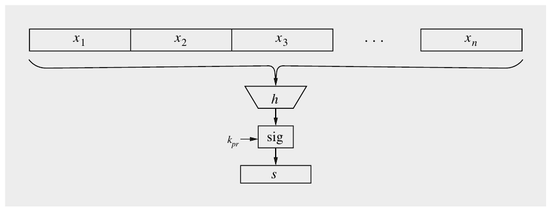

Hình 11.2 Ký các thông điệp dài bằng một hash function

Giả sử chúng ta sở hữu một hash function như vậy, bây giờ chúng tôi mô tả một protocol cơ bản cho một scheme digital signature với hash function. Bob muốn gửi một thông điệp được ký số tới Alice.

> Protocol cơ bản cho Digital Signature với Hash Function:
>
> 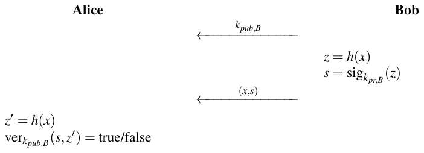

Anh ấy tính hash của thông điệp x và ký giá trị hash z bằng private key k<sub>pr,B</sub> của mình. Ở phía nhận, Alice tính giá trị hash z<sup>′</sup> của thông điệp nhận được x. Cô ấy kiểm chứng chữ ký s bằng public key k<sub>pub,B</sub> của Bob. Chúng tôi lưu ý rằng cả việc tạo chữ ký và việc kiểm chứng đều thao tác trên giá trị hash z thay vì trên bản thân thông điệp. Do đó, giá trị hash đại diện cho thông điệp. Hash đôi khi được gọi là message digest hay dấu vân tay (fingerprint) của thông điệp.

Trước khi thảo luận các tính chất bảo mật của hash function ở mục tiếp theo, chúng ta đã có thể có cảm nhận sơ bộ về một hành vi input–output đáng mong muốn của hash function: Chúng ta muốn có thể áp dụng một hash function cho các thông điệp x có kích thước bất kỳ và, do đó, chúng ta cần một hàm h hiệu quả về mặt tính toán. Ngay cả khi hash các thông điệp lớn trong khoảng, giả sử, hàng trăm megabyte, nó cũng nên tính tương đối nhanh. Một tính chất đáng mong muốn khác là output của hash function có độ dài cố định và độc lập với độ dài input. Nói theo toán học, chúng ta có thể định nghĩa h bởi một ánh xạ từ một input có số bit tùy ý tới một output có kích thước cố định n bit. Mỗi bit có thể nhận một giá trị {0,1}. Để ký hiệu số bit input tùy ý, chúng ta dùng dấu sao “*” trong định nghĩa sau:

h: {0,1}<sup>∗</sup> → {0,1}<sup>n</sup>

Hầu hết các hash function hiện đại có độ dài output n trong khoảng 256–512 bit.

Cuối cùng, dấu vân tay được tính nên rất nhạy với mọi bit input. Điều đó có nghĩa là ngay cả khi chúng ta thay đổi nhỏ input x, dấu vân tay cũng nên trông rất khác. Hành vi này tương tự hành vi của block cipher. Các tính chất chúng ta vừa mô tả được minh họa trong Hình 11.3.

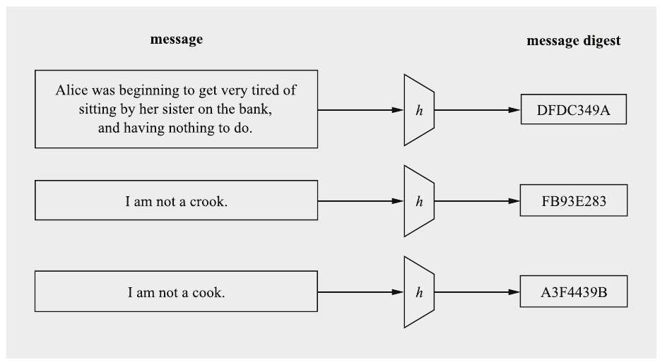

Hình 11.3 Hành vi input–output cơ bản của hash function

## 11.2 Các yêu cầu bảo mật của Hash Function

Như đã nhắc trong phần giới thiệu, khác với mọi thuật toán cryptographic khác mà chúng ta đã làm việc tới giờ, hash function không có key. Câu hỏi bây giờ là liệu có tính chất đặc biệt nào cần thiết để một hash function “an toàn” hay không. Thực ra, chúng ta phải tự hỏi liệu hash function có ảnh hưởng gì tới bảo mật của một ứng dụng hay không vì chúng không mã hóa và chúng không có key. Như thường thấy trong cryptography, mọi thứ có thể phức tạp và có những tấn công khai thác điểm yếu của hash function. Hóa ra có ba tính chất nền tảng mà hash function cần có để an toàn:

1. preimage resistance (hay one-wayness)

2. second preimage resistance (hay weak collision resistance)

3. collision resistance (hay strong collision resistance)

Ba tính chất này được minh họa trong Hình 11.4 và được thảo luận trong các tiểu mục sau.

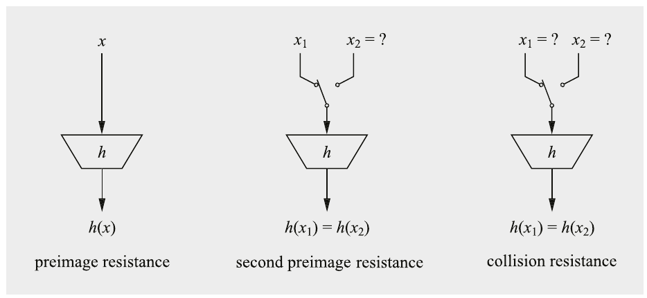

Hình 11.4 Ba tính chất bảo mật nền tảng của hash function

### 11.2.1 Preimage Resistance hay One-Wayness

Hash function cần là one-way: Cho một output hash z, phải bất khả thi về mặt tính toán để tìm một thông điệp input x sao cho z = h(x). Nói cách khác, cho một dấu vân tay, chúng ta không thể suy ra một thông điệp khớp. Với thông điệp khớp, chúng tôi muốn nói bất kỳ thông điệp x nào thỏa z = h(x), không chỉ thông điệp gốc. Bây giờ chúng tôi minh họa vì sao preimage resistance quan trọng qua một protocol hư cấu trong đó Bob mã hóa thông điệp nhưng không mã hóa chữ ký, tức là anh ấy truyền cặp:

(e<sub>k</sub>(x),sig<sub>k<sub>pr,B</sub></sub>(z))

Ở đây, e<sub>k</sub>(x) là một symmetric cipher, ví dụ, AES, với một key symmetric nào đó mà Alice và Bob dùng chung. Giả sử Bob dùng digital signature RSA, trong đó chữ ký được tính là:

s = sig<sub>k<sub>pr,B</sub></sub>(z) ≡ z<sup>d</sup> mod n

Kẻ tấn công Oscar có thể dùng public key e của Bob để tính

s<sup>e</sup> ≡ z mod n

Nếu hash function không phải one-way, Oscar bây giờ có thể tính thông điệp x từ h<sup>−1</sup>(z) = x. Do đó, việc mã hóa symmetric x bị chữ ký vô hiệu hóa, vì chữ ký làm rò rỉ plaintext. Vì lý do này, h(x) cần là một one-way function. Chúng tôi lưu ý rằng one-wayness ngụ ý rằng kẻ tấn công không được có khả năng tìm bất kỳ thông điệp x nào thỏa z = h(x), không chỉ thông điệp gốc.

Trong nhiều ứng dụng khác dùng hash function, chẳng hạn trong key derivation, preimage resistance còn quan trọng hơn nữa.

### 11.2.2 Second Preimage Resistance hay Weak Collision Resistance

Với digital signature trên thông điệp đã hash, phải bất khả thi về mặt tính toán để kẻ tấn công tạo hai thông điệp khác nhau x<sub>1</sub> ≠ x<sub>2</sub> có giá trị hash bằng nhau z<sub>1</sub> = h(x<sub>1</sub>) = h(x<sub>2</sub>) = z<sub>2</sub>. Chúng ta phân biệt hai loại collision như vậy. Trong trường hợp thứ nhất, x<sub>1</sub> được cho và chúng ta cố tìm x<sub>2</sub>. Điều này được gọi là second preimage resistance hay weak collision resistance. Trong trường hợp thứ hai, kẻ tấn công tự do chọn cả x<sub>1</sub> và x<sub>2</sub>. Điều này được gọi là strong collision resistance và được đề cập trong mục tiếp theo.

Dễ thấy vì sao second preimage resistance quan trọng với scheme chữ ký cơ bản có hash mà chúng tôi đã giới thiệu ở trên. Giả sử Bob hash và ký một thông điệp x<sub>1</sub>. Nếu Oscar có khả năng tìm một thông điệp thứ hai x<sub>2</sub> sao cho h(x<sub>1</sub>) = h(x<sub>2</sub>), hắn có thể chạy substitution attack sau:

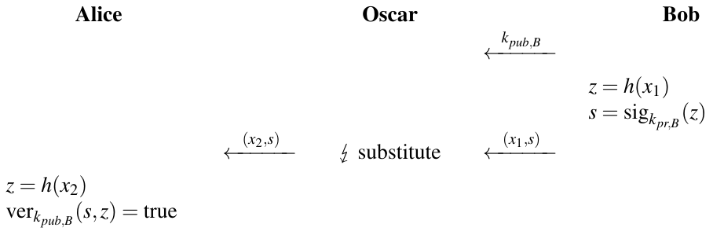

Như chúng ta thấy, Alice sẽ chấp nhận x<sub>2</sub> là thông điệp đúng vì việc kiểm chứng cho cô ấy output “true”. Làm sao điều này có thể xảy ra? Từ góc nhìn trừu tượng hơn, tấn công này khả thi vì cả việc ký (bởi Bob) và kiểm chứng (bởi Alice) đều không diễn ra với bản thân thông điệp thực sự, mà với phiên bản đã hash của nó. Do đó, nếu kẻ tấn công tìm được một thông điệp thứ hai có cùng dấu vân tay (tức là output hash), việc ký và kiểm chứng là như nhau với thông điệp thứ hai này.

Câu hỏi bây giờ là làm thế nào ngăn Oscar tìm x<sub>2</sub>. Lý tưởng nhất, chúng ta muốn có một hash function mà không tồn tại weak collision. Đáng tiếc, điều này là không thể do nguyên lý chuồng bồ câu (pigeonhole principle), mà một thuật ngữ ấn tượng hơn là nguyên lý ngăn kéo Dirichlet. Nguyên lý chuồng bồ câu dùng một lập luận đếm trong những tình huống như sau: Nếu bạn là chủ của 101 con bồ câu nhưng chuồng bồ câu của bạn chỉ có 100 ngăn, ít nhất một ngăn sẽ có 2 con chim trở lên. Vì output của mọi hash function có độ dài bit cố định, giả sử n bit, chỉ có “chỉ” 2<sup>n</sup> giá trị output khả dĩ. Đồng thời, số input của hash function là vô hạn nên nhiều input phải hash ra cùng một giá trị output. Trong thực tế, mỗi giá trị output có khả năng như nhau với một input ngẫu nhiên, nên weak collision tồn tại với mọi giá trị output.

Vì weak collision luôn tồn tại, điều tốt nhất tiếp theo chúng ta có thể làm là bảo đảm rằng chúng không thể được tìm thấy trong thực tế. Một hash function mạnh nên được thiết kế sao cho cho trước x<sub>1</sub> và h(x<sub>1</sub>), không thể xây dựng x<sub>2</sub> sao cho h(x<sub>1</sub>) = h(x<sub>2</sub>). Điều này có nghĩa là không có tấn công phân tích nào. Tuy nhiên, Oscar luôn có thể chọn ngẫu nhiên các giá trị x<sub>2</sub>, tính giá trị hash của chúng và kiểm tra xem chúng có bằng h(x<sub>1</sub>) không. Điều này tương tự brute-force attack trên một symmetric cipher. Để ngăn tấn công này với máy tính ngày nay, độ dài output n = 128 bit là đủ. Tuy nhiên, chúng ta sẽ thấy ở mục tiếp theo rằng tồn tại các tấn công mạnh hơn, buộc chúng ta phải dùng độ dài bit output còn dài hơn.

### 11.2.3 Collision Resistance và Birthday Attack

Chúng ta gọi một hash function là collision resistant hay strong collision resistant nếu bất khả thi về mặt tính toán để tìm hai input khác nhau x<sub>1</sub> ≠ x<sub>2</sub> với h(x<sub>1</sub>) = h(x<sub>2</sub>). Tính chất này khó đạt hơn weak collision resistance vì kẻ tấn công có hai bậc tự do: Cả hai thông điệp đều có thể được chọn để đạt cùng giá trị hash. Bây giờ chúng tôi chỉ ra cách Oscar có thể biến khả năng tìm collision của mình thành một tấn công. Hắn bắt đầu với hai thông điệp, chẳng hạn:

x<sub>1</sub> = Chuyển $10 vào tài khoản của Oscar

x<sub>2</sub> = Chuyển $10,000 vào tài khoản của Oscar

Bây giờ hắn thay đổi x<sub>1</sub> và x<sub>2</sub> ở các vị trí “không nhìn thấy”, ví dụ, hắn thay khoảng trắng bằng tab, thêm khoảng trắng hoặc ký tự xuống dòng ở cuối thông điệp, v.v. Bằng cách này, ngữ nghĩa của thông điệp không đổi (ví dụ, đối với ngân hàng), nhưng giá trị hash thay đổi với mỗi phiên bản của thông điệp. Oscar tiếp tục cho tới khi điều kiện h(x<sub>1</sub>) = h(x<sub>2</sub>) được thỏa. Tấn công này được biết tới là birthday attack của Yuval và được Gideon Yuval đề xuất lần đầu năm 1979.

Lưu ý rằng nếu kẻ tấn công có, ví dụ, 64 vị trí trong thông điệp mà hắn có thể thay đổi hoặc không, điều này cho ra 2<sup>64</sup> phiên bản của cùng thông điệp với 2<sup>64</sup> giá trị hash khác nhau. Với hai thông điệp, hắn có thể khởi động tấn công sau:

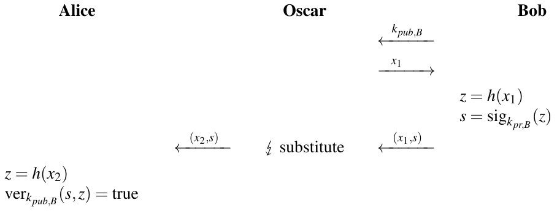

Tấn công này giả định Oscar có thể lừa Bob ký thông điệp x<sub>1</sub>. Tất nhiên, điều này không khả thi trong mọi tình huống. Nhưng người ta có thể hình dung các kịch bản mà Oscar có thể đóng vai một bên vô tội, ví dụ, một cửa hàng trên internet, và x<sub>1</sub> là đơn đặt hàng do Oscar tạo.

Như chúng ta đã thấy trước đó, do nguyên lý chuồng bồ câu, collision luôn tồn tại. Câu hỏi là tìm chúng khó đến mức nào. Phỏng đoán đầu tiên của chúng ta có lẽ là điều này khó ngang việc tìm second preimage, tức là nếu hash function có độ dài output 80 bit, chúng ta phải kiểm tra khoảng 2<sup>80</sup> thông điệp. Tuy nhiên, hóa ra kẻ tấn công chỉ cần khoảng 2<sup>40</sup> thông điệp! Đây là một kết quả khá bất ngờ do birthday attack. Tấn công này dựa trên birthday paradox, một tính chất mạnh thường được dùng trong cryptanalysis.

Hóa ra câu hỏi real-world sau liên quan chặt chẽ tới việc tìm collision cho hash function: Cần bao nhiêu người ở một bữa tiệc để có cơ hội hợp lý rằng ít nhất hai người có sinh nhật cùng ngày trong năm? Trực giác có thể khiến chúng ta giả định cần khoảng 183 người (tức là khoảng một nửa của 365 ngày trong một năm) để xảy ra collision. Tuy nhiên, hóa ra chúng ta cần ít người hơn nhiều. Cách tiếp cận từng bước để giải bài toán này là trước hết tính xác suất hai người không có cùng sinh nhật, tức là không có collision sinh nhật. Với một người, xác suất không có collision là 1, điều hiển nhiên vì một sinh nhật đơn lẻ không thể trùng với sinh nhật của ai khác. Với người thứ hai, xác suất không có collision là 364 trên 365, vì chỉ có một ngày, sinh nhật của người thứ nhất, để trùng:

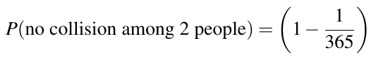

Nếu một người thứ ba tham gia bữa tiệc, người đó có thể trùng với bất kỳ ai trong số những người đã có mặt, do đó:

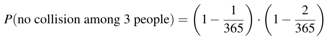

Hệ quả là xác suất để t người không có collision sinh nhật được cho bởi:

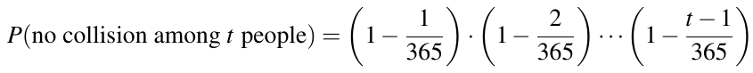

Với t = 366 người, chúng ta sẽ có collision với xác suất 1 vì một năm chỉ có 365 ngày. Bây giờ chúng ta quay lại câu hỏi ban đầu: Cần bao nhiêu người để có 50% cơ hội có hai hay nhiều sinh nhật trùng nhau? Đáng ngạc nhiên — suy ra từ các phương trình trên — chỉ cần 23 người để đạt xác suất khoảng 0.5 cho một collision sinh nhật vì:

P(ít nhất một collision) = 1 − P(không có collision)

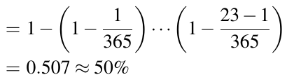

Lưu ý rằng với 40 người, xác suất khoảng 90%. Do kết quả bất ngờ của thí nghiệm tư duy (gedankenexperiment) này, nó thường được gọi là birthday paradox.

Tìm collision cho một hash function h() chính xác là cùng bài toán với tìm collision sinh nhật giữa những người dự tiệc. Với một hash function, không phải 365 giá trị mà mỗi phần tử có thể nhận mà là 2<sup>n</sup>, trong đó n là độ rộng output của h(). Thực ra, hóa ra n là tham số bảo mật then chốt cho hash function. Câu hỏi là Oscar cần hash bao nhiêu thông điệp (x<sub>1</sub>,x<sub>2</sub>,...,x<sub>t</sub>) để có cơ hội hợp lý rằng h(x<sub>i</sub>) = h(x<sub>j</sub>) với một x<sub>i</sub> và x<sub>j</sub> nào đó mà hắn đã chọn. Xác suất không có collision giữa t giá trị hash là:

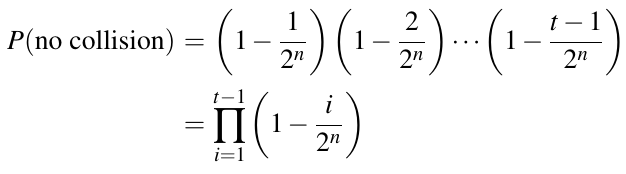

Nhớ lại từ các khóa học giải tích rằng phép xấp xỉ

e<sup>−x</sup> ≈ 1 − x,

đúng[^1] vì i/2<sup>n</sup> << 1. Chúng ta có thể xấp xỉ xác suất là:

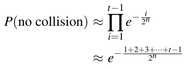

Chuỗi số học

1 + 2 +···+t − 1 = t(t − 1)/2

nằm ở số mũ, cho phép chúng ta viết xấp xỉ xác suất là

P(không có collision) ≈ e<sup>−t(t − 1)/(2 · 2<sup>n</sup>)</sup>

Nhớ rằng mục tiêu của chúng ta là tìm cần bao nhiêu thông điệp (x<sub>1</sub>,x<sub>2</sub>,...,x<sub>t</sub>) để tìm một collision. Do đó, bây giờ chúng ta giải phương trình theo t. Nếu ký hiệu xác suất có ít nhất một collision là λ = 1 − P(không có collision), thì

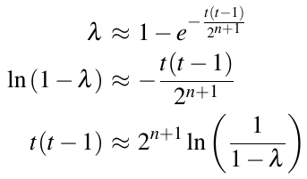

Vì trong thực tế t >> 1, ta có t<sup>2</sup> ≈ t(t − 1) và do đó:

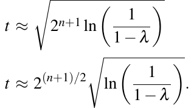 (11.1)

Phương trình (11.1) cực kỳ quan trọng: Nó mô tả số thông điệp đã hash t cần cho một collision như một hàm của độ dài output hash n và xác suất collision λ. Hệ quả quan trọng nhất của birthday attack là số thông điệp chúng ta cần hash để tìm một collision gần bằng căn bậc hai của số giá trị output khả dĩ, tức là khoảng

t ≈ 2<sup>n/2</sup> = √2<sup>n</sup>

Do đó, với một mức bảo mật (xem Mục 6.2.4) m bit, hash function cần có độ dài output 2m bit. Làm ví dụ, giả sử chúng ta muốn tìm một collision cho một hash function giả định có output 80-bit. Với xác suất thành công 50%, chúng ta kỳ vọng hash khoảng:

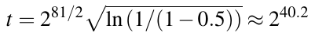

giá trị input. Tính khoảng 2<sup>40</sup> hash và kiểm tra collision có thể dễ dàng được làm ngày nay! Để chặn các collision attack dựa trên birthday paradox, độ dài output của một hash function phải dài khoảng gấp đôi so với một output chỉ bảo vệ trước second preimage attack. Vì lý do này, khuyến nghị rằng hash function nên có độ dài output ít nhất 256 bit. Bảng 11.1 cho thấy số phép tính hash cần cho một collision birthday paradox với các độ dài output có trong các hash function hiện tại và cũ hơn. Thú vị là khả năng collision mong muốn không ảnh hưởng nhiều tới độ phức tạp tấn công, như được chứng minh bởi sự khác biệt nhỏ giữa các xác suất thành công λ = 0.5 và λ = 0.9. Cần nhấn mạnh rằng birthday attack là một tấn công generic. Điều này có nghĩa là

Bảng 11.1 Số phép tính hash cần cho một collision với các độ dài output hash function khác nhau và với hai khả năng collision khác nhau

|  | Độ dài output hash [bit] |
|---|---|
| λ | 128 160 256 384 512 |
| 0.5 | 2<sup>64</sup> 2<sup>81</sup> 2<sup>129</sup> 2<sup>193</sup> 2<sup>257</sup> |
| 0.9 | 2<sup>65</sup> 2<sup>82</sup> 2<sup>130</sup> 2<sup>194</sup> 2<sup>258</sup> |

nó áp dụng được cho bất kỳ hash function nào. Mặt khác, không có gì bảo đảm rằng nó là tấn công mạnh nhất có sẵn cho một hash function cho trước. Như chúng ta sẽ thấy trong Mục 11.3, với một số hash function từng phổ biến, đặc biệt là MD5 và SHA-1, tồn tại các collision attack toán học hiệu quả hơn birthday attack.

Cần nhấn mạnh rằng có những ứng dụng của hash function chỉ cần preimage resistance. Chẳng hạn, khi lưu hash mật khẩu, chỉ cần mật khẩu không thể được khôi phục từ giá trị hash của nó. Do đó, một hash function với output tương đối ngắn, giả sử 128 bit, có thể đủ vì collision attack không gây đe dọa.

Ở cuối mục này, chúng tôi tóm tắt các tính chất quan trọng của hash function h(x). Lưu ý rằng Tính chất 1 − 3 là các yêu cầu thực tế, trong khi Tính chất 4 − 6 liên quan tới bảo mật của hash function.

> Các tính chất của Hash Function
>
> 1. Kích thước thông điệp tùy ý h(x) có thể được áp dụng cho thông điệp x có kích thước bất kỳ.
>
> 2. Độ dài output cố định h(x) tạo ra một giá trị hash z có độ dài cố định.
>
> 3. Hiệu quả h(x) tương đối dễ tính.
>
> 4. Preimage resistance Với một output z cho trước, bất khả thi về mặt tính toán để tìm bất kỳ input x nào sao cho h(x) = z, tức là h(x) là one-way.
>
> 5. Second preimage resistance Cho x<sub>1</sub>, và do đó h(x<sub>1</sub>), bất khả thi về mặt tính toán để tìm bất kỳ x<sub>2</sub> ≠ x<sub>1</sub> nào sao cho h(x<sub>1</sub>) = h(x<sub>2</sub>).
>
> 6. Collision resistance Bất khả thi về mặt tính toán để tìm bất kỳ cặp x<sub>1</sub> ≠ x<sub>2</sub> nào sao cho h(x<sub>1</sub>) = h(x<sub>2</sub>).

## 11.3 Tổng quan về các thuật toán Hash

Tới giờ chúng ta chỉ thảo luận các yêu cầu cho hash function. Bây giờ chúng ta sẽ chuyển sự chú ý sang các cách thực sự xây dựng chúng. Có hai loại hash function tổng quát:

1. Hash function chuyên dụng (dedicated) Đây là các thuật toán được thiết kế đặc biệt để làm hash function. Chúng là loại phổ biến nhất trong thực tế.

2. Hash function Block cipher-based Cũng có thể dùng block cipher như AES để xây dựng hash function.

Như chúng ta đã thấy ở mục trước, hash function có thể xử lý một thông điệp arbitrary-length và tạo ra một output fixed-length. Trong thực tế, điều này đạt được bằng cách chia input thành một chuỗi các block có kích thước bằng nhau. Các block này được hash function xử lý tuần tự, với một compression function ở cốt lõi. Một cách xử lý thông điệp theo kiểu lặp như vậy được biết tới là Merkle–Damgård construction, được thể hiện trong Hình 11.5. Giá trị hash cuối cùng của thông điệp input là output của lần lặp cuối của compression function.

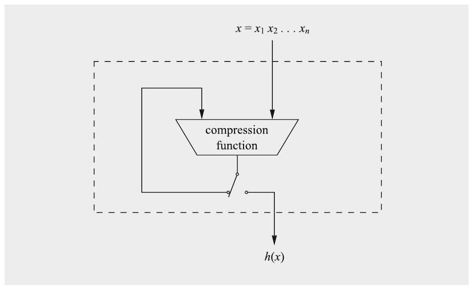

Hình 11.5 Cấu trúc hash function Merkle–Damgård

Các hash function phổ biến SHA-1 và SHA-2 thực sự dựa trên Merkle–Damgård construction, trong khi SHA-3 mới hơn dựa vào một nguyên lý thiết kế khác, cụ thể là sponge construction. Sponge construction gồm hai giai đoạn, giai đoạn hấp thụ (absorbing, hay input) và giai đoạn vắt (squeezing, hay output). Khác với thiết kế Merkle–Damgård, sponge construction linh hoạt hơn và cũng có thể được dùng để xây dựng các hàm khác ngoài hash function, ví dụ, extendable output function (XOF). Thêm về sponge construction sẽ được nói trong Mục 11.5.1.

### 11.3.1 Hash Function từ Block Cipher

Như đã nhắc ở trên, hash function cũng có thể được xây dựng bằng các kỹ thuật chaining block cipher. Trước hết, chúng ta chia thông điệp x thành các block x<sub>i</sub> có kích thước cố định. Hình 11.6 cho thấy cách xây dựng một hash function như vậy: Các mẩu thông điệp x<sub>i</sub> được mã hóa bằng một block cipher e có kích thước block b. Làm input key m-bit cho cipher, chúng ta dùng output trước đó H<sub>i−1</sub>, được xử lý qua một hàm g thực hiện ánh xạ b-to-m-bit. Trong trường hợp b = m — ví dụ, nếu AES với key 128-bit được dùng — hàm g có thể là ánh xạ đồng nhất. Sau khi mã hóa block thông điệp x<sub>i</sub>, chúng ta XOR kết quả với block thông điệp gốc. Giá trị output cuối cùng được tính là hash của toàn bộ thông điệp x<sub>1</sub>,x<sub>2</sub>,...,x<sub>n</sub>, tức là H<sub>n</sub> = h(x).

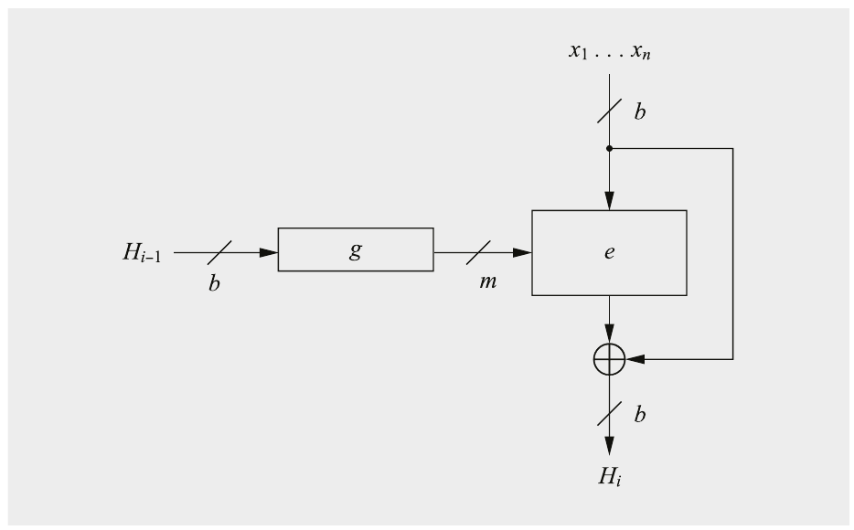

Hình 11.6 Cấu trúc hash function Matyas–Meyer–Oseas từ block cipher

Hàm có thể được biểu diễn là:

H<sub>i</sub> = e<sub>g(H<sub>i−1</sub>)</sub>(x<sub>i</sub>) ⊕ x<sub>i</sub>

Cấu trúc này, được đặt tên theo các nhà phát minh, được gọi là hash function Matyas–Meyer–Oseas.

Tồn tại vài biến thể của hash function block cipher-based. Hai biến thể phổ biến được thể hiện trong Hình 11.7.

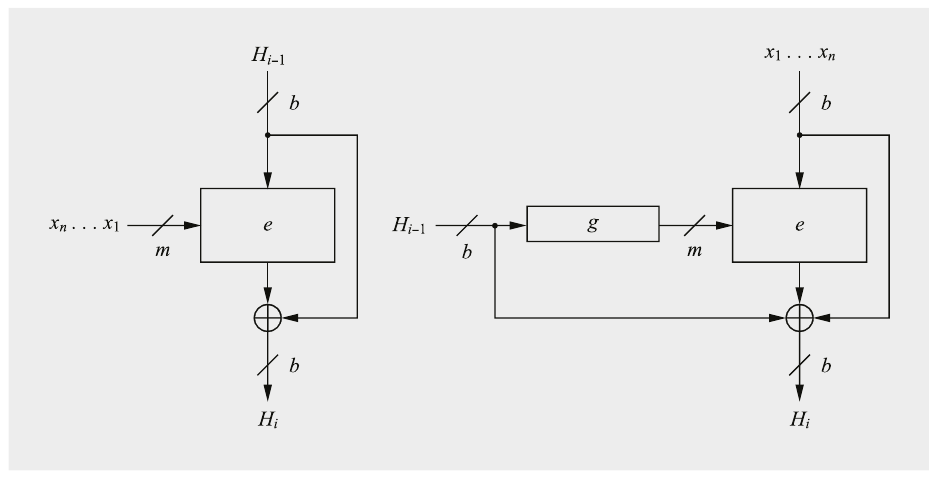

Hình 11.7 Các cấu trúc hash function Davies–Meyer (trái) và Miyaguchi–Preneel (phải) từ block cipher

Hai hash function có thể được biểu diễn là:

H<sub>i</sub> = H<sub>i−1</sub> ⊕ e<sub>x<sub>i</sub></sub>(H<sub>i−1</sub>) (Davies–Meyer)

H<sub>i</sub> = H<sub>i−1</sub> ⊕ x<sub>i</sub> ⊕ e<sub>g(H<sub>i−1</sub>)</sub>(x<sub>i</sub>) (Miyaguchi–Preneel)

Cả ba hash function cần được gán giá trị khởi tạo cho H<sub>0</sub>. Chúng có thể là các giá trị công khai, ví dụ, vector all-zero. Mọi scheme đều có điểm chung là kích thước bit của output hash bằng độ rộng block của cipher được dùng. Trong các tình huống chỉ cần preimage và second preimage resistance (nhưng không cần collision resistance), các block cipher như AES với độ rộng block 128-bit có thể được dùng, vì chúng cung cấp mức bảo mật 128 bit trước các tấn công đó. Với các ứng dụng cần collision resistance, độ dài 128-bit do hầu hết block cipher hiện đại cung cấp là không đủ. Birthday attack giảm mức bảo mật xuống chỉ 64 bit, nằm trong tầm với của các cụm cloud và chắc chắn làm được bởi các đối thủ nation-state.

Một giải pháp cho vấn đề này là dùng Rijndael, block cipher sau này trở thành AES (xem Mục 4.1), với độ rộng block 192 hoặc 256 bit. Các độ dài bit này lần lượt cung cấp mức bảo mật 96 và 128 bit trước birthday attack, đủ cho hầu hết các ứng dụng.

Một cách khác để có message digest lớn hơn là dùng các cấu trúc gồm vài instance của một block cipher, và cho ra độ rộng gấp đôi độ dài block b. Hình 11.8 cho thấy Hirose construction cho trường hợp một cipher e được dùng có độ dài key gấp đôi độ dài block. Điều này đặc biệt đúng với AES có key 256-bit. Output message digest là 2b bit (H<sub>n,L</sub>||H<sub>n,R</sub>). Nếu AES được dùng, output này dài 2b = 256 bit, cung cấp mức bảo mật cao trước collision attack. Như có thể thấy từ hình, output trước đó của cipher bên trái H<sub>i−1,L</sub> được đưa ngược làm input cho cả hai block cipher. Phép nối output trước đó của cipher bên phải, H<sub>i−1,R</sub>, với block thông điệp tiếp theo x<sub>i</sub> tạo thành key cho cả hai cipher. Vì lý do bảo mật, một hằng số c phải được XOR vào input của block cipher bên phải. c có thể có bất kỳ giá trị nào khác vector all-zero. Như trong ba cấu trúc khác được mô tả ở trên, giá trị khởi tạo phải được gán cho các giá trị hash đầu tiên, H<sub>0,L</sub> và H<sub>0,R</sub>.

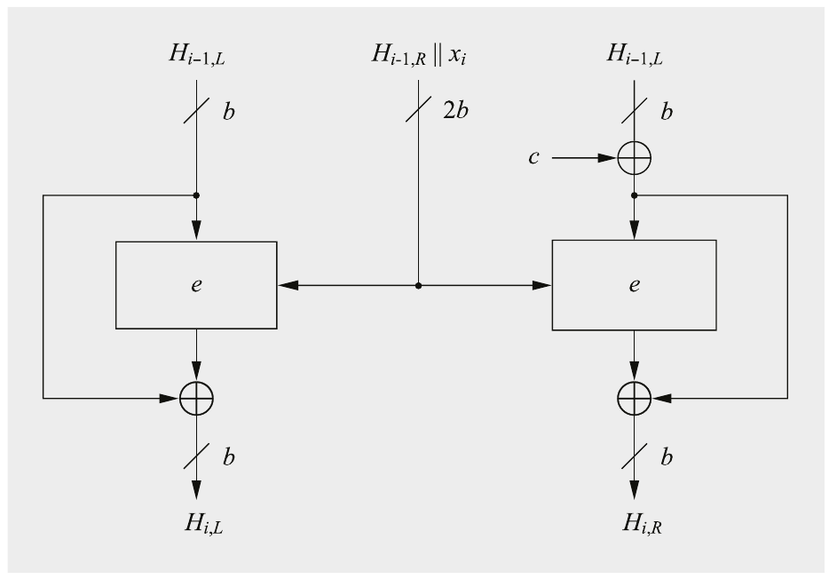

Hình 11.8 Hirose construction cho một hash function có độ rộng gấp đôi độ rộng block

Có nhiều cipher khác thỏa điều kiện này ngoài AES, ví dụ, các block cipher Blowfish, Mars, RC6 và Serpent. Nếu cần một hash function cho các ứng dụng resource-constrained, lightweight block cipher PRESENT (xem Mục 3.7) cho phép một bản triển khai hardware rất gọn. Với kích thước key 128 bit và kích thước block 64 bit, cấu trúc tính ra một output hash 128-bit. Nhớ rằng kích thước message digest này chống được preimage và second preimage attack, nhưng chỉ cung cấp bảo mật không đáng kể trước birthday attack.

### 11.3.2 Các Hash Function chuyên dụng SHA-1, SHA-2 và SHA-3

Một số lượng lớn hash function đã được đề xuất trong ba thập kỷ qua. Trong thực tế, các thuật toán phổ biến nhất cho tới nay là SHA-1, SHA-2 và SHA-3. Trong khi SHA-1 và SHA-2 cũng như MD5 và RIPEMD thuộc về cái được gọi là họ MD4, SHA-3 có thiết kế bên trong hoàn toàn khác. Trong mục này, chúng tôi giới thiệu các thuật toán hash này. Sau đó, chúng tôi sẽ thảo luận chi tiết SHA-2 và SHA-3.

Hash function MD4 được tạo bởi Ronald Rivest (một cái tên chúng ta đã gặp trước đó trong sách; Rivest là chữ “R” trong RSA). Ý tưởng đằng sau MD4 mang tính đổi mới vì nó được thiết kế đặc biệt để cho phép triển khai hiệu quả bằng software. Nó dùng các biến 32-bit và hầu hết các phép toán là các hàm Boolean theo bit như AND, OR, XOR logic và phủ định. Mọi hash function tiếp theo trong họ MD4 đều dựa trên cùng các nguyên lý software-friendly. Một phiên bản tăng cường của MD4, tên là MD5, được Rivest đề xuất năm 1991. Cả hai hash function tính một output 128-bit, tức là chúng có collision resistance khoảng 2<sup>64</sup>. MD5 được dùng rộng rãi, ví dụ, trong các protocol bảo mật internet, để tính checksum của file hoặc tạo hash mật khẩu.

Tuy nhiên, đã có những dấu hiệu sớm về các điểm yếu tiềm ẩn. Do đó, NIST, U.S. National Institute of Standards and Technology, đã công bố một tiêu chuẩn message digest mới, được đặt tên là Secure Hash Algorithm (SHA), năm 1993. Đây là thành viên đầu tiên của họ SHA và chính thức được gọi là SHA, dù ngày nay nó thường được gọi là SHA-0. Nó dựa trên MD5. Năm 1995, SHA-0 được sửa đổi để tạo SHA-1. Khác biệt giữa các thuật toán SHA-0 và SHA-1 nằm ở một schedule cải tiến của compression function. Cả hai thuật toán có độ dài output 160 bit. Năm 1996, một collision attack của Hans Dobbertin nhắm vào hash function MD5 đã khiến ngày càng nhiều chuyên gia khuyến nghị SHA-1 thay thế cho MD5 được dùng rộng rãi.

Năm 2004, các collision attack nhắm vào MD5 và SHA-0 được công bố. Năm 2005, một collision SHA-1 với độ phức tạp 2<sup>63</sup> bước được tìm thấy. Con số này nhỏ hơn đáng kể so với 2<sup>80</sup> bước cần cho birthday attack. Sau đó, tấn công được cải thiện thêm. Lần tìm collision tốt nhất tại thời điểm viết sách có độ phức tạp 2<sup>61.2</sup> phép tính SHA-1. Tóm lại, chúng tôi kết luận rằng SHA-1 nên được coi là không an toàn trong nhiều ứng dụng.

Bảng 11.2 cho tổng quan về các đại diện chính của họ MD4 và tình trạng bảo mật của chúng. Thêm chi tiết về lịch sử tấn công có thể được tìm thấy trong Mục 11.6. Tại điểm này, chúng tôi muốn lưu ý rằng tìm được một collision không nhất thiết có nghĩa là hash function không an toàn trong mọi tình huống. Có những ứng dụng của hash function, ví dụ, key derivation hay lưu mật khẩu, chỉ cần preimage và second preimage resistance. Với các ứng dụng như vậy, các hash function như SHA-1 vẫn có thể đủ.

Ngày nay, khuyến nghị dùng hash function có mức bảo mật ít nhất 128 bit, điều yêu cầu độ dài output 256 bit trở lên. Mức bảo mật này phù hợp nếu chúng được dùng trong các protocol cùng với các thuật toán như AES, có mức bảo mật 128 tới 256 bit. Tương tự, hầu hết các scheme public-key có thể cung cấp mức bảo mật cao hơn: chẳng hạn, elliptic curve có mức bảo mật 128 bit nếu dùng đường cong 256-bit. Do đó, năm 2001 NIST đã giới thiệu ba biến thể cải tiến của SHA-1: SHA-256, SHA-384 và SHA-512, với độ dài message digest lần lượt là 256, 384 và 512 bit. Một biến thể bổ sung, SHA-224, được giới thiệu năm 2004 để phù hợp với mức bảo mật của 3DES. Bốn hash function này thường được gọi là SHA-2, và cả bốn đều được coi là an toàn. Trong Mục 11.4, chúng ta sẽ học về bên trong SHA-2.

Bảng 11.2 Họ hash function MD4

|  | Thuật toán | Output [bit] | Input [bit] | # vòng | Collision đã tìm thấy |
|---|---|---|---|---|---|
|  | MD5 | 128 | 512 | 64 | có |
|  | SHA-1 | 160 | 512 | 80 | có |
| SHA-2 | SHA-224 | 224 | 512 | 64 | không |
|  | SHA-256 | 256 | 512 | 64 | không |
|  | SHA-384 | 384 | 1024 | 80 | không |
|  | SHA-512 | 512 | 1024 | 80 | không |

Dù SHA-2 vẫn được coi là an toàn, NIST đã quyết định bắt đầu một cuộc thi công khai năm 2007 với mục tiêu chuẩn hóa một hash function có thiết kế bên trong khác với thiết kế của họ MD4. Lý do đằng sau quyết định này là chuẩn bị sẵn sàng trong trường hợp kiến trúc MD4 hóa ra dễ bị tổn thương nói chung, qua đó cũng ảnh hưởng tới SHA-2. Hash function mới này cuối cùng được chuẩn hóa thành SHA-3 năm 2015 và sẽ được thảo luận chi tiết hơn trong Mục 11.5.

## 11.4 Secure Hash Algorithm SHA-2

Secure Hash Algorithm 2 (SHA-2) ngày nay là hàm message digest được dùng rộng rãi nhất của họ MD4. SHA-2 gồm sáu thuật toán SHA-224, SHA-256, SHA-384, SHA-512, SHA-512/224 và SHA-512/256. Với bốn thuật toán đầu, số theo sau “SHA–” chỉ độ dài output của digest tính bằng bit. Ngoài ra, có hai biến thể của SHA-512 với độ dài output 224 bit và 256 bit.

Mọi thuật toán SHA-2 đều dựa trên một Merkle–Damgård construction. Để đơn giản, chúng tôi chỉ mô tả SHA-256 như một đại diện của họ thuật toán SHA-2. Chúng tôi lưu ý rằng cấu trúc bên trong của cả sáu thuật toán hash là giống hệt nhau. Hình 11.9 cho thấy Merkle–Damgård construction của SHA-256. Một cách diễn giải thú vị của thuật toán SHA-2 là compression function hoạt động như một block cipher, trong đó input là giá trị hash trước đó H<sub>i−1</sub> và key được tạo bởi block thông điệp x<sub>i</sub>. Như chúng ta sẽ thấy dưới đây, các vòng thực sự của SHA-2 tương tự một Feistel block cipher.

SHA-256 tạo ra một output 256-bit từ một thông điệp có độ dài tối đa 2<sup>64</sup> − 1 bit. Chúng tôi lưu ý rằng SHA-384 và SHA-512 cho phép thông điệp có độ dài tối đa 2<sup>128</sup> − 1 bit. Trước khi tính hash, thuật toán tiền xử lý thông điệp. Trong quá trình tính toán thực sự, compression function của SHA-256 xử lý thông điệp theo các mẩu 512-bit. Với SHA-256, compression function gồm 64 vòng.

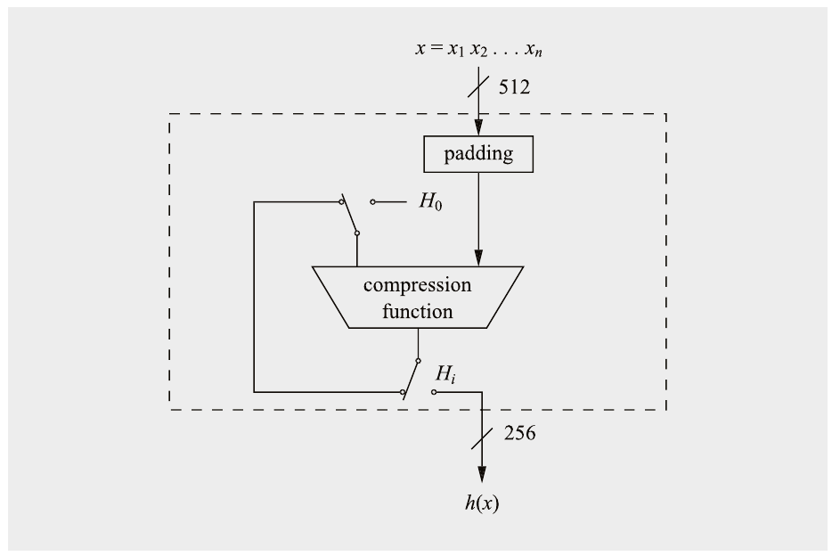

Hình 11.9 Sơ đồ High-level của SHA-256

### 11.4.1 Tiền xử lý SHA-256

Trước hết, chúng tôi mô tả giai đoạn tiền xử lý của SHA-2. Trước khi tính hash thực sự, thông điệp x phải được padding tới một bội số của 512 bit. Để xử lý bên trong, thông điệp đã padding sau đó phải được chia thành các block.

Padding Giả sử chúng ta có một thông điệp x có độ dài l bit. Để có tổng kích thước thông điệp là bội số của 512 bit, chúng ta nối thêm một “1” duy nhất theo sau là k bit không và biểu diễn nhị phân 64-bit của l. Hệ quả là số bit không cần thiết k được cho bởi

k ≡ 512 − 64 − 1 − l

= 448 − (l + 1) mod 512

Hình 11.10 minh họa việc padding một thông điệp x.

Ví dụ 11.1. Cho thông điệp “abc”, gồm ba ký tự ASCII 8-bit với tổng độ dài l = 24 bit:

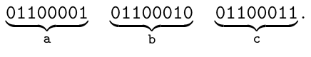

Chúng ta nối thêm một “1” theo sau là k = 423 bit không, trong đó k được xác định bởi

k ≡ 448 − (l + 1) = 448 − 25 = 423 mod 512

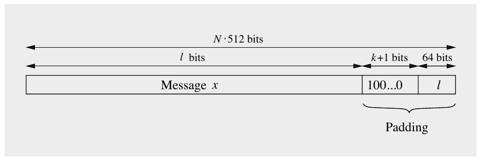

Hình 11.10 Padding một thông điệp trong SHA-256

Cuối cùng, chúng ta nối thêm giá trị 64-bit chứa biểu diễn nhị phân của độ dài l = 24<sub>10</sub> = 11000<sub>2</sub>. Thông điệp đã padding khi đó được cho là

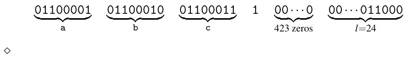

Chia thông điệp đã padding Trước khi áp dụng compression function, chúng ta cần chia thông điệp thành các block 512-bit x<sub>1</sub>,x<sub>2</sub>,...,x<sub>n</sub>. Mỗi block 512-bit có thể được chia nhỏ thành 16 word 32 bit. Chẳng hạn, block thứ i-th của thông điệp x được chia thành:

x<sub>i</sub> = (x<sub>i</sub><sup>(0)</sup> x<sub>i</sub><sup>(1)</sup>···x<sub>i</sub><sup>(15)</sup>)

trong đó x<sub>i</sub><sup>(k)</sup> là các word 32-bit.

### 11.4.2 Compression Function của SHA-256

Hình 11.11 cho cái nhìn kỹ hơn về compression function của SHA-256. Như có thể thấy từ hình, compression function có ba input: output của lần lặp trước H<sub>i−1</sub>, message schedule, gồm 64 word W<sub>0</sub>,W<sub>1</sub>,...,W<sub>63</sub>, và các hằng số K<sub>0</sub>,...,K<sub>63</sub>. Ký hiệu ⊞ trong hình ký hiệu phép cộng hai word 32-bit modulo 2<sup>32</sup>.

Với mỗi block thông điệp x<sub>i</sub>, gồm 16 word (hay 512 bit), lần lặp bên trong compression function được thực thi 64 lần. Trong mỗi lần lặp trong 64 lần, một word W<sub>i</sub> của message schedule và một hằng số K<sub>i</sub> được cung cấp làm input. Các giá trị của message schedule được suy ra như sau:

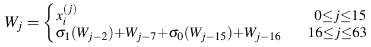

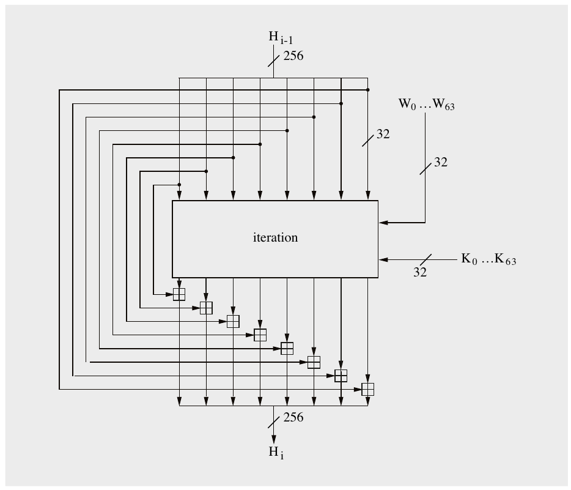

Hình 11.11 Compression function của SHA-2 với 256 bit output

Message schedule dùng hai hàm:

σ<sub>0</sub>(x) = ROTR<sup>7</sup>(x) ⊕ ROTR<sup>18</sup>(x) ⊕ SHR<sup>3</sup>(x)

σ<sub>1</sub>(x) = ROTR<sup>17</sup>(x) ⊕ ROTR<sup>19</sup>(x) ⊕ SHR<sup>10</sup>(x)

ROTR<sup>n</sup>(x) là một phép bit-shift vòng (tức là phép xoay) của x n vị trí sang phải. SHR<sup>n</sup>(x) là một phép dịch phải không xoay, tức là SHR<sup>n</sup>(x) = x n.

Chúng tôi lưu ý rằng 16 word đầu tiên W<sub>0</sub>,...,W<sub>15</sub> là 512 bit của thông điệp thực sự đang được hash, trong khi 48 word tiếp theo được tính đệ quy. 64 hằng số K = (K<sub>0</sub>,K<sub>1</sub>,...,K<sub>63</sub>) là các word 32-bit. Biểu diễn hệ thập lục phân của các hằng số như sau:

```
428A2F98 71374491 B5C0FBCF E9B5DBA5 3956C25B 59F111F1 923F82A4 AB1C5ED5
D807AA98 12835B01 243185BE 550C7DC3 72BE5D74 80DEB1FE 9BDC06A7 C19BF174
E49B69C1 EFBE4786 0FC19DC6 240CA1CC 2DE92C6F 4A7484AA 5CB0A9DC 76F988DA
983E5152 A831C66D B00327C8 BF597FC7 C6E00BF3 D5A79147 06CA6351 14292967
27B70A85 2E1B2138 4D2C6DFC 53380D13 650A7354 766A0ABB 81C2C92E 92722C85
A2BFE8A1 A81A664B C24B8B70 C76C51A3 D192E819 D6990624 F40E3585 106AA070
19A4C116 1E376C08 2748774C 34B0BCB5 391C0CB3 4ED8AA4A 5B9CCA4F 682E6FF3
748F82EE 78A5636F 84C87814 8CC70208 90BEFFFA A4506CEB BEF9A3F7 C67178F2
```

Các word này biểu diễn 32 bit đầu tiên của phần lẻ của căn bậc ba của sixty-four (sáu mươi tư) số nguyên tố đầu tiên[^2].

Input và output 256-bit của compression function được chia thành tám word H<sub>i</sub><sup>(0)</sup>,...,H<sub>i</sub><sup>(7)</sup>. Input khởi tạo H<sub>i</sub> cho lần lặp đầu tiên là tám word 32-bit sau, được cho ở dạng hệ thập lục phân:

A = H<sub>0</sub><sup>(0)</sup> = 6A09E667 E = H<sub>0</sub><sup>(4)</sup> = 510E527F

B = H<sub>0</sub><sup>(1)</sup> = BB67AE85 F = H<sub>0</sub><sup>(5)</sup> = 9B05688C

C = H<sub>0</sub><sup>(2)</sup> = 3C6EF372 G = H<sub>0</sub><sup>(6)</sup> = 1F83D9AB

D = H<sub>0</sub><sup>(3)</sup> = A54FF53A H = H<sub>0</sub><sup>(7)</sup> = 5BE0CD19

Các giá trị này được tính bằng cách lấy 32 bit đầu tiên của phần lẻ của căn bậc hai của tám số nguyên tố đầu tiên[^3].

Bản thân hàm lặp được thể hiện trong Hình 11.12. Tám word input và output được ký hiệu bởi các thanh ghi A,...,H. Một lần nữa, hàm được thực thi 64 lần cho mỗi block input.

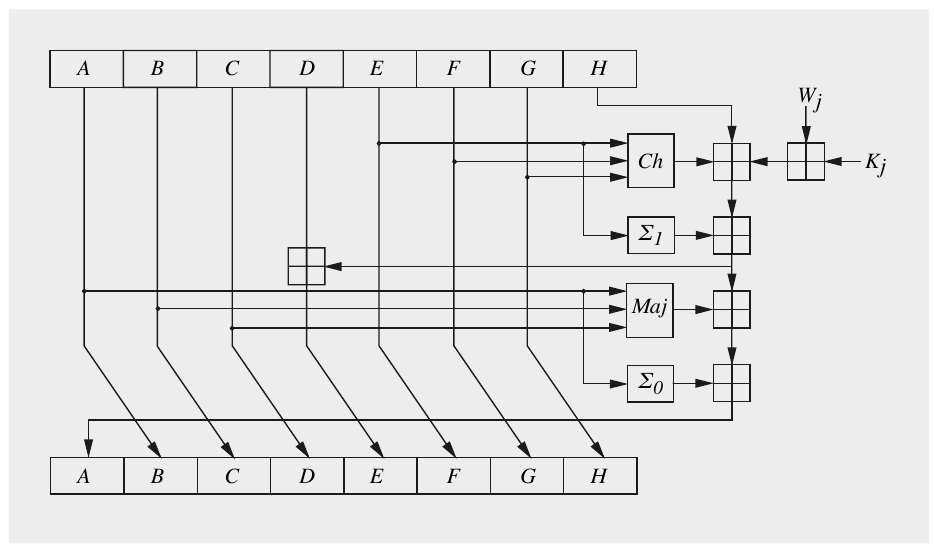

Hình 11.12 Lần lặp j trong compression function của SHA-256

Trong hình, chúng ta có thể thấy các phép toán bên trong một lần lặp đơn lẻ j, trong đó j = 0,...63, được cho bởi:

T<sub>1</sub> = H + Σ<sub>1</sub>(E) + Ch(E,F,G) + K<sub>j</sub> + W<sub>j</sub> T<sub>2</sub> = Σ<sub>0</sub>(A) + Maj(A,B,C)

H = G G = F

F = E E = D + T<sub>1</sub>

D = C C = B

B = A A = T<sub>1</sub> + T<sub>2</sub>

Mọi phép cộng được thực hiện modulo 2<sup>32</sup>. Trong lần lặp, sáu hàm logic được áp dụng, được mô tả dưới đây. Tất cả đều thao tác trên các word 32-bit, ký hiệu là x, y và z. Kết quả của mỗi hàm là một word 32-bit mới.

Ch(x,y,z) = (x∧y) ⊕ (¬x∧ z)

Maj(x,y,z) = (x∧y) ⊕ (x∧z) ⊕ (y∧z)

Σ<sub>0</sub>(x) = ROTR<sup>2</sup>(x) ⊕ ROTR<sup>13</sup>(x) ⊕ ROTR<sup>22</sup>(x)

Σ<sub>1</sub>(x) = ROTR<sup>6</sup>(x) ⊕ ROTR<sup>11</sup>(x) ⊕ ROTR<sup>25</sup>(x)

∧ ký hiệu AND logic và ¬x ký hiệu phần bù theo bit của x. ROTR<sup>n</sup>(x) hoạt động như được định nghĩa cho message schedule ở trên.

Cả Ch và Maj đều thao tác ở mức bit. Tên Ch chỉ “choice” (lựa chọn), vì với mỗi bit trong 32 bit output của nó, Ch chọn bit tương ứng của y hoặc z dựa trên bit tương ứng của x. Chẳng hạn, nếu bit đầu tiên của x là “1”, Ch xuất bit đầu tiên của y, nếu không nó xuất bit đầu tiên của z. Maj là viết tắt của “majority” (đa số), vì mỗi bit output của nó nhận giá trị chiếm đa số trong các bit tương ứng của x, y và z. Nếu bit đầu tiên của hai hoặc nhiều hơn trong x, y và z là “1”, Ch xuất “1” làm bit đầu tiên, nếu không bit output đầu tiên có giá trị “0”.

Sau khi mọi n block của thông điệp x = x<sub>1</sub>,x<sub>2</sub>,...,x<sub>n</sub> đã được xử lý, message digest 256-bit thu được được cho bởi:

SHA-256(x) = H<sub>n</sub><sup>(0)</sup>||H<sub>n</sub><sup>(1)</sup>||H<sub>n</sub><sup>(2)</sup>||H<sub>n</sub><sup>(3)</sup>||H<sub>n</sub><sup>(4)</sup>||H<sub>n</sub><sup>(5)</sup>||H<sub>n</sub><sup>(6)</sup>||H<sub>n</sub><sup>(7)</sup>

### 11.4.3 Triển khai bằng Software và Hardware

SHA-2 được thiết kế đặc biệt phù hợp cho các bản triển khai software. Mỗi vòng chỉ cần các phép toán Boolean theo bit và phép cộng với các thanh ghi 32-bit, vốn rất nhanh trong software. Dù các phép toán hiệu quả này dẫn tới thực thi nhanh một vòng đơn lẻ, SHA-2 có số vòng tương đối lớn. Tuy nhiên, các bản triển khai được tối ưu trên các kiến trúc CPU 64-bit hiện đại có thể đạt throughput khoảng 10 Gbit/s. Chúng tôi lưu ý rằng các lệnh SHA-2 đặc biệt có sẵn trên nhiều loại vi xử lý hiện đại, giúp tăng tốc hash function. Chẳng hạn, Intel SHA extensions có sẵn trên một số vi xử lý x86 của Intel và AMD.

Về hardware, các bản triển khai SHA-2 trên FPGA có thể đạt throughput vài Gbit/s, tức là chúng ở cùng khoảng tốc độ với các bản triển khai software. Lý do cho hiệu năng hardware vừa phải bao gồm các phép toán cơ bản bên trong compression function khó song song hóa. Chúng tôi lưu ý rằng SHA-3, được thảo luận ở mục sau, có cấu trúc hardware-friendly hơn, dẫn tới throughput cao hơn đáng kể trong các bản triển khai hardware.

## 11.5 Secure Hash Algorithm SHA-3

Năm 2007, NIST quyết định phát triển một hash function bổ sung, được đặt tên là SHA-3, qua một cuộc thi công khai. Suy nghĩ chính của NIST là có vẻ thận trọng khi có một lựa chọn thay thế SHA-2 với thiết kế bên trong khác: Trong trường hợp có một đột phá cryptanalytical (khó xảy ra) nhắm vào SHA-2, sẽ có sẵn một hash function thay thế khác đã được chuẩn hóa và kiểm nghiệm. Quá trình tổ chức một cuộc thi công khai cho SHA-3 khá giống quá trình lựa chọn AES vào cuối những năm 1990. Tuy nhiên, khác với AES, vốn rõ ràng nhằm thay thế DES, SHA-2 và SHA-3 nên cùng tồn tại. SHA-3 được ban hành thành tiêu chuẩn năm 2015. Dưới đây là một dòng thời gian sơ bộ của quá trình lựa chọn SHA-3:

■ Ngày 2 tháng Mười Một, 2007: NIST công bố lời kêu gọi thuật toán cho SHA-3.

■ Tháng Mười Hai 2008: NIST chọn 51 thuật toán cho Vòng 1 của cuộc thi SHA-3.

■ Tháng Bảy 2009: Sau nhiều đóng góp từ cộng đồng khoa học, NIST chọn 14 thuật toán Vòng 2.

■ Tháng Mười Hai 2010: NIST công bố năm ứng viên Vòng 3, đó là:

□ BLAKE của Jean-Philippe Aumasson, Luca Henzen, Willi Meier và Raphael C.-W. Phan,

□ Grøstl của Praveen Gauravaram, Lars Knudsen, Krystian Matusiewicz, Florian Mendel, Christian Rechberger, Martin Schläffer và Søren S. Thomsen,

□ JH của Hongjun Wu

□ Keccak của Guido Bertoni, Joan Daemen, Michaël Peeters và Gilles Van Assche,

□ Skein của Bruce Schneier, Stefan Lucks, Niels Ferguson, Doug Whiting, Mihir Bellare, Tadayoshi Kohno, Jon Callas và Jesse Walker.

■ Ngày 2 tháng Mười, 2012: NIST chọn Keccak làm cơ sở cho hash function SHA-3[^4].

■ Ngày 5 tháng Tám, 2015: SHA-3 chính thức được NIST chuẩn hóa thành FIPS 202.

Cần nhấn mạnh rằng “được chuẩn hóa” chỉ nói tới thực tế rằng SHA-3 là một tiêu chuẩn FIPS (Federal Information Processing Standard) so-called ở Mỹ. Hệ quả trực tiếp của nó chỉ là nó được dùng trong các hệ thống của chính phủ Mỹ. Tuy nhiên, với sự tham gia quốc tế trong quá trình chuẩn hóa, SHA-3 và nhiều tiêu chuẩn FIPS khác như AES cũng được dùng rộng rãi ở cấp độ quốc tế.

Một yêu cầu trung tâm của NIST cho hash function SHA-3 là hỗ trợ độ dài output 224, 256, 384 và 512-bit. Nhớ lại birthday paradox từ Mục 11.2.3: Một collision attack được áp dụng cho hash function SHA-3 có độ phức tạp tấn công lần lượt khoảng 2<sup>112</sup>, 2<sup>128</sup>, 2<sup>192</sup> và 2<sup>256</sup>. Ba mức bảo mật sau khớp chính xác với sức mạnh cryptographic mà ba độ dài key của AES cung cấp trước brute-force attack. Tương tự, 3DES có sức mạnh cryptographic 2<sup>112</sup>, và SHA-3 với output 224-bit thể hiện cùng khả năng chống collision attack. Không phải ngẫu nhiên mà SHA-2 cũng hỗ trợ bốn độ dài output 224, 256, 384 và 512 bit. Điều này cho phép SHA-3 được dùng thay thế SHA-2 và ngược lại.

Hơi bất ngờ là SHA-3 cũng có thể được dùng như một extendable-output function (XOF). Đây là các hàm có thể tạo ra output có độ dài bất kỳ mong muốn từ một thông điệp input cho trước. Hai hàm như vậy được hỗ trợ, ký hiệu là SHAKE128 và SHAKE256. Chúng lần lượt cung cấp mức bảo mật 128 và 256 bit. Chúng tôi lưu ý rằng cả SHA-1 lẫn SHA-2 đều không hỗ trợ chức năng XOF. SHA-3 và SHAKE[^5] sẽ được giới thiệu trong các tiểu mục sau.

### 11.5.1 Cái nhìn High-Level về SHA-3

SHA-3 và các biến thể SHAKE128 và SHAKE256 của nó dựa trên một thuật toán tên là Keccak. Sự tương tác giữa Keccak và SHA-3/SHAKE được minh họa trong Hình 11.13. Như mọi hash function, SHA-3 tính một message digest có độ dài cố định cho một thông điệp input m cho trước. Ngược lại, các extendable output function SHAKE128 và SHAKE256 tính output là một chuỗi bit có độ dài tùy ý. Như chúng ta sẽ thấy, Keccak có các tham số cho phép cấu hình nó để có thể dùng cho cả SHA-3 và SHAKE.

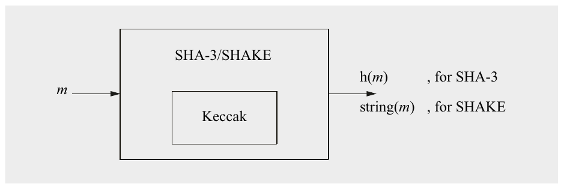

Hình 11.13 Cái nhìn High-level về SHA-3 và biến thể SHAKE của nó

Từ Hình 11.13 rõ ràng rằng để hiểu SHA-3 và SHAKE, người ta phải hiểu Keccak hoạt động như thế nào. Keccak dựa trên một thiết kế đổi mới, gọi là sponge construction. Sau tiền xử lý (chia thông điệp thành các block và cung cấp padding), một sponge construction gồm hai giai đoạn:

1. Giai đoạn hấp thụ (Absorbing, hay input) Phase, xử lý các block thông điệp x<sub>i</sub>.

2. Giai đoạn vắt (Squeezing, hay output) Phase, tính một output có độ dài cấu hình được.

Hình 11.14 cho cái nhìn high-level về Keccak. Ban đầu, có một bước tiền xử lý input m thêm một suffix và một padding vào m. Tiếp theo, ở giai đoạn hấp thụ, các block input x<sub>i</sub> được đọc vào và xử lý. Ở giai đoạn vắt tiếp theo, các block output y<sub>j</sub> được tạo. Bản thân Keccak cho phép tùy ý nhiều block output y<sub>j</sub>. Với SHA-3, chỉ y<sub>0</sub> được tính và các bit đầu của nó tạo thành giá trị hash h(m), xem Mục 11.5.2. Với SHAKE128 và SHAKE256, tính bao nhiêu block output y<sub>0</sub>,y<sub>1</sub>,... tùy ứng dụng cần. Việc không chỉ input mà cả độ dài output đều do người dùng định nghĩa khiến Keccak là một hàm linh hoạt có thể được dùng để hiện thực một số primitive cryptographic, bao gồm hash function và bộ sinh số giả ngẫu nhiên.

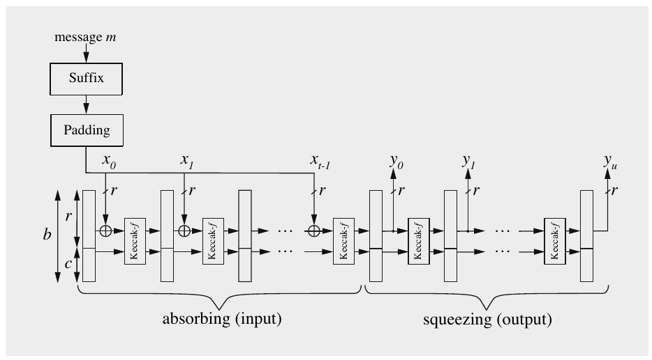

Hình 11.14 Sponge construction Keccak mà SHA-3 và SHAKE128/256 dựa trên

Như có thể đoán khi nhìn vào Hình 11.14, “trái tim” của SHA-3 và SHAKE128/256 là hàm Keccak-f. Trước khi thảo luận hàm này dưới đây, chúng tôi sẽ giới thiệu các tham số b, r và c mà với chúng Keccak có thể được cấu hình:

■ b là độ rộng của state, trong đó b = r + c. Dù hàm Keccak-f cho phép nhiều giá trị khác nhau cho b, trong trường hợp SHA-3 và SHAKE128/256, state được cố định ở b = 1600 bit. (Các lựa chọn khác cho b được thảo luận trong Mục 11.5.4.)

■ r được gọi là bit rate. r bằng độ dài của một block thông điệp x<sub>i</sub> hoặc một block output y<sub>j</sub>.

■ c được gọi là capacity. Capacity xác định mức bảo mật.

Một lần nữa, với SHA-3 và SHAKE128/256, state được cố định ở b = 1600. Các tổ hợp r và c khác nhau dẫn tới các mức bảo mật khác nhau, được thể hiện trong Bảng 11.3. Mức bảo mật chỉ số phép tính mà kẻ tấn công phải thực hiện để tìm một collision, ví dụ, mức bảo mật 128 bit ngụ ý rằng đối thủ phải thực hiện 2<sup>128</sup> phép tính (xem Mục 11.2.3).

Bảng 11.3 Các tham số của SHA-3 và SHAKE128/256

|  | loại | b | r | c | mức | output |
|---|---|---|---|---|---|---|
|  | hàm | (state) | (rate) | (capacity) | bảo mật | hash |
|  |  | [bit] | [bit] | [bit] | [bit] | [bit] |
| SHA3-224 | hash | 1600 | 1152 | 448 | 112 | 224 |
| SHA3-256 | hash | 1600 | 1088 | 512 | 128 | 256 |
| SHA3-384 | hash | 1600 | 832 | 768 | 192 | 384 |
| SHA3-512 | hash | 1600 | 576 | 1024 | 256 | 512 |
| SHAKE128 | XOF | 1600 | 1344 | 256 | 128 | tùy ý |
| SHAKE256 | XOF | 1600 | 1088 | 512 | 256 | tùy ý |

Những gì còn lại cần làm để hiểu đầy đủ SHA-3 và SHAKE128/256 như thể hiện trong Hình 11.14 là (a) giải thích suffix và padding trong Mục 11.5.2, và (b) cho cái nhìn sâu về hàm Keccak-f trong Mục 11.5.3.

### 11.5.2 Suffix, Padding và tạo Output

Trước khi xử lý thực sự một thông điệp m, một suffix và padding được thêm vào thông điệp. Để đầy đủ, chúng tôi lưu ý rằng nói chính xác suffix không phải là một phần của hàm Keccak, nhưng cần cho SHA–3 và SHAKE128/256. Mặt khác, padding là một phần của định nghĩa Keccak.

Suffix nối thêm một số bit nhất định vào thông điệp trước khi padding. Các quy tắc suffix đơn giản và được thể hiện trong Bảng 11.4. Các suffix khác nhau bảo đảm rằng ngay cả khi cùng một thông điệp được dùng để tính một hash SHA-3 và sau đó để tạo một chuỗi giả ngẫu nhiên với SHAKE128/256, các bit được tạo là khác nhau. Điều này được gọi là domain separation.

Sau khi suffix đã được nối vào m, padding bảo đảm rằng thông điệp cộng padding có độ dài là bội số của r bit. Lý do cần padding là rõ ràng khi nhìn vào Hình 11.14: Keccak đọc thông điệp theo các mẩu dài r bit. Padding là một multi-rate padding so-called, được xây dựng như sau:

Bảng 11.4 Các quy tắc suffix cho SHA-3 và SHAKE128/256

|  | suffix |
|---|---|
| SHA3 | suf = 01 |
| SHAKE128/256 | suf = 1111 |

pad(m,suf) = m||suf||1 0<sup>⋆</sup>1

Chuỗi padding thực sự “1 0<sup>⋆</sup>1” gồm một số 1 theo sau là số lượng nhỏ nhất các số 0 và một số 1 kết thúc, sao cho tổng độ dài của chuỗi mới là bội số của r. Lưu ý rằng chuỗi “0<sup>⋆</sup> = 0···0” có thể là chuỗi rỗng, tức là nó có thể không gồm số không nào. Do đó, padding nhỏ nhất khả dĩ là “11”, có độ dài hai. Chuỗi padding dài nhất khả dĩ “10···01” có độ dài r + 1.

Với SHA-3, chỉ cần giá trị output y<sub>0</sub> (xem Hình 11.14). y<sub>0</sub> được tính trong vòng cuối của giai đoạn hấp thụ và có độ dài r bit. Nếu nhìn vào Bảng 11.3, chúng ta thấy rằng r luôn có nhiều bit hơn mức cần cho output của bốn biến thể SHA-3 (lần lượt 224, 256, 384 và 512 bit). Để có output hash mong muốn, các bit đầu của y<sub>0</sub> được dùng và các bit còn lại của y<sub>0</sub> bị loại bỏ. Khi dùng SHAKE128/256, cả r bit của y<sub>0</sub> có thể được dùng. Nếu cần nhiều hơn r bit cho ứng dụng cho trước, chúng ta chỉ cần tiếp tục lặp Keccak-f như thể hiện trong Hình 11.14 và tính các block output tiếp theo y<sub>1</sub>,y<sub>2</sub>,...

### 11.5.3 Hàm Keccak-f (hay Keccak-f Permutation)

Keccak, và do đó SHA-3 và SHAKE128/256, dựa trên hàm Keccak-f, xem Hình 11.14. (Như đã nhắc ở trên, nói chính xác suffix không phải là một phần của Keccak.) Keccak-f cũng được gọi là Keccak-f permutation. Tên sau xuất phát từ thực tế rằng hàm hoán vị 2<sup>b</sup> giá trị input, tức là mỗi số nguyên b-bit được ánh xạ tới đúng một số nguyên output b-bit theo cách song ánh (one-to-one)[^6].

Dù SHA-3 và SHAKE có 1600 bit state (xem Bảng 11.3), Keccak-f cho phép bảy kích thước state khác nhau. Để hiểu Keccak-f, cực kỳ hữu ích khi xem state như một mảng three-dimensional như thể hiện trong Hình 11.15. Như có thể thấy từ hình, mảng state gồm b = 5 × 5 × w bit. Bảy state b khác nhau và số vòng n<sub>r</sub> cho mỗi state suy ra từ:

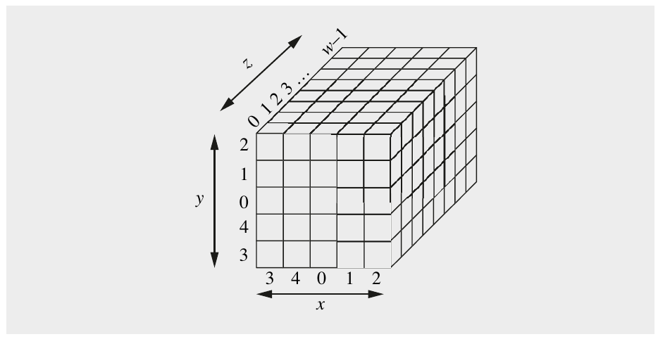

Hình 11.15 State của Keccak trong đó mỗi khối lập phương nhỏ biểu diễn một bit. Với SHA-3 và SHAKE128/256, “chiều sâu” của mảng dọc theo trục z là w = 64

b = 25 · w = 25 · 2<sup>l</sup>, với l = 0,1,...,6

n<sub>r</sub> = 12 + 2 l

Bảy state thu được và số vòng n<sub>r</sub> được thể hiện trong Bảng 11.5.

Bảng 11.5 Các state khác nhau và số vòng của Keccak-f; lưu ý rằng b = 1600 và n<sub>r</sub> = 24 cho SHA-3 và SHAKE128/256

| state b [bit] | 25 | 50 | 100 | 200 | 400 | 800 | 1600 |
|---|---|---|---|---|---|---|---|
| số vòng n<sub>r</sub> | 12 | 14 | 16 | 18 | 20 | 22 | 24 |
| lane w [bit] | 1 | 2 | 4 | 8 | 16 | 32 | 64 |
| l | 0 | 1 | 2 | 3 | 4 | 5 | 6 |

Với một tọa độ (x,y) cho trước, w bit được gọi là một lane, tức là word dọc theo z-axis. Với SHA-3 và SHAKE128/256, lane có w = 64 bit, tức là state gồm b = 1600 = 5 · 5 · 64 bit. Điều này rất phù hợp với các CPU hiện đại, vốn có kiến trúc 64-bit. Nó cho phép toàn bộ state được lưu trong một mảng gồm 25 thanh ghi. Lưu ý các chỉ số “ở giữa” dọc theo trục x và y-axis trong Hình 11.15, đóng vai trò khi chúng ta thảo luận bên trong Keccak-f dưới đây.

Bây giờ chúng ta xem cấu trúc bên trong của Keccak-f, được thể hiện trong Hình 11.16. Mỗi vòng của Keccak-f gồm một chuỗi năm bước được ký hiệu bằng các chữ cái Hy Lạp: θ (theta), ρ (rho), π (pi), χ (chi) và ι (iota). Các vòng giống hệt nhau trừ hằng số vòng RC[i], nhận một giá trị khác ở mỗi vòng i. Hằng số chỉ được dùng trong bước Iota (ι) của hàm vòng và sẽ được mô tả trong Mục 11.5.3.5. Sau đây, chúng tôi giới thiệu hoạt động bên trong của năm bước θ, ρ, π, χ và ι của Keccak-f.

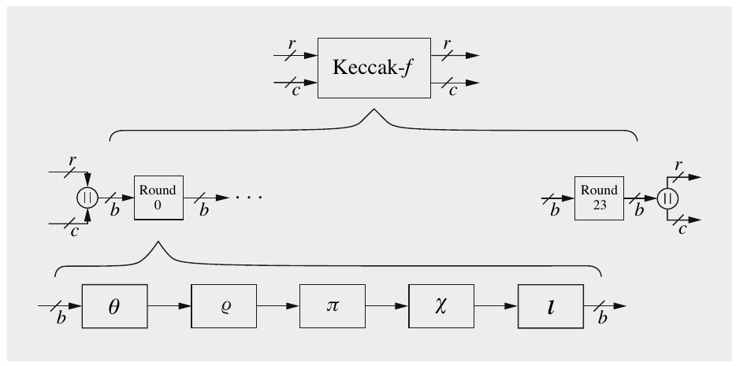

Hình 11.16 Cấu trúc bên trong của hàm Keccak-f

#### 11.5.3.1 Bước Theta (θ)

Hình 11.17 cho thấy bước θ ở mức bit. Nói đại khái, mỗi bit trong state được thay bằng tổng XOR của 10 bit “trong vùng lân cận của nó” và chính bit gốc. Nói chính xác: Người ta cộng vào bit đang được xử lý năm bit tạo thành cột bên trái cộng với cột ở bên phải và lệch một vị trí về “phía trước”. Lưu ý rằng mọi vị trí theo hướng x và y được tính modulo 5, và modulo w theo hướng z.

Để triển khai software hiệu quả, bước θ có thể được mô tả như thao tác trên các lane w bit thay vì trên từng bit. Để làm điều này, chúng ta xem lại Hình 11.15, nơi chúng ta thấy state gồm 25 lane được sắp xếp thành một mảng 5 × 5. Nếu ký hiệu mảng state là A(x,y) với x,y = 0,1,...,4, bước θ có thể được triển khai qua phép toán sau:

C[x] = A[x,0] ⊕ A[x,1] ⊕ A[x,2] ⊕ A[x,3] ⊕ A[x,4], x = 0,1,2,3,4

D[x] = C[x − 1] ⊕ rot(C[x + 1],1), x = 0,1,2,3,4

A<sup>′</sup>[x,y] = A[x,y] ⊕ D[x], x,y = 0,1,2,3,4

C[x] và D[x] là các mảng one-dimensional chứa năm word w bit. “rot(C[],1)” ký hiệu phép xoay toán hạng một bit và ⊕ ký hiệu phép XOR bit-wise của hai toán hạng w-bit. Lưu ý rằng mọi chỉ số được lấy modulo 5, ví dụ, C[−1] chỉ C[4].

Đây là những gì code làm: Ở dòng đầu tiên, mọi cột trong state được cộng lại (qua phép XOR) và lưu trong mảng C[x]. Mỗi cột gồm 5 bit và Hình 11.17 cho thấy hai cột như vậy màu xám. Ở dòng code tiếp theo, hai XOR-sums được cộng theo quy tắc mô tả ở trên, xem hai cột xám trong hình, và lưu trong D[x]. Lưu ý rằng mỗi bit của D[x] bây giờ chứa XOR-sum của 10 bit. Ở dòng code cuối, mỗi 10-bits-XOR-sum được cộng vào bit gốc; một lần nữa xem Hình 11.17. Ưu điểm của code là mức độ song song bit-level cao vì trong mỗi phép toán w bit được xử lý cùng lúc. Nhớ rằng w = 64 trong hầu hết các kịch bản thực tế vì đó là tham số được dùng cho SHA-3.

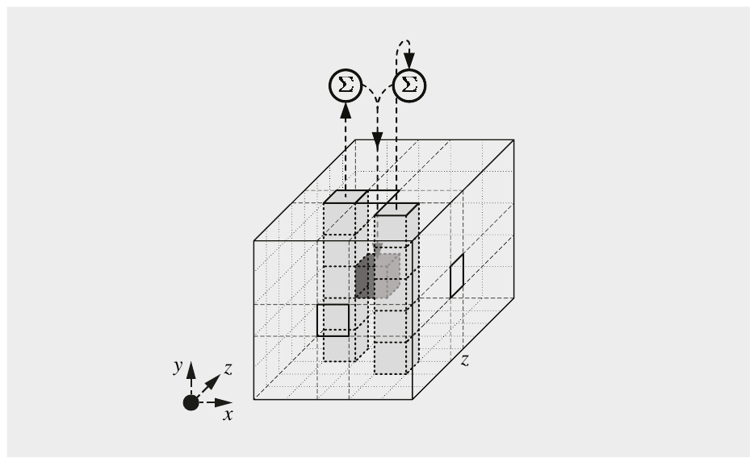

Hình 11.17 Bước θ của Keccak-f (hình từ [115])

#### 11.5.3.2 Bước Rho (ρ)

Một lần nữa, chúng ta xem state được biểu diễn bởi một mảng 5-by-5 A(x,y), trong đó mỗi phần tử mảng là một lane. Bước ρ[^7] xoay mỗi lane này một số vị trí bit nhất định, được gọi là offset. Các offset xoay này phụ thuộc vào tọa độ x và y của lane đang được xoay và được thể hiện trong Bảng 11.6. Mọi vị trí bit được tính modulo w. Để đầy đủ, chúng tôi cũng đưa ra thuật toán mà với nó các offset được tính.

Bảng 11.6 Các offset xoay của bước ρ

|  | x = 3 x = 4 x = 0 x = 1 x = 2 |
|---|---|
| y = 2 | 153 231 3 10 171 |
| y = 1 | 55 276 36 300 6 |
| y = 0 | 28 91 0 1 190 |
| y = 4 | 120 78 210 66 253 |
| y = 3 | 21 136 105 45 15 |

> Thuật toán tính Offset cho bước ρ
>
> Output: bảng offset T[x,y], x,y = 0,1,2,3,4
>
> Khởi tạo: (x,y) = (1,0), T[0,0] = 0
>
> Thuật toán:
>
> 1 FOR t = 0 TO 23
>
> 1.1 T[x,y] = (t + 1)(t + 2)/2
>
> 1.2 (x,y) = (y,2x + 3y mod 5)
>
> 2 RETURN (T[])

Thú vị là các giá trị offset thực sự đều là số tam giác, là số đồ vật được sắp xếp trong một cấu trúc pyramid-like, ví dụ, một kim tự tháp xây từ lon bia. Vài số tam giác đầu tiên là 0,1,3,6,10,...

#### 11.5.3.3 Bước Pi (π)

Bước π hoán vị 25 lane của mảng state A. Nếu ký hiệu mảng mới là A<sup>′</sup>, phép hoán vị được cho bởi quy tắc đơn giản sau:

A<sup>′</sup>[x,y] = A[x + 3y,x], x,y = 0,1,2,3,4

Như luôn luôn trong Keccak, các tọa độ x và y được tính modulo 5. Làm ví dụ, hãy xem mảng state mới ở vị trí A<sup>′</sup>[2,3], tức là lane ở góc right-most phía dưới trong Hình 11.15. Vị trí này sẽ được điền bởi lane A[2 + 3 · 3,2] = A[11,2] = A[1,2] của mảng gốc.

#### 11.5.3.4 Bước Chi (χ)

Bước χ là phép toán phi tuyến duy nhất trong Keccak-f và cũng thao tác trên các lane w bit. Nếu ký hiệu mảng state mới là A<sup>′</sup>, bước được mô tả bởi mã giả sau:

A<sup>′</sup>[x,y] = A[x,y] ⊕ ((Ā[x + 1,y])∧A[x + 2,y]), x,y = 0,1,2,3,4

trong đó Ā[i, j] ký hiệu phần bù theo bit của lane ở vị trí [i, j], và ∧ là phép AND Boolean theo bit của hai toán hạng. Như trong mọi bước khác, các chỉ số được lấy modulo 5. Mô tả phép toán bằng lời, có thể nói rằng bước χ lấy lane ở vị trí [x,y] và XOR nó với AND logic của nghịch đảo của lane ở vị trí [x + 1,y] và lane ở vị trí [x + 2,y]. Hình 11.18 minh họa bước này ở mức bit.

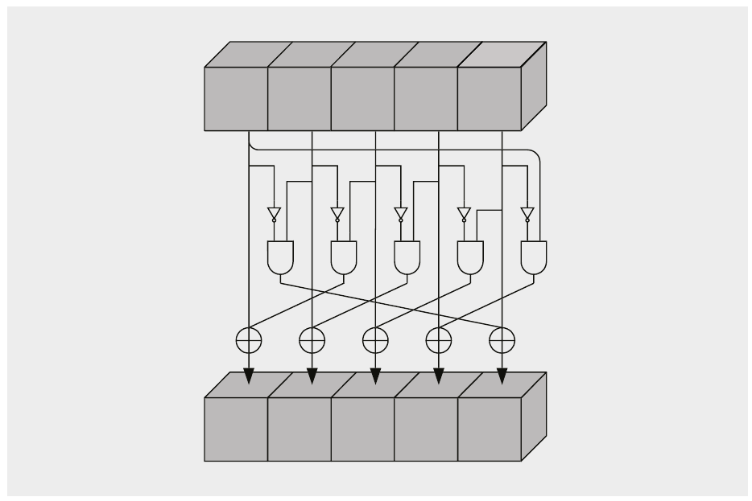

Hình 11.18 Bước χ của Keccak-f. Hàng trên biểu diễn năm lane của mảng A[], trong khi hàng dưới cho thấy năm lane của mảng state mới A<sup>′</sup>[] (hình từ [115]).

#### 11.5.3.5 Bước Iota (ι)

Bước Iota cộng một hằng số w-bit được định nghĩa trước vào lane ở vị trí [0,0] của mảng state A:

A<sup>′</sup>[0,0] = A[0,0] ⊕ RC[i]

Hằng số RC[i] khác nhau tùy theo vòng i nào đang được thực thi. Nhớ lại từ Bảng 11.5 rằng số vòng n<sub>r</sub> thay đổi theo tham số b được chọn cho Keccak. Với SHA-3 và SHAKE128/256, có n<sub>r</sub> = 24 vòng. Các hằng số vòng tương ứng RC[0]...RC[23] được thể hiện trong Bảng 11.7. Mỗi hằng số vòng gồm vector all-zero với các bit giả ngẫu nhiên được thêm ở các vị trí bit (1,2,3,7,15,31,63). Các bit giả ngẫu nhiên được tạo bởi một LFSR degree-8. Chi tiết về việc tạo PRN và cách tạo các hằng số vòng cho các giá trị b và n<sub>r</sub> khác nhau (xem Bảng 11.5) có thể được tìm thấy trong tài liệu NIST FIPS 202.

Bảng 11.7 Các hằng số vòng cho SHA-3 và SHAKE128/256; mỗi hằng số là một word 64-bit được cho ở dạng hệ thập lục phân

RC[0] = 0x0000000000000001 RC[12] = 0x000000008000808B

RC[1] = 0x0000000000008082 RC[13] = 0x800000000000008B

RC[2] = 0x800000000000808A RC[14] = 0x8000000000008089

RC[3] = 0x8000000080008000 RC[15] = 0x8000000000008003

RC[4] = 0x000000000000808B RC[16] = 0x8000000000008002

RC[5] = 0x0000000080000001 RC[17] = 0x8000000000000080

RC[6] = 0x8000000080008081 RC[18] = 0x000000000000800A

RC[7] = 0x8000000000008009 RC[19] = 0x800000008000000A

RC[8] = 0x000000000000008A RC[20] = 0x8000000080008081

RC[9] = 0x0000000000000088 RC[21] = 0x8000000000008080

RC[10] = 0x0000000080008009 RC[22] = 0x0000000080000001

RC[11] = 0x000000008000000A RC[23] = 0x8000000080008008

### 11.5.4 Các hàm cryptographic khác dựa trên Keccak

Như đã nêu trước đó, Keccak là một hàm linh hoạt mà với nó có thể hiện thực các primitive cryptographic khác ngoài SHA-3 và SHAKE. Trong mục này, chúng tôi thảo luận các cấu trúc như vậy. Trước hết chúng tôi giới thiệu các lựa chọn tham số bổ sung cho Keccak-f và sau đó là cSHAKE, một tập các hàm cryptographic.

Keccak-f Một lựa chọn để xây dựng thêm các hàm hash-like là dùng các kích thước state khác có thể có với Keccak-f. Nhớ lại từ Bảng 11.5 rằng có bảy state khả dĩ, cụ thể là b ∈ {25,50,100,200,400,800,1600}. Ngoài 1600 bit được dùng cho SHA-3 và SHAKE128/256, các giá trị 100, 200, 400 và 800 là các lựa chọn nếu người dùng muốn xây dựng các primitive cryptographic khác với sponge construction. Hai tham số nhỏ nhất b = 25 và b = 50 chỉ là các giá trị đồ chơi để phân tích thuật toán và không nên được dùng trong thực tế.

Keccak-p Trong cuộc thi SHA-3 và quá trình chuẩn hóa tiếp theo, hóa ra có thể có những ứng dụng mong muốn số vòng khác với số vòng được quy định trong Bảng 11.5. Đặc biệt, số vòng thấp hơn để có hiệu năng cao hơn có thể hấp dẫn. Do đó, NIST đã chuẩn hóa hàm Keccak-p, giống hệt Keccak-f, vốn bắt buộc 24 vòng, nhưng cho phép tự do khi chọn số vòng. Tuy nhiên, với các scheme cryptographic được chuẩn hóa SHA-3 và SHAKE128/256, Keccak-f với n<sub>r</sub> = 24 phải được dùng, như thể hiện trong Bảng 11.5.

cSHAKE Sau khi chuẩn hóa SHA-3 và SHAKE128/256 năm 2015, NIST đã đặc tả thêm ba hàm cryptographic dựa trên Keccak-f trong năm tiếp theo. Các hàm được đặt tên là KMAC, TupleHash và ParallelHash. Cần nhấn mạnh rằng chúng chỉ là các cách chuẩn hóa để dùng Keccak-f cho các mục đích khác chứ không phải các thuật toán mới. Cả ba hàm được hiện thực trong một instance của Keccak-f gọi là cSHAKE, là từ viết tắt của customizable SHAKE. Với 128 và 256 bit, hai mức bảo mật được định nghĩa. Các tham số Keccak-f tương ứng được thể hiện trong Bảng 11.8.

Bảng 11.8 Các tham số của hai instance cSHAKE

|  | b | r | c | mức |
|---|---|---|---|---|
|  | (state) | (rate) | (capacity) | bảo mật |
|  | [bit] | [bit] | [bit] | [bit] |
| cSHAKE 128 | 1600 | 1344 | 256 | 128 |
| cSHAKE 256 | 1600 | 1088 | 512 | 256 |

Bây giờ chúng tôi sẽ mô tả ngắn gọn ba hàm được chuẩn hóa dựa trên cSHAKE.

■ KMAC là một message authentication code (MAC) hash function-based, còn được gọi là keyed hash function, xem Mục 13.2. Hàm có thể được dùng với hai mức bảo mật, ký hiệu là KMAC128 và KMAC256, dùng hai hàm cSHAKE tương ứng được thể hiện trong Bảng 11.8.

■ TupleHash là một phương pháp hash n chuỗi input một cách rõ ràng không nhập nhằng. Một ví dụ về ứng dụng là tính một checksum hash trên vài public key. Hàm được định nghĩa sao cho việc hash các nhóm chuỗi rất giống nhau sẽ tạo ra các output khác nhau. Chẳng hạn, hash hai chuỗi ab và cd cùng nhau sẽ tạo ra một giá trị hash khác với hash hai chuỗi abc và d hoặc chuỗi đơn abcd.

■ ParallelHash cho phép hash hiệu quả các chuỗi input rất dài bằng cách hỗ trợ tính song song có trong các máy tính hiện đại. Như với KMAC và TupleHash, nó cũng hỗ trợ hai mức bảo mật 128 và 256 bit. ParallelHash hoạt động theo hai giai đoạn. Thứ nhất, input được chia thành các block độ dài B. Mỗi block này được hash riêng lẻ bằng cSHAKE, cho phép các hash riêng lẻ này được tính song song, chẳng hạn trên một CPU multi-core. Ở giai đoạn thứ hai, các output hash được tính từ giai đoạn thứ nhất được kết hợp bằng cách đưa chúng vào cSHAKE lần nữa và tạo một giá trị hash cuối cùng.

### 11.5.5 Triển khai bằng Software và Hardware

Khi tính SHA-3 và SHAKE, phần lớn thời gian được dành cho Keccak-f. Do đó, Keccak-f xác định các đặc tính triển khai của hash function. Dưới đây chúng tôi sẽ thảo luận các bản triển khai software và hardware.

Keccak-f, và do đó cả SHA-3 và SHAKE, hóa ra rất phù hợp cho các bản triển khai hardware. Điều này trái ngược với SHA-1 và SHA-2, vốn thiên về software. Một kiến trúc hardware song song high-speed của SHA-3 có thể dễ dàng đạt throughput 30 Gbit/s trở lên với diện tích khoảng 100,000 gate equivalence. Ở đầu kia của phổ hiệu năng, một engine hardware nối tiếp rất nhỏ với ít hơn 10,000 gate equivalence vẫn có thể đạt throughput vài 10 Mbit/s. Chúng tôi lưu ý rằng SHA-3 cũng dẫn tới các bản triển khai hardware tiết kiệm năng lượng hơn so với các bản triển khai SHA-1 và SHA-2, điều đặc biệt được quan tâm cho các ứng dụng như tiền mã hóa hay các scheme proof-of-work khác, xem Mục 11.6.

Dù thân thiện với hardware, SHA-3 cũng khá phù hợp cho triển khai software. Keccak-f có state 1600 bit, được lưu trong 25 word mỗi word 64 bit, xem Hình 11.15. Phần lớn CPU hiện đại, tức là Intel và AMD cho laptop và server cũng như ARM trong smartphone, dùng kiến trúc 64-bit. Điều này cho phép biểu diễn hiệu quả một lane 64-bit trong một thanh ghi duy nhất. Hơn nữa, nhiều phép toán nguyên tử được dùng trong năm bước của hàm vòng Keccak-f (xem Hình 11.16) như các phép toán Boolean theo bit và phép xoay được hỗ trợ trực tiếp bởi các lệnh CPU low-level, dẫn tới các bản triển khai nhanh. Một bản triển khai SHA-3 được tối ưu cao với output 512-bit trên các CPU Intel core hiện đại có thể được thực thi với tốc độ khoảng 15 chu kỳ/byte, tương ứng, ví dụ, với throughput khoảng 200 MByte/s (hay khoảng 1.6 Gbit/s) nếu giả sử vi xử lý chạy clock ở 3 GHz.

## 11.6 Thảo luận và đọc thêm (Discussion and Further Reading)

Các ứng dụng khác của Hash Function cryptographic Ở beginng *(ghi chú: sách in beginng; đúng là beginning)* của chương này, chúng tôi đã gợi động cơ cho việc dùng hash function bằng digital signature. Tuy nhiên, trong thực tế, các hash function cryptographic được dùng trong nhiều ứng dụng bảo mật khác. Một ví dụ nổi bật là các message authentication code được dùng rộng rãi, bảo đảm tính toàn vẹn thông điệp như chúng ta sẽ thảo luận trong Chương 13. Các ứng dụng khác bao gồm key derivation function, lưu trữ mật khẩu, hệ thống proof-of-work và kiểm chứng file. Chúng tôi sẽ thảo luận ngắn gọn các ứng dụng này dưới đây.

Mật khẩu và key derivation thường dùng tính one-wayness của hash function. Key derivation function tính một key từ một giá trị bí mật như một mật khẩu human-generated hay một master key. Trong trường hợp xác thực password-based, chúng ta có thể tránh lưu mật khẩu dạng rõ bằng cách áp dụng hash function. Điều này đáng mong muốn vì một file mật khẩu bị hack có thể gây hậu quả tàn khốc. Thay vì lưu trực tiếp các mật khẩu thực, chỉ cần lưu phiên bản đã hash của mật khẩu. Ngay cả khi giá trị đã hash bị lộ cho kẻ tấn công, tính chất one-way của hash function ngăn hắn tính các mật khẩu gốc. Thêm về key derivation và mật khẩu sẽ được nói trong Mục 14.2.

Các hàm Proof-of-work là các cơ chế đồng thuận có thể được xây dựng trên hash function. Các hệ thống Proof-of-work được dùng, ví dụ, trong tiền mã hóa và để hạn chế các tấn công denial-of-service và thư rác email. Ý tưởng cơ bản đằng sau proof-of-work là tính một hàm với nỗ lực tính toán cao (công việc) nhưng sao cho bằng chứng rằng công việc đã được làm đúng có thể được kiểm chứng hiệu quả. Công việc là xây dựng một thông điệp có giá trị hash với một cấu trúc cụ thể; thường n bit đầu tiên phải là số không. Chẳng hạn, tìm một giá trị input có 20 số không đứng đầu khi hash sẽ cần 2<sup>20</sup> ≈ 1,000,000 phép hash. Trong khi công việc như vậy có thể cần khoảng thời gian, giả sử, vài giây trên laptop, bên kiểm chứng chỉ phải thực hiện một phép hash để kiểm tra thông điệp có thực sự có đúng số số không, có thể mất một phần nhỏ của một mili giây. Hashcash [23], được đề xuất năm 1997, là một ví dụ về thuật toán proof-of-work hash-based được dùng trong tiền mã hóa bao gồm bitcoin và trong các ứng dụng như chống thư rác.

Làm ví dụ cuối cùng về ứng dụng của hash function, chúng tôi nhắc tới kiểm chứng file. Trong các hệ thống máy tính, thường cần kiểm tra xem hai file cho trước có thực sự giống hệt nhau không hoặc một file cho trước có bị thay đổi không. Một phương pháp hiệu quả để làm các nhiệm vụ như vậy là xét giá trị hash của các file đang xét, có thể được coi là dấu vân tay của các file. So sánh hai dấu vân tay, ví dụ, 256 bit, rõ ràng hiệu quả hơn nhiều so với so sánh byte-by-byte hai file lớn. Ngoài ra, cách tiếp cận này tiết kiệm lưu trữ vì chỉ dấu vân tay ngắn của file gốc phải được lưu cho lần so sánh sau.

Hash Function từ Block Cipher Bốn hash function block cipher-based được giới thiệu trong chương này đều an toàn có thể chứng minh. Điều này có nghĩa là các preimage và second preimage attack tốt nhất khả dĩ có độ phức tạp 2<sup>b</sup>, trong đó b là độ dài message digest, và collision attack tốt nhất khả dĩ cần 2<sup>b/2</sup> bước. Chứng minh bảo mật chỉ đúng nếu block cipher được coi là một hộp đen, tức là không có tấn công toán học nào nhắm vào bản thân cipher tốt hơn exhaustive key search. Ngoài bốn phương pháp xây dựng hash function từ block cipher được giới thiệu trong chương này, còn có vài cấu trúc khác [210]. Trong Bài tập 11.1, một số biến thể được thảo luận.

Họ MD4 và nhận xét chung Các thành viên khác nhau của họ MD4 đã được chỉ ra là không an toàn trong quá khứ; do đó, thật bổ ích khi xem lịch sử tấn công của họ MD4. Một tiền thân của MD4 là hash function MD2 của Rivest, có vẻ không được dùng rộng rãi. Đáng nghi ngờ rằng thuật toán sẽ chống chịu được các tấn công ngày nay. Các tấn công đầu tiên nhắm vào các phiên bản rút gọn của MD4 (thiếu các vòng đầu hoặc cuối) được Bert den Boer và Antoon Bosselaers phát triển năm 1992 [89]. Năm 1995, Hans Dobbertin đã chỉ ra cách collision cho MD4 đầy đủ có thể được xây dựng trong chưa tới một phút trên các PC thông thường [96]. Sau đó ông chỉ ra rằng một biến thể của MD4 (một vòng không được thực thi) không có tính chất one-wayness. Năm 1994, Boer và Bosselaer tìm thấy collision trong MD5 [90]. Năm 1995, Dobbertin đã có thể tìm collision cho compression function của MD5 [97].

Năm 2004, các tấn công collision-finding nhắm vào MD5 và SHA-0 được Xiaoyun Wang công bố tại Rump Session của hội nghị CRYPTO ’04 và được xuất bản trong [248]. Một năm sau, tại Rump Session của CRYPTO ’05, một nhóm có Wang tham gia công bố rằng tấn công có thể được mở rộng cho SHA-1 và rằng một lần tìm collision sẽ cần 2<sup>63</sup> bước, nhỏ hơn đáng kể so với 2<sup>80</sup> của birthday attack. Năm 2017, một nhóm nhà nghiên cứu đã thực sự tính được collision đầu tiên cho SHA-1 đầy đủ [242]. Nỗ lực tính toán của lần tìm collision này tương đương 2<sup>63.1</sup> bước. Tấn công tốt nhất tại thời điểm viết sách có độ phức tạp còn thấp hơn, cụ thể là 2<sup>61.2</sup> phép tính SHA-1 [173]. Việc thực thi collision attack thực sự mất chín tháng trên một cụm GPU và được thực hiện bởi giới học thuật. Có thể giả định an toàn rằng các đối thủ resource-rich có thể thực hiện tấn công nhanh hơn đáng kể.

RIPEMD-160 đóng một vai trò hơi đặc biệt trong họ hash function MD4. Khác với SHA-1 và SHA-2, nó là thuật toán duy nhất không được thiết kế bởi NIST và NSA, mà bởi một nhóm nhà nghiên cứu châu Âu. Dù không có dấu hiệu nào cho thấy bất kỳ thuật toán SHA nào bị làm yếu nhân tạo hay chứa backdoor, RIPEMD-160 có thể hấp dẫn với một số người rất không tin chính phủ. Hiện tại, không có tấn công thành công nào được biết nhắm vào các hash function full-size, dù mô tả các tấn công nhắm vào các phiên bản reduced-round được cho trong [177]. Chúng tôi lưu ý rằng cũng có hai phiên bản của thuật toán với độ dài output dài hơn, RIPEMD-256 và RIPEMD-320.

Quan trọng là chỉ ra rằng ngoài họ MD4, nhiều thuật toán khác đã được đề xuất qua nhiều năm bao gồm, chẳng hạn, Whirlpool [28], có liên quan tới AES. Tuy nhiên, hầu hết chúng không được áp dụng rộng rãi. Hoàn toàn khác với họ MD4 là các hash function dựa trên các cấu trúc đại số như MASH-1 và MASH-2 [149]. Nhiều thuật toán trong số này được phát hiện là không an toàn.

Hirose construction [143] cũng có thể được hiện thực với AES có key 192-bit và các block thông điệp x<sub>i</sub> dài 64 bit. Tuy nhiên, hiệu quả chỉ khoảng một nửa so với cấu trúc được trình bày trong chương này (AES256 với block thông điệp 128-bit). Cũng có nhiều phương pháp khác để xây dựng hash function với kích thước output gấp đôi block cipher được dùng. Một phương pháp nổi bật là MDC-2, ban đầu được thiết kế cho DES nhưng hoạt động với bất kỳ block cipher nào [211]. MDC-2 được chuẩn hóa trong ISO/IEC 10118-2.

Quá trình lựa chọn SHA-3 Request for Candidate Algorithms của NIST, U.S. National Institute of Standards and Technology, được ban hành năm 2007. Bốn tiêu chí để chọn hash function mới là bảo mật, hiệu năng, độ trưởng thành cryptographic (tức là một thuật toán được hiểu và phân tích tốt đến mức nào) và tính đa dạng (tức là cấu trúc bên trong khác SHA-2 đến mức nào). Sau khi nhận được các bài nộp vào cuối năm 2008, có bốn năm trong đó 51 thuật toán được NIST xem xét đã trải qua phân tích chuyên sâu bởi cộng đồng khoa học quốc tế. Trọng tâm chính là cryptanalyze các thuật toán và nghiên cứu hiệu năng của chúng. Website chính thức của NIST có nhiều tài nguyên về cuộc thi, bao gồm các báo cáo chính thức ở cuối Vòng 1, 2 và 3 [196]. Một tổng quan tốt về nỗ lực lựa chọn đa diện là dự án SHA-3 Zoo [3] do ECRYPT (European Network of Excellence in Cryptology) cung cấp. SHA-3 Zoo là một tài nguyên web wiki-like đặc biệt (i) cung cấp tổng quan về mỗi thuật toán được nộp cho cuộc thi SHA-3 và (ii) tóm tắt cryptanalysis của mỗi hash function.

SHA-3 và Keccak Như một phần của cuộc thi SHA-3, đã có những nỗ lực sâu rộng của cộng đồng khoa học để phát hiện điểm yếu trong Keccak (và, tất nhiên, mọi thuật toán ứng viên SHA-3 khác). Cho tới nay, có vẻ không có tấn công nào có dù chỉ một cơ hội mong manh thành công. Để cho độc giả ý niệm về state of theart *(ghi chú: sách in theart; đúng là the art)*: Tấn công “tốt nhất” đã biết tới nay cần khoảng 2<sup>500</sup> (!) bước và chỉ hoạt động nhắm vào một phiên bản scaled-down của Keccak với 8 vòng. Nhớ lại từ Mục 11.5.3 rằng SHA-3 cần 24 vòng. Một tổng quan về các bài báo nghiên cứu khác nhau về phân tích bảo mật của Keccak có thể được tìm thấy trong Tài liệu tham khảo [131].

Về Keccak, tài liệu tham khảo chính thức mô tả thuật toán là tài liệu [133]. Bốn người thiết kế thuật toán duy trì một website với nhiều thông tin hữu ích về hash function [130], bao gồm code software và hardware (HDL) và một mô tả mã giả của Keccak. Sponge construction, hay sponge function, là một cách tiếp cận tương đối mới để xây dựng hash function. Nó được những người thiết kế Keccak đề xuất tại một workshop ECRYPT năm 2007. Một giới thiệu tổng quát và thêm thông tin về sponge construction có thể được tìm thấy trực tuyến [132].

Bản triển khai Keccak Có rất nhiều mẹo triển khai low-level để speed-up Keccak trên các CPU 32 và 64-bit hiện đại. Một tổng quan về triển khai software open-source có thể được tìm thấy trên trang [136] và các con số hiệu năng trên [134].

Dù SHA-3 có hiệu năng tốt trong software, các bản triển khai SHA-2 được tối ưu cao chạy nhanh hơn khoảng ba tới bốn lần trên các CPU hiện đại. Tình hình khác trong hardware. Keccak hiệu quả hơn đáng kể so với SHA-2 và các thuật toán chung kết khác của cuộc thi SHA-3. Trong một so sánh có tính tới tỉ lệ throughput-to-area, Keccak efficien *(ghi chú: sách in efficien; đúng là efficient)* hơn khoảng năm lần. Hai tài liệu tham khảo được khuyến nghị cung cấp các con số tuyệt đối và cũng thảo luận khó khăn của việc đưa ra so sánh hardware đáng tin cậy là [225] và [255]. Code VHDL cho một bản triển khai hardware của Keccak được cung cấp trong [135]. Xem thêm Mục 11.5.5 về triển khai Keccak.

## 11.7 Bài học rút ra (Lessons Learned)

■ Hash function không có key. Chúng có nhiều ứng dụng trong các hệ thống bảo mật hiện đại. Trong số phổ biến nhất là digital signature và message authentication code.

■ Ba tính chất bảo mật chính của hash function là one-wayness, second preimage resistance và collision resistance.

■ Để chống chịu collision attack, hash function nên có độ dài output 256 bit trở lên.

■ Cả SHA-2 và SHA-3 hiện có vẻ rất an toàn, tức là không có tấn công nào được biết có cơ hội thành công hợp lý trong thực tế. Ngược lại, SHA-1 được coi là không an toàn và không nên được dùng.

■ Ngoài các thuật toán chuyên dụng như SHA-2 và SHA- 3, hash function cũng có thể được xây dựng từ block cipher.

■ SHA-3 dựa trên một sponge construction và do đó có cấu trúc bên trong khá khác SHA-1 và SHA-2.

■ Trong hardware, SHA-3 hiệu quả hơn đáng kể (nhanh, ít năng lượng) và do đó rất phù hợp cho các ứng dụng di động và nhúng. Trong software, SHA-2 nhanh hơn SHA-3.

## Bài tập

11.1. Vẽ sơ đồ khối cho các hash function sau được xây dựng từ một block cipher ký hiệu là e(x):

1. e(H<sub>i−1</sub>,x<sub>i</sub>) ⊕ x<sub>i</sub>

2. e(H<sub>i−1</sub>,x<sub>i</sub> ⊕ H<sub>i−1</sub>) ⊕ x<sub>i</sub> ⊕ H<sub>i−1</sub>

3. e(H<sub>i−1</sub>,x<sub>i</sub>) ⊕ x<sub>i</sub> ⊕ H<sub>i−1</sub>

4. e(H<sub>i−1</sub>,x<sub>i</sub> ⊕ H<sub>i−1</sub>) ⊕ x<sub>i</sub>

5. e(x<sub>i</sub>,H<sub>i−1</sub>) ⊕ H<sub>i−1</sub>

6. e(x<sub>i</sub>,x<sub>i</sub> ⊕ H<sub>i−1</sub>) ⊕ x<sub>i</sub> ⊕ H<sub>i−1</sub>

7. e(x<sub>i</sub>,H<sub>i−1</sub>) ⊕ x<sub>i</sub> ⊕ H<sub>i−1</sub>

8. e(x<sub>i</sub>,x<sub>i</sub> ⊕ H<sub>i−1</sub>) ⊕ H<sub>i−1</sub>

9. e(x<sub>i</sub> ⊕ H<sub>i−1</sub>,x<sub>i</sub>) ⊕ x<sub>i</sub>

10. e(x<sub>i</sub> ⊕ H<sub>i−1</sub>,H<sub>i−1</sub>) ⊕ H<sub>i−1</sub>

11. e(x<sub>i</sub> ⊕ H<sub>i−1</sub>,x<sub>i</sub>) ⊕ H<sub>i−1</sub>

12. e(x<sub>i</sub> ⊕ H<sub>i−1</sub>,H<sub>i−1</sub>) ⊕ x<sub>i</sub>

11.2. Chúng ta định nghĩa rate của một hash function block cipher-based như sau: Một hash function block cipher-based xử lý u bit input mỗi lần, tạo ra v bit output và thực hiện w phép mã hóa block cipher cho mỗi block input có rate

v/(u · w)

Rate của bốn cấu trúc block cipher được giới thiệu trong Mục 11.3.1 là bao nhiêu?

11.3. Chúng ta xét ba hash function khác nhau tạo ra output có độ dài 64, 128 và 160 bit. Sau bao nhiêu input ngẫu nhiên chúng ta có xác suất λ = 0.5 cho một collision? Sau bao nhiêu input ngẫu nhiên chúng ta có xác suất λ = 0.1 cho một collision?

11.4. Mô tả chính xác cách bạn sẽ thực hiện một lần tìm collision để tìm một cặp x<sub>1</sub>, x<sub>2</sub>, sao cho h(x<sub>1</sub>) = h(x<sub>2</sub>) cho một hash function h cho trước. Yêu cầu bộ nhớ cho loại tìm kiếm này là gì nếu hash function có độ dài output n bit?

11.5. Một trong những ứng dụng sớm hơn của hash function cryptographic là lưu mật khẩu để xác thực người dùng trong các hệ thống máy tính. Với phương pháp này, một mật khẩu được hash sau khi nhập và được so sánh với mật khẩu tham chiếu đã hash được lưu. (Xem Mục 11.6 để có thêm thông tin về cách tiếp cận này.)

1. Giả sử bạn là một hacker và bạn có quyền truy cập danh sách mật khẩu đã hash. Tất nhiên, bạn muốn khôi phục mật khẩu từ danh sách để mạo danh một số người dùng. Thảo luận tấn công nào trong ba tấn công dưới đây cho phép điều này. Mô tả chính xác hệ quả của mỗi tấn công:

■ Tấn công A: Bạn có thể phá tính chất one-way của h.

■ Tấn công B: Bạn có thể tìm second preimage cho h.

■ Tấn công C: Bạn có thể tìm collision cho h.

2. Vì sao kỹ thuật lưu mật khẩu đã hash này thường được mở rộng bằng cách dùng một salt so-called? Một salt là một giá trị ngẫu nhiên được nối vào mật khẩu trước khi hash. Cùng với hash, giá trị của salt được lưu trong danh sách mật khẩu đã hash. Các tấn công ở trên có bị ảnh hưởng bởi kỹ thuật này không?

3. Một hash function với độ dài output 80 bit có đủ cho ứng dụng này không?

11.6. Trong bài tập này, chúng ta sẽ so sánh độ phức tạp của việc tìm weak collision (hay second preimage) và strong collision (hay chỉ “collision”) bằng cách xem một ví dụ đồ chơi. Cho h() là một hash function hư cấu nào đó có độ dài bit output 8-bit. Chúng ta giả sử h không có điểm yếu toán học nhưng độ dài bit output của nó không đủ lớn. Tuy vậy, output cho một input cho trước trông như một số ngẫu nhiên.

1. Có bao nhiêu giá trị output khả dĩ?

2. Bây giờ chúng ta tính nỗ lực để xây dựng một weak collision. Viết một chương trình máy tính bằng ngôn ngữ lập trình yêu thích của bạn. Chương trình sẽ:

■ chọn một số ngẫu nhiên trong khoảng (0,...,255) và lưu nó

■ mô phỏng output của h() bằng cách tạo một chuỗi số ngẫu nhiên trong khoảng (0,...,255)

■ tiếp tục tạo số ngẫu nhiên cho tới khi tìm được một giá trị khớp với số ngẫu nhiên đầu tiên (tức là tìm được một weak collision).

Chạy chương trình của bạn 100 lần. Trung bình cần tạo bao nhiêu số ngẫu nhiên cho một weak collision?

3. Bây giờ, chúng ta sẽ xem độ phức tạp cho một strong collision qua một thí nghiệm khác. Để làm điều này, mỗi số ngẫu nhiên được tạo được lưu trong một danh sách. Viết một chương trình máy tính:

■ tạo một số ngẫu nhiên trong khoảng (0,...,255) và kiểm tra xem số đó đã có trong danh sách chưa

■ nếu chưa, số được thêm vào danh sách

■ tiếp tục cho tới khi tìm được một collision (tức là các số khớp nhau)

Chạy chương trình của bạn 100 lần. Trung bình cần tạo bao nhiêu số ngẫu nhiên cho một strong collision?

4. Phương trình (11.1) trong chương này cung cấp một biểu thức để tính số lượng số ngẫu nhiên kỳ vọng cho tới khi tìm được một strong collision với xác suất 0.5. Số lần thử kỳ vọng trong trường hợp này là bao nhiêu?

11.7. Giả sử block cipher PRESENT với key 128-bit được dùng trong một cấu trúc hash function Hirose. Thuật toán được dùng để lưu hash của mật khẩu trong một hệ thống máy tính. Với mỗi người dùng i có mật khẩu PW<sub>i</sub>, hệ thống lưu:

h(PW<sub>i</sub>) = y<sub>i</sub>

trong đó các mật khẩu (hay passphrase) có độ dài tùy ý. Trong hệ thống máy tính, chỉ các giá trị y<sub>i</sub> thực sự được dùng để định danh người dùng và cấp quyền truy cập cho họ.

Đáng tiếc, file mật khẩu chứa mọi giá trị hash rơi vào tay bạn và bạn được biết đến rộng rãi là một hacker rất nguy hiểm. Bản thân điều này không nên gây vấn đề nghiêm trọng vì lẽ ra không thể khôi phục mật khẩu từ hash do tính one-wayness của hash function. Tuy nhiên, bạn đã phát hiện một lỗi triển khai nhỏ nhưng hệ trọng trong software: Hằng số c trong scheme hash được gán giá trị c = 0. Giả sử bạn cũng biết các giá trị khởi tạo (H<sub>0,L</sub> và H<sub>0,R</sub>).

1. Kích thước của mỗi mục y<sub>i</sub> là bao nhiêu?

2. Giả sử bạn muốn đăng nhập với tư cách người dùng U (đây có thể là CEO của tổ chức). Đưa ra một mô tả chi tiết cho thấy rằng việc tìm một giá trị PW<sub>hack</sub> mà

PW<sub>hack</sub> = y<sub>U</sub>

chỉ cần khoảng 2<sup>64</sup> bước.

3. Bạn thực hiện tấn công tổng quát nào trong ba tấn công nhắm vào hash function?

4. Vì sao tấn công không khả thi nếu c ≠ 0?

11.8. Trong bài tập này, chúng ta sẽ xem xét vì sao các kỹ thuật hoạt động tốt cho mã sửa lỗi lại không phù hợp làm hash function cryptographic. Thông điệp input được biểu diễn bởi một chuỗi byte (C<sub>0</sub>,...,C<sub>n−1</sub>). Mã sửa lỗi tính một bit output cho mỗi byte thông điệp. Nó nhận một byte làm input và tính một giá trị output 1-bit qua phương trình sau:

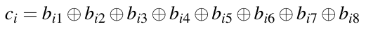 (11.2)

trong đó b<sub>i1</sub>,...,b<sub>i8</sub> là các bit của byte C<sub>i</sub>. Byte input có thể, ví dụ, là một ký tự ASCII-encoded. Chúng ta khảo sát điều gì xảy ra nếu muốn dùng mã sửa lỗi này làm hash function.

1. Mã hóa chuỗi CRYPTO thành biểu diễn nhị phân hoặc hệ thập lục phân.

2. Tính giá trị hash (dài 6-bit) của chuỗi ký tự dùng phương trình đã định nghĩa trước đó.

3. “Phá” hash function bằng cách chỉ ra cách có thể tìm các chuỗi ký tự (có nghĩa) cho ra cùng giá trị hash. Đưa ra một ví dụ phù hợp.

4. Tính chất then chốt nào của hash function bị thiếu trong trường hợp này?

11.9. Tính output của vòng đầu tiên (j = 0) của SHA-2 cho một block input 512-bit:

1. x = {0...00}

2. x = {0...01} (tức là bit không có giá trị 1).

Bỏ qua các giá trị khởi tạo tiêu chuẩn H<sub>0</sub><sup>(i)</sup> cho bài tập này và giả sử các giá trị khởi đầu gồm các chuỗi all-zero (tức là A<sub>0</sub> = B<sub>0</sub> =... = H<sub>0</sub> = 0000 0000<sub>hex</sub>).

11.10. Dùng một công cụ để tính hash SHA-2 512-bit cho hai thông điệp sau. Đưa ra bốn byte đầu tiên ở dạng hệ thập lục phân.

m<sub>1</sub> = Have you eaten, my child?

m<sub>2</sub> = Have you eaten my child?

Các thông điệp m<sub>1</sub> và m<sub>2</sub> rất giống nhau. Quan sát của bạn về các giá trị hash tương ứng là gì?

11.11. Giả sử SHA-3 được dùng trong một ứng dụng cho trước với kích thước output 256 bit. Chúng ta đo được throughput 120 MByte/s với thư viện software cryptographic của mình. Vì lý do bảo mật, chúng ta đổi sang SHA-3 với 384 bit output. Throughput là bao nhiêu nếu dùng cùng thư viện cryptographic? (Gợi ý: Bạn chỉ cần nghiên cứu Mục 11.5.1.)

11.12. Chúng ta muốn hash một thông điệp ngắn gồm hai byte 0xCCCC bằng SHA-3. Hash function nên được dùng thay thế cho SHA-2 với 256 bit. Thông điệp sau khi padding là gì? Đưa ra câu trả lời ở dạng nhị phân.

11.13. Keccak-f là một phép hoán vị, tức là mỗi giá trị trong 2<sup>d</sup> giá trị input được gán một giá trị output duy nhất theo cách song ánh (tức là one-to-one). Trong bài tập này, chúng ta sẽ nghiên cứu các hàm hoán vị khác với các hoán vị bit được dùng trong DES, ví dụ, hoán vị P hay IP, như thế nào.

■ Hãy xét một ví dụ đồ chơi, một hàm với 2 bit I/O. Có bao nhiêu hoán vị bit khác nhau tồn tại với 2 bit input và output? Vẽ một sơ đồ cho mỗi hoán vị bit khả dĩ.

■ Bây giờ chúng ta xét một hàm hoán vị f có 2 bit input và output. Có bao nhiêu (i) giá trị input và (ii) giá trị output khác nhau tồn tại? Quan trọng hơn: Có bao nhiêu phép hoán vị khác nhau tồn tại, tức là có bao nhiêu ánh xạ song ánh (one-to-one) khác nhau tồn tại giữa input và output? Liệt kê mọi phép hoán vị khả dĩ. Bạn có thể làm điều này trong một bảng có cột ngoài cùng bên trái liệt kê mọi tổ hợp input, và với mỗi phép hoán vị khả dĩ, bạn viết một cột mới về bên phải. (Bạn có thể muốn viết lời giải trên một tờ giấy đặt ngang.)

■ Hóa ra một hoán vị bit là một tập con của hàm hoán vị. Trong ví dụ trên, phép hoán vị nào được tạo bởi f là các hoán vị bit?

■ Nói chung: Có bao nhiêu hàm hoán vị cho d bit input, và có bao nhiêu hoán vị bit cho trường hợp này?

11.14. Chúng ta xét Keccak-f với state input A trong đó cả 1600 bit đều có giá trị 0. State sau vòng đầu tiên là gì?

11.15. Chúng ta xét một state SHA-3 A trong đó cả 1600 bit đều có giá trị 0 trừ các bit có tọa độ z bằng không, tức là A[x,y,0] = 1.

■ Có bao nhiêu bit state có giá trị 1? Nhìn vào Hình 11.15, các bit đó nằm ở đâu?

■ Bây giờ chúng ta áp dụng bước θ cho A. State mới là gì?

---

[^1]: Điều này suy ra từ biểu diễn chuỗi Taylor của hàm mũ: e<sup>−x</sup> = 1 − x+ x<sup>2</sup>/2! − x<sup>3</sup>/3!+···với x << 1.

[^2]: Các giá trị được suy ra từ các hằng số toán học này để chứng minh rằng không có backdoor, tức là không có điểm yếu ẩn, trong SHA-2 dựa trên các giá trị được xây dựng đặc biệt.

[^3]: Một lần nữa, các giá trị được suy ra từ các hằng số toán học để chứng minh sự vắng mặt của backdoor.

[^4]: Như AES, Keccak được thiết kế bởi một nhóm cryptographer châu Âu. Một thành viên của nhóm Keccak, Joan Daemen từ Bỉ, cũng là một trong hai người thiết kế AES.

[^5]: “SHAKE” là viết tắt của Secure Hash Algorithm Keccak.

[^6]: Lưu ý rằng một hàm hoán vị như vậy khác với các hoán vị bit được dùng trong DES.

[^7]: “Rho” có thể được coi là gợi nhớ cho rotation (phép xoay), và “Pi” tiếp theo của bước π cho permuation *(ghi chú: sách in permuation; đúng là permutation)*.
