# Chương 12 Mật mã hậu lượng tử (Post-Quantum Cryptography)

Thuật ngữ post-quantum cryptography (PQC) được đặt ra để mô tả các cryptosystem thay thế được giả định là chống được các tấn công dùng máy tính lượng tử large-scale. Điều này có tầm quan trọng đặc biệt với public-key cryptography vì đã biết rằng các họ cryptosystem hiện đang được dùng — tức là RSA, các scheme logarit rời rạc như trao đổi key Diffie-Hellman và elliptic curve (lần lượt xem Chương 7–9) — sẽ bị phá nếu máy tính lượng tử full-scale trở nên khả dụng trong tương lai. Dù điều này có vẻ là một vấn đề cần giải quyết trong tương lai, chúng ta đã cần trang bị cho các ứng dụng ngày nay cryptography chống được tấn công bằng máy tính lượng tử để phòng vệ trước các đối thủ “store now, decrypt later” (lưu bây giờ, giải mã sau), như được thảo luận trong Mục 12.1.1.

Ngày nay, post-quantum cryptography là một lĩnh vực nghiên cứu sôi động và một vài scheme đã được chuẩn hóa. Trong chương này, chúng tôi sẽ giới thiệu các loại post-quantum cryptography khác nhau đang tồn tại.

Trong chương này, bạn sẽ học:

■ Vì sao máy tính lượng tử là mối đe dọa đối với symmetric và asymmetric cryptography thông thường

■ Các ý tưởng thiết kế cơ bản đằng sau các cryptosystem public-key thay thế, tức là PQC

■ Cách lattice-based cryptography hoạt động và cách dùng nó

■ Kiến thức nền về code-based cryptography và cách xây dựng các scheme mã hóa với nó

■ Khái niệm hash-based cryptography

■ Tình trạng chuẩn hóa PQC và triển vọng

## 12.1 Giới thiệu

Trong các chương trước, chúng ta đã thấy một số cryptosystem symmetric và asymmetric và cách dùng chúng cho các tác vụ như mã hóa, trao đổi key an toàn và digital signature. Trong Mục 6.2.4, chúng tôi đã đưa ra các khuyến nghị key-length cho bảo mật long-term (giả sử, bảo mật cho 20–30 năm hoặc lâu hơn), trong đó chúng tôi giả định khả năng chống chịu các tấn công tốt nhất đã biết. Tuy nhiên, chúng tôi chưa thảo luận tường minh loại máy tính nào đối thủ sẽ dùng cho các tấn công tốt nhất đã biết này, ngầm giả định rằng mọi thuật toán cryptanalytic chỉ chạy trên hardware tính toán thông thường, dựa trên bit và byte well-known. Như chúng ta biết, trong một máy tính cổ điển như vậy, một bit có thể nhận hai trạng thái — 0 hoặc 1 — và bit này có thể được lưu hoặc dùng để tính toán. Nhưng điều gì sẽ xảy ra với các thuật toán cryptanalytic của chúng ta khi có một cỗ máy cho phép nhiều phép toán đồng thời hơn đáng kể trên cùng tập dữ liệu? Hóa ra máy tính lượng tử có khả năng làm chính xác điều này. Trong Mục 12.1.1 dưới đây, chúng tôi sẽ đưa ra một mô tả high-level rất ngắn gọn về máy tính lượng tử. Điều này nhằm làm động cơ cho việc học về các scheme PQC. Tuy nhiên, post-quantum cryptography, chủ đề chính của chương này, không đòi hỏi hiểu biết về máy tính lượng tử.

### 12.1.1 Tính toán lượng tử và Cryptography

Máy tính lượng tử là một cỗ máy hoạt động trên qubit thay vì bit cổ điển, vốn được các CPU đương đại của chúng ta dùng. Nói đại khái, một qubit đơn lẻ |qi là một trạng thái bộ nhớ không rời rạc như chúng ta biết từ bit thông thường, vốn có thể nhận hai giá trị 0 hoặc 1. Thay vào đó, một qubit là một phần tử nhớ mờ cũng có thể biểu diễn các giá trị “ở giữa” hai biên tương ứng |0i và |1i. Sự chồng lấn giữa các biên này được đặc trưng bởi các hệ số hay các amplitude so-called α và β. Điều này cho phép một qubit được biểu diễn như một tổ hợp có trọng số của hai biên như |qi = α|0i + β|1i. Người ta có thể thắc mắc ưu điểm của hành vi như vậy là gì. Với hai bit thông thường, chúng ta có thể lưu một trong bốn trạng thái khả dĩ 00, 01, 10 và 11. Tuy nhiên, hai qubit chứa một biểu diễn của cả bốn trạng thái khả dĩ cùng lúc, được xác định bởi các amplitude tương ứng. Để nắm bắt trạng thái của hai qubit, chúng ta cần bốn giá trị trên một máy tính cổ điển; với ba qubit chúng ta sẽ cần 8 giá trị. Nói chung, một thanh ghi n-bit trên máy tính cổ điển có thể giữ đúng một trạng thái, trong khi một thanh ghi n-qubit biểu diễn 2n trạng thái cùng lúc.

Khía cạnh thực sự thú vị là tính toán với một máy tính lượng tử n-qubit như vậy có thể mạnh hơn đáng kể so với bất kỳ máy tính cổ điển n-bit nào. Mức speed-up này được quy cho các phép toán song song hàng loạt trên 2n trạng thái có thể được thực hiện đồng thời trên một thanh ghi n-qubit nhờ một khái niệm gọi là superposition (chồng chập). Tuy nhiên, có một hiểu lầm phổ biến rằng máy tính lượng tử sẽ dẫn tới cải thiện hiệu năng đáng kể cho mọi ứng dụng. Thực ra, chúng chỉ có thể tăng tốc một số lớp tính toán và thuật toán nhất định mà với chúng superposition vốn có (và do đó bản chất song song) của input có thể được khai thác hiệu quả. Với nhiều thuật toán khác, vẫn cần máy tính cổ điển. Có vẻ không có khả năng chúng ta sẽ có trình duyệt web hay chương trình bảng tính chạy trên máy tính lượng tử tương lai. Tuy nhiên, làm một ví dụ hữu ích, một bài toán mà máy tính lượng tử có thể giải hiệu quả là tìm kiếm trong một cơ sở dữ liệu chưa sắp xếp với N mục. Một máy tính cổ điển cần lặp qua các mục và so sánh chúng với giá trị mong muốn, cần N bước trong trường hợp xấu nhất. Ngược lại, thuật toán Grovers có thể được dùng trên máy tính lượng tử để giải bài toán trong khoảng √N bước. Việc dùng nó trong cryptography sẽ được mô tả trong mục sau.

#### Tấn công bằng máy tính lượng tử nhắm vào các cryptosystem Symmetric

Thuật toán tìm kiếm lượng tử Grovers có thể được dùng để tấn công các cryptosystem symmetric. Như chúng ta đã thấy trong các chương trước của cuốn sách này, tấn công tốt nhất đã biết nhắm vào các symmetric cipher tốt là exhaustive key search, xem Mục 3.5.1. Nhớ lại rằng cần ít nhất một mẩu plaintext đã biết. Tấn công này về cơ bản giống như tìm kiếm trong một cơ sở dữ liệu chưa sắp xếp: Chúng ta mã hóa plaintext đã biết với mọi key khả dĩ, thu được một cơ sở dữ liệu lớn các giá trị chưa sắp xếp, rồi tìm ciphertext đã biết. Chẳng hạn, AES với key 128-bit có thể bị phá bằng máy tính cổ điển trong khoảng 2128 bước, giả sử chúng ta có một cặp plaintext/ciphertext.

Với một máy tính lượng tử chạy thuật toán Grovers, cùng tấn công hiệu quả hơn: Nó chỉ mất √2128 = 264 bước. Điều này có thể là vấn đề với các symmetric cipher có độ dài key (phổ biến) 128 bit. Người ta thường giả định rằng các đối thủ large-scale có thể thực hiện 264 phép tính và do đó có thể phá các cipher 128-bit ngay khi một máy tính lượng tử mạnh trở nên khả dụng[^1]. May mắn là vấn đề có thể được giải quyết khá đơn giản bằng cách tăng độ dài key của các thuật toán symmetric. Thực ra, thuật toán Grover là lý do chính vì sao AES được thiết kế với hai độ dài key 192 và 256 bit, ngoài key 128-bit. Dùng một máy tính lượng tử chạy thuật toán Grover, các key dài hơn này lần lượt cho độ phức tạp 296 và 2128. Trong thực tế, máy tính lượng tử tương lai là lý do chính vì sao ngày càng nhiều ứng dụng hiện đại yêu cầu AES-256, để chúng được bảo vệ trước tấn công bằng máy tính lượng tử trong tương lai.

#### Tấn công bằng máy tính lượng tử nhắm vào các cryptosystem Asymmetric

Đáng tiếc, máy tính lượng tử gây ra mối đe dọa nghiêm trọng hơn nhiều cho mọi cryptosystem asymmetric hiện đang được dùng, và đã được giới thiệu trong Chương 7–9 của cuốn sách này. Vào mid-1990s, Peter Shor đã công bố hai thuật toán cho máy tính lượng tử có thể giải hiệu quả các bài toán toán học mà các scheme public-key ngày nay dựa trên. Cụ thể hơn, RSA có thể bị phá bằng thuật toán period-finding của Shors, cho phép phân tích thừa số hiệu quả các số nguyên lớn. Nhớ lại từ Mục 7.9 rằng RSA dựa vào chính thực tế rằng điều này không khả thi. Mọi scheme asymmetric khác hiện đang được dùng, như Digital Signature Algorithm (DSA) hay Diffie-Hellman Key Exchange (DHKE) và các biến thể elliptic curve của chúng, dựa vào độ khó của việc tính logarit rời rạc. Hóa ra logarit rời rạc cũng có thể bị phá tương tự trong thời gian đa thức bằng thuật toán Shor trên máy tính lượng tử.

May mắn là các máy tính lượng tử large-scale cần để phá các cryptosystem asymmetric hiện đang triển khai như RSA và ECC hiện chưa thể được chế tạo. Tại thời điểm viết sách, các máy tính lượng tử được các công ty như Google và IBM hiện thực cung cấp các qubit (nhiễu) trong khoảng hàng chục tới hàng trăm, trong khi để tấn công thành công cần vài nghìn tới hàng triệu qubit fault-tolerant. Dù vẫn còn một khoảng cách công nghệ đáng kể, nhiều người tin rằng chỉ là vấn đề thời gian trước khi máy tính lượng tử phát triển tới mức có thể phá hiệu quả các cryptosystem asymmetric hiện đang triển khai. Lưu ý rằng số qubit không phải là yếu tố duy nhất hiện cản trở việc thực hiện các tấn công full-size bằng máy tính lượng tử. Loại phép toán lượng tử được hỗ trợ, tỉ lệ lỗi của chúng và số phép toán liên tiếp cũng có tầm quan trọng then chốt. Thời điểm chính xác khi máy tính lượng tử full-size trở nên khả dụng đang được các chuyên gia tranh luận sôi nổi. Tuy nhiên, người ta thường tin rằng các tấn công thực tế chạy trên máy tính lượng tử nhiều khả năng còn cách ít nhất 10–20 năm, có thể lâu hơn nhiều.

Dù điều này có vẻ vẫn còn xa, điều quan trọng là phát triển và triển khai ngay bây giờ các scheme asymmetric mới chống được máy tính lượng tử. Sự thật hơi bất ngờ này có hai lý do. Thứ nhất, kẻ tấn công có thể dùng chiến lược “store now, decrypt later”. Tức là, một đối thủ lưu ciphertext dù hắn không thể phá các thuật toán cryptographic liên quan. Tuy nhiên, khi máy tính lượng tử trở nên khả dụng vào một thời điểm sau, dữ liệu đã lưu có thể được giải mã. Cách tiếp cận này đặc biệt có khả năng được dùng bởi các tác nhân nation-state như các cơ quan tình báo lớn[^2]. Thứ hai, điều thiết yếu là xét độ trễ cho việc phát triển và roll-out các thuật toán asymmetric mới. Có nhiều bước liên quan tới việc biến một scheme cryptographic mới từ một cấu trúc toán học thành một hệ thống thực tế, bao gồm đánh giá bảo mật và phân tích đặc tính triển khai, quá trình chuẩn hóa, triển khai software hay hardware thực sự trong sản phẩm, bảo đảm khả năng tương tác (có thể liên quan tới việc thay đổi các tiêu chuẩn hiện có), quản lý key và nhiều khía cạnh khác. Kinh nghiệm trong quá khứ đã cho thấy ngay cả các nhiệm vụ tương đối đơn giản như cập nhật một tiêu chuẩn bảo mật internet để dùng hash function mới cũng có thể mất nhiều năm trong thực tế. Ngoài ra, có những chuỗi sản xuất phức tạp trong các lĩnh vực như ô tô hay hàng không, nơi có thể mất 5–10 năm để đưa các họ thuật toán mới vào sản phẩm. Do đó, chúng ta cần làm việc để đưa các cryptosystem asymmetric quantum-secure vào thực tế ngay bây giờ để sẵn sàng khi máy tính lượng tử mạnh trở nên khả dụng. NIST đã bắt đầu một sáng kiến theo hướng này năm 2017 bằng cách thiết lập một lời kêu gọi chuẩn hóa mở cho các cryptosystem asymmetric quantum-secure. Quá trình này tương tự các cuộc thi AES (xem Mục 4.1) và SHA-3 (xem Mục 4.1). Các thuật toán PQC hứa hẹn nhất được xem xét trong cuộc thi NIST thuộc về các họ lattice-based, code-based và hash-based cryptography. Ba họ thuật toán này sẽ là chủ đề chính của chương này.

### 12.1.2 Các cryptosystem Asymmetric Quantum-Secure

Như đã thảo luận ở trên, thuật toán Shor giải hiệu quả các bài toán phân tích thừa số và logarit rời rạc nằm bên dưới RSA, logarit rời rạc và các scheme ECC một khi máy tính lượng tử mạnh trở nên khả dụng. Khác với cryptanalysis bằng máy tính thông thường, vốn có thời gian chạy subexpentional *(ghi chú: sách in subexpentional; đúng là subexponential)*, thuật toán Shor chạy trong thời gian đa thức trên máy tính lượng tử. Hệ quả là chúng ta cần các bài toán toán học mới không bị ảnh hưởng bởi speed-up tính toán theo hàm mũ do máy tính lượng tử mang lại, và có thể được dùng để xây dựng các scheme public-key mới. Một cách tiếp cận hứa hẹn để tìm các bài toán như vậy là xem xét các bài toán khó đã biết trong lý thuyết độ phức tạp. Tồn tại lớp các bài toán NP-complete, ký hiệu tập các bài toán, nói đại khái, cần nỗ lực theo hàm mũ để giải trên một hệ thống tính toán cổ điển trong trường hợp tổng quát. Tuy nhiên, nếu tìm được một lời giải, tính hợp lệ của lời giải có thể được kiểm chứng trong thời gian đa thức. Các ví dụ về bài toán NP-complete được biết rõ từ lý thuyết khoa học máy tính, như bài toán cái túi (knapsack) và bài toán người bán hàng du lịch.

Thú vị là hiện người ta tin rằng lớp bài toán NP-complete không thể được giải quyết hiệu quả ngay cả với máy tính lượng tử full-scale. Nói cách khác, dùng một bài toán như vậy để xây dựng một cryptosystem asymmetric quantum-secure có thể là một cách tiếp cận rất hứa hẹn. Tuy nhiên, một câu hỏi thú vị nảy sinh trong bối cảnh này: Vì sao chúng ta chưa thấy cryptosystem public-key nào trong thực tế được xây dựng trên một bài toán NP-complete? Thay vào đó, các scheme hiện tại dựa vào các giả định độ phức tạp yếu hơn, cụ thể là các bài toán phân tích thừa số nguyên và logarit rời rạc.

Thứ nhất, quan trọng là hiểu đúng các yêu cầu bảo mật trong cryptography và các giả định bài toán. Chúng ta vừa học rằng các bài toán NP-complete được coi là khó giải trong trường hợp tổng quát nhưng một vấn đề chính là độ khó này không được bảo đảm cho mọi instance. Đặc biệt, có thể có những ví dụ dễ giải. Nói cách khác, chọn một instance ngẫu nhiên từ một bài toán NP-complete tổng quát được dùng cho một cryptosystem mới vẫn có thể dẫn tới một bài toán mà kẻ tấn công với bất kỳ máy tính thông thường nào cũng giải nhanh được. Do đó, chúng ta cần đặc biệt cẩn thận để loại trừ các trường hợp đơn giản đó nếu muốn đưa ý tưởng này vào thực tế. Cân nhắc này không thuần túy học thuật; đã có vài trường hợp điều này xảy ra. Một ví dụ well-known là cryptosystem knapsack MerkleHellman được đề xuất năm 1978 và sau đó bị Shamir phá, dù bài toán knapsack cơ bản là NP-complete.

Mặt khác, có những bài toán NP-complete khác đã được đề xuất cho public-key cryptography và có vẻ hữu ích. Nổi bật nhất là hệ mã hóa McEliece code-based, được Robert J. McEliece trình bày năm 1978, tức là cùng năm RSA được đề xuất. Phần còn lại của chương này sẽ giới thiệu ba họ scheme public-key mới. Bảng 12.1 cho thấy ba loại scheme PQC được đề cập trong chương này. Tại thời điểm viết sách, đây được coi là các ứng viên hứa hẹn nhất để dùng trong thực tế và các nỗ lực chuẩn hóa chúng hiện đang được tiến hành.

Bảng 12.1 Các họ và cryptosystem PQC hứa hẹn

| Họ PQC | Dịch vụ hỗ trợ | Cryptosystem | Mô tả |
|---|---|---|---|
| Lattice-based cryptography | vận chuyển key digital signature | LWE, KYBER, FRODO, DILITHIUM, FALCON | Mục 12.2 |
| Code-based cryptography | vận chuyển key | McEliece, Niederreiter | Mục 12.3 |
| Hash-based cryptography | digital signature | MSS, XMSS, LMS, SPHINCS+ | Mục 12.4 |

Nhớ rằng các scheme public-key thông thường RSA, logarit rời rạc và elliptic curve đều khá phổ quát; đặc biệt, mỗi scheme có thể được dùng cho mã hóa (và do đó vận chuyển key) và cho digital signature. Chúng ta sẽ thấy trong chương này rằng tình hình khác với các thuật toán PQC. Hầu hết các họ scheme PQC hỗ trợ hoặc mã hóa hiệu quả (ví dụ, cho vận chuyển key) hoặc digital signature nhưng thường không cả hai. Chẳng hạn, lớp các scheme PQC code-based chủ yếu tập trung vào các cơ chế vận chuyển key trong khi hash-based cryptography chỉ có thể được dùng cho các scheme digital signature. Chúng tôi lưu ý rằng một protocol vận chuyển key cũng được gọi là key encapsulation mechanism, hay KEM. Họ duy nhất có tính linh hoạt và hiệu quả tương tự các scheme asymmetric thông thường là lớp các scheme PQC lattice-based.

Trước khi đi vào lĩnh vực thú vị của public-key cryptography quantum-resistant, chúng ta nên làm rõ thuật ngữ. Chúng ta phải phân biệt giữa các thuật ngữ (similarly-sounding!) post-quantum cryptography (PQC) và quantum cryptography (QC). QC chỉ các khái niệm như quantum key distribution (QKD) để trao đổi key an toàn qua các kênh lượng tử, được xây dựng trên các hiệu ứng lượng tử thực sự. Post-quantum cryptography, tuy nhiên, nhằm chỉ lớp các thuật toán cryptographic thay thế được thiết kế để chạy trên máy tính thông thường nhưng có khả năng chống chịu các tấn công dùng máy tính lượng tử mạnh hoặc tổ hợp máy tính lượng tử và máy tính thông thường.

### 12.1.3 Việc dùng tính bất định trong Cryptography

Chúng ta đã thảo luận ở trên rằng các bài toán nền tảng phân tích thừa số và logarit rời rạc có thể được tính hiệu quả một khi máy tính lượng tử mạnh trở nên khả dụng. Hệ quả là post-quantum cryptography cần các giả định thay thế khó giải trên cả nền tảng máy tính cổ điển lẫn trên máy tính lượng tử. Trước khi đi vào chi tiết các bài toán mới này, chúng tôi giới thiệu một khái niệm tổng quát đằng sau nhiều scheme PQC bằng một ví dụ đơn giản.

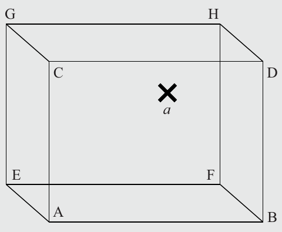

Hình 12.1 Bài toán: Xác định điểm a và tìm góc gần nó nhất

Hãy xem Hình 12.1. Nó cho thấy một hình lập phương, dù có ba chiều, được vẽ chỉ trong hai chiều. Ngoài tám góc, chúng ta thấy một điểm a. Bây giờ chúng ta thử trả lời câu hỏi: Điểm a gần nhất với góc nào trong các góc A, B,..., H của hình lập phương? Các câu trả lời khả dĩ khi nhìn hình 2D là:

■ Nếu giả sử a nằm bên trong hình lập phương, có thể khó nói nó gần D hay H nhất.

■ Điểm a có vẻ gần D nhất nếu giả sử nó nằm trên mặt trước của hình lập phương (hoặc thậm chí bên ngoài mặt trước).

■ Tương tự, điểm a cũng có thể gần H nhất nếu chúng ta nghĩ nó nằm trên mặt sau hoặc thậm chí bên ngoài mặt sau của hình lập phương.

Hệ quả là chúng ta không thể suy ra một câu trả lời đúng duy nhất, dù bằng quan sát trực quan hay bằng bất kỳ công cụ toán học nào — ít nhất trừ khi có thêm thông tin. Chúng ta có thể quy độ khó của bài toán này cho phép chiếu hình lập phương 3D lên một mặt phẳng 2D, tạo thành một phép giảm chiều. Với ví dụ đơn giản này trong đầu, chúng ta có thể giới thiệu hai nguyên lý quan trọng có thể được dùng cho PQC:

1. Mất thông tin (Loss of information): Chúng ta không thể xác định duy nhất vị trí chính xác của điểm do phép chiếu từ ba chiều xuống hai. Một bước giảm như vậy cũng có thể được quan sát ở các one-way function như hash function, vốn ánh xạ một chuỗi lớn thành một chuỗi nhỏ hơn, cố ý loại bỏ nhiều thông tin của input gốc. Như chúng ta đã học trong Chương 11, một kẻ tấn công chỉ biết giá trị output ngắn (hay “ảnh”) sẽ gặp khó khăn trong việc xác định đúng giá trị input lớn hơn tương ứng (“tiền ảnh”).

2. Xấp xỉ (Approximation): Trong ví dụ trên, chúng ta đã tạo bài toán tìm phần tử góc từ tập b ∈ {A,...,H} gần nhất với điểm a. Trong các scheme PQC, chúng ta có thể dùng một ý tưởng liên quan chặt chẽ, cụ thể là tìm một điểm (hoặc đối tượng tương tự) gần nhất với một điểm của một cấu trúc định trước. Để biến điều này thành một bài toán cryptographic, hãy hình dung rằng chúng ta chọn một góc cụ thể (ví dụ, D hoặc H trong ví dụ) và tạo điểm a bằng cách thêm một chút nhiễu để a dịch nhẹ trong không gian khỏi góc gốc b của nó.

Chúng tôi lưu ý rằng cả hai ý tưởng đều liên quan tới khái niệm bất định. Hóa ra hai khái niệm mất thông tin và xấp xỉ có thể được biến thành các bài toán toán học đặt nền tảng cho nhiều họ PQC, bao gồm ba scheme post-quantum được giới thiệu trong chương này:

1. Lattice-based cryptography (xem Mục 12.2) bắt đầu với tập {A,...,H} các góc hình lập phương và xét vài bài toán liên quan tới các góc và các điểm trung gian, như closest vector problem (CVP) hay shortest vector problem (SVP) liên quan.

2. Với code-based cryptography (xem Mục 12.3), chúng ta có thể coi tập {A,...,H} là các codeword của một mã error-correcting, và a được coi là một biến thể có nhiễu của một trong các codeword.

3. Hash-based cryptography dùng việc mất thông tin làm khái niệm then chốt cho tính one-wayness của hash function, cho phép các scheme chữ ký hash-based. Chúng ta sẽ xem kỹ hơn các scheme đó trong Mục 12.4.

## 12.2 Lattice-Based Cryptography

Trong mục này, chúng tôi sẽ giới thiệu khái niệm đằng sau lattice-based cryptography. Nó được dùng cho nhiều scheme PQC khác nhau có vẻ rất hứa hẹn cho việc dùng trong tương lai. Hãy bắt đầu bằng cách định nghĩa lattice thực sự là gì. Nói chung, một lattice (lưới) là một tập các điểm trong một không gian n-dimensional với cấu trúc tuần hoàn. Cấu trúc tuần hoàn tạo nên cái tên “lattice”. Chính xác hơn, một lattice L được định nghĩa là tập các tổ hợp tuyến tính nguyên của một số vector độc lập a1,a2,...,an, được gọi là vector cơ sở (basis vector), và các hệ số nguyên xi ∈ ℤ của chúng:

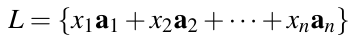 (12.1)

Các vector cơ sở ai có số chiều m, tức là chúng là các vector trong một không gian m-dimensional. Do đó, chúng ta nói rằng Phương trình (12.1) định nghĩa một không gian lattice m-dimensional. Lưu ý rằng mọi hệ số xi ∈ ℤ đều là số nguyên. Số vector, n, được gọi là rank của lattice n. Làm ví dụ, Hình 12.2 cho thấy một lattice từ hai vector a1 và a2. Mỗi chấm đặc trong hình có thể đạt được bằng công thức lattice:

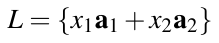 (12.2)

trong đó x1 và x2 là số nguyên. Vì các vector nằm trong không gian 2-dimensional, lattice có số chiều m = 2. Vì lattice được trải bởi hai vector, rank cũng là n = 2.

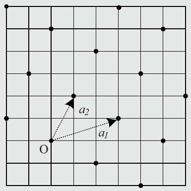

Hình 12.2 Lattice Two-dimensional được trải trên các vector cơ sở a1,a2; các chấm đen ký hiệu các điểm lattice

Chúng ta có thể dễ dàng hình dung rằng hình lập phương dùng trong ví dụ ban đầu ở Hình 12.1 có thể được hiểu như một phần của một lattice với số chiều m = 3, trong đó các góc là điểm lattice. Một quan sát quan trọng là cùng một lattice (hay hình lập phương) có thể được sinh bởi một số cơ sở khác nhau[^3], trong đó mỗi cơ sở được tạo bởi các tập vector cơ sở khác nhau.

Như với các scheme public-key thông thường, lattice-based cryptography cũng thao tác trên các số từ tập hữu hạn thay vì trên số thực. Với các scheme PQC, chúng ta chọn tọa độ của các vector cơ sở từ một integer ring ℤq, mà chúng tôi đã định nghĩa từ sớm trong cuốn sách này ở Mục 1.4.2. Để xây dựng các cryptosystem lattice-based hiệu quả, tức là nhanh, số nguyên q thường được chọn là một số nguyên tố hoặc một lũy thừa của hai. Nhớ lại rằng một ring như vậy gồm các số nguyên {0,1,...,q − 1} và số học được thực hiện với phép toán “mod q”.

Với điều này trong đầu, chúng ta định nghĩa một vector ai có số chiều m theo ký hiệu cột như sau:

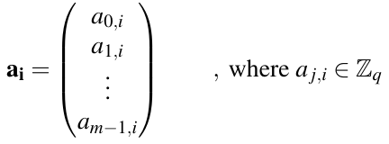

Vì các tọa độ thuộc integer ring ℤq và vector có số chiều m, chúng ta sẽ dùng ký hiệu ngắn hơn ai ∈ ℤqm dưới đây. Tập n vector cơ sở ai tạo thành một lattice có thể được viết dưới dạng một ma trận:

A = {a1,a2,...,an}

Với một lattice như vậy với n vector cơ sở, chúng ta dùng ký hiệu A ∈ ℤqm×n.

Hóa ra đôi khi hữu ích cho các scheme cryptographic khi chuyển vị ma trận này, tức là hoán đổi cột và hàng. Định nghĩa hình thức như sau.

> Định nghĩa 12.2.1 Chuyển vị một ma trận
>
> Cho một ma trận A ∈ ℤm×n được định nghĩa trên các số nguyên với số chiều m và rank n. Chúng ta định nghĩa chuyển vị của A là AT ∈ ℤn×m, trong đó mọi hàng của A được hoán đổi với các cột của nó, tức là AT[i, j] = A[j,i].

Lưu ý rằng chúng ta cũng có thể định nghĩa tương tự chuyển vị aT của một vector a, có nghĩa là chúng ta chuyển một vector cột thành một vector hàng và ngược lại.

Ví dụ 12.1. Chúng ta xem một ví dụ nhỏ về một lattice được định nghĩa trên ℤ17 với rank n = 4, tức là lattice được trải bởi 4 vector. Các vector có số chiều m = 7 nên ma trận có dạng A ∈ ℤ177×4. Chúng tôi cũng thể hiện ma trận lattice đã chuyển vị với các chiều hoán đổi AT ∈ ℤ174×7:

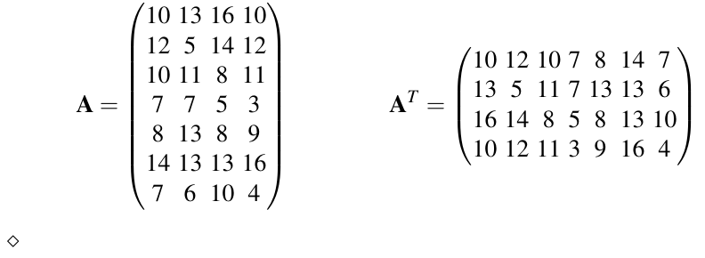

Để đầy đủ, chúng tôi lưu ý rằng hai cơ sở sẽ sinh ra cùng lattice khi bất kỳ điều nào sau đây xảy ra: Các vector của ma trận cơ sở bị hoán vị, các vector của ma trận cơ sở bị đổi dấu hoặc các vector được cộng với bội nguyên của các vector khác.

Bây giờ chúng ta có các điều kiện tiên quyết để định nghĩa một bài toán rất liên quan cho việc xây dựng các scheme lattice cryptography, cụ thể là bài toán Learning-with-Errors (LWE). Nói không hình thức, nó chỉ độ khó của việc khôi phục một điểm trên lattice L sau khi nó bị sửa đổi bằng cách thêm một sai số nào đó. Bây giờ chúng ta sẽ xem bài toán LWE và cách nó có thể được biến thành một cryptosystem lattice-based.

### 12.2.1 Bài toán Learning With Errors (LWE)

Trong Mục 8.3.1, chúng tôi đã giới thiệu bài toán logarit rời rạc, là bài toán nằm bên dưới các scheme public-key được dùng rộng rãi như elliptic curve và trao đổi key Diffie-Hellman. Để giải DLP, kẻ tấn công phải xác định một số nguyên bí mật x sao cho αx ≡ β mod p, cho trước group nhân ℤp∗ của một prime field, một generator α và một phần tử đích β trong finite field. Nói không hình thức, chúng ta đã tìm được một bài toán toán học khó liên quan tới việc xác định số bước rời rạc x cần để tới phần tử đích β bắt đầu từ α. Chúng ta có thể xem α như một cơ sở hay một generator trong bài toán này.

Với bài toán learning with errors (LWE), chúng ta thực ra dùng một bài toán hơi tương tự, nhưng lần này dựa trên một lattice. Ý tưởng cơ bản là chúng ta lấy vài vector cơ sở a1,a2,...,an ∈ ℤqm và nhân chúng với các hệ số nguyên bí mật s1,s2,...,sn để tới một điểm đích t trên lattice:

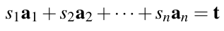 (12.3)

Tương tự bài toán DLP, đối thủ bây giờ được cho điểm bắt đầu (tập vector cơ sở) cũng như một điểm cuối t và mục tiêu của hắn là tìm giá trị — tức là tập số nguyên (s1,s2,...,sn) — mà hắn phải nhân điểm bắt đầu với để tới điểm cuối.

Một lần nữa, sẽ hữu ích khi biểu diễn bài toán này dưới dạng ma trận, trông như sau:

A · s = t

trong đó s = (s1,s2,...,sn) là tập hệ số nguyên bí mật, ma trận A chứa các vector cơ sở và t là vector đích. Bây giờ chúng ta xem một ví dụ đơn giản về phép nhân matrix-coefficient để xây dựng bài toán LWE.

Ví dụ 12.2. Chúng ta dùng cùng lattice như trong ví dụ trước, tức là một lattice được định nghĩa trên ℤ17 với rank n = 4. Các vector có số chiều m = 7, nên ma trận có dạng A ∈ ℤ177×4. Chúng tôi lưu ý rằng t cũng là một vector có số chiều 7, tức là nó là một điểm nào đó trên lattice. Phương trình (12.4) cho thấy bài toán:

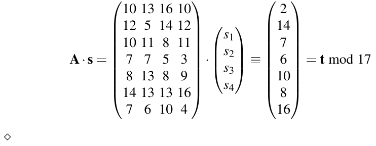 (12.4)

Nhớ lại rằng mục tiêu của chúng ta là tạo một bài toán khó giải cho đối thủ. Đáng tiếc, nhìn kỹ hơn ví dụ, hóa ra đó không phải là một bài toán khó vì Phương trình (12.4) mô tả một hệ phương trình tuyến tính. Chúng tôi đã nhắc trước đó, ví dụ, trong Mục 2.3.2, rằng các kỹ thuật như khử Gauss sẽ giải bài toán này rất nhanh, ngay cả với ma trận cực lớn. Trong trường hợp lattice, điều này có nghĩa là dễ về mặt tính toán để tìm một vector các hệ số nguyên (chưa biết) si mà nếu nhân với các vector cơ sở G sẽ tới điểm t. Thực ra lời giải cho Phương trình (12.4) có thể dễ dàng được tính là:

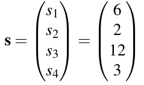

Thật straighforward *(ghi chú: sách in straighforward; đúng là straightforward)* khi chèn vector s này vào Phương trình (12.4) và kiểm tra rằng lời giải là đúng.

May mắn là bài toán dễ này có thể được biến thành một bài toán khó về mặt tính toán bằng một tinh chỉnh đơn giản: Hãy coi t không phải là một điểm trên lattice mà là một điểm gần một điểm trên lattice. Tinh chỉnh này có thể được mô tả toán học bằng cách đưa một vector sai số e vào phương trình, cho ra:

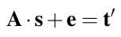 (12.5)

Vector sai số đưa một phép xấp xỉ vào bài toán, như đã thảo luận trong Mục 12.1.3. Bây giờ hãy xem lại ví dụ ở trên, nhưng với một vector sai số bổ sung e:

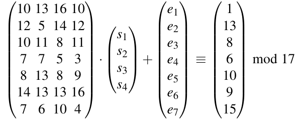 (12.6)

Nếu được cho một phương trình như vậy mà không cung cấp e hay s, kẻ tấn công có thể thử dùng khử Gauss hay bất kỳ kỹ thuật nào khác để giải hệ phương trình tuyến tính, nhưng hắn sẽ không thể tính lời giải đúng vì t′ không phải là một điểm trên lattice. Nếu so sánh kỹ các giá trị ở vế right-hand của Phương trình (12.4) và (12.6), chúng ta nhận thấy rằng các vector đích t và t′ thực ra rất gần nhau. Do đó, chúng ta thấy rằng ngay cả một sai lệch nhỏ khỏi các hệ số lattice, chẳng hạn với các giá trị sai số ei ∈ {−1,0,1}, cũng đủ để tạo một bài toán non-trivial. Thực ra, vector sai số trong Phương trình (12.6) là:

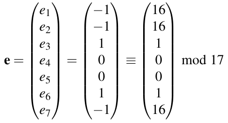

Chúng tôi lưu ý rằng trong ℤ17 ta có −1 ≡ 16. Với các cryptosystem thực tế, các giá trị nhỏ cho e là quan trọng vì chúng ta phải bảo đảm rằng một bên nhận hợp pháp vẫn có thể khôi phục duy nhất điểm lattice t mà t′ gần nhất.

Tóm lại, chúng ta kết luận rằng với việc đưa vào một vector sai số, chúng ta đã đạt mục tiêu: Các kỹ thuật tiêu chuẩn để giải hệ phương trình tuyến tính (như khử Gauss) không thể được dùng để khôi phục hiệu quả các ẩn s và e trong Phương trình (12.5). Với các hệ thống real-world, chúng ta cũng bảo đảm rằng các cách tiếp cận brute-force không hoạt động bằng cách chọn rank n và số chiều m của lattice đủ lớn. Thú vị là người ta thậm chí có thể chỉ ra rằng giải các xấp xỉ của các hệ tuyến tính như vậy thực sự là các bài toán khó thuộc lớp các bài toán NP-complete, và được giả định là khó ngay cả trên máy tính lượng tử large-scale. Do đó, định nghĩa sau có vẻ hữu ích để xây dựng các hệ thống cryptographic quantum computer-resistant.

> Định nghĩa 12.2.2 Bài toán Learning With Errors (LWE)
>
> Cho một tập n vector cơ sở ai ∈ ℤqm được biểu diễn bởi ma trận A và một điểm t ∈ ℤqm.
>
> LWE là bài toán xác định một tập hệ số bí mật s = (s1,s2,...,sn), với si ∈ ℤq, sao cho:
>
> A · s + e ≡ t mod q
>
> trong đó e là một vector sai số chưa biết gồm các số nguyên nhỏ modulo q.

LWE thuần túy này có thể được dùng để xây dựng một cryptosystem PQC nhưng nó cần các tham số rất lớn để an toàn, như sẽ được thảo luận tiếp theo. Tuy nhiên, bài toán Ring-LWE liên quan chặt chẽ cho phép các scheme cryptographic hiệu quả hơn đáng kể trong thực tế. Chúng tôi sẽ thảo luận các scheme Ring-LWE trong Mục 12.2.3.

### 12.2.2 Một hệ mã hóa LWE-Based đơn giản

Với bài toán LWE, bây giờ chúng ta có cơ sở để xây dựng một cryptosystem lattice-based đơn giản để mã hóa dữ liệu. Trước khi bắt đầu với chi tiết, sẽ hữu ích khi thảo luận một yêu cầu quan trọng của scheme. Như với mọi scheme mã hóa public-key, mục tiêu là Alice mã hóa một thông điệp và gửi nó tới Bob, người giải mã nó. Alice sẽ nhúng thông điệp bí mật của mình vào một bài toán LWE. Như một phần của quá trình này, cô ấy thêm một sai số ngẫu nhiên vào một điểm lattice. Vì bài toán LWE khó, Bob cần một số thông tin bổ sung để giải và giải mã nó. Chúng tôi lưu ý rằng điều này khác với các scheme mã hóa public-key thông thường được giới thiệu trong các chương trước, vốn hoặc hoàn toàn tất định không có chút ngẫu nhiên nào như schoolbook RSA, hoặc trong trường hợp các scheme xác suất như Elgamal, nonce được truyền tường minh cho bên kia. Tuy nhiên, với một cryptosystem LWE-based, nhiễu được thêm vào bị ẩn trong tham số t. Vấn đề sai số ẩn này có thể được Alice và Bob giải quyết bằng một kỹ thuật mã hóa (coding) đặc biệt. Bây giờ chúng tôi sẽ mô tả cách thông điệp được encode và decode để Alice và Bob có thể trao đổi thành công các thông điệp đã mã hóa.

#### Encoding và Decoding

Trong các hệ mã hóa public-key thông thường như RSA hay Elgamal, plaintext và ciphertext là các phần tử đơn giản trong một finite field hay integer ring ℤq∗. Điều này khác với các cấu trúc LWE và được làm như sau. Giả sử chúng ta muốn mã hóa một thông điệp n-bit m = (m0,m1,...,mn−1) với mi ∈ {0,1}. Ở bước đầu tiên, chúng ta ánh xạ mỗi bit plaintext tới một phần tử của ℤq. Chính xác hơn, chúng ta ánh xạ mỗi bit mi tới một hệ số m̄i ∈ ℤq. Vì các mi là giá trị bit trong khi mỗi hệ số m̄i có khoảng {0,1,...,q − 1}, câu hỏi nảy sinh là chúng ta nên chọn giá trị nào trong q giá trị khả dĩ cho m̄i. Một ý tưởng đơn giản là ánh xạ:

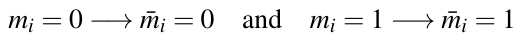

Tuy nhiên, như sẽ được chỉ ra sau, trong quá trình mã hóa scheme LWE đưa các sai số nhỏ vào các giá trị m̄i, ví dụ, từ phân phối (−1,0,1). Cách encode ở trên không hoạt động trong tình huống này vì bên nhận không thể phân biệt m̄i ban đầu là 0 hay 1. Để khắc phục vấn đề này, chúng ta phải ánh xạ mi = 0 và mi = 1 tới các giá trị m̄i đủ xa nhau để các biến dạng nhỏ của m̄i vẫn cho phép bên nhận quyết định một 0 hay 1 đã được encode.

Một ý tưởng tốt hơn có vẻ là dùng giá trị số nhỏ nhất và lớn nhất trong ℤq cho ánh xạ, tức là,

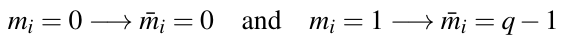

Điều này được thể hiện trong một bối cảnh ví dụ ở Hình 12.3 dùng q = 61. Tuy nhiên, ánh xạ này cũng là một ý tưởng tồi, vì chúng ta phải nhớ rằng các hệ số là phần tử từ ℤq, có cấu trúc tuần hoàn. Chẳng hạn, nếu một giá trị sai số ei = 1 được cộng vào m̄i = q − 1 = 60 (biểu diễn bit plaintext mi = 1), kết quả sẽ là m̄i + ei = 61 ≡ 0. Nhưng m̄i = 0 biểu diễn bit plaintext mi = 0! Do đó, với cách encode này, ngay cả giá trị sai số nhỏ nhất khả dĩ 1 cũng sẽ dẫn tới decode sai.

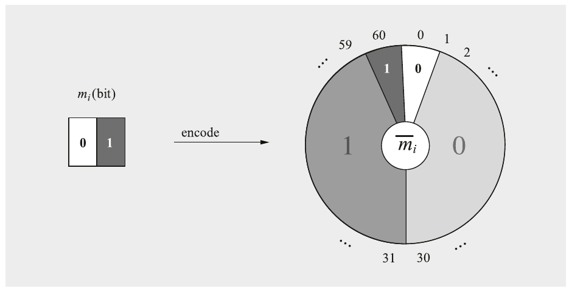

Hình 12.3 Ánh xạ ngây thơ (Naïve) các bit mi tới các hệ số m̄i ∈ ℤ61

Để cứu vãn tình hình, chúng ta cần tính tới bản chất tuần hoàn của finite group bên dưới. Một hàm encode tối ưu cực đại hóa khoảng cách giữa hai giá trị được gán cho các hệ số m̄i là như sau:

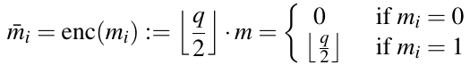 (12.7)

Hãy xem lại ví dụ với ℤ61. Các encode của hai giá trị bit 0 và 1 là pi = 0 → m̄i = 0 và mi = 1 → m̄i = 30 vì ⌊61/2⌋ = ⌊30.5⌋ = 30. Lưu ý rằng không có làm tròn khi q là một lũy thừa của hai. Hàm encode được thể hiện trong Hình 12.4. Các vùng tô xám cho biết một giá trị tương ứng từ vùng này được decode thành giá trị nào.

Then chốt trong hình là các vùng bao quanh các “lát pizza” chứa 0 và 1. Nếu m̄i có giá trị trong vùng xám đậm, decode sẽ ánh xạ nó tới mi = 1. Trong trường hợp giá trị của m̄i nằm trong vùng xám nhạt, output decode sẽ là mi = 0. Quy tắc decode có thể được mô tả hình thức là:

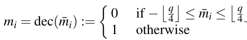 (12.8)

Nhìn lại ví dụ trước với q = 61, chúng ta sẽ nhanh chóng tính được ⌊q/4⌋ = ⌊61/4⌋ = 15. Điều này có nghĩa là mọi giá trị −15 ≤ mi ≤ 15 sẽ được decode thành không. Lưu ý rằng −15 ≡ 46 mod 61. Nói cách khác, decode sẽ trả về output 0 cho mọi input trong khoảng từ 46 tới 60 và trong khoảng từ 0 tới 15. Hệ quả là mọi input trong khoảng 16 tới 45 sẽ được decode thành output 1.

Dù có các quy trình coding phức tạp hơn cho các cryptosystem lattice-based (xem Mục 12.6), chúng tôi sẽ dùng các hàm encode và decode error-tolerant đơn giản này để định nghĩa một hệ mã hóa LWE đầu tiên trong mục sau.

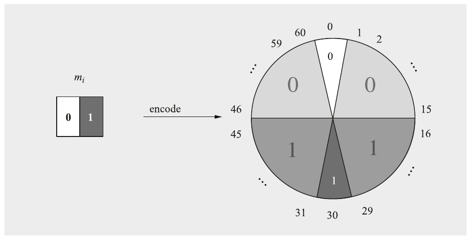

Hình 12.4 Ánh xạ an toàn các bit mi tới các hệ số m̄i ∈ ℤ61

#### Một scheme mã hóa và giải mã đơn giản

Bây giờ chúng ta định nghĩa một cryptosystem đơn giản mà chúng tôi gọi là “Simple-LWE”, vì nó chỉ phục vụ mục đích giáo dục. Nó sẽ giúp chúng ta hiểu hoạt động cơ bản của mã hóa lattice-based. Simple-LWE bị giới hạn ở việc chỉ mã hóa một bit thông điệp mỗi lần. Các scheme mã hóa có thể được dùng trong thực tế sẽ được thảo luận sau đó.

Như chúng ta đã thấy với các scheme mã hóa asymmetric thông thường như RSA và Elgamal, PQC lattice-based cũng cần (i) tạo key cũng như (ii) một hàm mã hóa và (iii) một hàm giải mã. Việc tạo key của Simple-LWE tạo một ma trận A từ các vector cơ sở lattice và một vector bí mật s và áp dụng bài toán LWE để tạo một public key tương ứng. Chi tiết như sau:

> Tạo key Simple-LWE
>
> Output: public key: kpub = (t,A) với t ∈ ℤqk và A ∈ ℤqk×n
>
> private key: kpr = s ∈ ℤqn
>
> 1. Chọn n vector ngẫu nhiên ai ∈ ℤqk và kết hợp chúng thành một ma trận A = (a1,a2,...,an) ∈ ℤqk×n.
>
> 2. Tạo một key bí mật ngẫu nhiên s từ các số nguyên “nhỏ”.
>
> 3. Xây dựng một vector sai số ngẫu nhiên e từ các số nguyên “nhỏ”.
>
> 4. Tính t = A · s + e.
>
> 5. Trả về public key kpub = (t,A) và private key kpr = s.

Sau khi đã tạo public key và private key, bây giờ chúng ta có thể định nghĩa các hàm mã hóa và giải mã. Như trong mọi scheme mã hóa asymmetric, người gửi dùng public key, được ký hiệu là kpub, cho việc mã hóa thực sự. Lưu ý rằng chúng ta dùng encoding như mô tả trong Mục 12.2.2 để chuyển bit thông điệp m thành một phần tử trong ℤq.

> Mã hóa Simple-LWE
>
> Input: public key kpub = (t,A), thông điệp m ∈ {0,1}
>
> Output: ciphertext c = (caux,cmsg) với caux ∈ ℤqn và cmsg ∈ ℤq
>
> 1. Lấy mẫu các số nguyên ngẫu nhiên nhỏ vào các vector r,eaux và một giá trị emsg.
>
> 2. Encode thông điệp m: m̄ = enc(m) ∈ ℤq.
>
> 3. Tính caux = AT · r + eaux.
>
> 4. Tính cmsg = tT · r + emsg + m̄.
>
> 5. Trả về ciphertext c = (caux,cmsg).

Như đã nhắc trước đó, scheme chỉ mã hóa một bit duy nhất. Ciphertext gồm hai phần tử, cụ thể là caux và cmsg. Hành vi như vậy không hoàn toàn xa lạ. Chẳng hạn, mã hóa Elgamal cũng tạo hai giá trị cần được bên mã hóa truyền, xem Mục 8.5.2. Với mã hóa LWE, chúng ta theo cùng chiến lược: Phần thứ nhất là một giá trị phụ caux chứa một số thông tin ẩn cho bên nhận, có thể được dùng để giải mã phần thứ hai cmsg.

Việc giải mã khôi phục thông điệp từ ciphertext dùng private key. Thú vị là việc giải mã thực sự về bản chất chỉ là một phép nhân caux với private key s, được trừ khỏi phần thứ hai của ciphertext cmsg. Cuối cùng, bên nhận phải dùng hàm decode được giới thiệu trong Mục 12.2.2.

> Giải mã Simple-LWE
>
> Input: private key kpr = s ∈ ℤqn, ciphertext c = (caux,cmsg)
>
> Output: thông điệp m ∈ {0,1}
>
> 1. Trả về thông điệp m = dec (cmsg − sT · caux).

Trước khi thảo luận bảo mật và tính đúng đắn của scheme Simple-LWE, hãy xem một ví dụ.

Ví dụ 12.3. Chúng ta xét mã hóa và giải mã Simple-LWE dùng các tham số đồ chơi m = 5, n = 3, q = 61, và bắt đầu bằng cách tính public key và private key như một phần của việc tạo key:

■ Để thiết lập scheme, chúng ta tạo n = 3 vector ngẫu nhiên a1 = (11,15,3,52,34), a2 = (33,18,39,41,56) và a1 = (27,48,36,37,17) và ghép thành ma trận A:

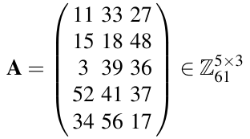

■ Tiếp theo, chúng ta tạo ngẫu nhiên một vector bí mật s và một vector sai số e với các giá trị nhỏ trên tập số nguyên.

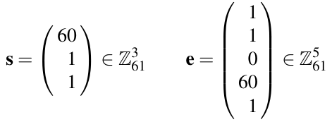

Lưu ý rằng 60 cũng “nhỏ” vì 60 ≡ −1 trong ℤ61.

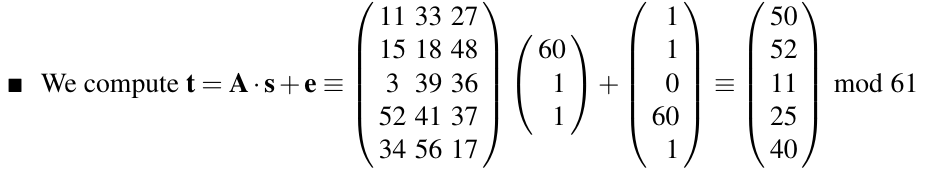

■ Public key chúng ta đã xây dựng bây giờ là: kpub = (t,A).

■ Private key bí mật là kpr = s =

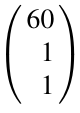

Với public key và private key trong tay, chúng ta có thể bắt đầu mã hóa. Giả sử chúng ta muốn mã hóa bit thông điệp m = 1. Việc này như sau:

■ Để mã hóa, trước hết chúng ta lấy mẫu ba giá trị ngẫu nhiên:

□ một vector ngẫu nhiên r với các giá trị nguyên nhỏ:

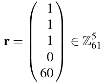

□ một vector ngẫu nhiên eaux với các giá trị nguyên nhỏ:

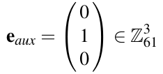

□ và một số nguyên nhỏ ngẫu nhiên emsg = 60 ∈ ℤ61.

■ Tiếp theo, chúng ta encode bit thông điệp m như sau:

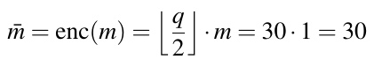

■ Cuối cùng, chúng ta có thể tính ciphertext c:

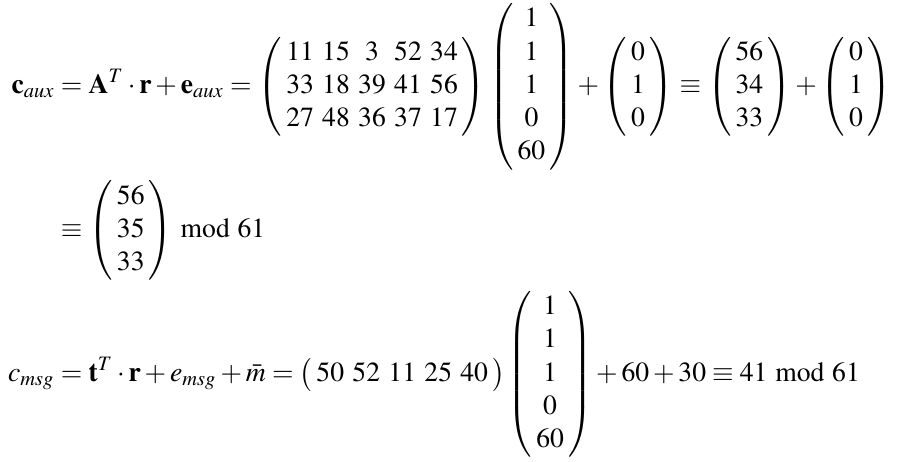

Ciphertext bây giờ có thể được gửi qua kênh.

Ở phía nhận, việc giải mã với private key s hoạt động như sau.

■ Bên nhận trước hết tính một giá trị trung gian từ ciphertext:

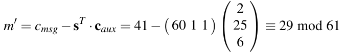

■ Dùng chiến lược decode của chúng ta từ Phương trình (12.8) và được thể hiện trong Hình 12.4, chúng ta khôi phục thành công m = dec(m′) = 1 vì t = 29 gần ⌊q/2⌋ = ⌊61/2⌋ = 30.

Chứng minh tính đúng đắn và bảo mật Chúng ta bắt đầu bằng việc chỉ ra rằng Simple-LWE là an toàn. Chúng ta xét hai chiến lược tấn công khả dĩ: Đối thủ có thể cố tính private key hoặc giải mã ciphertext. Nếu nhìn vào Bước 4 của việc tạo key

t = A · s + e

chúng ta thấy ngay rằng đây là bài toán LWE như được cho trong Định nghĩa 12.2.2. Cụ thể hơn, nếu kẻ tấn công cố tính private key từ public key kpub = (t,A), hắn cần giải bài toán LWE, được tin là bất khả thi nếu các tham số được chọn đúng. Một tấn công thứ hai là tính thông điệp từ bộ ciphertext:

caux = AT · r + eaux

cmsg = tT · r + emsg + m̄

Chúng ta thấy nhanh rằng cấu trúc của caux tương đương một bài toán LWE, vì kẻ tấn công không biết r lẫn eaux. Tương tự, hắn đối mặt với một instance khác của bài toán LWE nếu cố tính m̄ từ cmsg.

Về tính đúng đắn của scheme Simple-LWE, chúng ta đã thấy trong ví dụ rằng bên nhận thực sự khôi phục đúng bit thông điệp. Đây không phải là ngẫu nhiên và có thể chỉ ra rằng thông điệp được khôi phục trong (gần như) mọi trường hợp. Chúng tôi để chứng minh tính đúng đắn đầy đủ này làm bài tập cho độc giả trong Bài tập 12.6.

#### Các thiếu sót của scheme Simple-LWE

Với Simple-LWE, chúng tôi đã giới thiệu một scheme public-key lattice đầu tiên dựa trên giả định LWE. Nhớ rằng scheme không được thiết kế để dùng trong các ứng dụng real-world. Chúng tôi sẽ thảo luận các thiếu sót của Simple-LWE và suy ra các đặc điểm mà các scheme mã hóa lattice-based thực tế nên có.

■ Mã hóa Multi-bit. Simple-LWE chỉ hỗ trợ mã hóa từng bit đơn lẻ. Với các trường hợp sử dụng thực tế, ví dụ, vận chuyển an toàn các key symmetric, điều này không đủ và chúng ta cần mở rộng scheme sang mã hóa multi-bit.

■ Mở rộng Ciphertext. Nhìn vào Ví dụ 12.3, chúng ta nhận thấy scheme mã hóa một thông điệp 1-bit thành một bộ ciphertext c có tổng cộng n + 1 = 4 giá trị từ ℤ61. Mỗi giá trị này cần 6 bit để biểu diễn mọi giá trị khả dĩ ci = {0,...,60} nên toàn bộ ciphertext cần 24 bit. Xét rằng input là một bit thông điệp duy nhất, điều này tương ứng với hệ số mở rộng ciphertext 24. Với các tham số real-world, hệ số mở rộng này sẽ lớn hơn nhiều. Giảm mở rộng ciphertext do đó là một mục tiêu tối ưu quan trọng cho mọi scheme mã hóa lattice-based.

■ Key lớn. Việc dùng ma trận làm public key kéo theo độ phức tạp bậc hai về lưu trữ và băng thông. Dù ví dụ đồ chơi của chúng ta bắt đầu với ma trận A ∈ ℤ615×3, có thể dễ dàng xử lý, nó trở thành thách thức nếu rank n và số chiều k của ma trận ở mức hàng trăm. Các giá trị như vậy là cần thiết cho các instance an toàn của giả định LWE. Làm ví dụ, scheme mã hóa LWE-based FrodoKEM dùng một ma trận vuông A trên ℤq640×640 cho bộ tham số nhỏ nhất và ℤq1344×1344 cho bộ tham số lớn nhất của nó. Chúng ta sẽ thấy sau rằng hiệu quả hơn khi thay một cấu trúc ma trận tốn kém như vậy bằng việc đưa vào các polynomial ring hiệu quả hơn.

■ Phân phối sai số. Khi xem việc tạo các giá trị sai số e và r trong Simple-LWE, người ta thấy rằng chúng ta đã tránh chỉ rõ chính xác các giá trị nguyên “nhỏ” mong muốn được chọn như thế nào. Thực ra, việc lấy mẫu sai số cho các hệ mã hóa LWE-based là non-trivial và đã nhận được nhiều sự chú ý trong tài liệu khoa học. Một số phân phối D có thể được dùng để tạo các vector sai số như vậy bao gồm, chẳng hạn, lấy mẫu từ phân phối Gauss rời rạc hoặc phân phối nhị thức.

Tóm tắt các khía cạnh trên, một scheme mã hóa LWE-based thực tế phải có thể mã hóa một thông điệp multi-bit mà không mở rộng ciphertext quá mức hay kích thước key cực lớn. Để giảm yêu cầu lưu trữ, có một lựa chọn là xây dựng bài toán LWE trên polynomial ring, được gọi là bài toán ring learning with errors, hay Ring-LWE hoặc RLWE. Ring-LWE cho phép dùng một đa thức duy nhất thay vì một ma trận, vốn cần cho các scheme lattice tiêu chuẩn. Dù đa thức có các giá trị lớn, nó vẫn hiệu quả hơn đáng kể về lưu trữ và tính toán so với các scheme dùng ma trận A, vốn cần cho các cryptosystem LWE-based.

### 12.2.3 Bài toán Ring Learning With Errors

Để hiểu Ring-LWE, vốn thay các phép toán ma trận bằng các phép tính dùng đa thức, trước hết chúng ta phải giới thiệu khái niệm polynomial ring. Chúng ta giới hạn ở trường hợp phổ biến nhất được dùng trong lattice cryptography, cụ thể là các scheme dựa trên một polynomial ring được định nghĩa với cái được gọi là đa thức cyclotomic. Cụ thể hơn, chúng ta dùng các đa thức cyclotomic đặc biệt có dạng x2i + 1.

> Định nghĩa 12.2.3 Ring Rq = ℤq[x]/(xn + 1)
>
> Polynomial ring ℤq[x]/(xn + 1) gồm mọi đa thức có bậc tối đa n − 1 với hệ số từ ℤq và n là một lũy thừa của hai, tức là n = 2i.
>
> Các phép toán ring cộng, trừ và nhân được thực hiện như số học đa thức thông thường, với kết quả được rút gọn modulo cyclotomic polynomical *(ghi chú: sách in polynomical; đúng là polynomial)* xn + 1. Mọi hệ số nguyên được rút gọn modulo q.

Polynomial ring ℤq[x]/(xn + 1) có mọi tính chất của một ring, đã được giới thiệu trong Mục 1.4.2. Nếu tích của một phép nhân cho ra một đa thức có bậc n hoặc lớn hơn, nó được rút gọn modulo xn + 1. Trong bối cảnh này, dạng đặc biệt xn + 1 của modulus là có lợi vì phép rút gọn cực kỳ dễ. Nhớ lại rằng xn + 1 ≡ 0 mod xn + 1 đúng. Điều này có thể được viết lại là

xn ≡ −1 mod xn + 1

Nói cách khác, mỗi khi xn xuất hiện, nó có thể được thay bằng −1 khi rút gọn modulo. Từ quan sát này cũng suy ra rằng xn+1 ≡ −x và xn+2 ≡ −x2 và cứ thế nếu chúng ta làm số học modulo xn + 1.

Ví dụ 12.4. Hãy xem phép nhân trong ring R61 = ℤ61[x]/(x2 + 1) dùng các tham số n = 21 và q = 61. Chúng ta xét các đa thức a(x) và b(x) bậc n − 1 = 1 từ R61:

a(x) = 19x + 15 b(x) = 30x + 53

Chúng ta thực hiện phép nhân bằng cách rút gọn mọi phép tính hệ số theo q = 61 và đa thức tích theo x2 + 1. Để rút gọn đa thức, chúng ta dùng x2 ≡ −1 mod x2 + 1, tức là chúng ta chỉ cần thay x2 bằng −1.

a(x) · b(x) = (19 · 30)x2 + (19 · 53 + 15 · 30)x + (15 · 53)

≡ 21x2 + (31 + 23)x + 2 mod x2 + 1

≡ 21(−1) + 54x + 2 mod x2 + 1

≡ 54x + 42 mod x2 + 1

Chúng tôi lưu ý rằng loại tính toán này khá giống số học đa thức trong extension field, đã được giới thiệu trong Mục 4.3.3 trong bối cảnh AES.

◇

Để xây dựng các cryptosystem lattice-based, một sự thật quan trọng là có sự tương tự giữa một ma trận và một polynomial ring về khả năng sinh các cấu trúc đại số như các lattice (ideal). Không đi sâu vào chi tiết toán học, bây giờ chúng ta định nghĩa một bài toán LWE dựa trên polynomial ring thay vì các lattice tiêu chuẩn được trải bởi ma trận.

> Định nghĩa 12.2.4 Bài toán Ring-LWE
>
> Cho Rq ký hiệu ring ℤ[x]q/(xn + 1), trong đó q là số nguyên tố và số nguyên dương n là một lũy thừa của hai. Cho trước các đa thức a và t ∈ Rq.
>
> Ring-LWE là bài toán xác định một đa thức bí mật s ∈ Rq sao cho:
>
> a(x) · s(x) + e(x) = t(x)
>
> trong đó vector sai số e là một đa thức trong ring Rq với các hệ số nguyên nhỏ thu được từ một phân phối rời rạc D.

Chúng tôi dùng chữ đậm cho các đa thức có giá trị hệ số lớn như a(x),t(x) ∈ Rq trong khi dùng chữ thường cho các đa thức như e(x),s(x) chỉ có giá trị nhỏ.

So sánh định nghĩa này với Định nghĩa 12.2.2 trước của bài toán LWE (mà chúng tôi gọi là Standard-LWE), chúng ta dễ dàng thấy các điểm tương đồng. Tuy nhiên, Ring-LWE chỉ cần một đa thức one-dimensional a(x) thay vì ma trận vuông lớn A. Điều này giảm yêu cầu tính toán và bộ nhớ, trong khi bài toán Ring-LWE được giả định là an toàn do sự tương tự với Standard-LWE. Các cryptosystem dựa trên Ring-LWE hiệu quả hơn về mặt tính toán so với Standard-LWE, nhưng có nhược điểm là chúng có nhiều cấu trúc toán học hơn có thể bị khai thác về mặt cryptanalytic.

Như một biện pháp khắc phục mối đe dọa này, một lớp thứ ba các cryptosystem lattice-based đã được đề xuất, kết hợp khái niệm Standard-LWE matrix-based và Ring-LWE polynomial-based thành các lattice module-based (Module-LWE). Như chúng tôi sẽ thảo luận sau trong Mục 12.2.5, các cryptosystem lattice module-based đã thu hút nhiều sự chú ý trong quá trình chuẩn hóa. Đáng tiếc, chúng khá phức tạp và để đơn giản chúng tôi sẽ giữ bài toán Ring-LWE, cho phép chúng ta xây dựng một hệ mã hóa lattice-based thực tế.

### 12.2.4 Scheme mã hóa Ring-LWE

Với Định nghĩa 12.2.4 của bài toán Ring-LWE, chúng ta có các công cụ để trình bày một cryptosystem lattice-based thực tế, là một cải tiến đáng kể so với scheme Simple-LWE. Lưu ý rằng các scheme mã hóa lattice-based real-world trông khá giống nhưng thường có các tinh chỉnh và tối ưu riêng, mà chúng tôi sẽ phác họa trong Mục 12.2.5.

#### Mã hóa và giải mã

Hệ mã hóa Ring-LWE mà chúng tôi trình bày dưới đây ban đầu được Lyubashevski, Lindner và Peikert đề xuất. Vì đã học scheme Simple-LWE, chúng ta sẽ nhanh chóng nhận ra nhiều điểm tương đồng. Tuy nhiên, nhiều hạn chế của Simple-LWE, đã được thảo luận trong Mục 12.2.2, không có trong scheme Ring-LWE.

> Tạo key Ring-LWE
>
> Output: public key: kpub = (t,a) và private key: kpr = s
>
> 1. Chọn a(x) ∈ Rq từ ring Rq = ℤ[x]q/(xn + 1).
>
> 2. Chọn e(x),s(x) ∈ Rq với hệ số từ một tập số nguyên nhỏ theo một phân phối sai số rời rạc D nào đó.
>
> 3. Tính t(x) = a(x) · s(x) + e(x) ∈ Rq.
>
> 4. Trả về public key kpub = (t,a) và private key kpr = s.

Dù mọi biến được dùng trong việc tạo key đều là đa thức trong ring Rq, quan trọng là lưu ý rằng có hai loại đa thức được dùng. Có các đa thức — được ký hiệu bằng chữ đậm như a(x) — với hệ số nguyên “lớn”, và có các đa thức như r(x) với hệ số “nhỏ”. Chúng tôi sẽ thảo luận vấn đề này chi tiết hơn sau khi đã giới thiệu các quy trình mã hóa và giải mã của scheme mã hóa Ring-LWE.

> Mã hóa Ring-LWE
>
> Input: public key kpub = (t,a), thông điệp m ∈ {0,1}n
>
> Output: ciphertext c = (caux,cmsg)
>
> 1. Chọn các đa thức sai số r(x),eaux(x),emsg(x) với hệ số từ một tập số nguyên nhỏ theo phân phối sai số rời rạc D.
>
> 2. Viết n bit thông điệp m thành một đa thức thông điệp m(x) và tạo đa thức đã encode: m̄(x) = enc(m(x)).
>
> 3. Tính caux(x) = a(x) · r(x) + eaux(x).
>
> 4. Tính cmsg(x) = t(x) · r(x) + emsg(x) + m̄(x).
>
> 5. Trả về ciphertext c = (caux,cmsg).

Hãy xem việc giải mã bởi bên nhận:

> Giải mã Ring-LWE
>
> Input: private key kpr = s, ciphertext c = (caux,cmsg)
>
> Output: thông điệp m
>
> 1. Tính m′(x) = cmsg(x) − caux(x) · s(x).
>
> 2. Trả về thông điệp đã decode m = dec(m′(x)).

Trước hết hãy thảo luận độ dài bit mà scheme cần. Các hệ số của các đa thức “lớn” (một lần nữa, đó là các đa thức được in đậm) bị chặn bởi số nguyên q, không lớn như modulus trong trường hợp các cryptosystem RSA hay Elgamal, nơi chúng ta cần ít nhất 2048 bit cho các scheme an toàn. Ngược lại, trong các scheme Ring-LWE, q dài 10–20 bit, tương ứng khoảng 4–8 chữ số thập phân. Chẳng hạn, q = 12,289 được dùng trong cryptosystem NewHope. Thứ hai, chúng ta có các đa thức “nhỏ” s,e,r, eaux,emsg, cũng là phần tử của ring Rq nhưng các hệ số đa thức được chọn từ một phân phối sai số rời rạc D modulo q, chỉ có giá trị nhỏ. Một ví dụ là một phân phối sai số tập trung quanh 0 với giá trị nhỏ, chẳng hạn Dq = {−3,−2,−1,0,1,2,3}q = {58,59,60,0,1,2,3}61 khi q = 61.

Lưu ý rằng một phép tính liên quan tới một đa thức lớn và một đa thức nhỏ, chẳng hạn phép nhân

caux(x) · s(x)

sẽ có một đa thức tích lại có hệ số lớn. Để có cảm nhận tốt hơn về mã hóa Ring-LWE và các phép tính của nó, bây giờ chúng ta sẽ xem một ví dụ.

Ví dụ 12.5. Chúng ta xét một instance của mã hóa Ring-LWE với các tham số đồ chơi n = 23 và q = 61.

Tạo key. Bước ban đầu là tính public key và private key.

■ Trước hết, chúng ta chọn một đa thức ngẫu nhiên a(x):

a(x) = 53x7 + 11x6 + 38x5 + 16x4 + 4x3 + 54x2 + 55x + 7

■ Tiếp theo, chúng ta tạo các đa thức bí mật và sai số ngẫu nhiên s(x) và e(x) từ một phân phối D61 trên các số nguyên nhỏ. Trong ví dụ của chúng ta, chúng ta dùng phân phối Gauss rời rạc D61 ∈ {58,59,60,0,1,2,3}61:

s(x) = 60x6 + x4 + 60x2 e(x) = x7 + 60x6 + x5 + x4 + 59x3 + x2 + 1

■ Bây giờ chúng ta có thể tính phần thứ hai của public key:

t(x) = a(x) · s(x) + e(x) = 34x7 + 30x6 + 44x5 + 26x4 + 50x3 + 60x2 + 19x + 50

■ Cuối cùng, chúng ta trả về public key kpub = (t,a) và private key kpub = (s), trong đó chúng ta mô tả các đa thức đơn giản là một danh sách số nguyên (hay vector số nguyên).

kpub = (t,a) = [(34,30,44,26,50,60,19,50),(53,11,39,16,4,54,55,7)]

kpr = s = (0,60,0,1,0,60,0,0)

Mã hóa. Cho public key kpub = (t,a), chúng ta có thể mã hóa thông điệp m = (0,1,1,0,1,0,0,0) với n = 8 bit. Để làm điều này, chúng ta chuyển thông điệp m thành một đa thức:

m(x) = x6 + x5 + x3

■ Bây giờ chúng ta lấy mẫu các đa thức r, eaux và emsg từ phân phối D61:

r = 60x6 + 2x5 + 60x4 + 60x3 + 2x2 + 2x

eaux = 59x6 + x5 + 60x4 + 60x3 + 60x2 + 60x

emsg = x7 + 60x4 + x3 + 58x + 59

■ Tiếp theo chúng ta encode mọi bit thông điệp vào các hệ số của một đa thức thông điệp dùng quy tắc encode được thể hiện trong Phương trình (12.7): enc(m) = ⌊q/2⌋ · mi = 30 · mi với i = 1,...,8:

m̄(x) = 30x6 + 30x5 + 30x3

■ Sau đó chúng ta tính đa thức ciphertext thứ nhất caux(x):

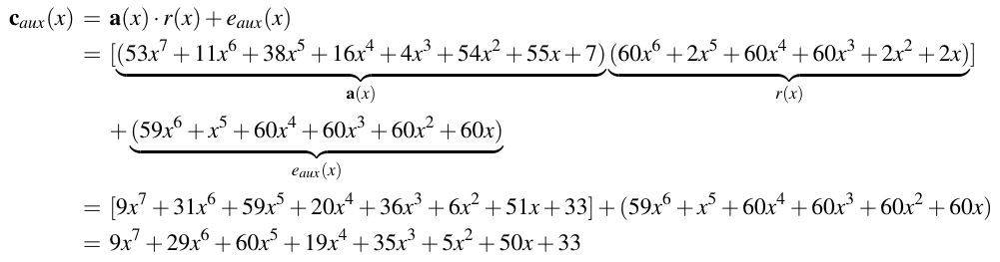

■ Cuối cùng chúng ta tính cmsg(x), cũng bao gồm thông điệp đã encode m̄(x):

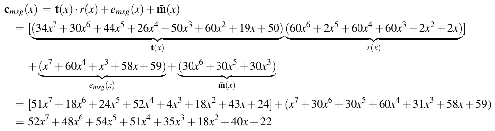

■ Cuối cùng chúng ta thu được ciphertext, được biểu diễn bởi các hệ số của hai đa thức ciphertext:

(caux,cmsg) = ((9,29,60,19,35,5,50,33),(52,48,54,51,35,18,40,22))

Giải mã. Để làm điều này, chúng ta cần có key bí mật kpr = (s) = (0,60,0,1,0,60,0,0) và ciphertext (caux,cmsg) như được tạo trong quá trình mã hóa. Mọi giá trị được chuyển lại thành các đa thức s(x),caux(x) và cmsg(x).

■ Trước hết chúng ta tính m′(x) = cmsg(x) − caux(x) · s(x) như sau:

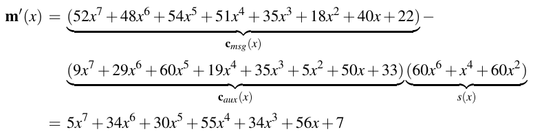

■ Ở bước cuối, chúng ta cần decode từng hệ số của m′(x) dùng hàm dec(x). Nhớ rằng dec(x) sẽ trả về 0 nếu −⌊q/4⌋ ≤ mi′ ≤ ⌊q/4⌋, và 1 trong mọi trường hợp khác. Với q = 61, điều này có nghĩa là các hệ số lớn hơn 45 và nhỏ hơn 16 sẽ được decode thành 0. Với trường hợp còn lại, mọi hệ số giữa 16 và 45 (bao gồm cả hai giá trị) sẽ được decode thành 1.

5x7 → dec(5) = 0 34x3 → dec(34) = 1

34x6 → dec(34) = 1 0x2 → dec(0) = 0

30x5 → dec(30) = 1 56x1 → dec(56) = 0

55x4 → dec(55) = 0 7 → dec(7) = 0

■ Thông điệp đã giải mã là m = (0,1,1,0,1,0,0,0). Như kỳ vọng, nó khớp với thông điệp plaintext gốc của chúng ta.

Tính đúng đắn và bảo mật Trước hết, chúng ta muốn chỉ ra rằng Ring-LWE hoạt động như dự kiến, tức là việc giải mã thực sự đảo ngược phép mã hóa. Chứng minh tính đúng đắn như sau.

Chứng minh. Chúng ta phải chỉ ra rằng phép giải mã dkpr(caux,cmsg) cho ra thông điệp gốc m.

dkpr(caux,cmsg) = dec(cmsg(x) − caux(x) · s(x))

= dec((t(x) · r(x) + emsg(x) + m̄(x)) − (a(x) · r(x) + eaux(x)) · s(x))

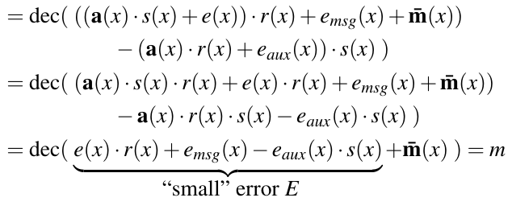 (12.9)

Một giả định nền quan trọng của chứng minh tính đúng đắn là số hạng sai số E = e(x) · r(x) + emsg(x) − eaux(x) · s(x) nhỏ tới mức có thể được sửa bởi hàm decode “dec()” trong hầu như mọi trường hợp, như thể hiện trong Hình 12.4. Tuy nhiên, do bản chất xác suất của mã hóa, vẫn có một cơ hội rất nhỏ là decode có thể thất bại trong trường hợp sai số E tăng quá lớn để có thể được sửa thành công. Tuy nhiên, nếu scheme được thiết kế cẩn thận và các tham số được chọn hợp lý, cơ hội decode thất bại là không đáng kể. Các cryptosystem LWE-based hiện đại quy định tỉ lệ decode thất bại như một tham số bổ sung δ, như có thể thấy trong Bảng12.2 sau trong mục này.

Thứ hai, chúng ta muốn xem bảo mật của scheme Ring-LWE. Chúng ta tự hỏi kẻ tấn công Oscar cần làm gì để phá phép mã hóa. Oscar biết public key kpub = (t,a), ciphertext (caux,cmsg) và, theo nguyên lý Kerckhoffs, cách tạo key, mã hóa và giải mã hoạt động. Tấn công đơn giản nhất là tìm và trích xuất private key kpr = (s), điều sẽ cho phép Oscar thực hiện phép giải mã thông thường được trình bày ở trên, tức là hắn sẽ tính cmsg(x) − caux(x) · s(x). Private key s là một phần của các giá trị public-key đã được tính là:

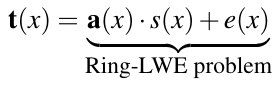

Với t và a đã biết, nhanh chóng trở nên rõ ràng rằng đây là bài toán Ring-LWE như được cho trong Định nghĩa 12.2.4. Như chúng ta nhớ lại từ thảo luận trước, giải bài toán này là bất khả thi về mặt tính toán nếu các tham số được chọn đúng và đủ lớn. Một tấn công khác là trích xuất thông điệp từ ciphertext. Để làm điều này, đối thủ phải xem bước này của phép mã hóa:

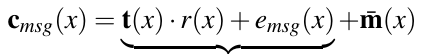 (12.10)

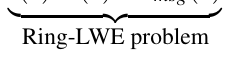

Dù hơi kém rõ ràng hơn, chúng ta sẽ tìm thấy một instance Ring-LWE khác như một phần của việc tính cmsg, trong đó vector sai số r(x) đóng vai trò như đa thức bí mật s(x). Vector sai số r, mà đối thủ không biết, cũng là một phần của instance Ring-LWE thứ hai chứa trong caux và được dùng để triệt tiêu mọi đa thức có hệ số lớn khi kết hợp cmsg và caux trong quá trình giải mã.

Lưu ý rằng thông điệp m̄(x) đã được trộn vào bài toán Ring-LWE bằng phép cộng trong Phương trình (12.10). Kẻ tấn công cần tính bài toán Ring-LWE trước để có thể tách t(x) · r(x) + emsg(x) và m̄(x).

Một phần thiết yếu của cryptosystem Ring-LWE là chọn đúng các số hạng sai số. Một mặt, sai số tích lũy E trong Phương trình (12.9) được cộng vào thông điệp cần đủ nhỏ để vẫn nằm trong khoảng được gán thể hiện trong Hình 12.4. Nếu không, việc decode trong quá trình giải mã sẽ không khả thi. Mặt khác, phân phối sai số cần cung cấp các giá trị đủ lớn để Ring-LWE thực sự là một bài toán khó cho kẻ tấn công. Việc chọn các tham số tối ưu để thỏa cả hai yêu cầu là thách thức, như được thảo luận chi tiết hơn trong mục tiếp theo.

### 12.2.5 LWE trong thực tế

Với (Ring-)LWE, chúng tôi đã giới thiệu một bài toán lattice-based tổng quát và scheme mã hóa. Điều chúng tôi muốn làm bây giờ là thảo luận các tham số thực tế người ta phải chọn để scheme chống được các kẻ tấn công mạnh. Vì lattice-based cryptography là một lĩnh vực khá trẻ của cryptography — được đề xuất trong công trình mang tính nền tảng của Miklós Ajtai năm 1996 và Oded Regev năm 2005 — cryptanalysis của các cấu trúc lattice-based hiệu quả và an toàn vẫn là một lĩnh vực nghiên cứu sôi động. Chúng tôi lưu ý rằng việc tham số hóa phức tạp hơn đáng kể so với RSA hay các scheme logarit rời rạc như trao đổi key Diffie-Hellman hay mã hóa Elgamal, nơi bảo mật phụ thuộc phần lớn vào một tham số duy nhất, cụ thể là modulus. Ngược lại, có sự tương tác của vài tham số cho các scheme Ring-LWE, bao gồm kích thước đa thức, modulus q và phân phối sai số. Một ví dụ là một instance Ring-LWE do Regev đề xuất với các tham số n = 128 và q = 16,411 dùng một phân phối sai số Dq dựa trên phân phối Gauss rời rạc với phương sai được chọn cẩn thận (σ = 29.6). Cấu hình cụ thể này được giả định vào đầu năm 2015 là cung cấp bảo mật tương đương một symmetric cipher 71-bit. Tuy nhiên, sau hai năm nghiên cứu với các kết quả cryptanalytical mới, hóa ra các tham số này chỉ cung cấp mức bảo mật 48 bit, tức là instance Ring-LWE này có thể bị phá khá dễ dàng.

Chúng ta đã học rằng việc thay biến thể ma trận của LWE (Standard-LWE) bằng biến thể đa thức (Ring-LWE) đi kèm lợi ích triển khai đáng kể, đặc biệt về yêu cầu lưu trữ. Tuy nhiên, nhược điểm của một scheme mã hóa Ring-LWE-based là các chứng minh bảo mật bảo đảm rằng LWE là một bài toán khó không đơn giản mở rộng sang phiên bản Ring-LWE. Ring-LWE được giả định là an toàn cho tới nay (với điều kiện chọn các tham số bảo mật phù hợp), nhưng cấu trúc ngầm suy ra từ các đa thức cyclotomic của nó có thể cho phép các tấn công hiệu quả hơn. Để đáp lại điều đó, một phiên bản trung gian của LWE gọi là Module-LWE đã được đề xuất nhằm kết hợp cả hai biến thể: nó áp dụng cấu trúc ma trận của Standard-LWE với hiệu quả của các đa thức có cấu trúc làm phần tử ma trận. Một tổng quan cấu trúc của cả ba phiên bản LWE khác nhau được mô tả trong Hình 12.5. Nó cũng làm nổi bật các yêu cầu lưu trữ khác nhau của A, từ scheme gọn nhất Ring-LWE (4 phần tử của một đa thức) tới Standard-LWE là scheme memory-consuming nhất (16 phần tử trong một ma trận).

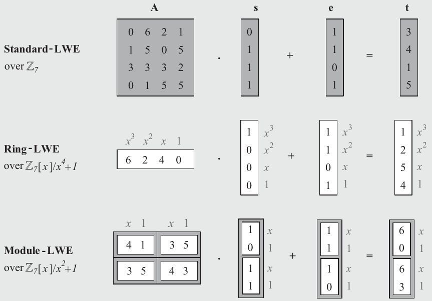

Hình 12.5 Các khác biệt cấu trúc giữa các biến thể LWE với 4 × 4 phần tử trong A. Các ô xám biểu diễn ma trận hoặc vector trong khi các ô trắng ký hiệu đa thức. Standard-LWE tính toán với ma trận và vector, Ring-LWE dùng đa thức thay vào đó và Module-LWE dùng hỗn hợp cả hai.

Như mọi scheme public-key, bất kỳ cryptosystem LWE-based nào cũng chậm hơn vài bậc độ lớn so với các symmetric cipher như AES. Do đó, ứng dụng chính của mã hóa PQC là thiết lập key giữa hai bên qua một kênh không an toàn (thay vì mã hóa khối lượng dữ liệu lớn). Key sau đó được dùng cho một symmetric cipher nhanh như AES. Trong thực tế, việc thiết lập key này thường được hiện thực qua một key encapsulation mechanism (KEM), đã được giới thiệu trong Mục 7.8. Bảng 12.2 liệt kê ba scheme KEM LWE-based có vẻ rất hứa hẹn để dùng trong thực tế, theo sau là giải thích các hàng ngoài cùng bên phải của bảng. Lưu ý rằng một số tham số rất cụ thể, ví dụ, cho phân phối sai số, được bỏ qua để đơn giản.

Bảng 12.2 Các bộ tham số cho các scheme key encapsulation LWE-based

| Scheme | Loại | Bảo mật tương đương | n | k | q | δ |
|---|---|---|---|---|---|---|
| KYBER-512 | Module-LWE | AES-128 | 256 | 2 | 3329 | 2−139 |
| KYBER-768 | Module-LWE | AES-192 | 256 | 3 | 3329 | 2−164 |
| KYBER-1024 | Module-LWE | AES-256 | 256 | 4 | 3329 | 2−174 |
| NEWHOPE-512 | Ring-LWE | AES-128 | 512 | 1 | 12289 | 2−213 |
| NEWHOPE-1024 | Ring-LWE | AES-256 | 1024 | 1 | 12289 | 2−216 |
| FRODOKEM-640 | Standard-LWE | AES-128 | 640 | 1 | 215 | 2−138.7 |
| FRODOKEM-1340 | Standard-LWE | AES-256 | 1340 | 1 | 216 | 2−252.5 |

■ n ký hiệu số hệ số và bậc của đa thức của instance LWE.

■ k biểu diễn số chiều của lattice như một bội số của n, ví dụ, với KYBER768 chúng ta có k · n = 3 · 256 = 768 hệ số trải lattice tương ứng.

■ q là modulus cho của ring ℤq.

■ δ là xác suất giải mã thất bại do một lỗi trong quá trình decode.

Chúng tôi cũng nhận xét rằng các bộ tham số từ Bảng 12.2 được thiết kế để cung cấp mức bảo mật lần lượt tương đương AES với key 128, 192 và 256-bit. Cryptosystem NewHope (Ring-LWE) và KYBER (Module-LWE) đều chia sẻ nhiều đặc điểm với scheme Ring-LWE cơ bản được giới thiệu trong Mục 12.2.4. Hai scheme dùng vài tối ưu tính toán để cải thiện hiệu năng và giảm kích thước ciphertext. Như trong trường hợp các scheme public-key đã được thiết lập, hiệu năng luôn liên quan tới paramatrization *(ghi chú: sách in paramatrization; đúng là parametrization)* của cryptosystem và có một sự thỏa hiệp giữa bảo mật và hiệu quả. Chúng tôi cũng đưa vào scheme mã hóa lattice-based bảo thủ hơn FRODO-KEM, dựa trên Standard-LWE.

Như một nhận xét cuối, chúng tôi lưu ý rằng trong mục này chúng tôi tập trung vào bài toán LWE và các biến thể của nó nhưng tồn tại một số bài toán lattice-based liên quan khác. Chúng bao gồm bài toán Shortest Integer Solution (SIS), bài toán Learning with Rounding (LWR) và bài toán NTRU. Với chúng cũng có thể xây dựng các scheme digital signature quantum-resistant không được đề cập trong chương này.

### 12.2.6 Nhận xét cuối

Vài cryptosystem lattice-based hiện đang được xem xét để chuẩn hóa. Chúng phổ biến vì linh hoạt hơn các scheme PQC khác và cung cấp một sự thỏa hiệp tốt giữa các lập luận bảo mật và sức mạnh cryptanalytic trước các tấn công cổ điển và lượng tử. Như đã nhắc trước đó, lattice-based và các scheme PQC khác hỗ trợ mã hóa không được thiết kế cho mã hóa khối lượng dữ liệu lớn mà đặc biệt cho vận chuyển key và do đó chỉ hỗ trợ key encapsulation mechanism (KEM). Sau đây là các thuật toán chung kết sau Vòng 3 của nỗ lực chuẩn hóa post-quantum cryptography của NIST (xem Mục 12.5):

■ KYBER: Scheme key encapsulation này được NIST chọn năm 2022 làm ứng viên cuối cùng để chuẩn hóa dưới tên ML-KEM. Nó dựa trên độ khó của bài toán LWE module-based, và được thiết kế để kết hợp hiệu quả cao của các đề xuất Ring-LWE-based với các lập luận bảo mật bảo thủ của LWE dùng ma trận và lattice tiêu chuẩn.

■ DILITHIUM: Một scheme digital signature dựa trên bài toán LWE module-based cũng được dùng cho KYBER. Lưu ý rằng, khác với RSA mà scheme mã hóa và digital signature rất giống nhau và đơn giản về khái niệm, việc xây dựng một scheme chữ ký lattice-based thách thức hơn về mặt kỹ thuật. Đặc biệt, tìm một instance phù hợp có thể được dùng làm chữ ký cho một thông điệp cho trước là non-trivial và liên quan tới một bước từ chối kích hoạt một lần thử ký khác trong trường hợp thất bại. DILITHIUM cũng được NIST chọn năm 2022 làm ứng viên chuẩn hóa dưới tên ML-SIG.

■ FALCON: Một scheme digital signature kết hợp vài cải tiến hiệu quả cho ra kích thước chữ ký và key nhỏ hơn với cái giá là độ phức tạp triển khai cao hơn. Do kích thước chữ ký nhỏ hơn và việc kiểm chứng nhẹ, FALCON được NIST chọn làm ứng viên để công bố thành tiêu chuẩn FN-SIG.

## 12.3 Code-Based Cryptography

Trong mục này, chúng tôi sẽ giới thiệu các cryptosystem dựa trên các bài toán khó từ lý thuyết mã. Thú vị là cryptosystem code-based đầu tiên đã được Robert J. McEliece đề xuất năm 1978 và do đó cũng lâu đời như thuật toán RSA được dùng cực kỳ rộng rãi (và gần như lâu đời như trao đổi key Diffie-Hellman, đã được phát minh sớm hơn một năm). Một câu hỏi nảy ra ngay là vì sao cryptosystem McEliece không trở nên phổ biến gần bằng RSA trong bốn thập kỷ qua. Chúng tôi sẽ giải đáp câu hỏi này trong phần còn lại của mục này. Nhưng trước hết chúng tôi cần cung cấp một số kiến thức nền về lý thuyết mã, cần để hiểu các cryptosystem code-based.

Như tên gọi gợi ý, code-based cryptography dựa trên các mã sửa lỗi (error correction code). Chúng được dùng để phát hiện và sửa các lỗi xảy ra trong quá trình truyền dữ liệu, ví dụ, trên một liên kết không dây trong mạng di động. Các scheme mã lỗi là không thể thiếu đối với mọi truyền thông số hiện đại, bao gồm mọi loại kết nối mạng có dây và không dây. Chúng tôi lưu ý rằng mã sửa lỗi cũng là một phần của mọi hệ thống lưu trữ dữ liệu, như ổ cứng máy tính hay thẻ nhớ. Trong mọi trường hợp này (và đặc biệt trên các kênh không dây), thông điệp có khả năng bị hỏng — ví dụ, qua việc lật một số bit — để bên kia không nhận đúng thông điệp gốc.

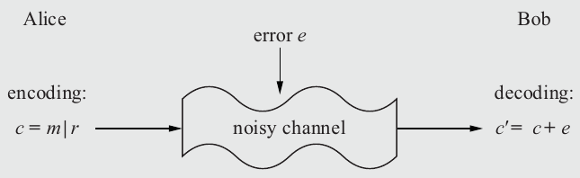

Hình 12.6 Truyền một thông điệp m qua một kênh nhiễu với error-coding

Cách tiếp cận cơ bản để cứu vãn tình hình là thêm một số thông tin dư thừa bổ sung r vào thông điệp gốc m. Thông điệp cùng với thông tin dư thừa tạo thành cái được gọi là một codeword c. Như thể hiện trong Hình 12.6, thông tin bổ sung có thể đơn giản được nối vào thông điệp. Nói chung, codeword c không cần chứa thông điệp dạng rõ và m và r không phải tách biệt chặt chẽ với nhau, nhưng để rõ ràng chúng tôi giới hạn ở trường hợp đặc biệt c = m|r trong phần còn lại của chương này.

Nếu một lỗi xuất hiện trong khi truyền, một codeword bị thay đổi c′ sẽ được nhận. Giả định nền tảng là bên nhận có thể phân biệt giữa codeword hợp lệ và codeword bị hỏng. Nếu mọi thứ hoạt động đúng, bên nhận có thể xác định rằng một lỗi đã xảy ra (trong trường hợp các scheme phát hiện lỗi) hoặc thậm chí sửa các lỗi e (trong trường hợp các scheme sửa lỗi). Trong trường hợp trước, bên nhận có thể yêu cầu người gửi truyền lại thông điệp. Không ngạc nhiên, phát hiện và sửa lỗi chỉ hoạt động nếu các lỗi xuất hiện nằm trong giới hạn mà mã được chọn có thể xử lý, tức là nếu xảy ra quá nhiều lỗi, mã không thể phát hiện hay sửa chúng thành công. Tiếp theo, chúng tôi sẽ giới thiệu một họ mã tuyến tính mà với nó chúng ta có thể minh họa chức năng cơ bản của encode và decode.

### 12.3.1 Mã tuyến tính (Linear Codes)

Trong mục này, chúng tôi sẽ giới thiệu nguyên lý của mã sửa lỗi. Chúng tôi sẽ dùng các mã tuyến tính nhị phân mà, như chúng ta sẽ thấy, có thể dễ dàng được decode. Tuy nhiên, với các mã phức tạp hơn, decode có thể là một bài toán rất khó có thể được dùng để xây dựng các cryptosystem asymmetric. Mục này sẽ được dùng làm động cơ cho bài toán syndrome decoding, được mô tả trong Mục 12.3.2, vốn là cốt lõi của các scheme PQC code-based.

Hình 12.7 cho thấy việc truyền dữ liệu với mã tuyến tính hoạt động như thế nào ở mức cao.

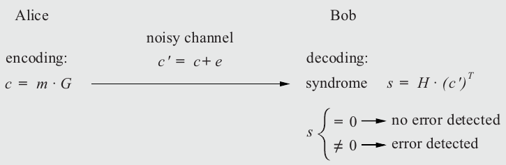

Hình 12.7 Nguyên lý của mã hóa sửa lỗi tuyến tính

Trước khi thảo luận ba giai đoạn được thể hiện trong hình, trước hết hãy định nghĩa hai tham số quan trọng, cụ thể là k là độ dài của thông điệp m, và n là độ dài của codeword được xây dựng, xem Hình 12.8. Mọi độ dài được cho tính bằng bit. Từ hình rõ ràng rằng phần dư thừa r có (n − k) bit.

Bây giờ chúng ta xem ba giai đoạn trong quá trình sửa lỗi từ Hình 12.7:

Encoding Alice, người gửi, tính một codeword từ thông điệp m của mình bằng cách thêm một số bit dư thừa. Phép tính này được làm đơn giản bằng cách nhân thông điệp với một generator matrix G:

c = m · G

Như thể hiện trong Hình 12.6, codeword gồm một số thông tin dư thừa ký hiệu là r và thông điệp: c = m|r.

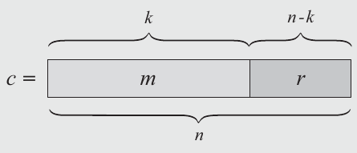

Hình 12.8 Mỗi codeword n-bit c gồm k bit thông điệp và n − k bit thông tin dư thừa

Truyền dẫn Trong quá trình truyền dữ liệu trên kênh, lỗi có thể xảy ra, dẫn tới một codeword bị thay đổi c′. Chúng ta coi các lỗi này là các lần lật bit[^4]. Nói theo toán học, điều này có thể được biểu diễn bằng cách cộng một vector lỗi e vào codeword:

c′ = c + e

Quan trọng là lưu ý rằng lỗi là một vector bit nên phép cộng là một phép XOR bit-wise. Nói cách khác, ở các vị trí bit mà vector lỗi e có giá trị “1”, bit của codeword c bị lật và do đó một lỗi xảy ra. Ở các vị trí mà e có bit “0”, không có lỗi xảy ra.

Decoding Bên nhận Bob phải decode thông điệp. Anh ấy tính cái được gọi là syndrome s từ codeword nhận được c′:

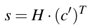 (12.11)

Phép tính là một phép nhân matrix-vector với parity-check matrix H so-called. Syndrome là then chốt cho quá trình coding: Nếu syndrome s có giá trị không, không phát hiện lỗi nào. Nếu s khác không, một lỗi đã được phát hiện. Nếu không quá nhiều bit bị lật, các bit lỗi thậm chí có thể được Bob sửa. Lưu ý rằng (c′)T là phiên bản chuyển vị của codeword c′ như đã giới thiệu ở mục trước về lattice-based cryptography. Trong trường hợp này, nó đơn giản có nghĩa là vector hàng c′ được xoay 90◦ và biến thành một vector cột.

Sau đây, chúng tôi sẽ xây dựng khái niệm toán học đằng sau mã tuyến tính, bao gồm cách generator matrix G và parity-check matrix H được xây dựng sao cho r phụ thuộc tuyến tính vào m.

Nói chung, có hai cách mô tả một mã. Cách thứ nhất là định nghĩa các quy tắc để xây dựng mọi codeword thuộc về mã. Chính điều này đạt được bởi generator matrix G: Mọi tổ hợp tuyến tính khả dĩ của các hàng của G tương ứng với một codeword hợp lệ mà chúng ta thu được khi encode một thông điệp. Chúng ta nhân m với G, cho chúng ta codeword hợp lệ tương ứng với m.

Với cách thứ hai, chúng ta có thể định nghĩa một mã dựa trên các quy tắc xác định một codeword cho trước có hợp lệ hay không. Đó là trực giác đằng sau parity-check matrix H. Mỗi khi nhân H với một word cho trước c̃, kết quả là 0 nếu và chỉ nếu c̃ là một codeword hợp lệ. Tính chất này của parity-check matrix là nền tảng cho bất kỳ mã sửa lỗi nào. Nó cho phép bên nhận phân biệt các codeword hợp lệ được người gửi xây dựng với các codeword không hợp lệ bị hỏng do lỗi bit. Syndrome trong Phương trình (12.11) cho chúng ta chính thông tin này nhờ quan sát (đơn giản) sau: Nhớ lại rằng codeword nhận được gồm codeword gốc và vector lỗi, tức là c′ = c + e. Do đó, phép tính syndrome có thể được biểu diễn là:

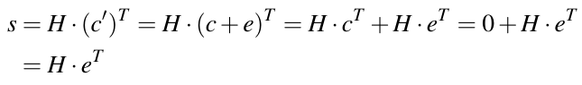 (12.12)

Do đó, syndrome s từ Phương trình (12.11) luôn là tích của parity-check matrix và vector lỗi.

Một trong hai ma trận G và H là đủ để định nghĩa mã. Khi biết generator matrix G, người ta có thể tính một parity-check matrix H tương ứng và ngược lại. Với ví dụ sau, chúng tôi minh họa cách tìm generator matrix G cho một parity-check matrix H cho trước để có thể encode bất kỳ thông điệp nào.

Ví dụ 12.6. Giả sử một thông điệp m gồm k = 4 bit, nên m = (m1,m2,m3,m4). Chúng ta muốn tạo một codeword c có độ dài bảy bit (n = 7) với ba bit (n − k = 7 − 4 = 3) dư thừa r. Do đó codeword có dạng:

c = (m|r) = (m1,m2,m3,m4,r1,r2,r3)

Ma trận H có kích thước (n − k) × n = 3 × 7, trong đó các phần tử ma trận thuộc GF(2). Nhớ lại rằng đây là finite field có hai phần tử[^5]. Chúng ta dùng parity-check matrix sau trong ví dụ này:

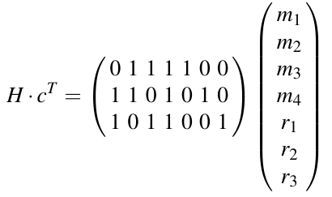 (12.13)

Chúng ta đã biết bốn bit đầu tiên của codeword c, cụ thể là (m1,m2,m3,m4) nhưng vẫn cần tính các bit dư thừa (r1,r2,r3). Nhớ lại rằng một tính chất thiết yếu của H là kết quả của Phương trình (12.13) là vector không, tức là HcT = 0. Với điều này, chúng ta có thể suy ra một hệ phương trình tuyến tính từ Phương trình (12.13):

m2 + m3 + m4 + r1 ≡ 0 mod 2

m1 + m2 + m4 + r2 ≡ 0 mod 2

m1 + m3 + m4 + r3 ≡ 0 mod 2

Tập phương trình tuyến tính này có thể được viết lại là:

r1 ≡ m2 + m3 + m4 mod 2

r2 ≡ m1 + m2 + m4 mod 2

r3 ≡ m1 + m3 + m4 mod 2

Ba phương trình xác định phần dư thừa r từ thông điệp 4-bit m để chúng ta có thể tạo một codeword hợp lệ c. Vì ba bit ri là tổ hợp tuyến tính của các bit thông điệp, chúng ta có thể viết việc xây dựng codeword dưới dạng một phép nhân ma trận (cũng là một phép toán tuyến tính):

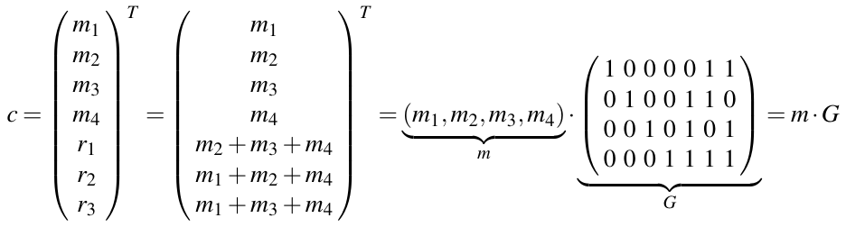

Ví dụ này cho thấy cách một generator matrix G có thể được xây dựng từ H. Nó có kích thước 4 × 7, tức là nó gồm k = 4 hàng và n = 7 cột. Như thể hiện trong Hình 12.7, nó được Alice dùng trong quá trình encode.

◇

Sau ví dụ này, bây giờ chúng ta có thể đưa ra một định nghĩa tổng quát của một mã tuyến tính.

> Định nghĩa 12.3.1 Mã tuyến tính (nhị phân) ((Binary) Linear Codes)
>
> Cho một parity-check matrix H có kích thước (n − k) × n trên bất kỳ prime field GF(p) nào. Với mã tuyến tính nhị phân, field là GF(2).
>
> Chúng ta định nghĩa mã tuyến tính C là tập mọi vector c ∈ GF(2)n với n phần tử mà H · cT = 0 đúng.
>
> Tập C định nghĩa mọi codeword hợp lệ của một mã tuyến tính (n,k), trong đó n được gọi là độ dài và k là số chiều của mã.
>
> Bất kỳ ma trận k × n G nào có row space bằng C được gọi là một generator matrix của C và có thể được dùng để encode bởi c = m · G. Một mã có thể được định nghĩa tương đương bởi generator matrix của nó thay vì parity-check matrix của nó.

Row space được dùng trong định nghĩa trên đơn giản là tập mọi tổ hợp tuyến tính khả dĩ của các hàng của H.

Với định nghĩa này, có nhiều lựa chọn để xây dựng một mã tuyến tính. Các mã đơn giản được biết tới là mã parity-check hay mã lặp (repetition code). Trong phần bài tập, chúng tôi sẽ đưa ra thêm một số ví dụ về cách dùng mã tuyến tính trong các ứng dụng mã lỗi phổ biến (xem Bài tập 12.7, 12.8 và 12.9). Lưu ý rằng chúng tôi tập trung vào các mã tuyến tính nhị phân đơn giản (có hệ thống) để rõ ràng, trong khi tồn tại các mã tuyến tính phức tạp hơn trên các finite field khác cũng được dùng rộng rãi trong thực tế.

Bây giờ chúng ta sẽ xem một ví dụ khác cho phép chúng ta khám phá một số khía cạnh nền tảng của mã sửa lỗi, đặc biệt là khái niệm khả năng sửa lỗi.

Ví dụ 12.7. Chúng ta lại giả sử một mã tuyến tính với các tham số k = 4, n = 7. Generator matrix giống như trong ví dụ trước:

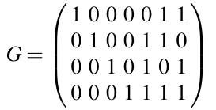

Ma trận parity-check tương ứng với n − k = 3 và n = 7 được định nghĩa bởi:

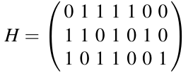

Một đặc điểm then chốt của mã là khả năng sửa lỗi cực đại t. Tham số này chỉ số lần lật bit tối đa trong khi truyền có thể được sửa. Để suy ra t, chúng ta phải xem mọi codeword hợp lệ. Sau đó chúng ta phải xác định khoảng cách Hamming nhỏ nhất giữa mọi codeword đó. Khoảng cách Hamming giữa hai vector bit là số vị trí mà chúng khác nhau. Chẳng hạn, khoảng cách Hamming giữa (1101) và (1011) là hai vì chúng khác nhau ở vị trí bit thứ hai và thứ ba.

Trong mã chúng ta xét ở đây, ta có k = 4 và do đó có 24 = 16 thông điệp khả dĩ, dẫn tới 16 codeword hợp lệ. Làm ví dụ, chúng ta xét thông điệp m = (1 0 1 0). Như đã chỉ ra trước đó, encode thông điệp thu được bằng cách nhân m với generator matrix G, tức là,

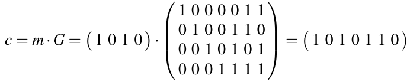

Nếu làm tương tự với mọi thông điệp four-bit khả dĩ, chúng ta thu được một danh sách đầy đủ mọi thông điệp m khả dĩ và các codeword c tương ứng như được trình bày dưới đây.

Thông điệp m Codeword c

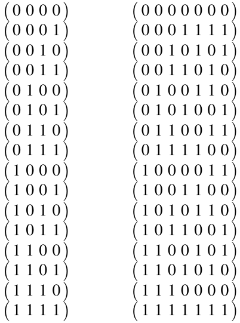

Bây giờ chúng ta phải xác định khoảng cách Hamming giữa mọi cặp codeword khả dĩ. Nếu làm điều đó, chúng ta thấy rằng khoảng cách Hamming nhỏ nhất là d = 3. Điều này có nghĩa là hai codeword bất kỳ khác nhau ở ít nhất ba vị trí bit. Từ đây dễ thấy rằng khả năng sửa lỗi là

t = ⌊(d − 1)/2⌋ = 1

Đằng sau biểu thức này là nguyên lý rằng nếu t = 1 lỗi bit đã xuất hiện, có một code word gần nhất, chứa thông điệp gốc. Code word gần nhất c này có khoảng cách Hamming một từ c′ nhận được, trong khi mọi codeword khác sẽ có khoảng cách Hamming ít nhất hai. Nói cách khác, mã tuyến tính cho trước có khả năng sửa bất kỳ lỗi single-bit nào có thể xảy ra trong khi truyền. Một lỗi như vậy sẽ lật đúng một bit trong bất kỳ codeword nào được liệt kê ở trên. Có bảy vector lỗi e = (e1,...,e7) sẽ gây ra một lần lật bit như vậy: Các vector lỗi có một bit ei với giá trị 1 và mọi giá trị bit khác là 0.

Bây giờ chúng ta có thể dùng bảy vector lỗi để tính mọi syndrome cho phép sửa một lỗi one-bit. Chúng ta đạt điều này bằng cách nhân các vector lỗi này với parity-check matrix. Nhớ lại rằng điều này là do hệ thức s = H · (c′)T = H · eT được giới thiệu trong Phương trình (12.12). Làm ví dụ, chúng ta xét vector lỗi e = 0 0 0 0 1 0 0. Vector này dẫn tới syndrome s sau:

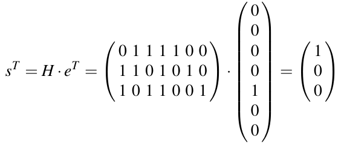

Nếu lặp lại phép tính này với cả bảy vector lỗi, chúng ta thu được danh sách dưới đây:

Lỗi e Syndrome s

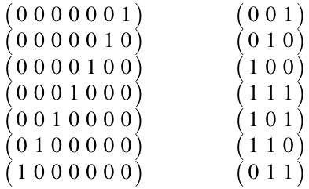

Bảng này thiết yếu cho việc decode: Nếu bên nhận, Bob, tính được bất kỳ syndrome nào trong bảy syndrome được thể hiện ở cột bên phải, anh ấy có thể tra vector lỗi tương ứng. Để sửa lỗi, anh ấy chỉ cần cộng e vào codeword nhận được c′ và thu được codeword ban đầu được Alice gửi:

c = c′ + e

Điều này ngay lập tức cho Bob thông điệp gốc vì k bit đầu tiên của code word là thông điệp, xem Hình 12.8.

◇

### 12.3.2 Bài toán Syndrome Decoding

Như chúng ta biết, mọi cryptosystem asymmetric đều dựa trên một bài toán khó mà kẻ tấn công không thể giải. Để xây dựng một scheme PQC dựa trên mã, mục tiêu của chúng ta là biến bước decode thành một bài toán khó về mặt tính toán. Đáng tiếc, decode trong Ví dụ 12.7 ở trên có vẻ đơn giản và không đặc biệt khó, vì nó chỉ cần các phép toán ma trận đơn giản. Tuy nhiên, sự dễ dàng mà chúng ta có thể decode (và do đó tìm lỗi) là do chúng ta dùng một mã nhỏ có khả năng sửa lỗi rất thấp, cụ thể là t = 1. Nếu tăng t, bước decode trở nên phức tạp hơn đáng kể trong trường hợp tổng quát. Để có cảm nhận về điều đó, hãy giả sử khả năng sửa lỗi lên tới t = 8 cho một mã với n = 2048 bit. Dù kích thước mã này có vẻ đã lớn, chúng ta sẽ thấy sau rằng cần các giá trị n còn lớn hơn để đạt các cryptosystem code-based an toàn.

Nếu tính bảng với mọi syndrome khả dĩ cho một mã như vậy như đã làm trong ví dụ trên, bảng trở nên rất lớn vì chúng ta cần xét mọi tổ hợp lỗi trong khoảng từ 1 tới 8 lỗi khả dĩ. Số tổ hợp lỗi được cho bởi các hệ số nhị thức tương ứng:

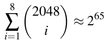

Một lookup table như vậy sẽ lớn một cách vô lý, vì nó sẽ chứa 32 triệu terabyte mục. Thực ra, trừ khi có cấu trúc toán học trong mã cho phép một cách dễ về mặt tính toán để ánh xạ syndrome tới vector lỗi e có Hamming weight nhỏ hơn hoặc bằng t, đây là một bài toán khó trong trường hợp tổng quát. Nó được biết tới là bài toán syndrome decoding và đã được Berlekamp, McEliece và van Tilborg xác định năm 1978. Bây giờ chúng tôi đưa ra một định nghĩa hình thức của bài toán.

> Định nghĩa 12.3.2 Bài toán Syndrome Decoding
>
> Cho một mã (tuyến tính) với parity-check matrix H có kích thước (n − k) × n trên binary field GF(2), một syndrome s gồm n − k bit và khả năng sửa lỗi cực đại t. Chúng ta gọi nhiệm vụ tìm một vector n-bit e không vượt quá Hamming weight HW(e) ≤ t sao cho
>
> H · eT = s
>
> là bài toán syndrome decoding.

Ràng buộc HW(e) ≤ t làm cho bài toán rất khó trong trường hợp tổng quát. Thực ra, nó có thời gian chạy hàm mũ trong trường hợp xấu nhất.

Dù bài toán syndrome decoding hứa hẹn cho cryptography, nó không hữu ích cho mã sửa lỗi, nơi mục tiêu là tìm vector lỗi đã làm hỏng dữ liệu. Vì lý do này, từ những năm 1960, cộng đồng lý thuyết mã đã phát triển một số lượng lớn mã sửa lỗi cho phép quá trình decode hiệu quả. Nguyên lý cơ bản luôn là đưa cấu trúc toán học vào mã để việc decode trở nên khả thi. Các thuật toán decode Well-known cho mã sửa lỗi được dùng trong thực tế là, ví dụ, thuật toán Berlekamp-Massey và thuật toán Patterson.

Để xây dựng các scheme public-key, người ta phải kết hợp hai mục tiêu mâu thuẫn: Đối thủ phải đối mặt với bài toán syndrome decoding (rất khó về mặt tính toán), trong khi chủ sở hữu private key phải có thể dùng một thuật toán decode hiệu quả. Ý tưởng của các scheme PQC code-based là Bob, chủ sở hữu cặp key private/public, dùng một mã mà anh ấy có thuật toán decode hiệu quả. Tuy nhiên, anh ấy không công khai mã gốc mà che giấu mã bằng cách thêm tính ngẫu nhiên vào nó. Chẳng hạn, trong scheme McEliece, mã gốc mà Bob có thể decode được cho bởi generator matrix G. Nếu kẻ tấn công biết G, hắn cũng có thể decode. Do đó Bob chỉ công bố Ĝ trong đó anh ấy giấu G bằng cách nhân nó với hai ma trận ngẫu nhiên: kpub = Ĝ = S × G × P. Trong Mục 12.3.3 dưới đây, chúng tôi sẽ giới thiệu chi tiết hai scheme mã hóa asymmetric dựa trên nguyên lý này.

### 12.3.3 Các scheme mã hóa

Code-based PQC scheme có thể được dùng để mã hóa dữ liệu, và được dùng trong thực tế đặc biệt cho vận chuyển key. Tóm gọn, Bob công bố một mã tuyến tính được giấu trong public key của mình. Nếu Alice muốn gửi một thông điệp plaintext, cô ấy thực hiện một phép encode của mã tuyến tính đó. Cô ấy cũng đưa vào một cách nhân tạo một lỗi trong phép encode. Khi Bob nhận thông điệp đã encode, anh ấy chạy phép decode, loại bỏ các lỗi, để thu được plaintext. Tuy nhiên, decode chỉ dễ và hiệu quả nếu mã thực sự được biết. Một kẻ tấn công, Oscar, nghe lén, do đó không thể lấy đúng thông điệp vì Bob giấu mã trước khi công bố nó. Bảo mật của các scheme code-based này dựa trên giả định rằng đối thủ không thể giải bài toán syndrome decoding hay một bài toán liên quan cho mã (có vẻ) ngẫu nhiên trong public key. Bây giờ chúng tôi giới thiệu cryptosystem code-based đầu tiên, được Robert McEliece đề xuất năm 1978, và sau đó là scheme mã hóa Niederreiter.

#### Cryptosystem McEliece

Để xây dựng một hệ mã hóa public-key, McEliece nhận thấy rằng chúng ta có thể dễ dàng biến phép encode của một mã sửa lỗi thành mã hóa và, tương tự, decode thành một phép giải mã. Để cách tiếp cận này hoạt động an toàn, cần một số phép toán bổ sung che giấu cấu trúc mã bên dưới nhưng vẫn cho phép syndrome decoding nếu biết private key. Ý tưởng che giấu cấu trúc mã rất đơn giản: McEliece đề xuất làm nhiễu generator matrix G bằng cách nhân nó với hai ma trận được chọn ngẫu nhiên: một scrambling matrix S và permutation matrix P. Bob — là người dùng hợp pháp — giữ mã chưa bị xáo trộn làm private key của mình và do đó có thể giải mã hiệu quả bằng một thuật toán decode tiêu chuẩn. Tuy nhiên, một kẻ tấn công không có quyền truy cập mã bên dưới chưa bị xáo trộn phải giải bài toán khó là decode một mã tuyến tính tổng quát. Dưới đây, chúng tôi giới thiệu ba bước của scheme McEliece, tạo key, mã hóa và giải mã.

> Tạo key McEliece
>
> Output: public key: kpub = (Ĝ) và private key kpr = (S,G,P)
>
> Cho một mã tuyến tính C[n,k,d] với khả năng sửa lỗi cực đại t, một generator matrix G và hàm decode tương ứng decode().
>
> 1. Tạo private key kpr = (S,G,P), trong đó S là một ma trận ngẫu nhiên khả nghịch k × k và P là một permutation matrix ngẫu nhiên khả nghịch n × n.
>
> 2. Tính public key kpub = Ĝ = S × G × P.

> Mã hóa McEliece
>
> 1. Tạo một vector lỗi n-bit ngẫu nhiên e có weight t.
>
> 2. Cho một thông điệp m và kpub, tính ciphertext: c = m · Ĝ+e.

> Giải mã McEliece
>
> 1. Tính u = c · P−1.
>
> 2. Decode giá trị trung gian v = decode(u).
>
> 3. Tính m = v · S−1.

Lưu ý các ký hiệu khác nhau cho hai loại phép nhân: Nếu muốn nhân hai ma trận M và N, chúng ta dùng M × N. Với phép nhân matrix-vector của một ma trận M với một vector e, chúng ta viết M · e.

Sau đây chúng tôi sẽ thảo luận tính đúng đắn và việc chọn mã cho scheme McEliece, theo sau là một ví dụ với các tham số nhỏ.

Tính đúng đắn. Chúng ta chỉ ra rằng việc giải mã thực sự tính ra thông điệp gốc đã được gửi. Bước 1 của quá trình giải mã tính như sau:

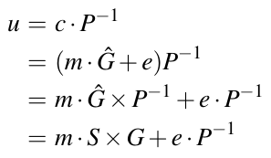 (12.14)

Câu hỏi then chốt là điều gì xảy ra nếu đưa Phương trình (12.14) vào thuật toán decode của mã ở Bước 2. Số hạng left-hand m · S × G chứa thông điệp đã xáo trộn v = m · S. Để hiểu quy trình decode, nhớ lại rằng trong mã tuyến tính thông điệp được encode là m · G, xem Hình 12.7, và trong scheme McEliece chúng ta đã thay m bằng m · S. Nếu áp dụng quy trình decode cho tích m · S × G, chúng ta nhân nó với parity-check matrix H:

H · (m · S × G)T = H · (v · G)T = H · c̃T = 0

Theo Phương trình (12.12), tích giữa một codeword hợp lệ và parity-check matrix luôn bằng không. Trong trường hợp của chúng ta, c̃ = (m · S × G) là một codeword hợp lệ vì chúng ta vừa encode thông điệp đã xáo trộn v = m · S thay vì thông điệp gốc m.

Số hạng right-hand e · P−1 của Phương trình (12.14) chỉ là một hoán vị bit của t bit lỗi được người gửi thông điệp đưa vào. Vì số bit lỗi không thay đổi, mọi lỗi có thể được sửa bằng cách dùng parity-check matrix H và một lookup table (xem Ví dụ 12.7) để xác định lỗi đã hoán vị e · P−1.

Cuối cùng, Bước 3 loại bỏ việc xáo trộn S và lấy lại thông điệp gốc vì:

v · S−1 = m · S × S−1 = m

Để dùng scheme McEliece trong thực tế, chúng ta cần chọn một mã bên dưới phù hợp, là một nhiệm vụ rất non-trivial. Một số lượng lớn mã hiện đang được dùng để sửa lỗi, như các mã Reed-Solomon phổ biến, có các đặc tính có thể bị kẻ tấn công khai thác ngay cả sau khi xáo trộn bằng các ma trận ngẫu nhiên S và P và do đó không phù hợp cho scheme public-key này. Thú vị là Robert McEliece ban đầu đề xuất dùng mã Goppa nhị phân và chúng vẫn là một lựa chọn an toàn cho tới nay. Chúng tôi sẽ thảo luận thêm chi tiết về việc chọn mã và các tham số liên quan trong Mục 12.3.4.

Bây giờ chúng tôi trình bày một ví dụ đồ chơi về scheme McEliece không dựa trên mã Goppa nhị phân như McEliece đề xuất, mà dùng cùng mã tuyến tính đơn giản như được giới thiệu trong Ví dụ 12.7 ở trên. Lưu ý rằng một mã như vậy không an toàn trong thực tế, nhưng do tính đơn giản và gọn của nó, nó rất phù hợp để minh họa mã hóa McEliece hoạt động như thế nào.

Ví dụ 12.8. Chúng ta giả sử Bob tính một cặp key public/private, Alice mã hóa một thông điệp và gửi nó tới Bob, người cuối cùng giải mã ciphertext bằng private key của mình. Bob dùng mã tuyến tính từ Ví dụ 12.7, tức là anh ấy có generator matrix G và parity-check matrix H.

■ Chúng ta bắt đầu với việc tạo key. Để xây dựng private key kpr = (S,G,P), Bob tạo các ma trận ngẫu nhiên S và P. Anh ấy cần bảo đảm S khả nghịch. Vì P là một permutation matrix, nó khả nghịch theo định nghĩa. Trong ví dụ này, chúng ta giả sử S và P được cho bởi:

Chúng tôi lưu ý rằng P thực sự là một permutation matrix và có thể chỉ ra rằng S thực sự khả nghịch.

■ Các nghịch đảo của chúng là:

(Làm bài tập, người ta có thể kiểm tra xem S × S−1 và P × P−1 có thực sự cho ra ma trận đơn vị không.)

■ Cho S và P, Bob bây giờ có thể tính public key kpub = Ĝ, trong đó mọi phép tính số học được thực hiện trong GF (2).

Khi Alice muốn mã hóa thông điệp m = (m1,...,m4), trước hết cô ấy tạo các bit ngẫu nhiên cho vector lỗi e = (e1,...,e7). Sau đó cô ấy encode m bằng ma trận public-key Ĝ của Bob, thêm lỗi e. Vì mã trong ví dụ này có thể sửa t = 1 lỗi, Alice phải chọn một vector lỗi có Hamming weight một.

■ Chúng ta giả sử vector lỗi e của Alice là:

■ Thông điệp Alice muốn mã hóa là:

■ Để mã hóa thực sự, Alice tính ciphertext c bằng cách nhân m với kpub và cộng vector lỗi e. Một lần nữa, mọi phép tính số học được thực hiện trong GF (2).

Ciphertext c này được gửi tới Bob. Khi nhận, anh ấy có thể giải mã bằng mã đã biết và các ma trận private-key P−1 và S−1.

■ Trước hết, Bob tính giá trị trung gian u dùng ciphertext và nghịch đảo

■ Tiếp theo, Bob phải decode u. Để làm điều này, anh ấy dùng thuật toán decode đặc thù cho mã bên dưới được chọn. Decode có nghĩa là anh ấy loại bỏ các lỗi được Alice đưa vào một cách nhân tạo. Do đó, trước hết anh ấy nhân parity-check matrix H với vector uT, tức là,

■ Với syndrome s′ này, Bob có thể xác định lỗi đã hoán vị e′ = eP−1. Dùng bảng look-up từ Ví dụ 12.7, anh ấy xác định vector lỗi đã hoán vị là

Để hoàn tác hoán vị các vị trí bit của e′, chúng ta tìm e bằng cách nhân e′ với permutation matrix P, tức là e = e′ · P.

■ Tiếp theo, Bob dùng vector lỗi đã hoán vị e′ để sửa vector trung gian u. Vì mọi phép tính của chúng ta được thực hiện trong GF (2), chúng ta có thể loại e′ khỏi u bằng một phép cộng đơn giản modulo hai. Bob thu được vector đã sửa ũ bởi

■ Vì Bob chỉ quan tâm tới thông điệp, chúng ta loại n − k = 3 bit cuối khỏi ũ để thu được v làm kết quả của quá trình decode:

■ Cuối cùng, Bob nhân v với nghịch đảo của S và khôi phục thông điệp gốc

#### Cryptosystem Niederreiter

Lấy cảm hứng từ cùng ý tưởng mã tuyến tính ẩn, Harald Niederreiter đã đề xuất một biến thể của scheme McEliece năm 1986. Về cơ bản nó thay generator matrix G bằng parity-check matrix H để mã hóa. Dù tương đương về mặt kỹ thuật, một ưu điểm của cách tiếp cận Niederreiter là quá trình mã hóa đơn giản hơn kết hợp thông điệp và giá trị lỗi vào một tham số duy nhất. Điều này có lợi và có ít overhead hơn so với quá trình mã hóa McEliece nếu mã hóa code-based được dùng để vận chuyển key bí mật.

> Tạo key Niederreiter
>
> Output: public key: kpub = (Ĥ) và private key kpr = (S,H,P)
>
> Cho một mã C[n,k,d] với khả năng sửa lỗi cực đại t, parity-check matrix H và hàm decode() tương ứng của nó.
>
> 1. Tạo private key kpr = (S,H,P), trong đó S là một ma trận ngẫu nhiên khả nghịch (n − k)× (n − k) và P là một permutation matrix ngẫu nhiên khả nghịch n × n.
>
> 2. Tính public key kpub = Ĥ = S × H × P.

> Mã hóa Niederreiter
>
> 1. Encode thông điệp m độ dài n thành một vector lỗi e có độ dài bit n và Hamming weight tối đa t.
>
> 2. Tạo ciphertext c bằng cách tính c = Ĥ ·eT.

> Giải mã Niederreiter
>
> 1. Tính u = S−1 · c.
>
> 2. Decode giá trị trung gian v = decode(u).
>
> 3. Tính eT = P−1 · vT để khôi phục vector lỗi, chứa thông điệp.

Dù hệ mã hóa này có vẻ gần như hoàn toàn tương tự scheme McEliece, nó có một số khác biệt tinh tế. Một khía cạnh là nó bám sát hơn bài toán Syndrome Decoding tổng quát, có thể dễ dàng được nhận ra là cốt lõi của phép mã hóa. Một khía cạnh khác gây chú ý khi xem quá trình mã hóa là chúng ta cần một kỹ thuật để chuyển thông điệp cho trước thành một vector lỗi có weight không vượt quá khả năng sửa lỗi t của mã. Điều này thực ra cần một quy trình riêng để chuyển các bit thông điệp thành các khoảng cách cụ thể trong vector lỗi. Như đã chỉ ra trước đó, các biến thể hiện đại của mã hóa Niederreiter chủ yếu được dùng để trao đổi các key bí mật symmetric, vốn dù sao cũng thường cần được tạo ngẫu nhiên. Trong trường hợp này, thay vì trước hết tạo một key ngẫu nhiên rồi dùng một quá trình encode fixed-weight phức tạp, chúng ta chỉ cần tạo ngẫu nhiên một vector lỗi e với weight cố định. Decode một vector lỗi ngẫu nhiên fixed-weight như vậy cho ra một chuỗi ngẫu nhiên có thể được dùng làm key bí mật symmetric dùng chung giữa Alice và Bob.

Tính đúng đắn. Để chứng minh tính đúng đắn, chúng ta phải chỉ ra rằng decode ciphertext cho ra thông điệp gốc. Điều này có thể đạt được bằng cách coi ciphertext c là một syndrome của vector lỗi e có weight t. Điều này trở nên rõ ràng nếu so sánh Bước 2 của mã hóa với Phương trình (12.12) trong thảo luận về mã tuyến tính. Mục tiêu của giải mã bây giờ là khôi phục vector lỗi — chứa thông điệp — từ ciphertext c. Để làm điều này, trong quá trình giải mã, trước hết chúng ta loại bỏ permutation matrix S ở Bước 1 qua phép tính:

u = S−1 · c

= S−1 · (Ĥ ·eT)

= S−1 · (S × H × P · eT)

= H × P · eT

và thu được giá trị trung gian u. Biểu thức này khá giống biểu thức được dùng cho phép tính syndrome của mã tuyến tính, nơi chúng ta có H · eT, xem Phương trình (12.12). Nếu bây giờ chạy phép decode của mã bên dưới với u làm input ở Bước 2 của giải mã, chúng ta thu được v, là một hoán vị của

Phép toán này then chốt: Vì mã có khả năng sửa t bit lỗi, syndrome và vector lỗi tương ứng có thể được khôi phục qua phép decode. Bước (3) còn lại trong giải mã chỉ loại bỏ permutation matrix P:

P−1 · vT = P−1 × P · eT = eT

Bây giờ chúng tôi đưa ra một ví dụ về scheme mã hóa Niederreiter dùng một mã tuyến tính đơn giản, chỉ dùng cho mục đích giáo dục. Trong thực tế, các mã như được thảo luận trong Mục 12.3.4 cần được dùng để cung cấp đủ bảo mật.

Ví dụ 12.9. Bối cảnh là Bob phát hành một cặp key public/private và Alice muốn gửi một thông điệp đã mã hóa tới anh ấy. Bob dùng mã tuyến tính được giới thiệu trong Ví dụ 12.7 làm mã bên dưới cho scheme Niederreiter, tức là anh ấy có parity-check matrix H và generator matrix G.

■ Để tạo key, Bob trước hết tạo ngẫu nhiên ma trận 3 × 3 S và

■ Tiếp theo, anh ấy giấu H trong public key bằng cách nhân nó với hai ma trận ngẫu nhiên Ĥ = S × H × P. Mọi phép toán với các hệ số ma trận đều trong GF(2).

Alice dùng public key kpub = Ĥ để mã hóa một thông điệp. Vì khả năng sửa lỗi của mã tuyến tính là t = 1, cô ấy encode thông điệp m của mình thành một vector lỗi e có Hamming weight 1. Với mã (đơn giản) cụ thể này, có bảy thông điệp khả dĩ cô ấy có thể encode vì e có bảy vị trí bit.

■ Chúng ta giả sử thông điệp được biểu diễn bởi vector lỗi:

■ Alice tính ciphertext c bằng cách nhân public key Ĥ với vector lỗi e. Điều này cho ra ciphertext:

Sau đó cô ấy gửi ciphertext c tới Bob, người bắt đầu quá trình giải mã.

■ Thứ nhất, anh ấy tính giá trị trung gian u là:

■ Thứ hai, dùng u và lookup table từ Ví dụ 12.7, Bob xác định v là

■ Thứ ba, anh ấy tính eT = P−1 · vT, cho ra:

đó là thông điệp đã encode được Alice gửi!

◇

Trong mục sau, khía cạnh then chốt là nên dùng loại mã nào cho các scheme Niederreiter và McEliece sẽ được thảo luận.

### 12.3.4 Các lựa chọn mã phù hợp

Vẻ đẹp của các scheme mã hóa code-based nằm ở nguyên lý cơ bản biến phép encode và decode của một mã sửa lỗi thành các phép mã hóa và giải mã. Các cryptosystem McEliece và Niederreiter hứa hẹn vì bảo mật của chúng liên quan tới các bài toán khó từ lý thuyết mã, đặc biệt là bài toán Syndrome Decoding, xem Định nghĩa 12.3.2. Tuy nhiên, các tuyên bố bảo mật mạnh như vậy chỉ đúng nếu các tham số và lớp mã được chọn cẩn thận, điều hóa ra là thách thức. Đặc biệt, những người thiết kế cryptosystem muốn làm cho việc decode bằng private key hiệu quả hơn bằng cách đưa thêm cấu trúc toán học vào mã, nhưng điều này thường cho phép thêm các tấn công đại số khai thác các cấu trúc này.

Một trong các thuật toán generic mạnh nhất có thể tấn công các cryptosystem code-based là kỹ thuật được biết tới là Information Set Decoding (ISD) và nhiều biến thể của nó. Để ngăn ISD và các tấn công đại số khác, yêu cầu các mã ẩn phải lớn và được chọn ngẫu nhiên. Đề xuất ban đầu của McEliece dùng mã Goppa nhị phân hóa ra là một lựa chọn xuất sắc do bản chất ngẫu nhiên vốn có của chúng. Đáng tiếc, các instance mã vẫn cần lớn để an toàn trước các instance mạnh của các tấn công ISD-based. Bảng 12.3 cung cấp tổng quan về các bộ tham số được khuyến nghị cho cái được biết tới là cryptosystem Classic McEliece. Classic McEliece là một biến thể KEM hiện đại của đề xuất ban đầu của McEliece. Chúng tôi cung cấp thêm chi tiết về scheme như một phần của thảo luận về quá trình chuẩn hóa trong Mục 12.5.

Bảng 12.3 Bộ tham số được đề xuất cho Classic McEliece KEM

| Scheme | Bảo mật tương đương | n | k | t | Public Key |
|---|---|---|---|---|---|
| mceliece348864 | AES-128 | 3488 | 2720 | 64 | 2040 kBits |
| mceliece460896 | AES-192 | 4608 | 3360 | 96 | 4095 kBits |
| mceliece6688128 | AES-256 | 6688 | 5024 | 128 | 8164 kBits |
| mceliece6960119 | AES-256 | 6960 | 5413 | 119 | 8178 kBits |
| mceliece8192128 | AES-256 | 8192 | 6528 | 128 | 10,608 kBits |

Người ta có thể thắc mắc vì sao Bảng 12.3 cho thấy vài bộ tham số đều cung cấp bảo mật tương đương AES-256. Lý do là có thể có nhiều cách tấn công các scheme về mặt toán học. Bằng cách dùng các mã khác nhau, hy vọng là trong trường hợp có một tấn công mới nhắm vào một trong các instance mã, các instance khác vẫn an toàn.

Từ Bảng 12.3 chúng ta thấy rằng các mã cung cấp mức bảo mật 256 bit cần public key cực lớn vài Mbit ! Rõ ràng, điều này có thể khá thách thức cho các ứng dụng có bộ nhớ hoặc băng thông liên lạc hạn chế, ví dụ, thiết bị IoT. Dung lượng bộ nhớ cao cũng là lý do McEliece nhận được ít sự chú ý hơn trong các thập kỷ qua so với các scheme mã hóa asymmetric thông thường như RSA, dù cả hai đều được hình thành vào cuối những năm 1970. Lưu ý rằng mã hóa với scheme Niederreiter cần public key lớn tương tự, vì các giả định bảo mật tương đương với scheme McEliece.

Có vài tinh chỉnh để giảm dung lượng bộ nhớ của các cryptosystem code-based. Thứ nhất, chúng ta có thể đưa ma trận đơn vị vào như một phần của mã không cần được lưu tường minh, giảm mức tiêu thụ bộ nhớ cao. Thực ra, hầu hết các ví dụ và ma trận của chương này đã bao gồm tinh chỉnh này nên bạn sẽ thấy ma trận đơn vị như một thành phần con của các generator matrix và parity-check matrix. Các mã bao gồm ma trận đơn vị như một phần của parity-check matrix của chúng được gọi là mã có hệ thống (systematic code). Lưu ý rằng việc dùng ma trận đơn vị không khả thi cho mọi loại code-based cryptography. Chẳng hạn, chỉ cần xét rằng nhân các bit thông điệp với ma trận đơn vị không gây thay đổi nào ở output, rõ ràng là một đặc điểm rất không mong muốn cho một scheme mã hóa.

Thứ hai, nhiều nghiên cứu đã được đầu tư vào việc giảm chi phí của các ma trận ẩn lớn bằng cách đưa vào các cấu trúc và mẫu lặp lại. Để đạt mục đích này, rất nhiều mã có cấu trúc khác nhau đã được khảo sát. Hóa ra có một số lượng lớn mã gọn cần ít bộ nhớ hơn đáng kể, nhưng đồng thời chúng có xu hướng đưa vào quá nhiều cấu trúc dẫn tới các cấu trúc không an toàn làm đơn giản hóa tấn công. Cho tới nay, một số lớp mã quasi-cyclic (QC) với việc chọn tham số cẩn thận có vẻ là các lựa chọn thay thế phù hợp cho mã Goppa nhị phân. Mã QC có cấu trúc cao vì chúng gồm một hàng duy nhất được dịch vòng để xây dựng toàn bộ ma trận mã. Bằng cách chỉ lưu hàng duy nhất, yêu cầu bộ nhớ có thể được giảm đáng kể. Một vài ví dụ về mã có cấu trúc là mã quasi-cyclic moderate density parity-check (QC-MDPC) được dùng trong cryptosystem BIKE[^6], hay một số mã Hamming ghép nối nhất định (HPC KEM). Bảng 12.4 chứa các tham số được đề xuất cho BIKE, nhỏ hơn đáng kể so với các tham số cần cho Classic McEliece như thể hiện trong Bảng 12.3.

Bảng 12.4 Các bộ tham số cho cryptosystem BIKE, dựa trên mã quasi-cyclic có cấu trúc

| Scheme | Bảo mật tương đương | r | w | t | Public Key |
|---|---|---|---|---|---|
| BIKE Level 1 | AES-128 | 12,323 | 142 | 134 | 12 kBits |
| BIKE Level 3 | AES-192 | 24,659 | 206 | 199 | 24 kBits |
| BIKE Level 5 | AES-256 | 40,973 | 274 | 264 | 40 kBits |

Chúng ta thấy từ Bảng 12.4 rằng BIKE không còn quy định tường minh các tham số n và k nữa mà do bản chất có cấu trúc của nó dùng các tham số r cho độ dài block w cho row weight thay vào đó.

### 12.3.5 Nhận xét cuối

Hầu hết các cấu trúc code-based tập trung vào mã hóa và key encapsulation mechanism (KEM). Điều này bao gồm cấu trúc McEliece và Niederreiter và các biến thể của chúng, ví dụ, các scheme Classic McEliece, BIKE và HQC đã được nộp cho quá trình chuẩn hóa NIST PQC, xem Mục 12.5. Dù có các đề xuất cho digital signature code-based, hầu hết đã hóa ra hoặc không an toàn (ví dụ, scheme CFS) hoặc rất kém hiệu quả so với các scheme chữ ký dựa trên các họ PQC khác.

Tương tự các scheme lattice-based, các cryptosystem code-based đi kèm một sự mở rộng ciphertext non-negligible do việc encode thông điệp thành codeword, tức là ciphertext lớn hơn đáng kể so với input. Làm ví dụ, với scheme BIKE, ciphertext thu được có kích thước gần bằng public key, trong khoảng 12 tới 40 kBit, tùy theo mức bảo mật được chọn. Điều này khiến code-based cryptography không hấp dẫn cho mã hóa khối lượng dữ liệu lớn nhưng hoạt động tốt để mã hóa các thông điệp ngắn, đặc biệt cho key encapsulation mechanism.

## 12.4 Hash-Based Cryptography

Tới giờ chúng ta đã xem các scheme PQC dựa trên lattice, có thể được dùng cho mã hóa và digital signature (dù chúng tôi chỉ thảo luận mã hóa), và các scheme code-based, chủ yếu được dùng cho mã hóa. Trong mục này, chúng tôi giới thiệu một họ PQC khác chỉ có thể được dùng cho digital signature, cụ thể là hash-based cryptography.

Như tên gọi gợi ý, digital signature hash-based dựa trên các hash function cryptographic, được mô tả trong Chương 11. Vì hash function được thiết kế để nén một input dài hơn thành một output ngắn hơn, chúng ta thực ra có thể xem chúng như các hàm làm mất thông tin, đưa sự bất định vào cho kẻ tấn công. Nhớ lại từ thảo luận trong Mục 12.1.3 ở đầu chương này rằng mất thông tin là một trong các nguyên lý thiết kế của các scheme PQC. Nếu kẻ tấn công muốn phá một scheme chữ ký hash-based, hắn phải đảo ngược một hash function cryptographic như SHA-2 hay SHA-3. Như chúng ta biết từ Mục 11.2, đây được coi là một bài toán khó với máy tính cổ điển do tính one-way của hash function. Để xây dựng các scheme PQC, niềm tin phổ biến rằng máy tính lượng tử sẽ không thể đảo ngược hash function là then chốt. Nguồn gốc của hash-based cryptography được xác lập vào khoảng cùng thời điểm các cryptosystem code-based (và RSA và trao đổi key Diffie-Hellman) được đề xuất: Năm 1979, Leslie Lamport và Whitfield Diffie đã giới thiệu nguyên lý của digital signature one-time, đặt nền tảng cho mọi cryptosystem hash-based hiện đại.

Sau đây, trước hết chúng tôi giới thiệu chữ ký one-time Lamport-Diffie cơ bản và tổng quát hóa của nó, chữ ký one-time Winternitz. Sau đó, chúng tôi sẽ mô tả các scheme chữ ký many-time thực tế hơn trong Mục 12.4.2.

### 12.4.1 Chữ ký One-Time

Một scheme chữ ký one-time hoạt động khá khác với các digital signature được giới thiệu trong Chương 10, vốn dựa trên bài toán phân tích thừa số hoặc logarit rời rạc. Dù các chữ ký one-time thuần túy rất hạn chế trong việc dùng trong các ứng dụng real-world, chúng cũng là các khối xây dựng cho chữ ký many-time, sẽ được trình bày trong Mục 12.4.2.

#### Chữ ký One-Time Lamport-Diffie (LD-OTS)

Để nắm nguyên lý của LD-OTS, chúng ta bắt đầu với việc ký thông điệp đơn giản nhất khả dĩ, chỉ gồm một bit m0. Ký có nghĩa là Alice có thể chứng minh hai sự thật then chốt mà chúng ta yêu cầu từ digital signature: cô ấy có thể chứng minh với mọi người (1) rằng cô ấy là người gửi thực sự của thông điệp, và (2) rằng cô ấy đã ký một giá trị cụ thể, hoặc m0 = 0 hoặc m0 = 1, và giá trị đó đã được truyền đúng. Nhiệm vụ này có thể được hoàn thành theo cách dễ đến bất ngờ nếu Alice và Bob dùng một one-way function f (x) nhận input n-bit và ánh xạ nó tới một output n-bit theo kiểu one-way. Hành vi này có thể được biểu diễn bằng ký hiệu sau:

f: {0,1}n → {0,1}n

Lưu ý rằng ánh xạ one-way ngụ ý rằng ánh xạ một input tới một output là hiệu quả, nhưng đảo ngược ánh xạ này, tức là ánh xạ output ngược về input, là một bài toán khó. Đây là một đặc tính then chốt của các hash function cryptographic, được mô tả trong Chương 11, vốn thường được dùng làm hàm f. Các hash function cryptographic có các tính chất bổ sung mà chúng ta không cần lúc này, như ánh xạ các input có độ dài tùy ý thành output ngắn. Với định nghĩa cơ bản của f, chúng ta chỉ giả định một ánh xạ từ input n-bit tới output n-bit, là điều một hash function cryptographic có thể làm nhưng cũng có các one-way function khác có tính chất này.

Ở bước đầu tiên để tạo một chữ ký one-time, Alice tạo hai giá trị ngẫu nhiên r, sẽ được dùng để biểu diễn hai giá trị khả dĩ của bit m0 = {0,1}. Vì các đại diện này tương ứng với các giá trị nhị phân 0 và 1, chúng ta ký hiệu chúng lần lượt là r[0] và r[1], như thể hiện ở đây:

Các giá trị r[0] và r[1] gồm n bit, trong đó n thường nằm trong khoảng 128–512 bit. Do đó, chúng ta biểu diễn bit đơn m0 bằng nhiều bit hơn, như chúng ta sẽ thấy dưới đây. Việc gán hai giá trị ngẫu nhiên sẽ đạt được một trong các sự thật then chốt của scheme: gắn các bit thông điệp với một giá trị cụ thể có thể sau này dùng làm chữ ký. Với điều này trong đầu, bây giờ chúng ta có thể lấy hai số ngẫu nhiên này để tạo private key:

kpr = (r[0],r[1])

Để tạo public key từ private key, chúng ta cần một cách che giấu thông tin bí mật. Đây là lúc one-way function f (x) xuất hiện, mà chúng ta áp dụng cho các giá trị r[0],r[1]:

p[0] = f(r[0])

p[1] = f(r[1])

Chúng ta công bố cả hai giá trị đã hash, tạo thành public key:

kpub = (p[0], p[1])

Lưu ý rằng vị trí của hai giá trị trong public key là quan trọng: Giá trị thứ nhất p[0] tương ứng với chữ ký cho một thông điệp là 0-bit, giá trị thứ hai p[1] là chữ ký trong trường hợp thông điệp có giá trị 1.

Như luôn luôn trong asymmetric cryptography, mọi bên tham gia đều biết kpub của Alice và mọi người đều yên tâm rằng chỉ Alice biết private key kpr của cô ấy. Với điều này, Alice có thể ký một thông điệp one-bit bằng một quy tắc đơn giản:

Điều này có nghĩa là chữ ký s là một trong hai giá trị được tạo ngẫu nhiên r[i] với i = 0 hoặc i = 1, mỗi giá trị dài 128–512 bit. Như trong trường hợp digital signature thông thường, cô ấy truyền thông điệp cùng với chữ ký s. Do đó, giả sử Alice gửi

(m0,s) = (0,r[m0])

qua kênh tới Bob. Anh ấy phải làm ba việc đơn giản để kiểm chứng chữ ký là đúng:

1. Trước hết anh ấy hash chữ ký, tức là Bob tính f(s).

2. Thứ hai, anh ấy chọn đại diện từ public key kpub khớp với vị trí của m0, tức là với m0 = 0 anh ấy chọn giá trị đầu tiên f(r[0]).

3. Cuối cùng, anh ấy so sánh f(s) ≟ f(r[0]).

Nếu phép so khớp ở Bước 3 checkes *(ghi chú: sách in checkes; đúng là checks)* out, Bob biết điều sau:

■ Xác thực thông điệp: Thông điệp và chữ ký phải đến từ Alice vì chỉ cô ấy có thể biết giá trị duy nhất r[0] đã sinh ra giá trị f(r[0]) và rõ ràng là một phần của public key của Alice.

■ Tính toàn vẹn: Alice thực sự đã gửi một bit thông điệp với giá trị m0 = 0.

Tất nhiên, các lập luận tương tự đúng nếu bit thông điệp là 1 và Alice gửi cặp message-signature (m0,s) = (1,r[1]) tới Bob. Trong trường hợp này, Bob kiểm chứng bằng cách kiểm tra f (s) ≟ f(r[1]). Nếu điều này đúng, Bob biết rằng bit thông điệp tương ứng phải có giá trị 1.

Ngay từ ví dụ đồ chơi này, chúng ta đã học được một số đặc tính quan trọng của chữ ký one-time[^7]. Quan trọng là nhấn mạnh rằng một khi Alice đã ký một thông điệp bằng private key của mình, nó không thể được dùng lại. Điều này đơn giản là do bản thân chữ ký là (một phần của) private key, tức là ký có nghĩa là để lộ một phần cụ thể của private key.

Sau khi đã học cách ký các thông điệp một bit, bây giờ chúng tôi sẽ chỉ ra cách scheme Lamport-Diffie có thể được dùng để ký các thông điệp gồm n bit.

#### Tạo key

Tổng quát hóa từ một thông điệp one-bit lên nhiều bit là đơn giản. Chúng ta đã nhận thấy rằng Alice cần hai giá trị ngẫu nhiên để ký một bit đơn lẻ. Hai giá trị ngẫu nhiên r[0],r[1] này tạo thành private key. Nếu thông điệp có nhiều hơn một bit (điều rõ ràng đúng trong hầu hết các bối cảnh thực tế), Alice phải tạo một cặp giá trị như vậy cho mỗi bit trong thông điệp. Như trước, giá trị thứ nhất được dùng làm chữ ký trong trường hợp bit thông điệp tương ứng có giá trị 0; giá trị thứ hai trở thành chữ ký trong trường hợp bit là 1.

Giả sử chúng ta có một thông điệp n-bit. Với thông điệp này m = (m0,m1,...,mn−1), chúng ta dùng ký hiệu sau cho các giá trị key bí mật:

kpr = [(r[0],r[1])0,(r[0],r[1])1,...,(r[0],r[1])n−1]

Như trước, mỗi giá trị r[i], trong đó i = 0 hoặc i = 1, là một số n-bit được tạo ngẫu nhiên. Do đó, toàn bộ private key kpr gồm n cặp, trong đó mỗi cặp (r[0],r[1]) có độ dài 2n bit. Điều này dẫn tới một private key với n · 2n = 2n2 bit. Chúng tôi lưu ý rằng độ dài key tăng theo bình phương độ dài thông điệp, dẫn tới private key dài.

Để tạo public key kpub, chúng ta đưa mỗi r[i] vào one-way function f, trả về các giá trị p[i] = f (r[i]) của public key:

kpub = [(p[0], p[1])0,(p[0], p[1])1,...,(p[0], p[1])n−1]

Việc ký bây giờ rất đơn giản. Chúng ta dùng bộ đầu tiên của private key, tức là (r[0],r[1])0, để ký bit đầu tiên m0 của thông điệp, cặp private-key thứ hai (r[0],r[1])1 được dùng để ký bit m1, v.v. Việc kiểm chứng hoạt động tương tự và được thực hiện cho mỗi bit của thông điệp m lần nữa. Chúng tôi lưu ý rằng public key có 2n phần tử, trong đó độ dài bit của các phần tử phụ thuộc vào kích thước output của one-way function f.

Trước khi xem một ví dụ, chúng tôi thảo luận những gì có thể được dùng làm one-way function f. Như đã nhắc trước đó, one-way function này thường được hiện thực bằng một hash function cryptographic well-known (ví dụ, SHA-2 hay SHA-3) nhưng người ta cũng có thể dùng các cấu trúc toán học đơn giản hơn. Trong chương này, chúng tôi sẽ dùng một one-way function dựa trên bình phương modulo:

f(x) ≡ x2 mod N

trong đó giá trị N là tích của hai số nguyên tố, như được Michael Rabin đề xuất vào cuối những năm 1970. Nếu kẻ tấn công muốn tính x từ một output cho trước của hàm này, hắn phải tính một căn bậc hai trong finite ring ZN trên các số nguyên, là một bài toán khó nếu N khó phân tích thừa số. Lưu ý rằng modulus N = p · q được tạo bởi hai số nguyên tố p,q thực ra giống như cho cryptosystem RSA từ Chương 7 — thực ra hai bài toán liên quan chặt chẽ.

Chúng ta xem một ví dụ đồ chơi về tạo key trong scheme LD-OTS, trong đó chúng ta giả sử thông điệp có độ dài n = 8.

Ví dụ 12.10. Giả sử one-way function Rabin f(x) ≡ x2 mod 253 với N = 253 = 11 · 23. Trong quá trình tạo key, Alice chọn hai giá trị ngẫu nhiên cho mỗi bit trong n = 8 bit thông điệp. Tám cặp này tạo thành private key:

kpr = [(r[0],r[1])0,(r[0],r[1])1,(r[0],r[1])2,...,(r[0],r[1])7]

= [(13,77)0,(22,142)1,(221,87)2,(55,119)3,(43,187)4,(8,53)5,(99,244)6,(184,49)7]

Tiếp theo Alice tính public key bằng cách áp dụng one-way function f cho mỗi giá trị ngẫu nhiên r[i] của private key. Kết quả được thể hiện trong Hình 12.9. Public key hoàn chỉnh mà Alice đã tạo gồm các giá trị sau:

Hình 12.9 Ví dụ về tạo key LD-OTS cho một thông điệp 8-bit: Mọi phần tử của private key kpr là các giá trị 8-bit được tạo ngẫu nhiên, và one-way function là f(x) ≡ x2 mod 253

kpub = [(p[0],p[1])0,(p[0],p[1])1,(p[0],p[1])2,...,(p[0],p[1])7]

= [(169,110)0,(231,177)1,(12,232)2,(242,246)3,(78,55)4,(64,26)5,(187,81)6,(207,124)7]

Cặp key (kpr,kpub) bây giờ sẵn sàng được dùng để ký một thông điệp 8-bit duy nhất. Trước khi ký, public key kpub được phân phối cho bất kỳ ai cần có khả năng kiểm chứng thông điệp. Lưu ý rằng one-way function f cũng được coi là thông tin công khai và có sẵn cho mọi bên (bao gồm Alice và Bob).

◇

Sau ví dụ cho thấy cách các key được tạo, bây giờ chúng ta chuyển sự chú ý sang việc ký và kiểm chứng thông điệp.

#### Ký một thông điệp

Tiếp theo Alice muốn ký thông điệp m của mình dùng cặp key one-time (kpr,kpub). Nhớ rằng thông điệp gồm n bit, tức là m = (m0,m1,...,mn−1). Quá trình ký rất đơn giản: Mỗi bit thông điệp mi được dùng để chọn giá trị tương ứng r[mi] ở chỉ số i của private key, có thể được viết như sau:

s = [(r[m0])0,(r[m1])1,(r[m2])2,...,(r[mn−1])n−1]

Hãy làm rõ việc tạo chữ ký bằng cách quay lại ví dụ của chúng ta.

Ví dụ 12.11. Cho public key và private key từ ví dụ trước, Alice muốn ký thông điệp 8-bit

m = (0,1,1,0,1,0,0,1)

Quá trình ký đơn giản gồm việc chọn các mục của private key tương ứng với giá trị của bit mi (tức là 0 hoặc 1), như mô tả trong Hình 12.10.

Hình 12.10 Tạo chữ ký LD-OTS cho một thông điệp ví dụ với 8 bit

Điều này cho ra chữ ký:

s = (13,142,87,55,187,8,99,49)

Sau khi ký, Alice gửi chữ ký s cùng với thông điệp m tới Bob.

#### Kiểm chứng một thông điệp

Bob nhận cặp message-signature (m,s) từ Alice, trong đó m = (m0,m1,...,mn−1) và s = (s0,s1,...,sn−1). Để kiểm chứng chữ ký, Bob dùng public key của Alice và thực hiện các bước sau:

1. Với mỗi giá trị si từ chữ ký, Bob trước hết tính các giá trị kiểm chứng vi dùng one-way function f:

vi = f (si), i = 0,...,n − 1

2. Thứ hai, Bob kiểm tra xem mọi giá trị kiểm chứng vi có khớp với mục tương ứng p[mi]i trong public key không:

vi ≟ (p[mi])i, i = 0,...,n − 1.

Hãy xem việc kiểm chứng chữ ký hoạt động thế nào với ví dụ của chúng ta.

Ví dụ 12.12. Chúng ta lại giả sử các giá trị từ hai ví dụ trước. Giả sử Bob đã có được public key đúng của Alice tại một thời điểm trước đó:

kpub = [(169,110)0,(231,177)1,(12,232)2,(242,246)3,(78,55)4,(64,26)5,(187,81)6,(207,124)7] Bob nhận cặp message-signature của Alice với m = (0,1,1,0,1,0,0,1) và chữ ký tương ứng s = (13,142,87,55,187,8,99,49). Bây giờ anh ấy thực hiện các bước kiểm chứng chữ ký được thể hiện trong Hình 12.11.

Hình 12.11 Ví dụ về kiểm chứng chữ ký LD-OTS

Chẳng hạn, để kiểm chứng bit m0 = 0, anh ấy hash giá trị chữ ký tương ứng s0 = 13:

v0 = f(13) ≡ 132 = 169 mod 253

Vì điều này khớp với giá trị thứ nhất (tức là bên trái) của bộ public key (169,110)0, anh ấy biết rằng chữ ký thực sự là cho bit thông điệp có giá trị 0.

Vì mọi vi khớp với các mục tương ứng của public key ymi, việc kiểm chứng thành công. ◇

#### Thảo luận

Chứng minh tính đúng đắn của scheme LD-OTS rất đơn giản vì có thể chỉ ra trực tiếp rằng

vi = f (si) = f ((r[mi])i) = (p[mi])i

đúng với mọi i = 0...n − 1.

Lưu ý rằng với mỗi lần tạo chữ ký, một nửa số bit của private key bị lộ ra công khai vì các phần tử chữ ký đơn giản được lấy từ các giá trị private-key. Hệ quả là mỗi cặp key chỉ có thể được dùng một lần, điều hạn chế việc dùng phiên bản đơn giản này của LD-OTS trong các ứng dụng real-world.

Một nhược điểm khác của LD-OTS cơ bản là chữ ký lớn; chính xác hơn là lớn hơn kích thước thông điệp n lần. Điều này có thể được giảm nhẹ phần nào bằng cách áp dụng một hash function cryptographic lên thông điệp rồi ký output hash. Cùng cách tiếp cận được dùng cho các scheme chữ ký thông thường, xem Hình 11.2. Một ví dụ số được thảo luận trong Bài tập 12.13. Chúng ta sẽ khảo sát kỹ hơn hệ số mở rộng này giữa kích thước thông điệp và chữ ký trong scheme chữ ký one-time sau.

#### Chữ ký One-Time Winternitz (W-OTS)

LD-OTS là scheme chữ ký hash-based đầu tiên, và không lâu sau khi được giới thiệu, các biến thể đã được đề xuất. Năm 1979 (cùng năm LD-OTS được tạo ra), Robert Winternitz công bố một cải tiến của scheme LD-OTS làm giảm đáng kể kích thước chữ ký. Scheme W-OTS dựa trên các hash chain, và nó mở đường cho các chữ ký hash-based cải tiến khác.

Ý tưởng của Winternitz là không áp dụng one-way function f cho từng bit của thông điệp n-bit riêng biệt mà thay vào đó, xử lý nhiều bit thông điệp cùng lúc. Để làm điều này, người ta phải chọn một tham số Winternitz w chia hết n, là độ dài của thông điệp cần ký. Sau đó scheme tạo l = n/w giá trị ngẫu nhiên ri làm private key W-OTS, trong đó mỗi giá trị cũng dài n bit. Public key kpub được tính bằng cách hash mỗi giá trị private-key 2w − 1 lần liên tiếp, cho ra các giá trị tương ứng pi, tạo thành public key. Việc tính lặp lại one-way function này được gọi là chaining.

Để tạo một chữ ký cho một thông điệp n-bit m = (m0,m1,...,mn−1), thông điệp được chia thành l block mỗi block gồm w bit. Do đó, chúng ta có l block thông điệp cũng như l giá trị private-key. Ý tưởng cốt lõi của scheme bây giờ như sau: Vì mỗi block thông điệp gồm w bit, chúng ta có thể xem các giá trị nguyên t được tạo bởi các bit này, nằm trong khoảng t = 0,1,...,2w − 1. Để tạo chữ ký, one-way function được áp dụng lặp lại t lần lên giá trị private-key tương ứng với block thông điệp. Sau mô tả hơi trừu tượng này, chúng ta xem một ví dụ để hiểu rõ hơn W-OTS nói chung và quá trình kiểm chứng hoạt động thế nào.

Ví dụ 12.13. Hãy xem quá trình ký và kiểm chứng một block thông điệp duy nhất mi khi chọn kích thước block w = 3. Alice, người gửi, đã tạo một giá trị private key ngẫu nhiên ri và tính giá trị công khai pi bằng cách hash ri 2w − 1 = 7 lần, có thể được biểu diễn là:

pi = f7(ri)

Quá trình này được thể hiện trong Hình 12.12.

Hình 12.12 Nguyên lý W-OTS cho độ rộng block thông điệp w = 3 và giá trị thông điệp mi = 5

Chữ ký si cho block thông điệp phụ thuộc vào giá trị thực của mi. Lưu ý rằng mi dài ba bit và do đó có thể nhận các giá trị {0,1,...,7}. Trong ví dụ này, chúng ta giả sử block thông điệp có mẫu bit mi = (101), bằng giá trị nguyên mi = 5. Do đó, Alice ký thông điệp bằng cách hash ri năm lần liên tiếp:

si = f (f(f(f (f(ri))))) = f5(ri)

Bây giờ cô ấy gửi cặp (mi,si) tới Bob, người đã biết public key pi. Bob thấy rằng giá trị nguyên của mi là 5. Để kiểm chứng, bây giờ anh ấy hash si thêm hai lần (vì 7-5 = 2) để hoàn thành hash chain. Sau đó anh ấy kiểm tra xem kết quả của f2(si) có giống giá trị public key pi mà anh ấy nhận trước đó từ Alice không. Quá trình ký và kiểm chứng này cho phần tử thứ i-th của private key và public key được thể hiện trong Hình 12.12.

◇

Nếu xem W-OTS chi tiết hơn, chúng ta có hai quan sát quan trọng:

1. Collision-resistance của one-way function. Scheme LD-OTS trước đó chỉ áp dụng one-way function một lần để tạo một chữ ký dựa trên private key. Ngược lại, trong scheme W-OTS chúng ta áp dụng one-way function f (x) lặp lại, cụ thể là t lần. Tuy nhiên, áp dụng lặp lại một ánh xạ làm tăng xác suất collision. Điều đó có nghĩa là hai giá trị input khác nhau x,x′ có nhiều khả năng ánh xạ tới cùng giá trị output hơn sao cho fx(ri) = fx′(ri) với x,x′ < 2w khác nhau. Do đó, W-OTS yêu cầu one-way function f là collision-resistant.

2. Chữ ký có thể giả mạo. Xem kỹ Hình 12.12 hơn để lộ một điểm yếu của scheme chữ ký. Nếu kẻ tấn công chặn được block chữ ký si = f5(ri) và block thông điệp mi = 5, hắn có thể dễ dàng áp dụng lại one-way function công khai để tạo một block chữ ký giả mạo nhưng hợp lệ cho block thông điệp mi′ = 6 vì si′ = f6(ri) = f(si).

May mắn là dễ ngăn tấn công giả mạo bằng một mẹo đơn giản: Chúng ta encode các giá trị thực của mi thành một checksum c, nối nó vào thông điệp và ký tổ hợp (message||checksum) như mô tả trong Hình 12.13.

Checksum W-OTS được tính như sau:

Như chúng ta thấy, c là tổng nguyên của mọi giá trị 2w − 1 − mi. Mỗi giá trị này chỉ số lần one-way function f cần được áp dụng trong quá trình kiểm chứng si. Chẳng hạn, trong ví dụ trên, (2w − 1) − mi = 7 − 5 = 2, như có thể thấy trong Hình 12.12. Vì bản thân c cũng cần được ký bằng scheme W-OTS, chúng ta cũng chia checksum thành k block gồm w bit để phù hợp với yêu cầu của scheme:

c = (c0,c1,...,ck−1), với ci = 0...2w − 1

Hình 12.13 Quá trình ký W-OTS với checksum: l block thông điệp và k block checksum được ký

Thông điệp, có độ dài block l, cùng với checksum sau đó được dùng để tạo chữ ký s gồm j = l + k giá trị như thể hiện trong Hình 12.13.

Nếu kẻ tấn công cố giả mạo một chữ ký bằng cách áp dụng one-way function cho bất kỳ block chữ ký nào (do đó tăng block tương ứng của thông điệp đã ký), hắn sẽ phải hoàn tác một lần lặp của one-way function trong phần checksum của chữ ký. Theo bản chất của one-way function, việc đảo ngược là không khả thi và do đó kẻ tấn công không thể xây dựng một chữ ký hợp lệ với checksum hợp lệ.

Trước khi tiếp tục với scheme Winternitz, chúng tôi thảo luận độ dài của checksum. Dễ thấy rằng c đạt cực đại khi thông điệp chỉ gồm các bit không. Trong trường hợp này, c = l(2w − 1). Độ dài bit của checksum khi đó là

\|c| = ⌈log2(l(2w − 1))⌉ ≈ ⌈log2(l)⌉+w

Vì checksum chỉ tăng theo logarit của độ dài block thông điệp l, overhead trong chữ ký do checksum-signing sẽ vừa phải ngay cả với các thông điệp rất dài, giả sử trong khoảng gigabyte.

#### Tạo key

Alice tạo một key bí mật kpr bằng cách chọn ngẫu nhiên j giá trị cho mỗi block thông điệp và checksum. Mọi giá trị ri này phải khớp với kích thước input của hàm collision-resistant f. Do đó private key là:

kpr = (r0,r1,r2,...,rj−1)

Lưu ý rằng dù tương tự scheme LD-OTS, mỗi ri là một giá trị đơn lẻ trong khi LD-OTS dùng các cặp giá trị. Bây giờ chúng ta tính public key bằng cách áp dụng hàm f đúng 2w − 1 lần cho mỗi phần tử private key:

kpub = (p0, p1, p2...,pj−1), với pi = f2w−1(ri)

Hãy xem một ví dụ với các số nhỏ để có trực giác về cách tạo key hoạt động cho scheme này.

Ví dụ 12.14. Chúng ta giả sử một scheme W-OTS với thông điệp gồm n = 12 bit và tham số Winternitz w = 3. Do đó, có l = n/w = 4 block thông điệp. Với ví dụ này, chúng ta lại dùng một one-way function Rabin với các tham số đồ chơi: f(x) ≡ x2 mod 511, với N = 511 = 7 · 73. Nó hoạt động trên input và output 9-bit. Lưu ý rằng chúng ta không xét collision-resistance của one-way function lúc này. Chúng tôi sẽ thảo luận yêu cầu này thêm trong Bài tập 12.20.

Nhớ lại rằng checksum được tạo dùng

Giá trị cực đại của checksum là l · (2w − 1) = 4 · 7 = 28, là trường hợp khi mọi mi = 0. Để biểu diễn nhị phân giá trị cực đại này, cần k = ⌈log2(28)⌉ = 5 bit. Vì w = 3, chúng ta cần hai block cho checksum ngoài bốn block thông điệp, do đó j = 4 + 2 = 6.

Với các tham số này, giả sử Alice chọn các giá trị private key ngẫu nhiên sau:

kpr = (413,253,36,221,374,188)

Tiếp theo, Alice tính public key bằng cách lặp one-way function 2w − 1 = 7 lần trên mỗi xi, như thể hiện trong Hình 12.14.

Điều này cho ra public key:

kpub = (105,470,274,296,373,470)

Nhìn kỹ hơn public key, chúng ta nhận thấy giá trị 470 xuất hiện hai lần trong public key. Điều này không mong muốn và cho thấy sự cần thiết phải dùng một one-way function collision-resistant trong thực tế, vì hai giá trị private-key ngẫu nhiên r1 = 253 và r5 = 188 trùng vào cùng giá trị p1 = p5 = 470 sau khi chúng ta áp dụng one-way function t = 7 lần. Một lần nữa, chúng tôi sẽ phân tích điều này thêm trong Bài tập 12.20. ◇

Hình 12.14 Ví dụ với w = 3 và độ dài thông điệp n = 12 cho W-OTS với checksum. Hàm one-way function là f(x) ≡ x2 mod 511

#### Ký một thông điệp

Trước hết, chúng tôi lưu ý rằng padding thông điệp có thể được áp dụng trong trường hợp w không chia hết độ dài thông điệp n. Để ký thực sự, chúng ta có thể thấy từ Hình 12.12 rằng hàm f được áp dụng một số lần nhất định, tùy theo giá trị nhị phân của các block thông điệp (hoặc checksum). Vì quá trình ký không phân biệt giữa block thông điệp và block checksum, chúng tôi đưa ra ký hiệu sau cho phép nối (message||checksum):

mc = (m0,...,ml−1,c0,...,ck−1) = (mc0,...,mcj−1)

Dựa trên ký hiệu này, chữ ký được tính trên các giá trị mci như sau:

s = (fmc0(r0), fmc1(r1),..., fmcj−1(rj−1)) = (s0,s1,...,sj−1)

Một lần nữa, hãy làm rõ việc xây dựng và tạo chữ ký bằng một ví dụ khác.

Ví dụ 12.15. Bây giờ Alice muốn ký thông điệp n = 12-bit m, mà chúng ta biểu diễn theo các block kích thước w = 3 như sau:

m = 101011101010 (bit)

= (101,011,101,010) (các block nhị phân)

= (5,3,5,2) = (m0,m1,m2,m3) (các block thập phân)

Checksum tương ứng (dùng số thập phân) được tính từ bốn block thông điệp là:

c = (7 − 5) + (7 − 3) + (7 − 5) + (7 − 2) = 13 = (001101)2 = (001,101)w=3 = (1,5)

Do đó chuỗi nối của bốn block thông điệp và hai block checksum là:

mc = (mc0,...,mc5) = (5,3,5,2,1,5)

Với mỗi phần tử của private key kpr = (413,253,36,221,374,188), chúng ta áp dụng hàm f lặp lại. Độ dài của mỗi hash chain (tức là số lần chúng ta áp dụng f) phụ thuộc vào các giá trị mci. Điều này cho ra chữ ký sau:

s = (f5(413), f3(253), f5(36), f2(221), f1(374), f5(188))

= (329,442,162,235,373,183)

◇

Những gì còn thiếu bây giờ là thảo luận về việc kiểm chứng của scheme W-OTS.

#### Verifiying một thông điệp

*(ghi chú: sách in Verifiying; đúng là Verifying)*

Cho chữ ký s và thông điệp m = (m0,...,ml−1), bên kiểm chứng tính checksum theo cùng cách như đã làm khi ký, cho ra mc = (mc0,...,mcj−1).

Từ Hình 12.12, chúng ta thấy rằng việc kiểm chứng chữ ký đạt được bằng cách hoàn tất việc hash block chữ ký cho tới khi đạt số lần lặp t = 2w − 1. Nói cách khác, block chữ ký si = fmci(ri) có thể được kiểm chứng bằng cách tính các giá trị kiểm chứng như sau:

v = (ft−mc0(s0), ft−mc1(s1),..., ft−mcj−1(sj−1))

Nếu mọi giá trị khớp với public key, thì chữ ký là đúng. Sự đơn giản của quá trình kiểm chứng trở nên rõ ràng khi xem ví dụ sau.

Ví dụ 12.16. Bob nhận chữ ký s = (329,442,162,235,373,183) và thông điệp m = (5,3,2,1) từ Alice. Trước đó, anh ấy cũng đã nhận public key của Alice kpub = (105,470,274,296,373,470).

Để kiểm chứng, Bob tính chuỗi nối của thông điệp và các block checksum liên quan mc = (5,3,5,2,1,5). Vì cách checksum được xây dựng được biết công khai, Bob cũng sẽ tính checksum như thể hiện trong Ví dụ 12.15. Tiếp theo, Bob xác định số lần lặp tối đa t = 2w − 1 = 7 và tính các giá trị kiểm chứng:

v = (f7−5(329), f7−3(442), f7−5(162), f7−2(235), f7−1(373), f7−5(183))

= (105,470,274,296,373,470)

Vì mỗi giá trị thu được bằng giá trị public key tương ứng của kpub, chữ ký là đúng.

◇

### 12.4.2 Chữ ký Many-Time

Dù ý tưởng đằng sau chữ ký one-time rất tinh tế, chúng chịu một nhược điểm đáng kể trong thực tế: Với mỗi thông điệp đơn lẻ, phải tạo và phân phối một cặp key bí mật và công khai full-sized. Như người ta có thể hình dung, rất không thực tế khi pre-distribute cho mọi người dùng các public key đủ dài để ký mọi thông điệp mà người ta định gửi trong, giả sử, một hoặc hai năm tới[^8]. Như một biện pháp khắc phục, Ralph Merkle đã đề xuất một mở rộng của chữ ký one-time thành một scheme chữ ký many-time năm 1989. Như chữ ký one-time, scheme của Merkle dựa trên one-way function. Một khác biệt của scheme là bây giờ chúng ta cũng cho phép các input lớn hơn n bit được ánh xạ tới một output cố định n bit. Điều này không phải vấn đề vì mọi hash function cryptographic h như được thảo luận trong Chương 11 cung cấp chính xác chức năng này, mà chúng ta có thể biểu diễn là:

h: {0,1}∗ → {0,1}n

Ý tưởng high-level của scheme Merkle là người ký có thể dùng bao nhiêu scheme chữ ký one-time (OTS) tùy ý, nhưng chỉ cần một public key. Các public key riêng lẻ cần cho nhiều chữ ký one-time được hợp nhất thành một public key duy nhất qua việc dùng một hash tree, còn được gọi là Merkle tree. Key duy nhất này được công bố và có thể, nếu muốn, được bảo vệ bởi một certificate (xem Mục 14.4.2).

#### Nguyên lý của chữ ký MSS

Trong tiểu mục này, chúng tôi thảo luận ý tưởng cốt lõi đằng sau Merkle signature scheme (MSS) qua một ví dụ. Alice, người ký, tính trước các tham số cho bao nhiêu instance của một scheme chữ ký one-time (ví dụ, cho W-OTS) tùy ý. Trước hết, Alice chọn một giá trị t cho phép cô ấy dùng 2t chữ ký one-time (OTS). Tính trước có nghĩa là cô ấy tạo một cặp gồm một private key và một public key cho mỗi OTS. Để gọn và dễ đọc hơn, hãy ký hiệu các cặp key OTS này bởi:

OTSi = (kpr,kpub)i = (Xi,Yi), i = 0,...,2t − 1

Nhớ rằng mục tiêu của chúng ta là Alice chỉ cần công bố một public key (dù cô ấy vừa tạo 2t public key OTS), được mọi người dùng khác biết. Mẹo mà Alice dùng là cô ấy xây dựng một hash tree với t mức trong đó các lá — đó là các nút ở đáy cây — chứa hash của mỗi public key trong 2t public key OTS.

Hãy xem một ví dụ về một cây như vậy có chiều cao t = 3 trong Hình 12.15. Ở Mức 0, chúng ta thấy các lá với giá trị Ai, là các phiên bản đã hash của 2t = 23 = 8 public key OTS. Lên một mức, ở Mức 1, là các nút cây Bi. Mỗi nút chứa hash của hai nút từ Mức 0 mà giá trị của chúng được kết hợp đơn giản, chẳng hạn B0 = h(A0||A1), trong đó || ký hiệu phép nối hai giá trị. Mẫu này tiếp tục ở Mức 2, gồm các hash của các nút từ Mức 1. Cuối cùng, ở đỉnh chúng ta chỉ thấy một giá trị thực ra là public key của Alice, có thể được phân phối cho mọi người dùng trong hệ thống. Lưu ý rằng nút đỉnh được gọi là gốc (root) (một thuật ngữ hơi gây bối rối vì cây trong tự nhiên thường có gốc ở dưới).

Hình 12.15 Nguyên lý của một Merkle hash tree có chiều cao t = 3

Quá trình ký hoạt động như sau: Alice chọn một cặp key OTS mà cô ấy chưa dùng. Chẳng hạn, giả sử cô ấy đã ký ba thông điệp bằng các key OTS (X0,Y0), (X1,Y1) và (X2,Y2) nên bây giờ cô ấy dùng:

(X3,Y3)

cho thông điệp tiếp theo. Trước hết, cô ấy ký thông điệp m bằng private key dùng scheme chữ ký one-time của mình:

s3 = sigX3(m)

Lưu ý rằng hash tree hoạt động với bất kỳ scheme OTS nào. Nếu bây giờ Alice ngây thơ (naïvely) tiến hành như thường lệ và gửi bộ ba

(thông điệp, chữ ký, public key) = (m,s3,Y3)

tới Bob, sẽ có vấn đề sau. Bob sẽ không có cách nào biết thông điệp và chữ ký là từ Alice vì anh ấy không biết public key Y3 có thực sự là của cô ấy không. Thực ra, bất kỳ ai cũng có thể thiết lập một scheme chữ ký one-time (ví dụ, W-OTS), tính các giá trị (m,s3,Y3) và gửi chúng tới Bob với thông điệp m nói “Chào Bob, tôi là Alice và đây là thông điệp đã ký của tôi. Hãy chuyển 1000 e vào tài khoản của tôi.”.

Để giải quyết vấn đề này, chúng ta phải liên kết public key OTS one-time Y3 với public key long-term kpub của Alice, vốn được Bob biết. Điều này có thể đạt được nếu Alice gửi cho Bob một số nút được chọn từ hash tree. Trong ví dụ này, ngoài (m,s3,Y3) cô ấy gửi đường xác thực (authentication path) (A2,B0,C1) tới Bob:

(thông điệp, chữ ký, public key, auth) = (m,s3,Y3,(A2,B0,C1))

Bây giờ Bob có thể dùng authentication path để tính một chuỗi hash nối public key OTS Y3 của thông điệp hiện tại với kpub của Alice, mà anh ấy biết. Anh ấy tính hash chain sau:

A3′ = h(Y3) Mức 0

B1′ = h(A2||A3′) Mức 1

C0′ = h(B0||B1′) Mức 2

D′ = h(C0′||C1) Mức 3

Bây giờ Bob kiểm chứng xem giá trị D′ mà anh ấy vừa tính có thực sự là public key của Alice không:

D′ ≟ kpub

Nếu phép kiểm tra này đúng, Bob biết chắc chắn rằng Y3 phải từ Alice vì chỉ cô ấy biết mọi giá trị trung gian cần để tính D. Một lần nữa, chúng ta giả sử Bob có kpub và nó đã được xác thực, tức là đã kiểm chứng rằng nó thực sự là public key của Alice. Với Y3, đến lượt anh ấy có thể kiểm chứng chữ ký OTS trên thông điệp m có đúng không. Chúng ta sẽ thấy sau rằng Y3 thậm chí không cần được đưa vào việc truyền vì nó có thể được tính hoàn toàn từ chữ ký s3 và thông điệp m. Do đó mọi bên tham gia đạt mục tiêu cuối cùng là cung cấp một digital signature cho thông điệp m, ngụ ý các security service tính toàn vẹn, xác thực và non-repudiation (xem Mục 10.1.3).

Thoạt nhìn, người ta có thể nghĩ rằng theo thời gian một kẻ tấn công Oscar nghe lén sẽ thu thập mọi nút cây, và hắn có thể tạo chữ ký gian lận. Tuy nhiên, ngay cả khi hắn biết mọi nút cây bao gồm mọi giá trị lá Ai, hắn không thể tính các public key Yi liên quan mà hắn cần để tạo một chữ ký OTS giả. Chúng tôi lưu ý rằng vẫn cần một cơ chế theo dõi những chữ ký OTS nào đã được dùng. Điều này được gọi là statefulness và được thảo luận trong Mục 12.4.3.

Vì mỗi nút cây (trừ các lá ở đáy) chứa hash của đúng hai nút, đây được gọi là cây nhị phân. Cũng dễ thấy rằng nếu cây có chiều cao t, có 2t lá ở đáy và do đó 2t key OTS. Sự tăng theo hàm mũ của số chữ ký one-time này cho phép scheme được dùng trong các bối cảnh real-world large-scale. Chẳng hạn, nếu Alice biết rằng cô ấy sẽ cần tối đa một triệu chữ ký trong hai năm tới, cô ấy có thể chọn một cây có chiều cao t = 20, có 220 = 1,048,576 lá ở đáy. Như đã giải thích ở trên, mỗi lá gắn với một cặp key public/private, cho phép ký một thông điệp. Lưu ý rằng Alice cần tính trước toàn bộ cây nhưng chỉ công bố giá trị D = kpub, có hiệu lực hai năm. Vì khá tốn kém cho Alice khi tính trước và lưu các cây lớn cần cho quá trình ký, vài cải tiến cho scheme MSS gốc đã được đề xuất làm giảm tổng chi phí tính toán và bộ nhớ, như được thảo luận trong Mục 12.4.3.

#### Mô tả hình thức của MSS

Sau khi giới thiệu cách scheme MSS hoạt động cho ví dụ t = 3, bây giờ chúng tôi sẽ mô tả một thuật toán để tạo hash tree và authentication path theo cách tổng quát hơn. Vì chúng ta không thể dễ dàng tổng quát hóa một scheme với tên nút cố định theo mức như A,B,C,..., bây giờ chúng ta dùng một ký hiệu có thể mở rộng cho cây mà ngoài ra vẫn giống hệt cây trong ví dụ giới thiệu ở Hình 12.15.

Như trước, chúng ta dùng t để chỉ chiều cao của toàn bộ cây. Bây giờ chúng ta cần hai chỉ số cho mỗi nút v. Chỉ số i ký hiệu mức của nút và chỉ số j là vị trí của nó trong mức:

vi[j], 0 ≤ j < 2t−i

Để hiểu trực quan hơn ký hiệu này, sẽ hữu ích khi nhận ra rằng một cây về cơ bản là một cấu trúc 2-dimensional của các nút (còn được gọi là đỉnh — vertex, do đó vi[j]), trong đó các chỉ số j có thể được coi là các giá trị trên trục x và i là các giá trị y. Với điều này trong đầu, chúng ta có thể áp dụng ký hiệu mới cho hash tree như mô tả trong Hình 12.16. Khác với Hình 12.15, cây này dùng ký hiệu vi[j] tổng quát hơn cho các nút. Tuy nhiên, về chức năng, hai cây giống hệt nhau. Chúng tôi thảo luận dưới đây ba loại nút trong cây.

Nút lá. Các nút ở đáy cây có chỉ số i = 0. Các giá trị lá được tính từ các public key OTS Yi bằng hash function h:

v0[j] = h(Yj), 0 ≤ j < 2t

Nút trung gian. Mọi nút khác ở các tầng tiếp theo 1,2,...,t được tạo bằng cách hash phép nối của hai nút tiền nhiệm tương ứng của chúng:

vi[j] = h(vi−1[2 j]||vi−1[2 j + 1]), trong đó 1 ≤ i ≤ t và 0 ≤ j < 2t−i

Hình 12.16 Cây MSS có chiều cao t = 3. Hình phóng to cho thấy cách xây dựng hai nút v1[0] và v2[1] làm ví dụ

Nút gốc. Cuối cùng, chúng ta định nghĩa gốc vt[0] là public key của scheme MSS.

Private key gồm mọi private key OTS. Cây ví dụ trong Hình 12.16 có chiều cao t = 3 chứa 23 = 8 private key OTS và do đó cho phép chúng ta ký tám thông điệp dùng một public key MSS duy nhất.

Để tạo chữ ký MSS, Alice lấy một thông điệp và ký nó dùng một trong 2t cặp key OTS chưa được dùng trước đó. Giả sử cô ấy chọn một cặp key OTS ở chỉ số c. Alice phải cung cấp một authentication path cho phép bất kỳ ai liên kết public key OTS Yc với public key kpub đã công bố của cô ấy, là gốc của cây. Authentication path được tính bằng thuật toán sau:

> Thuật toán cho MSS Authentication Path
>
> Input: Merkle tree với các nút vi[j], trong đó 1 ≤ i ≤ t và 0 ≤ j < 2t−i,
>
> chỉ số c của chữ ký one-time được chọn cho quá trình ký
>
> Output: authentication path cho Yc: (a0,a1,...,at−1)
>
> Thuật toán:
>
> 1 FOR i = 0 TO t − 1 DO
>
> 1.1 q = ⌊c/2i⌋
>
> 1.2 tính chỉ số của nút anh em: r = q + (−1)q
>
> 1.3 chọn nút xác thực ai = vi[r]
>
> 2 RETURN
>
> authentication path (a0,a1,...,at−1)

Hình 12.17 MSS authentication path cho OTS được chọn ở chỉ số c = 3 cho một cây có chiều cao t = 3. Các vòng tròn nét đứt cho thấy các nút cần được cung cấp kèm chữ ký

Hình 12.17 cho thấy các nút xác thực (a0,a1,a2) cho chữ ký OTS gắn với lá được chọn c = 3 cho một cây có chiều cao t = 3. Lưu ý rằng đây là cùng authentication path như được dùng trong Mục 12.4.2.

Bây giờ, hãy xem việc kiểm chứng hoạt động thế nào trong ví dụ được cho trong Hình 12.17. Bob, bên nhận, nhận authentication path (a0,a1,a2) tương ứng với cặp key OTS được chọn (Xc,Yc) ở chỉ số c = 3. Anh ấy muốn biết public key OTS Y3 có thực sự từ người gửi, Alice, không. Anh ấy kiểm tra điều đó bằng cách liên kết Y3 với public key kpub của Alice. Việc kiểm chứng dọc theo authentication path gồm các bước sau:

v0′[3] = h(Y3) Mức 0

v1′[1] = h(a0||v0′[3]) = h(v0[2]||v0′[3]) Mức 1

v2′[0] = h(a1||v1′[1]) = h(v1[0]||v1′[1]) Mức 2

v3′[0] = h(v2′[0]||a2) = h(v2′[0]||v2[1]) Mức 3

Cuối cùng, anh ấy kiểm tra xem phép tính của chính mình cuối cùng có khớp với public key của Alice không sao cho v3′ [0] ≟ kpub. Nếu phép kiểm tra này thành công, Bob yên tâm rằng giá trị Y3 thực sự tương ứng với một trong các chữ ký one-time gắn với public key của Alice. Trong các ví dụ sau sẽ cho thấy cách chúng ta có thể kết hợp một cách tinh tế việc kiểm chứng W-OTS rằng một thông điệp m khớp với Y3 với việc kiểm chứng cây dọc theo authentication path.

Ví dụ 12.17. Bây giờ chúng tôi mô tả toàn bộ quá trình tạo một cây MMS, tính một chữ ký và kiểm chứng nó với các giá trị số qua một ví dụ. Cây có chiều cao t = 2. Làm OTS, chúng ta dùng scheme chữ ký one-time Winternitz được giới thiệu trong Mục 12.4.1. Như trong ví dụ trước, chúng ta dùng one-way function Rabin

f(x) ≡ x2 mod 511

cho scheme Winternitz với n = 9 bit input và output. Hơn nữa, chúng ta chọn một hash function đồ chơi để xây dựng Merkle tree: Đó là một hash function cực kỳ đơn giản chỉ cộng mọi giá trị input xi trước khi đưa kết quả vào f(x):

Phép cộng trong biểu thức này là phép cộng số nguyên đơn giản. Chúng tôi muốn nhấn mạnh rằng cả hai hàm f và h chỉ được thiết kế cho mục đích giáo dục. Thực ra, Bài tập 12.20 sẽ cho thấy rằng cấu trúc của một hash function h như vậy khá yếu vì nó không ngăn các thao túng hay collision trong quá trình tạo chữ ký và Merkle tree. Trong các ứng dụng real-world của MSS và các biến thể, các hash function cryptographic mạnh (xem Mục 12.4.3) được dùng cho f,h mà với chúng có thể tạo các scheme long-term, quantum-secure. Cũng lưu ý rằng các biến thể cải tiến của MSS, như XMSS, được thiết kế để nới lỏng yêu cầu thiết yếu về collision resistance, giúp dễ dàng khởi tạo các instance an toàn cho digital signature hash-based trong thực tế.

Tạo cây Giả sử Alice đã tạo các cặp key public/private W-OTS (X0,Y0),...,(X3,Y3) cần cho cây. Private key MSS gồm bốn private key W-OTS X0,X1,X2,X3 (mà chúng ta không cần xét thêm). Chúng ta quan tâm tới các public key W-OTS Y0,Y1,Y2,Y3:

Y0 = (105,470,274,296,373,470)

Y1 = (502,506,32,390,144,312)

Y2 = (42,264,342,195,73,187)

Y3 = (158,264,165,478,194,37)

Cây có chiều cao t = 2 tương ứng với các public key này được thể hiện trong Hình 12.18.

Hình 12.18 Cây MSS ví dụ có chiều cao t = 2

Để xây dựng cây MSS, bao gồm public key ở đỉnh, trước hết chúng ta cần tính các nút lá v0[0],...,v0[3]. Trong ví dụ, chúng ta tập trung vào nút lá ngoài cùng bên trái v0[0], là phiên bản đã hash của public key Y0:

v0[0] = h(Y0) = h(105 + 470 + 274 + 296 + 373 + 470) = 70

Chúng ta có thể tính các nút lá khác theo cùng cách, cho ra v0[1] = 436,v0[2] = 429 và v0[3] = 470. Để tạo nút cha bên trái ở Mức 1, xuất phát từ hai nút lá ngoài cùng bên trái, chúng ta tính:

v1[0] = h(v0[0] + v0[1]) = h(70 + 436) = 25

Tương tự, chúng ta tính v1[1] ở phía right-hand của Mức 1:

v1[1] = h(v0[2] + v0[3]) = h(429 + 470) = 310

Bây giờ, chúng ta chỉ cần tính gốc của cây:

v2[0] = h(25 + 310) = 316

Nút gốc này là public key của scheme chữ ký và được công bố.

Ký Như đã nhắc ở trên, Alice dùng scheme W-OTS. Cô ấy muốn ký cùng thông điệp như trong Ví dụ 12.15, cụ thể là:

m = 101011101010

Chúng ta giả sử m là thông điệp đầu tiên được ký với scheme MSS này, tức là chúng ta sẽ chọn OTS ngoài cùng bên trái ở chỉ số c = 0, chưa được dùng trước đó. Như được trình bày đầy đủ chi tiết trong Ví dụ 12.15, chữ ký cho thông điệp m là s0 = (329,442,162,235,373,183). Tiếp theo, Alice cần tính MSS authentication path ngoài chữ ký W-OTS thực sự. Vì cô ấy biết mọi giá trị trung gian của cây, điều này có thể được làm khá hiệu quả. Với mức cây 0, ta có q = ⌈0/(0 + 1)⌉ = 0 và do đó, r = 0 + −10 = 1. Do đó, chúng ta thêm v0[1] = 436 vào authentication path. Với mức cây tiếp theo, chúng ta tính q = ⌈0/(1 + 1)⌉ = 0 và r = 0 + −10 = 1. Chúng ta thêm v1[1] = 310 vào authentication path. Do đó, authentication path là auth = (436,310). Chữ ký MSS hoàn chỉnh gồm bộ:

sMSS = [c, sc, auth]

sMSS = [0, (329,442,162,235,373,183), (436,310)]

Kiểm chứng Chúng ta giả sử Bob có public key MSS của Alice kpub = 316 và biết rằng đây là key đúng của cô ấy. Anh ấy nhận sMSS cùng với m và muốn kiểm chứng chữ ký từ Alice. Như thể hiện trong Ví dụ 12.16, Bob bắt đầu bằng cách mở rộng thông điệp nhận được m với checksum thành mc = (5,3,5,2,1,5). Tiếp theo anh ấy tiến hành các bước kiểm chứng như thể hiện trong Hình 12.12, tức là anh ấy áp dụng f lặp lại lên các phần tử của chữ ký s0 cho tới khi đạt public key OTS kỳ vọng Y0′:

Yl′ = (f7−5(329), f7−3(442), f7−5(162), f7−2(235), f7−1(373), f7−5(183))

= (105,470,274,296,373,470)

Bước tiếp theo, anh ấy phải kiểm chứng rằng đây thực sự là key W-OTS hợp lệ thuộc về Alice. Trước hết, Bob tính lá từ public key OTS Y0′. Từ chữ ký MSS, anh ấy biết rằng đây là lá có chỉ số c = 0.

v0 = h(105 + 470 + 274 + 296 + 373 + 470) = 70

Anh ấy dùng giá trị đầu tiên của authentication path để tính v1[0] như sau:

v1 = h(v0 + auth[0]) = h(70 + 436) = 25

Sau đó, nút gốc của MSS có thể được tính là

v2 = h(v1 + auth[1]) = h(310 + 25) = 316

Vì Bob biết rằng public key của Alice là kpub = 316, bây giờ anh ấy yên tâm rằng (1) chữ ký OTS s0 thực sự khớp với một public key one-time hợp lệ Y0 và (2) public key one-time Y0 này nằm ở một lá đã được xác thực của cây MSS thuộc về public key kpub của Alice.

### 12.4.3 Nhận xét cuối

Hash-based digital signature dựa vào độ khó của việc đảo ngược một phép toán one-way và, may mắn là, người ta tin rằng các one-way function mạnh không chỉ an toàn về mặt tính toán trước công nghệ máy tính hiện tại mà còn trước máy tính lượng tử tương lai. Để xây dựng các scheme chữ ký MSS-based, các hash function như SHA-2 (xem Mục 11.4) và SHAKE, một phiên bản extendable-output của SHA- 3 (xem Mục 11.5), được dùng trong thực tế. eXtended Merkle Signature Scheme (XMSS) và Leighton-Micali Signatures (LMS) là các biến thể được chuẩn hóa của scheme Merkle cơ bản. Cả hai bản triển khai các tinh chỉnh bổ sung nới lỏng giả định về collision-resistance và cải thiện hiệu quả của việc xây dựng cây, giảm đáng kể yêu cầu tính trước và lưu trữ.

Lưu ý rằng các scheme digital signature MSS-based này có chung một nhược điểm lớn so với các scheme chữ ký khác, như RSA và ECDSA. Do việc dùng chữ ký one-time, hệ thống cần bảo đảm rằng không chữ ký one-time nào trong cây được dùng hai lần. Nếu không, scheme sẽ trở nên không an toàn một cách tầm thường (xem Bài tập 12.14). Nói cách khác, cryptosystem cần một cơ chế để theo dõi những chữ ký one-time nào đã được dùng và những chữ ký nào vẫn còn sẵn cho các quá trình ký tiếp theo. Do đó, MSS là một scheme digital signature có trạng thái (stateful). Điều này có nghĩa là người dùng hay hệ thống phải lưu một state xác định không thể thu hồi những chữ ký OTS còn lại nào vẫn có sẵn và có thể được dùng an toàn tiếp theo. Tuy nhiên, duy trì một state như vậy có thể là một ràng buộc khó cho một số ứng dụng. Thứ nhất, cây và kích thước state cần được cố định từ trước bằng cách định nghĩa chiều cao cây t. Khi mọi chữ ký OTS trong cây đã được dùng, không thể thực hiện thêm phép ký nào, rõ ràng hạn chế thời gian sống của instance MSS này. Thứ hai, state phải được bảo vệ trước sự can thiệp vì nếu kẻ tấn công có thể sửa đổi nó sao cho một key OTS được dùng hai lần, việc giả mạo chữ ký sẽ trở nên dễ dàng. Điều này đặt ra thêm hạn chế trong thực tế so với các digital signature cổ điển không có trạng thái (stateless) (một lần nữa, ví dụ, RSA hay ECDSA), vốn không giới hạn số chữ ký.

Như một biện pháp khắc phục tình huống này, scheme digital signature hash-based SPHINCS+ cũng được chọn để chuẩn hóa, theo một đề xuất của Bernstein, Hopwood, Hülsing, Lange, Niederhagen, Papachristodoulou, Schneider, Schwabe và Wilcox-O’Hearn từ năm 2015. SPHINCS+ nhằm giải phóng người dùng khỏi gánh nặng duy trì một state ghi lại những thành phần OTS nào đã được dùng. Thực ra, SPHINCS+ mở rộng cấu trúc MSS gốc bằng cách thay chữ ký one-time (OTS) bằng chữ ký few-times (FTS) kết hợp với một cấu trúc hypertree phức tạp hơn. Bằng cách này, SPHINCS+ cho phép một scheme digital signature hash-based stateless. SPHINCS+ cũng là một thuật toán chung kết của quá trình chuẩn hóa, như chúng ta sẽ thấy trong mục sau.

## 12.5 Chuẩn hóa PQC

Như đã thảo luận trong các chương trước, chuẩn hóa cryptosystem là một quá trình mạnh mẽ để có được các hàm cryptographic rất hữu ích trong thực tế. Các ví dụ điển hình là AES và SHA-3. Một phần của quá trình chuẩn hóa là phân tích in-depth các đặc tính cryptanalytic và bảo mật cũng như hiệu quả tính toán của mỗi ứng viên được xem xét. Một trong những tiêu chuẩn sớm nhất cho các scheme PQC đã được IETF/IRTF công bố cho các digital signature hash-based Merkle-based XMSS và LMS. Hai scheme này cũng được NIST chấp nhận năm 2020. Vì tiêu chuẩn PQC sớm này không bao gồm protocol thỏa thuận key nào, NIST đã phát động một lời kêu gọi mở cho các cryptosystem asymmetric quantum-secure thay thế cho key encapsulation mechanism nhưng cũng cho digital signature. Trong vài vòng của quá trình chuẩn hóa, các đặc tính cryptanalytic, hiệu quả và các ràng buộc cụ thể bổ sung như bảo mật triển khai đã được cộng đồng khoa học quốc tế phân tích và thảo luận kỹ lưỡng. Năm 2022, một tập ứng viên đầu tiên đã được chọn để chuẩn hóa. Tại thời điểm viết sách, mọi ứng viên được chọn để chuẩn hóa đều thuộc các họ hash-based, lattice-based và code-based cryptography, tất cả đều được giới thiệu trong chương này. Chi tiết của quá trình NIST được thể hiện trong Bảng 12.5.

Bảng 12.5 Các ứng viên được nộp và được chọn trong cuộc thi NIST PQC. Số in đậm cho biết số thuật toán chung kết để chuẩn hóa; số trong ngoặc ký hiệu các ứng viên còn lại để tiếp tục xem xét.

| Bước | Công bố | #Thuật toán | #KEM | #Chữ ký |
|---|---|---|---|---|
| Bài nộp ban đầu | Dec 2017 | 69 | 40 | 29 |
| Sau Vòng 1 | Jan 2019 | 26 | 17 | 9 |
| Sau Vòng 2 | Jul 2020 | 7 + (8) | 4 + (5) | 3 + (3) |
| Sau Vòng 3 | Jul 2022 | **4** + (3) | **1** + (3) | **3** |

Như có thể thấy từ lịch sử, bốn scheme PQC đã được NIST công bố để chuẩn hóa, cụ thể là một KEM (tức là một key encapsulation mechanism cho thiết lập key dựa trên một scheme mã hóa) và ba scheme digital signature ngoài hai scheme digital signature hash-based XMSS và LMS. KYBER lattice-based được chọn làm KEM như một sự thỏa hiệp giữa bảo mật được giả định và hiệu quả so với các scheme public-key thông thường. DILITHIUM và FALCON lattice-based và SPHINCS+ hash-based là các scheme digital signature được chọn trong quá trình chuẩn hóa này. Do đa số ứng viên lattice-based trong các tiêu chuẩn hiện tại, NIST đã mở vòng thứ tư năm 2022 với vài ứng viên runner-up chủ yếu từ họ KEM code-based. Đồng thời, NIST yêu cầu thêm các bài nộp cho ứng viên digital signature để mở rộng hơn nữa phổ trong các tiêu chuẩn tương lai. Ngoài các hoạt động NIST-driven này, International Organization for Standardization (ISO) đang xem xét cryptosystem code-based Classic McEliece và FRODOKEM Standard-LWE-based để chuẩn hóa.

Các tổ chức chuẩn hóa quốc tế đã biên soạn một danh mục đầu tiên các scheme quantum-secure được chuẩn hóa cho key encapsulation và digital signature, hiện vẫn đang được mở rộng. Thực ra, với sự đa dạng lớn của các scheme PQC được chuẩn hóa, chúng ta sẽ được chuẩn bị để cung cấp các dịch vụ bí mật và xác thực ngay cả trong kỷ nguyên máy tính lượng tử mạnh.

## 12.6 Thảo luận và đọc thêm (Discussion and Further Reading)

Để tóm tắt lại động cơ cho chương này, máy tính lượng tử gây ra mối đe dọa lớn cho các cryptosystem public-key cổ điển do thuật toán Shor [233] từ năm 1997, có thể phá RSA, logarit rời rạc và các cryptosystem ECC một khi máy tính lượng tử mạnh trở nên khả dụng. Với các cryptosystem symmetric, thuật toán lượng tử Grover [128] sẽ giảm mức bảo mật của chúng và thực chất giảm một nửa kích thước key. Các scheme public-key thay thế được tin là chống được tấn công bằng máy tính lượng tử được gọi là post-quantum cryptography.

Chương này đã giới thiệu các khái niệm cơ bản đằng sau ba họ PQC hứa hẹn, cụ thể là code-based, lattice-based và hash-based cryptography. Mọi scheme PQC hiện đang được xem xét để chuẩn hóa đều thuộc ba họ thuật toán này. Lưu ý rằng chúng tôi đã loại khỏi chương này thảo luận về chi tiết và một số biến thể nhất định có thể vẫn còn thay đổi. Cập nhật về sáng kiến chuẩn hóa quan trọng nhất có thể được tìm thấy tại [202]. Chúng tôi cũng không đề cập các họ scheme PQC khác đã được đề xuất qua nhiều năm. Một số scheme “khác” này dựa trên các bài toán NP-complete hoặc các bài toán toán học khó khác. Tuy nhiên, lưu ý rằng không phải mọi bài toán khó đều tự động dẫn tới hệ thống cryptographic quantum-secure. Thực ra, chúng ta đã thấy một loạt scheme cực kỳ yếu về mặt cryptographic dựa trên các bài toán NP-complete như vậy, chẳng hạn, các cryptosystem Knapsack-based [64].

Với độc giả quan tâm tới chi tiết các cấu trúc toán học và kiến thức nền bổ sung về các họ PQC khác nhau đang tồn tại, hướng dẫn in-depth trong [39] được khuyến nghị. Các tiến bộ trong lý thuyết và ứng dụng của PQC được thảo luận trong chuỗi hội nghị PQCRYPTO [2]. Cập nhật về việc chuẩn hóa các ứng viên PQC có thể được tìm thấy tại [202]. Sau đây, chúng tôi đưa ra một số thông tin nền về ba họ PQC được đề cập trong chương này cũng như các scheme khác.

■ Lattice-based cryptography. Trong chương này, chúng tôi đã thảo luận scheme mã hóa cơ bản dùng LWE và các biến thể liên quan, phát triển từ các công trình mang tính nền tảng của Ajtai [9] năm 1996 và Regev năm 2005 [215]. Các instance phổ biến của mã hóa Ring-LWE dựa trên các đề xuất của Lyubashevski, Lindner và Peikert từ năm 2011 [176, 179], theo sau là các cấu trúc nâng cao hơn như cryptosystem NewHope [11], FRODOKEM [10], KYBER [22] và SABER [88]. Một hướng thay thế trong xây dựng mã hóa lattice-based dựa trên giả định NTRU, được thảo luận chi tiết trong [70]. Ngoài các scheme mã hóa, digital signature cũng là một khía cạnh thiết yếu của lattice-based cryptography; các đề xuất liên quan theo hướng này là DILITHIUM [21] và FALCON [119]. Với độc giả quan tâm, kiến thức nền toán học thêm về các lattice (ideal) và polynomial ring được cho trong [179].

■ Code-based cryptography. Code-based PQC scheme có thể được dùng để mã hóa dữ liệu và vận chuyển key. Cryptosystem code-based đầu tiên được Robert McEliece đề xuất năm 1978 [187]. Một đề xuất tương tự là cryptosystem được Harald Niederreiter trình bày năm 1986 [200]. Với cả hai scheme, việc chọn mã bên dưới là then chốt để chống lại các tấn công mạnh như Information Set Decoding (ISD) [209] và nhiều biến thể của nó. Ban đầu, McEliece đề xuất dùng mã Goppa nhị phân, vốn tiếp tục là một lựa chọn an toàn sau một số tinh chỉnh và điều chỉnh tham số năm 2008 [43]. Mã Goppa nhị phân cũng là lựa chọn được dùng trong đề xuất Classic McEliece [40], cũng là đối tượng của các nỗ lực chuẩn hóa. Các đề xuất hiệu quả hơn cho key encapsulation dựa trên mã quasi-cyclic là HQC [188] và BIKE [17]. Dù code-based cryptography truyền thống tập trung vào các scheme mã hóa, thực sự cũng có một số đề xuất cho digital signature [202]. Tuy nhiên, do cấu trúc phức tạp, digital signature code-based có xu hướng kém hiệu quả hơn so với các scheme từ các họ PQC khác.

■ Hash-based cryptography. Chi tiết về LD-OTS và W-OTS có thể được tìm thấy trong các ấn phẩm gốc [168]. Merkle đã đề xuất mở rộng chữ ký one-time của mình thành một scheme chữ ký many-times năm 1989 [191]. Thực ra, do sự đơn giản cryptanalytic của chữ ký one-time, chữ ký hash-based là loại đầu tiên được IETF và NIST chuẩn hóa để dùng toàn cầu trong các ứng dụng. Quan trọng cho việc triển khai chữ ký hash-based là việc chọn hash function bên dưới xác định biên bảo mật và hiệu năng của scheme chữ ký. Các lựa chọn phổ biến cho các hash function này là SHA-2 và SHAKE, được chuẩn hóa cho các cryptosystem stateful XMSS và LMS trong IETF RFC 8391 [146, 153] và NIST SP 800-208 [203]. Thêm thông tin về scheme digital signature hash-based stateless SPHINCS+ được cho trong [41].

■ Isogeny-based cryptography. Một lớp thú vị khác là họ PQC isogeny-based cryptography, dựa vào các quan hệ toán học trên elliptic curve. Một scheme như vậy, gọi là Supersingular Isogeny Key Encapsulation (SIKE) [79], đã được nộp cho quá trình chuẩn hóa NIST PQC. Vì được xây dựng với elliptic curve, các hệ thống cryptographic isogeny-based có ưu điểm dùng các framework và hạ tầng hiện có cho elliptic curve, vốn đã được triển khai rộng rãi trong những thập kỷ qua. Tuy nhiên, dù SIKE đã trở thành ứng viên cho vòng thứ tư của quá trình chuẩn hóa NIST và đã được xem như một thuật toán chung kết, nó đã bị phá vào tháng Tám năm 2022 bởi tấn công tàn khốc của Castryck và Decru [68].

■ Cryptography dựa trên phương trình bậc hai đa biến. Lớp Multivariate Quadratic Cryptosystems (MQ) đã được nghiên cứu kỹ sau khi được Matsumoto và Imai [185] đề xuất năm 1988. Ý tưởng cơ bản, nói đại khái, là dùng một tập phương trình đa biến có thể được giải dễ dàng khi có quyền truy cập field cơ sở tuyến tính, mà chỉ Bob biết với tư cách người dùng hợp pháp và chủ sở hữu private key. Tuy nhiên, bất kỳ đối thủ nào không có quyền truy cập field cơ sở tuyến tính cần giải cùng bài toán trên một extension field bậc hai. Dù có truyền thống lâu dài và các scheme phổ biến như Unbalanced Oil and Vinegar (UOV) [159] và Rainbow [95], việc khởi tạo chính xác các scheme MQ là non-trivial và vẫn thách thức. Thực ra, ngay cả sau nhiều thập kỷ nghiên cứu cryptanalytic, các ứng viên được đề xuất gần đây vẫn thường hóa ra không an toàn. Làm ví dụ, Rainbow, cũng là một ứng viên trong quá trình chuẩn hóa NIST, đã bị phá bởi một tấn công của Beullens năm 2022 [44], dùng một laptop chạy chỉ khoảng một cuối tuần. Tuy nhiên, các biến thể cải tiến của UOV vẫn có thể đáng quan tâm cho chuẩn hóa trong tương lai.

Từ góc độ triển khai, các scheme PQC nói chung kém hiệu quả hơn đáng kể và phức tạp hơn để triển khai so với RSA và ECC. Dù có các ứng viên lattice-based nhanh gần bằng RSA và ECC về hiệu năng tính toán, các scheme PQC nói chung thường đi kèm những thiếu sót tinh tế nhưng quan trọng so với các scheme cổ điển. Chúng cần được xem xét cẩn thận trước khi triển khai một scheme từ danh mục PQC lớn trong các ứng dụng real-world. Các khía cạnh liên quan cần xét là:

■ Hiệu quả thời gian & bộ nhớ. Hầu hết các scheme PQC, đặc biệt với các bộ tham số cung cấp mức bảo mật cao, kém hiệu quả hơn đáng kể về thời gian tính toán và yêu cầu bộ nhớ so với các scheme asymmetric thông thường. Chẳng hạn, scheme hash-based SPHINCS+ cần nhiều trăm triệu tới hàng tỷ chu kỳ CPU để chạy các phép toán tạo key, ký và kiểm chứng. Ngay cả với máy tính desktop và server mạnh, đây có thể là thách thức [41]. Ngoài ra, nó cần nhiều tài nguyên để tính cấu trúc hypertree trong bộ nhớ chính. Trên các thiết bị nhỏ hơn, như các nút Internet of Things (IoT), với ít tài nguyên tính toán và bộ nhớ hơn, việc dùng một scheme tốn kém như vậy rõ ràng là bất khả thi.

■ Kích thước key. Dù có các scheme PQC lattice-based và code-based như KYBER hay BIKE cung cấp public key và private key cùng bậc độ lớn với key RSA lớn, cũng có khá nhiều scheme đi kèm yêu cầu đáng kể về lưu trữ key. Làm ví dụ, Classic McEliece cần public key khoảng 1 MB [40] cho bộ tham số lớn nhất của nó. Một lần nữa, với các thiết bị nhỏ như RFID và smart card, đây đã là một lượng lưu trữ non-volatile quá mức.

■ Kích thước output. Mã hóa RSA cơ bản (hay tạo chữ ký) là length-preserving, tức là ciphertext c sau mã hóa c ≡ me mod n có cùng kích thước với thông điệp ban đầu m. Tuy nhiên, điều này khác với mọi scheme PQC: Mọi scheme mã hóa (hay KEM) PQC đều đi kèm mở rộng ciphertext đáng kể, và hầu hết các scheme digital signature cho ra chữ ký lớn. Hệ quả là khi các scheme PQC được triển khai trong thực tế, điều này rõ ràng sẽ dẫn tới yêu cầu băng thông cao hơn cho mạng và thiết bị.

■ Ràng buộc phụ: Dù lịch sử cryptanalysis đã cho thấy một số lỗi tàn khốc khi các tham số sai được chọn cho RSA, logarit rời rạc và ECC, vấn đề nghiêm trọng hơn với các scheme PQC. Do số tham số security-relevant lớn hơn đáng kể và độ phức tạp cao hơn của các phép tính cryptographic liên quan, có thể kỳ vọng nhiều lỗi và lỗ hổng hơn xuất hiện trong bản triển khai của chúng. Hơn nữa, các ràng buộc phụ như xác suất (nhỏ) giải mã thất bại [22] hay từ chối chữ ký [21] khiến các bản triển khai đúng đắn thách thức hơn. Hơn nữa, theo dõi state trong các scheme chữ ký stateful, bảo đảm rằng chữ ký one-time [203] không bị chọn hai lần, cũng là một thách thức non-trivial trong nhiều ứng dụng.

■ Bảo mật triển khai. Không chỉ bản thân scheme cryptographic có thể là mục tiêu tấn công mà cả bản triển khai của nó, ví dụ, bằng cách khai thác timing side-channels (xem Mục 7.9) hoặc injection fault làm nhiễu hoạt động đúng của bản triển khai. Hầu hết các scheme PQC liên quan tới các phép toán less-established và non-trivial như lấy mẫu từ các phân phối đặc biệt (non-uniform) và encoding. Trong những năm gần đây, chúng ta đã thấy một loạt tấn công side-channel và fault-injection nhắm vào các phép toán này. Có thể nói chắc rằng việc triển khai PQC an toàn vẫn là một lĩnh vực nghiên cứu thách thức, và có lẽ sẽ mất nhiều năm cho tới khi các kỹ thuật triển khai đúng đắn được hiểu đầy đủ.

## 12.7 Bài học rút ra (Lessons Learned)

■ Một khi máy tính lượng tử large-scale trở nên khả dụng trong tương lai, các cryptosystem asymmetric thông thường đang được dùng — tức là RSA, logarit rời rạc và elliptic curve — sẽ bị phá.

■ Post-quantum cryptography là thuật ngữ (hoa mỹ) cho các scheme cryptographic asymmetric thay thế hiện được tin là an toàn trước các tấn công quantum-computer. Chúng dựa trên các hàm toán học khác với các thuật toán asymmetric thông thường.

■ Các chức năng bảo mật do thuật toán PQC cung cấp là digital signature và thiết lập key.

■ Các scheme PQC hứa hẹn nhất và được chuẩn hóa dựa trên lattice-based, code-based và hash-based cryptography.

■ Các cryptosystem PQC-based đi kèm các nhược điểm riêng so với các scheme asymmetric thông thường, đặc biệt là kích thước key và output lớn, và yêu cầu bộ nhớ và tính toán của chúng. Ngoài ra, tích hợp PQC vào ứng dụng có xu hướng phức tạp hơn.

■ Cần một danh mục các scheme PQC khác nhau để đáp ứng các nhu cầu bảo mật khác nhau của các ứng dụng hiện đại.

## Bài tập

12.1. Trong bài tập này, chúng ta xem bảo mật của bài toán Standard-LWE.

1. Cho một phương trình matrix-vector với các mục trong ℤ7:

Chỉ ra rằng bài toán này có thể dễ dàng được giải bằng cách tính vector sai số bí mật s. Bạn có thể áp dụng bất kỳ thuật toán nào để giải hệ phương trình tuyến tính.

2. Hãy làm bài toán khó hơn bằng cách đưa một vector sai số vào phương trình:

Bạn có thể xác định các vector chưa biết s và e bằng phương pháp bạn đã dùng trong bài tập trước không?

3. Chỉ ra rằng bài toán có thể được giải nếu bạn đoán được vector sai số, trong trường hợp này là e = (0,1,0)T.

12.2. Cho một instance của cryptosystem Simple-LWE từ Mục 12.2.2. Giả sử n = 3,k = 3,q = 61 và các tham số sau:

1. Chọn tùy ý các giá trị ngẫu nhiên từ {−1,0,1} = {60,0,1} ∈ ℤ61 để xây dựng r,eaux,emsg, gồm các giá trị nguyên nhỏ.

2. Mã hóa và giải mã thông điệp m = 0 dùng r,eaux,emsg bạn đã chọn.

3. Mã hóa và giải mã m = 1 dùng cùng các giá trị cho r,eaux,emsg.

12.3. Bây giờ hãy xem số học trong polynomial ring, như được giới thiệu trong Định nghĩa 12.2.3.

1. Cho ring R7 với q = 7 và n = 4 và ba đa thức trong ring này: a(x) = 3x3 + 4x2 + x + 6, b(x) = 4x3 + 4x2 + 5x + 6 và c(x) = x3 + 5x2 + 3. Tính d(x) = a(x) · b(x) + c(x).

2. Bây giờ chúng ta xét ring với một modulus khác q = 11, tức là R11. Giá trị n = 4 giữ nguyên. Giả sử cùng các đa thức như trước.

Tính d′(x) = a(x) · b(x) + c(x).

12.4. Chúng ta lại dùng polynomial ring R7 với q = 7 và n = 4. Cho đa thức a(x) = 2x3 + 5x2 + 4x + 3, tính p(x),q(x),r(x) là kết quả của phép nhân với các đa thức chỉ có hệ số “nhỏ”:

Nếu nhìn vào các kết quả p(x),q(x),r(x): Có còn dễ dàng xác định thừa số gốc a(x) bằng quan sát trực quan không?

12.5. Chúng ta xét polynomial ring R61 với n = 4.

1. Cho a(x) = 48x3 + 16x2 + 50x + 51, s(x) = x3 + x2 + 60 và e(x) = x2 + 60, tính t(x) = a(x) · s(x) + e(x).

2. Mã hóa thông điệp m = (0,1,1,1). Một lần nữa chọn tùy ý các hệ số ngẫu nhiên nhỏ cho r(x), eaux và emsg từ {−1,0,1} = {60,0,1} ∈ ℤ61.

3. Giải mã ciphertext và khôi phục thông điệp.

12.6. Chỉ ra tính đúng đắn của Simple-LWE, tương tự Mục 12.2.4, nơi tính đúng đắn được chỉ ra cho scheme Ring-LWE. Nhớ rằng phép nhân matrix-vector là non-commutative nên các toán hạng của một phép nhân matrix-vector không thể hoán đổi (khác với phép nhân số nguyên hay đa thức, vốn có tính giao hoán). Cũng xét rằng với một ma trận M và một vector v ta có: (M · v)T = vT · MT.

12.7. Chúng ta xem một parity-check matrix H của một mã tuyến tính C với các tham số k = 4 và n = 7. Chỉ ra cách generator matrix G có thể được tính từ H.

12.8. Alice muốn truyền thông điệp “PQC” qua một kênh liên lạc không tin cậy tới Bob. Trước hết cô ấy chuyển thông điệp “PQC” sang định dạng UTF-8. Để bảo vệ thông điệp trước các lỗi ngẫu nhiên có thể xảy ra trong khi truyền, cô ấy chia ba ký tự 8-bit thành các nibble 4-bit và encode sáu sub-messages thu được bằng mã tuyến tính được định nghĩa trong Ví dụ 12.7.

Tính sáu codeword ci.

12.9. Chúng ta xét lại mã tuyến tính từ Ví dụ 12.7. Alice truyền tới Bob một thông điệp ngắn gồm hai chữ cái. Mỗi chữ cái được biểu diễn bằng 8 bit ở định dạng UTF-8. Bob nhận bốn codeword:

Decode các codeword nhận được, tức là kiểm tra lỗi và sửa chúng trong trường hợp có lỗi.

4 + 4 bit thông điệp từ (c1||c2) tạo thành chữ cái thứ nhất, và các bit thông điệp từ các codeword (c3||c4) tạo thành chữ cái thứ hai.

12.10. Cho cả 16 codeword của một mã Hamming tuyến tính với n = 7 và k = 4. Xác định generator matrix G và parity-check matrix H tương ứng.

12.11. Bob đã tạo một key cho scheme mã hóa McEliece. Trước hết anh ấy tính generator matrix Ĝ là:

Để làm điều này, anh ấy đã dùng các ma trận sau của private key:

và

Cuối cùng, anh ấy tạo parity-check matrix H khớp với generator matrix G:

Từ Alice, anh ấy nhận ciphertext c = (1 1 1 0 1 0 1). Nhiệm vụ của bạn bây giờ là decode ciphertext để khôi phục thông điệp m.

12.12. Bob đã thực hiện việc tạo key của scheme mã hóa Niederreiter. Cho public key, anh ấy đã tạo parity check matrix Ĥ:

Các ma trận tương ứng của private key là:

và

Từ Alice, anh ấy nhận ciphertext cT = (0 1 0). Decode ciphertext để khôi phục vector lỗi e.

12.13. Trong bài tập này, chúng ta xem scheme LD-OTS (Lamport-Diffie one-time signatures) khi được áp dụng trong thực tế. Giả sử bạn muốn ký một thông điệp dài 1 MB[^9], chẳng hạn một file PDF.

1. Public key kpub dài bao nhiêu nếu scheme LD-OTS được áp dụng trực tiếp để ký từng bit của thông điệp?

2. Để giảm kích thước bộ nhớ, bạn hash thông điệp trước bằng SHA-256 (xem Mục 11.4) và sau đó ký output đã hash bằng LD-OTS. Public key bây giờ dài bao nhiêu?

3. Kích thước public key của bạn là bao nhiêu nếu bạn định ký một tài liệu mỗi ngày và key nên dùng được một năm? Một lần nữa giả sử bạn áp dụng SHA-256 trước khi ký mỗi thông điệp.

12.14. Như tên gọi ngụ ý, chữ ký one-time không bao giờ được dùng quá một lần. Đáng tiếc, Bob không tin vào hạn chế này. Bạn đã có thể thu được hai chữ ký LD sa,sb cho hai thông điệp khác nhau ma,mb được tạo từ cùng public key:

ma = 101110 sa = (130,10,432,213,396,105)

mb = 011010 sb = (254,488,432,112,396,105)

Chỉ ra rằng bạn có thể giả mạo một chữ ký hợp lệ cho một số thông điệp m′ nhất định không giống ma hay mb, tức là: m′ ∉ {ma,mb}. Bạn có thể giả mạo chữ ký cho bất kỳ m′ tùy ý nào không? Vì sao (không)?

12.15. Tính public key W-OTS dùng n = 9 bit, với f(x) ≡ x2 mod 511 và w = 3. Private key được tạo ngẫu nhiên dùng chuỗi số sau: 184,245,20,60,311,450,11,...

1. Tính độ dài cần thiết của private key rồi ký thông điệp

m = 101110100

2. Chỉ ra rằng chữ ký hợp lệ bằng cách chạy việc kiểm chứng.

12.16. Chúng ta xem yêu cầu one-time của chữ ký W-OTS. Giả sử chúng ta có một one-way function f(x) ≡ x2 mod 211 với các tham số W-OTS w = 3 và n = 9. Với các tham số này, bạn đã có thể quan sát hai chữ ký W-OTS sa,sb được tạo dùng cùng public key nhưng cho các thông điệp khác nhau ma,mb:

ma = 111010000 sa = (274,422,126,127,366)

mb = 011011111 sb = (442,256,294,127,501)

Chỉ ra rằng bạn có thể giả mạo một chữ ký hợp lệ cho thông điệp m′ ∉ {ma,mb}.

12.17. Chúng ta xem Merkle signature scheme (MSS) dùng một cây có chiều cao t = 4.

1. Alice muốn dùng chữ ký OTS đầu tiên (X0,Y0) cho một thông điệp. Những giá trị nào cần cho authentication path? Thể hiện các phép hash mà bên nhận phải thực hiện để xác thực Y0.

2. Những giá trị nào cần cho authentication path nếu Alice dùng các key OTS (X8,Y8)? Một lần nữa, thể hiện mọi phép hash cần để kiểm chứng Y8.

12.18. Tính public key cho scheme MSS với f(x) ≡ x2 + 7x mod 512 và một cây có chiều cao t = 3. Các key OTS đã được tạo và nén như thể hiện dưới đây. Để kết hợp hai nút, áp dụng hash function h(xi) ≡ f(∑xi) dựa trên phép cộng được mô tả trong chương này.

v0[0] = 152 v0[1] = 2 v0[2] = 233 v0[3] = 112

v0[4] = 501 v0[5] = 442 v0[6] = 243 v0[7] = 499

12.19. Bây giờ chúng ta muốn tạo một chữ ký MSS cho một Merkle tree có chiều cao t = 3. Một lần nữa, chúng ta sẽ dùng f(x) ≡ x2 + 7x mod 512 và h(xi) ≡ f(∑xi) làm hash function. Các nút lá của cây chứa các giá trị sau:

v0[0] = 411 v0[1] = 245 v0[2] = 44 v0[3] = 192

v0[4] = 376 v0[5] = 199 v0[6] = 418 v0[7] = 53

1. Tạo chữ ký MSS cho thông điệp

m = 101001111

Giả sử chữ ký OTS sau đã được tạo là s3 = (72,300,220,436,52) mà key OST tương ứng nằm ở c = 3 trong cây nhị phân.

2. Sau khi hoàn thành quá trình ký, điều gì cần xảy ra với state của instance MSS?

12.20. Trong bài tập này, chúng ta phân tích bảo mật và collision-resistance của hash function từ Ví dụ 12.17. Trong ví dụ đó, chúng ta đã dùng h(xi) ≡ f(∑xi) với f(x) ≡ x2 mod 511 để xây dựng một cây có chiều cao t = 3.

Chúng ta muốn hiểu liệu hàm này là lựa chọn tốt hay tồi để xây dựng chữ ký MSS. Nhớ rằng một yêu cầu thiết yếu cho digital signature là chúng không thể bị kẻ tấn công giả mạo đơn giản, tức là kẻ tấn công không thể tạo hiệu quả các chữ ký được kiểm chứng là hợp lệ dưới một public key cho trước.

Với các hàm h, f và một thông điệp m nào đó, bây giờ chúng ta muốn chỉ ra rằng không khó để xây dựng một tập chữ ký khác (và do đó một Merkle tree khác) hợp lệ dưới một public key cho trước.

1. Trước hết chúng ta phân tích collision resistance của one-way function f (x). Bạn nhận thấy gì nếu áp dụng lặp lại f(x) cho các input x = 1, x = 8 và x = 64, x = 510 theo cùng cách như chúng ta tính chữ ký W-OTS?

2. Tiếp theo, chúng ta khảo sát hash function h(xi), được dùng để xây dựng Merkle tree. Nếu nhìn vào mức i của cây, phép toán nào bạn có thể áp dụng cho mức đó mà không thay đổi bất kỳ giá trị nào ở các mức trên i + 1,...?

3. Kết hợp cả hai quan sát, làm thế nào bạn có thể giả mạo chữ ký cho một thông điệp m để hợp lệ dưới cùng public key?

---

[^1]: Lưu ý rằng hầu hết các phép toán lượng tử tốn kém hơn nhiều để thực hiện so với các phép toán của máy tính cổ điển. Xét chi phí cao hơn của các phép toán lượng tử như vậy, một tấn công với 264 phép toán lượng tử có thể nằm ngoài tầm với trong các thập kỷ tới.

[^2]: Có tiền lệ lịch sử cho cách tiếp cận “store now, decrypt later”. Bắt đầu từ Thế chiến II và kéo dài nhiều thập kỷ trong Chiến tranh Lạnh, NSA đã điều hành Dự án VENONA, dẫn tới việc giải mã các thông điệp đã được gửi nhiều năm trước đó.

[^3]: Để làm rõ, bases là số nhiều của basis (cơ sở).

[^4]: Trong các kênh liên lạc thực tế, các loại lỗi khác như mất bit cũng có thể xảy ra.

[^5]: Các phép tính trong GF(2) được thực hiện với số học modulo 2: Phép cộng là phép toán XOR và phép nhân là AND Boolean, xem, Mục 4.3.2

[^6]: Một trong các tác giả của cuốn sách đã tham gia thiết kế BIKE.

[^7]: Dù chúng tôi thích ký hiệu r cho các giá trị ngẫu nhiên và p cho các giá trị công khai, trong tài liệu các ký hiệu x và y lần lượt thường được dùng.

[^8]: Chúng tôi lưu ý rằng tình huống này tương tự mã hóa với one-time pad, xem Mục 2.2.

[^9]: Một MB là 106 byte.
