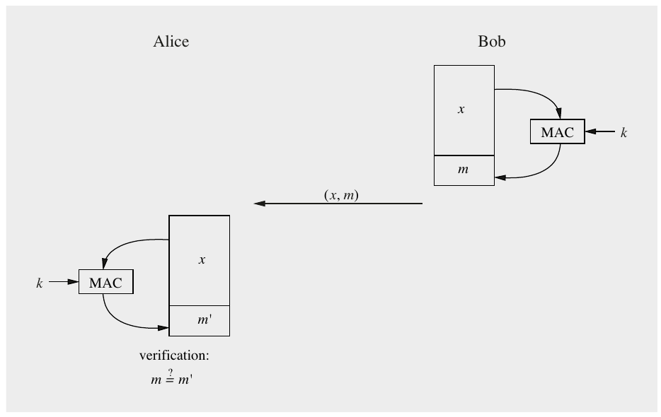
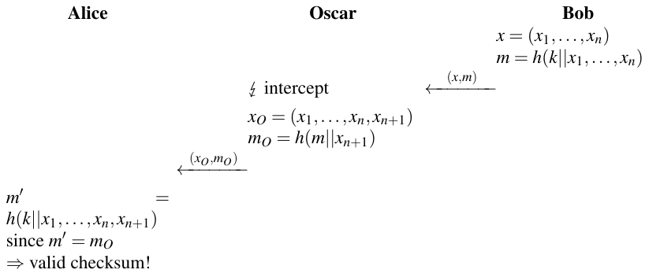
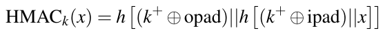
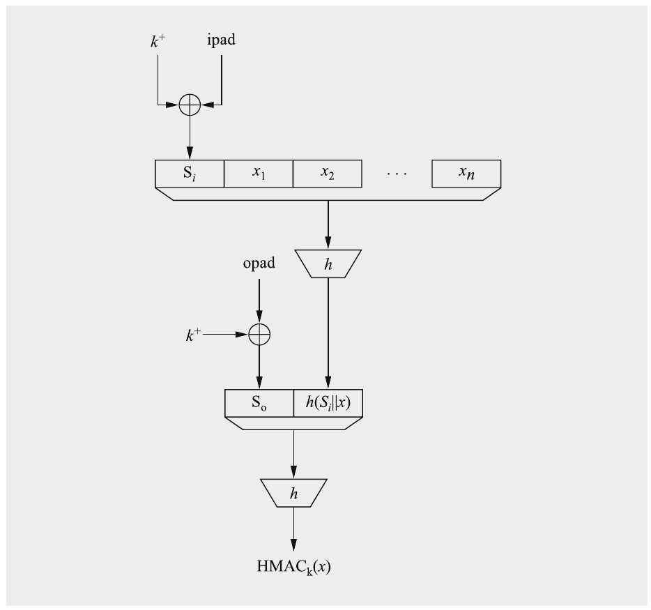
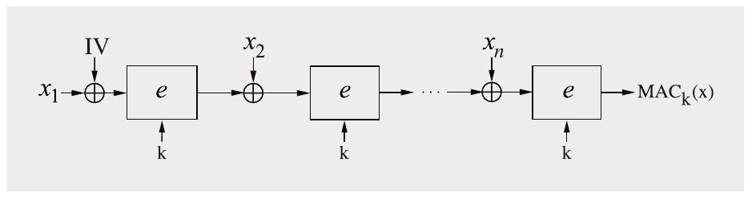
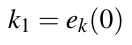
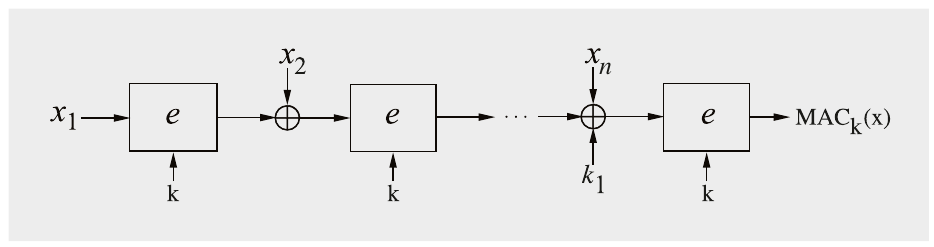
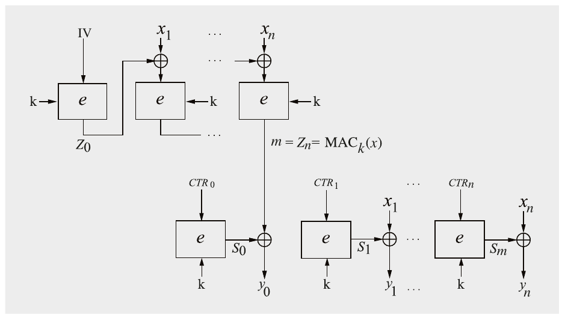
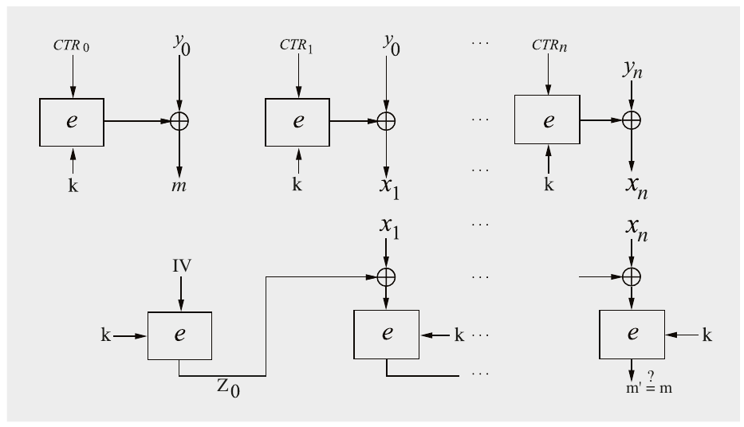
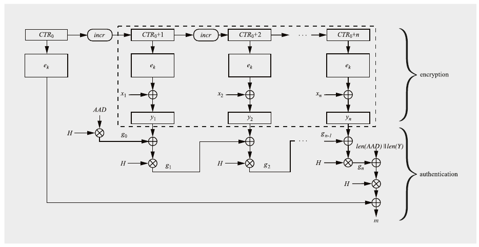

# Chương 13 Message Authentication Code (MAC) (Message Authentication Codes (MACs))

Message Authentication Code (MAC), còn được gọi là cryptographic checksum hay keyed hash function, được dùng rộng rãi trong thực tế. Về chức năng bảo mật, MAC có chung một số tính chất với digital signature, vì chúng cũng cung cấp tính toàn vẹn thông điệp và xác thực thông điệp. Tuy nhiên, khác với digital signature, MAC là các scheme symmetric-key và chúng không cung cấp non-repudiation. Một ưu điểm của MAC là chúng nhanh hơn nhiều so với digital signature vì chúng dựa trên block cipher hoặc hash function.

Trong chương này, bạn sẽ học:

■ Nguyên lý đằng sau MAC

■ Các tính chất bảo mật có thể đạt được với MAC

■ MAC có thể được hiện thực bằng hash function và bằng block cipher như thế nào

## 13.1 Các nguyên lý của Message Authentication Code

Tương tự digital signature, MAC nối một authentication tag vào thông điệp. Khác biệt then chốt giữa MAC và digital signature là MAC dùng một key symmetric k cho cả việc tạo authentication tag và kiểm chứng nó. Một MAC là một hàm của key symmetric k và thông điệp x. Chúng tôi sẽ dùng ký hiệu

m = MACk(x)

cho điều này dưới đây. Nguyên lý tính MAC (bởi Bob) và kiểm chứng (bởi Alice) được thể hiện trong Hình 13.1.

Hình 13.1 Protocol cơ bản để bảo vệ một plaintext x bằng một message authentication code

Động cơ điển hình để dùng MAC là Alice và Bob muốn yên tâm rằng mọi thao túng thông điệp x trong khi truyền đều bị phát hiện, và rằng thông điệp xuất phát từ người gửi đúng. Để làm điều này, Bob tính MAC như một hàm của thông điệp và key bí mật dùng chung k. Anh ấy gửi cả thông điệp và authentication tag m tới Alice. Khi nhận thông điệp và m, Alice kiểm chứng MAC. Vì đây là một thiết lập symmetric, cô ấy chỉ cần lặp lại các bước mà Bob đã thực hiện khi gửi thông điệp: Cô ấy chỉ cần tính lại authentication tag với thông điệp nhận được và key symmetric.

Giả định nền của hệ thống này là phép tính MAC sẽ cho ra kết quả sai nếu thông điệp x bị thay đổi trong khi truyền. Do đó, tính toàn vẹn thông điệp được cung cấp như một security service. Hơn nữa, Alice bây giờ yên tâm rằng Bob là người tạo thông điệp vì chỉ hai bên có cùng key bí mật k mới có khả năng tính MAC. Nếu một đối thủ, Oscar, thay đổi thông điệp trong khi truyền, hắn không thể đơn giản tính một MAC hợp lệ vì hắn không có key bí mật. Mọi sự giả mạo thông điệp có chủ ý hay ngẫu nhiên (ví dụ, do lỗi truyền) sẽ bị bên nhận phát hiện do việc kiểm chứng MAC thất bại. Điều đó có nghĩa là, từ góc nhìn của Alice, Bob phải là người đã tạo MAC. Về security service, xác thực thông điệp cũng được cung cấp, ngoài tính toàn vẹn thông điệp.

Trong thực tế, một thông điệp x hầu như luôn lớn hơn nhiều so với MAC tương ứng. Do đó, tương tự hash function, output của một phép tính MAC là một authentication tag fixed-length độc lập với độ dài input.

Nếu tóm tắt thảo luận tới giờ, chúng ta có thể nêu các tính chất MAC quan trọng sau:

> Các tính chất của Message Authentication Code
>
> 1. Cryptographic checksum Một MAC tạo một authentication tag an toàn về mặt cryptographic cho một thông điệp cho trước.
>
> 2. Symmetric MAC dựa trên các key symmetric bí mật. Bên ký và bên kiểm chứng phải dùng chung một key bí mật.
>
> 3. Kích thước thông điệp tùy ý MAC nhận các thông điệp có độ dài tùy ý.
>
> 4. Độ dài output cố định MAC tạo các authentication tag fixed-size.
>
> 5. Tính toàn vẹn thông điệp MAC cung cấp tính toàn vẹn thông điệp: Mọi thao túng thông điệp trong khi truyền sẽ bị bên nhận phát hiện.
>
> 6. Xác thực thông điệp Bên nhận được bảo đảm về nguồn gốc của thông điệp.
>
> 7. Không có non-repudiation Vì MAC dựa trên các nguyên lý symmetric, chúng không cung cấp non-repudiation.

Điểm cuối cùng quan trọng cần ghi nhớ: MAC không cung cấp non-repudiation. Vì hai bên liên lạc dùng chung cùng key, không có khả năng chứng minh với một bên thứ ba trung lập, ví dụ, một thẩm phán, rằng một thông điệp và MAC của nó xuất phát từ Alice hay Bob. Do đó, MAC không bảo vệ trong các kịch bản mà Alice hoặc Bob không trung thực, như ví dụ car-buying mà chúng ta đã thảo luận trong Mục 10.1.1. Một key bí mật symmetric không gắn với một người duy nhất (khác với một private key asymmetric) mà với hai bên, và do đó thẩm phán không thể phân biệt giữa Alice và Bob trong trường hợp tranh chấp.

Dù không có non-repudiation, MAC được dùng rộng rãi trong thực tế vì chúng cho phép tính authentication tag rất hiệu quả, trái ngược với chữ ký asymmetric tương đối chậm. Lý do cho hiệu quả của chúng là MAC có thể được xây dựng từ các primitive symmetric, như chúng ta sẽ thấy dưới đây. Dùng MAC đòi hỏi cả hai bên liên lạc lưu key bí mật. Ngược lại, kiểm chứng digital signature chỉ cần lưu public key sao cho tính xác thực của nó được bảo đảm, điều thường dễ thực hiện hơn. Sự trade-off này giữa MAC và digital signature phải được xem xét cho mỗi ứng dụng và cryptosystem cụ thể, vì nó đòi hỏi xem xét chi tiết bảo mật nền tảng, quản lý key và các yêu cầu hiệu quả.

Trong thực tế, message authentication code được xây dựng theo hai cách về cơ bản khác nhau: từ block cipher hoặc từ hash function. Trong các mục tiếp theo của chương này, chúng tôi sẽ giới thiệu cả hai cách tiếp cận để xây dựng MAC.

## 13.2 MAC từ Hash Function: HMAC

Một cách được dùng rộng rãi để hiện thực MAC là dùng các hash function cryptographic như SHA-2 và SHA-3 làm khối xây dựng. Một cấu trúc khả dĩ, tên là HMAC, đã trở nên rất phổ biến trong thực tế. Chẳng hạn, cả protocol Transport Layer Security (TLS), được hầu như mọi trình duyệt web dùng, cũng như bộ protocol IPsec đều dùng HMAC. Một lý do cho việc dùng rộng rãi của nó là nó có thể được chứng minh là an toàn nếu một số giả định nhất định được đặt ra.

Ý tưởng cơ bản đằng sau mọi message authentication code hash-based là key được hash cùng với thông điệp. Hai cấu trúc hiển nhiên nảy ra ngay. Cấu trúc thứ nhất:

m = MACk(x) = h(k||x)

được gọi là secret prefix MAC, và cấu trúc thứ hai:

m = MACk(x) = h(x||k)

được biết tới là secret suffix MAC. Ký hiệu “||” ký hiệu phép nối. Theo trực giác, do tính one-wayness và “tính chất xáo trộn” tốt của các hash function hiện đại, cả hai cách tiếp cận đều nên cho ra các cryptographic checksum mạnh. Tuy nhiên, như thường thấy trong cryptography, đánh giá bảo mật của một scheme có thể phức tạp hơn so với vẻ ngoài thoạt nhìn. Bây giờ chúng tôi minh họa các điểm yếu trong cả hai cấu trúc đơn giản này.

### Các tấn công nhắm vào Secret Prefix MAC (Length Extension Attack)

Chúng ta xét các MAC được hiện thực là m = h(k||x). Cho tấn công, chúng ta giả sử cryptographic checksum m được tính bằng một hash function dựa trên Merkle–Damgård construction, như thể hiện trong Hình 11.5. Cách tiếp cận lặp này được dùng trong nhiều hash function ngày nay, đặc biệt là SHA-1 và SHA-2. (Chúng tôi lưu ý rằng SHA-3 dùng một cấu trúc khác — sponge construction — và do đó nó không dễ bị tấn công này.) Thông điệp x mà Bob muốn ký là một chuỗi block x = (x1,x2,...,xn), trong đó độ dài block khớp với độ rộng input của hash function. Bob tính một authentication tag là:

m = MACK(x) = h(k||x1,x2,...,xn)

Vấn đề là MAC cho thông điệp x = (x1,x2,...,xn,xn+1), trong đó xn+1 là một block bổ sung tùy ý, có thể được xây dựng từ m mà không cần biết key bí mật. Tấn công được biết tới là length extension attack. Nó được thể hiện trong protocol dưới đây.

> Tấn công nhắm vào Secret Prefix MAC
>
> 

Lưu ý rằng Alice sẽ chấp nhận thông điệp (x1,...,xn,xn+1) là hợp lệ, dù Bob chỉ xác thực (x1,...,xn). Block cuối xn+1 có thể, chẳng hạn, là một phụ lục cho một hợp đồng điện tử, một tình huống có thể có hậu quả nghiêm trọng.

Tấn công khả thi vì MAC cho thông điệp với block bổ sung xn+1 có thể được xây dựng với output hash trước đó m (đã được tính với key bí mật) và xn+1, nhưng nó không cần key k.

Chúng tôi lưu ý rằng các hash function hiện đại thường yêu cầu đưa một chỉ báo về độ dài thông điệp vào header của thông điệp để ngăn length extension attack. Tuy nhiên, dù có bản sửa này, tấn công vẫn đáng lo ngại.

### Các tấn công nhắm vào Secret Suffix MAC

Sau khi nghiên cứu tấn công trên, có vẻ an toàn khi dùng phương pháp xây dựng cơ bản kia, cụ thể là m = h(x||k). Tuy nhiên, một điểm yếu khác xuất hiện ở đây. Giả sử Oscar có khả năng xây dựng một collision trong hash function, tức là hắn có thể tìm x và xO sao cho:

h(x) = h(xO)

Hai thông điệp x và xO có thể là, chẳng hạn, hai phiên bản của một hợp đồng khác nhau ở một khía cạnh then chốt nào đó, ví dụ, khoản thanh toán agreed-upon. Nếu Bob ký x bằng một message authentication code

m = h(x||k)

m cũng là một checksum hợp lệ cho xO, tức là,

m = h(x||k) = h(xO||k)

Đây là một collision attack “cổ điển”, khả thi vì x và xO cho ra cùng output khi hash. Do đó, chúng ta kết luận rằng cấu trúc secret suffix không an toàn nếu có thể tìm được một collision trong hash function bên dưới.

Tấn công này có mang lại lợi thế cho Oscar hay không phụ thuộc vào các tham số được dùng trong cấu trúc. Làm ví dụ thực tế, hãy xét một secret suffix MAC dùng SHA-256 làm hash function, có độ dài output 256 bit, và một key 256-bit. Người ta sẽ kỳ vọng rằng MAC này cung cấp mức bảo mật 256 bit, tức là kẻ tấn công không thể làm tốt hơn việc brute-forcing toàn bộ key space để giả mạo một thông điệp. Tuy nhiên, nếu kẻ tấn công khai thác birthday paradox (xem Mục 11.2.3), hắn có thể tìm một collision với khoảng √2256 = 2128 phép tính. Dù thực hiện 2128 phép tính hoàn toàn nằm ngoài tầm với của máy tính ngày nay, chúng ta kết luận rằng phương pháp secret suffix cũng không cung cấp mức bảo mật mà người ta muốn có từ một cấu trúc MAC.

### HMAC

Một message authentication code hash-based không có điểm yếu bảo mật của secret prefix và secret suffix MAC được mô tả ở trên là cấu trúc HMAC do Mihir Bellare, Ran Canetti và Hugo Krawczyk đề xuất năm 1996. HMAC gồm một hash trong và một hash ngoài và được minh họa trong Hình 13.2.

Phép tính MAC bắt đầu bằng cách nối các byte all-zero vào đầu bit có trọng số thấp nhất của key k sao cho kết quả k+ có độ dài b bit, trong đó b là độ rộng block input của hash function. Key mở rộng k+ được XOR với inner pad, gồm một mẫu bit lặp lại:

ipad = 0011 0110,0011 0110,...,0011 0110

và cũng có độ dài b bit. Output của XOR tạo thành block input đầu tiên cho hash function. Các block input tiếp theo là các block thông điệp (x1,x2,...,xn).

Hash ngoài thứ hai được tính với key đã padding cùng với output của hash thứ nhất. Ở đây, key lại được mở rộng bằng số không rồi XOR với outer pad:

opad = 0101 1100,0101 1100,...,0101 1100

Kết quả của phép XOR tạo thành block input đầu tiên cho hash ngoài. Input kia là output của hash trong. Sau khi hash ngoài đã được tính, output của nó là message authentication code của x. Toàn bộ cấu trúc HMAC có thể được biểu diễn là:

Hình 13.2 Cấu trúc HMAC

Người ta có thể thắc mắc liệu có vấn đề gì với giao diện giữa hash trong và hash ngoài không vì độ dài output (của hash trong) l trong thực tế ngắn hơn độ rộng b của một block input của hash ngoài. Chẳng hạn, SHA-256 có output l = 256-bit nhưng nhận input b = 512-bit. Tuy nhiên, điều này không gây vấn đề vì hash function có các bước tiền xử lý để khớp chuỗi input với độ rộng block. Làm ví dụ, Mục 11.4.1 mô tả việc tiền xử lý cho SHA-256. Chúng tôi lưu ý rằng dù ipad và opad được chuẩn hóa như thể hiện ở trên, các giá trị thực sự không quan trọng cho bảo mật của HMAC. ipad và opad được chọn sao cho key đã che trong hash trong và hash ngoài khác nhau ở nhiều bit.

Về hiệu quả tính toán, cần lưu ý rằng thông điệp x, có thể rất dài, chỉ được hash một lần trong hash function trong. Hash ngoài chỉ gồm hai block, cụ thể là key đã padding và output hash trong. Do đó, overhead tính toán do cấu trúc HMAC đưa vào rất thấp.

Một lý do chính vì sao cấu trúc HMAC được dùng rộng rãi trong thực tế là có một chứng minh bảo mật. Có thể chỉ ra rằng MAC an toàn ngay cả khi có thể tìm được một collision hay một second preimage (xem Mục 11.2) trong hash function bên dưới.

## 13.3 MAC từ Block Cipher

Trong mục trước, chúng ta đã thấy rằng hash function có thể được dùng để hiện thực message authentication code. Một phương pháp thay thế là xây dựng MAC từ block cipher. Tồn tại khá nhiều scheme với chức năng như vậy. Chúng có thể được phân loại sơ bộ thành các cấu trúc chỉ tính MAC, tức là chúng cung cấp authentication-only, và các scheme authenticated encryption. Loại sau cung cấp cả tính bí mật qua mã hóa lẫn xác thực qua MAC. Bảng 13.1 cho thấy các đại diện quan trọng của cả hai họ scheme. Chúng sẽ được giới thiệu trong các mục sau.

Bảng 13.1 Các cấu trúc MAC phổ biến dựa trên block cipher

| Mode | Mã hóa | Xác thực | Ghi chú |
|---|---|---|---|
| CBC-MAC |  | ✓ | thiếu sót bảo mật |
| CMAC |  | ✓ |  |
| CCM | ✓ | ✓ | authenticated encryption |
| GCM | ✓ | ✓ | authenticated encryption |
| GMAC |  | ✓ |  |

### 13.3.1 CBC-MAC

Trong một thời gian dài, cách tiếp cận phổ biến nhất để tính MAC là dùng mode cipher block chaining (CBC) cùng với một block cipher như AES. Một message authentication code như vậy được gọi là CBC-MAC. Nó rất giống mode mã hóa CBC, đã được giới thiệu trong Mục 5.1.2.

Hình 13.3 cho thấy CBC-MAC. Từ hình chúng ta thấy rằng giá trị MAC cuối cùng m thực ra là một hàm của mọi block thông điệp x1,...,xn. Các block có thể được coi là được xích lại với nhau, do đó có tên CBC. Nhớ lại rằng cả người gửi (tạo MAC ban đầu) và bên nhận (kiểm chứng MAC) đều thực hiện các phép toán giống hệt nhau. Do đó, phép tính được thể hiện trong hình được thực hiện bởi cả Alice và Bob. Thật bổ ích khi so sánh cấu trúc CBC-MAC với mode mã hóa CBC được thể hiện trong Hình 5.4 ở Mục 5.1.2. Chúng tôi lưu ý rằng trong mode sau, Bob thực sự phải giải mã các block ciphertext nhận được, trong khi cấu trúc CBC-MAC hoàn toàn không cần cipher e được dùng ở chế độ giải mã. Một khác biệt cốt lõi khác là cấu trúc CBC-MAC không truyền các giá trị trung gian đã mã hóa mà chỉ truyền kết quả của phép mã hóa cuối cùng, cụ thể là m = MACk(x).

Hình 13.3 MAC được xây dựng từ một block cipher ở mode CBC

Lưu ý rằng chúng ta cần đặt IV thành một giá trị hằng như không. Nếu không, một đối thủ có thể thay đổi block plaintext đầu tiên (và duy nhất) x1 cùng với một thay đổi tương ứng trong IV cho ra cùng MAC. Tấn công này được ngăn nếu IV được cố định thành một giá trị hằng định trước.

Độ dài output của MAC được xác định bởi kích thước block của cipher được dùng. Về mặt lịch sử, DES đã được dùng rộng rãi, ví dụ, cho các ứng dụng ngân hàng. Ngày nay, AES thường được dùng, cho ra một MAC có độ dài 128 bit.

CBC-MAC có một số điểm yếu bảo mật tinh vi, dù nó đã và vẫn đang được dùng trong thực tế. Nói chung, cho MAC của vài thông điệp đã được xác thực riêng lẻ, một đối thủ có thể xây dựng một MAC hợp lệ cho một thông điệp mới là phép nối của các thông điệp riêng lẻ. Bài tập 13.8 đề cập một tấn công như vậy. Với một sửa đổi nhỏ, các tấn công này có thể được ngăn. Phiên bản sửa đổi này của CBC-MAC được gọi là CMAC và sẽ được giới thiệu dưới đây.

### 13.3.2 Cipher-based MAC (CMAC)

Mode CMAC, được thể hiện trong Hình 13.4, liên quan chặt chẽ tới CBC-MAC nhưng loại bỏ một số thiếu sót bảo mật của nó. Chúng tôi lưu ý rằng trong thực tế AES thường được dùng làm cipher e. Có hai khác biệt giữa hai cấu trúc. Thứ nhất, CMAC không có IV. (Người ta cũng có thể hình dung rằng có một IV cố định được đặt thành chuỗi all-zero.) Khác biệt thứ hai quan trọng hơn. Trước khi mã hóa block cuối xn của plaintext, một key bổ sung k1 được XOR-added vào xn. Key k1 này được gọi là subkey. Subkey được tính từ key gốc k, tức là người dùng chỉ phải cung cấp một key, cụ thể là k. Cách k1 được tính hơi rắc rối đối với cấu trúc CMAC standard-compliant. Tuy nhiên, trong một phiên bản đơn giản hóa, subkey được suy ra từ k bằng cách mã hóa chuỗi all-zero bằng cipher e được dùng cho MAC:

 (13.1)

Trong tiêu chuẩn NIST, subkey cũng dựa trên phép mã hóa chuỗi không như thể hiện trong Phương trình (13.1) nhưng thêm vào đó nó được xoay một hoặc hai vị trí và có thể một mask cố định được cộng vào. Chi tiết phụ thuộc vào mẫu bit của subkey và liệu thông điệp có thể chia đều cho độ rộng block của cipher hay không.

Hình 13.4 Cấu trúc CMAC (cipher-based MAC) cơ bản

### 13.3.3 Authenticated Encryption: Counter with Cipher Block Chaining-Message Authentication Code (CCM)

Trong nhiều ứng dụng, đáng mong muốn khi cung cấp tính bí mật (qua mã hóa) và đồng thời xác thực và tính toàn vẹn (qua MAC). Chúng tôi lưu ý rằng ba security service này được hiện thực bằng symmetric cipher. Một cách đạt mục tiêu này là dùng một trong các mode of operation được mô tả trong Chương 5 để mã hóa cùng với CBC-MAC hoặc CMAC — đã được giới thiệu trong các mục trước — để xác thực và toàn vẹn. Tuy nhiên, thường hấp dẫn khi có một hàm mã hóa thực hiện mã hóa thông điệp và tính MAC trong một lượt. Các primitive cryptographic như vậy được gọi là authenticated encryption, đôi khi được gọi là “AE”.

Mode Counter with Cipher Block Chaining-Message Authentication Code (CCM) cung cấp authenticated encryption. Ý tưởng đằng sau CCM là kết hợp mode counter cho mã hóa (CTR, xem Mục 5.1.5) với CBC-MAC cho xác thực. Với cả hai cơ chế, mode CTR và CBC-MAC, cùng key k được dùng. CCM được dùng rộng rãi trong thực tế, ví dụ, trong protocol bảo mật WPA2 để bảo vệ liên lạc Wi-Fi, trong Bluetooth Low Energy và trong IPsec.

CCM hoạt động theo kiểu authenticate-then-encrypt, tức là trước hết một MAC được tính và sau đó tag m của MAC cùng với toàn bộ thông điệp được mã hóa. Hai quá trình CCM được gọi là generation-encryption (bởi người gửi, Alice) và decryption-verification (bởi bên nhận, Bob) và được mô tả dưới đây. Hình 13.5 cho thấy quá trình generation-encryption cho một thông điệp x. Các giá trị bộ đếm CTRi được xây dựng theo cùng cách như cho mode mã hóa counter, như được giới thiệu trong Mục 5.1.5. Người gửi, Alice, trước hết tính giá trị MAC m rồi mã hóa m cùng với thông điệp thực sự. Cô ấy gửi ciphertext gồm n + 1 block (y0,...,yn) tới Bob. Thật thú vị khi xem điều gì xảy ra với MAC tag m. Thứ nhất, chúng tôi lưu ý rằng nó chỉ là một giá trị nội bộ không được gửi dạng rõ qua kênh (trái ngược với các mode MAC-only CBC-MAC và CMAC được giới thiệu ở trên). Thứ hai, giá trị MAC m được mã hóa và trở thành block ciphertext đầu tiên y0, sau đó được truyền qua kênh. IV phải là một nonce, tức là một giá trị chỉ được dùng một lần; xem Mục 5.1.2 để có thêm thông tin về IV và nonce. Cũng phải bảo đảm rằng nonce không giống bất kỳ giá trị bộ đếm CTRi nào.

Hình 13.5 Quá trình Generation-encryption của mã CCM

Ở phía nhận, Bob thực hiện phép toán decryption-verification được thể hiện trong Hình 13.6. Để kiểm chứng, MAC tag m phải được Bob re-computed, điều cần plaintext x1,...,xn. Do đó, Bob trước hết phải giải mã các block ciphertext (phần trên của hình) và sau đó anh ấy tính MAC (phần dưới của hình). Việc kiểm chứng thực sự gồm so sánh tag m′ do Bob tính với tag nhận được m do Alice gửi.

Mode CCM theo tiêu chuẩn NIST (chính thức được đặt tên là NIST Special Publication 800-38C) liên quan tới nhiều chi tiết hơn, đã được lược bỏ cho rõ ràng trong mô tả ở mục này. Chẳng hạn, tiêu chuẩn quy định associated data, là một mẩu plaintext được xác thực nhưng không được mã hóa. Đây có thể là, chẳng hạn, thông tin header mà người gửi muốn gửi dạng rõ.

Hình 13.6 Quá trình Decryption-verification của mã CCM

### 13.3.4 Authenticated Encryption: Galois Counter Mode (GCM)

Tương tự CMAC, Galois Counter mode (GCM) cũng kết hợp mã hóa và tính MAC. Nó được dùng rộng rãi trong thực tế, tức là trong IPsec và TLS. GCM cung cấp cái được gọi là authenticated encryption with associated data (AEAD). “Associated data” được dùng trong các tình huống mà một số phần nhất định của thông điệp không nên được mã hóa, ví dụ, header của gói tin hay frame mạng. Dù associated data không được mã hóa, MAC được tính trên cả thông điệp plaintext thực sự lẫn associated data. Vì associated data cũng được MAC-protected, một mode AEAD cho phép phát hiện các tấn công trong đó ciphertext bị sao chép vào các thông điệp với header khác (là một phần của AE) vì nó gắn associated data với ciphertext. Dưới đây chúng tôi trình bày một phiên bản hơi đơn giản hóa của mode GCM, lược bỏ một số chi tiết padding cho rõ ràng.

GCM hoạt động theo kiểu encrypt-then-authenticate, tức là plaintext trước hết được mã hóa và MAC được tính từ các block ciphertext thu được. Hình 13.7 cho thấy sơ đồ của mode GCM. Ở phía người gửi, GCM mã hóa dữ liệu dùng mode counter (hộp nét đứt trong hình) theo sau là việc tính một giá trị MAC (phần dưới). Về chi tiết của mode counter và việc tạo các giá trị bộ đếm CTRi, vui lòng xem Mục 5.1.5. Như trong mọi mode counter, GCM cho phép tính trước hàm block cipher nếu initialization vector được biết trước.

Để xác thực, GCM thực hiện một cách tiếp cận đổi mới dựa trên một chuỗi phép nhân Galois field. Để tính MAC tag, cần một subkey H, được tính từ key mã hóa k như sau:

Hình 13.7 Authenticated encryption cơ bản ở Galois Counter mode

H = ek(0)

Như có thể thấy từ phần dưới của Hình 13.7, các ciphertext được xích lại với nhau theo cách sau: Mỗi ciphertext yi được XOR-added với kết quả của lần lặp trước rồi nhân với subkey H. Ciphertext đầu tiên y1 được XOR với kết quả của phép nhân associated data (ký hiệu là AAD — additional authenticated data) và subkey. Sau khi block ciphertext cuối yn đã được nhân với H, một chuỗi bit chứa độ dài của associated data và độ dài của tổng mọi ciphertext được XOR-added. Kết quả của phép XOR này cuối cùng được nhân với output của phép mã hóa giá trị bộ đếm đầu tiên CTR0.

Các phép nhân nằm trong Galois field 128-bit GF (2128) với đa thức bất khả quy P(x) = x128 + x7 + x2 + x + 1. Điều này ngụ ý rằng block cipher được dùng phải có kích thước block 128 bit. Các cipher như vậy khá phổ biến, ví dụ nổi bật nhất là AES. Vì chỉ cần một phép nhân mỗi lần mã hóa block cipher, việc xác thực thêm rất ít overhead tính toán vào phép mã hóa.

Bên nhận, Bob, nhận gói [(y1,...,yn),m,AAD], chứa ba loại dữ liệu, thông điệp đã mã hóa thực sự, authentication tag m và associated data không mã hóa. Để khôi phục thông điệp, Bob chỉ cần áp dụng mode counter lên các block yi. Để kiểm tra tính xác thực của dữ liệu, anh ấy cũng tính một authentication tag m′ dùng ciphertext nhận được và AAD làm input. Để tính, anh ấy dùng chính xác các bước giống người gửi. Nếu m và m′ khớp, bên nhận được bảo đảm rằng cipertext *(ghi chú: sách in cipertext; đúng là ciphertext)* (và AAD) không bị thao túng trong khi truyền và chỉ người gửi có thể đã tạo thông điệp.

### 13.3.5 Galois Counter Message Authentication Code (GMAC)

GMAC là một biến thể của Galois Counter Mode (GCM) được giới thiệu trong Mục 13.3.4 ở trên. Khác với mode GCM, GMAC không mã hóa dữ liệu mà chỉ tính message authentication code. Mode được dùng trong các ứng dụng không cần tính bí mật của dữ liệu nhưng vẫn cần tính toàn vẹn và tính xác thực thông điệp. GMAC cho phép song song hóa dễ dàng, hấp dẫn cho các ứng dụng high-speed. Mode có thể được hiện thực hiệu quả bằng hardware và có thể đạt throughput 100 Gbit/sec trở lên.

Mode là một phần của nhiều tiêu chuẩn được dùng rộng rãi. Chẳng hạn, GMAC được quy định trong tiêu chuẩn IPsec cho bảo mật internet, nơi nó được dùng cho Encapsulating Security Payload (ESP) và Authentication Header (AH).

## 13.4 Thảo luận và đọc thêm (Discussion and Further Reading)

MAC từ Block Cipher Về mặt lịch sử, MAC block cipher-based đã là phương pháp thống trị để xây dựng message authentication code. Ngay từ năm 1977, tức là chỉ vài năm sau khi công bố Data Encryption Standard, người ta đã gợi ý rằng DES có thể được dùng để tính cryptographic checksum [66]. Trong những năm tiếp theo, MAC block cipher-based đã được chuẩn hóa ở Mỹ và được dùng rộng rãi để bảo đảm tính toàn vẹn của các giao dịch tài chính, ví dụ, trong FIPS 113 1985-issued. Đây là một tiêu chuẩn cho cấu trúc CBC-MAC với DES làm thuật toán mã hóa, đã hết hiệu lực năm 2008. Thiếu sót bảo mật chính của CBC-MAC là một existential forgery attack, mô tả có thể được tìm thấy trong [189, Example 9.62]. Bài tập 13.8 cũng cho thấy một ví dụ về tấn công như vậy.

Bốn cấu trúc MAC hiện đại CMAC, CCM, GCM và GMAC được giới thiệu trong chương này đã được NIST chuẩn hóa trong các năm 2004–2007. Chúng được mô tả trong một loạt NIST Special Publications 800-38 (SP 800-38), cũng chứa các mode of operation cho mã hóa. Để dễ đọc, chúng tôi trình bày lại dưới đây Bảng 5.1 từ Mục 5.4, tóm tắt các NIST Special Publications 800-38. Vui lòng xem Mục 5.4 để có thêm chi tiết.

| SP-800-38 | A [101] | B [105] | C [103] | D [102] | E [104] | F [106] |
|---|---|---|---|---|---|---|
| các mode | ECB, CBC, CFB, OFB, CTR | CMAC | CCM | GCM, GMAC | XTS-AES | KW, KWP, TKW |
| tính bí mật | ✓ |  | ✓ | (✓) | ✓ |  |
| xác thực |  | ✓ | ✓ | ✓ |  |  |
| key wrap |  |  |  |  |  | ✓ |

Như đã nhắc trong phần lý thuyết, cấu trúc CMAC là một phiên bản cải tiến của CBC-MAC, vốn có điểm yếu bảo mật. CMAC dựa trên cấu trúc OMAC (One-key MAC), được Iwata và Kurosawa [154] đề xuất năm 2003. Đến lượt mình, OMAC cải tiến cấu trúc XCBC MAC, được Rogaway và Black [51] đề xuất năm 2000, bản thân nó là một cải tiến của thuật toán CBC-MAC.

MAC Hash Function-Based Cấu trúc HMAC ban đầu được đề xuất tại hội nghị CRYPTO 1996 [32]. Một trình bày rất dễ tiếp cận về scheme có thể được tìm thấy trong [33]. Như được mô tả trong phần lý thuyết, HMAC hấp dẫn vì nó ngăn length extension attack, được mô tả trong Mục 13.2. HMAC đã được biến thành một RFC internet, và nhanh chóng được chấp nhận trong nhiều protocol bảo mật internet, bao gồm TLS và IPsec. Trong cả hai trường hợp, nó bảo vệ tính toàn vẹn của thông điệp trong khi truyền. Hiện nó được dùng rộng rãi với hash function SHA-2.

Các cấu trúc MAC khác Một loại message authentication code khác dựa trên universal hashing và được gọi là UMAC. UMAC được hỗ trợ bởi một phân tích bảo mật hình thức, và thành phần cryptographic nội bộ duy nhất là một block cipher được dùng để tạo các pad giả ngẫu nhiên và vật liệu key nội bộ. Universal hash function được dùng để tạo một giá trị hash ngắn có độ dài cố định. Hash này sau đó được XOR với một pad giả ngẫu nhiên key-derived. Universal hash function được thiết kế để rất nhanh trong software (ví dụ, chỉ khoảng một chu kỳ mỗi byte trên các vi xử lý đương đại) và chủ yếu dựa trên phép cộng các số 32-bit và 64-bit và phép nhân các số 32-bit. Dựa trên ý tưởng ban đầu của Wegman và Carter [67], nhiều scheme đã được đề xuất, ví dụ, các scheme Multilinear-Modular-Hashing (MMH) và UMAC [138, 50].

## 13.5 Bài học rút ra (Lessons Learned)

■ MAC cung cấp hai security service, tính toàn vẹn thông điệp và xác thực thông điệp, dùng các kỹ thuật symmetric. MAC được dùng rộng rãi trong các protocol thực tế.

■ Cả hai service này cũng được digital signature cung cấp, nhưng MAC nhanh hơn nhiều.

■ MAC không cung cấp non-repudiation.

■ Các MAC có ý nghĩa thực tế dựa trên block cipher hoặc hash function.

■ Authenticated encryption chỉ các scheme thực hiện cả mã hóa dữ liệu và tính MAC.

■ HMAC là một MAC phổ biến dựa trên hash function. Nó được dùng rộng rãi trong thực tế, ví dụ, trong TLS.

## Bài tập

13.1. Như chúng ta đã thấy, MAC có thể được dùng để xác thực thông điệp. Với bài tập này, chúng tôi muốn chỉ ra sự khác biệt giữa hai protocol — một với MAC, một với digital signature. Trong hai protocol, bên gửi thực hiện phép toán sau:

1. Protocol A:

y = ek1[x||h(k2||x)]

trong đó x là thông điệp, h(x) là một hash function như SHA-3, e là một thuật toán mã hóa symmetric, “||” ký hiệu phép nối đơn giản, và k1, k2 là các key bí mật, chỉ người gửi và bên nhận biết.

2. Protocol B:

y = ek[x||sigkpr(h(x))]

Đưa ra một mô tả step-by-step (ví dụ, bằng một danh sách liệt kê) về những gì bên nhận làm khi nhận y. Bạn có thể muốn vẽ một sơ đồ khối cho quá trình ở phía bên nhận.

13.2. Với hash function, điều then chốt là có số bit output đủ lớn, ví dụ, 256 bit, để chặn các tấn công dựa trên birthday paradox. Vì sao độ dài output ngắn hơn nhiều, ví dụ, 128 bit, lại đủ cho MAC trong hầu hết trường hợp? Cho câu trả lời của bạn, giả sử một thông điệp x được gửi dạng rõ cùng với MAC của nó qua kênh: (x,MACk(x)). Làm rõ chính xác Oscar phải làm gì để tấn công hệ thống này.

13.3. Chúng ta nghiên cứu hai phương pháp bảo vệ tính toàn vẹn với mã hóa.

1. Giả sử chúng ta áp dụng một kỹ thuật authenticated encryption (tức là một scheme cung cấp cả tính bí mật lẫn authentication/integrity) trong đó một ciphertext c được tính là

c = ek(x||h(x))

trong đó h(x) là một hash function. Kỹ thuật này không phù hợp cho mã hóa bằng stream cipher nếu kẻ tấn công biết toàn bộ plaintext x. Giải thích chính xác cách một kẻ tấn công chủ động bây giờ có thể thay x bằng một x′ tùy ý do his/her chọn và tính c′ sao cho bên nhận sẽ kiểm chứng thông điệp là đúng nếu một stream cipher được dùng cho hàm mã hóa e(x). Giả sử x và x′ có độ dài bằng nhau. Tấn công này có hoạt động nếu phép mã hóa được làm bằng one-time pad không? Điều chúng tôi muốn chỉ ra với bài tập này là nếu tính bí mật bị phá, xác thực cũng bị phá. Một scheme authenticated encryption tốt không nên có hành vi này.

2. Tấn công có còn áp dụng được không nếu checksum được tính bằng một keyed hash function như một MAC:

c = ek1(x||MACk2(x))

Giả sử e(x) là một stream cipher như trên.

13.4. Bây giờ chúng ta sẽ thảo luận các vấn đề với một cấu trúc MAC ad hoc hiệu quả nhưng yếu về mặt cryptographic.

1. Thông điệp X cần được xác thực gồm z block độc lập sao cho X = x1||x2||...||xz, trong đó mỗi xi gồm |xi| = 8 bit. Các block input lần lượt được đưa vào một compression function h() hoạt động như sau:

ci = h(ci−1,xi) = ci−1 ⊕ xi

với c0 = 0. Cả ci và xi đều là các giá trị 8-bit. MAC được tính từ output cuối cz của compression function:

MACk(X) ≡ cz + k mod 28

trong đó k là một key dùng chung 64-bit. Mô tả chính xác cách (phần hiệu dụng của) key k có thể được tính chỉ với một thông điệp X đã biết.

2. Thực hiện tấn công này cho các giá trị sau và xác định key k:

X = HELLO ALICE!

c0 = 1111 11112

MACk(X) = 1001 11012

3. Độ dài key hiệu dụng của k là bao nhiêu?

13.5. Về nguyên tắc, MAC cũng dễ bị collision attack. Chúng ta thảo luận vấn đề này dưới đây.

1. Giả sử Oscar tìm được một collision giữa hai thông điệp, tức là,

MACk(x1) = MACk(x2)

Giả sử một cuộc trao đổi thông điệp đã xác thực giữa Alice và Bob không có mã hóa. Chỉ ra Oscar phải làm gì để khai thác collision.

2. Dù birthday paradox vẫn có thể được dùng để xây dựng collision, vì sao xây dựng chúng trong bối cảnh thực tế cho MAC khó hơn nhiều so với cho hash function? Vì đây là trường hợp: MAC với output 128-bit cung cấp bảo mật gì so với một hash function có output 128-bit?

13.6. MAC có thể là một lựa chọn thay thế cho chữ ký asymmetric để kiểm chứng tính xác thực của các thực thể (còn được gọi là định danh). Trong Mục 10.1.4, một protocol asymmetric đơn giản được trình bày để định danh Alice.

1. Mô tả một protocol tương tự trong đó Alice và Bob dùng một MAC để xác thực Alice.

2. Mở rộng protocol sao cho Alice và Bob xác thực lẫn nhau.

13.7. Chúng ta xét MAC từ hash function. Chỉ ra hai tấn công cơ bản nhắm vào secret prefix MAC và secret suffix MAC:

MACk(x) = H(k||x) (secret prefix)

MACk(x) = H(x||k) (secret suffix)

trong đó H(x) ký hiệu một hash function mạnh về mặt cryptographic dựa trên Merkle–Damgård construction.

13.8. Trong bài tập này, chúng ta nghiên cứu một adaptive chosen-plaintext attack nhắm vào CBC-MAC. Chúng tôi sẽ chỉ ra rằng CBC-MAC có thể không an toàn dưới một số giả định nhất định.

Giả sử một kẻ tấn công, Oscar, có quyền truy cập một oracle O tính MAC cho các thông điệp có kích thước tùy ý với một key k, mà Oscar không biết. (Trong thực tế, một oracle như vậy có thể được “xây dựng” nếu kẻ tấn công có thể lừa Alice hoặc Bob xác thực các thông điệp mà hắn gửi cho họ.) Chúng tôi muốn chỉ ra rằng Oscar có thể dùng các thông điệp với MAC oracle-generated để xây dựng một thông điệp mới với MAC hợp lệ. Để đơn giản, chúng ta giả sử một IV gồm toàn số không được dùng.

1. Mục tiêu của kẻ tấn công là xây dựng một MAC hợp lệ cho thông điệp X′ = x1x2x3 mà không yêu cầu MAC(X′) từ oracle. Trước hết hắn yêu cầu MAC cho thông điệp X = x1x2 từ oracle. Kẻ tấn công phải gửi thông điệp nào khác tới oracle để có MAC(X′)? Chúng ta giả sử mỗi xi có độ rộng của block cipher được dùng bởi CBC-MAC.

2. Giải thích vì sao tấn công hoạt động, tức là khía cạnh có vấn đề của CBC-MAC là gì.

3. Tấn công có còn khả thi nếu dùng scheme CMAC không? Giải thích câu trả lời.
