# Chương 14 Quản lý key (Key Management)

Với các cơ chế cryptographic mà chúng ta đã học tới giờ, đặc biệt là mã hóa symmetric và asymmetric, digital signature và message authentication code (MAC), người ta có thể đạt tương đối dễ dàng các security service cơ bản được giới thiệu trong Mục 10.1.3:

■ Tính bí mật (dùng các thuật toán mã hóa)

■ Tính toàn vẹn (dùng MAC hoặc digital signature)

■ Xác thực thông điệp (dùng MAC hoặc digital signature)

■ Non-repudiation (dùng digital signature)

Tương tự, định danh có thể được thực hiện qua các protocol dùng các primitive cryptographic symmetric hoặc aysmmetric *(ghi chú: sách in aysmmetric; đúng là asymmetric)*.

Tuy nhiên, mọi cơ chế cryptographic đều dựa vào việc tạo key đúng cách và phân phối an toàn chúng giữa các bên liên quan. Trong thực tế, nhiệm vụ quản lý key thường là một trong những phần quan trọng nhất và khó nhất của một cryptosystem. Chúng ta đã học một số cách phân phối key qua kênh không an toàn, đặc biệt là trao đổi key Diffie–Hellman. Trong chương này, bạn sẽ học thêm về quản lý key và các phương pháp tương ứng để tạo và thiết lập key giữa các bên ở xa. Đặc biệt, chúng tôi sẽ thảo luận:

■ Cách suy ra nhiều session key từ một key ban đầu

■ Key có thể được thiết lập bằng các primitive symmetric và asymmetric như thế nào

■ Vì sao các kỹ thuật public-key vẫn có thiếu sót trong việc phân phối key

■ Certificate là gì và chúng được dùng như thế nào

■ Vai trò của các public-key infrastructure

■ Tầm quan trọng của việc quản lý trong suốt vòng đời của một cryptosystem

## 14.1 Giới thiệu

Trong mục này, chúng tôi giới thiệu một số thuật ngữ và trình bày một scheme phân phối key đơn giản. Scheme sau hữu ích để làm động cơ cho các phương pháp nâng cao hơn, mà chúng tôi sẽ giới thiệu sau đó. Sau đó, chúng tôi sẽ giới thiệu các cơ chế key derivation trong Mục 14.2. Sau đó trong chương này, trước hết chúng tôi sẽ thảo luận các vấn đề then chốt của các kỹ thuật thiết lập key dựa trên các cơ chế symmetric và asymmetric (lần lượt Mục 14.3 và 14.4). Sau đó chúng tôi sẽ giới thiệu public-key infrastructure, hay PKI, trong Mục 14.5, vốn cần để việc thiết lập key asymmetric hoạt động trong thực tế. Chương sẽ kết thúc với một thảo luận về các khía cạnh thực tế của quản lý key trong Mục 14.6.

Nói đại khái, thiết lập key (key establishment) đề cập việc phân phối một bí mật dùng chung giữa hai hay nhiều bên. Các phương pháp cho điều này có thể được phân loại thành các phương pháp vận chuyển key (key transport) và thỏa thuận key (key agreement), như thể hiện trong Hình 14.1. Một protocol vận chuyển key là một kỹ thuật trong đó một bên truyền an toàn một giá trị bí mật tới các bên khác. Trong một protocol thỏa thuận key, hai (hay nhiều) bên suy ra bí mật dùng chung trong đó mọi bên đều đóng góp vào bí mật. Lý tưởng nhất, không bên nào có thể kiểm soát giá trị chung cuối cùng sẽ là gì.

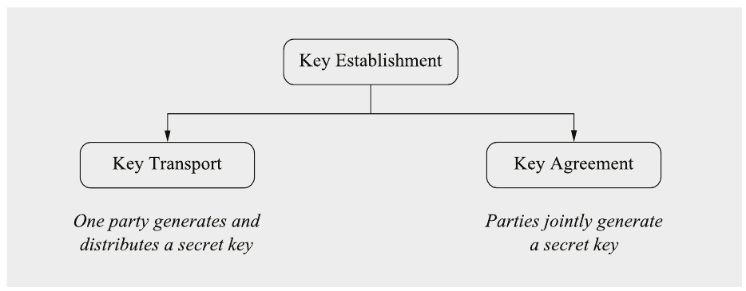

Hình 14.1 Phân loại các scheme thiết lập key

Bản thân việc thiết lập key liên quan chặt chẽ tới định danh. Luôn có mối đe dọa rằng đối thủ cố giả danh Alice hoặc Bob với mục tiêu thiết lập một key bí mật với bên kia. Để ngăn các tấn công như vậy, mỗi bên phải được bảo đảm về danh tính của thực thể kia. Mọi vấn đề này đều được đề cập trong chương này.

### Vấn đề phân phối key n2

Cho tới giờ, chúng ta chủ yếu giả định rằng các key cần thiết cho thuật toán symmetric được phân phối qua một “kênh an toàn”, như được mô tả ở đầu cuốn sách này trong Hình 1.5. Phân phối key theo cách này đôi khi được gọi là key predistribution hay truyền out-of-band vì nó thường liên quan tới một phương thức (hay băng) liên lạc khác, ví dụ, key được truyền qua điện thoại hoặc trong thư. Dù điều này có vẻ hơi vụng về, nó có thể là một cách tiếp cận hữu ích trong một số tình huống thực tế nhất định, đặc biệt nếu số bên liên lạc không quá lớn. Một ví dụ từ thực tế là key predistribution trong một mạng WiFi gia đình giữa một router và vài thiết bị đầu cuối. Cộng đồng WiFi dùng thuật ngữ pre-shared key (PSK) cho cách tiếp cận này. Trong hầu hết các tình huống, khá dễ để cài key WiFi thủ công trên một số lượng hạn chế laptop, smartphone hay thiết bị nhà thông minh. Tuy nhiên, key predistribution nhanh chóng đạt tới giới hạn ngay cả khi số thực thể trong một mạng chỉ lớn vừa phải. Điều này dẫn tới vấn đề phân phối key n2 well-known.

Chúng ta giả sử một mạng với n người dùng, trong đó mọi bên đều có khả năng liên lạc với mọi bên khác một cách an toàn, tức là nếu Alice muốn liên lạc với Bob, hai người dùng chung một key bí mật kAB, chỉ họ biết mà không ai trong n − 2 bên còn lại biết. Tình huống này được thể hiện cho trường hợp một mạng với n = 4 người tham gia trong Hình 14.2.

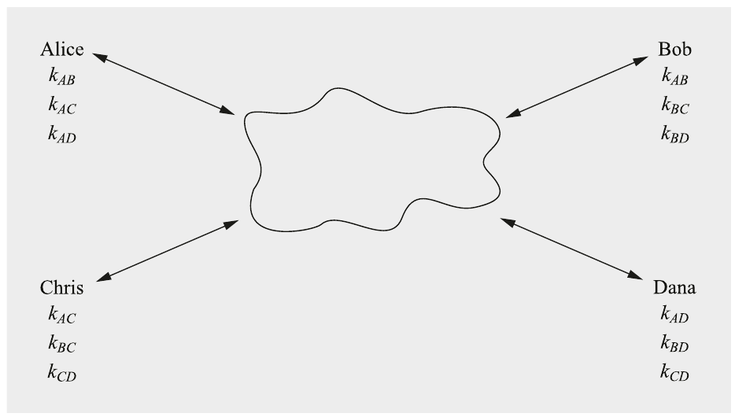

Hình 14.2 Các key trong một mạng với n = 4 người dùng

Từ ví dụ này, chúng ta có thể ngoại suy vài đặc điểm của scheme cho trường hợp n người dùng:

■ Mỗi người dùng phải lưu n − 1 key.

■ Có tổng cộng n(n − 1) ≈ n2 key trong mạng.

■ Tổng cộng n(n − 1)/2 = (n2) cặp key symmetric nằm trong mạng.

■ Nếu một người dùng mới tham gia mạng, một kênh an toàn phải được thiết lập với mọi người dùng khác để tải lên các key mới.

Hệ quả của các quan sát này không thuận lợi lắm nếu số người dùng tăng. Nhược điểm thứ nhất là số key trong hệ thống khoảng n2. Ngay cả với các mạng có kích thước vừa phải, con số này trở nên khá lớn. Mọi key này phải được tạo an toàn ở một vị trí, thường là một loại cơ quan đáng tin cậy nào đó. Nhược điểm kia, thường nghiêm trọng hơn trong thực tế, là thêm một người dùng mới vào hệ thống đòi hỏi cập nhật key của mọi người dùng hiện có. Vì mỗi lần cập nhật cần một kênh an toàn, điều này rất cồng kềnh.

Ví dụ 14.1. Một công ty mid-size với 800 nhân viên muốn cho phép liên lạc an toàn giữa mọi cặp nhân viên khả dĩ dùng các cơ chế symmetric. Điều này sẽ cho phép tính bí mật qua mã hóa symmetric cũng như xác thực và tính toàn vẹn qua MAC. Để làm điều này, phải tạo 800 × 799/2 = 319,600 cặp key symmetric, và phải phân phối 800 × 799 = 639,200 key qua các kênh an toàn. Hơn nữa, nếu nhân viên số 801 gia nhập công ty, cả 800 người dùng khác phải nhận một bản cập nhật key. Điều này có nghĩa là phải thiết lập 801 kênh an toàn (tới 800 nhân viên hiện có và tới người mới).

◇

Rõ ràng, cách tiếp cận này không hoạt động cho các mạng vừa hoặc lớn, và chắc chắn không cho internet. Tuy nhiên, có những ứng dụng mà số người dùng (i) nhỏ và (ii) không thay đổi thường xuyên. Một ví dụ có thể là một công ty với một số ít chi nhánh, tất cả đều cần liên lạc an toàn với nhau. Thêm một chi nhánh mới không xảy ra quá thường xuyên, và nếu điều này xảy ra, có thể chấp nhận việc tải một key mới lên mỗi chi nhánh hiện có.

Để giải quyết các vấn đề nói trên với việc phân phối key hiệu quả cho từng bên, chúng ta cần thảo luận phương pháp luận chung về cách tạo các key này. Trong các chương trước, chúng ta đã học rằng các key bí mật cần mới và được chọn ngẫu nhiên. Tuy nhiên, trong thực tế cũng có những trường hợp sử dụng mà có lợi khi suy ra key từ một key ban đầu hoặc từ một master key so-called. Các phương pháp key derivation như vậy hữu ích, chẳng hạn, cho các cơ quan trung tâm được yêu cầu (re-)generate key hiệu quả cho mỗi người dùng liên lạc qua một mạng lớn. Nếu các key người dùng riêng lẻ có thể được suy ra hiệu quả từ master key, cơ quan trung tâm không cần lưu mọi key người dùng. Hơn nữa, key derivation cũng có thể được dùng cho các phép biến đổi bí mật cục bộ, như chuyển mật khẩu hay passphrase thành key bí mật. Mục sau sẽ thảo luận chi tiết nhiều khía cạnh của key derivation an toàn và hiệu quả.

## 14.2 Key Derivation

Cho tới giờ trong cuốn sách này, chúng ta đã xét hai cách tạo key cryptographic. Hoặc chúng ta giả định chúng đến từ các bộ sinh số ngẫu nhiên thực (TRNG) hoặc chúng là kết quả của một protocol asymmetric như trao đổi key Diffie-Hellman. Trong thực tế, thường có thêm các vấn đề. Chẳng hạn, TRNG cần một nguồn entropy đáng tin cậy, vốn đơn giản là không có trên nhiều nền tảng tính toán. Trong trường hợp các protocol thiết lập key asymmetric, các key được tạo cho ứng dụng thường lớn hơn mức cần và phải được rút ngắn bằng cách nào đó. Ngoài ra, có những ứng dụng cần tạo nhiều ephemeral key từ một master key để bảo đảm key freshness. Điều sau bảo đảm rằng nếu một ephemeral key bị lộ, kẻ tấn công chỉ có thể giải mã một lượng plaintext hạn chế. Một giải pháp trong các kịch bản như vậy là key derivation, tức là tạo một hoặc vài key cryptographic từ một giá trị bí mật. Đây là một số kịch bản cần key derivation:

■ Suy ra (nhiều) key từ một master key pre-shared

■ Suy ra một key bí mật từ một mật khẩu (dễ nhớ và dễ nhập hơn cho con người)

■ Suy ra một key symmetric từ một protocol thiết lập key asymmetric tạo ra các giá trị quá dài để được dùng trực tiếp làm key symmetric

■ Suy ra một key từ các đặc điểm sinh trắc học

■ ...

Sau đây, chúng tôi sẽ mô tả nguyên lý chung của key derivation và thảo luận key derivation password-based như một ứng dụng quan trọng.

### Key Derivation Function

Ý tưởng cơ bản đằng sau một key derivation function (KDF) là tính một key kd từ một giá trị bí mật hiện có k. Hình 14.3 cho thấy nguyên lý của một KDF. Như có thể thấy, trong hầu hết trường hợp, một tham số thứ hai s, không phải giữ bí mật, được xử lý cùng với bí mật chung k. Then chốt cho KDF là với mỗi giá trị s một key kd khác được suy ra. Thường một giá trị non-secret như một bộ đếm hay một nonce được dùng làm s. Với thiết lập này, hai bên (Alice và Bob) đã thiết lập một bí mật chung có thể suy ra nhiều session key kd bằng cách dùng một bộ đếm đồng bộ cho giá trị s. Ngoài ra, Alice có thể tạo một nonce và gửi nó dạng rõ tới Bob. Cả hai sau đó có thể đưa nonce làm input s vào KDF.

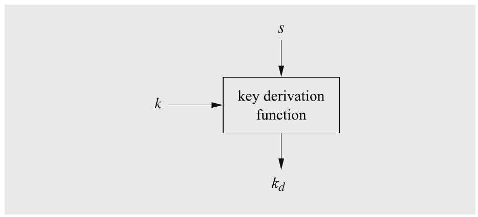

Hình 14.3 Nguyên lý của key derivation

Bên trong, KDF áp dụng một pseudorandom function (PRF) để tạo output. Một PRF là một hàm có output không thể phân biệt được (với cơ hội thành công hợp lý) với một giá trị ngẫu nhiên thực sự. Trong thực tế, PRF thường được xây dựng từ hash function hoặc block cipher. Một ví dụ về KDF được xây dựng bằng cấu trúc HMAC (xem Mục 13.2) được cho dưới đây:

kd = KDF(k,s) = HMACk(s)

### Key Derivation Password-Based

Dù tồn tại các lựa chọn thay thế như sinh trắc học, mật khẩu vẫn được dùng phổ biến nhất để xác thực người dùng trong các hệ thống máy tính. Ngay cả trong xác thực two-factor, một trong hai yếu tố thường là mật khẩu. Do đó, không ngạc nhiên khi một ứng dụng chính của KDF là tạo key từ mật khẩu hay passphrase để xác thực người dùng. Vì con người kém trong việc nhớ ngay cả một số lượng vừa phải bit hay chữ số ngẫu nhiên, các mật khẩu easy-to-remember thường được dùng làm thông tin bí mật để xác thực. Rõ ràng, trong một hệ thống máy tính, một mật khẩu được nhập cần được kiểm tra tính đúng. Một cách tiếp cận ngây thơ (naïve) là so sánh trực tiếp mật khẩu nhập vào với các mật khẩu được lưu trong một file mật khẩu. Tuy nhiên, điều này sẽ tạo thành một lỗ hổng lớn vì việc mất file mật khẩu, ví dụ, qua một hệ thống máy tính bị hack, sẽ ngay lập tức làm lộ mọi mật khẩu người dùng. Để khắc phục vấn đề này, mỗi mật khẩu được đưa vào một KDF và chỉ output KDF được lưu trong file mật khẩu. Nếu một người dùng Alice muốn tự xác thực và nhập mật khẩu của mình, KDF của mật khẩu được tính và output được so sánh với các giá trị được lưu dưới “Alice” trong file mật khẩu. Tính chất KDF quan trọng là one-wayness: Cho file mật khẩu, kẻ tấn công không thể tính các mật khẩu gốc. Lựa chọn duy nhất còn lại của hắn là đoán các mật khẩu khả dĩ, hash mỗi phỏng đoán và so sánh chúng với các mục trong file mật khẩu (bị đánh cắp).

Vì đáng tiếc các file bị đánh cắp chứa mật khẩu đã hash có sẵn rộng rãi trong giới tội phạm mạng (và một số file thậm chí có thể dễ dàng được tìm thấy trên internet), người ta phải bảo vệ trước việc tìm kiếm mật khẩu brute-force. Để làm điều này, một số lượng lớn mật khẩu phổ biến và not-so-common được tạo. Đối thủ đưa mỗi mật khẩu này vào KDF và kiểm tra xem output có nằm trong file với mật khẩu đã hash không. Một biến thể của brute-force attack như vậy là dictionary attack, là các bảng tính trước chứa nhiều mật khẩu thường dùng cùng với giá trị hash của chúng. Dù tấn công này — như mọi brute-force attack — về nguyên tắc luôn khả thi, nó có thể được làm khó hơn đáng kể qua hai cơ chế sau.

Biện pháp đối phó thứ nhất là đưa vào một giá trị salt cho việc hash mật khẩu. Bản thân mật khẩu được dùng làm input K cho KDF trong khi salt được dùng làm input thứ hai s (xem Hình 14.3). Salt không phải bí mật nhưng mỗi người dùng nên có một salt khác khi mật khẩu được hash lần đầu. Điều này bảo đảm rằng ngay cả khi hai người dùng có cùng mật khẩu, hai giá trị hash thu được kd là khác nhau vì hai giá trị salt khác nhau được dùng. Với salt, thường một giá trị ngẫu nhiên được dùng. Lưu ý rằng salt được lưu dạng rõ trên hệ thống máy tính cùng với hash. Nếu một người dùng nhập mật khẩu, hệ thống tra giá trị salt của người dùng và đưa nó vào KDF cùng với mật khẩu. Với thiết lập này, dictionary attack bị ngăn nhờ việc đưa vào các giá trị salt. Chúng cũng ngăn đối thủ dùng rainbow table, một phương pháp mạnh để tăng tốc tìm kiếm mật khẩu.

Biện pháp đối phó thứ hai chống lại các tấn công password-search là làm chậm việc tính KDF. Điều này thường đạt được qua việc lặp hàm pseudo-random là cốt lõi của KDF. Chẳng hạn, nếu một hash function được dùng làm PRF, có thể dễ dàng đạt slow-down nếu output kd được tính bằng cách lặp hash function, chẳng hạn, 1024 lần. Điều này trực tiếp làm chậm việc tìm kiếm mật khẩu của đối thủ 1024 lần.

Sau đây, chúng ta xem một KDF thực tế thường được dùng để tạo key password-based.

### Key Derivation Function PBKDF2 Password-Based

Một key derivation function được dùng rộng rãi là PBKDF2 (Password-Based Key Derivation Function #2), cũng được chuẩn hóa thành một RFC. PBKDF2 ánh xạ mật khẩu thành key bí mật, có thể được dùng cho các hàm cryptographic. Một tính chất quan trọng của PBKDF2 và các key derivation function hiện đại khác là nỗ lực tính toán để tính một key có thể được điều chỉnh. Đặc biệt, vì lý do bảo mật, hấp dẫn khi làm key derivation chậm. Như đã mô tả ở trên, điều này làm cho brute-force attack nhắm vào file mật khẩu khó hơn đáng kể.

PBKDF2 dựa trên một keyed pseudorandom function như HMAC (xem Mục 13.2) và cần bốn input để tạo key output đã suy ra kd:

kd = PBKDF2PRF(Pwd,s,i,kLen)

trong đó Pwd là mật khẩu, s là salt, i là bộ đếm lặp và kLen là độ dài output key mong muốn tính bằng byte. Trong thực tế, PBKDF2 thường được dùng với cấu trúc HMAC, vốn lại dựa trên hash function SHA-1 hoặc SHA-2 (xem Mục 11.3.2). Hash function được dùng lặp lại. Số lần lặp hash được xác định bởi giá trị i. Mục tiêu là tăng thời gian cần để suy ra một key từ một mật khẩu được nhập. Trong thực tế, các giá trị phổ biến nằm trong khoảng từ mức tối thiểu khuyến nghị 1024 tới 4096 lần lặp, trong khi các ứng dụng cần bảo mật long-term có thể dùng vài 100,000 lần lặp hash. Dưới đây là một ví dụ về một instance của PBKDF2.

Ví dụ 14.2. Chúng ta xét PBKDF2 với độ dài key kLen = 32 byte (tức là 256 bit) và HMAC làm pseudorandom function với SHA-256 làm hash function bên dưới. 256 bit output của HMAC tạo thành output 32-byte.

Như có thể thấy từ Hình 14.4, hàm HMAC được gọi đệ quy i lần, trong đó output Uj của mỗi phép tính HMAC được dùng làm input cho các phép tính HMAC tiếp theo. Key kd được xây dựng là tổng XOR bit-wise trên mọi output HMAC, ngăn các phép tính trung gian dễ dàng bị kẻ tấn công bỏ qua.

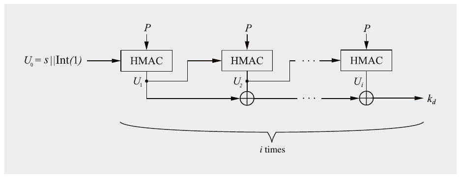

Hình 14.4 Ví dụ về PBKDF2 với HMAC-SHA256

Input của phép tính HMAC đầu tiên là salt s cùng với 32 bit chứa biểu diễn nguyên của số 1. Nếu cần nhiều hơn 32 byte cho key kd, phép tính được thể hiện trong hình được thực hiện lại nhưng với một số nguyên khác làm input ban đầu. Chẳng hạn, để tính các byte key 33–64, input ban đầu là

U0 = s||Int(2)

Các byte key tiếp theo 65–96 được tính với U0 = s||Int(3) v.v.

## 14.3 Thiết lập key dùng kỹ thuật Symmetric-Key

Trong thực tế, thỏa thuận key giữa Alice và Bob, hay giữa nhiều người dùng hơn, thường là một trong những nhiệm vụ thách thức nhất khi dùng cryptography. Về điểm này, chúng tôi lưu ý rằng symmetric cipher có thể được dùng để thiết lập key bí mật (phiên). Điều này hơi bất ngờ vì trong hầu hết cuốn sách chúng ta đã giả định rằng bản thân symmetric cipher cần một kênh an toàn để thiết lập key của chúng. Tuy nhiên, hóa ra trong nhiều trường hợp chỉ cần có một kênh an toàn ban đầu, khi một người dùng mới tham gia mạng. Điều này trong thực tế thường đạt được cho các mạng máy tính vì lúc set-up dù sao cũng có thể cần một quản trị viên hệ thống (đáng tin cậy) trực tiếp có mặt để cài một key bí mật thủ công. Trong trường hợp thiết bị nhúng, như smartphone hay thiết bị IoT, một kênh an toàn thường có sẵn trong quá trình sản xuất, tức là một key bí mật có thể được nạp vào thiết bị “tại nhà máy”.

Các protocol được giới thiệu trong mục này đều thực hiện vận chuyển key chứ không phải thỏa thuận key.

### 14.3.1 Thiết lập key với một Key Distribution Center

Các protocol được xây dựng dưới đây dựa vào một Key Distribution Center (KDC). Đây là một server được mọi người dùng tin tưởng hoàn toàn và dùng chung một key bí mật với mỗi người dùng. Key này, được đặt tên là Key Encryption Key (KEK), được dùng để truyền an toàn session key tới người dùng.

#### Protocol cơ bản

Một điều kiện tiên quyết cần thiết là mỗi người dùng U dùng chung một KEK bí mật duy nhất kU với key distribution center, đã được phân phối trước qua một kênh an toàn. Hãy xem điều gì xảy ra nếu một bên yêu cầu một phiên an toàn từ KDC, ví dụ, Alice muốn liên lạc với Bob. Phần thú vị của cách tiếp cận này là KDC mã hóa session key, cuối cùng sẽ được Alice và Bob dùng. Trong một protocol cơ bản, KDC tạo hai thông điệp, yA và yB, lần lượt cho Alice và Bob:

yA = ekA(kses)

yB = ekB(kses)

Mỗi thông điệp chứa session key được mã hóa bằng một trong hai KEK. Protocol trông như sau:

> Thiết lập key cơ bản dùng một Key Distribution Center
>
> 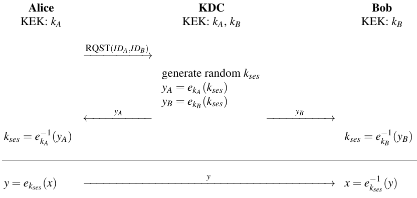

Protocol bắt đầu với một thông điệp yêu cầu RQST(IDA,IDB), trong đó IDA và IDB đơn giản chỉ ra những người dùng liên quan tới phiên. Protocol thiết lập key thực sự được thực thi ở phần trên của hình vẽ. Bên dưới đường liền, làm ví dụ, cho thấy cách Alice và Bob bây giờ có thể liên lạc an toàn với nhau dùng session key.

Quan trọng là lưu ý rằng hai loại key liên quan tới protocol. Các KEK kA và kB là các key long-term không thay đổi. Session key kses là một ephemeral key thay đổi thường xuyên, lý tưởng nhất cho mỗi phiên liên lạc. Để hiểu protocol này trực quan hơn, người ta có thể xem các KEK được phân phối trước như tạo thành một kênh bí mật giữa KDC và mỗi người dùng. Với cách diễn giải này, protocol rất đơn giản: KDC chỉ đơn giản gửi một session key tới Alice và Bob qua hai kênh bí mật tương ứng.

Vì các KEK là key long-term, trong khi các session key thường có thời gian sống ngắn hơn nhiều, trong thực tế đôi khi các thuật toán mã hóa khác nhau được dùng với các loại key khác nhau. Hãy xét ví dụ sau. Trong một hệ thống pay-TV, AES có thể được dùng với các KEK long-term kU để phân phối session key kses. Các session key có thể chỉ có thời gian sống, giả sử, một phút. Các session key được dùng để mã hóa plaintext thực sự — là tín hiệu TV số trong ví dụ này — bằng một lightweight cipher nhanh (ví dụ, PRESENT với key 80-bit, xem Mục 3.7.3). Ưu điểm của sự sắp xếp này là ngay cả khi một session key bị lộ, đối thủ chỉ có thể giải mã một phút dữ liệu đa phương tiện. Do đó, cipher được dùng với session key không nhất thiết cần có cùng sức mạnh cryptographic như thuật toán được dùng để phân phối session key. Mặt khác, nếu một trong các KEK bị lộ, mọi lưu lượng trước và sau đều có thể bị kẻ nghe lén giải mã.

Dễ dàng sửa đổi protocol trên sao cho tiết kiệm một lần liên lạc. Protocol đã sửa đổi được thể hiện dưới đây:

> Thiết lập key dùng một Key Distribution Center
>
> 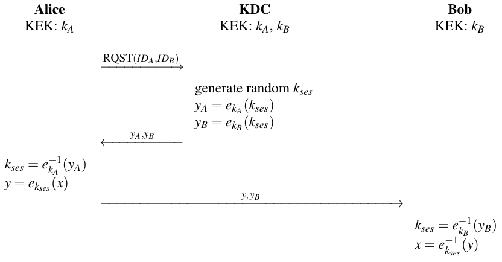

Alice nhận session key được mã hóa bằng cả hai KEK, kA và kB. Cô ấy có thể tính session key kses từ yA và có thể dùng nó sau đó để mã hóa thông điệp thực sự mà cô ấy muốn gửi tới Bob. Phần thú vị của protocol là Bob nhận cả thông điệp đã mã hóa y cũng như yB. Anh ấy cần giải mã cái sau để khôi phục session key cần để tính x.

Cả hai protocol KDC-based được mô tả ở trên đều có ưu điểm là chỉ có n cặp key symmetric long-term trong hệ thống, khác với scheme ngây thơ (naïve) đầu tiên mà chúng ta gặp, nơi cần khoảng n2/2 cặp key. N KEK long-term chỉ cần được KDC lưu, trong khi mỗi người dùng chỉ lưu KEK của riêng mình. Quan trọng nhất, nếu một người dùng mới Noah tham gia mạng, chỉ cần thiết lập một kênh an toàn một lần giữa KDC và Noah để phân phối KEK kN.

#### Bảo mật

Dù hai protocol bảo vệ trước một kẻ tấn công thụ động, tức là một đối thủ chỉ có thể nghe lén, có các tấn công nếu đối thủ có thể chủ động thao túng thông điệp và tạo thông điệp giả.

Replay Attack Một điểm yếu là có thể có replay attack. Tấn công này lợi dụng thực tế rằng cả Alice lẫn Bob đều không biết session key đã mã hóa họ nhận có thực sự là key mới không. Nếu một key trước đó được dùng lại, key freshness bị vi phạm. Đây có thể là một vấn đề đặc biệt nghiêm trọng nếu một session key cũ đã bị lộ. Điều này có thể xảy ra nếu một key cũ bị rò rỉ, ví dụ, qua một hacker, hoặc nếu thuật toán mã hóa được dùng với một key cũ đã trở nên không an toàn do tiến bộ cryptanalytical.

Nếu Oscar có được một session key trước đó, hắn có thể mạo danh KDC và gửi lại các thông điệp cũ yA và yB tới Alice và Bob. Vì Oscar biết session key, hắn có thể giải mã plaintext sẽ được Alice hoặc Bob mã hóa.

Key Confirmation Attack Một điểm yếu khác của protocol trên là Alice không được bảo đảm rằng vật liệu key cô ấy nhận từ KDC thực sự là cho một phiên giữa cô ấy và Bob. Tấn công này giả định rằng Oscar cũng là một người dùng hợp pháp — nhưng có ác ý. Bằng cách thay đổi thông điệp session-request, Oscar có thể lừa KDC và Alice thiết lập một phiên giữa hắn và Alice, trong khi Alice giả định cô ấy có một phiên an toàn với Bob. Đây là tấn công:

> Key Confirmation Attack
>
> 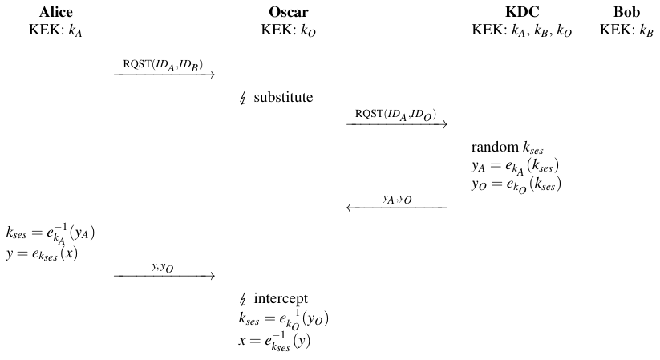

Mấu chốt của tấn công là KDC tin rằng Alice yêu cầu một key cho một phiên giữa Alice và Oscar, trong khi cô ấy thực sự muốn liên lạc với Bob. Alice giả định rằng key đã mã hóa “yO” là “yB”, tức là session key được mã hóa dưới KEK kB của Bob. (Lưu ý rằng nếu KDC đặt một header IDO trước yO, gắn nó với Oscar. Oscar có thể đơn giản đổi header thành IDB.) Nói cách khác, Alice không có cách nào biết rằng KDC đã chuẩn bị một phiên với cô ấy và Oscar; thay vào đó cô ấy vẫn nghĩ rằng mình đang thiết lập một phiên với Bob. Alice tiếp tục với protocol và mã hóa thông điệp thực sự dành cho Bob thành y. Nếu Oscar chặn được y, hắn có thể giải mã nó.

Vấn đề nền của tấn công này là không có key confirmation. Nếu có key confirmation, Alice sẽ được bảo đảm rằng Bob và không người dùng nào khác biết session key.

### 14.3.2 Protocol Needham-Schroeder

Một scheme nâng cao hơn bảo vệ trước cả replay attack và key confirmation attack là protocol Needham-Schroeder. Nó là cơ sở cho Kerberos, một protocol phổ biến để xác thực trong mạng máy tính. Kerberos được chuẩn hóa thành một RFC năm 1993 và được dùng rộng rãi. Protocol Needham-Schroeder cũng dựa trên một KDC, được gọi là “authentication server” theo thuật ngữ Kerberos. Trước hết hãy xem một phiên bản đơn giản hóa của protocol.

Để ngăn replay attack, chúng tôi đưa vào các nonce[^1] nA và nB để bảo đảm tính mới của các thông điệp được trao đổi. Protocol thu được được thể hiện dưới đây:

> Thiết lập key dùng Protocol Needham-Schroeder
>
> 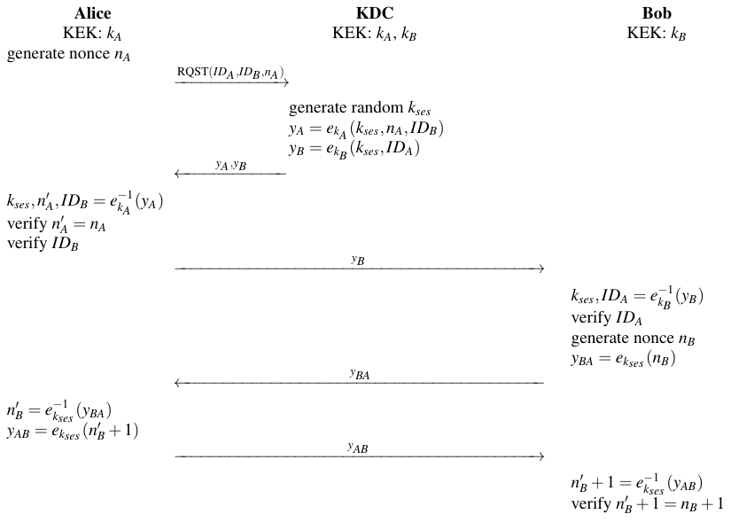

Needham-Schroeder bảo đảm tính mới qua hai biện pháp. Thứ nhất, Alice tạo một nonce nA cho session key. Nonce được mã hóa trong câu trả lời của KDC. Do đó, Alice biết rằng session key đã được tạo sau yêu cầu của cô ấy, tức là nó không phải một key được dùng lại từ một lần liên lạc trước đó. Thứ hai, Bob tương tự dùng một nonce nB mà anh ấy gửi tới Alice ở dạng đã mã hóa. Alice giải mã và tăng nonce. Sau đó cô ấy gửi giá trị mới nB′ + 1 lại cho Bob. Anh ấy kiểm chứng rằng giá trị đã tăng là đúng. Nếu vậy, anh ấy được bảo đảm rằng Alice và anh ấy dùng chung cùng key kses.

Protocol cung cấp key confirmation và xác thực người dùng. Ở đầu, Alice gửi một nonce ngẫu nhiên nA tới KDC. Điều này có thể được coi là một thử thách (challenge) vì cô ấy thách KDC mã hóa nA bằng KEK chung kA của họ. Nếu thử thách được trả về nA′ khớp với thử thách đã gửi, Alice được bảo đảm rằng thông điệp yA thực sự được KDC gửi. Phương pháp xác thực một bên này được biết tới là protocol challenge-response. (Một ví dụ khác về scheme challenge-response được cho trong Mục 10.1.4.) Qua việc đưa danh tính của Bob IDB vào yA, Alice được bảo đảm rằng session key thực sự dành cho một phiên giữa cô ấy và Bob. Bằng cách đưa danh tính của Alice IDA vào yB, Bob có thể kiểm chứng rằng KDC đã tạo một session key cho một kết nối giữa anh ấy và Alice.

Dù có các cải tiến của protocol, một replay attack cụ thể vẫn khả thi. Chúng ta giả sử rằng Oscar đã có thể làm lộ một session key trước đó kses (ví dụ, bằng cách hack vào hệ thống máy tính của Alice). Khi đó hắn có thể re-send yB tới Bob. Bob sẽ kiểm chứng IDA là đúng và gửi yBA, chứa nonce đã mã hóa của anh ấy. Oscar có thể chặn yBA và tạo một yAB hợp lệ, đến lượt nó sẽ được Bob kiểm chứng là đúng. Bob bây giờ sẽ giả định anh ấy đang trong một phiên hợp pháp với Alice, trong khi thực ra anh ấy đang liên lạc với Oscar.

### 14.3.3 Các vấn đề còn lại với phân phối Symmetric-Key

Dù protocol Needham-Schroeder có thể ngăn một số tấn công nhất định, có một số vấn đề chung tồn tại với các scheme KDC-based. Chúng được phác họa dưới đây.

Không có perfect forward secrecy Nếu bất kỳ KEK nào bị lộ, ví dụ, qua một hacker hay một software Trojan chạy trên máy tính của người dùng, hậu quả là nghiêm trọng. Thứ nhất, mọi liên lạc tương lai có thể bị kẻ tấn công nghe lén giải mã. Chẳng hạn, nếu Oscar có được KEK kA của Alice, hắn có thể khôi phục session key từ mọi thông điệp yA mà KDC gửi ra. Kịch tính hơn nữa là thực tế rằng Oscar cũng có thể giải mã các liên lạc trong quá khứ nếu hắn đã lưu các thông điệp cũ yA và y. Ngay cả khi Alice ngay lập tức nhận ra KEK của mình đã bị lộ và ngừng dùng nó ngay, cô ấy không thể làm gì để ngăn Oscar giải mã các liên lạc trong quá khứ của mình. Việc một hệ thống có dễ bị tổn thương khi các key long-term bị lộ hay không là một đặc điểm quan trọng của một hệ thống bảo mật mà thuật ngữ đặc biệt sau được dùng.

> Định nghĩa 14.3.1 Perfect Forward Secrecy
>
> Một protocol cryptographic có perfect forward secrecy (PFS) nếu việc làm lộ các key long-term không cho phép kẻ tấn công có được các session key trong quá khứ.

Cả Needham-Schroeder lẫn các protocol đơn giản hơn được trình bày trước đó đều không cung cấp PFS. Cơ chế chính để bảo đảm PFS là dùng các kỹ thuật public-key, mà chúng tôi thảo luận trong Mục 14.4 và 14.5.

Kênh an toàn trong khởi tạo Như đã thảo luận trước đó, mọi protocol KDC-based đều cần một kênh an toàn vào lúc một người dùng mới tham gia mạng để truyền KEK của người dùng đó.

Yêu cầu liên lạc Một vấn đề khác trong thực tế là KDC cần được liên hệ nếu một phiên an toàn mới cần được khởi tạo giữa hai bên bất kỳ trong mạng. Dù đây là vấn đề hiệu năng hơn là vấn đề bảo mật, nó có thể là một trở ngại nghiêm trọng trong một hệ thống có rất nhiều người dùng. Trong Kerberos, người ta có thể giảm nhẹ vấn đề tiềm ẩn này bằng cách tăng thời gian sống của các session key. Trong thực tế, Kerberos có thể chạy với hàng chục nghìn người dùng. Tuy nhiên, sẽ là vấn đề khi mở rộng một cách tiếp cận như vậy cho “mọi” người dùng internet.

Single point of failure Mọi protocol KDC-based, bao gồm Kerberos, đều có nhược điểm bảo mật là có một single point of failure, cụ thể là cơ sở dữ liệu chứa các key encryption key, các KEK. Nếu KDC bị lộ, mọi KEK trong toàn bộ hệ thống trở nên vô hiệu và phải được re-established dùng các kênh an toàn giữa KDC và mỗi người dùng.

## 14.4 Thiết lập key dùng kỹ thuật Asymmetric

Public-key algorithm đặc biệt phù hợp cho các protocol thiết lập key vì chúng không có hầu hết các nhược điểm mà các cách tiếp cận key symmetric có. Thực ra, cạnh digital signature, thiết lập key là lĩnh vực ứng dụng chính khác của các scheme public-key. Chúng có thể được dùng cho cả vận chuyển key và thỏa thuận key. Với loại sau, trao đổi key Diffie–Hellman hoặc biến thể elliptic curve Diffie–Hellman (ECDH) của nó thường được dùng. Với vận chuyển key, các scheme mã hóa public-key được dùng, ví dụ, RSA hay Elgamal. Chúng tôi nhắc lại ở đây rằng các primitive public-key khá chậm. Vì lý do này, việc mã hóa dữ liệu thực sự thường được làm bằng các primitive symmetric như AES sau khi một key đã được thiết lập bằng kỹ thuật asymmetric.

Cho tiện, chúng tôi nhắc lại protocol vận chuyển key cơ bản từ Mục 6.1. Giả định rằng Bob đã thiết lập một scheme mã hóa asymmetric với cặp key kpub và kpr:

> Protocol vận chuyển key cơ bản
>
> 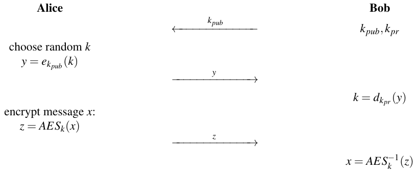

Với thảo luận tới giờ, có vẻ như các scheme public-key giải quyết mọi vấn đề thiết lập key. Tuy nhiên, hóa ra mọi scheme asymmetric đều cần cái được gọi là kênh được xác thực (authenticated channel) để phân phối public key. Phần còn lại của chương này chủ yếu dành cho việc giải quyết vấn đề phân phối public-key được xác thực.

Để nghiên cứu vấn đề xác thực key, chúng ta sẽ xem trao đổi key Diffie-Hellman trong mục sau. Nhớ lại rằng DHKE cho phép hai bên chưa từng gặp nhau thỏa thuận một bí mật dùng chung bằng cách trao đổi thông điệp qua một kênh không an toàn. Chúng tôi nhắc lại protocol DHKE ở đây:

> Trao đổi key Diffie–Hellman
>
> 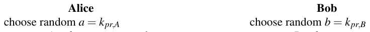
>
> tính A = kpub,A ≡ αa mod p tính B = kpub,B ≡ αb mod p
>
> 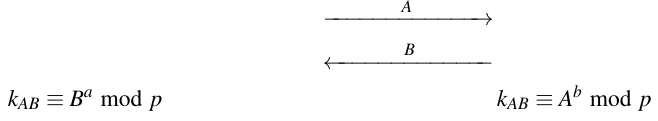

Như chúng ta đã thảo luận trong Mục 8.4, nếu các tham số được chọn cẩn thận, đặc biệt bao gồm một số nguyên tố p có độ dài 2048 bit trở lên, DHKE an toàn trước nghe lén, tức là tấn công thụ động.

### 14.4.1 Man-in-the-Middle Attack

Bây giờ chúng ta xét trường hợp đối thủ không bị giới hạn ở việc chỉ nghe kênh. Thay vào đó, Oscar cũng có thể chủ động tham gia vào việc trao đổi thông điệp bằng cách chặn, thay đổi và tạo thông điệp. Điều này cho phép Oscar thực hiện cái được gọi là man-in-the-middle attack[^2], một tấn công rất nghiêm trọng nhắm vào các thuật toán public-key. Ý tưởng nền là Oscar thay public key của cả Alice và Bob bằng public key của chính hắn. Điều này khả thi bất cứ khi nào public key không được xác thực.

MIM attack có hệ quả far-reaching cho asymmetric cryptography. Vì lý do sư phạm, chúng tôi sẽ nghiên cứu tấn công nhắm vào trao đổi key Diffie–Hellman (DHKE). Tuy nhiên, cực kỳ quan trọng là ghi nhớ rằng tấn công áp dụng được cho bất kỳ scheme asymmetric nào trừ khi public key được bảo vệ, ví dụ, qua certificate, một chủ đề được thảo luận trong Mục 14.4.2. Tấn công hoạt động như sau:

> Man-in-the-Middle Attack nhắm vào DHKE
>
> 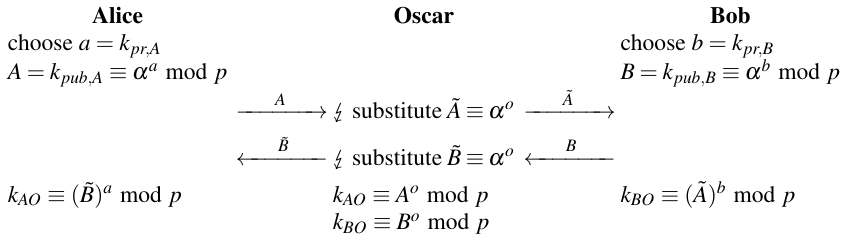

Hãy xem các key được ba người chơi, Alice, Bob và Oscar, tính. Key mà Alice tính là:

kAO = (B̃)a ≡ (αo)a ≡ αo a mod p

giống hệt key mà Oscar tính là kAO = Ao ≡ (αa)o ≡ αa o mod p. Đồng thời Bob tính:

kBO = (Ã)b ≡ (αo)b ≡ αo b mod p

giống hệt key của Oscar kBO = Bo ≡ (αb)o ≡ αb o mod p. Lưu ý rằng hai key ác ý mà Oscar gửi ra, Ã và B̃, thực ra có cùng giá trị. Chúng tôi dùng tên khác nhau ở đây chỉ để nhấn mạnh thực tế rằng Alice và Bob giả định họ đã nhận public key của nhau.

Điều xảy ra trong tấn công này là hai DHKE được thực hiện đồng thời, một giữa Alice và Oscar và một giữa Bob và Oscar. Kết quả là Oscar đã thiết lập một key dùng chung với Alice, mà chúng tôi gọi là kAO, và một key khác với Bob, mà chúng tôi đặt tên là kBO. Tuy nhiên, cả Alice lẫn Bob đều không biết rằng họ dùng chung một key với Oscar chứ không phải với nhau! Cả hai đều giả định họ đã tính một key chung kAB.

Từ đây trở đi, Oscar có nhiều quyền kiểm soát lưu lượng đã mã hóa giữa Alice và Bob. Làm ví dụ, đây là cách hắn có thể đọc các thông điệp đã mã hóa theo cách mà Alice và Bob không nhận ra:

> Thao túng thông điệp sau một Man-in-the-Middle Attack
>
> 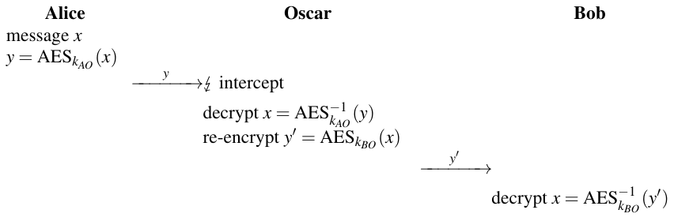

Để minh họa, chúng tôi giả định AES được dùng để mã hóa. Tất nhiên, bất kỳ symmetric cipher nào khác cũng có thể được dùng. Lưu ý rằng Oscar không chỉ có thể đọc plaintext x mà còn có thể thay đổi nó trước khi re-encrypting nó bằng kBO. Điều này có thể có hậu quả nghiêm trọng, ví dụ, nếu thông điệp x mô tả một giao dịch tài chính.

### 14.4.2 Certificate

Vấn đề nền của man-in-the-middle attack là public key không được xác thực. Nhớ lại từ Mục 10.1.3 rằng xác thực thông điệp bảo đảm rằng người gửi một thông điệp là xác thực. Tuy nhiên, trong kịch bản đang xét, Bob nhận một public key được cho là của Alice, nhưng anh ấy không có cách nào biết điều này có thực sự đúng không. Để làm rõ điểm này, hãy xem một key của người dùng Alice trông như thế nào trong thực tế:

kA = (kpub,A,IDA)

trong đó IDA là thông tin định danh, ví dụ, địa chỉ email của Alice hoặc tên cô ấy cùng với ngày sinh. Tuy nhiên, public key thực sự kpub,A chỉ là một chuỗi nhị phân, ví dụ, dài 2048 bit. Nếu Oscar thực hiện một MIM attack, hắn đổi key thành:

kA = (kpub,O,IDA)

Vì mọi thứ không đổi ngoại trừ chuỗi bit thực sự vô danh tạo nên key, bên nhận sẽ không thể phát hiện rằng nó thực ra là của Oscar. Quan sát này có hệ quả far-reaching có thể được tóm tắt trong phát biểu sau:

Dù các scheme public-key không cần kênh an toàn, chúng cần một kênh được xác thực để phân phối public key.

Chúng tôi muốn nhấn mạnh lại ở đây rằng MIM attack không bị giới hạn ở DHKE mà thực ra áp dụng được cho bất kỳ scheme cryptographic asymmetric nào. Tấn công luôn diễn ra theo cùng cách: Oscar chặn public key đang được gửi và thay nó bằng public key của chính hắn.

Vấn đề phân phối đáng tin cậy public key là trung tâm trong public-key cryptography hiện đại. Có vài cách giải quyết vấn đề xác thực key. Cơ chế chính trong thực tế là dùng certificate. Ý tưởng đằng sau certificate khá đơn giản: Vì tính xác thực của thông điệp (kpub,A,IDA) bị vi phạm bởi một tấn công chủ động, chúng ta áp dụng một cơ chế cryptographic cung cấp xác thực. Cụ thể hơn, chúng ta dùng digital signature[^3]. Do đó, một certificate cho một người dùng Alice ở dạng cơ bản nhất là cấu trúc sau:

CertA = [(kpub,A,IDA),sigkpr(kpub,A,IDA)]

Ý tưởng là bên nhận certificate kiểm chứng chữ ký trước khi dùng public key. Nhớ lại từ Chương 10 rằng một chữ ký bảo vệ thông điệp được ký — là bộ (kpub,A,IDA) trong trường hợp này — trước sự thao túng. Nếu Oscar cố thay kpub,A bằng kpub,O, điều đó sẽ bị phát hiện. Do đó, người ta nói rằng certificate gắn danh tính của một người dùng với public key của họ.

Certificate yêu cầu bên nhận có key kiểm chứng đúng, là một public key. Nếu chúng ta dùng public key của Alice cho điều này, chúng ta sẽ có cùng vấn đề mà chúng ta thực sự đang cố giải quyết. Thay vào đó, chữ ký cho certificate được cung cấp bởi một bên thứ ba được cả hai tin tưởng. Bên này được gọi là Certificate Authority, thường được viết tắt là CA. Nhiệm vụ của CA là tạo và cấp certificate cho mọi người dùng trong hệ thống. Với việc tạo certificate, chúng ta có thể phân biệt hai trường hợp chính. Trong trường hợp thứ nhất, người dùng tự tính cặp key asymmetric của mình và chỉ yêu cầu CA ký public key, như thể hiện trong protocol đơn giản sau cho một người dùng tên Alice:

> Tạo certificate với các key User-Provided
>
> 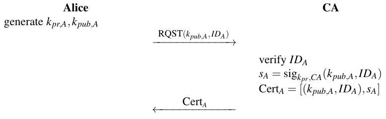

Từ góc độ bảo mật, giao dịch thứ nhất là then chốt. Phải bảo đảm rằng thông điệp (kpub,A, IDA) của Alice được gửi qua một kênh được xác thực. Nếu không, Oscar có thể yêu cầu một certificate dưới tên của Alice.

Trong thực tế, thường có lợi khi CA không chỉ ký public key mà còn tạo các cặp public/private-key cho mỗi người dùng. Trong trường hợp thứ hai này, một protocol cơ bản trông như sau:

> Tạo certificate với các key CA-Generated
>
> 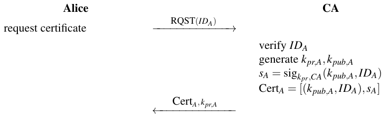

Với lần truyền thứ nhất, cần một kênh được xác thực. Nói cách khác: CA phải được bảo đảm rằng thực sự là Alice đang yêu cầu một certificate, chứ không phải Oscar đang yêu cầu một certificate dưới tên của Alice. Nhạy cảm hơn nữa là lần truyền thứ hai, gồm (CertA, kpr,A). Vì private key phải được gửi, không chỉ cần một kênh được xác thực mà còn cần một kênh an toàn. Trong thực tế, đây có thể là một lần truyền out-of-band, tức là private key được giao qua thư trên một USB stick hoặc một phương tiện khác.

Trước khi thảo luận CA chi tiết hơn, hãy xem protocol DHKE với certificate:

> Trao đổi key Diffie–Hellman với Certificate
>
> 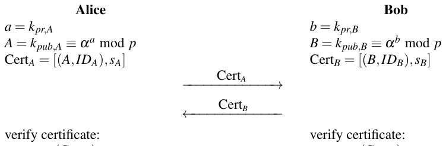
>
> verkpub,CA(CertB) verkpub,CA(CertA)
>
> tính session key: tính session key:
>
> kAB ≡ Ba mod p kAB ≡ Ab mod p

Một điểm then chốt ở đây là việc kiểm chứng certificate. Rõ ràng, không có kiểm chứng, các chữ ký trong certificate sẽ vô dụng. Như có thể thấy trong protocol, việc kiểm chứng cần public key của CA. Key này phải được truyền qua một kênh được xác thực, nếu không Oscar lại có thể thực hiện MIM attack. Có vẻ như chúng ta không được lợi nhiều từ việc đưa vào certificate vì chúng ta lại cần một kênh được xác thực! Tuy nhiên, khác biệt so với tình huống trước là chúng ta chỉ cần kênh được xác thực một lần, lúc set-up. Chẳng hạn, các public key kiểm chứng ngày nay thường được đưa vào software PC như trình duyệt web hay các sản phẩm software của Microsoft. Kênh được xác thực được giả định là có qua việc cài software gốc, chưa bị thao túng. Điều đang xảy ra từ góc nhìn trừu tượng hơn cực kỳ thú vị, cụ thể là một sự chuyển giao lòng tin. Chúng ta đã thấy trong ví dụ trước về DHKE không có certificate rằng Alice và Bob phải tin trực tiếp public key của nhau. Với việc đưa vào certificate, họ chỉ phải tin public key của CA kpub,CA. Nếu CA ký các public key khác, Alice và Bob biết rằng họ cũng có thể tin các key đó. Điều này được gọi là chuỗi tin cậy (chain of trust).

### Certificate X.509

Trong thực tế, certificate không chỉ gồm ID và public key của người dùng, chúng có xu hướng là các cấu trúc khá phức tạp với nhiều thông tin bổ sung. Hình 14.5 cho thấy một ví dụ về certificate X.509. X.509 là một tiêu chuẩn quan trọng cho các dịch vụ xác thực mạng, và các certificate tương ứng được dùng rộng rãi cho liên lạc internet, tức là trong TLS, IPsec và S/MIME.

Thảo luận các trường khác nhau trong cấu trúc X.509 cho chúng ta cái nhìn sâu về những gì liên quan khi dùng public key và certificate trong thế giới thực. Chúng tôi xem một số vấn đề dưới đây:

1. Certificate Algorithm: Ở đây chỉ định thuật toán chữ ký nào đang được dùng, ví dụ, RSA với SHA-2 hay ECDSA với SHA-3, và với các tham số nào, ví dụ, độ dài bit.

2. Issuer: Có nhiều công ty và tổ chức cấp certificate. Trường này chỉ định ai đã tạo certificate đang xét.

3. Period of Validity: Trong hầu hết trường hợp, một public key không được chứng nhận vô thời hạn mà trong một thời gian giới hạn, ví dụ, một hoặc hai năm. Một lý do để làm điều này là private key, thuộc về certificate, có thể bị lộ. Bằng cách giới hạn thời hạn hiệu lực, chỉ có một khoảng thời gian nhất định mà kẻ tấn công có thể dùng private key một cách ác ý. Một lý do khác cho thời gian sống giới hạn là, đặc biệt với certificate cho công ty, thường xảy ra việc người dùng rời công ty. Nếu certificate, và do đó public key, chỉ có hiệu lực trong thời gian giới hạn, thiệt hại có thể do một cựu nhân viên gây ra có thể được kiểm soát.

4. Subject: Trường này chứa cái được gọi là IDA hay IDB trong các ví dụ trước của chúng ta. Nó chứa thông tin định danh như tên người hoặc tổ chức. Lưu ý rằng không chỉ người thật mà các thực thể như công ty cũng có thể có certificate.

5. Subject’s Public Key: Public key cần được certificate bảo vệ nằm ở đây. Ngoài chuỗi nhị phân là giá trị public-key thực sự, thuật toán (ví dụ, Diffie–Hellman) và các tham số thuật toán, ví dụ, modulus p và phần tử nguyên thủy α, được lưu.

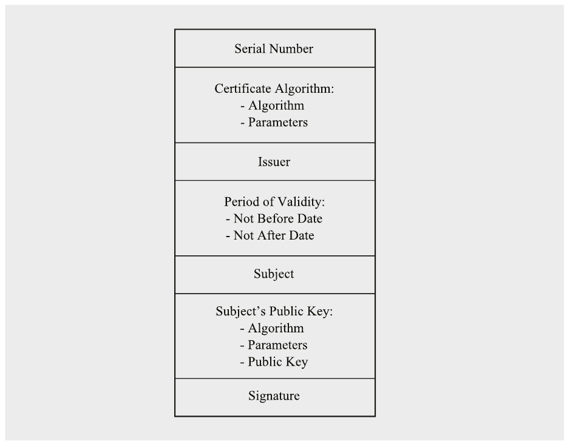

Hình 14.5 Cấu trúc của một certificate X.509

6. Signature: Chữ ký trên mọi trường khác của certificate.

Chúng tôi lưu ý rằng trong mỗi certificate có hai thuật toán public key liên quan: (i) thuật toán có public key được certificate bảo vệ và (ii) thuật toán chữ ký mà certificate được ký bằng nó. Đây có thể là các thuật toán và bộ tham số hoàn toàn khác nhau. Chẳng hạn, certificate có thể được ký bằng một thuật toán RSA 2048-bit, trong khi public key trong certificate có thể là một scheme Diffie-Hellman elliptic curve 256-bit.

## 14.5 Public-Key Infrastructure (PKI) và CA

Toàn bộ hệ thống được tạo bởi các CA cùng với các cơ chế hỗ trợ cần thiết được gọi là public-key infrastructure, thường được gọi là PKI. Như độc giả có lẽ có thể hình dung, thiết lập và vận hành một PKI trong thế giới thực là một nhiệm vụ phức tạp. Các vấn đề như xác lập đáng tin cậy danh tính người dùng trong quá trình cấp certificate và phân phối đáng tin cậy các key CA phải được giải quyết. Cũng có nhiều khía cạnh real-world khác. Trong số phức tạp nhất là sự tồn tại của nhiều CA khác nhau và việc thu hồi certificate. Chúng tôi thảo luận một số khía cạnh của việc dùng các hệ thống certificate trong thực tế dưới đây.

### 14.5.1 Certificate Chain

Trong một thế giới lý tưởng (đơn giản), sẽ có một CA cấp certificate cho, giả sử, mọi người dùng internet trên hành tinh Trái Đất. Đáng tiếc, không phải vậy. Có nhiều thực thể khác nhau đóng vai trò CA. Thứ nhất, nhiều quốc gia có CA “chính thức” của riêng mình, thường cho các certificate được dùng cho các ứng dụng liên quan tới công việc chính phủ. Thứ hai, hầu hết certificate cho các dịch vụ web được cấp bởi các thực thể thương mại hoặc các tổ chức non-profit. (Hầu hết trình duyệt web có public key của các CA đó được pre-installed.) Thứ ba, nhiều tập đoàn lớn cấp certificate cho nhân viên của mình và các thực thể bên ngoài làm ăn với họ. Hầu như không thể để một người dùng có trong tay public key của tất cả các CA khác nhau này. Thay vào đó, các CA chứng nhận lẫn nhau. Điều này được gọi là cross-certification.

Hãy xem một ví dụ trong đó certificate của Alice được cấp bởi CA1 và của Bob bởi CA2. Lúc này, Alice chỉ sở hữu public key của CA1 “của cô ấy”, và Bob chỉ có kpub,CA2. Nếu Bob gửi certificate của mình tới Alice, cô ấy không thể kiểm chứng public key của Bob. Tình huống này trông như sau:

> Hai người dùng với các Certificate Authority khác nhau
>
> 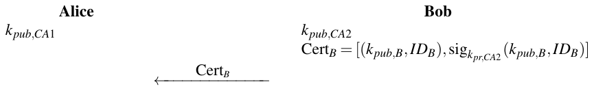

Bây giờ Alice có thể yêu cầu public key của CA2, bản thân nó nằm trong một certificate được CA1 của Alice ký:

> Kiểm chứng public key của một CA
>
> 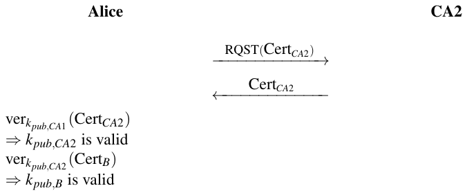

Cấu trúc CertCA2 chứa public key của CA2 được CA1 ký, trông như sau:

CertCA2 = [(kpub,CA2,IDCA2),sigkpr,CA1(kpub,CA2,IDCA2)]

Kết quả quan trọng của quá trình là Alice bây giờ có thể kiểm chứng key của Bob.

Điều đang xảy ra ở đây là một certificate chain đang được thiết lập. CA1 tin CA2, điều được thể hiện bởi việc CA1 ký public key kpub,CA2. Bây giờ Alice có thể tin public key của Bob vì nó được CA1 ký. Tình huống này được gọi là chain of trust, và người ta nói rằng lòng tin được ủy quyền.

Trong thực tế, các CA có thể được sắp xếp theo thứ bậc, trong đó mỗi CA ký public key của các certificate authority ở một mức bên dưới. Ngoài ra, các CA có thể cross-certify lẫn nhau mà không có quan hệ thứ bậc chặt chẽ.

Ví dụ 14.3. Một ví dụ về thứ bậc CA được mô tả trong Hình 14.6. Hình cho thấy người dùng ở dưới cùng với thứ bậc CA ở phần trên. Có thể thấy có các loại CA khác nhau: Issuing CA, Intermediate CA và Root CA. Các certificate người dùng thực sự — như CAAlice — được tạo bởi các Issuing CA. Root CA, thường được giữ offline, đóng vai trò trung tâm. Một Root CA chỉ được dùng để chứng nhận các CA bên dưới, điều xảy ra rất hiếm (trái ngược với việc cấp certificate người dùng thường xuyên). Do đó, Root CA có thể ở trạng thái offline an toàn hầu hết thời gian. Ý tưởng đằng sau việc tách Root CA khỏi Issuing CA là giảm thiểu rủi ro. Issuing CA thường bị phơi bày nhiều, ví dụ, trên internet hay trong dây chuyền sản xuất của một công ty. Với kiến trúc được thể hiện, nếu một Issuing CA bị lộ, nó có thể dễ dàng bị CA ở trên thu hồi và được thay bằng một Issuing CA mới. Trong mọi trường hợp, với người dùng, quan trọng là luôn kiểm tra toàn bộ certificate chain lên tới certificate của Root CA.

Nếu có nhiều hơn một Root CA liên quan và chúng tin nhau, chúng cross certify lẫn nhau, như thể hiện với Root CA1 và Root CA2 trong hình. Root CA có thể ký trực tiếp một Issuing CA, như thể hiện ở giữa hình. Hoặc có thể có thêm một Intermediate CA để giảm thêm sự phụ thuộc trực tiếp vào Root CA. Intermediate CA thường cũng ở trạng thái off-line an toàn hầu hết thời gian.

Trong thực tế, các kiến trúc CA thường liên quan tới thứ bậc của công ty hay tổ chức tương ứng. Hầu hết các công ty có một Root CA và vài CA bên dưới. Chẳng hạn, một công ty lớn với các bộ phận kinh doanh khác nhau thường có các CA riêng cho người dùng và thiết bị. Các công ty hay tổ chức hợp tác chặt chẽ có thể cross-certify Root CA của nhau, cho phép liên lạc tin cậy lẫn nhau giữa các công ty liên quan.

### 14.5.2 Thu hồi Certificate (Certificate Revocation)

Một vấn đề lớn trong thực tế là phải có khả năng thu hồi certificate. Một lý do phổ biến là một certificate được lưu trên một hardware token như một smart card bị mất. Một lý do khác có thể là một người đã rời tổ chức và người ta muốn bảo đảm rằng cô ấy không dùng public key đã được cấp cho cô ấy. Sau đây chúng tôi sẽ thảo luận hai phương pháp bảo đảm hiệu lực của certificate.

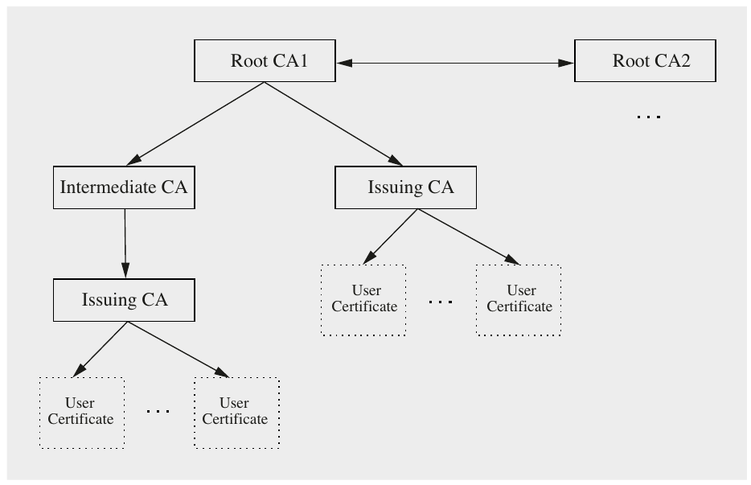

Hình 14.6 Ví dụ kiến trúc của một thứ bậc certificate

#### Certificate Revocation List

Một giải pháp đơn giản trong các tình huống cần thu hồi certificate hoạt động như sau. Chỉ cần công bố một danh sách mọi certificate hiện không hợp lệ. Một danh sách như vậy được gọi là certificate revocation list, hay CRL. Thông thường, số serial của certificate được dùng để xác định các certificate bị thu hồi, xem Hình 14.5. Tất nhiên, một CRL phải được CA ký vì nếu không đối thủ có thể thu hồi certificate một cách ác ý.

Vấn đề với CRL là việc truyền chúng tới người dùng. Cách đơn giản nhất là mỗi người dùng liên hệ Issuing CA mỗi khi nhận được certificate của một người dùng khác. Nhược điểm lớn là bây giờ CA liên quan tới mọi lần set-up phiên. Đây là một thiếu sót lớn của các cách tiếp cận KDC-based, tức là symmetric-key. Lời hứa của liên lạc certificate-based là không cần liên hệ online với một cơ quan trung tâm.

Một lựa chọn thay thế là CRL được gửi định kỳ. Vấn đề với cách tiếp cận này là luôn có một khoảng thời gian trong đó một certificate không hợp lệ nhưng người dùng chưa được thông báo. Chẳng hạn, nếu CRL được gửi lúc 3:00 am mỗi sáng (thời điểm có tương đối ít lưu lượng mạng khác), một người không trung thực có thể có gần cả một ngày mà một certificate bị thu hồi vẫn còn hiệu lực. Để chống lại điều này, chu kỳ cập nhật CRL có thể được rút ngắn, giả sử xuống một giờ. Tuy nhiên, đây sẽ là một gánh nặng khá lớn lên băng thông mạng. Đây là một ví dụ bổ ích về sự thỏa hiệp giữa chi phí dưới dạng lưu lượng mạng một mặt, và bảo mật mặt khác. Trong thực tế, phải tìm một sự thỏa hiệp hợp lý.

Để giảm kích thước CRL, thường chỉ các thay đổi từ lần phát CRL trước được gửi đi. Các CRL update-only này được gọi là delta CRL.

#### Online Certificate Status Protocol

Online Certificate Status Protocol (OCSP) là một protocol internet được dùng để lấy trạng thái thu hồi của certificate X.509, đã được thể hiện trong Hình 14.5. Với OCSP, trạng thái thu hồi hiện tại của một certificate có thể được xác định mà không cần CRL dài. Nó được dùng trong các tình huống mà người dùng muốn xác định ngay một certificate nhận được đã bị thu hồi hay chưa mà không phải đợi bản cập nhật CRL tiếp theo. Để làm điều này, người dùng (gọi là OCSP client) gửi một yêu cầu trạng thái tới một OCSP responder. Cho tới khi client nhận được phản hồi, việc chấp nhận các certificate đang xét bị tạm hoãn. Nhiều trình duyệt internet hiện tại hỗ trợ OCSP và nó đã được công bố thành RFC 6960.

Xét ví dụ sau: Alice có được public key của Bob được nhúng trong certificate của anh ấy. Certificate đã được một CA cấp cách đây một thời gian. Alice lo rằng certificate của Bob không còn hợp lệ. Để kiểm tra trạng thái thu hồi của certificate của Bob, cô ấy gửi một yêu cầu trạng thái OCSP chứa số serial của certificate của Bob tới CA. Quá trình này được thể hiện trong protocol dưới đây.

> Ví dụ về một yêu cầu OCSP để xác nhận certificate của Bob
>
> 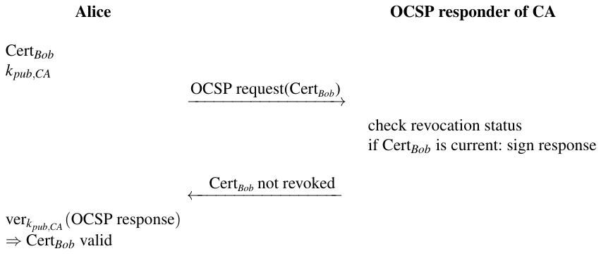

## 14.6 Các khía cạnh thực tế của quản lý key

Trọng tâm của cuốn sách này là các thuật toán và protocol cryptographic để cung cấp các security service cơ bản như tính bí mật, tính toàn vẹn và tính xác thực. Một yêu cầu để các hệ thống như vậy hoạt động đúng là các key cryptographic liên quan được xử lý đúng. Hóa ra quản lý key trong thực tế thường là một thách thức lớn. Thực ra, nhiều vụ vi phạm bảo mật trong thực tế có thể được truy về các điểm yếu trong quản lý key. Sau đây chúng tôi muốn phác họa ngắn gọn các khía cạnh khác nhau cần được tính tới về quản lý key khi dùng cryptography trong thế giới thực.

Rõ ràng, key phải được xử lý bí mật trong trường hợp symmetric và theo cách được xác thực trong trường hợp public key cho asymmetric cipher. Nhưng còn gì khác liên quan khi thiết kế và dùng một cryptosystem? Hóa ra chúng ta phải suy nghĩ cẩn thận về nhiều khía cạnh liên quan tới key trong suốt toàn bộ vòng đời của một cryptosystem. Đây là một số câu hỏi phải được giải đáp khi thiết kế một hệ thống bảo mật:

■ Chúng ta dùng key riêng lẻ và/hoặc key toàn cục?

■ Chúng ta tạo key như thế nào?

■ Chúng ta phân phối key như thế nào?

■ Chúng ta phải làm mới key bao lâu một lần?

■ Chúng ta lưu key như thế nào?

■ Key được bảo vệ như thế nào khi chúng đang được dùng?

■ Chúng ta có phải sao lưu key không?

■ Key có an toàn cho tới hết thời gian sống dự kiến của hệ thống không?

■ Chúng ta xóa key an toàn như thế nào?

Câu trả lời cho các câu hỏi này nên dẫn tới một khái niệm quản lý key đúng đắn, vốn then chốt cho bảo mật tổng thể của một hệ thống real-world. Trái ngược với cái nhìn thuần túy cryptographic về quản lý key vốn là chủ đề chính trong cuốn sách này cho tới giờ, việc dùng key real-world phải tính tới toàn bộ vòng đời của key, như mô tả trong Hình 14.7.

Sau đây, chúng tôi sẽ thảo luận ngắn gọn một số vấn đề thực tế quan trọng khi xét vòng đời key.

Khái niệm key Ở đầu vòng đời, một khái niệm key đúng đắn cần được xây dựng. Ngoài cách dùng key trong quá trình vận hành hệ thống, khái niệm phải bao quát giai đoạn phát triển cũng như việc ngừng sử dụng vật liệu key. Khái niệm đề cập việc chọn loại key, tức là hệ thống dùng key symmetric, key asymmetric hay cả hai, và các tham số tương ứng. Trong suốt thời gian sống của hệ thống, quan trọng là xét mọi tác nhân như nhà phát triển, người dùng cuối, quản trị viên hệ thống v.v., và xác định quyền và khả năng của họ đối với việc xử lý key. Hơn nữa, khái niệm key đề cập các khía cạnh như đa dạng key (ví dụ, key symmetric toàn cục so với key device-specific) và public-key infrastructure (xem Mục 14.5).

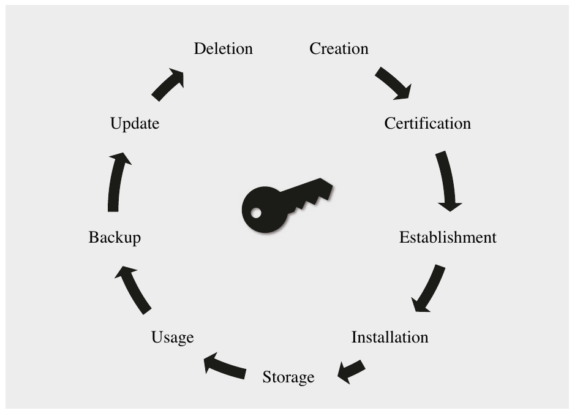

Hình 14.7 Vòng đời của key cryptographic

Tạo key và nạp key Tạo hay suy ra key an toàn là một phần then chốt của bảo mật tổng thể. Trong Mục 14.3 và 14.2, chúng tôi đã thảo luận các phương pháp thiết lập key và key derivation. Tuy nhiên, trong hầu hết ứng dụng, chúng ta cũng cần có một key ban đầu — hoặc một key symmetric bí mật hoặc một public key đáng tin cậy. Hai lựa chọn liên quan trong thực tế là: tạo key bên trong thiết bị hoặc tạo key bên ngoài và truyền an toàn key vào thiết bị. Tạo key bên trong là một lựa chọn cho các thiết bị có nguồn entropy tốt và đủ tài nguyên tính toán để tính một cặp public/private-key. Nếu không phải vậy, key được tạo bên ngoài phải được nạp vào thiết bị. Điều này có thể xảy ra trong quá trình sản xuất hoặc sau khi thiết bị đã được triển khai. Tạo key ở một nơi trung tâm có thể hợp lý cho các hệ thống cần lưu bản sao lưu key hoặc có các yêu cầu khác như throughput hay chất lượng số ngẫu nhiên. Mặt khác, một thực thể tạo key trung tâm như vậy cũng đòi hỏi mức bảo mật cao.

Thời gian sống Thời gian sống dự kiến của một cryptosystem đòi hỏi chúng ta chọn các tham số phù hợp cho thuật toán và key. Đặc biệt, chúng ta phải bảo đảm rằng mức bảo mật vẫn đủ vào cuối thời gian sống. Chẳng hạn, ô tô có thể có thời gian sống hai thập kỷ, điều phải được tính tới khi chọn scheme cryptographic và độ dài key. Một ví dụ điển hình về việc xem xét cẩn thận bảo mật theo thời gian sống là thực tế rằng các thuật toán asymmetric sẽ trở nên lỗi thời khi máy tính lượng tử large-scale trở nên khả dụng trong tương lai, xem Mục 12.1. Trong những tình huống như vậy, người ta phải hoặc lên kế hoạch tương ứng và trang bị cho ứng dụng ngay từ đầu các thuật toán post-quantum, hoặc cho phép cập nhật thuật toán cryptographic và vật liệu key. Vì đáng mong muốn khi ứng dụng dù sao cũng có thể nhận cập nhật bảo mật, cách tiếp cận sau hấp dẫn.

Lưu trữ key Key cần được lưu an toàn. Tùy theo loại key, thuật ngữ an toàn có ý nghĩa khác nhau. Trong trường hợp key symmetric, chúng ta phải lưu key bí mật. Ngoài ra, chúng ta phải phân biệt giữa key toàn cục và key cho từng người dùng hay thiết bị. Một key symmetric toàn cục có yêu cầu bảo mật cực kỳ cao vì việc bị lộ sẽ có hệ quả system-wide, trong khi mất một key riêng lẻ chỉ ảnh hưởng tới một người dùng hay thiết bị. Thách thức lớn khi lưu key symmetric hay private key asymmetric là bảo vệ trước việc read-out bởi software độc hại. Có nhiều cách tiếp cận để đạt điều này. Một giải pháp là dùng TPM, hay Trusted Platform Module, là một thiết bị hardware nhỏ cung cấp lưu trữ key an toàn (và các chức năng bảo mật khác như tính toán cryptographic). Cũng có vài cách tiếp cận software để bảo vệ vật liệu key trước truy cập trái phép. Một mức bảo vệ nhất định có thể đạt được nếu các key nhạy cảm được lưu ở dạng đã mã hóa và chỉ được mở khóa qua một mật khẩu user-provided khi cần.

## 14.7 Thảo luận và đọc thêm (Discussion and Further Reading)

Key Derivation Trong Mục 14.2, PBKDF2 đã được giới thiệu như một ví dụ về key derivation function. Nó được dùng trong WPA2 (tiêu chuẩn mã hóa Wi-Fi), trong VeraCrypt (một tiện ích mã hóa ổ đĩa open-source) và nhiều ứng dụng khác [100]. Quan trọng là lưu ý rằng PBKDF2 cho phép người dùng tăng số phép tính mà đối thủ cần khi cố đoán mật khẩu nhưng tấn công này có thể được song song hóa, chẳng hạn, bằng cách dùng các chip hardware special-purpose (ASIC), GPU hay các máy FPGA như COPACOBANA (xem Mục 3.5.1). Một biện pháp khắc phục tình huống này là các key derivation function cũng tăng lượng bộ nhớ RAM mà kẻ tấn công cần. Password Hashing Competition (PHC) là một sáng kiến để chọn các KDF không chỉ đòi hỏi nhiều tính toán đối với kẻ tấn công mà còn về bộ nhớ. PHC được tổ chức năm 2013 và thuật toán Argon2 của Alex Biryukov, Daniel Dinu và Dmitry Khovratovich (tất cả thuộc University of Luxembourg) được chọn là người chiến thắng cuộc thi [5]. Các runners-up là các thuật toán Catena, Lyra2, yescrypt và Makwa. Một lựa chọn thay thế cho các hàm PHC là Balloon hashing của Dan Boneh, Henry Corrigan-Gibbs và Stuart Schechter, là một phần của hướng dẫn NIST về danh tính số [240].

Các protocol thiết lập key Symmetric Kerberos bắt nguồn là một protocol để xác thực trong mạng máy tính như một phần của một dự án tại Massachusetts Institute of Technology (MIT) trong những năm 1980. Như đã nhắc trong Mục 14.3.2, Kerberos dựa trên protocol NeedhamSchroeder. Steve Miller và Clifford Neuman đã đóng vai trò quan trọng trong việc tạo Phiên bản 5 của Kerberos, được công bố thành một RFC năm 1993 và được cập nhật thành RFC 4120. Không ngạc nhiên, Kerberos gốc được thiết kế với DES làm symmetric cipher và điều này được thay bằng AES năm 2005. Vì single DES có thể dễ dàng bị phá, người ta nên cẩn thận không dùng các bản triển khai Kerberos cũ dùng Data Encryption Standard thay vì AES. Nhiều dẫn xuất của các hệ điều hành Unix-like hiện tại như OpenBSD và FreeBSD dùng Kerberos làm cơ chế xác thực.

Các protocol thiết lập key Asymmetric Trong hầu hết các protocol bảo mật mạng hiện đại, các scheme public-key được dùng để thiết lập key. Trong cuốn sách này, chúng tôi đã giới thiệu trao đổi key Diffie–Hellman và mô tả một protocol vận chuyển key cơ bản trong Chương 6 (xem Hình 6.5). Trong thực tế, các protocol asymmetric phức tạp hơn thường được dùng. Tuy nhiên, hầu hết chúng dựa trên trao đổi key Diffie–Hellman hoặc một protocol vận chuyển key. Một tổng quan về lĩnh vực này có thể được tìm thấy trong Tài liệu tham khảo [63].

Sau đây là một vài ví dụ về các protocol cryptographic tổng quát là các cải tiến của trao đổi key Diffie–Hellman cơ bản. Các protocol MTI (Matsumoto–Takashima–Imai) là một tập các trao đổi key Diffie–Hellman được xác thực, đã được công bố từ năm 1986. Các mô tả tốt có thể được tìm thấy trong [63] và [189]. Một phương pháp gần đây hơn cho Diffie–Hellman được xác thực là protocol MQV, được thảo luận trong [170]. Nó thường được dùng với elliptic curve.

Các ví dụ thực tế nổi bật về protocol hiện thực thiết lập key là Internet Key Exchange (IKE) và TLS (hay Transport Layer Security). IKE cung cấp vật liệu key cho IPsec, là cơ chế bảo mật “chính thức” cho lưu lượng internet. IKE khá phức tạp và cung cấp nhiều lựa chọn. Tuy nhiên, cốt lõi của nó là một thỏa thuận key Diffie–Hellman theo sau là một bước xác thực. Bước sau có thể đạt được bằng certificate hoặc bằng key được chia sẻ trước. Một điểm khởi đầu tốt để có thêm thông tin về IPsec và IKE là tài liệu tham khảo [241, Chương 16]. Các mô tả chi tiết hơn có thể được tìm thấy trong một loạt RFC. Trong khi IKE và IPsec hoạt động ở tầng internet, protocol TLS cung cấp bảo mật ở tầng ứng dụng. Nó được dùng cực kỳ rộng rãi để bảo mật kết nối giữa một website server và một trình duyệt web. Để thiết lập key, TLS hỗ trợ cả ba thuật toán asymmetric đã được thiết lập, tức là RSA, Diffie-Hellman và elliptic curve Diffie-Hellman. Đã có vài lỗ hổng trong các phiên bản TLS trước và tại thời điểm viết sách, khuyến nghị dùng TLS 1.3, được mô tả trong RFC 8446.

Certificate và các lựa chọn thay thế Các thuật ngữ “certificate” và “certificate revocation list” cũng như các khái niệm PKI khác lần đầu được Loren Kohnfelder giới thiệu trong luận văn cử nhân của ông (được hướng dẫn bởi Leonard Adleman, chữ “A” trong RSA) [178]. Dù certificate là một công cụ bảo mật hữu ích, các lý do kỹ thuật và tổ chức ngăn hầu hết người dùng internet có được certificate cá nhân. Điều đã xuất hiện để bảo mật lưu lượng internet là certificate chủ yếu được dùng để xác thực server với người dùng cuối. Thiết lập bất đối xứng này — server được xác thực nhưng người dùng thì không — là chấp nhận được vì người dùng thường là người cung cấp thông tin then chốt như số thẻ tín dụng của cô ấy. Các key kiểm chứng CA cần thiết thường được cài sẵn trong trình duyệt web của người dùng hoặc kho key của hệ điều hành. Để làm cho certificate được áp dụng rộng rãi hơn, cũng có các sáng kiến như Let’s Encrypt của Internet Security Research Group (ISRG), cung cấp CA miễn phí và mở cho công chúng [152].

CA là mục tiêu rất hấp dẫn cho kẻ tấn công. Khi root key riêng bị biết, kẻ tấn công có thể tạo certificate tùy ý. Với public key của chúng được tích hợp trong software tiêu chuẩn, chúng ta ngầm tin vài trăm cơ quan ký mà không biết nhiều về mức bảo mật nội bộ của chúng. Qua nhiều năm, đã có vài sự cố trong đó CA bị xâm phạm. Chẳng hạn, năm 2011, một certificate giả “*.google.com” đã được cấp bởi một intermediate CA có thẩm quyền từ CA Turktrust ở Thổ Nhĩ Kỳ. Hóa ra Turktrust đã vô tình cấp hai intermediate certificate thay vì certificate site thông thường vào tháng Tám năm 2011, bao gồm certificate được dùng để ký certificate Google giả.

Một giới thiệu toàn diện về lĩnh vực rộng lớn của PKI và certificate được cho trong cuốn sách [8]. Một thảo luận thú vị và giải trí về các thiếu sót được cho là của PKI được cho trong [111], và một bài phản bác cũng bổ ích không kém có trực tuyến tại [169].

Chúng tôi đã giới thiệu certificate và public-key infrastructure làm các phương pháp chính để xác thực public key. Các certificate được tổ chức theo thứ bậc như vậy chỉ là một cách tiếp cận khả dĩ, dù là cách được dùng rộng rãi nhất. Một khái niệm khác là web of trust, hoàn toàn dựa vào quan hệ tin cậy giữa các bên. Ý tưởng như sau: Nếu Alice tin Bob, người ta giả định rằng cô ấy cũng muốn tin mọi người dùng khác mà Bob tin. Điều này có nghĩa là mọi bên trong một web of trust như vậy ngầm tin các bên mà nó không biết (hoặc chưa từng gặp). Các ví dụ phổ biến nhất của các hệ thống như vậy là Pretty Good Privacy (PGP) và Gnu Privacy Guard (GPG), được dùng rộng rãi để ký và mã hóa email.

Quản lý key Các khái niệm đúng đắn cho quản lý key trong một hệ thống cryptographic là then chốt cho bảo mật của toàn bộ ứng dụng. Một trình bày chi tiết về các khía cạnh kỹ thuật cũng như tổ chức của quản lý key có thể được tìm thấy trong một ấn phẩm đặc biệt của NIST [207]. Một mô tả kỹ thuật hơn về cách thiết lập một quản lý key tốt trong vòng đời của một hệ thống có thể được tìm thấy trong IEC 62351-9:2017 [4]. Dù tài liệu tham khảo sau dành cho quản lý hệ thống điện, mô tả của nó khá tổng quát và có thể được điều chỉnh cho nhiều hệ thống thực tế khác.

## 14.8 Bài học rút ra (Lessons Learned)

■ Các protocol vận chuyển key truyền an toàn một key bí mật do một bên tạo tới các bên khác.

■ Trong các protocol thỏa thuận key, hai hay nhiều bên thương lượng một key bí mật chung và mọi bên đều xác định giá trị key thực sự.

■ Trong hầu hết các protocol thiết lập symmetric-key, một bên thứ ba đáng tin cậy tham gia. Thông thường, chỉ cần một kênh an toàn giữa bên thứ ba và mỗi người dùng lúc set-up.

■ Các protocol thiết lập Symmetric-key không mở rộng tốt cho các mạng có số lượng lớn người dùng và, trong hầu hết trường hợp, chúng không cung cấp perfect forward secrecy.

■ Mọi protocol asymmetric đều yêu cầu public key được xác thực, thường bằng certificate. Nếu không, các man-in-the-middle attack là khả thi.

■ Cho một key ban đầu giữa hai bên, key derivation function (KDF) cho phép tạo nhiều session key khác nhau. KDF cũng được dùng rộng rãi để tạo key từ mật khẩu.

■ Quản lý key đúng đắn là then chốt cho bảo mật của một hệ thống cryptographic và cần được xem xét trong toàn bộ vòng đời.

## Bài tập

14.1. Trong bài tập này, chúng ta muốn phân tích một số key derivation function. Một ứng dụng điển hình là một master key kMK được trao đổi theo cách an toàn (ví dụ, dùng DHKE certificate-based) giữa các bên liên quan. Sau đó, session key được tạo định kỳ bằng một KDF. Điều này bảo đảm key freshness trong trường hợp một session key bị lộ. Chúng ta xét ba phương pháp khác nhau:

(1) k0 = kMK, ki+1 = ki + 1

(2) k0 = h(kMK), ki+1 = h(ki)

(3) k0 = h(kMK), ki+1 = h(kMK||i||ki)

trong đó h() ký hiệu một hash function an toàn, và ki là session key thứ i-th.

1. Các khác biệt chính giữa ba phương pháp này là gì?

2. Phương pháp nào cung cấp Perfect Forward Secrecy?

3. Giả sử Oscar có được session key thứ n (ví dụ, qua một virus máy tính). Bây giờ hắn có thể giải mã những phiên nào (tùy theo phương pháp được chọn)?

4. Phương pháp nào vẫn an toàn nếu master key kMK bị lộ? Đưa ra lý do!

14.2. Hãy hình dung một mạng peer-to-peer trong đó 1000 người dùng muốn liên lạc theo cách được xác thực và bí mật.

1. Tổng cộng cần bao nhiêu key nếu triển khai các thuật toán symmetric và chúng ta không dùng một key distribution center (KDC), tức là cần các key khác nhau cho mỗi cặp người dùng?

2. Con số này thay đổi thế nào nếu chúng ta đưa vào một KDC làm bên thứ ba đáng tin cậy?

3. Ưu điểm chính của một hệ thống KDC-based so với kịch bản không có KDC là gì?

4. Cần bao nhiêu key nếu chúng ta dùng các thuật toán asymmetric?

14.3. Bạn phải chọn các thuật toán cryptographic cho một KDC nơi xuất hiện hai lớp mã hóa khác nhau:

■ ekU,KDC(), trong đó U ký hiệu một nút mạng (người dùng) tùy ý,

■ ekses() cho liên lạc giữa hai người dùng.

Bạn có bản triển khai của hai cipher khác nhau, PRESENT với key 80-bit và AES-256, và bạn được khuyên dùng các thuật toán khác nhau cho hai lớp mã hóa. Bạn dùng cipher nào cho lớp nào? Giải thích câu trả lời.

14.4. Bài tập này xét bảo mật của việc thiết lập key với sự trợ giúp của một KDC. Giả sử một hacker thực hiện một tấn công thành công nhắm vào KDC tại thời điểm tx, khi mọi key đều bị lộ. Tấn công bị phát hiện.

1. Những biện pháp (thực tế) nào phải được thực hiện để ngăn việc giải mã liên lạc tương lai giữa các nút mạng?

2. Kẻ tấn công phải thực hiện những bước nào để giải mã các lần truyền dữ liệu đã xảy ra vào thời điểm trước đó (t < tx)? Một hệ thống KDC như vậy có cung cấp Perfect Forward Secrecy (PFS) hay không?

14.5. Bây giờ chúng ta sẽ phân tích một hệ thống KDC cải tiến. Khác với bài tập trước, mọi key kU,KDC(i) bây giờ được làm mới sau các khoảng thời gian tương đối ngắn với scheme sau:

■ KDC tạo một key ngẫu nhiên mới: kU,KDC(i+1)

■ KDC truyền key mới tới người dùng U, được mã hóa bằng key cũ:

ekU,KDC(i)(kU,KDC(i+1))

Những phép giải mã nào khả thi nếu một nhân viên của KDC có thể bị mua chuộc và “bán” mọi key gần đây ekU,KDC(i) của KDC tại thời điểm tx? Chúng ta giả sử tình huống này không bị phát hiện cho tới thời điểm ty, có thể muộn hơn nhiều, ví dụ, một năm.

14.6. Trình bày một key confirmation attack nhắm vào protocol KDC cơ bản được giới thiệu trong Mục 14.3.1. Mô tả từng bước của tấn công. Hình vẽ của bạn nên trông tương tự hình thể hiện key confirmation attack nhắm vào protocol KDC-based thứ hai (đã sửa đổi).

14.7. Chỉ ra rằng PFS thực sự không được cung cấp trong protocol Kerberos đơn giản hóa. Chỉ ra cách Oscar có thể giải mã các liên lạc quá khứ và tương lai nếu:

1. KEK kA của Alice bị lộ.

2. KEK kB của Bob bị lộ.

14.8. Mở rộng protocol Kerberos dùng một timestamp sao cho việc xác thực lẫn nhau giữa Alice và Bob được thực hiện. Đưa ra lý do giải pháp của bạn an toàn.

14.9. Mọi người ở công việc mới của bạn rất ấn tượng vì bạn đã đọc hết cuốn sách này. Là nhiệm vụ công việc đầu tiên, bạn được yêu cầu thiết kế một hệ thống pay-TV số dùng mã hóa để ngăn việc đánh cắp dịch vụ qua nghe lén đường dây. Làm protocol trao đổi key, protocol Diffie–Hellman với modulus 2048-bit được dùng. Tuy nhiên, vì công ty của bạn muốn dùng hardware cũ giá rẻ, chỉ DES có sẵn làm thuật toán mã hóa dữ liệu. Bạn quyết định dùng cách tiếp cận key derivation sau:

K(i) = f (KAB || i)

trong đó f là một one-way function.

1. Trước hết chúng ta phải xác định liệu kẻ tấn công có thể lưu toàn bộ một bộ phim với nỗ lực hợp lý (đặc biệt là chi phí) không. Giả sử tốc độ dữ liệu cho liên kết TV là 1 Mbit/s (= 106 bit/s), và các bộ phim dài nhất mà chúng ta muốn bảo vệ dài 2 giờ. Cần lưu bao nhiêu GB (trong đó 1MB = 106 byte và 1GB = 109 byte) dữ liệu cho một bộ phim 2-hour (đừng nhầm lẫn bit và byte ở đây)? Điều này có thực tế không?

2. Chúng ta giả sử kẻ tấn công sẽ có thể tìm một key DES trong 10 phút dùng brute-force attack với hardware special-purpose. Lưu ý rằng đây là một giả định hơi lạc quan từ góc nhìn của kẻ tấn công, nhưng chúng ta muốn cung cấp một mức bảo mật medium-term bằng cách giả định việc tìm key ngày càng nhanh hơn trong tương lai.

Một key phải được suy ra thường xuyên đến mức nào nếu mục tiêu là ngăn việc giải mã offline một bộ phim 2-hour trong ít hơn 30 ngày?

14.10. Chúng ta xét một hệ thống gồm một protocol key-exchange asymmetric và một symmetric cipher để mã hóa khối lượng dữ liệu lớn. Một key kAB được thiết lập dùng protocol key-exchange Diffie–Hellman, và các key mã hóa k(i) sau đó được suy ra bằng cách tính:

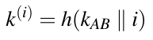 (14.1)

trong đó h() là một hash function an toàn như SHA-2 và i chỉ là một bộ đếm nguyên, được biểu diễn như một biến 32-bit. Các giá trị của i là công khai (ví dụ, bên mã hóa luôn chỉ ra giá trị i nào được dùng trong một header đứng trước mỗi block ciphertext). Các key đã suy ra được thuật toán symmetric dùng. Các key mới được suy ra mỗi 60 giây trong phiên liên lạc.

Bây giờ chúng ta xét hai tình huống giả định. Trong tình huống thứ nhất, hệ thống asymmetric được dùng với các tham số không còn an toàn nữa, và trong trường hợp thứ hai một block cipher lỗi thời đang được dùng.

1. Giả sử trao đổi key Diffie–Hellman được thực hiện với một số nguyên tố 512-bit, và thuật toán mã hóa là AES. Vì sao, từ góc độ cryptographic, không hợp lý khi dùng protocol key derivation được mô tả ở trên? Mô tả tấn công cần nỗ lực tính toán ít nhất của Oscar.

2. Bây giờ giả sử trao đổi key Diffie–Hellman được thực hiện với một số nguyên tố 2048-bit, và thuật toán mã hóa là DES. Mô tả chi tiết các ưu điểm mà scheme key derivation mang lại so với một hệ thống chỉ dùng trao đổi key Diffie–Hellman cho DES.

14.11. Chúng ta xét trao đổi key Diffie–Hellman. Giả sử Oscar chạy một man-in-the-middle attack nhắm vào protocol. như được giới thiệu trong Mục 14.4.1. Với trao đổi key Diffie–Hellman, dùng các tham số p = 467, α = 2 và a = 228, b = 57 lần lượt cho Alice và Bob. Oscar dùng giá trị o = 16.

Tính các cặp key kAO và kBO (i) theo cách Oscar tính chúng, và (ii) theo cách Alice và Bob tính chúng.

14.12. Chúng ta xét scheme trao đổi key Diffie–Hellman với certificate. Chúng ta có một hệ thống với ba người dùng Alice, Bob và Charley. Thuật toán Diffie–Hellman dùng p = 61 và α = 18. Ba key bí mật là a = 11, b = 22 và c = 33. Ba ID là ID(A) = 1, ID(B) = 2 và ID(C) = 3.

Để tạo chữ ký, scheme chữ ký Elgamal được dùng. Chúng ta áp dụng các tham số hệ thống p′ = 467, d′ = 127, α′ = 2 và β. CA dùng các ephemeral key kE = 213, 215 và 217 lần lượt cho chữ ký của Alice, Bob và Charley. (Trong thực tế, CA nên dùng một bộ sinh giả ngẫu nhiên tốt hơn để có các giá trị kE.)

Để có các certificate, CA tính xi = 4 × bi + ID(i) và dùng giá trị này làm input cho thuật toán chữ ký. (Cho xi, ID(i) khi đó suy ra từ ID(i) ≡ xi mod 4.)

1. Tính ba certificate CertA, CertB và CertC.

2. Kiểm chứng cả ba certificate.

3. Tính ba session key kAB, kAC và kBC.

14.13. Giả sử Oscar cố dùng một tấn công chủ động (thay thế) nhắm vào trao đổi key Diffie–Hellman với certificate theo các cách sau:

1. Alice muốn liên lạc với Bob. Khi Alice nhận Cert(B) từ Bob, Oscar thay nó bằng Cert(O) (hợp lệ!). Việc giả mạo này sẽ bị phát hiện như thế nào?

2. Cùng kịch bản: Bây giờ Oscar cố thay public key bB của Bob bằng public key bO của chính hắn. Việc giả mạo này sẽ bị phát hiện như thế nào?

14.14. Chúng ta xét việc cấp certificate với các key CA-generated (xem Mục 14.4.2). Giả sử lần truyền thứ hai của (CertA, kpr,A) diễn ra qua một kênh được xác thực nhưng không an toàn, tức là Oscar có thể đọc thông điệp này.

1. Chỉ ra cách hắn có thể giải mã lưu lượng được mã hóa bằng một symmetric cipher có key được tạo bằng protocol Diffie–Hellman giữa Alice và Bob.

2. Hắn cũng có thể mạo danh Alice sao cho hắn khởi tạo một trao đổi key Diffie-Hellman với Bob mà Bob không nhận ra không?

14.15. Cho một miền trong đó người dùng dùng chung các tham số Diffie–Hellman α và p. Public key Diffie–Hellman của mỗi người dùng được một CA chứng nhận. Người dùng liên lạc an toàn với nhau bằng cách thực hiện một trao đổi key Diffie–Hellman rồi mã hóa/giải mã thông điệp bằng một thuật toán symmetric như AES.

Giả sử Oscar nắm được thuật toán chữ ký của CA (bao gồm private key của nó), đã được dùng để tạo certificate. Bây giờ hắn có thể giải mã các ciphertext cũ đã được trao đổi giữa hai người dùng trước khi thuật toán chữ ký CA bị lộ, và Oscar đã lưu không (giải thích câu trả lời)? Nếu không, mô tả tấn công nào khác Oscar có thể thực hiện.

14.16. Một vấn đề trong PKI là việc phân phối được xác thực public key của CA, cần để kiểm chứng certificate. Giả sử Oscar có toàn quyền kiểm soát mọi liên lạc của Bob, tức là hắn có thể thay đổi mọi thông điệp tới và từ Bob. Bây giờ Oscar thay public key của CA bằng của chính hắn. Lưu ý rằng Bob không có cách nào xác thực key mà anh ấy nhận, nên anh ấy nghĩ rằng mình đã nhận public key của CA.

1. (Cấp certificate) Bob yêu cầu một certificate từ CA bằng cách gửi một yêu cầu chứa (1) ID của Bob ID(B) và (2) public key B của Bob. Mô tả chính xác Oscar phải làm gì để Bob không phát hiện ra rằng anh ấy có public key CA sai.

2. (Thực thi protocol) Mô tả Oscar phải làm gì để thiết lập một session key với Bob dùng trao đổi key Diffie–Hellman được xác thực, sao cho Bob nghĩ rằng anh ấy đang thực thi protocol với Alice.

14.17. Vẽ sơ đồ một protocol vận chuyển key tương tự protocol trong Mục 14.4 trong đó mã hóa RSA với certificate được dùng.

14.18. Chúng ta xét mã hóa RSA với certificate trong đó Bob có các key RSA. Oscar gửi được cho Alice một key kiểm chứng kpub,CA thực ra là key của Oscar. Trình bày một tấn công chủ động trong đó hắn có thể giải mã các thông điệp đã mã hóa mà Alice gửi tới Bob.

14.19. Pretty Good Privacy (PGP) là một scheme được dùng rộng rãi để bảo mật email và các dữ liệu số khác. PGP không nhất thiết đòi hỏi dùng certificate authority. Mô tả mô hình tin cậy của PGP và việc quản lý public-key hoạt động như thế nào trong thực tế.

14.20. Hình 14.8 cho thấy hai protocol để thiết lập key với một key distribution center T. Các protocol có những khác biệt nhỏ. Phân tích các protocol để tìm điểm yếu trước một kẻ tấn công chủ động cũng là người dùng hợp pháp của key server.

1. Vẽ một key confirmation attack nhắm vào protocol thứ nhất.

2. Mô tả vì sao protocol thứ hai bảo vệ trước tấn công này.

14.21. Bây giờ chúng ta sẽ phân tích protocol sau mà với nó hai người dùng có thể xác thực lẫn nhau. Giả định rằng mỗi người dùng có một thuật toán digital signature và các public key để kiểm chứng chữ ký đã được phân phối đúng cho mọi bên tham gia. Đây là protocol xác thực:

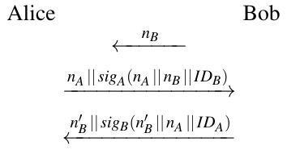

nX ký hiệu một số ngẫu nhiên, đóng vai trò nonce, được tạo bởi người dùng X.

1. Mô tả mọi bước của cả hai bên và giải thích mục tiêu của mỗi bước.

Bây giờ, Oscar thực hiện một tấn công thành công nhắm vào protocol. Trong tài liệu, tấn công này được biết tới là interleaving attack.

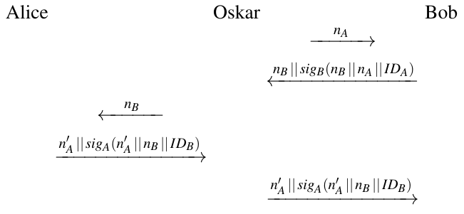

2. Giải thích tấn công của Oscar hoạt động thế nào và hậu quả là gì.

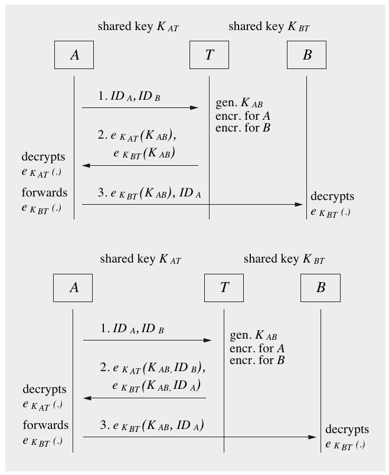

Hình 14.8 Hai protocol với KDC cho Bài tập 14.20

3. Khác biệt giữa interleaving attack này và man-in-the-middle attack được giới thiệu trong Mục 14.4.1 là gì? So sánh hậu quả của hai tấn công.

---

[^1]: Nhớ lại rằng nonce là viết tắt của “number used only once” (số chỉ dùng một lần), tức là đây là các giá trị chỉ xuất hiện một lần trong suốt thời gian sống của một hệ thống. Thêm về nonce được nói trong Mục 5.1.2 trong bối cảnh IV.

[^2]: “man-in-the-middle attack” không nên bị nhầm lẫn với “meet-in-the-middle attack” nghe tương tự nhưng thực ra hoàn toàn khác nhắm vào block cipher, đã được giới thiệu trong Mục 5.3.1.

[^3]: MAC cũng cung cấp xác thực và về nguyên tắc cũng có thể được dùng để xác thực public key. Tuy nhiên, vì bản thân MAC là các thuật toán symmetric, chúng ta lại cần một kênh an toàn để phân phối key MAC, với mọi nhược điểm đi kèm.
