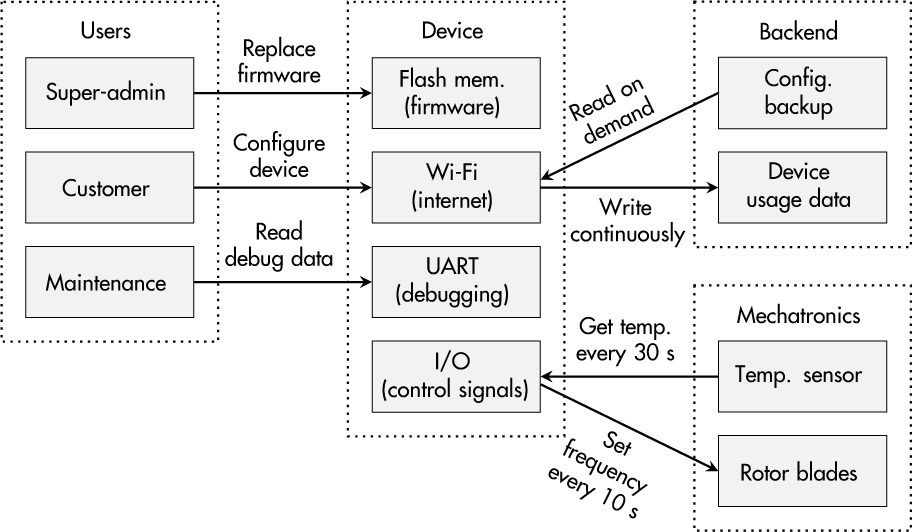

# 1 QUY TRÌNH PHÁT TRIỂN AN TOÀN (SECURE DEVELOPMENT PROCESS)

Khi còn là sinh viên, tôi nghĩ các quy trình tổ chức nằm trong số những chủ đề nhàm chán nhất của ngành kỹ thuật. Tuy nhiên, sau hơn một thập kỷ làm việc trong kỹ thuật bảo mật và giúp các tổ chức tối ưu hóa nỗ lực bảo mật của họ, tôi phải thừa nhận rằng các quy trình thú vị hơn tôi tưởng và hoàn toàn không phải là không liên quan khi phát triển các sản phẩm an toàn.

Mặc dù các tính năng bảo vệ kỹ thuật của một sản phẩm có thể được hoàn thành và đánh dấu là *xong*, một quy trình phát triển an toàn thì *không bao giờ xong*; nó phải được duy trì và cải tiến liên tục, đó là lý do tại sao thước đo định tính cho các quy trình kỹ thuật bảo mật được gọi là *maturity* (độ trưởng thành). Nó có thể tăng hay giảm, tùy thuộc vào tính đều đặn, chất lượng và cấu trúc tổ chức của các hoạt động hỗ trợ việc phát triển một sản phẩm an toàn bên trong một tổ chức.

Mục tiêu của chương này là thuyết phục sinh viên, kỹ sư và developer rằng các quy trình không chỉ là việc tạo ra những tài liệu không ai đọc. Một *secure development life cycle (SDL)* là về văn hóa và hành vi day-to-day của con người; nó là về việc duy trì chất lượng và bảo mật trong những điều kiện thay đổi, và nó làm rõ cách mọi người tham gia vào một quy trình kỹ thuật sản phẩm có thể liên tục đóng góp vào một sản phẩm cuối cùng an toàn.

## Về sự đa dạng của các hướng dẫn

Các khuyến nghị về quy trình phát triển an toàn đã tồn tại từ khá lâu. Tuy nhiên, tùy theo ngành của bạn, có thể chưa ai trong tổ chức của bạn từng cân nhắc theo đuổi một cách tiếp cận có hệ thống như vậy cho đến giờ, hoặc ít nhất là chưa một cách tường minh.

Các công ty phát triển hệ điều hành và ứng dụng web đã phải đối mặt với các vấn đề bảo mật tương đối sớm, nên không có gì ngạc nhiên khi Microsoft và Open Web Application Security Project (OWASP) là một trong những tổ chức đầu tiên làm việc và nói về SDL. Kể từ khi IEC công bố IEC 62443 Part 4-1, ngày càng nhiều nhà sản xuất các thành phần công nghiệp được dùng trong các cơ sở sản xuất, hạ tầng trọng yếu và nhiều ứng dụng tự động hóa khác nhau đã nhận thức được sự cần thiết phải hiện thực một quy trình phát triển an toàn.

SDL của Microsoft tuân theo 12 thực hành (*[https://www.microsoft.com/en-us/securityengineering/sdl/practices](https://www.microsoft.com/en-us/securityengineering/sdl/practices)*) mô tả các quy trình mà công ty dùng để phát triển các sản phẩm (phần mềm) an toàn. Những quy trình này trải dài từ đào tạo đến requirements engineering và threat modeling đến kiểm thử bảo mật. Cũng nhắm tới cộng đồng phần mềm, OWASP dùng năm nhóm để tóm tắt Software Assurance Maturity Model (SAMM, *[https://owaspsamm.org/model/](https://owaspsamm.org/model/)*) của mình: governance (quản trị), design (thiết kế), implementation (hiện thực), verification (kiểm chứng) và operations (vận hành). Part 4-1 của IEC 62443 (*[https://webstore.iec.ch/publication/33615](https://webstore.iec.ch/publication/33615)*) nhằm thiết lập một quy trình phát triển an toàn cho các nhà sản xuất thành phần công nghiệp. Nó được cấu trúc thành 8 thực hành, mỗi thực hành chứa từ 2 đến 13 thực hành con mô tả chi tiết các hoạt động được khuyến nghị, từ quản lý bảo mật đến thiết kế và hiện thực đến quản lý cập nhật ngoài hiện trường.

Cả ba hướng dẫn này đều dùng một cấu trúc khác nhau để giải thích ý tưởng về một quy trình phát triển an toàn; tuy nhiên, bạn có thể nhận thấy rằng chúng chồng lấn nhau đáng kể. Ví dụ, Microsoft SDL bảo bạn thực hiện *threat modeling*, trong khi OWASP dùng thuật ngữ *threat assessment* trong nhóm *design* của mình, và IEC 62443-4-1, yêu cầu SR-2 (là một phần của thực hành *specification of security requirements*) giải thích sự cần thiết phải thiết lập một quy trình để tạo và duy trì một *threat model* cho một sản phẩm.

Ngoài ra, tầm quan trọng của kiến thức và năng lực bảo mật có mặt trong cả ba: Microsoft liệt kê *provide training* là thực hành đầu tiên của mình, trong khi OWASP coi *education* là một phần của *governance*, và IEC 62443-4-1 dùng thuật ngữ *security expertise* để tóm tắt việc xác định và phát triển kỹ năng trong yêu cầu SM-4 của thực hành *security management*. Như một ví dụ cuối cùng, *penetration testing* là một thực hành được nêu tên tường minh ở Microsoft; nó được đưa vào với cùng tên trong yêu cầu SVV-4 thuộc thực hành *security verification and validation testing* của IEC 62443-4-1, và SAMM đề cập đến nó trong tác vụ *security testing* dưới mục *verification*.

Chúng ta có thể tiếp tục theo cách này cho các chủ đề như việc dùng cryptography state-of-the-art, làm rõ các phụ thuộc third-party và quản lý lỗ hổng. Điểm chính là, content-wise (về mặt nội dung), các hướng dẫn này có nhiều điểm tương đồng, nên câu trả lời cho câu hỏi “Tài nguyên nào trong số rất nhiều tài nguyên có sẵn là tốt nhất?” là “Không khác biệt lớn đâu.”

Microsoft có hơn 30 năm kinh nghiệm trong kỹ thuật phần mềm an toàn. OWASP không chỉ cung cấp các khuyến nghị có giá trị mà còn cả công cụ open source để hỗ trợ các quy trình này. Mặt khác, IEC 62443-4-1 nhắm tới lĩnh vực công nghiệp và các nhà sản xuất thành phần, vốn khác với các công ty IT cổ điển. Ngoài ra, các tổ chức độc lập có thể chứng nhận sự tuân thủ IEC 62443, nhưng điều đó không khả thi đối với SDL của Microsoft và OWASP, điều này có thể là một yếu tố quyết định nữa.

Ba tài liệu này chỉ là những ví dụ phổ biến. NIST *Special Publication 800-160* (*[https://csrc.nist.gov/pubs/sp/800/160/v1/r1/final?](https://csrc.nist.gov/pubs/sp/800/160/v1/r1/final?)*), sáng kiến Building Security In Maturity Model (BSIMM, *[https://www.bsimm.com](https://www.bsimm.com)*) và tài liệu *Good Practices for Security of IoT—Secure Software Development Lifecycle* của European Union Agency for Cybersecurity (ENISA) (*[https://www.enisa.europa.eu/publications/good-practices-for-security-of-iot-1](https://www.enisa.europa.eu/publications/good-practices-for-security-of-iot-1)*) cũng rất hữu ích.

## Trách nhiệm đối với bảo mật sản phẩm

Thành công về bảo mật của mọi sản phẩm bắt đầu từ việc làm rõ trách nhiệm. Không quan trọng người nhận trách nhiệm là nhà sáng lập một startup, một product security officer (PSO) của một công ty toàn cầu hay một thành viên của nhóm phát triển, nhưng điều cực kỳ quan trọng là *ai đó* nhận trách nhiệm và người đó có đủ thời gian và tài nguyên cần thiết để làm việc này.

Một quy trình phát triển an toàn gồm một tập hoạt động không đồng nhất, điều đó cũng có nghĩa là người chịu trách nhiệm về bảo mật phải tham gia vào nhiều giai đoạn phát triển sản phẩm. Người đó phải bảo đảm rằng *security by design* là một phần của văn hóa phát triển. Dĩ nhiên, đó không phải là vị trí dễ được lòng nhất, đặc biệt khi bảo mật trước đây chưa từng là trọng tâm trong tổ chức của bạn. Mặc dù ban quản lý (sản phẩm) thường thích nói về tiềm năng của các công nghệ mới và tính năng thiết bị mới, việc thường xuyên nhấn mạnh các rủi ro đi kèm sẽ không làm bạn trở thành người được mọi người yêu quý.

Tuy nhiên, về lâu dài, người đó sẽ loại bỏ các nguồn gây lỗi, lỗ hổng và hiểu lầm nội bộ. Họ sẽ không chỉ tăng cường bảo mật thiết bị mà còn góp phần vào sự minh bạch trong nhóm phát triển sản phẩm và đối với ban quản lý.

> **THỰC TẾ: CÁC CHUYÊN GIA KỸ THUẬT BẢO MẬT**
>
> Tôi từng làm tư vấn cho một công ty medium-sized để đưa bảo mật vào các quy trình kỹ thuật sản phẩm của họ. Vào thời điểm đó, công ty có một chuyên gia bảo mật làm việc cho bộ phận IT, nhưng trong nhóm kỹ thuật embedded system thì không có ai có kiến thức bảo mật.
>
> May mắn thay, công ty đã có thể tuyển một chuyên gia trẻ đầy nhiệt huyết, có chuyên môn bảo mật vững chắc và thậm chí có kinh nghiệm kỹ thuật thiết bị để lấp khoảng trống đó và nhận trách nhiệm về bảo mật sản phẩm. Với nhiều ý tưởng trong đầu về cách thiết lập một quy trình phát triển an toàn, anh ấy đã làm quen với các quy trình, con người và sản phẩm đặc thù của tổ chức.
>
> Thỉnh thoảng, anh ấy được yêu cầu hỗ trợ nhóm phát triển trong các dự án kỹ thuật phần mềm và phần cứng vì tính cấp bách. Đáng buồn là số lượng những nhiệm vụ đó tăng lên trong khi sự quan tâm của ban quản lý đối với bảo mật sản phẩm giảm đáng kể. Sau khoảng hai năm, anh ấy nghỉ việc. Và công ty này đã mất hai lần: nó mất một tài năng bảo mật tận tâm và mất cơ hội thiết lập một quy trình phát triển an toàn trước các đối thủ cạnh tranh.

## Nhận thức và đào tạo

Vài năm trước, tôi tham dự một bài nói chuyện của một chuyên gia tư vấn bảo mật người Đức về việc các công ty châu Âu đã chuẩn bị (hay chưa chuẩn bị) như thế nào cho các mối đe dọa mạng sắp tới, và những người làm việc trong lĩnh vực bảo mật phải trải qua bao nhiêu căng thẳng và thất vọng mỗi ngày. Nhắm tới các đại diện ban quản lý, ông kết luận như sau: “Không phải công cụ hay công nghệ—*con người* tạo ra bảo mật!”

Từ requirements engineering đến phát triển phần mềm và phần cứng đến xử lý lỗ hổng, chính con người là những người sáng tạo tìm ra các cách lạm dụng một tính năng sản phẩm, tỉ mỉ tuân theo các quy tắc secure coding đã thống nhất trong nhóm, và phân tách các vấn đề bảo mật liên quan với không liên quan được bên thứ ba báo cáo.

Nói cách khác, nếu nhóm phát triển của bạn không thể hình dung các kịch bản tấn công tiềm năng; coi các thực hành bảo mật là trở ngại; và đáp lại các báo cáo lỗ hổng bằng sự tức giận, sợ hãi hay hoàn toàn không hiểu, sản phẩm của bạn sẽ không cải thiện về bảo mật, ngay cả khi bạn đã mua license đắt nhất cho các công cụ hàng đầu để “hỗ trợ” họ. Câu hỏi hiển nhiên cần đặt ra là, “Ai cần có kiến thức bảo mật gì để tuân theo nguyên tắc security-by-design mỗi ngày làm việc?”

Đối với phần lớn nhân viên, nhận thức bảo mật chung là một yêu cầu cơ bản. Yêu cầu này cũng đúng với kỹ sư, developer và kiến trúc sư thiết bị. Tuy nhiên, nhận thức bảo mật không phải là thứ bạn học ở trường (ít nhất là cho đến nay). Nó cũng không phải là một phần bắt buộc của giáo dục đại học hay các chương trình đào tạo on-the-job điển hình. Hơn nữa, nhận thức thường phai nhạt theo thời gian, nghĩa là nó phải được làm mới thường xuyên. Trong các nhóm của bạn, điều thiết yếu là đề cập và thảo luận góc nhìn của kẻ tấn công, ý định của họ và các khả năng để đối phó với những chiến lược đó.

Theo kinh nghiệm của tôi, đào tạo web-based thường là một hoạt động “click-and-forget” đối với nhân viên, trong khi các buổi gặp mặt, workshop và sự kiện team-building dẫn đến tương tác, thảo luận và, tốt nhất là, sự suy ngẫm, cho phép mọi người liên kết kiến thức bảo mật với công việc day-to-day của họ.

Bên cạnh các kiến thức bảo mật cơ bản, các cá nhân trong nhóm kỹ thuật sản phẩm của bạn có thể cần những năng lực cụ thể. Ví dụ, developer có thể hưởng lợi từ khóa đào tạo secure coding, trong khi tester có thể nâng cao kỹ năng bằng cách tham dự một khóa penetration testing. Thường bị bỏ qua, đặc biệt ở các công ty medium-sized, việc tham gia vào một cộng đồng kỹ thuật bảo mật có thể là một cách đáng giá để trao đổi ý tưởng, thách thức và bài học kinh nghiệm với các tổ chức khác cho cả nhân viên management-level lẫn nhân viên kỹ thuật.

Một lần nữa, đào tạo không phải là một hoạt động one-shot. Liên tục khuyến khích mọi người suy ngẫm về tính bảo mật trong công việc và các quy trình hằng ngày của họ là một phần không thể thiếu của một văn hóa bảo mật sống động.

## Tài sản và mục tiêu bảo vệ

Hãy tưởng tượng một buổi sáng thứ Hai đầy nắng. Tuần làm việc phía trước có vẻ sẽ bận rộn như thường lệ, nhưng rồi ai đó từ ban quản lý hỏi bạn có thể dành ra một phút không:

> Quản lý: “Hãy biến sản phẩm của chúng ta thành một sản phẩm an toàn!”
>
> Bạn: “Chính xác thì ý anh là gì?”
>
> Quản lý: “Phải không thể hack được nó!”
>
> Bạn: “Yêu cầu này đến từ đâu?”
>
> Quản lý: “Cậu không đọc tin tức à? Ngày nay cái gì cũng bị hack!”
>
> Bạn: “Được rồi. Vậy, phần nào của sản phẩm chúng ta đáng để hack?”
>
> Quản lý: “Tôi không biết; cậu nói cho tôi đi!”

Cuộc đối thoại này là hư cấu, nhưng có thể bạn đã từng có những cuộc thảo luận tương tự. Nó làm rõ một điểm đơn giản: bạn không thể bảo vệ một thiết bị nếu bạn không biết cần bảo vệ cái gì. Về cơ bản, mọi người trong công ty của bạn nên biết cái gì đáng được bảo vệ hay cái gì quan trọng một cách căn bản để giữ cho hoạt động kinh doanh vận hành. Chúng ta thường gọi đây là một *asset* (tài sản).

### *Các phần có giá trị của sản phẩm*

Asset có thể thuộc nhiều loại khác nhau—ví dụ, một cryptographic key cần thiết cho một kịch bản pay-per-use, dữ liệu đo lường được truyền từ thiết bị của bạn tới một ứng dụng cloud để hỗ trợ các dịch vụ bảo trì dự đoán, một file cấu hình kích hoạt hay vô hiệu hóa các tính năng sản phẩm, code trong firmware của bạn phát ra cảnh báo trong trường hợp khẩn cấp, hay một web service cần thiết cho cả những hoạt động cơ bản nhất của thiết bị. Tóm lại, asset là mọi thứ quan trọng và có giá trị theo một cách nào đó.

Việc xác định các asset này là phân tích ban đầu để khởi động một quy trình phát triển an toàn và là cơ sở cho mọi nỗ lực bảo vệ của bạn. Về mặt logic, bạn nên xác định asset của mình là gì trước khi hiện thực các biện pháp đối phó hay đặt hàng một penetration test, vì nếu bạn không biết mình muốn bảo vệ cái gì, làm sao bạn có thể hiện thực các biện pháp đối phó hiệu quả và xác định các kịch bản tấn công worst-case? Tuy nhiên, vì hầu hết các thiết bị hiện đại không hoạt động độc lập, quy trình này cũng bao gồm việc thiết lập một *hiểu biết chung về hệ thống* trong tổ chức của bạn, gồm các đối tượng, luồng dữ liệu, con người, thành phần third-party và các quy trình life-cycle liên quan, cũng như mô hình kinh doanh đằng sau tất cả những điều đó.

Đọc danh sách đó, bạn có thể nghĩ rằng nó bao gồm rất nhiều thông tin, và bạn đúng. Các chủ đề trải dài từ hiểu biết kinh doanh đến kiến thức kỹ thuật chuyên sâu đến các quy trình và cấu trúc tổ chức. Dù công ty của bạn nhỏ hay lớn đến đâu, có lẽ không một người duy nhất nào chịu trách nhiệm cho tất cả những nhiệm vụ đó, đặc biệt là không phải trong một nhóm phát triển, nên tiếp cận phân tích này theo cách đa chiều là then chốt.

> **LƯU Ý**
>
> *Tôi đã có những trải nghiệm tốt với việc tổ chức một workshop có một người điều phối, một chuyên gia bảo mật và một nhóm nhân viên đa dạng tham gia vào các hoạt động kinh doanh xoay quanh một thiết bị cụ thể. Bên cạnh một developer, tester và product manager, sẽ hợp lý nếu mời những người từ bộ phận bảo trì, hỗ trợ khách hàng, dịch vụ số, an toàn thiết bị, bán hàng và bất kỳ bộ phận nào khác có thể liên quan đến sản phẩm của bạn.*

Điểm khởi đầu để thảo luận về cybersecurity với các thành viên trong nhóm là một bản tổng quan cơ bản tập hợp thông tin có sẵn về architecture. [Hình 1-1](#ch01fig01) cho thấy một ví dụ về cách biểu diễn như vậy cho một máy thông gió công nghiệp Wi-Fi-controlled hư cấu.

*Hình 1-1: Một ví dụ về bản tổng quan ngữ cảnh thiết bị cơ bản*

Bản tổng quan ban đầu này nên đơn giản nhưng chi tiết đến mức cần thiết. Về sau, trong một quá trình đôi khi hỗn loạn trong một workshop hay buổi thảo luận, bản tổng quan này sẽ được bổ sung và tinh chỉnh với thông tin, có thể là các luồng dữ liệu không hiển nhiên từ các tài liệu gốc, các mối quan hệ với bên thứ ba trước đó chưa ai biết, hay các bước quy trình ngầm định chỉ những người thực hiện chúng hằng ngày mới biết.

Sau khi mọi người hài lòng với mức chi tiết và tính đúng đắn của bản biểu diễn tổng thể hệ thống, việc xác định asset thực sự bắt đầu với câu hỏi này: “Những phần nào của hệ thống là trọng yếu đối với mô hình kinh doanh và/hoặc tổ chức của chúng ta?”

### *Các nhu cầu bảo vệ liên quan*

Việc xác định không chỉ *cái gì* quan trọng cần bảo vệ mà còn *tại sao* nó quan trọng dẫn chúng ta trực tiếp đến định nghĩa về *protection goal* (mục tiêu bảo vệ).

Mỗi asset nên có ít nhất một protection goal; nếu không, asset đó có lẽ không liên quan (từ góc nhìn bảo mật). Danh sách sau, bắt đầu với bộ ba C-I-A nổi tiếng (confidentiality, integrity, availability), chỉ ra các protection goal điển hình định nghĩa thuộc tính nào của một asset đáng được bảo vệ. Tuy nhiên, nếu bạn xác định được một nhu cầu bảo vệ cụ thể không khớp với các mục tiêu chuẩn trong danh sách này, không có gì sai khi viết nó ra bằng lời của chính bạn.

**Confidentiality (C)** Protection goal này có lẽ được biết đến rộng rãi nhất. Chúng ta có thể nói rằng một asset tương ứng phải giữ “bí mật” để được “an toàn.” Một cách hình thức hơn, nó có nghĩa là việc truy cập đọc vào một asset cụ thể không được phép xảy ra, ngoại trừ đối với các thực thể được ủy quyền. Mặc dù mục tiêu này có lẽ xuất hiện trong đầu mọi người không chuyên khi nói về bảo mật, nó không phải lúc nào cũng là mục tiêu đúng, và nó không cần thiết cho mọi asset khả dĩ. Các ví dụ điển hình về asset đòi hỏi confidentiality là các cryptographic key được lưu trữ hay các file thực thi chứa tài sản trí tuệ.

**Integrity (I)** Chỉ các chủ thể được ủy quyền mới có thể thay đổi một đối tượng hay dữ liệu cho trước, và nếu những người khác thay đổi nó, bạn phải có khả năng phát hiện việc thao túng đó. Các use case phổ biến bao gồm một bộ đếm đơn điệu (monotonic counter) cho mục đích tính phí hay các lệnh điều khiển được gửi qua một kênh giao tiếp. Hơn nữa, bạn có thể áp dụng mục tiêu này cho toàn bộ thiết bị hay máy móc để nhấn mạnh tầm quan trọng của *system integrity* (tính toàn vẹn hệ thống), ví dụ, nếu có thể thay thế các phần của hệ thống. Hãy lưu ý rằng thuật ngữ *integrity* được dùng khác đi trong lĩnh vực safety, nơi một cyclic redundancy check (CRC) thường được coi là “integrity protection.” Điều này không đúng trong lĩnh vực security, nơi một kẻ tấn công chủ động có thể dễ dàng giả mạo một CRC.

**Availability (A)** Trong khi hầu hết các phần của một thiết bị cần sẵn sàng để hoạt động đúng, protection goal này được dùng cho dữ liệu hay dịch vụ (trên thiết bị hay trên backend) nếu một kẻ tấn công có khả năng làm gián đoạn hay trì hoãn việc truy cập vào chúng. Ví dụ về các asset tương ứng là một web service cung cấp dữ liệu trực tiếp cho thiết bị, một luồng số ngẫu nhiên bên trong đơn vị xử lý chính của thiết bị, hay thậm chí các bản sao lưu trên một hệ thống server. Đặc biệt trong các use case ô tô và công nghiệp, một yêu cầu tương tự tồn tại trong ngữ cảnh *hard real-time communication*. Ở đó, thông tin hiện tại (ví dụ, từ một cảm biến an toàn hay một bộ điều khiển phanh) phải sẵn có *trước một thời hạn cho trước*.

**Authenticity (Au)** Chúng ta có thể coi protection goal này là một sự mở rộng của integrity. Ngoài việc bảo đảm rằng dữ liệu không bị thao túng, mục tiêu này đòi hỏi chúng ta có thể xác minh rõ ràng rằng dữ liệu có nguồn gốc từ một định danh cụ thể. Authenticity đặc biệt liên quan nếu các phần của thiết bị phải là “hàng gốc,” như phụ tùng thay thế, firmware được lưu trong flash memory, hay một file license.

**Nonrepudiation (Nr)** Liên quan chặt chẽ đến authenticity, nonrepudiation có nghĩa là một thực thể không thể chối bỏ một cách hợp lý rằng mình đã thực hiện một thao tác cho trước. Nói chung, yêu cầu này hữu ích cho các hoạt động của thiết bị và/hoặc người dùng dẫn đến một hợp đồng—ví dụ, đặt mua mực bổ sung cho máy in của bạn trực tiếp trên thiết bị, nhưng cũng hữu ích nếu sản phẩm của bạn có chức năng pay-per-use.

**Privacy (Pr), pseudonymity (Ps) và anonymity (An)** Ít nhất kể từ khi European General Data Protection Regulation (GDPR) ra đời năm 2018, quyền riêng tư và bảo vệ dữ liệu đã thu hút sự chú ý. Nếu thiết bị của bạn làm việc với dữ liệu cá nhân (ví dụ, thiết bị y tế), bạn có thể cũng muốn xác định các protection goal cho dữ liệu đó. Các mục tiêu điển hình có thể là *pseudonymity* (bí danh hóa), nghĩa là dữ liệu có thể được truy vết tới một bí danh nhưng không tới một người thật, hay *anonymity* (ẩn danh), nghĩa là dữ liệu được xử lý hay thu thập không thể được liên kết với một người thật cũng như với một bí danh.

Cuối cùng, bạn có thể có được một bảng các asset và protection goal tương ứng, như được thể hiện trong [Bảng 1-1](#ch01tab01). Lưu ý rằng cột Comment có thể hữu ích nếu bạn muốn cung cấp thêm ngữ cảnh cho protection goal đã chọn.

**Bảng 1-1:** Ví dụ về các asset và protection goal tương ứng

| **ID** | **Asset** | **Protection goal(s)** | **Comment** |
|---|---|---|---|
| AS01 | Firmware | I, Au | Chỉ firmware gốc |
| AS02 | Certificate private key | C | Nếu bị lộ, thiết bị có thể bị nhân bản |
| AS03 | Dữ liệu cảm biến nhiệt độ | I, Au, A | Thiết yếu để phát hiện việc lạm dụng thiết bị |
| AS04 | Debug interface | C | Chỉ kỹ thuật viên nội bộ được truy cập |
| AS05 | . . . | . . . | . . . |

Sau khi xử lý một đống thông tin như vậy, mọi người thường sửng sốt về sự đan xen của bảo mật thiết bị với nhiều lĩnh vực khác nhau của việc phát triển và vận hành sản phẩm. Tuy nhiên, họ thường hài lòng vì bước đầu tiên hướng tới một thiết bị an toàn đã được thực hiện và vì họ đã học được điều gì đó mới về sản phẩm mà họ tưởng đã biết từ A đến Z.

> **THỰC TẾ: CÁC WORKSHOP THREAT-MODELING**
>
> Vài năm trước, tôi được yêu cầu thực hiện một workshop phân tích rủi ro two-day tại một nhà sản xuất hệ thống điều khiển công nghiệp. Theo gợi ý của tôi, công ty đã mời nhiều người từ các chuyên môn khác nhau.
>
> Trong những giờ đầu của workshop, một developer đang giải thích cách việc tách biệt mạng công nghiệp trọng yếu và mạng IT được hiện thực trong thiết bị, thì một anh chàng từ bộ phận bảo trì kỹ thuật xen vào: “Ngoài hiện trường chúng tôi không làm như thế.” Anh ta tiếp tục giải thích rằng trong quá trình bảo trì, việc bắc cầu (bridge) hai mạng này tiện hơn nhiều, và kết nối bắc cầu này đôi khi vẫn còn đó ngay cả trong quá trình vận hành.
>
> Chỉ một khoảnh khắc này đã khởi đầu nhiều cuộc thảo luận, góp phần vào một trong những rủi ro hàng đầu được xác định và, cuối cùng, dẫn đến việc phát triển một tính năng network-monitoring bổ sung cho thiết bị. Sau đó, sách hướng dẫn bảo trì cũng được cập nhật với bảo mật được tính đến. Vấn đề này chỉ nổi lên nhờ một nhóm người không đồng nhất, liên ngành cùng nói chuyện về bảo mật của một sản phẩm.

## Kẻ tấn công, mối đe dọa và rủi ro

Sau khi thiết lập một hệ thống chung để hiểu và xác định các asset và môi trường của thiết bị, con đường đã được dọn sẵn để phân tích các mối đe dọa và rủi ro cho các use case cụ thể của bạn. Mục tiêu của giai đoạn thứ hai này là phát triển một tập kịch bản đại diện cho bối cảnh mối đe dọa (threat landscape) hiện tại của bạn và đánh giá chúng theo xác suất xảy ra và tác động tiềm năng lên hoạt động kinh doanh và tổ chức của bạn.

Một *threat scenario* (kịch bản mối đe dọa) thường gồm một *threat actor* (người thực hiện tấn công), một *lỗ hổng* (vulnerability) khả dĩ (một điểm yếu có thể khai thác của thiết bị), các *attack vector* (con đường hay phương pháp dùng để tấn công), và một tác động lên ít nhất một trong các asset bạn đã xác định trước đó. Giai đoạn này cố gắng dự đoán những mối đe dọa nào thiết bị của bạn có thể phải đối mặt trong tương lai, ngay cả khi nó chưa được phát triển hay sản xuất.

Dĩ nhiên, bạn không thể đạt được sự dự đoán này một cách toàn diện với độ chính xác 100 phần trăm. Đó là một quá trình sáng tạo đòi hỏi người tham gia nhập vai kẻ tấn công và hình dung các cách để đạt được mục tiêu xấu của họ. Vâng, việc xây dựng các threat scenario có thể hơi thiếu cấu trúc đối với nhân viên kỹ thuật, có thể có những bất ngờ, và kết quả không phải là bất di bất dịch. Bạn cũng sẽ cần cập nhật các kịch bản của mình trong tương lai nếu phát hiện ra các mối đe dọa mới.

### *Các đối thủ tiềm năng*

Một điểm khởi đầu tốt thường là hình dung các kẻ tấn công tiềm năng khác nhau về động cơ, cơ hội và tài nguyên. Những ví dụ sau có thể đóng vai trò như các ví dụ cơ bản:

**Script kiddie** Những kẻ tấn công này không nhất thiết phải là thanh thiếu niên, nhưng họ là những người phân tích thiết bị và dịch vụ vì tò mò và như một thú tiêu khiển. Họ thường có ít tài nguyên (ngoài thời gian rảnh), dùng các công cụ tiêu chuẩn có sẵn trên internet, và có được các kỹ năng cơ bản từ việc xem video.

**Nhà nghiên cứu bảo mật** Những người này có kiến thức chuyên môn và có quyền truy cập vào thiết bị mạnh, thường là tại các trường đại học. Mặc dù họ thường không có lợi ích tài chính, họ nhắm tới việc công bố các lỗ hổng mà họ tìm thấy và việc chuẩn bị các bản sửa lỗi tương ứng. Trái với các loại kẻ tấn công khác, họ thường sẵn lòng hợp tác với các công ty để cải thiện bảo mật sản phẩm.

**Tội phạm mạng** Bị thúc đẩy bởi lợi nhuận tài chính, tội phạm có tổ chức tấn công các sản phẩm IT hằng ngày. Dù họ tập trung vào ransomware, các cuộc tấn công denial-of-service (DoS) hay bán dữ liệu cá nhân, những kẻ tấn công này có ít nhất một lượng tài nguyên vừa phải, đang chủ động theo dõi các ngành công nghiệp và có khả năng điều chỉnh công cụ của họ cho các kịch bản mới.

**Kẻ làm hàng nhái sản phẩm** Nhân bản thiết bị là một mối lo lớn đối với embedded system. Những kẻ tấn công này được trang bị tốt để sao chép thiết kế phần cứng và các thành phần phần mềm cho mục đích riêng của họ. Họ lợi dụng các khoản đầu tư phát triển của các nhà sản xuất thiết bị gốc để bán các sản phẩm giả với giá thấp hơn.

**Kẻ tấn công nation-state** Thiết bị tinh vi, tài nguyên gần như vô tận và quyền truy cập độc nhất vào dữ liệu tình báo chỉ là một vài thuộc tính của những kẻ tấn công này. Họ hành động vì động cơ chính trị hay quân sự, nên họ thường khá nằm ngoài phạm vi của các giải pháp kinh doanh tiêu chuẩn. Tuy nhiên, đặc biệt đối với các thiết bị hoạt động trong hạ tầng liên bang hay hạ tầng trọng yếu, việc xem xét những đối thủ như vậy là quan trọng.

Những loại kẻ tấn công rộng và chung chung này hữu ích để xác định các rủi ro phổ biến, nhưng thường một thiết bị và các ứng dụng của nó sẽ có những đối thủ cụ thể hơn, cho phép bạn làm cho các threat scenario cụ thể hơn và giúp bạn xác định các rủi ro riêng cho tổ chức của mình. Ví dụ, trong lĩnh vực ô tô và xe máy, độ động cơ (engine tuning) có thể là mục tiêu của một nhóm kẻ tấn công cụ thể nhằm vượt qua các biện pháp bảo vệ để áp dụng các thiết lập performance tùy chỉnh của họ.

Có khi ngay cả bản thân khách hàng cũng có lợi ích trong việc thao túng thiết bị của họ. Nhìn vào các hệ thống IoT nông nghiệp, các nhà hoạt động bảo vệ môi trường và động vật có thể là những kẻ tấn công khá thực tế với các mục tiêu, tài nguyên và cách tiếp cận riêng của họ.

Cuối cùng, đừng quên *người trong nội bộ là kẻ tấn công*, vì họ có kiến thức và quyền truy cập độc nhất vào các tài liệu, dữ liệu và quy trình nội bộ. Dĩ nhiên, hầu hết nhân viên có lẽ đáng tin cậy, nhưng việc nghĩ xem các đồng nghiệp có thể làm gì nếu họ có ý đồ xấu có thể đáng giá cho giai đoạn này. [Bảng 1-2](#ch01tab02) cho thấy một danh sách mẫu các kẻ tấn công đối với các asset được liệt kê trong [Bảng 1-1](#ch01tab01) và các thuộc tính tương ứng của họ.

**Bảng 1-2:** Ví dụ về các kẻ tấn công khả dĩ và thuộc tính

| **ID** | **Kẻ tấn công** | **Động cơ** | **Tài nguyên** |
|---|---|---|---|
| AT01 | Tội phạm mạng | Tài chính | Trung bình, có quyền truy cập malware |
| AT02 | Script kiddie | Giải trí | Thấp, công cụ internet, thời gian rảnh |
| AT03 | Nhà hoạt động môi trường | Gây chú ý công chúng | Trung bình, có quan hệ PR |
| AT04 | Người nội bộ bộ phận bảo trì | Tài chính/tức giận | Tài liệu kỹ thuật, tài khoản thiết bị, quyền đọc source code |
| AT05 | Khách hàng | Tài chính | Dùng thiết bị hằng ngày, có thời gian để thử nghiệm |
| AT06 | . . . | . . . | . . . |

Trong khi lập danh sách này, mọi người đôi khi nhớ lại những câu chuyện real-world về trộm cắp, phá hoại hay làm hàng lậu đã xảy ra trong quá khứ. Thông tin này có thể thực sự hữu ích trong việc tối ưu hóa các nỗ lực bảo vệ của bạn trong tương lai.

### *Các tác động tiêu cực tiềm năng*

Một bên, chúng ta có các asset có tầm quan trọng trung tâm đối với hoạt động kinh doanh, và bên kia, chúng ta có những kẻ tình nghi đang chờ cơ hội tấn công chúng. Câu hỏi logic tiếp theo là, “Những tác nhân có khả năng có ý đồ xấu này có thể gây tác động lên các asset của chúng ta như thế nào?”

Việc xây dựng các attack vector và hình dung các lỗ hổng khả dĩ trong hệ thống của bạn có thể dẫn đến vô số threat scenario, có lẽ chồng lấn nhau, làm tăng công sức xử lý mà vẫn không bao quát được mọi thứ. Một cách để giải quyết vấn đề này là thử cách tiếp cận thực dụng: đi qua danh sách asset của bạn và áp dụng các mối đe dọa liên quan được gợi ý bởi *phương pháp STRIDE* do Microsoft phát triển.

[Bảng 1-3](#ch01tab03) giải thích phương pháp này bằng cách cho thấy từ viết tắt STRIDE đại diện cho những gì—cụ thể là năm mối đe dọa tiêu chuẩn—rồi dẫn chiếu tới các mục tiêu mà chúng nhắm phá vỡ cũng như các câu hỏi mẫu mà người điều phối có thể đặt ra cho mọi người tham gia. Với AS01 trong [Bảng 1-1](#ch01tab01)—một firmware image mang các protection goal integrity và authenticity—nhiệm vụ sẽ là suy nghĩ sáng tạo về các cách can thiệp vào nó hay giả mạo định danh của nhà sản xuất gốc của image.

**Bảng 1-3:** Checklist các mối đe dọa STRIDE

| **Mối đe dọa** | **Mục tiêu** | **Câu hỏi cần đặt ra** |
|---|---|---|
| **S**poofing | Authenticity | Có cách nào để mạo danh bất kỳ thực thể nào không? |
| **T**ampering | Integrity | Có cách nào để thao túng bất kỳ dữ liệu nào không? |
| **R**epudiation | Nonrepudiation | Có cách nào để chối bỏ một hành động một cách hợp lý không? |
| **I**nformation disclosure | Confidentiality | Có cách nào để đọc/trích xuất thông tin không? |
| **D**enial of service | Availability | Có cách nào để làm gián đoạn/trì hoãn một dịch vụ không? |
| **E**levation of privilege | Authorization | Có cách nào để hành động mà không có quyền không? |

Nếu bất kỳ mối đe dọa STRIDE nào khác có vẻ áp dụng được, hãy thêm chúng vào cuộc thảo luận. Trong trường hợp firmware, ví dụ, bạn có thể có tài sản trí tuệ cần giữ bí mật mà trước đó chưa được xem xét. Cuối cùng, hãy ghép mọi mối đe dọa bổ sung với danh sách kẻ tấn công của bạn và thảo luận xem ai sẽ là tác nhân phù hợp cho mối đe dọa đó.

Ngoài các mối đe dọa mà thiết bị và phần mềm có chung, các sản phẩm vật lý còn phải đối mặt với một vấn đề khác mà mọi người nên ghi nhớ trong đầu khi brainstorm các mối đe dọa: *chúng có thể bị tấn công về mặt vật lý*. Trong một số trường hợp, điều đó có thể không trọng yếu, vì nếu người ta có quyền truy cập vật lý vào một thiết bị, họ cũng có thể phá hủy các phần khác của máy móc hay hệ thống mà thiết bị điều khiển. Tuy nhiên, khả năng tiếp cận vật lý tạo ra khác biệt trong ít nhất hai tình huống:

**Phân tích thiết bị pre-attack** Trong nhiều trường hợp, thiết bị có thể được mua về và phân tích để tìm lỗ hổng, các bí mật cryptography và hành vi liên quan trong một môi trường attacker-controlled. Quyền truy cập vật lý cho phép kẻ tấn công trích xuất firmware của thiết bị và thực hiện reverse engineering chi tiết, hay nghe lén giao tiếp trên các đường mạch của bảng mạch in (PCB), điều có thể làm lộ dữ liệu bí mật.

**Thao túng vô hình** Dùng búa để “thao túng” một cỗ máy thường gây tiếng ồn và hư hại nhìn thấy được mà con người có thể phát hiện. Tuy nhiên, bất kỳ quyền truy cập vật lý hay sự ở gần nào có thể được dùng để thay đổi các tham số của thiết bị hay hệ thống mà không thể nhận ra nếu không phân tích sâu hơn hệ thống bị tấn công, đều có thể là một attack vector khá mạnh, có thể gây ra tác động long-lasting.

Lặp lại quy trình cho mọi asset tốn thời gian. Tuy nhiên, vì hình thức này thường có sự tham gia của các chuyên gia từ nhiều lĩnh vực, trên thực tế nó thường được giới hạn trong một hay vài ngày. Sau khi đưa các asset của bạn qua quy trình này, bạn thu được một tập hợp threat scenario cho sản phẩm của mình. [Bảng 1-4](#ch01tab04) cho thấy những hàng đầu tiên của kết quả từ một workshop ví dụ.

**Bảng 1-4:** Ví dụ về các threat scenario

| **ID** | **Asset** | **Kẻ tấn công** | **Mối đe dọa** | **Tác động** |
|---|---|---|---|---|
| TS01 | AS01 | AT04 | Hiện không có bảo vệ integrity và authenticity; nhân viên bảo trì có quyền truy cập vật lý vào nhiều thiết bị; biết cách mở thiết bị và can thiệp vào firmware | Sản phẩm hoạt động sai và khách hàng khiếu nại |
| TS02 | AS02 | AT01, AT03 | Nếu mua thiết bị, kẻ tấn công có thể trích xuất private key từ firmware thiết bị; kẻ tấn công có thể đóng vai thiết bị | Đưa dữ liệu giả mạo vào backend |
| TS03 | AS02 | AT01, AT03, AT04 | Kẻ tấn công có thể công bố private key trên mạng để làm tổn hại danh tiếng công ty; bất kỳ ai trên thế giới cũng có thể mạo danh thiết bị của chúng ta | Sự chú ý của truyền thông; thậm chí có thể phải thu hồi sản phẩm |
| TS04 | AS03 | AT05 | Thao túng vật lý cảm biến nhiệt độ; kênh giao tiếp an toàn không bảo vệ được trước điều đó; nhiệt độ luôn được đo là mát trong khi thực tế liên tục vượt giới hạn | Không thể chứng minh việc lạm dụng khi có hư hỏng |
| TS05 | . . . | . . . | . . . | . . . |

Các kịch bản đã ghi lại sẽ giúp bạn minh họa các vấn đề đã xác định và truyền đạt chúng trong công ty hoặc tới ban quản lý.

### *Không có rủi ro, không có ưu tiên*

Cho đến điểm này, mọi attack vector tiềm năng và mọi lỗ hổng tiềm năng đã được thu thập mà không loại bỏ bất cứ thứ gì vì “không liên quan.” Tuy nhiên, danh sách có thể dài, và tài nguyên để xử lý các vấn đề đã xác định thường có hạn. Đã đến lúc gạn đục khơi trong bằng cách đánh giá (ít nhất) hai thuộc tính của mỗi threat scenario: xác suất xảy ra của nó và, nếu nó xảy ra, tác động tiềm năng của nó.

Trong lĩnh vực safety, bạn có thể mô tả gần như mọi xác suất xảy ra bằng một con số. Nếu các chuyên gia functional safety là một phần của workshop liên ngành của bạn, họ có thể đề xuất phương pháp này và lập luận rằng xác suất phải được biểu diễn bằng số. Tuy nhiên, không ai có thể chắt lọc một đối thủ con người tưởng tượng thành một tỉ lệ phần trăm có bất kỳ ý nghĩa nào, nên xếp hạng xác suất theo một thang định tính thấp, trung bình hay cao có lẽ là tốt nhất.

Đối với tác động, tôi cũng thích dùng cùng thang đơn giản thấp, trung bình hay cao. Tuy nhiên, việc định nghĩa các mức đó đại diện cho điều gì trong mỗi phân tích riêng lẻ là quan trọng và phụ thuộc vào sản phẩm, quy mô công ty và các tình huống kinh doanh của bạn. Ví dụ, nhóm của bạn có thể thống nhất liên hệ việc đánh giá tác động với các giá trị thiệt hại, như được thể hiện trong [Bảng 1-5](#ch01tab05).

**Bảng 1-5:** Ví dụ về đánh giá tác động

| **Tác động** | **Thiệt hại** |
|---|---|
| Thấp | $10,000 |
| Trung bình | $100,000 |
| Cao | $1,000,000 |

Để có được một *risk score* (điểm rủi ro) cuối cùng cho mỗi threat scenario, tôi còn một điều cuối cùng cần giải thích: các mức đánh giá xác suất và tác động thấp, trung bình và cao nhận các giá trị 1, 2 và 3. Nếu bạn nhân chúng cho một kịch bản cho trước, bạn thu được risk score tương ứng.

Sau khi đánh giá mọi threat scenario, bạn có được một danh sách tương tự như danh sách được thể hiện trong [Bảng 1-6](#ch01tab06). Thêm giải thích cho các đánh giá cho phép hiểu và lập luận tốt hơn, đặc biệt là vài tuần sau khi mọi người đã quên chi tiết của các cuộc thảo luận trong workshop.

**Bảng 1-6:** Ví dụ về đánh giá threat scenario

| **Threat scenario** | **Xác suất xảy ra** | **Tác động** | **Risk score** |
|---|---|---|---|
| TS01 | Thấp (ít cơ hội) | Thấp (một thiết bị) | 1 |
| TS02 | Trung bình (tấn công offline) | Trung bình (ít trường hợp) | 4 |
| TS03 | Trung bình (cần know-how) | Cao (thu hồi sản phẩm) | 6 |
| TS04 | Trung bình (lợi ích tài chính) | Trung bình (nếu có nhiều trường hợp) | 4 |
| TS05 | . . . | . . . | . . . |

Sau khi bạn và các đồng nghiệp đã soạn được một danh sách các threat scenario đã đánh giá, bạn có thể sắp xếp nó theo risk score hay trình bày nó trong một ma trận rủi ro two-dimensional với xác suất và tác động là các trục. Cách tiếp cận này cho phép các kiến trúc sư thiết bị và product manager ưu tiên rủi ro tốt hơn, vì không bao giờ có đủ tài nguyên để hiện thực mọi biện pháp giảm thiểu và bảo vệ trước mọi mối đe dọa khả dĩ.

> **LƯU Ý**
>
> *Bảng tính và phần mềm threat-modeling chuyên dụng có thể hỗ trợ bạn tạo và trực quan hóa các threat scenario được mô tả ở đây. Nhưng dù bạn dùng phương pháp nào, quá trình xác định asset và protection goal của chúng, suy nghĩ sáng tạo về kẻ tấn công và mục tiêu của họ, và đánh giá mức độ liên quan của các threat scenario đã thu thập vẫn là việc của bạn.*

## Yêu cầu bảo mật và architecture bảo mật

Threat modeling và phân tích rủi ro là thiết yếu đối với chính công ty của bạn để tách các nhu cầu bảo vệ cần thiết của thiết bị khỏi những nhu cầu chỉ là có thì tốt. Tuy nhiên, điều quan trọng là hiểu rằng tổ chức của bạn không phải là bên liên quan (stakeholder) duy nhất. Khách hàng, các tổ chức chứng nhận và chính phủ đều có thể áp đặt thêm các yêu cầu bảo mật lên sản phẩm của bạn.

Một số yêu cầu đó có thể trùng với lợi ích của chính bạn, và những yêu cầu khác có thể trái ngược với chúng. Hãy bảo đảm xử lý các rủi ro top-priority đã xác định của bạn, nhưng cũng hãy xem xét các yêu cầu bên ngoài như nghĩa vụ pháp lý, nhu cầu khách hàng và các tiêu chuẩn công nghiệp trong quy trình xây dựng yêu cầu bảo mật của bạn.

Nếu mục tiêu của bạn là chứng nhận sản phẩm, đây là thời điểm bạn nên xem xét các yêu cầu chi tiết của chứng nhận mà bạn dự định đạt. Ví dụ, các nhà sản xuất thành phần công nghiệp có thể điều chỉnh các yêu cầu bảo mật thiết bị của họ theo các tính năng bảo vệ được IEC 62443 Part 4-2 đòi hỏi. Nhưng ngay cả khi không có định hướng chứng nhận rõ ràng, các tài liệu như bảng câu hỏi Platform Security Architecture (PSA) Level 1 của ARM có thể đóng vai trò hướng dẫn và nguồn cảm hứng để tạo ra các yêu cầu bảo mật vững chắc cho sản phẩm cụ thể của bạn.

Ngoài ra, các yêu cầu bảo mật luôn cạnh tranh với các yêu cầu khác, như performance của thiết bị, khả năng tương thích ngược và giá thấp hơn của các linh kiện không có tính năng bảo mật. Do đó, bạn cần xem xét mọi sự xung đột với các yêu cầu khác ngay từ giai đoạn sớm.

Việc xem xét toàn bộ vòng đời sản phẩm—từ phát triển đến sản xuất đến sử dụng ngoài hiện trường đến ngừng sử dụng—thường bị bỏ qua trong quá trình xác định các yêu cầu bảo mật. Mỗi giai đoạn có các yêu cầu và phụ thuộc riêng. Tuy nhiên, nếu việc chủ sở hữu của thiết bị có thể thay đổi, hay việc dữ liệu bí mật trên thiết bị phải bị hủy trước khi thải bỏ thiết bị, chưa từng được thảo luận, có thể sẽ không có yêu cầu tương ứng cho những mục đích như vậy, điều này có thể gây đau đầu về sau.

### *Xử lý rủi ro*

Khi nói đến việc định nghĩa một architecture bảo mật, mọi công việc trước đó về mối đe dọa, rủi ro và yêu cầu phải được dồn vào việc lựa chọn công nghệ, biện pháp bảo vệ và các sắp xếp tổ chức, cuối cùng dẫn đến một sản phẩm an toàn. Bạn có thể xử lý rủi ro theo nhiều cách:

**Giảm (Reduce)** Một cách tiếp cận phổ biến để xử lý rủi ro là giảm chúng. Việc tích hợp các biện pháp bảo vệ phù hợp có thể hoặc giảm xác suất của một cuộc tấn công thành công, hoặc hạn chế thiệt hại có thể gây ra. Cả hai chiến lược đều làm giảm rủi ro của một threat scenario nhất định.

**Loại bỏ (Eliminate)** Đôi khi việc gỡ bỏ các thành phần phần mềm, interface hay tính năng sản phẩm có thể loại bỏ hoàn toàn một rủi ro nhất định. Chiến lược này là hoàn hảo từ góc nhìn bảo mật, nhưng thường là một quyết định khó đưa ra từ góc nhìn kinh doanh và tiếp thị.

**Chuyển giao (Transfer)** Bạn có thể chuyển giao rủi ro bảo mật từ công ty của mình sang một nhà cung cấp, hay từ nhà sản xuất sang người dùng sản phẩm. Thông thường, việc chuyển giao này đòi hỏi tài liệu phù hợp và/hoặc các thỏa thuận pháp lý, nhưng nó còn có thể góp phần vào sự minh bạch và nhận thức giữa các đối tác và khách hàng của bạn.

**Chấp nhận (Accept)** Các bên có trách nhiệm trong công ty của bạn có thể chấp nhận rủi ro, điều này có thể là một lựa chọn nếu việc giảm thiểu sẽ tốn kém hơn việc xử lý bất kỳ sự cố bảo mật nào xảy ra trên thực tế.

### *Các nguyên tắc phát triển an toàn*

Mặc dù Phần II và III của cuốn sách này nhằm hỗ trợ các kiến trúc sư quyết định chọn hay không chọn một số tính năng bảo mật kỹ thuật nhất định, bạn cũng nên ghi nhớ các nguyên tắc mang tính khái niệm khi phát triển một architecture bảo mật.

#### Thực hiện Defense in Depth (phòng thủ nhiều lớp)

Mọi biện pháp bảo vệ đều có thể thất bại vào một ngày nào đó, hoặc do một kẻ tấn công tinh vi, hoặc do một hoàn cảnh ngoại lệ. Một architecture bảo mật nên hiện thực nhiều lớp bảo vệ. Nếu một lớp bị phá vỡ, một hay nhiều lớp còn lại có thể bảo đảm bảo mật hoặc ít nhất hạn chế thiệt hại tiềm năng.

#### Dùng công nghệ hay thành phần an toàn đã được kiểm chứng

Một số công ty từ chối dùng công nghệ và thành phần hiện có từ các bên bên ngoài, ngay cả khi chúng có chất lượng cao. Dĩ nhiên, trong một số trường hợp, việc phát triển một thành phần bảo mật từ đầu là hợp lý. Tuy nhiên, làm như vậy có thể kéo theo một đường cong học tập dốc với nhiều thất bại. Hãy dùng phần mềm và phần cứng đã được chứng minh là bền vững và an toàn nếu bạn không có lý do chính đáng để không làm vậy.

#### Hiện thực Least Privilege (đặc quyền tối thiểu)

Để có một architecture bảo mật vững chắc, mọi vai trò và quyền liên quan đều phải được ghi lại thành tài liệu. Khi nói đến việc cấp hay từ chối quyền truy cập cho người và dịch vụ, các vai trò cụ thể chỉ nên được phép truy cập các tài nguyên cần thiết để hoàn thành nhiệm vụ của mình. Thực hành này cũng giúp hạn chế tiềm năng đe dọa của các cuộc tấn công từ người trong nội bộ.

#### Giữ cho đơn giản

Sự phức tạp và thiếu minh bạch là kẻ thù tự nhiên của bảo mật vì chúng làm cho việc phân tích rủi ro, xác định đường tấn công và hiện thực các biện pháp đối phó hiệu quả càng khó hơn. Duy trì sự đơn giản trong architecture thiết bị và architecture bảo mật của bạn dẫn đến cơ hội tốt hơn để các nỗ lực bảo mật thực sự đạt được các protection goal đã định nghĩa.

#### Giảm attack surface

Bạn có thể thêm bằng cách bớt! Thành ngữ này rất đúng khi nói đến attack surface của một sản phẩm. Một interface không dây không tồn tại thì không thể bị tấn công, và một debug port đã được gỡ khỏi PCB thì không thể là điểm xâm nhập cho một kẻ tấn công vật lý. Hãy loại bỏ mọi tính năng, interface, phần cứng và thành phần phần mềm không cần thiết khỏi architecture thiết bị của bạn, hoặc ít nhất khỏi thiết kế sản phẩm cuối cùng được đưa ra thị trường.

> **THỰC TẾ: LOẠI BỎ TÍNH NĂNG**
>
> Tôi từng là thành viên của một nhóm tư vấn bảo mật được mời tham gia các cuộc thảo luận về architecture cho một sản phẩm công nghiệp mới ngay từ giai đoạn sớm. Các chủ đề trải dài từ giao tiếp an toàn đến lưu trữ an toàn các bí mật của thiết bị đến việc theo dõi vị trí của thiết bị khi nó được di chuyển từ địa điểm của khách hàng này sang khách hàng khác. Vào thời điểm đó, chủ đề sau cùng này phần nào đó là trọng yếu, và chúng tôi đã dành khá nhiều thời gian để thảo luận về nó.
>
> Cuối cùng, các cân nhắc về bảo mật và luật quốc tế đã dẫn đến việc loại bỏ cơ chế theo dõi đó khỏi danh sách tính năng sản phẩm. Các rủi ro về dữ liệu theo dõi giả mạo và các cuộc tấn công tương tự đã hoàn toàn bị loại bỏ, và bộ phận quản lý sản phẩm lại được yên tâm.

## Hiện thực an toàn và kiểm thử bảo mật

Trong khi các phần trước chủ yếu tập trung vào *làm đúng việc*, phần này liên quan đến *làm việc cho đúng*. Lẽ tự nhiên, các developer phần cứng và phần mềm muốn hiện thực một sản phẩm đầy đủ chức năng, hoạt động được. Tuy nhiên, nếu bảo mật không có trong đầu mọi người (và có khi còn không có trong đầu ai cả), rốt cuộc bạn sẽ có một sản phẩm đầy đủ chức năng nhưng có nhiều điểm yếu và lỗ hổng mà sớm hay muộn sau khi ra mắt thị trường có thể bị tội phạm, nhà nghiên cứu hay khách hàng phát hiện.

### *Shift Left*

Một chiến lược để tránh tình huống này là *shift left* (dịch sang trái), nghĩa là việc phát hiện lỗi hiện thực không diễn ra sau khi triển khai, mà càng sớm càng tốt (càng xa về bên trái càng tốt) trong quy trình phát triển. Bên cạnh việc cho phép các vòng phản hồi nhanh, điều này còn làm giảm chi phí phát hiện và sửa lỗi.

Những cân nhắc này đã có liên quan ngay từ đầu giai đoạn hiện thực, khi nhóm của bạn đưa ra các quyết định quan trọng có thể có hệ quả bảo mật then chốt, như các thành phần phần cứng trung tâm, hệ điều hành (OS), các quy tắc secure coding, v.v. Hãy xem hai ví dụ.

#### Lựa chọn thành phần phần cứng

Việc phát triển phần cứng cho một sản phẩm vật lý thường bắt đầu sớm hơn việc phát triển phần mềm. Vào một thời điểm nào đó, sẽ có một hạn chót dự án gọi là *hardware freeze*, sau đó bạn không thể thay đổi các thành phần phần cứng của thiết bị nữa. Phát hiện các vấn đề bảo mật phần cứng sau hạn chót đó dẫn đến những bản sửa chắp vá, thiết kế lại tốn kém, hay bảo mật thiết bị tồi.

Hãy bảo đảm xem xét các yêu cầu bảo mật khi lựa chọn các thành phần phần cứng cơ bản cho một thiết bị. Nếu chi phí linh kiện không phải là yếu tố then chốt, hãy chọn các linh kiện có nhiều tính năng bảo mật hơn thay vì các linh kiện có ít hơn, điều này có thể giúp bạn tránh được rất nhiều rắc rối và tiết kiệm nhiều tiền về sau trong quá trình phát triển.

#### Lựa chọn ngôn ngữ lập trình

Hỏi 10 người về ngôn ngữ lập trình tốt nhất cho một tác vụ cụ thể và bạn có thể nhận được 11 câu trả lời. Tuy nhiên, chúng ta đã thấy, đặc biệt trong lĩnh vực embedded system và thiết bị IoT, rằng ngôn ngữ C đã đặt nền móng cho vô số vấn đề memory safety dẫn đến các lỗ hổng bảo mật. Theo thống kê từ Android, Chromium và Microsoft, 70 đến 90 phần trăm common vulnerabilities and exposures (CVE) của họ có thể được truy về các vấn đề quản lý memory. Hãy tưởng tượng bạn có thể tiết kiệm bao nhiêu tiền và công sức nếu các công cụ phân tích code, code review và xử lý sự cố cho các vấn đề quản lý memory không còn cần thiết nữa.

Không có gì ngạc nhiên khi Rust ngày càng thu hút sự chú ý trong các cộng đồng phát triển làm việc với phần mềm embedded, system-level và high-performance, vì nó là một giải pháp để khắc phục các vấn đề bảo mật và mọi chi phí phát sinh từ việc dùng C hay C++.

> **THỰC TẾ: LẬP KẾ HOẠCH CHO BẢO MẬT**
>
> Tôi từng có một cuộc trò chuyện với một “nhà vô địch thầm lặng” (hidden champion) tại một công ty trong ngành tự động hóa công nghiệp. Nhóm của tôi và tôi đã phân tích một trong các sản phẩm của công ty và ngạc nhiên khi thấy một secure element (SE) trên PCB của nó. Khi được hỏi về chủ đề này, giám đốc kỹ thuật (CTO) giải thích rằng chi phí của con chip không phải là vấn đề trọng yếu, nhưng bảo mật thì một ngày nào đó sẽ là vấn đề, nên họ đã tích hợp SE vào thiết bị của mình, dù họ không dùng nó khi ra mắt sản phẩm. Về sau họ đã có thể kích hoạt nó cho việc lưu trữ bí mật và giao tiếp an toàn; sự chuẩn bị cho các thách thức bảo mật tương lai là then chốt.

### *Kiểm thử và phân tích liên tục*

Dĩ nhiên, các quyết định thiết kế ban đầu không thể lường trước mọi vấn đề bảo mật khả dĩ. Mảnh ghép thứ hai của việc hiện thực an toàn là tự động hóa vững chắc các quy trình build, kiểm thử và review. Đặc biệt trong quá trình phát triển phần mềm, developer phải nhận được phản hồi ngay lập tức sau khi các điểm yếu và vấn đề tiềm ẩn được xác định trong code của họ. Mặc dù bảo mật không phải là mục tiêu chính của tự động hóa và continuous integration (CI), chúng góp phần nâng cao chất lượng và giảm lỗi của con người, vốn thường là nguồn gốc của các lỗ hổng bảo mật.

Từ góc nhìn bảo mật, hãy bảo đảm bao quát các lĩnh vực sau khi tự động hóa một SDL (một số trong đó là software-specific, nhưng hầu hết cũng có thể được áp dụng cho quy trình phát triển phần cứng).

#### Minh bạch về thành phần third-party

Trong thiết kế phần cứng, việc tạo bill of materials (BOM) là công việc thường ngày, nhưng nhu cầu về một software bill of materials (SBOM) cho một số sản phẩm nhất định đang tăng lên. Cả hai không chủ yếu nhằm mục đích bảo mật nhưng quan trọng để theo dõi các lỗ hổng bảo mật trong các phụ thuộc third-party, bao gồm library phần mềm, microcontroller và OS.

#### Kiểm thử bảo mật tĩnh

Dùng static application security testing (SAST) trong phát triển phần mềm là một phần quan trọng của việc phát hiện vấn đề. Những công cụ này có thể giúp bạn xác định các hàm không an toàn trong ngôn ngữ C: chúng có thể phát hiện các bí mật hardcode phải được loại bỏ trước khi phát hành và có thể làm nổi bật các đoạn code có thể dễ bị tổn thương trước các rủi ro bảo mật phổ biến như OWASP Top 10. Những công cụ static code-analysis này có thể được tích hợp liền mạch vào các CI pipeline và cung cấp cho developer phản hồi kịp thời.

#### Kiểm thử bảo mật động

Phân tích tĩnh không thể phát hiện một số lỗ hổng vì các vấn đề liên quan phát sinh từ *hành vi không an toàn* của phần mềm hay một thiết bị, nghĩa là kiểm thử bảo mật động là cần thiết. Bạn có thể tự động hóa việc kiểm thử này đến một mức độ nhất định—ví dụ, bằng cách triển khai phần mềm được build trong một CI pipeline tới một thiết bị thử nghiệm, thiết bị này sau đó có thể được thử thách bằng các test case. Tuy nhiên, vì không gian kiểm thử rất lớn, và dynamic application security testing (DAST) đòi hỏi các môi trường runtime cụ thể, lĩnh vực này thường đi kèm công sức cao hơn đáng kể so với phân tích tĩnh.

#### Review hiện thực

Mặc dù chúng ta thường dành thuật ngữ *code review* cho các quy trình phần mềm, chúng ta cũng hoàn toàn có thể áp dụng review cho thiết kế phần cứng thiết bị để phát hiện các điểm yếu hiện thực, việc dùng các linh kiện bị cấm, hay các design pattern tồi tạo điều kiện cho tấn công vật lý. Mặc dù đây là một nhiệm vụ của con người, tự động hóa có thể hỗ trợ bạn trong việc lên lịch review hay kích hoạt review khi có thay đổi đối với các phần phần cứng hay phần mềm trọng yếu.

### *Kẻ tấn công như một dịch vụ (Attackers as a Service)*

Tất cả các kỹ thuật được mô tả đều nhằm kiểm chứng và xác thực các yêu cầu bảo mật tường minh và tính năng bảo vệ, hay nhằm tránh các sai sót hiện thực có thể làm suy yếu bảo mật thiết bị. Tuy nhiên, trong khi hiện thực an toàn và kiểm thử bảo mật tiếp tục hội tụ để tạo thành một quy trình phát triển an toàn, tăng dần và agile, có một phương pháp kiểm thử bảo mật thường được áp dụng thủ công và bên ngoài môi trường CI: penetration testing.

Trong một *penetration test*, các chuyên gia bảo mật nội bộ hay bên ngoài nhập vai kẻ tấn công. Bằng cách mô phỏng các cuộc tấn công vào thiết bị đang xét, họ cố kích hoạt các kịch bản worst-case cho thấy tính khả thi của các cuộc tấn công, công sức bỏ ra và các đường tấn công khả dĩ. Đổi lại, loại kiểm thử này cho phép nhà sản xuất làm lại các phần sản phẩm liên quan và phát hiện thêm các vấn đề liên quan khác.

Vì penetration testing thường là một dịch vụ time-limited, điều quan trọng là dùng các ngày có sẵn một cách hiệu quả. Nếu bạn đặt hàng một penetration test cho thiết bị của mình, hãy bảo đảm chỉ định ba khía cạnh quan trọng: phạm vi (scope); worst case; và việc bạn kỳ vọng kiểm thử black-, gray- hay white-box.

#### Phạm vi (Scope)

Nếu bạn không đặt một phạm vi xác định cho penetration test, người kiểm thử sẽ chỉ tìm cách dễ nhất để xâm nhập vào thiết bị của bạn. Tuy nhiên, điều đó có thể bao gồm việc mở thiết bị ra, điều có thể khác xa mô hình tấn công mà bạn đã nghĩ trong đầu.

Hãy làm rõ kỳ vọng của bạn. Tấn công vật lý có nằm trong phạm vi không? Interface nào nên bị tấn công, và interface nào nằm ngoài phạm vi? Có được phép thao túng firmware của thiết bị không?

Trọng tâm không phải là thu hẹp phạm vi xuống mức tối thiểu để có được một kết quả kiểm thử tích cực. Mục đích của một phạm vi rõ ràng là tạo ra các kết quả hỗ trợ các nỗ lực bảo vệ của bạn theo cách tốt nhất có thể.

#### Worst Case

Thông thường, thiết bị của bạn mang một vài asset trọng yếu, những viên ngọc quý mà, nếu bị xâm phạm, sẽ dẫn đến thiệt hại nghiêm trọng. Tối ưu nhất, bạn đã xác định chúng trong phân tích rủi ro trước đó trong quy trình, và có lẽ bạn quan tâm nhất đến các cuộc tấn công có tác động lên những asset đó. Nếu bạn không chỉ định chúng, người làm penetration testing có thể mất nhiều ngày cố tìm những cách hay ho để thao túng một giao diện đồ họa người dùng (GUI) chỉ có ý nghĩa cho mục đích nội bộ.

#### Kiểm thử Black-/Gray-/White-Box

*Black-box attacks* giả định rằng kẻ tấn công hoàn toàn không có thông tin gì về thiết bị, điều này hợp lý nếu bạn muốn thấy kẻ tấn công có thể thu thập thông tin gì về một sản phẩm cho trước trong một khoảng thời gian ngắn. Tuy nhiên, sẽ không hợp lý nếu làm điều này trong nhiều tuần và về cơ bản trả tiền cho người làm penetration testing để reverse engineering những thông tin mà bạn đã biết.

Một cách để cải thiện hiệu quả cho nhà sản xuất có thể là một cách tiếp cận theo giai đoạn. Sau vài ngày kiểm thử black-box, người kiểm thử có thể trình bày các kết quả ban đầu và đề xuất các bước (reverse-engineering) tiếp theo khả dĩ. Tuy nhiên, thay vì thực sự reverse thiết bị sau đó, nhà sản xuất có thể cung cấp cho người kiểm thử thông tin về protocol, phần cứng và/hoặc phần mềm để họ có thể tiếp tục công việc penetration-testing đáng giá của mình. Bạn có thể lặp lại quy trình này nhiều lần, tạo ra một quy trình time-saving có khả năng cao hơn nhiều trong việc xác định những hiểu biết bảo mật có giá trị.

> **THỰC TẾ: CÁC MỤC TIÊU PENETRATION-TESTING**
>
> “Anh có thể thực hiện một penetration test cho sản phẩm của chúng tôi không?” Đó là câu hỏi khởi đầu hành trình thú vị của tôi với một đối tác công nghiệp vài năm trước. Tôi có thể đã nói, “Chắc chắn rồi! Đưa tôi một hay hai thiết bị của các anh, và tôi sẽ xem chúng tôi có thể làm gì cho các anh!” Thay vào đó, tôi khởi xướng một cuộc thảo luận về kiểm thử bảo mật, một SDL, và việc SDL thực ra nên bắt đầu từ đâu, cụ thể là ở điểm khởi đầu.
>
> May mắn thay, tôi gặp những người open-minded và đầy nhiệt huyết, sẵn lòng thiết lập một SDL và thực sự cải thiện bảo mật thiết bị của họ. Cuối cùng chúng tôi đã thực hiện một phân tích mối đe dọa và rủi ro vững chắc và, dựa trên kết quả, đặt ra các ưu tiên cho việc phát triển biện pháp giảm thiểu. Điểm mấu chốt là việc định hướng bảo mật của một sản phẩm chỉ dựa vào kết quả của một penetration test không phải là một chiến lược hợp lý. Điều này đáng được nhắc lại.

Cuối cùng, đừng quên rằng đối với một sản phẩm vật lý như một thiết bị IoT, các bước hiện thực cuối cùng không diễn ra trong văn phòng của nhóm phát triển mà trong quá trình sản xuất tại nhà máy. Lựa chọn một môi trường sản xuất an toàn, bảo vệ các asset của thiết bị khi chúng được chuyển tới địa điểm sản xuất, và thực hiện kiểm thử post-production để xác nhận việc kích hoạt đúng các tính năng bảo vệ là thiết yếu cho một thiết bị được hiện thực an toàn.

## Giám sát và ứng phó lỗ hổng

Dù công ty của bạn lớn đến đâu, bạn bỏ bao nhiêu công sức vào việc tổ chức quy trình phát triển an toàn, hay nhóm kỹ thuật của bạn thông minh đến đâu, vẫn luôn còn khả năng có các lỗ hổng ẩn trong thiết bị của bạn. Một số có thể là kết quả của sai sót con người trong quá trình phát triển, một số khác có thể bắt nguồn từ các thành phần third-party, và một số khác nữa có thể xuất hiện do những tiến bộ trong công cụ và phương pháp của kẻ tấn công mà bạn không thể lường trước. Nếu bạn thừa nhận thực tế đó, điều tốt nhất bạn có thể làm là chuẩn bị sẵn và lên kế hoạch để các giai đoạn sau được thực hiện một cách có cấu trúc.

### *Báo cáo lỗ hổng*

Một số khách hàng, người làm penetration testing và nhà nghiên cứu bảo mật thực lòng quan tâm đến bảo mật sản phẩm của bạn và sẽ báo cáo các lỗ hổng tìm thấy cho nhà sản xuất trong một quy trình công bố có trách nhiệm, có phối hợp. Tuy nhiên, nếu website của bạn không liệt kê một đầu mối liên hệ bảo mật, như một địa chỉ đơn giản *[security@company.com](mailto:security@company.com)*, những người đó có thể gặp khó khăn trong việc báo cáo phát hiện của họ cho một người thực sự quan tâm. Khi đó họ có thể dùng địa chỉ *[info@company.com](mailto:info@company.com)*, nhưng thông điệp có thể bị chìm nghỉm trong hộp thư đó, và bạn sẽ không bao giờ biết về vấn đề đã được phát hiện.

Trong các trường hợp khác, những người tìm ra lỗ hổng sẽ tìm đến các tổ chức bảo mật quốc gia hay quốc tế, hay thậm chí tới truyền thông để gây chú ý, điều có lẽ không phải là điều bạn muốn. Hãy thiết lập một đầu mối liên hệ bảo mật đơn giản, dễ thấy trên trang web của bạn. Thứ hai, một số người báo cáo các vấn đề bảo mật lên mailing list hay cơ sở dữ liệu lỗ hổng thay vì liên hệ nhà sản xuất. Việc giám sát các nguồn liên quan cho ngành của bạn là thiết yếu để phát hiện và biết về các lỗ hổng càng sớm càng tốt.

### *Review và đánh giá báo cáo lỗ hổng*

Một báo cáo lỗ hổng có thể từ một email ngắn đến một tài liệu phân tích toàn diện. Sau khi nhận được một báo cáo, trước tiên hãy review nó để kiểm tra xem đó thực sự là một vấn đề bảo mật hay là hành vi có chủ đích của thiết bị, hay liệu nhà nghiên cứu đã mắc lỗi nào đó. Nếu sản phẩm của bạn dễ bị tổn thương trước attack vector được mô tả, nhiệm vụ follow-up là làm rõ tại sao. Kết quả của giai đoạn này nên là một sự hiểu biết và đánh giá nội bộ về lỗ hổng đang xét.

### *Sửa hay xử lý vấn đề*

Nếu nguyên nhân của vấn đề nằm trong phần mềm thiết bị có thể được cập nhật, bạn có thể phát triển một bản vá với hai mục tiêu trong đầu. Một mặt, nó nên loại bỏ lỗ hổng một cách toàn diện nhất có thể. Mặt khác, nó không được ảnh hưởng đến bất kỳ tính năng hay thuộc tính nào khác của thiết bị.

Ngoài ra, hãy xem xét khả năng giảm thiểu lỗ hổng bằng cách cấu hình lại thiết bị, điều mà ngay cả khách hàng cũng có thể thực hiện. Trong một số trường hợp, phần cứng hay phần mềm non-updatable là nguyên nhân gây ra một vấn đề bảo mật. Những tình huống này khó xử lý vì chúng có thể đòi hỏi truy cập vật lý vào từng thiết bị hay thậm chí thu hồi sản phẩm.

### *Kiểm thử*

Dù giải pháp là một bản vá phần mềm, một việc sửa chữa vật lý hay một cách khắc phục bằng cấu hình, nó phải được kiểm thử trước khi được triển khai tới mọi thiết bị ngoài hiện trường. Trong một số trường hợp, các bản cập nhật có thể làm suy giảm performance của thiết bị; trong các trường hợp khác, các thay đổi đối với phần mềm có thể chuyển vấn đề sang một phần khác của thiết bị và tạo ra một lỗ hổng mới. Hãy bảo đảm giải pháp của bạn làm chính xác những gì nó được dự định làm.

### *Công bố giải pháp*

Một ngày nào đó, bản sửa lỗi của bạn sẽ được phát hành tới khách hàng. Tùy thuộc vào các tiêu chuẩn ngành, mức độ nghiêm trọng của vấn đề tìm thấy và hiệu quả của việc xử lý vulnerability-response của bạn, có thể đã một tuần hay hơn một năm trôi qua kể từ báo cáo ban đầu. Tuy nhiên, ngay cả tại thời điểm đó, thế giới vẫn chưa biết các chi tiết. Hãy bảo đảm giải pháp bạn đề xuất đi kèm một lời giải thích hữu ích về vấn đề, chỉ rõ các hành động cho khách hàng, quản trị viên hay nhà vận hành. Hãy chuẩn bị trả lời các yêu cầu từ truyền thông nếu sản phẩm của bạn được công chúng quan tâm.

### *Tránh các vấn đề trong tương lai*

Một quy trình phát triển an toàn là một chu trình cải tiến liên tục. Mỗi lỗ hổng tìm thấy nên dẫn đến các cuộc thảo luận về những cải tiến khả dĩ cho quy trình phát triển của bạn để tránh các vấn đề tương tự trong tương lai.

### *Xây dựng lòng tin*

Việc thiết lập một mối quan hệ tin cậy với những người phát hiện và báo cáo lỗ hổng là vì lợi ích tốt nhất của mọi nhà sản xuất. Những người này thực sự hỗ trợ quy trình phát triển an toàn của bạn mà không có tên trong bảng lương của bạn. Giao tiếp rõ ràng và đều đặn về trạng thái của quy trình vulnerability-handling là thiết yếu.

Tùy thuộc vào mức độ nghiêm trọng và phạm vi của vấn đề tìm thấy, bạn có thể cân nhắc phần thưởng hay security bounty để bày tỏ sự cảm kích. Nhưng ngay cả khi bạn cảm thấy vấn đề được báo cáo chỉ là chuyện vặt, một chút thank-you cũng có thể đáng giá để ghi nhận công sức của người báo cáo và khuyến khích họ tìm ra những điểm yếu trọng yếu hơn trong tương lai.

> **THỰC TẾ: BÁO CÁO LỖ HỔNG**
>
> Tôi từng là thành viên của một nhóm đã xác định được nhiều lỗ hổng trong một sản phẩm của một tập đoàn quốc tế. Sau một lần tìm kiếm nhanh trên mạng, chúng tôi tìm thấy một biểu mẫu vulnerability-reporting do trụ sở châu Á của tập đoàn cung cấp và tin chắc rằng công ty đã có một quy trình vulnerability-response vững chắc. Chúng tôi điền mọi chi tiết, đính kèm bản phân tích 25-page toàn diện của mình và hy vọng điều tốt đẹp nhất.
>
> Chẳng bao lâu sau chúng tôi nhận được một email đại loại như thế này: “Cảm ơn báo cáo của các bạn, nhưng chúng tôi nghĩ không có nhiều việc chúng tôi cần làm.” Hơi sững sờ, chúng tôi cố nhấn mạnh lại rằng chúng tôi đã tìm thấy các vấn đề trọng yếu, nhưng không thành công. Tiếp theo, chúng tôi báo cáo các vấn đề cho một tổ chức bảo mật của Đức, tổ chức này đã chuyển chúng tới đầu mối liên hệ châu Âu của nhà sản xuất và nhấn mạnh mức độ liên quan của chúng. Sau vài tháng, một nhóm chuyên gia kết luận rằng kỹ sư vulnerability-handling ở châu Á chỉ đơn giản đã đánh giá sai báo cáo của chúng tôi. Họ đã cấp nhiều CVE.
>
> Tuy nhiên, nếu chúng tôi kém độ lượng hơn, vấn đề có thể đã bị công khai, tội phạm mạng có thể đã phát triển các exploit trong vòng vài tuần, và danh tiếng của tập đoàn đó có thể đã bị tổn hại nghiêm trọng, chỉ vì một người duy nhất trong quy trình vulnerability-handling đã nói, “Tôi không nghĩ điều đó có nhiều ý nghĩa.”

Nếu bạn vẫn nghĩ, “Thôi, chẳng ai tìm kiếm hay tìm thấy lỗ hổng trong thiết bị của chúng ta đâu,” hãy xem xét hậu quả nếu có ai đó làm vậy. Nếu bạn không chuẩn bị một quy trình vulnerability-handling, một trong hai kịch bản có thể xảy ra. Một lỗ hổng thiết bị có thể nhận được quá ít sự chú ý vì không ai quan tâm hay cảm thấy có trách nhiệm, điều có thể dẫn đến các cuộc tấn công ngoài hiện trường, thiệt hại thực sự ở phía khách hàng, báo chí tiêu cực và mất danh tiếng cho sản phẩm hay công ty của bạn. Hoặc, nếu một báo cáo lỗ hổng khiến mọi người trong nhóm của bạn, hay thậm chí rộng hơn, chạy loanh quanh như những con gà hoảng sợ, việc ứng phó lỗ hổng trở thành một quá trình hỗn loạn làm cạn kiệt cảm xúc và tài nguyên, và sẽ không đưa ra được một giải pháp đáng tin cậy cho vấn đề.

## Tóm tắt

Chương này đã tóm tắt các hoạt động và quy trình quan trọng mà các tổ chức nên tuân theo khi hướng tới các sản phẩm an toàn. Ở phần đầu, tôi đã giải thích rằng bạn có thể chọn từ nhiều hướng dẫn tương tự nhau về nội dung. Trong khi các khuyến nghị của Microsoft và OWASP nhắm tới các sản phẩm phần mềm, IEC 62443 Part 4 rõ ràng dành cho các thành phần công nghiệp có thể được chứng nhận.

Một yêu cầu cơ bản cho mọi quy trình phát triển an toàn là mọi người nhận thức được rủi ro và nhận được đào tạo bảo mật mà họ cần cho các nhiệm vụ hằng ngày. Chìa khóa để tạo ra một sản phẩm an toàn là một phân tích vững chắc về asset, các protection goal tương ứng, các kẻ tấn công khả dĩ, mối đe dọa và các rủi ro liên quan. Bạn có thể giải quyết nhiệm vụ này bằng một cách tiếp cận có cấu trúc dẫn đến sự minh bạch, các quyết định tường minh về lòng tin và rủi ro, và tài liệu rõ ràng.

Dựa trên công việc sơ bộ này, sau đó bạn có thể hiện thực các yêu cầu bảo mật product-specific và một architecture bảo mật riêng. Hãy vun đắp các thói quen hiện thực an toàn như secure coding trong số developer và kỹ sư, và thường xuyên kiểm tra kết quả hiện thực bằng kiểm thử bảo mật. Giám sát lỗ hổng cùng với các quy trình vulnerability-response hiệu quả và hữu hiệu sẽ hoàn thiện vòng đời bảo mật của một sản phẩm high-quality.

Nếu bạn muốn đi sâu hơn vào lĩnh vực quy trình phát triển an toàn và các phương pháp tương ứng, hãy xem *Designing Secure Software* của Loren Kohnfelder (No Starch Press, 2021) và *Threat Modeling: Designing for Security* của Adam Shostack (Wiley, 2014).
