

# 2 CRYPTOGRAPHY

Những bảo đảm và sức mạnh của các thuật toán cryptography thường nghe như phép thuật. Một người không chuyên không thể kiểm chứng bất kỳ thuộc tính nào trong số này, và hầu hết các kỹ sư cũng vậy. Trong một số trường hợp, ngay cả các nhà mật mã học cũng không thể chứng minh tính bảo mật của một lược đồ, nhưng họ giả định hay tin rằng bài toán toán học nền tảng là khó giải. Tuy nhiên, các thuật toán cryptography là những công cụ cần thiết mà mọi developer và kiến trúc sư nên biết cách sử dụng.

Từ *cryptography* bắt nguồn từ sự kết hợp của các từ Hy Lạp *kryptós* và *gráphein*, dịch ra là *chữ viết bí mật*. Tuy nhiên, ngày nay cryptography không chỉ là việc bảo vệ các thông điệp bí mật. Nó còn được dùng để bảo vệ tính toàn vẹn của file, để tạo ra các dấu vân tay đáng tin cậy cho hàng gigabyte dữ liệu, và để ký số tài liệu và code.

Chương này đưa ra một cái nhìn tổng quan thực dụng về các thuật toán cryptography hiện đại và các thuộc tính thực tế của chúng, đồng thời giữ các công thức toán học ở mức tối thiểu. Chúng ta sẽ bắt đầu với một số nguyên tắc cơ bản, sau đó xem qua các thuật toán đối xứng (symmetric) điển hình và các hash function. Một cái nhìn về lĩnh vực hấp dẫn của crypto bất đối xứng (asymmetric) sẽ kết thúc chương.

## Nguyên tắc Kerckhoffs (Kerckhoffs’s Principle)

Auguste Kerckhoffs là một nhà mật mã học người Hà Lan ở thế kỷ 19. Trong cộng đồng bảo mật, ông được biết đến với các đề xuất cải thiện cryptography thực tiễn trong quân đội Pháp. Trong số sáu khuyến nghị ông công bố năm 1883, một khuyến nghị trở nên nổi tiếng với tên gọi *nguyên tắc Kerckhoffs*: “Hệ thống không được đòi hỏi sự bí mật và có thể bị kẻ thù đánh cắp mà không gây ra rắc rối.”

Đối với các thuật toán cryptography, nguyên tắc này có nghĩa là các thủ tục như mã hóa, giải mã hay ký không nên được giữ bí mật và không ai nên dựa vào sự bí mật này để bảo đảm bảo mật. Bí mật duy nhất trong hệ thống nên là một cryptographic key bí mật.

Ngày nay, điểm này có vẻ không đáng nhắc đến vì mọi thuật toán crypto liên quan đều được tiêu chuẩn hóa ở cấp quốc gia hay quốc tế, và tất cả đều công khai cho mọi người đọc và phân tích. Tuy nhiên, khi nói đến kỹ thuật phần mềm và thiết bị, một số developer vẫn phá vỡ nguyên tắc này. Họ tự phát minh ra các thủ tục “crypto” của riêng mình và lập luận rằng bảo mật đạt được “vì không ai biết nó hoạt động thế nào.” Đôi khi họ làm điều này vì lý do performance, nhưng thường hơn đó là kết quả của việc thiếu kiến thức crypto vững chắc. Tuy nhiên, cụm từ “có thể bị kẻ thù đánh cắp” cũng có thể được hiểu là “có thể bị kẻ tấn công reverse engineering,” điều sẽ phá vỡ tính bảo mật của một “giải pháp” như vậy.

Nếu bạn bắt gặp mình đang cân nhắc hiện thực một hàm tùy chỉnh, có lẽ bao gồm một vài giá trị ma thuật và các phép XOR để đạt được bảo mật, hãy ngừng nghĩ về nó ngay lập tức! Điều đó được gọi là *security by obscurity* và nó sẽ chỉ khiến bạn gặp rắc rối.

## Các mức bảo mật (Levels of Security)

Các thuật toán cryptography có nhiều tham số và thuộc tính mô tả và phân biệt chúng, nhưng có một thuộc tính trung tâm: *security level* của chúng, được biểu thị bằng một độ dài bit nhất định—ví dụ, 64-bit, 80-bit hay 256-bit. Thước đo thực tế này cho phép bạn so sánh các thuật toán và độ mạnh cryptography của chúng. Nhưng thực sự thì việc một thuật toán cụ thể có security level 128-bit có nghĩa là gì?

Mức này mô tả công sức mà một kẻ tấn công cần bỏ ra để phá vỡ protection goal của thuật toán. Thông thường, công sức đó bao gồm việc thử các tập dữ liệu lớn để tìm ra lời giải đúng, như một key giải mã bí mật. Nếu một thuật toán có security level 128-bit, *không gian tìm kiếm* (search space) cho kẻ tấn công có kích thước 128 bit, nghĩa là kẻ tấn công phải thực hiện tối đa 2128 lần thử để tìm ra cây kim trong đống rơm.

Đối với các symmetric cipher well-designed, độ dài key có thể được chuyển trực tiếp thành security level của thuật toán. Tuy nhiên, security level có thể thay đổi nếu các nhà mật mã học tìm ra các lỗi thuật toán. Trong trường hợp đó, security level của thuật toán có thể trở nên thấp hơn đáng kể so với độ dài key.

Ngoài ra, hãy nhớ rằng kẻ tấn công liên tục cải thiện performance. Các cuộc tấn công *brute-force* hiện đại tận dụng hàng nghìn instance cloud để tìm kiếm key một cách hiệu quả. Trong những năm gần đây, các cuộc tấn công vào các bí mật 64-bit đã thành công, làm tăng nhu cầu lựa chọn security level một cách vững chắc.

Nếu bạn muốn chế tạo các thiết bị an toàn và long-lasting, hãy cập nhật các khuyến nghị hiện tại về security level của crypto (xem *[https://www.keylength.com](https://www.keylength.com)*). Theo quy tắc kinh nghiệm tại thời điểm viết sách, security level 128-bit được coi là phù hợp cho kỹ thuật bảo mật thực tiễn, và 256-bit thường được dùng cho các ứng dụng high-security.

> **CẢNH BÁO**
>
> *Mặc dù security level của symmetric cipher thường bằng độ dài key của chúng, điều đó không phải lúc nào cũng đúng. Ngoài ra, security level cho crypto bất đối xứng hoàn toàn khác; ví dụ, key có 2,048 bit có thể chỉ cung cấp mức bảo mật 112-bit, như bạn sẽ thấy ở phần sau của chương này.*

## Symmetric Cipher

Nguồn gốc của cryptography đối xứng có từ thời người La Mã nổi tiếng tên là Caesar, người được cho là đã dùng một cipher letter-substitution đơn giản để làm cho các thông điệp trở nên khó hiểu. Kể từ đó, nguyên tắc cơ bản của crypto đối xứng không thay đổi. Nó theo ý tưởng rằng một thông điệp *plaintext* có thể được mã hóa thành một *ciphertext* bằng cách dùng thuật toán mã hóa `Encrypt``()` và một *cryptographic key*, như được minh họa trong [Hình 2-1](#ch02fig01).

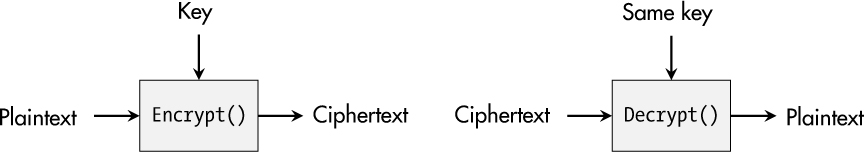

*Hình 2-1: Nguyên tắc cơ bản của cryptography đối xứng*

Thao tác giải mã `Decrypt``()` dùng *cùng secret key* để đảo ngược việc mã hóa và thu lại thông điệp gốc, do đó có thuật ngữ *symmetriccryptography*.

### *Data Encryption Standard*

Fast-forward 2,000 năm. Trong nhiều trường hợp, mã hóa đối xứng giờ được xử lý bởi các *block cipher*, nhận một khối plaintext và mã hóa nó thành một khối ciphertext. Một trong những block cipher đầu tiên được tiêu chuẩn hóa công khai là *Data Encryption Standard (DES)*, còn được biết đến là *Data Encryption Algorithm (DEA)*. Nó dựa trên một *Feistel network* so-called (cái gọi là) và chỉ có key 56-bit. Ngày nay, với phần cứng chuyên dụng, không gian key này có thể được tìm kiếm toàn bộ trong vòng vài giờ, điều khiến nó hoàn toàn không an toàn cho các ứng dụng hiện đại.

*Triple DES (3DES)* là một phần mở rộng của DES, dùng ba key 56-bit và áp dụng DES ba lần lên một plaintext hay ciphertext. Với tổng độ dài key là 168 bit, kích thước khối 64 bit và các điểm yếu cryptography đã biết, 3DES được coi là chỉ đạt security level 112-bit và không nên được dùng trong các thiết kế mới nữa.

> **CẢNH BÁO**
>
> *Một số crypto library hiện đại vẫn cung cấp DES và 3DES. Tuy nhiên, nếu bạn không có lý do rất chính đáng—ví dụ, tương thích ngược không thể thiếu—thì đừng dùng bất kỳ thuật toán DES-based nào.*

### *Advanced Encryption Standard*

Lựa chọn hàng đầu cho mã hóa đối xứng hiện nay là *Advanced Encryption Standard (AES)*, ban đầu có tên là *Rijndael*. Người kế nhiệm DES này được tiêu chuẩn hóa thành Federal Information Processing Standard (FIPS) 197 và ISO/IEC 18033-3 sau một quá trình thi tuyển cryptography do NIST tổ chức kéo dài từ 1997 đến 2000. AES dựa trên một substitution-permutation network (SPN), có độ dài khối 128 bit, và có thể được vận hành với ba độ dài key: 128-bit, 192-bit và 256-bit.

Như được thể hiện trong [Hình 2-2](#ch02fig02), AES thao tác trên một ma trận byte 4×4, được biết đến là *AES state*.

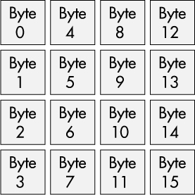

*Hình 2-2: Một hình ảnh ma trận của AES state*

Tùy thuộc vào kích thước key được chọn, state này được xử lý qua một số vòng (round) nhất định: 10 cho key 128-bit, 12 cho key 192-bit và 14 cho key 256-bit. Đây là quy trình mã hóa cơ bản dựa trên các hàm AES chính:

**Key expansion** Key gốc được mở rộng thành nhiều subkey 128-bit, một cho mỗi vòng cộng thêm một subkey ban đầu.

**Vòng ban đầu** Như một bước chuẩn bị, hàm `AddRoundKey``()` được áp dụng lên plaintext đầu vào để thu được một state mới.

**Các vòng chính** Tùy thuộc vào độ dài key, 9, 11 hay 13 vòng chính được thực hiện với các thao tác sau diễn ra liên tiếp: `SubBytes``()`, `ShiftRows``()`, `MixColumns``()` và `AddRoundKey``()`.

**Vòng cuối** Trong vòng cuối cùng, chỉ `SubBytes``()`, `ShiftRows``()` và `AddRoundKey``()` được gọi. `MixColumns``()` bị bỏ qua.

Bốn thao tác cho phép việc mã hóa mạnh này khá đơn giản. Hàm `SubBytes()` thay thế mỗi byte trong AES state bằng một byte tương ứng thu được từ một bảng tra cứu gọi là *S-box*, như được thể hiện trong [Hình 2-3](#ch02fig03).

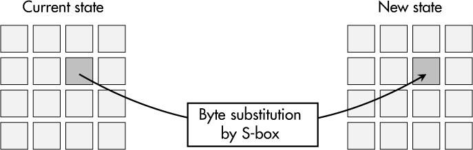

*Hình 2-3: Phép biến đổi* `SubBytes()`

[Hình 2-4](#ch02fig04) cho thấy rằng phép biến đổi `ShiftRows()` dịch hàng thứ hai của ma trận AES state sang trái 1 byte, hàng thứ ba sang trái 2 byte và hàng thứ tư sang trái 3 byte. Hàng đầu tiên giữ nguyên.

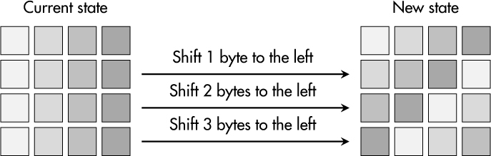

*Hình 2-4: Phép biến đổi* `ShiftRows()`

Thao tác `MixColumns()` áp dụng một phép biến đổi tuyến tính lên mỗi cột của ma trận AES state, như được minh họa trong [Hình 2-5](#ch02fig05). Điều này tạo ra 4 byte kết quả, lần lượt đại diện cho state mới của mỗi cột.

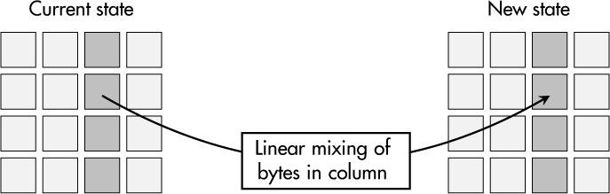

*Hình 2-5: Phép biến đổi* `MixColumns()`

Ở mỗi vòng, thao tác `AddRoundKey()` XOR mỗi byte của AES state với byte tương ứng của một round key cho trước, như được minh họa trong [Hình 2-6](#ch02fig06).

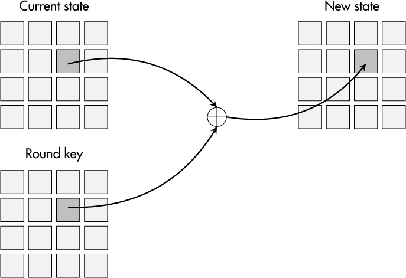

*Hình 2-6: Phép biến đổi* `AddRoundKey()`

Để giải mã, thứ tự các subkey được đảo ngược, và các hàm nghịch đảo của `SubBytes()`, `ShiftRows()`, `MixColumns()` và `AddRoundKey()` được gọi.

Sau hơn 20 năm và nhiều nghiên cứu sâu rộng, chưa ai phát hiện ra một cuộc tấn công nào vào architecture của AES có ý nghĩa thực tế. Nó có sẵn trong mọi crypto software library lớn, và các hệ thống nhỏ như microcontroller 8-bit cũng có thể dùng nó với performance hợp lý. AES được dùng để mã hóa ổ đĩa trên laptop, nhưng cũng để mã hóa payload trong giao tiếp internet an toàn. Bất cứ khi nào nói đến mã hóa đối xứng, bạn nên chọn AES trừ khi bạn có lý do nghiêm túc để không làm vậy.

## Mode of Operation

Vì AES là một block cipher, lẽ tự nhiên nó chỉ mã hóa hay giải mã một khối duy nhất, nhưng nhiều ứng dụng có nhiều dữ liệu đầu vào hơn chỉ một khối 128-bit. Do đó, AES phải được dùng trong một *mode of operation* (chế độ hoạt động) nhất định, định nghĩa các thủ tục để mã hóa và giải mã nhiều khối dữ liệu. Các mode được giới thiệu ở đây được định nghĩa trong *Special Publication 800-38A* của NIST.

### *Electronic Codebook Mode*

Một số bạn có thể thắc mắc, “Tại sao không chỉ mã hóa dữ liệu từng khối một?” Cách tiếp cận tầm thường đó chính xác là những gì *Electronic Codebook (ECB) mode* làm. Nó lấy 128 bit đầu tiên của một thông điệp làm khối plaintext đầu tiên, mã hóa nó thành 128 bit ciphertext đầu tiên, và tiếp tục theo cùng cách với bao nhiêu khối dữ liệu 128-bit còn có, như được thể hiện trong [Hình 2-7](#ch02fig07).

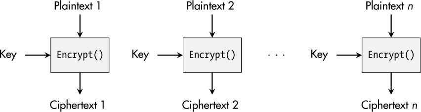

*Hình 2-7: Mã hóa trong ECB mode*

Tuy nhiên, vấn đề với cách tiếp cận này là các khối dữ liệu đầu vào bằng nhau được mã hóa thành các khối ciphertext bằng nhau. Do đó, mối quan hệ giữa các khối, vốn cũng có thể mang thông tin nhạy cảm, được bảo toàn. [Hình 2-8](#ch02fig08) minh họa hiện tượng này.

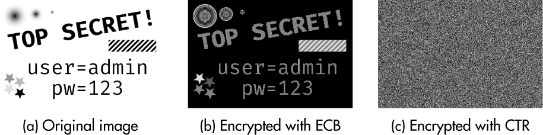

*Hình 2-8: So sánh ECB mode và Counter (CTR) mode*

Khi ảnh được mã hóa trong ECB mode, các pixel plaintext có cùng giá trị vẫn được ánh xạ thành các pixel ciphertext có giá trị giống hệt nhau. Thông tin của ảnh vẫn có thể hiểu được. Với các mode hoạt động khác, như Counter mode, mọi thứ trông khác hẳn, như được giải thích trong “Counter Mode” ở [trang 34](#ch00lev2_22).

### *Cipher Block Chaining Mode*

*Cipher Block Chaining (CBC) mode* phá vỡ mối quan hệ giữa plaintext và ciphertext bằng cách XOR ciphertext của khối thứ nhất với plaintext của khối thứ hai, và cứ thế tiếp tục. [Hình 2-9](#ch02fig09) cho thấy nguyên tắc cơ bản.

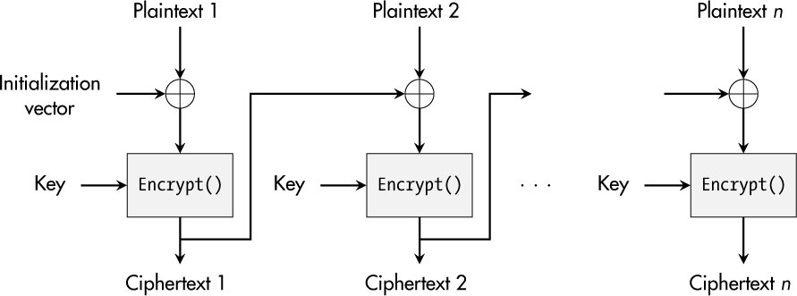

*Hình 2-9: Mã hóa trong CBC mode*

Từ góc nhìn bảo mật, CBC mode tốt hơn đáng kể so với ECB mode, nhưng nó có một nhược điểm mới: sự phụ thuộc giữa các lần mã hóa liên tiếp làm cho các hiện thực song song kém hiệu quả hơn, điều này hạn chế performance.

### *Counter Mode*

Một mode thú vị không cho phép tồn tại quan hệ giữa các ciphertext nhưng tạo điều kiện cho các hiện thực high-performance, multicore được gọi là *Counter (CTR) mode*. Như được minh họa trong [Hình 2-10](#ch02fig010), bản thân các khối plaintext không được mã hóa, mà là sự ghép nối của một *nonce (number used once)* và một giá trị bộ đếm bắt đầu từ 0.

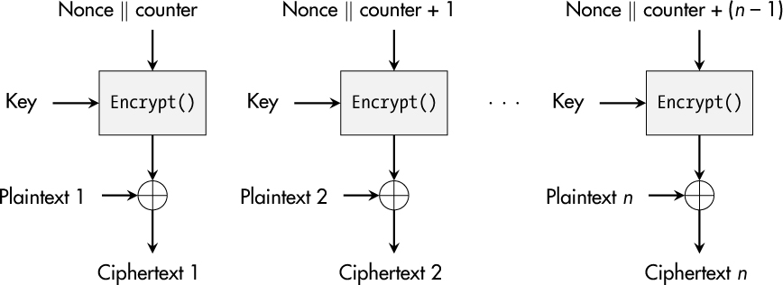

*Hình 2-10: Mã hóa trong CTR mode*

Kết quả của việc mã hóa này sau đó được XOR với plaintext để thu được ciphertext. Với mỗi khối plaintext tiếp theo, giá trị bộ đếm được tăng thêm một để tạo ra các ciphertext thay đổi, như được thể hiện trong [Hình 2-8](#ch02fig08)c. Cách tiếp cận này thậm chí còn mang lại một ưu điểm khác: cả mã hóa lẫn giải mã đều dùng hàm `Encrypt()` của block cipher được sử dụng. Không cần hiện thực `Decrypt()`.

Trái với ECB mode, CBC mode và CTR mode đòi hỏi thêm một tham số đầu vào: một *initialization vector (IV)* hay một nonce. Lý do cho cả hai là làm cho mỗi lần mã hóa là duy nhất, nên chúng không bao giờ được dùng hai lần. Hơn nữa, việc giải mã chỉ khả thi nếu bên nhận cũng có quyền truy cập vào IV hay nonce tương ứng. Nhưng vì nó không mang dữ liệu bí mật, việc truyền nó dưới dạng cleartext cùng với ciphertext là không sao.

> **CẢNH BÁO**
>
> *Trên thực tế, việc chỉ đặt IV hay nonce bằng 0 hay một số ngẫu nhiên cố định rất hấp dẫn. Tuy nhiên, làm như vậy sẽ làm suy yếu đáng kể độ mạnh của cryptographic primitive này. Hãy bỏ thêm công sức để hiện thực một bộ sinh phù hợp cho các giá trị duy nhất.*

Cùng với các mode hoạt động CBC và CTR, AES rất được ưa chuộng. Tuy nhiên, các symmetric cipher khác, thú vị hơn, có thể hữu ích nếu bạn có các yêu cầu đặc biệt. Ví dụ, các stream cipher hiện đại Salsa20 và ChaCha20, do nhà mật mã học Daniel J. Bernstein phát triển, có thiết kế đơn giản và cung cấp performance cao trong các hiện thực thuần phần mềm. Nếu phần cứng của bạn không hỗ trợ AES nhưng bạn cần đạt được performance cao nhất có thể, những thuật toán này có thể đáng để xem xét.

## Hash Function

Hash function có phần khác thường trong số các thuật toán cryptography. Tự bản thân chúng, chúng không nhắm tới một trong các protection goal cổ điển. Mục tiêu của chúng là ánh xạ dữ liệu đầu vào lớn tùy ý ở mức độ nào đó thành một chuỗi nhị phân fixed-length, gọi là *hash value* hay *digest*.

Tuy nhiên, việc thiết kế những hàm như vậy không hề tầm thường. Chúng phải đáp ứng một tập yêu cầu khắt khe:

**Preimage resistance** Thuật ngữ *preimage* chỉ dữ liệu đầu vào đúng của một hash function ánh xạ tới một hash value cho trước. Yêu cầu này nói rằng kẻ tấn công không được có khả năng tìm ra dữ liệu đầu vào phù hợp như vậy cho một hash value có sẵn. Đây là lý do tại sao hash function còn được gọi là *one-way function* (hàm một chiều). Không ai được có khả năng đảo ngược chúng.

**Second preimage resistance** Hơn nữa, một tác nhân có ý đồ xấu có quyền truy cập vào một thông điệp và hash value của nó không được có khả năng tìm ra một *second preimage*—tức là một thông điệp khác ánh xạ tới cùng hash.

**Collision resistance** Lẽ tự nhiên, các va chạm hash-value phải tồn tại vì không gian đầu vào của một hash function lớn hơn không gian đầu ra của nó. Giả định mạnh nhất đối với hash function là việc tìm ra bất kỳ hai thông điệp nào ánh xạ tới cùng một hash value phải là *bất khả thi trên thực tế*.

Theo thiết kế, hash function không dùng secret key, nghĩa là mọi người đều có thể dùng chúng và áp dụng chúng cho mọi dữ liệu trong tay. Do đó, chúng ta phải xác định security level của hash function theo cách khác. Security level được mô tả là mức độ khó khăn trong việc tìm ra va chạm, đây lại là một dạng bài toán search-space, tương tự việc tìm key đúng cho một thuật toán mã hóa.

Dựa trên *birthday paradox* và *rho method* so-called (cái gọi là), các nhà mật mã học đã chỉ ra rằng, đối với các hash function well-designed, chúng ta có thể ước lượng security level bằng một nửa kích thước đầu ra của chúng. Ví dụ, với một hash function có đầu ra 160-bit, security level ước lượng là khoảng 80-bit.

Đến đây, bạn có thể thắc mắc tại sao chúng ta cần hash function và quá trình ánh xạ cryptography của chúng cho bảo mật thiết bị. Lý do rất đơn giản: chúng là một phần của nhiều ứng dụng bảo mật như tạo và xác minh digital signature, các thuật toán key-derivation, lưu trữ mật khẩu an toàn và nhiều ứng dụng khác nữa.

Những hiện thực thực tế đầu tiên của hash function xuất hiện vào những năm 1990. MD4, MD5 và SHA-1 là ba đại diện nổi bật. Tuy nhiên, trong khoảng thời gian đó, các nhà nghiên cứu đã tìm ra cách tìm va chạm cho ba hàm này (và những hàm khác), nên bạn không nên dùng những thuật toán legacy đó trong các thiết kế hiện đại nữa.

Hiện nay, họ hash function được dùng rộng rãi nhất là SHA-2, người kế nhiệm SHA-1. Nó được mô tả trong tiêu chuẩn *FIPS 180-4* và có bốn thành viên: SHA-224, SHA-256, SHA-384 và SHA-512. Các con số biểu thị độ dài đầu ra của các hàm này, nên SHA-224 rất giống SHA-256 ngoại trừ các giá trị khởi tạo khác nhau và việc cắt ngắn hash value cuối cùng xuống 224 bit. Điều tương tự áp dụng cho SHA-384 so với SHA-512.

SHA-256 xử lý 512 bit (mười sáu word 32-bit) trong 64 vòng. Nó có security level 128-bit trước va chạm và do đó là một lựa chọn an toàn và hiệu quả. SHA-512 được dự định cho các lĩnh vực high-security như mục đích liên bang và quân sự. Nó làm việc trên 1,024 bit (mười sáu word 64-bit) trong 80 vòng và có performance thấp hơn so với SHA-256.

Vì họ SHA-2 dựa trên một architecture tương tự MD5 và SHA-1, các nhà mật mã học hoài nghi về tính bảo mật long-term của nó. Năm 2007, NIST công bố một cuộc thi cryptography để tìm một ứng viên được tiêu chuẩn hóa làm SHA-3. Một yêu cầu quan trọng là thiết kế của thuật toán phải dựa trên các primitive khác với SHA-2. Năm năm sau, thuật toán *Keccak* được chọn là hash function chiến thắng. Sau đó, nó đã được công bố thành tiêu chuẩn SHA-3 mới trong *FIPS 202*.

SHA-3 cũng có bốn phiên bản: SHA3-224, SHA3-256, SHA3-384 và SHA3-512. Một lần nữa, độ dài giá trị đầu ra tính bằng bit của chúng được biểu thị bởi các con số sau dấu gạch nối trong tên. Performance và security level của chúng tương đương với các phiên bản SHA-2 tương ứng, nhưng chúng dựa trên một nền tảng thuật toán hoàn toàn khác, đúng như ý định của NIST.

> **LƯU Ý**
>
> *Ngay cả khi SHA-3 là tiêu chuẩn mới hơn, bạn không cần sớm chuyển từ SHA-2 sang SHA-3. Chúng tương đương nhau, nên bạn được tự do quyết định dùng cái nào tùy theo các library bạn cần và các yêu cầu ứng dụng bạn có.*

## Message Authentication Code

Một quan niệm sai phổ biến về mã hóa là nó bảo vệ trước việc thao túng. Không phải vậy. Ngay cả khi bạn dùng AES và một mode of operation state-of-the-art, và kẻ tấn công không thể đọc được gì từ ciphertext thu được, kẻ tấn công đó vẫn có thể thao túng từng bit hay toàn bộ thông điệp mà không bị block cipher phát hiện. Mã hóa chỉ bảo vệ confidentiality, không bảo vệ integrity.

Một *message authentication code (MAC)*, còn được biết đến là *message integrity code (MIC)*, là một primitive khác từ bộ công cụ cryptography đối xứng, và nó được dùng để bảo vệ integrity và authenticity của thông điệp. Nó tạo ra một *authentication tag* từ một thông điệp và một secret key. Sau đó, bất kỳ ai sở hữu secret key đều có thể xác minh tính đúng đắn của một thông điệp và authentication tag tương ứng của nó.

Một phương pháp phổ biến để tạo MAC là *hash-based message authentication code (HMAC)*. Cấu trúc HMAC, còn được biết đến là *keyed hash function*, được định nghĩa trong RFC 2104. Công thức sau cho thấy thành phần của nó:

*HMAC* = *hash*((*key* ⊕ *opad*) ∥ *hash*((*key* ⊕ *ipad*) ∥ *message*))

*Inner padding (ipad)* là một chuỗi byte, `0x3636...36`, chứa cùng số byte với kích thước khối đầu vào của hash function được dùng. Nó được XOR với một key có độ dài ít nhất bằng security level của hash function nền tảng. Kết quả được ghép nối với thông điệp cần bảo vệ trước khi tất cả được hash cùng nhau. Digest của thao tác này sau đó được nối vào kết quả XOR giữa cùng key đó và *outer padding (opad)*, một chuỗi byte `0x5c5c...5c` có cùng độ dài với ipad. Hash các byte thu được dẫn đến giá trị HMAC cuối cùng.

Ví dụ, nếu SHA-256 được chọn làm hash function của một HMAC, thuật toán cryptography khi đó được gọi là HMAC-SHA-256. Độ dài của inner padding và outer padding là 512 bit, hay 64 byte. Key nên dài ít nhất 128 bit, và độ dài HMAC là 256 bit, hay 32 byte.

> **LƯU Ý**
>
> *Trên thực tế, bạn có thể gặp các cấu trúc HMAC được xây dựng dựa trên MD5 hay SHA-1. Ngay cả khi các cuộc tấn công va chạm đã được chứng minh đối với những hash function này, chúng vẫn hợp lệ để dùng cho các hiện thực HMAC thực tế vì kẻ tấn công sẽ phải thu thập một số lượng khổng lồ authentication tag được tạo ra từ cùng một secret key duy nhất để phá vỡ một instance cụ thể.*

Một *cipher-based message authentication code (CMAC)* dùng một block cipher trong CBC mode để tính MAC. Một biến thể dựa trên AES, gọi là *AES-CMAC*, được đặc tả trong RFC 4493. Ở đó, thông điệp cần bảo vệ được xử lý bằng AES trong CBC mode ngoại trừ khối thông điệp cuối cùng, vốn được xử lý đặc biệt vì lý do bảo mật. Ciphertext cuối cùng được lấy làm authentication tag, và mọi ciphertext khác bị loại bỏ.

Giải pháp này không phổ biến bằng cấu trúc HMAC, nhưng nó có thể thú vị từ góc nhìn performance, đặc biệt trên các thiết bị có bộ tăng tốc AES built-in.

## Authenticated Encryption

Đối với giao tiếp an toàn, confidentiality, integrity và authenticity là các protection goal phổ biến. Trong các phần trước, chúng ta đã xem xét cách dùng block cipher và MAC để đạt được những mục tiêu này, nhưng vẫn còn hai câu hỏi thực tế: “Chúng ta kết hợp chúng như thế nào?” và “Việc kết hợp cipher và MAC có thể hiệu quả hơn việc dùng chúng riêng rẽ không?”

### *Chiến lược và yêu cầu*

Khi kết hợp mã hóa và tạo MAC, chúng ta có thể dùng ba chiến lược. Cả ba đều giả định việc dùng các cipher và thuật toán MAC an toàn, và mỗi thứ dùng key riêng của nó, nhưng khác nhau ở thứ tự các thao tác được thực hiện:

**Encrypt-and-MAC** Cách tiếp cận này tạo ra một ciphertext và một authentication tag từ cùng plaintext một cách song song, điều có thể mang lại lợi thế về performance. Tuy nhiên, việc áp dụng một thuật toán MAC lên plaintext có thể dẫn đến rò rỉ thông tin về plaintext thông qua authentication tag vì các thuật toán MAC không được thiết kế để bảo vệ confidentiality của dữ liệu đầu vào của chúng. Tuy nhiên, với các MAC hiện đại như HMAC-SHA-256, vấn đề này không tồn tại. Vấn đề thứ hai là integrity của ciphertext không được bảo vệ. Một ciphertext bị thay đổi phải được giải mã trước để phát hiện việc thao túng, điều có thể cho phép kẻ tấn công khai thác các điểm yếu hiện thực trong routine giải mã.

**MAC-then-encrypt** Trong biến thể này, một authentication tag được tạo ra từ plaintext và được nối vào nó. Kết quả sau đó được mã hóa để thu được ciphertext cuối cùng. Trong trường hợp này, thuật toán MAC không thể làm rò rỉ bất kỳ thông tin nào, nhưng ciphertext vẫn có thể bị thao túng mà không có khả năng phát hiện trước khi giải mã.

**Encrypt-then-MAC** Đây là một chiến lược mạnh cho việc bảo vệ integrity và confidentiality của thông điệp. Trước tiên, plaintext được mã hóa, rồi MAC được tạo ra từ ciphertext thu được. Với cách tiếp cận này, authentication tag không thể làm rò rỉ bất kỳ thông tin nào về plaintext, và đồng thời, chúng ta có thể xác minh tính đúng đắn của các bit ciphertext trước khi giải mã dữ liệu đã cho.

Những người làm crypto luôn tìm kiếm các cải thiện performance vì các biện pháp bảo mật nên có overhead performance càng ít càng tốt. Do đó, không có gì ngạc nhiên khi lĩnh vực *authenticated encryption (AE)* ra đời từ sự kết hợp cipher và MAC để tăng tốc độ xử lý.

So với các cipher “thông thường,” các thuật toán AE nhận plaintext và tính cả ciphertext lẫn một authentication tag trong quá trình mã hóa. Khi giải mã, integrity của ciphertext và authentication tag được xác minh trước khi tiếp tục.

Một phần mở rộng thú vị của AE được gọi là *authenticated encryption with associated data (AEAD)*, cho phép bạn tích hợp thêm dữ liệu plaintext vào quá trình tạo authentication tag. Ví dụ là số thứ tự hay metadata không đòi hỏi confidentiality. Integrity của dữ liệu đi kèm (associated data) này đạt được đồng thời với việc gắn kết nó với ciphertext thu được.

### *Galois Counter Mode*

Ngày nay, thuật toán AEAD phổ biến nhất là cipher AES vận hành trong *Galois Counter mode (GCM)* đặc biệt, vốn tuân theo nguyên tắc encrypt-then-MAC và được đặc tả trong *Special Publication 800-38D* của NIST. [Hình 2-11](#ch02fig011) mô tả chức năng cơ bản của nó.

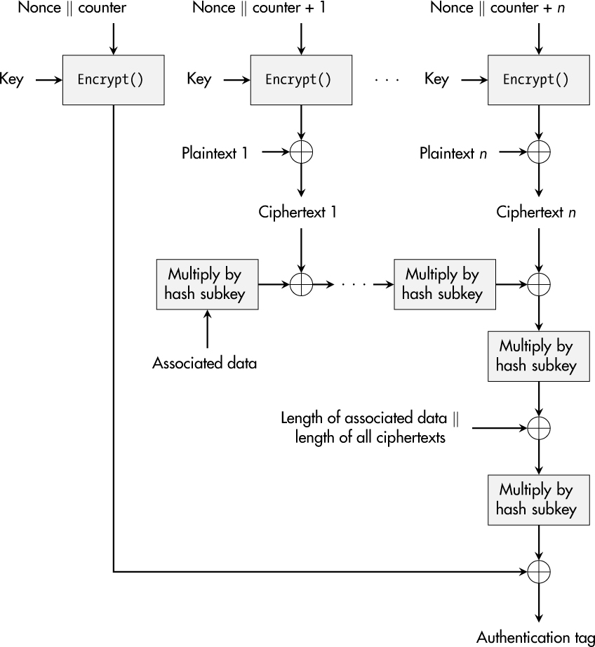

*Hình 2-11: Một authenticated encryption trong GCM*

Việc bảo vệ confidentiality rất giống CTR mode, ngoại trừ việc GCM không dùng kết quả của lần mã hóa đầu tiên để xử lý plaintext, mà dùng nó ở bước cuối cùng của việc tạo authentication-tag. Việc tạo MAC dựa trên hash function `GHASH`, về cơ bản gồm một chuỗi phép nhân trong một trường Galois nhị phân với một tham số cố định, *hash subkey*. Subkey này được dẫn xuất bằng cách mã hóa khối plaintext all-zeros bằng key AES được dùng cho việc mã hóa.

Nonce hay initialization vector của GCM được dự định là một chuỗi nhị phân 96-bit duy nhất. GCM khá mong manh đối với việc dùng lại nonce, nghĩa là kẻ tấn công có thể giả mạo authentication tag nếu họ có quyền truy cập vào hai authentication tag được tạo ra bằng cùng key và nonce. Do đó, việc hiện thực một cơ chế sinh nonce vững chắc là thiết yếu cho GCM.

Bên cạnh AES-GCM, bạn có thể gặp nhiều thuật toán AE khác trong thực tế. Ví dụ là Counter with CBC-MAC (CCM) mode như được trình bày chi tiết trong *Special Publication 800-38C* của NIST và Offset Codebook (OCB) mode do Phil Rogaway thiết kế. Sự kết hợp của stream cipher ChaCha20 và thuật toán MAC Poly1305, cả hai đều do Bernstein thiết kế, cũng là một giải pháp AEAD phổ biến. Nó đặc biệt hiệu quả trong các hiện thực software-only và đã được đặc tả trong RFC 8439.

Hơn nữa, cuộc thi CAESAR (*[https://competitions.cr.yp.to/caesar-submissions.xhtml](https://competitions.cr.yp.to/caesar-submissions.xhtml)*) diễn ra từ 2013 đến 2019 đã tạo ra thêm một tập thiết kế AEAD sáng tạo—ví dụ, các hiện thực lightweight trên các thiết bị resource-constrained hay các ứng dụng high-performance.

## Asymmetric Cryptography

Trái với việc dùng một secret key duy nhất, ý tưởng cơ bản của *asymmetric cryptography* là có một cặp key và dùng mỗi key chỉ cho một thao tác riêng biệt bổ sung cho thao tác kia. Ví dụ, mọi người dùng một key, gọi là *public key*, để mã hóa dữ liệu ([Hình 2-12](#ch02fig012)). Key thứ hai, gọi là *private key*, thuộc về một thực thể duy nhất, và chỉ thực thể đó mới có thể giải mã ciphertext đã được tạo trước đó bằng private key của mình. Các hệ mật bất đối xứng còn được biết đến là *public-key cryptography*.

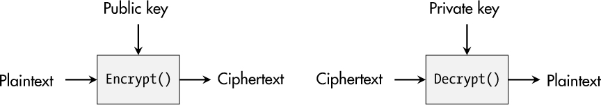

*Hình 2-12: Mã hóa bằng asymmetric cryptography*

Tuy nhiên, asymmetric cryptography không chỉ hữu ích cho việc bảo vệ confidentiality. Thao tác private-key cũng có thể tạo ra một *digital signature* (chữ ký số), là một dạng checksum cho dữ liệu cho trước mà chỉ private key duy nhất của một thực thể cụ thể mới tính được. Bất kỳ ai sở hữu public key tương ứng đều có thể xác minh chữ ký này, điều không chỉ bảo vệ authenticity của dữ liệu được bảo vệ mà còn cả integrity của nó, vì việc thao túng dữ liệu hay chữ ký sẽ dẫn đến xác minh thất bại. [Hình 2-13](#ch02fig013) minh họa ý tưởng cơ bản.

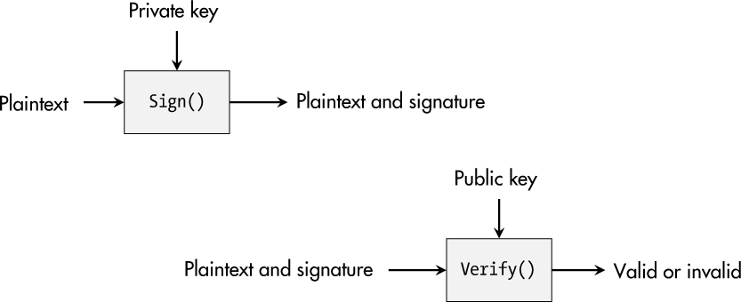

*Hình 2-13: Việc tạo và xác minh một digital signature*

Những cơ hội khác nhau về căn bản này đã mở đường cho nhiều tính năng bảo mật mà chúng ta đã coi là đương nhiên, như giao tiếp an toàn qua internet. Để hiểu những điều cơ bản về hai đại diện phổ biến nhất của asymmetric cryptography, không có cách nào tránh khỏi một chút toán học, như tôi sẽ trình bày trong phần tiếp theo.

## Hệ mật RSA (The RSA Cryptosystem)

Lược đồ crypto bất đối xứng đầu tiên và vẫn phổ biến nhất được công bố năm 1977 và được đặt theo tên các nhà phát minh: *Rivest-Shamir-Adleman (RSA)*. Để đạt được sự bất đối xứng điển hình giữa thao tác public và private, RSA hiện thực một *trapdoor function*. Với cách tiếp cận này, bạn có thể dễ dàng biến đổi dữ liệu A thành dữ liệu B, nhưng việc suy ra dữ liệu A từ dữ liệu B là bất khả thi trên thực tế trừ khi bạn biết trapdoor.

### *Toán học RSA cơ bản*

RSA dựa trên số học modulo, nghĩa là các phép tính số nguyên quay vòng lại nếu chúng đạt tới một giới hạn gọi là *modulus*. Công thức sau mô tả toàn bộ phép màu đằng sau việc mã hóa RSA:

*y* = *xe* mod *n*

*Modular exponentiation* (lũy thừa modulo) của plaintext *x* và *e*, *public exponent*, tính ra ciphertext *y*. *n* ký hiệu modulus.

Việc giải mã hoạt động theo cách rất tương tự:

*x* = *yd* mod *n*

Modular exponentiation xử lý ciphertext *y* với *d*, *private exponent*, để thu được plaintext *x*. Tuy nhiên, cách lũy thừa ngây thơ, nghĩa là thực hiện *d* – 1 phép nhân với *y*, là hoàn toàn bất khả thi khi *d* là một số có hàng nghìn bit. Bạn có thể vượt qua trở ngại này bằng một thuật toán gọi là *square-and-multiply*. Thuật toán đó về cơ bản thao tác từng bit trên biểu diễn nhị phân của số mũ. Ở mỗi bước, thuật toán thực hiện một phép bình phương, nhưng nếu một bit cho trước là 1, nó thực hiện thêm một phép nhân, làm cho RSA trở thành một cơ chế crypto dùng được trên thực tế.

Các số *n* và *e* thường được coi là một phần của public key, và *d* tương ứng với private key trong RSA. Hành vi được mô tả của chúng chỉ khả thi vì *d* và *e* có một quan hệ đặc biệt được thiết lập trong quá trình tạo key RSA. Ở bước đầu tiên, hai số nguyên tố lớn *p* và *q* phải được chọn ngẫu nhiên. Tích của chúng cho ra modulus *n* = *pq*. Dùng *n*, bạn có thể suy ra kết quả của hàm phi Euler Φ(*n*):

Φ(*n*) = (*p* – 1)(*q* – 1) = *pq* – *p* – *q* + 1 = (*n* + 1) – (*p* + *q*)

Giá trị này là thiết yếu đối với hệ mật RSA và tính bảo mật của nó vì quan hệ nghịch đảo giữa *e* và *d* đạt được trong một nhóm modulo Φ(*n*):

*ed* mod Φ(*n*) = 1

Trên thực tế, *e* = 65537 = (10000000000000001)2 là một lựa chọn phổ biến vì độ ngắn của nó và số lượng bit 1 thấp, cả hai đều góp phần vào performance cao hơn với thuật toán square-and-multiply. Sau khi *e* được chọn, bước cuối cùng của việc tạo key là tính *d* như nghịch đảo của *e* modulo Φ(*n*).

Biết những chi tiết này, có thể sẽ rõ hơn tại sao RSA thường được nhắc đến cùng câu với *integer factorization problem* (bài toán phân tích số nguyên). Cân nhắc toán học này cho rằng việc tìm các thừa số của các số lớn là khó. Modulus *n* sẽ là một tích lớn như vậy. RSA an toàn vì khó tìm ra *p* và *q* từ một *n* cho trước. Tuy nhiên, nếu ai đó tìm ra lời giải cho bài toán này, một đối thủ có thể tính Φ(*n*) từ các giá trị đã phân tích *p* và *q* và tính nghịch đảo của *e* modulo Φ(*n*), và RSA sẽ bị phá vỡ.

So với các lược đồ đối xứng, nền tảng toán học của hệ mật RSA khiến việc ước lượng security level của nó khó hơn. Trong *Special Publication 800-57* năm 2020, các chuyên gia crypto của NIST đã đánh giá các security level của RSA như được liệt kê trong [Bảng 2-1](#ch02tab01).

**Bảng 2-1:** Ước lượng bảo mật của RSA

| **Security level** | **Kích thước key** |
|---|---|
| ≤ 80-bit | 1,024-bit |
| 112-bit | 2,048-bit |
| 128-bit | 3,072-bit |
| 192-bit | 7,680-bit |
| 256-bit | 15,360-bit |

Hai thuộc tính quan trọng là hiển nhiên. Kích thước key cần thiết dài hơn nhiều so với security level đạt được. Quan hệ giữa chúng không tuyến tính, mà security level tăng chậm hơn đáng kể so với số bit key được đầu tư. Tại thời điểm viết sách, 2,048-bit là thiết lập phổ biến, nhưng để dùng long-term, key RSA 4,096-bit được khuyến nghị.

### *Việc dùng RSA trong real-world*

Tuy nhiên, cấu trúc cơ bản của RSA không hoàn toàn phù hợp cho việc mã hóa thực tế, vì kẻ tấn công sở hữu hai ciphertext có thể tạo ra một ciphertext mới là bản mã hóa đúng của tích hai plaintext gốc. Lược đồ *Optimal Asymmetric Encryption Padding (OAEP)* được phát triển để tránh điểm yếu này. Khi kết hợp với RSA, nó được gọi là *RSA-OAEP* hay *RSAES-OAEP* và được đặc tả trong *Special Publication 800-56B* của NIST.

Tóm lại, OAEP dùng một chuỗi ngẫu nhiên và hai hash function để xử lý plaintext, thường là một symmetric key, và tạo ra một phiên bản plaintext đã được padding, sau đó được dùng cho việc mã hóa RSA. Để giải mã, ciphertext được giải mã như trong RSA tiêu chuẩn, nhưng sau đó thông điệp ban đầu và giá trị ngẫu nhiên phải được khôi phục bằng cách dùng hai hash function đã đề cập trước đó. Cuối cùng, kết quả tính toán phải được xác minh về cấu trúc đúng trước khi bạn có thể dùng plaintext.

Một vấn đề tương tự cũng tồn tại đối với digital signature với các phương trình RSA cơ bản. Dựa trên một chữ ký hợp lệ cho một thông điệp được chuẩn bị đặc biệt, kẻ tấn công có thể tạo ra một chữ ký hợp lệ cho một thông điệp mà họ chọn. *Probabilistic Signature Scheme (PSS)* được định nghĩa là RSASSA-PSS (RSA Signature Scheme with Appendix) trong RFC 3447 ngăn chặn những cuộc tấn công như vậy.

PSS đưa thêm padding ngẫu nhiên vào dữ liệu đầu vào của lược đồ chữ ký—cụ thể là hash value của thông điệp cần ký. Một lần nữa, hai hash function và một cách mã hóa (encoding) được định nghĩa trước là cần thiết để tạo ra một phiên bản đã padding của hash thông điệp. Trong quá trình xác minh, các giá trị trung gian phải được khôi phục và padding phải được kiểm tra tính đúng đắn để xác nhận một chữ ký.

## Diffie-Hellman Key Exchange (trao đổi key)

Khi chỉ có cryptography đối xứng, người ta phải trao đổi key qua các *kênh an toàn* (secure channel)—trực tiếp gặp mặt, bằng thư niêm phong, hay qua một đường truyền giao tiếp đã được bảo vệ. Quá trình này khá bất tiện và có nhiều cạm bẫy thực tế.

May mắn thay, năm 1976, Whitfield Diffie và Martin Hellman đã công bố ý tưởng về cách thiết lập một *shared secret* (bí mật chung) giữa hai bên chỉ có thể giao tiếp qua một *kênh không an toàn* (insecure channel), mà ngày nay thường được biết đến là *Diffie-Hellman (DH) key exchange*. Thay vì tạo key tại một vị trí cụ thể rồi áp dụng một cơ chế *key-transport* (ví dụ, mã hóa RSA), DH tạo ra shared key bằng cách dùng một protocol *key-agreement* giữa hai thực thể.

### *Vẻ đẹp toán học*

Toán học đằng sau DH dựa trên một nhóm 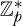, trong đó mọi phép toán được thực hiện modulo một số nguyên tố *p* và phần tử nguyên thủy được ký hiệu là *g*. [Hình 2-14](#ch02fig014) minh họa quá trình thiết lập một shared secret.

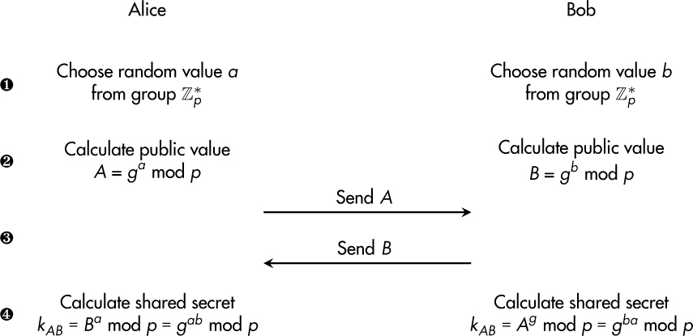

*Hình 2-14: Các bước trong một Diffie-Hellman key exchange*

Trước tiên, cả hai bên, thường được gọi là Alice và Bob, lần lượt chọn các số bí mật *a* và *b* ➊. Sau đó, họ suy ra các giá trị public tương ứng *A* và *B* ➋ và trao đổi chúng ➌. Sau đó, họ nâng giá trị public của bên kia lên lũy thừa bằng giá trị private của chính mình ➍ để thu được shared secret *kAB*.

Tính bảo mật của DH dựa trên *discrete logarithm problem (DLP)* (bài toán logarit rời rạc): khó thu được *a* từ *A* = *ga* mod *p*. Việc suy ra số private *a* từ giá trị *A* được truyền công khai rõ ràng sẽ phá vỡ tính bảo mật của protocol này. Tuy nhiên, vì điều đó là bất khả thi trên thực tế, kẻ tấn công nghe lén protocol DH không nhận được bất kỳ thông tin hữu ích nào. Security level đạt được so với kích thước key DH thực tế là giống như với RSA.

### *Tấn công Man-in-the-Middle*

Phiên bản DH cơ bản này còn được gọi là *anonymous Diffie-Hellman* vì Alice và Bob không thể xác minh định danh của nhau. Thực tế này có thể bị một đối thủ khai thác thông qua một cuộc tấn công *man-in-the-middle (MITM)*: một tác nhân có ý đồ xấu chặn bắt giao tiếp giữa các bên gốc, loại bỏ việc trao đổi các giá trị public *A* và *B* của họ, và thay vào đó thực hiện một lần chạy protocol DH với Alice và một lần với Bob. Cuối cùng, Alice và Bob nghĩ rằng việc thỏa thuận key của họ đã thành công và họ có thể giao tiếp an toàn. Tuy nhiên, giờ cả hai đều chia sẻ một key với kẻ tấn công, kẻ có thể đọc và thao túng mọi thông tin truyền giữa họ.

Giải pháp cho vấn đề này là đưa vào *authenticated Diffie-Hellman*, dựa trên giả định rằng Alice và Bob mỗi người có một cặp public-key long-term mà họ có thể dùng để chứng minh định danh của mình với nhau bằng cách trao đổi các giá trị *A* và *B* đã được ký số. Trong trường hợp này, một kẻ tấn công MITM sẽ không thể chen vào giữa mà không bị phát hiện. Trong các biến thể của cách tiếp cận này, các dữ liệu protocol khác được ký và xác minh, nhưng điều luôn thiết yếu là xác thực bên kia trước khi tính và dùng shared secret.

Một thuộc tính thứ hai của DH là bạn không nên coi các giá trị *a* và *b* là key long-term. Dùng lại chúng cho nhiều lần chạy key-agreement vi phạm yêu cầu phổ biến về *perfect forward secrecy (PFS)*. Điều này có nghĩa là các session key được thiết lập trong một lần trao đổi key vẫn phải an toàn, ngay cả khi các key long-term bị xâm phạm trong tương lai. Bạn nên coi các số private *a* và *b* là *ephemeral key* (key tạm thời) và chỉ dùng chúng một lần. Phiên bản DH tương ứng thường được gọi là *Diffie-Hellman Ephemeral (DHE)*.

Bạn có thể tìm thấy chi tiết về các biến thể Diffie-Hellman và các lược đồ key-agreement khác trong *Special Publication 800-56A* của NIST.

## Elliptic-Curve Cryptography

RSA và DH cung cấp nhiều cơ chế có ý nghĩa cho asymmetric cryptography, nhưng chúng đi kèm hai nhược điểm lớn: key dài và đòi hỏi performance đáng kể. Lĩnh vực *elliptic-curve cryptography (ECC)*, được thành lập năm 1985, hứa hẹn cung cấp asymmetric cryptography với các nhược điểm giảm đi đáng kể.

Tuy nhiên, khoảng 20 năm đã trôi qua trước khi nó được dùng rộng rãi trên thực tế. Toán học đằng sau ECC khá phức tạp so với RSA và DH, và việc áp dụng ECC bị cản trở bởi công ty Certicom, công ty nắm giữ một loạt bằng sáng chế phải được cấp phép trong trường hợp dùng ECC. May mắn thay, hầu hết các bằng sáng chế đó giờ đã hết hạn.

### *Toán học đằng sau các đường cong*

Tóm lại, *elliptic curve* (đường cong elliptic) được coi là một nhóm các điểm có x- and y-coordinates (tọa độ x và y)—ví dụ, được ký hiệu là *P*(*x*, *y*). Các giá trị *x* và *y* là các số nguyên của một nhóm modulo một số nguyên tố *p*, thường được ký hiệu là *GF*(*p*), một *Galois field*. Phương trình của một elliptic curve mô tả mọi điểm thuộc về nó.

Trong cryptography, chỉ có một vài phương trình đường cong có ý nghĩa thực tế. Phương trình sau được dùng cho các *Weierstrass curve* như P-256 do NIST tiêu chuẩn hóa và có các tham số *a* và *b*:

*x*2 = *x*3 + *ax* + *b*

*Montgomery curve* dùng các tham số *A* và *B*, và chúng đặc biệt được biết đến nhờ thành viên nổi bật Curve25519. Phương trình sau mô tả chúng:

*By*2 = *x*3 + *Ax*2 + *x*

*Edwards curve*, với tham số *d* của chúng, là một loại đường cong thú vị khác, và Ed448-Goldilocks dựa trên nó. Đây là phương trình tổng quát cho những đường cong này:

*x*2 + *y*2 = 1 + *dx*2*y*2

Bạn có thể xử lý các điểm trên elliptic curve theo ba cách:

**Point addition** (cộng điểm) Cộng hai điểm *P* và *Q* để thu được một điểm mới *R* trên cùng đường cong: *R* = *P* + *Q*.

**Point doubling** (nhân đôi điểm) Nhân một điểm cho trước *P* với 2 để thu được một điểm mới *R*: *R* = 2*P*.

**Scalar multiplication** (nhân vô hướng) Lấy một điểm *P* và nhân nó với một số nguyên (vô hướng) *k* để thu được một điểm mới *R* trên đường cong: *R* = *kP*.

Scalar multiplication trong ECC tương tự modular exponentiation đối với RSA. Ngoài ra, cách tiếp cận ngây thơ đối với scalar multiplication, nghĩa là cộng một điểm *k* – 1 lần, là bất khả thi khi *k* là một số lớn có hàng trăm bit. Do đó, một thuật toán tương tự square-and-multiply, cụ thể là *double-and-add*, phải được dùng để tính nó một cách hiệu quả. Nói đơn giản, *k* được xử lý từng bit, và với mỗi vị trí bit, một point doubling được thực hiện. Nếu một bit là 1, một point addition bổ sung được thực thi. Tất cả những điều này cho phép dùng các crypto primitive ECC trên thực tế.

Elliptic curve được thiết kế theo cách sao cho *elliptic-curve discrete logarithm problem (ECDLP)* là khó. Cái tên gợi ý rằng nó tương tự DLP là nền tảng của DH, và đúng là vậy. Tuy nhiên, trong thế giới ECC, bạn có thể mô tả bài toán là tìm vô hướng *k* khi cho trước các điểm *P* và *R* = *kP*. [Bảng 2-2](#ch02tab02), được rút ra từ *Special Publication 800-57* năm 2022 của NIST, cho thấy sự khác biệt nổi bật của ECDLP so với các bài toán nền tảng của RSA và DH.

**Bảng 2-2:** Ước lượng bảo mật của ECC

| **Security level** | **Kích thước key** | **Kích thước key của RSA/DH (để so sánh)** |
|---|---|---|
| ≤ 80-bit | 160-bit | 1,024-bit |
| 112-bit | 224-bit | 2,048-bit |
| 128-bit | 256-bit | 3,072-bit |
| 192-bit | 384-bit | 7,680-bit |
| 256-bit | 512-bit | 15,360-bit |

ECC đạt được cùng security level với kích thước key nhỏ hơn nhiều. Ngoài ra, khi độ dài key tăng, security level tương ứng tăng *tuyến tính*, nên việc nhân đôi kích thước đường cong từ 256-bit lên 512-bit cũng dẫn đến gấp đôi security level.

### *Nỗi khổ của sự lựa chọn*

Trái với nhiều thuật toán cryptography khác, ECC đòi hỏi người hiện thực phải chọn không chỉ một kích thước key mà còn một elliptic curve cụ thể để sử dụng. Các đường cong “an toàn” phải đáp ứng một số yêu cầu toán học nhất định, đó là lý do tại sao hợp lý khi chọn một đường cong từ các lựa chọn phổ biến, đã được tiêu chuẩn hóa và trải qua phân tích nghiêm ngặt.

Mặt khác, một tiêu chí mà bạn có thể xem xét trong quá trình lựa chọn là nguồn gốc của các tham số đường cong. Mặc dù National Security Agency (NSA) của Mỹ đã tạo ra đường cong số nguyên tố P-256, và NIST đã tiêu chuẩn hóa nó vào năm 2000, nó là một trong những đường cong phổ biến nhất trên thực tế. Tham số *b* của nó là một số 256-bit, và chỉ NSA biết nó được chọn như thế nào và tại sao. Điều tương tự cũng đúng với các đường cong NIST khác: P-192, P-224, P-384 và P-521. Đây có thể không phải là một vấn đề trọng yếu, nhưng có thể là một vấn đề đáng quan tâm, đối với các thiết bị hoạt động trong hạ tầng trọng yếu.

Curve25519 hiện là elliptic curve phổ biến nhất và đáng tin cậy nhất. Nó được Bernstein đề xuất năm 2006 và nổi bật nhờ hai thuộc tính. Thứ nhất, nó tập trung mạnh vào performance cao trong các hiện thực phần mềm. Thứ hai, nó không dựa vào các tham số đường cong được chọn ngẫu nhiên hay mờ ám. Trong tương lai, các Edwards curve như Ed448-Goldilocks và Curve41417 cũng có thể được quan tâm vì chúng cung cấp security level trên 200-bit.

### *Các ứng dụng thực tế của ECC*

Một trong những ứng dụng phổ biến nhất của ECC là digital signature dựa trên *Elliptic-Curve Digital Signature Algorithm (ECDSA)* như được định nghĩa trong *FIPS 186-5*. Thiết lập cơ bản cho use case này là hai bên đã thống nhất về một đường cong cụ thể và các tham số của nó. Thực thể ký giữ private key *d*, một số nguyên bí mật, và bên xác minh có quyền truy cập vào public key tương ứng *P* = *dG*, trong đó *G* là điểm cơ sở của đường cong được chọn.

Để tạo chữ ký, người ký hash thông điệp, chọn một ephemeral key ngẫu nhiên, và xử lý cả hai cùng nhau để thu được một chữ ký duy nhất gồm hai giá trị có tổng kích thước gấp đôi bậc của đường cong—ví dụ, 512 bit, hay 64 byte, cho một đường cong 256-bit. (Chi tiết của quá trình xác minh khá phức tạp và nằm ngoài phạm vi của cuốn sách này.)

Nói chung, chữ ký ECDSA được ưa chuộng hơn chữ ký RSA vì lý do performance và bảo mật, ngoại trừ một trường hợp duy nhất: nếu việc xác minh chữ ký có độ ưu tiên cao nhất, và việc tạo chữ ký chỉ hiếm khi xảy ra—ví dụ, khi ký một firmware image một lần trong quá trình phát triển—và việc xác minh là time-critical vì nó diễn ra trong quá trình boot của thiết bị.

Bên cạnh digital signature, ECC là một phần vốn có của các lược đồ key-exchange và key-agreement hiện đại như được mô tả trong *Special Publication 800-56A* của NIST. Chúng còn được biết đến là *Elliptic-Curve Diffie-Hellman (ECDH)* và *Elliptic-Curve Diffie-Hellman Ephemeral (ECDHE)*. Ở đó, modular exponentiation của DH được thay bằng một scalar multiplication dựa trên một elliptic curve. Phần còn lại khá giống DH. Một lần nữa, điều này dẫn đến một cải thiện performance đáng kể so với DH cổ điển, điều đặc biệt thú vị khi bạn cần thực hiện một số lượng lớn handshake key-agreement thường xuyên, như một server xử lý rất nhiều kết nối.

Cuối cùng nhưng không kém phần quan trọng, bạn có thể dùng ECC cho mã hóa public-key, nhưng nó hiếm khi được dùng trên thực tế. *Elliptic-Curve Integrated Encryption Scheme (ECIES)* được dành cho chính mục đích đó. Tóm lại, nó dùng public key của người nhận để tạo ra một ECDH secret chung và dẫn xuất một symmetric key từ đó. Key này sau đó được dùng để mã hóa một thông điệp bằng một cipher AE, tạo ra một ciphertext và một authentication tag.

## Tóm tắt

Chương này bắt đầu với các nền tảng crypto như nguyên tắc Kerckhoffs rằng một cryptographic key nên là bí mật duy nhất trong một hệ mật, tiếp theo là thảo luận rằng security level chỉ đơn thuần là mô tả không gian tìm kiếm tiềm năng mà kẻ tấn công phải đối mặt.

Tôi đã trình bày chi tiết lĩnh vực mã hóa đối xứng dựa trên thuật toán AES phổ biến và các mode hoạt động thông dụng vì nó có mặt ở khắp nơi trong bảo mật. Các hash function như SHA-256, các thuật toán MAC integrity-protecting và các lược đồ AE hiệu quả như AES-GCM hoàn thiện tool-box hiện đại của cryptography đối xứng.

Sự ra đời của asymmetric cryptography dựa trên RSA và DH đã mở ra những khả năng tuyệt vời để bảo vệ giao tiếp và thiết bị: mã hóa public-key, digital signature và thỏa thuận key an toàn qua các kênh không an toàn. Hơn nữa, lĩnh vực ECC đã nâng cao đáng kể performance của các cơ chế này.

*Post-quantum cryptography* nằm ngoài phạm vi của cuốn sách này, nhưng nó có thể là một chủ đề sẽ thách thức các lược đồ crypto bất đối xứng hiện có trong tương lai, và nó sẽ là tất yếu nếu một máy tính lượng tử vạn năng được chế tạo. Quá trình tiêu chuẩn hóa post-quantum cryptography của NIST (*[https://csrc.nist.gov/projects/post-quantum-cryptography](https://csrc.nist.gov/projects/post-quantum-cryptography)*) vẫn đang diễn ra nhưng đáng để theo dõi.

Nếu bạn quan tâm đến việc tìm hiểu thêm về cách hoạt động bên trong của cryptography, *Serious Cryptography* của Jean-Philippe Aumasson (No Starch Press, 2017; second edition sắp ra mắt) và *Understanding Cryptography* của Christof Paar và Jan Pelzl (Springer, 2009) là những tài nguyên tốt.
