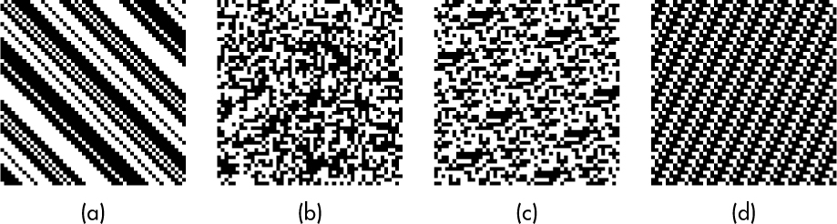
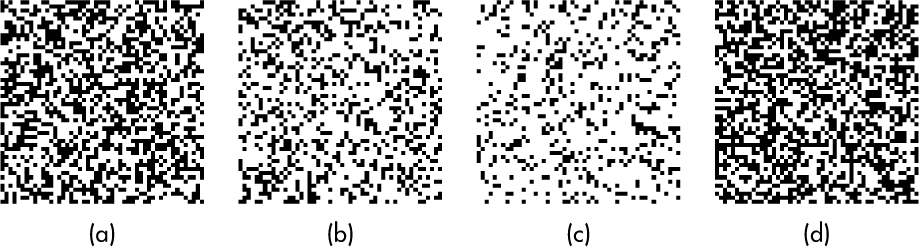
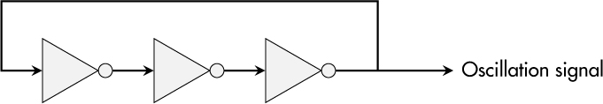
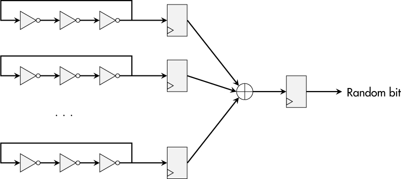
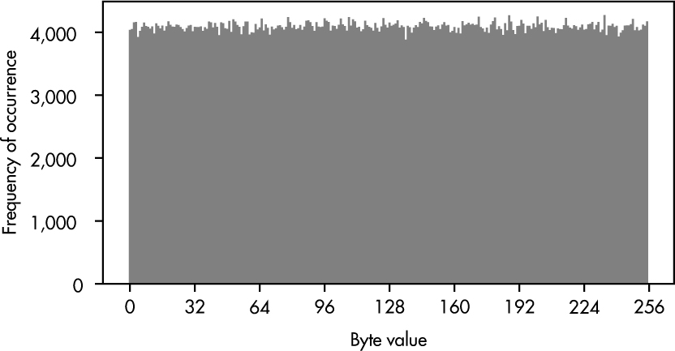
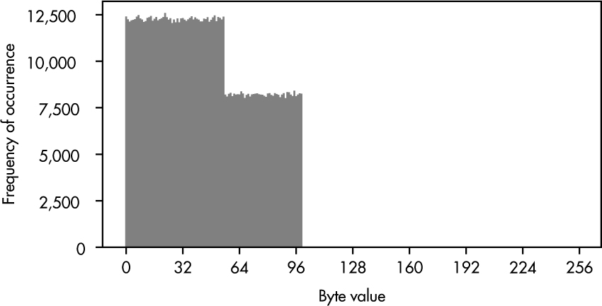
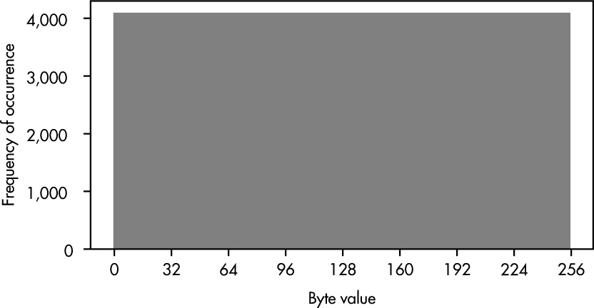

<a id="ch03"></a>

# <a id="page_51"></a>3 RANDOM NUMBER GENERATOR

Tính ngẫu nhiên là đối trọng tự nhiên của tính tất định. Trong khi chúng ta muốn hầu hết các chức năng của thiết bị tuân theo tính tất định, các *random number generator (RNG)* (bộ sinh số ngẫu nhiên) được dùng để tạo ra tính ngẫu nhiên. Nhưng liệu có thể tạo ra số ngẫu nhiên bên trong một mạch tích hợp (IC) không? Và nếu có, liệu chúng ta có thể mô tả tính ngẫu nhiên “tốt” bằng các yêu cầu thực tế không?

Một số người lập luận rằng tính ngẫu nhiên thực sự chỉ có trong các quá trình quantum-mechanical (và họ có thể đúng), nhưng các thí nghiệm lượng tử thường khó thực hiện bên trong một chip complementary metal–oxide semiconductor (CMOS) tiêu chuẩn. Mặt khác, nhiều ứng dụng bảo mật tuyệt đối đòi hỏi một nguồn số ngẫu nhiên để đạt được mức bảo vệ dự định của chúng.

Chương này bắt đầu với các ứng dụng đòi hỏi tính ngẫu nhiên để được coi là an toàn. Nó giới thiệu một cách phổ biến để tạo ra tính ngẫu nhiên bên trong một vi mạch và ý tưởng đằng sau *true randomness* (tính ngẫu nhiên thực sự). Ngoài ra, tôi giải thích khái niệm *pseudorandomness* (giả ngẫu nhiên) và tại sao nó cần thiết cho các kịch bản thực tế. Cuối cùng, tôi cung cấp ba công cụ đơn giản bạn có thể dùng để đánh giá các tập số ngẫu nhiên nhằm tìm ra các lỗi triển khai khả dĩ.

<a id="ch00lev1_27"></a>

## <a id="page_52"></a>Nhu cầu về tính ngẫu nhiên

Nhiều khái niệm bảo mật dựa vào tính ngẫu nhiên. Ví dụ, khi các bí mật như mật khẩu, cryptographic key hay token duy nhất được tạo ra, chúng đóng vai trò dữ liệu bí mật chỉ có sẵn cho một thực thể cụ thể. Lẽ tự nhiên, kết quả của quá trình tạo này phải hoàn toàn không thể dự đoán. Nếu không, không gian tìm kiếm cho bí mật đó sẽ bị thu hẹp, làm giảm security level và khiến các cuộc tấn công hiệu quả hơn, như đã thảo luận trong [Chương 2](ch02_cryptography.vi.md#ch02).

*Challenge-response authentication*, một phần của nhiều security protocol phổ biến, là use case thứ hai mà tính ngẫu nhiên là thiết yếu. Với loại xác thực này, một bên xác minh gửi một challenge ngẫu nhiên, không thể đoán trước tới thực thể tuyên bố một định danh cho trước để khởi động quá trình xác thực. Giá trị ngẫu nhiên này sau đó phải được xử lý cùng một bí mật duy nhất để chứng minh định danh đã tuyên bố. Tuy nhiên, nếu challenge có thể được biết trước hay có khả năng lặp lại, kẻ tấn công sẽ có thể chuẩn bị cho tình huống này và có được response kỳ vọng bằng các cách khác.

Vì secret key và giao tiếp an toàn là thiết yếu đối với nhiều thiết bị IoT, nhu cầu về RNG bên trong những thiết bị này khá hiển nhiên. Tuy nhiên, trong hầu hết các trường hợp, một giải pháp phần mềm không thể đáp ứng nhu cầu này, nên nó phải được tích hợp trong phần cứng, thường là processor chính của thiết bị hay một chip bảo mật chuyên dụng. Do đó, một yêu cầu về RNG nên là một phần của mọi quy trình processor-purchasing khi hướng tới bảo mật thiết bị.

> **LƯU Ý**
>
> *Trên thực tế, một số software library, như Mbed TLS, đòi hỏi tường minh bạn phải định nghĩa một nguồn ngẫu nhiên để dùng cho các thao tác bảo mật. Chúng sẽ không hoạt động nếu thiếu nó.*

<a id="ch00lev1_28"></a>

## Bản chất của tính ngẫu nhiên

Mặc dù tính ngẫu nhiên là một điều tự nhiên, nó khá khó mô tả. Một giải thích đơn giản là tính ngẫu nhiên thu được từ một thí nghiệm mà kết quả không thể được dự đoán trước khi nó được thực hiện, như tung đồng xu. Ngay cả khi thí nghiệm đó đã được thực hiện một triệu lần, chúng ta sẽ không tìm thấy bất kỳ mô thức hay sự lặp lại đặc trưng nào trong kết quả, và không thể rút ra bất kỳ sự chắc chắn nào về đầu ra ngoài việc đoán thuần túy.

Thước đo cho sự không chắc chắn và không thể dự đoán này được gọi là *entropy*. Nó cũng được dùng trong các ngành khác như vật lý hay lý thuyết thông tin để mô tả lượng hỗn loạn hay thông tin chứa trong một hệ thống hay dữ liệu. Trong ngữ cảnh RNG, entropy mô tả số bit có thể được coi là ngẫu nhiên *thực sự*. Một RNG tồi có thể chỉ tạo ra 2.4 bit entropy trên mỗi byte, nghĩa là hơn 5 bit thông tin về một byte đầu ra RNG đơn lẻ có thể được đoán với độ chắc chắn cao.

Đến đây, có lẽ đã rõ rằng chúng ta mong muốn 8 bit entropy trên mỗi byte cho một RNG high-quality. Tuy nhiên, bản thân entropy hay sự thiếu vắng của nó khó đo lường, nên các chuyên gia RNG dựa vào các đánh giá thống kê trên lượng bit ngẫu nhiên thu thập được, tốt nhất là lớn, để xác định các lỗi và đánh giá các tối ưu hóa thiết kế của họ. Hai trong số các yêu cầu thống kê này là tính độc lập và phân phối đều.

<a id="page_53"></a>*Tính độc lập* nghĩa là mọi thí nghiệm randomness-generating nên tách biệt khỏi các thí nghiệm đã chạy trước đó. Do đó, giá trị của các bit đầu ra không có xác suất xảy ra *có điều kiện*, nên nó không có bất kỳ quan hệ nào với các bit đầu ra đã được tạo ra trước đó. [Hình 3-1](#ch03fig01) cho thấy bốn tập dữ liệu nhị phân.

<a id="ch03fig01"></a>

*Hình 3-1: Một hình ảnh 2D của các bit ngẫu nhiên có thể chứa mô thức*

Trong [Hình 3-1a](#ch03fig01) và [3-1d](#ch03fig01), não của chúng ta sẽ ngay lập tức phát hiện ra mô thức, nghĩa là dữ liệu nhị phân lặp lại. Những hình này rõ ràng kém ngẫu nhiên hơn các hình khác. Nhìn kỹ hơn, [Hình 3-1](#ch03fig01)c có một mô thức tinh tế, trong khi [Hình 3-1](#ch03fig01)b không cho thấy bất kỳ quan hệ nào có thể phát hiện bằng mắt giữa các bit được mô tả.

Chúng ta cũng có thể phát biểu rằng yêu cầu *phân phối đều* (uniform distribution) đối với các bit ngẫu nhiên đòi hỏi xác suất của mọi ký hiệu mà một RNG có thể tạo ra phải bằng nhau. [Hình 3-2](#ch03fig02) cho thấy các bit ngẫu nhiên thu được từ bốn phân phối ký hiệu.

<a id="ch03fig02"></a>

*Hình 3-2: Một hình ảnh 2D của các bit ngẫu nhiên có thể chứa độ lệch (bias)*

Bằng mắt thường, chúng ta có thể thấy rằng [Hình 3-2b](#ch03fig02) và [3-2c](#ch03fig02) chứa nhiều ô trắng hơn ô đen. Cụ thể, 70 phần trăm diện tích là màu trắng trong [Hình 3-2](#ch03fig02)b, và 80 phần trăm là màu trắng trong [Hình 3-2](#ch03fig02)c. Phân biệt giữa [Hình 3-2a](#ch03fig02) và [3-2d](#ch03fig02) khó hơn, nhưng nhìn vào các con số, tình huống trở nên rõ ràng. [Hình 3-2](#ch03fig02)a có tỉ lệ black-white (đen trắng) là 45 trên 55, trong khi [Hình 3-2](#ch03fig02)d hoàn hảo 50-50.

<a id="ch00lev1_29"></a>

## True Random Number Generator

Nhiệm vụ chính của một *true random number generator (TRNG)*, đôi khi còn được gọi là *nondeterministic random bit generator (NRBG)*, không gì khác hơn là tạo ra tính ngẫu nhiên “thực sự.” Chúng ta có thể triển khai một *entropy source* (nguồn entropy) như <a id="page_54"></a>được mô tả trong *Special Publication 800-90B* của NIST, thực hiện các thí nghiệm (ở thang vi mô) và xuất kết quả của chúng thành các bit ngẫu nhiên để đạt được tính ngẫu nhiên thực sự. Một cách ẩn dụ, hãy tưởng tượng một người tí hon cỡ nano đang tung đồng xu đều đặn và điều khiển các transistor theo kết quả sấp hay ngửa.

Các nguồn entropy vật lý có thể là việc truyền photon qua một tấm gương semi-transparent, việc quan sát một quá trình phân rã nguyên tử phóng xạ, hay thậm chí một bức tường đèn dung nham (*[https://blog.cloudflare.com/randomness-101-lavarand-in-production](https://blog.cloudflare.com/randomness-101-lavarand-in-production)*). Tuy nhiên, tất cả những ý tưởng này đều khó triển khai trong các thiết kế CMOS, nghĩa là các nhà sản xuất chip thường dựa vào các hiệu ứng vật lý liên quan đến nhiễu nhiệt và nhiễu điện tử có sẵn trong IC.

<a id="ch00lev2_32"></a>

### *Ring Oscillator*

Một mạch phổ biến để trích xuất và tích lũy nhiễu như vậy là một *ring oscillator (RO)* (bộ dao động vòng). Nó gồm một số lẻ cổng đảo (inverter) được kết nối thành một cấu trúc ring-like. Khi power-up, các cổng đưa đầu ra của chúng về mức đảo ngược của tín hiệu đầu vào. [Hình 3-3](#ch03fig03) cho thấy một RO three-inverter.

<a id="ch03fig03"></a>

*Hình 3-3: Một mạch RO cơ bản*

Giả sử đầu vào của inverter ngoài cùng bên trái là *high*, đầu ra của nó sẽ là *low*, đầu ra của inverter thứ hai sẽ là *high*, và tín hiệu đầu ra cuối cùng lại là *low*. Đưa đầu ra cuối cùng trở lại đường đầu vào đầu tiên dẫn đến một sự không khớp, khiến mọi inverter thay đổi đầu ra của chúng tương ứng. Như bạn có lẽ đã để ý, mạch ổn định này sẽ không bao giờ đứng yên mà sẽ dao động ở một tần số nhất định.

Trong một thế giới hoàn hảo, tín hiệu đầu ra của RO sẽ hoàn toàn tất định, và tần số dao động của nó cũng vậy. Tuy nhiên, trong thực tế, hành vi phụ thuộc vào các đặc tính vật lý của bản triển khai và trạng thái vật lý mà nó đang ở. Cả hai dẫn đến *jitter* trong tín hiệu RO, điều này đến lượt nó làm cho tần số thay đổi, đôi khi cao hơn một chút, đôi khi thấp hơn một chút. Nói ngắn gọn, tín hiệu và tần số của nó chịu ảnh hưởng của nhiễu. Mặc dù chúng ta vẫn có thể dự đoán một phần hành vi của RO, một số đặc tính thực sự bắt nguồn từ tính ngẫu nhiên. Trong nhiều trường hợp, đây là bước đầu tiên hướng tới tính ngẫu nhiên “thực sự” trong vi mạch.

Vì một oscillator đơn lẻ chỉ cung cấp “một chút” entropy, nhiều oscillator thường được kết hợp để tạo ra một TRNG. [Hình 3-4](#ch03fig04) cho thấy một cách đơn giản mà các tín hiệu oscillator này có thể được lấy mẫu bởi các flip-flops, được kết hợp bằng một phép XOR, rồi được lấy mẫu lần nữa để thu được một bit ngẫu nhiên duy nhất có entropy cao.

<a id="page_55"></a><a id="ch03fig04"></a>

*Hình 3-4: Một architecture TRNG cơ bản dùng nhiều RO*

Tuy nhiên, trong các thiết bị thương mại, chúng ta khó có thể mô tả đặc tính của bất kỳ quyết định thiết kế nội bộ nào trong số này và entropy thực tế của các mạch này. Chúng ta phải tin tưởng nhà sản xuất chip. Các đoạn trước chỉ nhằm cho bạn một ý niệm về nơi tính ngẫu nhiên “thực sự” đó có thể đến từ đâu.

<a id="ch00lev2_33"></a>

### *Tình trạng hoạt động (health status) của entropy source*

Tình trạng hoạt động của entropy source *nên được cung cấp* cho người dùng TRNG vì cần thông báo cho hệ thống trong trường hợp entropy source không hoạt động. Nếu không, thiết bị có thể dựa vào các số ngẫu nhiên mà thực chất toàn là số không. Do đó, đối với các TRNG high-quality, ít nhất ba thủ tục kiểm tra giám sát chức năng đúng của entropy source của chúng:

**Startup test** Một số entropy source phải chạy thành công qua một giai đoạn khởi tạo để tạo ra các bit ngẫu nhiên high-quality. Ví dụ, đối với các mạch oscillator-based, sự dao động dự định phải khởi động và không bị kẹt trong trạng thái non-oscillating. Do đó, TRNG phải triển khai một startup test giám sát cẩn thận giai đoạn khởi động của entropy source và báo lỗi nếu nó thất bại.

**Total failure test** Các ảnh hưởng môi trường, như thay đổi nhiệt độ, điện áp nguồn, hay các cuộc tấn công có chủ đích, có thể dẫn đến việc đột ngột mất chức năng đúng của một entropy source. Total failure test theo dõi các bit đầu ra của entropy source để phát hiện những sự kiện như vậy và phát ra cảnh báo khi chúng xảy ra.

**Online test** Trong khi hai bài kiểm tra trước giám sát entropy source để phát hiện ngừng hoạt động hoàn toàn, online test liên tục quan sát phân phối của các bit ngẫu nhiên được tạo ra để xác định độ trôi (drift) và độ lệch (bias). Nếu chúng vượt quá một giới hạn nhất định, đây cũng có thể là lý do để thông báo cho OS hay một ứng dụng.

Mặc dù TRNG là cách duy nhất để tạo ra tính ngẫu nhiên “thực sự” và là không thể thiếu đối với các thiết bị an toàn, chúng cũng có những nhược điểm. Chúng dựa vào các quá trình vật lý vốn tự nhiên phụ thuộc vào hoàn cảnh môi trường <a id="page_56"></a>có thể gây ra thay đổi hành vi hay thậm chí lỗi. Ngoài ra, việc trích xuất và thu thập các bit entropy thô tốn thời gian và thường không đáp ứng được các nhu cầu high-performance. Phần tiếp theo giới thiệu các primitive thiếu tính ngẫu nhiên “thực sự” nhưng hoạt động tốt hơn nhiều.

<a id="ch00lev1_30"></a>

## Pseudorandom Number Generator

Các *pseudorandom number generator (PRNG)* là kiểu ngược lại của TRNG và còn được gọi là *deterministic random bit generator (DRBG)* vì, trái với TRNG, hành vi của chúng hoàn toàn tất định và chúng không chứa entropy source. Cả hai đặc tính đều là ưu điểm của PRNG vì chúng làm cho PRNG đáng tin cậy và bền vững trước các tác động môi trường, đồng thời cho phép các bản triển khai high-speed.

Các yêu cầu then chốt đối với thuật toán PRNG là *backtracking resistance* và *prediction resistance*. Cả hai đều giả định rằng kẻ tấn công đã có quyền truy cập vào state (đầu ra) hiện tại của một PRNG. Yêu cầu thứ nhất khi đó đòi hỏi đối thủ không thể suy ra bất kỳ giá trị state trước đó nào từ thông tin này, trong khi yêu cầu thứ hai đòi hỏi kẻ tấn công không thể dự đoán các giá trị đầu ra trong tương lai của thuật toán PRNG. Những tuyên bố này có thể nhắc bạn rằng hash function là các hàm one-way hay rằng việc mã hóa bằng block cipher không thể bị đảo ngược nếu không có key tương ứng—và bạn sẽ đúng. Những thuật toán này khá phù hợp cho nhiệm vụ đang xét.

Trong *Special Publication 800-90A*, các chuyên gia của NIST khuyến nghị ba cấu trúc PRNG. *Hash_DRBG* dùng một hash function được phê duyệt dành cho security level mong muốn để xử lý dữ liệu state ban đầu và trung gian nhằm dẫn xuất các bit đầu ra giả ngẫu nhiên và thu được các state tiếp theo. *HMAC_DRBG* và *CTR_DRBG* lần lượt dùng keyed hash function và block cipher trong Counter mode, trong đó các key tương ứng không cố định mà được cập nhật thường xuyên như một phần của các thao tác PRNG.

Có thể bạn đã nghe về các linear feedback shift register (LFSR) và PRNG Mersenne Twister và thắc mắc tại sao chúng không được khuyến nghị ở đây dù chúng rất hiệu quả. Chúng thực sự tạo ra các chuỗi *trông* ngẫu nhiên, nhưng chúng không an toàn về mặt cryptography vì architecture của chúng chỉ dựa trên các tổ hợp tuyến tính, vốn không thể cung cấp prediction resistance. Nói đơn giản, bất kỳ kẻ tấn công nào có thể quan sát một số lượng giá trị đầu ra nhất định đều có thể suy ra các giá trị tương lai.

> **LƯU Ý**
>
> *Bạn có thể tình cờ gặp* Dual_EC_DRBG*, một PRNG ban đầu được dự định là an toàn về mặt cryptography. Tuy nhiên, nó chứa một backdoor tiềm ẩn có thể đã được cố ý chèn vào. Hãy chọn các cryptographic primitive của bạn một cách cẩn thận!*

Ngoài việc lựa chọn vững chắc một thuật toán PRNG, *seeding* là một trong những phần quan trọng nhất của việc dùng PRNG. Với seeding, một PRNG được khởi tạo bằng dữ liệu có đủ entropy để đáp ứng mục tiêu bảo mật mong muốn. Ví dụ, nếu yêu cầu security level 128-bit, PRNG phải <a id="page_57"></a>được seed bằng một chuỗi bit có ít nhất 128 bit entropy. Ngoài ra, thông tin này phải được coi là bí mật và không bao giờ được tiết lộ cho kẻ tấn công.

Tùy chọn, chúng ta có thể triển khai việc *reseeding* thường xuyên, nghĩa là entropy pool của một instance PRNG được cập nhật bằng entropy “mới.” Hơn nữa, chúng ta có thể cá nhân hóa việc khởi tạo PRNG bằng cách thêm một giá trị duy nhất như số serial của thiết bị, một nonce hay một timestamp. Tuy nhiên, hãy cẩn thận, vì dữ liệu bổ sung này luôn được coi là *hoàn toàn không có entropy*, vì nó có thể được công khai mà không làm tổn hại bảo mật.

<a id="ch00lev1_31"></a>

## Các cấu trúc RNG thực tế và cách sử dụng

Sau khi đọc chương trước, có lẽ bạn đã đoán được rằng bạn có thể đạt được giải pháp RNG tốt nhất cho các thiết bị an toàn bằng cách kết hợp TRNG và PRNG. TRNG trích xuất entropy liên tục (và chậm), entropy này được dùng để seed và sau đó reseed một PRNG cung cấp một cách đáng tin cậy lượng bit ngẫu nhiên gần như tùy ý cho OS và ứng dụng.

Nếu thiết bị của bạn chạy một OS, có khả năng các developer OS đã lo những phần khó. Nhưng ngay cả khi vậy, kiến trúc sư và developer vẫn cần ghi nhớ các chủ đề sau.

<a id="ch00lev2_34"></a>

### *Lựa chọn RNG*

Ngay cả khi một OS cung cấp một RNG mạnh, không phải mọi framework và ngôn ngữ lập trình đều dùng nó mặc định. Thông thường, nó phải được chọn tường minh hay API tương ứng phải được dùng trong code của bạn. Nếu không, bạn dựa vào các PRNG non-cryptographic có thể phá vỡ bảo mật thiết bị.

<a id="ch00lev2_35"></a>

### *Xử lý lỗi*

Như đã đề cập trước đó, TRNG có thể thất bại. Ngoài ra, các RNG OS-provided có thể trả về lỗi, nên hãy bảo đảm xem xét nghiêm túc các giá trị trả về này và xử lý chúng tương ứng. Điều cuối cùng bạn muốn là một thiết bị làm việc với dữ liệu được cho là ngẫu nhiên mà thực tế không chứa gì ngoài số không mà không ai để ý.

<a id="ch00lev2_36"></a>

### *Entropy boot-time*

Một số thủ tục diễn ra trong quá trình boot hay ngay sau đó, như việc tạo key Secure Shell (SSH) ở lần khởi động thiết bị đầu tiên. Tuy nhiên, tại boot time, thiết bị có thể chưa thu thập được nhiều entropy, hay có thể không có chút nào. Đến lượt nó, điều này có thể dẫn đến các secret key giống hệt hay ít nhất tương tự nhau trên nhiều thiết bị, điều tuyệt đối không mong muốn. Hãy nhớ rằng các quá trình key-generation trọng yếu cần chờ cho đến khi có một lượng entropy xác định.

<a id="ch00lev1_32"></a>

## <a id="page_58"></a>Case Study: Số ngẫu nhiên từ phần cứng đến Python

Trong case study này, tôi phân tích các tính năng RNG phần cứng của một thiết bị STM32MP157F, giải thích cách RNG của Linux hoạt động, và chỉ ra tại sao bạn vẫn phải cẩn thận để dùng đúng RNG trong Python.

<a id="ch00lev2_37"></a>

### *RNG phần cứng và entropy source*

Xem *Reference Manual RM0436* của ST cho các thiết bị STM32MP157F, có rất nhiều thông tin về RNG được tích hợp. Ở đầu phần tương ứng, ST viết rằng RNG được triển khai có thể được dùng làm cơ sở cho một cấu trúc DRBG NIST-compliant và rằng nó đã được kiểm thử thành công với bộ test AIS-32 của Văn phòng Liên bang Đức về An ninh Thông tin (BSI).

> **CẢNH BÁO**
>
> *Hãy cẩn thận, vì bản thân RNG được triển khai không tương đương với một NIST DRBG. Một phần sau của reference manual nói rằng một PRNG được phê duyệt phải được thêm vào bên trên TRNG này nếu cần một DRBG NIST-compliant với security level 128-bit.*

Nhìn kỹ hơn vào manual, bạn sẽ đọc thấy rằng TRNG được triển khai dùng hai nguồn nhiễu analog, và mỗi nguồn chứa ba RO free-running được XOR để trộn đầu ra của chúng. Kết quả XOR sau đó được lấy mẫu bởi một tín hiệu clock chuyên dụng và được hậu xử lý để loại bỏ độ lệch khả dĩ của các bit thô. Hơn nữa, một giai đoạn conditioning “tăng tốc độ entropy,” nhưng quá trình đó không được mô tả chi tiết hơn. Đầu ra cuối cùng chứa 128 bit dữ liệu ngẫu nhiên được cung cấp cho Advanced High-performance Bus (AHB) 32-bit qua một buffer first-in, first-out (FIFO).

Về việc giám sát liên tục các nguồn nhiễu, ST đã triển khai một repetition count test. Ví dụ, một lỗi được báo nếu một nguồn nhiễu xuất ra hơn 64 bit có cùng giá trị hay 32 lần lặp lại cùng một mẫu 2-bit. Một status register có thể truy cập qua AHB cho thấy các lỗi đã xảy ra.

Tin tốt ở điểm này là vi mạch được chọn cung cấp một RNG phần cứng. Như thường lệ, việc đánh giá chất lượng của module này đối với người dùng là khó, nhưng nếu chúng ta tin tưởng một nhà sản xuất và năng lực bảo mật của họ, RNG phần cứng này có thể là một asset có giá trị.

<a id="ch00lev2_38"></a>

### *Tích hợp RNG phần cứng trong Linux*

Trong Linux, một RNG phần cứng có thể được tích hợp bởi framework `hw_random`, gồm một driver hardware-specific và một kernel interface chung tạo ra thiết bị */dev/hwrng* tương ứng. Nếu `CONFIG_HW_RANDOM` được bật trong cấu hình Linux kernel và driver vendor-provided hoạt động đúng, bạn có thể kiểm tra tính khả dụng và lựa chọn RNG phần cứng của mình, như được thể hiện cho thiết bị STM32MP157F của tôi trong [Listing 3-1](#ch03list01).

<a id="page_59"></a>

```
# cat /sys/class/misc/hw_random/rng_available
optee-rng
# cat /sys/class/misc/hw_random/rng_current
optee-rng
```

<a id="ch03list01"></a>

*Listing 3-1: Kiểm tra tính khả dụng của RNG phần cứng*

Hơn nữa, nếu `rng-tools` được cài đặt trên hệ thống Linux của bạn, bạn có thể chạy các bài kiểm tra thống kê trên RNG phần cứng được tích hợp như được thể hiện trong [Listing 3-2](#ch03list02).

```
# rngtest -c 1000 < /dev/hwrng
rngtest 6.15
...
rngtest: starting FIPS tests...
rngtest: bits received from input: 20000032
rngtest: FIPS 140-2 successes: 999
rngtest: FIPS 140-2 failures: 1
rngtest: FIPS 140-2(2001-10-10) Monobit: 0
rngtest: FIPS 140-2(2001-10-10) Poker: 0
rngtest: FIPS 140-2(2001-10-10) Runs: 0
rngtest: FIPS 140-2(2001-10-10) Long run: 1
rngtest: FIPS 140-2(2001-10-10) Continuous run: 0
rngtest: input channel speed: (min=117.995; avg=137.966; max=149.035)Kibits/s
rngtest: FIPS tests speed: (min=14.638; avg=28.942; max=29.434)Mibits/s
rngtest: Program run time: 142228806 microseconds
```

<a id="ch03list02"></a>

*Listing 3-2: Chạy các bài kiểm tra thống kê trên dữ liệu từ một thiết bị RNG phần cứng*

Các bài kiểm tra này bắt nguồn từ tài liệu yêu cầu cryptography *FIPS 140-2* của NIST. Các chi tiết toán học không liên quan ở đây, và một số ít lần thất bại không có gì đáng lo. Hãy để ý rằng nguồn RNG phần cứng này cung cấp số ngẫu nhiên với tốc độ khoảng 138Kb mỗi giây.

<a id="ch00lev2_39"></a>

### *Architecture RNG của Linux*

Giống như mọi OS lớn khác, Linux có khái niệm RNG và bản triển khai PRNG riêng. Nó được giới thiệu lần đầu năm 1994 và, vào thời điểm đó, architecture của nó dựa trên các thao tác SHA-1 vì các thuật toán mã hóa mạnh nằm trong diện hạn chế xuất khẩu của Mỹ.

Tuy nhiên, kể từ phiên bản 5.17 của Linux kernel, SHA-1 đã bị loại bỏ hoàn toàn khỏi code. Các instance PRNG giờ dựa trên cipher ChaCha20, trong khi hàm nén của *entropy pool* được triển khai bằng thao tác hash-update của *BLAKE2s*, một hash function cũng dựa trên ChaCha. Phiên bản 5.18 đưa vào nhiều cải tiến bổ sung khác cho RNG của Linux (ví dụ, liên quan đến boot-time entropy).

<a id="page_60"></a>Entropy pool là một memory buffer nội bộ 256-bit thu thập dữ liệu từ một tập các nguồn nhiễu và được dùng để cấp cho instance cơ sở của một PRNG ChaCha20. Nếu có một RNG phần cứng trên nền tảng đang xét, như chúng ta đã thấy với thiết bị STM32MP157F, entropy mà nó cung cấp có thể được tích hợp vào entropy pool thông qua interface `add_hwgenerator_randomness`. Ước lượng lượng entropy của nó phụ thuộc vào giá trị chất lượng entropy được cung cấp trong code driver của nó. Với thiết bị của tôi, giá trị đó được cho là 900, nghĩa là mỗi bit RNG cung cấp một lượng entropy khoảng 900/1,024 = 0.879 bit.

Các nguồn nhiễu khác có thể đóng góp vào việc thu thập entropy. Nếu hệ thống của bạn có ổ cứng quay hay các block device tương tự, `add_disk _randomness` có thể đóng góp tích cực vào entropy pool của bạn. Tuy nhiên, vì board STM32MP157F-DK2 của tôi chạy trên thẻ microSD, cơ chế này không đóng góp gì. Hơn nữa, các lần nhấn phím và di chuyển chuột có thể được dùng để trích xuất một lượng nhiễu nhất định và làm giàu pool nội bộ thông qua `add_input_randomness`, nhưng tương tác người dùng thường hiếm trong việc sử dụng embedded system. Ngoài ra, các device driver có thể cung cấp dữ liệu ngẫu nhiên có thể có trong quá trình khởi tạo thiết bị cho `add_device_randomness` để tích hợp nó vào entropy pool. Tuy nhiên, theo mặc định nó được coi là có entropy bằng không.

Filesystem `proc` cung cấp thông tin về entropy pool đã được khởi tạo, như kích thước của nó và mức ước lượng entropy hiện tại tính bằng bit, như được thể hiện trong [Listing 3-3](#ch03list03).

```
# cat /proc/sys/kernel/random/poolsize
256
# cat /proc/sys/kernel/random/entropy_avail
256
```

<a id="ch03list03"></a>

*Listing 3-3: In thông tin entropy pool*

Hãy nhớ rằng các hệ thống Linux cũ hơn dựa trên một architecture RNG khác, vốn sẽ hiển thị kích thước pool là 4,096 bit thay vì 256 ở điểm này.

Trong cùng đường dẫn, file *bootid* cung cấp một số định danh ngẫu nhiên, duy nhất cho lần chạy hiện tại, như được minh họa trong [Listing 3-4](#ch03list04). Nó thay đổi ở lần boot tiếp theo.

```
# cat /proc/sys/kernel/random/boot_id
e67a7d3e-3825-4019-ad86-940a7c8748df
```

<a id="ch03list04"></a>

*Listing 3-4: Hiển thị số định danh boot*

Ngược lại, [Listing 3-5](#ch03list05) cho thấy việc đọc *uuid* cho ra một *universally unique identifier (UUID)* mới ở mỗi lần truy cập.

```
# cat /proc/sys/kernel/random/uuid
703a31fe-fd53-44d4-8a85-075416a107ea
# cat /proc/sys/kernel/random/uuid
10f38bb8-66a8-4951-b9b4-db89db438ba8
# cat /proc/sys/kernel/random/uuid
6abf0dd4-2d0b-421b-b04e-8f02f994149b
```

<a id="ch03list05"></a>

*Listing 3-5: Đọc UUID từ RNG của Linux*

<a id="page_61"></a>Từ user space, số ngẫu nhiên có thể được lấy theo nhiều cách:

**Đọc từ** ***/dev/random*** Hành vi của device file */dev/ random* là *blocking*. Điều đó có nghĩa là nếu PRNG ChaCha20 chưa nhận được 256 bit entropy, nó sẽ không trả về bất kỳ dữ liệu nào.

**Đọc từ** ***/dev/urandom*** Bản chất *nonblocking* của */dev/urandom* cho phép đọc số ngẫu nhiên từ thiết bị này bất kể trạng thái thu thập entropy ban đầu, khiến nó trở thành lựa chọn phổ biến của developer.

**Dùng system call** `getrandom` System call này có thể được tham số hóa để định nghĩa hành vi của nó. Với flag được đặt bằng không, nó hoạt động như */dev/random*, nhưng nếu flag được đặt là `GRND_INSECURE`, nó trả về số ngẫu nhiên giống như */dev/urandom*.

Trong kernel space, hàm `get_random_bytes` có thể được dùng để truy cập một instance PRNG và lấy số ngẫu nhiên từ nó. Hàm này không phụ thuộc vào trạng thái seeding của PRNG ChaCha20 và entropy pool.

Một one-liner đơn giản để ghi 1MB dữ liệu ngẫu nhiên vào một file được thể hiện trong [Listing 3-6](#ch03list06).

```
# dd if=/dev/urandom of=rand_file.bin bs=1M count=1 iflag=fullblock
1+0 records in
1+0 records out
1048576 bytes (1.0 MB, 1.0 MiB) copied, 0.0638873 s, 16.4 MB/s
# ls -l rand_file.bin
-rw-r--r-- 1 root root 1048576 ... rand_file.bin
```

<a id="ch03list06"></a>

*Listing 3-6: Tạo một file chứa 1,048,576 byte ngẫu nhiên*

Việc gọi `rngtest` với */dev/urandom* như được thể hiện trong [Listing 3-7](#ch03list07) minh họa thực tế ưu điểm của việc kết hợp một nguồn ngẫu nhiên phần cứng với một PRNG phần mềm đáng tin cậy.

```
# rngtest -c 1000 < /dev/urandom
rngtest 6.15
...
rngtest: starting FIPS tests...
rngtest: bits received from input: 20000032
rngtest: FIPS 140-2 successes: 999
rngtest: FIPS 140-2 failures: 1
rngtest: FIPS 140-2(2001-10-10) Monobit: 0
rngtest: FIPS 140-2(2001-10-10) Poker: 0
rngtest: FIPS 140-2(2001-10-10) Runs: 0
rngtest: FIPS 140-2(2001-10-10) Long run: 1
rngtest: FIPS 140-2(2001-10-10) Continuous run: 0
rngtest: input channel speed: (min=85.917; avg=185.867; max=190.735)Mibits/s
rngtest: FIPS tests speed: (min=12.203; avg=28.918; max=29.756)Mibits/s
rngtest: Program run time: 763735 microseconds
```

<a id="ch03list07"></a>

*Listing 3-7: Chạy các bài kiểm tra RNG trên* /dev/urandom

<a id="page_62"></a>Các thống kê vẫn ổn, nhưng tốc độ tăng lên khoảng 186Mbps. Đó là gấp hơn 1,000 lần so với RNG phần cứng thô.

<a id="ch00lev2_40"></a>

### *Số ngẫu nhiên an toàn về mặt cryptography trong Python*

Mặc dù chúng ta có một thiết bị đi kèm một RNG phần cứng đã được tích hợp đúng vào Linux, và RNG của Linux hoạt động đúng, chúng ta vẫn có thể thất bại trong việc sinh số ngẫu nhiên an toàn về mặt cryptography ở mức ứng dụng. Trong case study này, chúng ta xem xét Python, nhưng điều tương tự cũng đúng với nhiều ngôn ngữ lập trình và môi trường khác.

Các hướng dẫn Python thường nêu module `random` cho việc sinh số ngẫu nhiên. Tuy nhiên, tài liệu của nó chỉ rõ rằng đây là một PRNG dựa trên thuật toán Mersenne Twister, được dành cho, ví dụ, mục đích mô hình hóa và mô phỏng, nhưng không phù hợp cho việc dùng trong cryptography.

Để dùng RNG OS-provided (do OS cung cấp), module `os` cung cấp hàm `os.urandom()`. Tuy nhiên, cách được khuyến nghị trong Python 3.6 hay mới hơn là dùng module `secrets`, vốn được dành riêng cho việc lấy số ngẫu nhiên an toàn về mặt cryptography và chọn nguồn ngẫu nhiên an toàn nhất trên hệ thống của bạn.

[Listing 3-8](#ch03list08) cho thấy một script nhận một số lượng byte và một tên file từ các argument command line, tạo ra số byte ngẫu nhiên tương ứng bằng hàm `token_bytes()` của module `secrets`, và ghi chúng vào file đầu ra đã cho.

```
import sys
import secrets

n_bytes = int(sys.argv[1])
output_file = sys.argv[2]

print('Generating', str(n_bytes), 'random bytes ...')
random_bytes = secrets.token_bytes(n_bytes)

print('Writing random bytes to', output_file, '...')
with open(output_file, "wb") as f:
  f.write(random_bytes)
```

<a id="ch03list08"></a>

*Listing 3-8: Dùng module* `secrets` *của Python để tạo một file chứa các byte ngẫu nhiên*

Cuối cùng, case study này đã minh họa sự đa dạng của các lớp phần cứng và phần mềm cần xem xét khi sinh số ngẫu nhiên cho mục đích cryptography.

<a id="ch00lev1_33"></a>

## <a id="page_63"></a>Case Study: Các công cụ thực tế để kiểm tra nhanh tính ngẫu nhiên

Nếu bạn chịu trách nhiệm phát triển và kiểm thử một thiết kế RNG mới, bạn sẽ muốn dùng nhiều thuật toán phân tích thống kê khác nhau như được mô tả trong *Special Publication 800-22* của NIST hay được cung cấp bởi bộ Dieharder, nhưng chỉ rất ít người trên hành tinh này thực sự thiết kế RNG mới.

Tuy nhiên, nhiều người *dùng và xử lý* số ngẫu nhiên, điều có thể dẫn đến các lỗi triển khai thực tế, đặc biệt ở mức ứng dụng. Một số lỗi này có thể được tìm ra bằng cách áp dụng các công cụ tương đối đơn giản. Case study này giải thích hai cách tiếp cận như vậy và minh họa cách phát hiện các vấn đề phổ biến bằng chúng.

<a id="ch00lev2_41"></a>

### *Các công cụ đơn giản cho phân tích phân phối và nhận dạng mô thức*

Ở đầu chương này, chúng ta đã thấy rằng độ lệch (hay một phân phối không đều dưới bất kỳ dạng nào) và các mô thức lặp lại là hai dấu hiệu của số ngẫu nhiên low-quality. Phần này mô tả một phương tiện đơn giản để phân tích các đặc trưng dữ liệu cơ bản, nhưng chúng còn xa mới bằng phân tích thống kê chuyên nghiệp. Chúng phục vụ một mục đích duy nhất: có được các gợi ý rằng có điều gì đó sai trong quá trình sinh số ngẫu nhiên, nhiều khả năng nhất là ở giai đoạn cuối (tức là trong một ứng dụng).

[Listing 3-9](#ch03list09) cho thấy một script ngắn nhận một file làm argument command line, đọc nó, và vẽ một histogram cho thấy tần suất xuất hiện của mọi giá trị byte khả dĩ. Trong trường hợp hoàn hảo, histogram nên cho thấy một đường phẳng, nghĩa là mọi byte đều có khả năng xuất hiện như nhau trong file.

```
import sys
import matplotlib.pyplot as plt

file_to_analyze = sys.argv[1]

print('Reading', file_to_analyze, '...')
with open(file_to_analyze, "rb") as f:
  data = f.read()

hist_data = bytearray(data)

print('Plotting distribution of bytes ...')
fig1, ax1 = plt.subplots(figsize=(15, 5))
ax1.hist(hist_data, bins=range(256+1), align='left', color = "gray")
ax1.set_title('Distribution of Bytes')
ax1.set_xlabel('byte value')
ax1.set_xticks([0, 32, 64, 96, 128, 160, 192, 224, 256])
ax1.set_ylabel('frequency of occurrence')
plt.show()
```

<a id="ch03list09"></a>

*Listing 3-9: Một script Python để vẽ phân phối byte cho một file cho trước*

<a id="page_64"></a>Để minh họa, tôi đã tạo một file chứa 1MB dữ liệu ngẫu nhiên bằng RNG của Linux và chạy script trên nó. [Hình 3-5](#ch03fig05) cho thấy phân phối tương ứng. Nó không phải là một đường phẳng, nhưng các tần suất khá gần nhau.

<a id="ch03fig05"></a>

*Hình 3-5: Phân phối các giá trị byte từ RNG của Linux*

Phát hiện mô thức phức tạp hơn một chút so với phân tích độ lệch vì mô thức có thể thuộc nhiều loại khác nhau. Tuy nhiên, một số ứng dụng được tối ưu hóa cho chính xác nhiệm vụ đó: các công cụ nén. Những thuật toán này chạy qua dữ liệu và cố tìm các chuỗi lặp lại, xây dựng từ điển và loại bỏ dư thừa. Áp dụng cho dữ liệu ngẫu nhiên, mọi thành công trong việc nén đều có nghĩa là tập dữ liệu có thiếu hụt entropy. Mặc dù các công cụ nén không cho chúng ta biết vấn đề là gì, chúng có thể khẳng định rõ ràng rằng lượng thông tin của một file ít hơn mức kỳ vọng từ dữ liệu ngẫu nhiên.

[Listing 3-10](#ch03list010) cho thấy một script đơn giản để gọi các công cụ nén Linux phổ biến `bzip2`, `gzip` và `xz` trên một file được cho là chứa dữ liệu ngẫu nhiên.

<a id="page_65"></a>

```
import sys
import subprocess
import os

file_to_analyze = sys.argv[1]

print('Compressing', file_to_analyze, '...')
run = subprocess.run('bzip2 -k ' + file_to_analyze, shell=True)
run = subprocess.run('gzip -k ' + file_to_analyze, shell=True)
run = subprocess.run('xz -k ' + file_to_analyze, shell=True)

print('Compression test results:')
print('{:<28}'.format(file_to_analyze),          '-->',
      '{:>9}'.format(os.path.getsize(file_to_analyze)), 'bytes')
print('{:<28}'.format(file_to_analyze + '.bz2'), '-->',
      '{:>9}'.format(os.path.getsize(file_to_analyze + '.bz2')), 'bytes')

print('{:<28}'.format(file_to_analyze + '.gz'),  '-->',
      '{:>9}'.format(os.path.getsize(file_to_analyze + '.gz')), 'bytes')
print('{:<28}'.format(file_to_analyze + '.xz'),  '-->',
      '{:>9}'.format(os.path.getsize(file_to_analyze + '.xz')), 'bytes')
print('')
```

<a id="ch03list010"></a>

*Listing 3-10: Một script Python để kiểm tra dữ liệu ngẫu nhiên bằng các công cụ nén điển hình*

Một lần nữa, 1MB dữ liệu từ RNG của Linux đóng vai trò là ví dụ tích cực ở đây. Như được thể hiện trong [Listing 3-11](#ch03list011), mọi công cụ nén đều cho ra file lớn hơn file gốc. Điều này là như kỳ vọng vì nội dung không thể được nén và, đồng thời, thông tin header của định dạng nén được dùng được thêm vào các file.

```
data_urandom.rnd             -->   1048576 bytes
data_urandom.rnd.bz2         -->   1053538 bytes
data_urandom.rnd.gz          -->   1048771 bytes
data_urandom.rnd.xz          -->   1048688 bytes
```

<a id="ch03list011"></a>

*Listing 3-11: Kết quả của một bài kiểm tra nén trên RNG của Linux*

<a id="ch00lev2_42"></a>

### *Vấn đề 1: Giới hạn không gian đầu ra bằng modulo*

Trong một số trường hợp, cần giới hạn không gian đầu ra của một biến ngẫu nhiên—ví dụ, trong khoảng từ 0 đến 99—vì khoảng đó là yêu cầu của một ứng dụng cho trước. Một cách tiếp cận tầm thường để giới hạn kết quả của một phép toán số nguyên là dùng toán tử modulo. Để thu được một số nguyên từ 0 đến 99, chúng ta có thể chỉ cần tính mọi số ngẫu nhiên modulo 100.

Để kiểm tra trường hợp đó, tôi đã thêm phép toán đó vào ví dụ Python từ [Listing 3-8](#ch03list08). [Hình 3-6](#ch03fig06) cho thấy phân phối byte thu được.

<a id="ch03fig06"></a>

*Hình 3-6: Phân phối byte khi giới hạn bằng phép toán modulo*

<a id="page_66"></a>Trong khi chúng ta kỳ vọng sụt xuống 0 tại các giá trị byte 100 hay cao hơn, một sự sụt giảm xác suất kỳ lạ xảy ra tại giá trị 56. Tuy nhiên, điều đó có nghĩa là ứng dụng đang xét sẽ sinh ra các giá trị từ 0 đến 55 với *xác suất cao hơn đáng kể*. Điều này là không thể chấp nhận từ góc nhìn bảo mật.

Đối với Python, một giải pháp vững chắc là dùng hàm `randbelow()` từ module `secrets` để thu được các số ngẫu nhiên phân phối đều và an toàn về mặt cryptography trong một khoảng số nguyên nhất định.

<a id="ch00lev2_43"></a>

### *Vấn đề 2: Các thiết kế PRNG tùy chỉnh*

Đôi khi chúng ta phải dựa vào các ứng dụng là hộp đen. Chúng ta không thể đánh giá phần bên trong của phần mềm, càng không thể đánh giá chất lượng xử lý số ngẫu nhiên. Tuy nhiên, rất có thể một ứng dụng khởi tạo PRNG riêng của nó, có lẽ vì lý do performance hay để dễ dùng. Có thể nó thậm chí được seed bởi một RNG mạnh OS-provided. Tuy nhiên, nếu PRNG tùy chỉnh có thiết kế yếu, các vấn đề bảo mật có thể phát sinh.

Cho test case này, tôi cố ý triển khai một PRNG yếu. Về cơ bản nó là một bộ đếm 16-bit đã được sửa đổi, được seed bởi RNG của Linux. Nó không hợp lý lắm nhưng cũng không hoàn toàn phi thực tế; developer có thể rất sáng tạo. Như trong trường hợp đầu tiên, tôi trích xuất 1MB dữ liệu kiểm thử từ instance PRNG này và vẽ phân phối byte của nó như được thể hiện trong [Hình 3-7](#ch03fig07). Nó cho thấy một phân phối hoàn hảo. Mặc dù điều đó có thể đã đáng ngờ, nó không trực tiếp chỉ ra một điểm yếu.

<a id="ch03fig07"></a>

*Hình 3-7: Phân phối byte từ một PRNG tùy chỉnh*

<a id="page_67"></a>Tuy nhiên, sau khi áp dụng các bài kiểm tra nén đã giải thích trước đó, rõ ràng là có điều gì đó sai. [Listing 3-12](#ch03list012) cho thấy đầu ra.

```
data_custom_prng.rnd         -->   1048576 bytes
data_custom_prng.rnd.bz2     -->     86756 bytes
data_custom_prng.rnd.gz      -->    997143 bytes
data_custom_prng.rnd.xz      -->     84648 bytes
```

<a id="ch03list012"></a>

*Listing 3-12: Kết quả của một bài kiểm tra nén trên dữ liệu từ một PRNG tùy chỉnh*

Hai trong ba công cụ nén đã giảm kích thước file đi hơn 12 lần. Thay đổi này là đáng kể. Nó vẫn không cho chúng ta biết chính xác điều gì sai với ứng dụng đang xét, nhưng nó đòi hỏi một cuộc thảo luận với các developer của ứng dụng.

<a id="ch00lev1_34"></a>

## Tóm tắt

Tính ngẫu nhiên là một con quái vật khó nhằn. Tuy nhiên, sau khi đọc chương này, hẳn đã rõ rằng tính ngẫu nhiên là tuyệt đối cần thiết cho bảo mật và nó xứng đáng được xem xét cẩn thận đối với các thành phần phần cứng và phần mềm liên quan.

Tôi đã giải thích một số điều cơ bản về entropy source trong vi mạch CMOS và cách chúng tạo ra tính ngẫu nhiên “thực sự” từ nhiễu—ví dụ, nhiễu có trong các mạch dao động. Hơn nữa, tôi đã thảo luận nhu cầu về PRNG và các thuộc tính có lợi của chúng như hành vi đáng tin cậy và cung cấp dữ liệu high-speed. Cả TRNG lẫn PRNG đều liên quan và nên được triển khai kết hợp để xây dựng một RNG an toàn và đáng tin cậy cho embedded system.

Trong case study đầu tiên, tôi đã đi qua các lớp ngẫu nhiên trong một hệ thống real-world—bắt đầu từ các nguồn nhiễu vật lý được tích hợp trong các thiết bị STM32MP157F, đến việc tích hợp chúng trong Linux kernel, đến architecture phức tạp của chính RNG của Linux. Cuối cùng, tôi bổ sung rằng ngay cả ở mức ứng dụng, việc xử lý sai RNG và dữ liệu của chúng có thể dẫn đến điểm yếu. Nếu bạn quan tâm đến chi tiết của RNG Linux và sự phát triển của chúng theo thời gian, hãy tham khảo các tài liệu phân tích RNG Linux định kỳ từ BSI của Đức.

Các công cụ đơn giản và thực dụng để xác định một số vấn đề với RNG và dữ liệu đầu ra của chúng, đặc biệt trong phần mềm third-party, đã khép lại chương này trong case study thứ hai.
