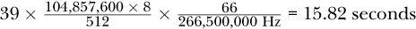

<a id="ch04"></a>

# <a id="page_69"></a>4 HIỆN THỰC CRYPTOGRAPHY (CRYPTOGRAPHIC IMPLEMENTATIONS)

Trong [Chương 2](ch02_cryptography.vi.md#ch02), tôi đã đưa ra một cái nhìn tổng quan về các thuật toán cryptography, các tham số của chúng và các use case điển hình. Tuy nhiên, một thuật toán toán học vẫn còn cách rất xa các *hiện thực* cryptography an toàn và hiệu quả.

Trong phần lớn các ứng dụng, cryptography không đóng vai trò chủ đạo. Nó giống một thứ xấu cần thiết để bảo vệ các asset của thiết bị và của doanh nghiệp hơn. Do đó, developer và product manager rất muốn có các hiện thực cryptography chạy tức thì, không chiếm memory và không tiêu thụ năng lượng. Dĩ nhiên, điều đó là không thể, nhưng nó là một điểm thảo luận quan trọng trong nhiều trường hợp. Các hiện thực kém hiệu quả thậm chí có thể dẫn đến việc loại bỏ các tính năng bảo mật, làm giảm chất lượng sản phẩm, hay ít nhất là những lời bình phẩm khó chịu từ các đồng nghiệp không tập trung vào bảo mật.

Trong chương này, tôi sẽ thảo luận các yêu cầu đối với hiện thực cryptography và các lựa chọn dành cho developer. Các phần tiếp theo giới thiệu các ví dụ về tối ưu hóa thuật toán cho crypto đối xứng và bất đối xứng. Case study cuối cùng phân tích và thảo luận các đặc tính performance của các hiện thực crypto trong phần cứng và phần mềm trên một thiết bị STM32MP157F.

<a id="ch00lev1_35"></a>

## <a id="page_70"></a>Ngữ cảnh hiện thực và yêu cầu

Developer chọn vi mạch trung tâm từ sớm trong các giai đoạn thiết kế sản phẩm và phát triển architecture vì nhiều quyết định tiếp theo phụ thuộc vào nó. Vi mạch đó có thể là một microcontroller single-core, một hệ thống multicore đồng nhất hay không đồng nhất, một field-programmable gate array (FPGA), hay thậm chí một system-on-chip (SoC) kết hợp processor, ngoại vi và có thể cả FPGA trong một package duy nhất.

Nếu một processor điển hình được chọn, nhiều tham số ảnh hưởng đến performance chung, bao gồm cả performance crypto. Những tham số này bắt đầu từ *instruction set architecture*, hay *ISA* (ví dụ, ARM, RISC-V hay MIPS), và độ rộng dữ liệu (8-bit, 16-bit, 32-bit, 64-bit hay thậm chí hơn). Số lượng core và tần số tối đa của chúng cũng có liên quan đáng kể. Riêng đối với các thao tác cryptography, điều thú vị là xem liệu có các instruction crypto chuyên dụng không, như phần mở rộng AES New Instructions (AES-NI) của Intel, hay liệu chip đang xét có đi kèm một crypto coprocessor không.

Trong các hệ thống dành cho ứng dụng công nghiệp, ô tô hay datacenter, việc cân nhắc các vi mạch có bao gồm một phần FPGA có thể là thú vị như một cách tận dụng các thuộc tính high-performance hay các bảo đảm real-time mà các thiết kế phần cứng số có thể cung cấp. Bên cạnh tần số tối đa được hỗ trợ, FPGA có các đặc tính cụ thể như số lượng lookup table, flip-flops, các khối random access memory (RAM), bộ nhân và các lựa chọn tương tự có thể đặt ra giới hạn cho các hiện thực cryptography.

Dù bạn chọn loại đơn vị xử lý nào, nó đều đòi hỏi memory bên trong và/hoặc bên ngoài. Thông thường, cả memory volatile như RAM lẫn memory nonvolatile như flash memory, thẻ nhớ hay solid-state drive (SSD) đều cần thiết. Bên cạnh kích thước của chúng, vốn chỉ ảnh hưởng đến các hiện thực cryptography trên các thiết bị rất resource-constrained, tốc độ đọc và ghi của chúng có thể ảnh hưởng đến performance tổng thể của một ứng dụng crypto.

Cuối cùng nhưng không kém phần quan trọng, tốc độ truyền của các interface có dây và không dây của thiết bị (ví dụ, Wi-Fi, Bluetooth, Ethernet và các bus độc quyền) giới hạn băng thông cho giao tiếp, bao gồm cả các kênh được bảo vệ bằng cryptography.

> **LƯU Ý**
>
> *Đôi khi trên thực tế, architecture thiết bị và phần cứng đã ít nhiều cố định khi performance cryptography được thảo luận, và bạn phải tận dụng tốt nhất những gì có. Tuy nhiên, đừng ngại đóng góp các yêu cầu performance crypto ngay từ giai đoạn sớm. Ví dụ, nếu ứng dụng dự định của bạn đòi hỏi hàng nghìn chữ ký mỗi giây, yêu cầu đó chắc chắn phải được xem xét khi lựa chọn phần cứng.*

Nhìn vấn đề này từ phía ứng dụng, bạn có thể áp đặt nhiều loại yêu cầu lên các hiện thực crypto. Trong khi *latency* mô tả thời gian xử lý một khối dữ liệu duy nhất từ đầu vào đến đầu ra, *throughput* định nghĩa lượng dữ liệu có thể được xử lý trong một khoảng thời gian cho trước.

<a id="page_71"></a>Đối với các hiện thực phần mềm trên các thiết bị resource-constrained, có thể cần giới hạn kích thước code tĩnh của binary đã biên dịch phải được lưu trong memory volatile và/hoặc nonvolatile. Hơn nữa, việc sử dụng memory động trong runtime có thể là một yếu tố liên quan. Mặt khác, các hiện thực FPGA phải khởi tạo tĩnh các thành phần số, đó là lý do tại sao, ngoài performance, hiệu quả của các thiết kế phần cứng số cho crypto thường được so sánh bằng số lượng tài nguyên FPGA bị chiếm dụng.

Vì nhiều thiết bị IoT là battery-powered và một số thậm chí dựa vào energy harvesting (thu hoạch năng lượng), mức tiêu thụ năng lượng của các hiện thực cryptography cũng có thể là một yêu cầu xác đáng.

Mọi thông tin về ngữ cảnh hiện thực của một thiết bị đều liên quan đến các quyết định crypto vững chắc và hiệu quả. Và trong một số trường hợp, có thể cần tìm ra các thỏa hiệp hợp lý giữa việc tiêu thụ tài nguyên và bảo mật.

<a id="ch00lev1_36"></a>

## Lựa chọn hiện thực crypto

Chúng ta đã thấy nhiều vấn đề hiện thực trong những thập kỷ qua dẫn đến các lỗ hổng. Nếu bạn không muốn tự mình có những trải nghiệm quý giá nhưng mệt mỏi như vậy, hãy xem xét các cryptographic library hiện có đã được tối ưu và trưởng thành như OpenSSL, LibreTLS, Mbed TLS và wolfSSL, chỉ để kể tên một vài cái trong lĩnh vực embedded system.

Tuy nhiên, vấn đề này dẫn chúng ta đến một câu hỏi mà nhiều developer gặp phải trong quá trình phát triển: Làm thế nào bạn chọn một crypto library cụ thể cho một thiết bị hay một ứng dụng? Quyết định phụ thuộc phần lớn vào các yêu cầu cụ thể của bạn, nếu đã được nêu tường minh, và các framework cũng như ngôn ngữ lập trình bạn làm việc cùng. Danh sách sau mô tả bốn tình huống điển hình:

**Tự do lựa chọn** Đôi khi chỉ có mục tiêu bảo vệ dự định được quy định—ví dụ, giao tiếp phải được bảo vệ bằng authenticated encryption, không có thêm chi tiết. Đây có thể là trường hợp của một tính năng company-internal không có phụ thuộc bên ngoài. Trong những tình huống như vậy, nhiều thuật toán cryptography có thể được cân nhắc. Ví dụ, cả AES-GCM lẫn ChaCha20-Poly1305 đều có thể là lựa chọn phù hợp. Đánh giá performance trên thiết bị đích là hợp lý trong kịch bản này. Hãy kiểm thử cả hai thuật toán với một tập tham số và nhiều crypto library khác nhau để thu được một giải pháp hiệu quả nhất có thể.

**Yêu cầu performance khắt khe** Trong một số trường hợp, cryptography là thiết yếu và phải đáp ứng các đòi hỏi cao về performance—ví dụ, nếu một ứng dụng đòi hỏi hàng nghìn digital signature mỗi giây. Vì ECDSA nhanh hơn RSA trong việc tạo chữ ký, thuật toán có lẽ nên dựa trên ECC. Tuy nhiên, bạn vẫn phải chọn loại đường cong. Kiểm thử một tập đường cong từ các crypto library có sẵn trên phần cứng đang xét là cách nên làm khi chọn cấu hình best-performing. Nếu các yêu cầu của bạn không thể đạt được, <a id="page_72"></a>việc thay phần cứng hay hiện thực một giải pháp tùy chỉnh, được tối ưu có thể là các lựa chọn.

**Ràng buộc tài nguyên khắt khe** Các thiết bị dựa trên microcontroller nhỏ có mặt trong một phần lớn IoT. Tuy nhiên, những linh kiện đó thường có đặc tính performance yếu hơn đáng kể so với các thiết bị Linux-based. Mặc dù nhiều cryptography state-of-the-art có thể chạy trên những processor này, các yêu cầu về latency, throughput, số kết nối cần phục vụ và nhiều thứ khác nữa phải được lựa chọn cẩn thận. Các đánh giá thực tế trên phần cứng đích là thiết yếu.

**Thuật toán và security level cố định** Nếu thuật toán và kích thước key được cố định từ trước (ví dụ, vì lo ngại về tương thích), phạm vi giảm đi đáng kể. Tuy nhiên, nếu hiện thực cụ thể chưa được cố định, một so sánh performance nhanh giữa các library vẫn có thể có giá trị và mở khóa tiềm năng performance.

Mặc dù chương này tập trung mạnh vào performance, latency và throughput hoàn toàn không phải là những đặc tính chất lượng duy nhất cần xem xét đối với các hiện thực cryptography. Đặc biệt đối với các ứng dụng bảo mật, hai thuộc tính sau có thể tạo ra khác biệt đáng kể, ngay cả khi chúng dẫn đến performance thấp hơn:

**Minh bạch và rõ ràng** Code dễ đọc, dễ hiểu và có tài liệu là tuyệt vời. Nó giảm sai sót, giả định và hiểu lầm. Hơn nữa, những thuộc tính đó tạo ra sự đáng tin cậy cho developer và sản phẩm của họ. Điều đó càng đúng hơn đối với các hiện thực cryptography. Code spaghetti, việc tối ưu hóa đến mức tột cùng khiến code hoàn toàn không thể hiểu được, và các cấu trúc rời rạc có thể là lý do để bỏ qua các hiện thực bất chấp performance vượt trội của chúng.

**Hỗ trợ và bảo trì** Phần mềm open source đã cho phép phát triển những dự án đáng kinh ngạc. Tuy nhiên, một số dự án không well-documented cũng không được hỗ trợ. Nếu các lỗ hổng được tìm thấy và báo cáo, có thể không có ai sửa chúng ngay. Dĩ nhiên, điều tương tự cũng có thể đúng với phần mềm thương mại và closed source. Điểm chính là, bạn cần chú ý đến việc một library cụ thể đã được bảo trì như thế nào trong quá khứ và đến bất kỳ dấu hiệu cảnh báo nào có thể cho thấy việc ngừng bảo trì trong tương lai gần, đặc biệt đối với các cryptographic library.

> **CẢNH BÁO**
>
> *Đừng tự phát triển các hiện thực crypto của riêng bạn trừ khi bạn có lý do rất chính đáng để làm vậy!*

Dù bạn chọn thuật toán crypto nào, các vấn đề có thể nảy sinh vào một ngày nào đó trong tương lai do tính toán lượng tử hay các thành công mới trong cryptanalysis. Do đó, hợp lý khi theo cách tiếp cận *crypto agility*, nghĩa là các thuật toán (ví dụ, một block cipher) có thể dễ dàng được thay bằng một thuật toán khác cùng loại.

<a id="ch00lev1_37"></a>

## <a id="page_73"></a>Các lựa chọn hiện thực AES

Trong phần này, tôi muốn làm sáng tỏ các lựa chọn cần cân nhắc nếu bạn phải cấu hình hay phân tích một hiện thực AES. AES được dùng làm ví dụ ở đây, nhưng vì nhiều symmetric cipher và hash function khác cũng có cấu trúc round-based và các thao tác tương tự, bạn có thể áp dụng những hiểu biết này cho các thuật toán khác.

<a id="ch00lev2_44"></a>

### *Architecture cơ bản*

Một cân nhắc cơ bản là độ rộng thao tác của dữ liệu được xử lý. Trong các hiện thực phần mềm tối ưu, độ rộng được chọn để tận dụng độ rộng dữ liệu của phần cứng bên dưới. Tuy nhiên, sự không khớp có thể dẫn đến vấn đề. Chẳng hạn, các hiện thực 8-bit trên central processing unit (CPU) 32-bit thiếu performance, và các hiện thực 32-bit trên CPU 8-bit có thể không biên dịch được hoặc dẫn đến các phép biến đổi kém hiệu quả.

Trong các hiện thực FPGA, độ rộng thao tác của một hiện thực có thể được chọn tùy ý. Nếu performance chậm hơn là chấp nhận được và trọng tâm là dùng ít tài nguyên, một hiện thực 8-bit là phù hợp. Mặt khác, nếu cần performance cao, có lẽ chúng ta muốn thao tác với độ rộng dữ liệu 128-bit. Nếu mong muốn một hiện thực *cân bằng* (với một trade-off hợp lý giữa tài nguyên cần thiết và performance), một architecture 32-bit có thể là một lựa chọn vững chắc.

AES cần mở rộng một key cho trước thành một tập round key. Việc key expansion này có thể được thực hiện một lần ở đầu để cải thiện performance trong quá trình mã hóa và giải mã dữ liệu khối lượng lớn. Tuy nhiên, lựa chọn thứ hai là thực hiện nó on the fly, ngay trước khi round key tương ứng cần cho các thao tác. Có được lợi thế về mức tiêu thụ memory động vì chỉ một round key duy nhất phải được lưu trong memory thay vì mọi round key.

Đối với các thuật toán round-based như AES, việc hiện thực một cấu trúc vòng lặp để chạy qua các vòng cần thiết có vẻ tự nhiên. Tuy nhiên, việc liên tục xử lý và kiểm tra một biến vòng lặp làm giảm performance tối đa. Ngay cả khi một phép so sánh và một lệnh rẽ nhánh có điều kiện không mất đến vài giây, chúng sẽ làm suy giảm throughput tổng thể. Thuật ngữ *loop unrolling* mô tả một cách tiếp cận bạn có thể thấy trong các hiện thực high-speed: một vòng lặp được thay bằng một chuỗi code biểu diễn mọi vòng AES để đạt được sự tăng performance với cái giá là kích thước binary lớn hơn.

<a id="ch00lev2_45"></a>

### *Các thao tác được tối ưu*

S-box của AES thường được biểu diễn dưới dạng một bảng nhằm thực hiện một phép thay thế phi tuyến. Do đó, nó thường được hiện thực như một lookup table hằng trong các hiện thực phần mềm. Tuy nhiên, đó không phải là lựa chọn duy nhất. Nếu các bảng tĩnh không phù hợp với yêu cầu của bạn, bạn có thể tạo các bảng thay thế một cách động trong RAM. Ngoài ra, đối với các thiết kế phần cứng số, một hiện thực mạch Boolean được biết đến là *Canright S-box* có thể được dùng.

<a id="page_74"></a>Một trong những cách tiếp cận phổ biến nhất để hiện thực AES theo cách tối ưu là kết hợp các thao tác vòng `SubBytes()`, `ShiftRows()` và `MixColumns()` để thu được một chuỗi rất hiệu quả gồm bốn lần tra bảng và bốn phép XOR cho mỗi cột mỗi vòng, đôi khi còn được biết đến là hiện thực *T-tables*. Nó đòi hỏi bốn bảng chứa 256 word 4-byte, cộng lại thành yêu cầu memory 4KB lần lượt cho mã hóa và giải mã. Các tối ưu hóa tiếp theo có thể giảm memory bảng cần thiết xuống 1KB với cái giá là ba phép xoay (rotation) bổ sung cho mỗi cột mỗi vòng.

> **LƯU Ý**
>
> *Ghi nhớ những lựa chọn cơ bản này có thể giúp bạn ước lượng các đặc tính performance của các hiện thực cho trước, nhưng nó cũng có thể cho phép bạn suy ra chi tiết hiện thực của một thiết bị cho trước khi nhìn vào dữ liệu performance của nó.*

Rõ ràng, các nền tảng cung cấp instruction chuyên dụng cho việc tăng tốc AES hay các crypto coprocessor cụ thể cho phép tối ưu hóa performance thêm nữa. Một số crypto library đã được chuẩn bị để hỗ trợ những tối ưu hóa này—ví dụ, các instruction AES-NI phổ biến. Tuy nhiên, trên embedded system, không có gì bất thường khi bạn phải bỏ công sức để tận dụng tăng tốc phần cứng trong ứng dụng của mình.

Mặc dù cải thiện performance chắc chắn là động lực phổ biến nhất để dùng crypto phần cứng, trong một số trường hợp nó cũng có thể cải thiện mức tiêu thụ điện của thiết bị hoặc ít nhất giảm bớt tải cho CPU chính.

<a id="ch00lev1_38"></a>

## Đặc tính hiện thực của RSA và ECDSA

Các hiện thực asymmetric cryptography như RSA và ECDSA khác với các hiện thực cryptography đối xứng. Các lựa chọn bất đối xứng không có cấu trúc vòng chứa một tập phép biến đổi, mà thay vào đó xây dựng trên các bài toán toán học đòi hỏi các phép toán số học trên các số lớn. Do đó, performance real-world của các thuật toán này phụ thuộc ở một mức độ nhất định vào hiệu quả của *multiple-precision arithmetic* (số học đa độ chính xác), còn được biết đến là *bignum arithmetic*.

Trở ngại đầu tiên mà các library này phải vượt qua là thực tế đơn giản rằng các processor điển hình hỗ trợ các thao tác dữ liệu 32-bit và 64-bit, nhưng RSA, ví dụ, dựa trên các số nguyên có độ dài 2,048, 4,096 hay thậm chí nhiều bit hơn. Vấn đề này có thể được giải quyết bằng cách chia những số dài đó thành một mảng các *limb*, thường bằng độ rộng dữ liệu tối đa của CPU.

<a id="ch00lev2_46"></a>

### *Tối ưu hóa RSA*

Trong khi các bignum library tổng quát hỗ trợ một tập toàn diện các phép toán số học trên số lớn, các thuật toán cryptography thường chỉ đòi hỏi một tập con nhỏ. Như đã thấy trong [Chương 2](ch02_cryptography.vi.md#ch02), thao tác chính của RSA là modular exponentiation—ví dụ, cho mã hóa và xác minh chữ ký: *y* = *x<sup>e</sup>*mod *n*. Với một cách tiếp cận ngây thơ, việc thực hiện phép tính này trên các số nguyên có hàng nghìn bit sẽ là bất khả thi. Việc dùng thuật toán square-and-multiply mới làm cho phép tính này khả thi ngay từ đầu.

<a id="page_75"></a>RSA có hai trường hợp cần xem xét với các thuộc tính rất khác nhau. Thứ nhất, các thao tác xác minh và mã hóa dùng public exponent *e* = 65537 = (10000000000000001)<sub>2</sub>, dẫn đến performance khá cao. Lý do là độ dài 17 bit của nó với bit đứng đầu và bit đứng cuối đều là 1 trong biểu diễn nhị phân chỉ dẫn đến 16 phép bình phương và một phép nhân duy nhất dựa trên thuật toán square-and-multiply. Như bạn sẽ thấy ở phần sau của chương này, điều này không chỉ nhanh hơn rất nhiều so với các hàm giải mã và ký, vốn phải xử lý các số nguyên có độ dài key đầy đủ của RSA, mà còn vượt cả tốc độ xác minh của ECDSA.

Thao tác private-key của RSA không thể được tối ưu theo cùng cách, nhưng một cách tiếp cận gọi là *Chinese remainder theorem (CRT)* (định lý số dư Trung Hoa) giảm thời gian chạy khoảng 4 lần. Điều này khả thi vì CRT khai thác việc *n* = *pq*, cho phép nó thu được kết quả của phép lũy thừa modulo *n* từ hai phép lũy thừa, lần lượt modulo *p* và modulo *q*. Điều này dẫn đến tiết kiệm tính toán vì *p* và *q* chỉ có kích thước khoảng một nửa *n*.

Một khía cạnh quan trọng của thuật toán square-and-multiply đối với performance của RSA là độ phức tạp của nó phụ thuộc bậc ba vào độ dài bit của các số mũ được xử lý. Bạn có thể cảm nhận tác động đau đớn của quan hệ này khi chuyển từ RSA 2,048-bit sang RSA 4,096-bit future-proof hơn, vì việc nhân đôi độ dài key dẫn đến thời gian chạy tăng khoảng 2<sup>3</sup> = 8 lần, điều có thể làm bay hơi mọi yêu cầu về thời gian chạy của bạn.

<a id="ch00lev2_47"></a>

### *Đặc thù của ECDSA*

Vì ECDSA thao tác trên các elliptic curve xử lý các số nhỏ hơn đáng kể, các thao tác private-key nhanh hơn đáng kể so với các thao tác tương ứng của RSA. Tuy nhiên, các loại đường cong khác nhau tạo điều kiện cho các hiện thực và tối ưu hóa khác nhau. Mặc dù việc chọn một đường cong phù hợp liên quan đến các cân nhắc toán học và lòng tin, performance không nên bị bỏ qua hoàn toàn trong quá trình này vì tồn tại những khác biệt đáng kể giữa mọi lựa chọn.

Các hiện thực FPGA và phần cứng nội bộ để hỗ trợ asymmetric cryptography ít phổ biến hơn nhiều so với cryptography đối xứng. Bạn có thể tìm thấy chúng trong các IC bảo mật chuyên dụng, ví dụ, cung cấp xác thực bằng digital signature, cũng như trong các thiết bị SoC hỗ trợ xác minh digital signature để bảo vệ quá trình boot của chúng. Tuy nhiên, thông thường bạn sẽ không biết nhiều chi tiết về những hiện thực này, và bạn sẽ không có quyền truy cập tùy ý vào các interface của chúng.

<a id="ch00lev1_39"></a>

## Case Study: Performance crypto trên một thiết bị STM32MP157F

Trong case study này, tôi khám phá performance của một tập đa dạng các thuật toán cryptography đối xứng và bất đối xứng trên một thiết bị STM32MP157F và thảo luận những gì bạn có thể học được từ kết quả. Việc đo performance với độ chính xác cao là khó đối với các embedded system phức tạp có OS feature-rich. Do đó, mọi kết quả nên được coi là các con số ước lượng.

<a id="page_76"></a>SoC đang xét dựa trên một ARM Cortex-A7 dual core chạy ở tối đa 800 MHz. Nó đi kèm hai loại cryptographic coprocessor. Core *CRYP1* cung cấp DES, Triple DES và AES ở các mode hoạt động khác nhau. Module hash *HASH1* cung cấp tăng tốc cho SHA-1, MD5, SHA-224, SHA-256 và các thao tác HMAC tương ứng. Cả hai chạy ở khoảng 266 MHz.

Trong các test case sau, công cụ command line OpenSSL được dùng để đánh giá performance vì nó thường có sẵn trên các hệ thống Linux và các hiện thực phần mềm của nó đã được tối ưu cao và phù hợp cho nhiệm vụ của chúng ta.

Lời gọi `openssl speed -elapsed -evp` `algorithm-to-test` luôn được dùng để chạy các bài kiểm tra. Tùy chọn `-elapsed` định nghĩa rằng throughput được tính dựa trên thời gian wall-clock đã trôi qua thay vì thời gian CPU dành cho user space. Cách sau sẽ làm sai lệch kết quả, đặc biệt khi dùng hỗ trợ phần cứng. Flag `-evp` là viết tắt của *envelope* và bật một crypto interface high-level tổng quát có thể dùng cả hiện thực phần mềm lẫn phần cứng, tùy theo tính khả dụng.

Đầu ra console thu được luôn bao gồm các tham số biên dịch như được thể hiện trong [Listing 4-1](#ch04list01) và một danh sách kết quả kiểm tra tính bằng byte mỗi giây cho tập kích thước dữ liệu đầu vào sau: 16 byte, 64 byte, 256 byte, 1,024 byte, 8,192 byte và 16,384 byte.

```
version: 3.0.5
...
options: bn(64,32)
compiler: arm-ostl-linux-gnueabi-gcc  -mthumb -mfpu=neon-vfpv4
-mfloat-abi=hard -mcpu=cortex-a7 --sysroot=recipe-sysroot -O2 -pipe -g
-feliminate-unused-debug-types ...
-DOPENSSL_USE_NODELETE -DOPENSSL_PIC -DOPENSSL_BUILDING_OPENSSL -DNDEBUG
CPUINFO: OPENSSL_armcap=0x3
```

<a id="ch04list01"></a>

*Listing 4-1: Các tham số compiler và metadata của công cụ OpenSSL đang xét*

Để rõ ràng và dễ hiểu, các đầu ra terminal của mọi bài kiểm tra được rút gọn xuống các con số liên quan chính.

<a id="ch00lev2_48"></a>

### *Lựa chọn tham số cho mã hóa đối xứng*

Hãy xem xét một use case đòi hỏi bảo vệ confidentiality cho các giá trị cảm biến cần được mã hóa theo từng khối 50KB. Giả sử các thành viên trong nhóm của bạn đã chọn AES làm block cipher, nhưng kích thước key và mode hoạt động chưa được cố định.

Phân tích đầu tiên so sánh performance của AES trong CTR mode với key 128, 192 và 256 bit để có cảm nhận về các con số. [Listing 4-2](#ch04list02) cho thấy kết quả thu được trên một thiết bị STM32MP157F: dòng trên cùng cho thấy kích thước các khối dữ liệu đầu vào, và dòng thứ hai cho thấy throughput tính bằng kilobyte mỗi giây gắn với kích thước dữ liệu đầu vào cụ thể đó.

<a id="page_77"></a>

```
# openssl speed -elapsed -evp aes-128-ctr
...
type             16 bytes     64 bytes    ...   8192 bytes  16384 bytes
AES-128-CTR      15102.09k    19198.53k   ...     22915.75k    22943.06k
# openssl speed -elapsed -evp aes-192-ctr
...
type             16 bytes     64 bytes    ...   8192 bytes  16384 bytes
AES-192-CTR      13517.07k    16734.31k   ...     19327.66k    19360.43k
# openssl speed -elapsed -evp aes-256-ctr
...
type             16 bytes     64 bytes    ...   8192 bytes  16384 bytes
AES-256-CTR      12158.66k    14689.77k   ...     16711.68k    16728.06k
```

<a id="ch04list02"></a>

*Listing 4-2: Sự khác biệt performance tùy thuộc vào kích thước key AES*

Điểm chung đầu tiên bạn có thể nhận thấy là throughput tăng khi kích thước dữ liệu đầu vào tăng. Điều này là do overhead cần thiết, vốn mất dần ý nghĩa với dữ liệu đầu vào lớn hơn.

Với ví dụ của chúng ta, cột cuối cùng là cột cần quan tâm vì chúng ta muốn xử lý dữ liệu đầu vào khoảng 50KB. Ở đó, chúng ta có thể thấy AES-128-CTR đạt khoảng 22.9MBps, trong khi AES-256-CTR chỉ đạt 16.7MBps. Đây là mức giảm performance khoảng 27 phần trăm, hay mức tăng processing-time khoảng 37 phần trăm. Điều này hoàn toàn hợp lý vì AES-128 chỉ phải tính 10 vòng, trong khi AES-256 cần 14 vòng, và do đó nhiều hơn 40 phần trăm. Tuy nhiên, xét quan hệ này theo security level, chúng ta có thêm 128 bit bảo mật trong khi chỉ đầu tư thêm khoảng 37 phần trăm performance. Việc nâng cấp có thể đáng giá.

Điểm thú vị thứ hai là ảnh hưởng của mode hoạt động lên performance. Trong khi CTR, CBC và GCM mode khác nhau về bảo mật, chúng cũng có các đặc tính performance khác nhau. Trong [Listing 4-3](#ch04list03), bạn có thể thấy CTR mode cho performance cao hơn CBC mode khoảng 8 phần trăm với kích thước đầu vào lớn hơn, điều có thể là lý do để chọn CTR thay vì CBC trong nhiều trường hợp.

```
# openssl speed -elapsed -evp aes-256-ctr
...
type             16 bytes     64 bytes    ...   8192 bytes  16384 bytes
AES-256-CTR      12157.72k    14690.37k   ...     16708.95k    16722.60k
# openssl speed -elapsed -evp aes-256-cbc
...
type             16 bytes     64 bytes    ...   8192 bytes  16384 bytes
AES-256-CBC      11962.59k    14429.91k   ...     15515.65k    15515.65k
# openssl speed -elapsed -evp aes-256-gcm
...
type             16 bytes     64 bytes    ...   8192 bytes  16384 bytes
AES-256-GCM       9052.80k    10844.44k   ...     12126.89k    12113.24k
```

<a id="ch04list03"></a>

*Listing 4-3: Tác động của mode hoạt động AES lên throughput mã hóa*

<a id="page_78"></a>GCM cung cấp authenticated encryption, nghĩa là nó cho ra không chỉ ciphertext mà còn một authentication tag để bảo vệ integrity. Công sức xử lý cho phần sau dẫn đến mức giảm performance khoảng 28 phần trăm. Tuy nhiên, nếu bạn phải thêm một thuật toán tạo MAC vào AES-CTR (ví dụ, một HMAC-SHA-256), điều này có lẽ sẽ khiến bạn tốn hơn 28 phần trăm.

Nếu bảo mật có độ ưu tiên cao hơn throughput, việc chọn AES-256-GCM vẫn mang lại performance hợp lý là 12.1MBps. Tuy nhiên, nếu performance là tính năng then chốt của bạn, bạn có thể đạt được yêu cầu bảo mật tối thiểu về bảo vệ confidentiality với AES-128-CTR ở tốc độ gần gấp đôi—cụ thể là 22.9MBps.

Đến đây, có thể bạn nhớ rằng các hiện thực phần mềm của stream cipher ChaCha thường vượt trội so với các hiện thực của AES. Và vì có lẽ bạn là kiểu người muốn đưa sản phẩm của mình đến sự hoàn hảo, bạn nên kiểm tra xem phần mềm đang xét có hỗ trợ thuật toán này không, như được thể hiện trong [Listing 4-4](#ch04list04).

```
# openssl list -cipher-algorithms | grep -i chacha
  ChaCha20
  ChaCha20-Poly1305
  ChaCha20 @ default
  ChaCha20-Poly1305 @ default
```

<a id="ch04list04"></a>

*Listing 4-4: Tính khả dụng của cipher ChaCha trong công cụ OpenSSL đang xét*

Chạy các bài kiểm tra tốc độ trên ChaCha20 và ChaCha20-Poly1305 cho ra kết quả như được thể hiện trong [Listing 4-5](#ch04list05).

```
# openssl speed -elapsed -evp ChaCha20
...
type             16 bytes     64 bytes    ...   8192 bytes  16384 bytes
ChaCha20         21168.64k    36814.83k   ...     57442.30k    57507.84k
# openssl speed -elapsed -evp ChaCha20-Poly1305
...
type                 16 bytes     64 bytes    ...   8192 bytes  16384 bytes
ChaCha20-Poly1305    16054.38k    28477.87k   ...     47390.72k    47300.61k
```

<a id="ch04list05"></a>

*Listing 4-5: Các bài kiểm tra performance cho cipher ChaCha20 và ChaCha20-Poly1305*

Nếu nhóm của bạn sẵn lòng chuyển từ AES sang ChaCha20, họ có thể có bảo mật 256-bit và authenticated encryption ở tốc độ dữ liệu 47.3MBps hay hơn. Do đó, ChaCha20 có thể đáng để cân nhắc lại.

<a id="ch00lev2_49"></a>

### *Hiện thực phần mềm so với phần cứng cho việc hash SHA-256*

Hãy tưởng tượng thiết bị của bạn tạo ra các logfile được chia ở mức 100MB và bạn muốn ký những file đó để bảo vệ integrity và authenticity trước khi chúng rời khỏi thiết bị. Vì kích thước dữ liệu đầu vào tương đối lớn, performance của thao tác ký chủ yếu được quyết định bởi bước hash chứ không phải bởi việc <a id="page_79"></a>ký bất đối xứng ở cuối. Do đó, việc so sánh hiện thực phần mềm của SHA-256 với bộ tăng tốc đi kèm module phần cứng *HASH1* của thiết bị STM32MP157F có thể đáng giá.

[Listing 4-6](#ch04list06) cho thấy mọi hash function được phần cứng hỗ trợ và có sẵn thông qua các driver tương ứng của chúng.

```
# cat /proc/crypto | grep stm32-sha*
driver       : stm32-sha256
driver       : stm32-sha224
driver       : stm32-sha1
```

<a id="ch04list06"></a>

*Listing 4-6: Các thuật toán SHA được phần cứng STM32MP157F hỗ trợ*

Việc tăng tốc phần cứng có thể được cung cấp cho công cụ command line OpenSSL bằng cách nạp kernel module `cryptodev` rồi thêm `-engine devcrypto` vào các tham số kiểm tra tốc độ. [Listing 4-7](#ch04list07) cho thấy so sánh cơ bản giữa hiện thực phần mềm SHA-256 của OpenSSL và thao tác hardware-supported.

```
# openssl speed -elapsed -evp sha-256
...
type             16 bytes     ...   1024 bytes   8192 bytes  16384 bytes
sha-256           2868.42k    ...     24365.74k    27598.85k    27841.88k
# modprobe cryptodev
# openssl speed -elapsed -evp sha-256 -engine devcrypto
Engine "devcrypto" set.
...
type             16 bytes     ...  1024 bytes   8192 bytes  16384 bytes
sha-256            127.87k    ...     5835.78k    29996.37k    42592.94k
```

<a id="ch04list07"></a>

*Listing 4-7: So sánh performance SHA-256 trong phần mềm và phần cứng*

Với dữ liệu đầu vào nhỏ như 16 byte, giải pháp phần mềm vượt trội hơn phần cứng 22 lần. Điều này xảy ra vì dữ liệu kiểm thử phải được chuyển từ user space sang kernel space tới phần cứng rồi quay lại, điều đi kèm overhead đáng kể. Tuy nhiên, khi kích thước dữ liệu tăng, tác động này ngày càng trở nên không đáng kể. Có vẻ như phần cứng STM32MP157F có lợi thế performance với dữ liệu đầu vào từ 8KB trở lên.

> **LƯU Ý**
>
> *Ngay cả khi hầu hết các nhà cung cấp phần cứng gọi các module crypto của họ là “bộ tăng tốc” (accelerator), không có gì bảo đảm chúng tăng tốc được thứ gì. Rất có thể việc dùng phần cứng thậm chí làm chậm các thao tác crypto trong trường hợp cụ thể của bạn. Hãy bảo đảm bạn kiểm thử performance trước khi đưa ra lựa chọn.*

Các kích thước dữ liệu tiêu chuẩn của công cụ command line OpenSSL dừng ở 16KB, nhưng với use case cụ thể của chúng ta, sẽ thú vị nếu có thể đạt được tốc độ throughput thậm chí cao hơn khi hash một file 100MB. Các lệnh trong [Listing 4-8](#ch04list08) thêm các tùy chọn `-bytes 104857600` và `-seconds 60` vào các lời gọi để bảo OpenSSL dùng các khối đầu vào 100MB và thực hiện việc hash trong khoảng một phút.

<a id="page_80"></a>

```
# openssl speed -elapsed -evp sha-256 -bytes 104857600 -seconds 60
...
type        104857600 bytes
sha-256          27566.90k
# openssl speed -elapsed -evp sha-256 -engine devcrypto -bytes 104857600
    -seconds 60
Engine "devcrypto" set.
...
type        104857600 bytes
sha-256          68021.40k
```

<a id="ch04list08"></a>

*Listing 4-8: Phân tích performance khi hash 100MB dữ liệu bằng SHA-256*

Các con số thu được cho thấy hiện thực phần mềm không hưởng lợi từ dữ liệu đầu vào lớn, nhưng hiện thực phần cứng có thể nâng throughput lên khoảng 68.0MBps.

Các sanity check là những bước nhỏ có thể giảm sai sót, hiểu lầm và thậm chí cả lỗ hổng. Tôi chắc chắn khuyên bạn thực hiện chúng khi dùng crypto phần cứng.

Thứ nhất, tôi muốn biết liệu phần cứng có thực sự được dùng hay một software fallback xen vào và dẫn tôi đi sai hướng. Thứ hai, sự tự tin của tôi vào giải pháp đã chọn sẽ tăng lên nếu các con số performance do nhà sản xuất chip đưa ra khớp phần nào với dữ liệu thực nghiệm của tôi. [Listing 4-9](#ch04list09) cho thấy một cách thực dụng để trả lời những câu hỏi đó.

```
# time openssl speed -elapsed -evp sha-256 -bytes 104857600 -seconds 60
You have chosen to measure elapsed time instead of user CPU time.
Doing sha-256 for 60s on 104857600 size blocks: 16 sha-256's in 60.87s
...
type        104857600 bytes
sha-256          27562.37k
real  1m 1.79s
user  1m 0.94s
sys   0m 0.75s
# time openssl speed -elapsed -evp sha-256 -engine devcrypto -bytes 104857600
    -seconds 60
Engine "devcrypto" set.
You have chosen to measure elapsed time instead of user CPU time.
Doing sha-256 for 60s on 104857600 size blocks: 39 sha-256's in 61.19s
...
type        104857600 bytes
sha-256          66831.94k
real  1m 2.26s
user  0m 0.18s
sys   0m 2.08s
```

<a id="ch04list09"></a>

*Listing 4-9: Một sanity check cho việc hash SHA-256 bằng phần cứng*

<a id="page_81"></a>Lệnh `time` đặt ở phía trước phân tích thời gian thực thi của process được gọi sau đó theo ba loại: thời gian wall-clock đã trôi qua (`real`), thời gian xử lý dành cho user space (`user`), và thời gian dùng cho các thao tác kernel space process-specific (`sys`).

Phân tích software-only mất 1 phút và 1.79 giây, trong đó 1 phút và 0.94 giây được dành cho user space và chỉ 0.75 giây được dùng cho các thao tác kernel. 61.79 – 60.94 – 0.75 = 0.10 giây “bị thiếu” có lẽ có thể được quy cho việc OS lập lịch các process khác hay thực hiện các tác vụ OS độc lập.

Nhìn vào lần chạy hardware-assisted, tình huống trông hoàn toàn khác. Bài kiểm tra tốc độ kéo dài 1 phút và 2.26 giây, nhưng chỉ 0.18 giây được phân bổ cho các tính toán user-space và 2.08 giây được dành cho kernel space. Bất chấp những con số thấp này, 39 khối dữ liệu đầu vào 100MB đã được SHA-256 xử lý.

Kết luận đầu tiên là 62.26 – 0.18 – 2.08 = 60.00 giây không được thể hiện trong kết quả. Bên cạnh các tác vụ lập lịch và OS-related đã đề cập trước đó, lượng thời gian này còn bao gồm các độ trễ khi chờ các thành phần phần cứng xử lý và trả về dữ liệu. Trong *Reference Manual RM0436* cho các thiết bị STM32MP157F, ST giải thích rằng thời gian xử lý một khối trung gian 512-bit cho SHA-256 mất 66 chu kỳ. Do đó, một ước lượng thời gian cần thiết cho các thao tác thuần phần cứng trong trường hợp cụ thể này có thể được tính như sau:



Con số này ít nhất đúng bậc độ lớn, nhưng nó vẫn cho thấy 60.00 – 15.82 = 44.18 giây bị “mất” trong các tác vụ OS, driver và các quá trình phần cứng khác như truyền bus. Nếu performance là mục tiêu tối thượng của bạn, profiling và tối ưu hóa các hiện thực driver có thể là bước tiếp theo.

<a id="ch00lev2_50"></a>

### *So sánh performance phần mềm của crypto bất đối xứng*

Các thao tác của asymmetric cryptography tốn kém về mặt tính toán. Tuy nhiên, điều quan trọng là có ý niệm về việc chúng tốn kém *đến mức nào* và các lựa chọn có sẵn khác nhau về performance như thế nào.

Các đầu ra phân tích đầu tiên trong [Listing 4-10](#ch04list010) cho thấy tác động đáng kể của độ dài key trong các hiện thực RSA.

```
# openssl speed -elapsed rsa1024 rsa2048 rsa4096
...
                  sign    verify    sign/s verify/s
rsa 1024 bits 0.004880s 0.000204s    204.9   4897.8
rsa 2048 bits 0.028736s 0.000672s     34.8   1487.6
rsa 4096 bits 0.178246s 0.002454s      5.6    407.5
```

<a id="ch04list010"></a>

*Listing 4-10: Phân tích performance RSA với key 1,024, 2,048 và 4,096 bit*

Trong khi RSA-1024 đã lỗi thời hoàn tất gần 205 chữ ký mỗi giây trên thiết bị STM32MP157F của tôi, phiên bản state-of-the-art với key 2,048-bit chỉ cho ra 35 chữ ký mỗi giây. Bằng cách nhân đôi độ dài key, chúng ta <a id="page_82"></a>phải chấp nhận mức giảm performance khoảng 6 lần. Chuyển sang biến thể 4,096-bit chỉ còn lại năm đến sáu chữ ký mỗi giây, nghĩa là thao tác ký mất hơn 178 mili giây, mặc dù thiết bị này đã chạy ở 800 MHz.

Mặt khác, rõ ràng việc xác minh chữ ký, tương đương với thao tác mã hóa, cho thấy performance cao hơn rất nhiều với mọi kích thước key vì nó tận dụng các public exponent ngắn của RSA.

Khi nói đến ECDSA, công cụ OpenSSL cung cấp một tập đường cong lớn. [Listing 4-11](#ch04list011) đưa ra tổng quan performance cho một số đường cong NIST phổ biến nhất đang được dùng.

```
# openssl speed -elapsed ecdsap224 ecdsap256 ecdsap384 ecdsap521
...
                              sign    verify    sign/s verify/s
 224 bits ecdsa (nistp224)   0.0090s   0.0074s    110.8    134.6
 256 bits ecdsa (nistp256)   0.0010s   0.0028s    982.3    355.5
 384 bits ecdsa (nistp384)   0.0322s   0.0243s     31.1     41.1
 521 bits ecdsa (nistp521)   0.0773s   0.0567s     12.9     17.6
```

<a id="ch04list011"></a>

*Listing 4-11: Performance ký và xác minh của các đường cong NIST được chọn*

Chúng ta có thể thấy ngay rằng đường cong NIST P-256 nhanh hơn rất nhiều so với các đường cong khác nhờ cấu trúc và hiện thực được tối ưu cao. Hơn nữa, rất khó đưa ra các ước lượng sơ bộ về hệ số chi phí performance (ví dụ, như đối với RSA). Đo một hiện thực cụ thể trên một nền tảng cụ thể thường là cách nên làm.

Về việc so sánh ECDSA và RSA, P-224 của NIST và RSA-2048, vốn có security level tương tự, khác nhau về performance ký khoảng 3 lần, nghiêng về phía ECDSA. Nhưng về tốc độ xác minh, RSA-2048 nhanh hơn đường cong P-224 hơn 11 lần.

Cuối cùng, các elliptic curve thay thế thường được cân nhắc vì vấn đề lòng tin với lựa chọn của NIST, nhưng performance cũng có thể là một khía cạnh tích cực, như được trình bày trong [Listing 4-12](#ch04list012).

```
# openssl speed -elapsed ed25519 ed448 ecdsabrp256t1 ecdsabrp512t1
...
                                     sign    verify    sign/s verify/s
 256 bits ecdsa (brainpoolP256t1)   0.0099s   0.0084s    101.5    119.1
 512 bits ecdsa (brainpoolP512t1)   0.0420s   0.0317s     23.8     31.6
                                     sign    verify    sign/s verify/s
 253 bits EdDSA (Ed25519)           0.0008s   0.0021s   1301.0    478.7
 456 bits EdDSA (Ed448)             0.0059s   0.0120s    169.4     83.1
```

<a id="ch04list012"></a>

*Listing 4-12: Các elliptic curve thay thế có performance thú vị*

Đường cong Brainpool P512t1 cho performance tốt hơn NIST P-521 với mức bảo mật tương tự. Hơn nữa, Ed25519 (Curve25519) của Bernstein cho thấy performance vượt trội, thậm chí cao hơn NIST P-256.

Giả sử bạn được tự do chọn một thuật toán chữ ký bất đối xứng cho ứng dụng của mình, Ed25519 sẽ là một ứng viên khá thú vị từ góc nhìn <a id="page_83"></a>performance. Nếu tương thích ngược với RSA là một yêu cầu, RSA-2048 hiện có thể là một lựa chọn vững chắc, nhưng hãy bảo đảm RSA-4096 cũng khả thi trên thiết bị của bạn để chuẩn bị cho các bản cập nhật tương lai.

<a id="ch00lev1_40"></a>

## Tóm tắt

Performance không phải là tất cả. Tuy nhiên, khi nói đến việc hiện thực các thuật toán cryptography, đó là một thuộc tính bạn không bao giờ nên bỏ qua. Bên cạnh bản thân bảo mật, performance là một trong những đặc tính chất lượng cơ bản của crypto.

Một số embedded system có những hạn chế nghiêm ngặt về năng lực xử lý, kích thước memory hay mức tiêu thụ điện, khiến các hiện thực được tối ưu trở thành điều cần thiết. Nếu không, crypto có thể thua trong một cuộc thảo luận trade-off. Các thiết bị khác phục vụ các mục đích chuyên dụng trong mạng hay xử lý dữ liệu và đòi hỏi các hiện thực crypto high-speed. Đôi khi các yêu cầu performance có thể được đáp ứng bằng việc dùng các software library hiệu quả, nhưng các kịch bản khác đòi hỏi các thiết kế phần cứng số cụ thể trong FPGA (vốn là một lĩnh vực kỹ thuật riêng) hay các coprocessor phần cứng được xây dựng chính xác cho nhiệm vụ này.

Hãy lưu ý rằng ngay cả khi các thuật toán crypto bạn chọn an toàn từ góc nhìn toán học và có các đặc tính performance tốt, chúng không nhất thiết bền vững trước các implementation attack như side-channel analysis và fault injection. *The Hardware Hacking Handbook* của Jasper van Woudenberg và Colin O’Flynn (No Starch Press, 2021) đầy các ví dụ và hiểu biết thực tế về cách phá vỡ và bảo vệ các hiện thực crypto. *Power Analysis Attacks: Revealing the Secrets of Smart Cards* của Stefan Mangard, Elisabeth Oswald và Thomas Popp (Springer, 2007) cũng là một cuốn kinh điển để đi sâu hơn vào lĩnh vực này.

Ngoài ra, hãy nhớ rằng những biện pháp bảo vệ nâng cao như vậy thường đi kèm sự giảm performance crypto. Hãy bảo đảm xác định càng sớm càng tốt trong vòng đời phát triển của bạn liệu sản phẩm có đòi hỏi các hiện thực crypto được gia cố đặc biệt hay không.
