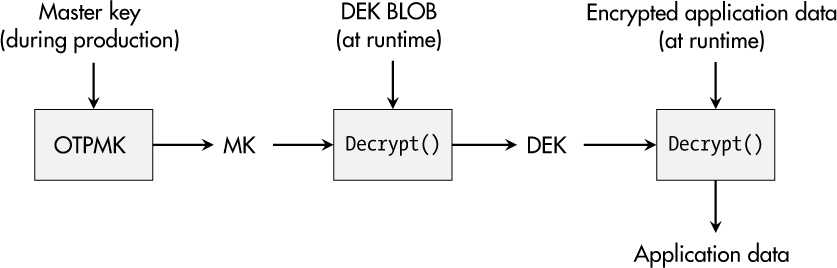

<a id="ch05"></a>

# <a id="page_85"></a>5 LƯU TRỮ DỮ LIỆU BÍ MẬT VÀ SECURE MEMORY (CONFIDENTIAL DATA STORAGE AND SECURE MEMORY)

Embedded system lưu trữ và xử lý nhiều loại dữ liệu. Một phần dữ liệu này là tầm thường vì nó giống nhau trên nhiều nền tảng hoặc có thể dễ dàng đoán hay suy ra. Tuy nhiên, một lượng dữ liệu nhất định, thường được biết đến là dữ liệu *nhạy cảm*, *bí mật* hay *cần giữ kín* (confidential), đòi hỏi được xử lý cẩn thận.

Thông tin mà dữ liệu này mang theo là có giá trị, và việc nó bị lộ có khả năng dẫn đến các hậu quả tiêu cực. Một ví dụ là *tài sản trí tuệ* được kết tinh trong các thuật toán phần mềm, protocol độc quyền và nội dung ứng dụng. Hơn nữa, *vật liệu cryptography* như secret key và mật khẩu về bản chất chứa thông tin trọng yếu. *Dữ liệu vòng đời* của một thiết bị như dữ liệu cảm biến, các mục log và các thông điệp đã gửi hay nhận cũng có thể thuộc nhóm này.

Chương này bắt đầu bằng việc xem xét dữ liệu nên được lưu trữ theo cách bí mật và tình thế tiến thoái lưỡng nan về cách giữ bí mật trong embedded system. Tiếp theo, tôi sẽ mô tả các lựa chọn của bạn để lưu trữ dữ liệu bí mật, từ mức OS đến phần cứng đến phần mềm được làm rối (obfuscated), cùng các ưu nhược điểm tương ứng. Một case study trong chương này sau đó sẽ đi qua việc dùng các container file được mã hóa trên một embedded system chạy Linux.

<a id="ch00lev1_41"></a>

## <a id="page_86"></a>Dữ liệu bí mật

Việc xác định dữ liệu bí mật và nhận thức về các mối đe dọa liên quan luôn là bước đầu tiên hướng tới việc bảo vệ nó. Các ví dụ sau nhằm tạo ra tư duy cần thiết.

Hãy tưởng tượng bộ phận nghiên cứu của bạn phát minh ra một thuật toán engine-control siêu hiệu quả giúp một chiếc xe chạy tốn ít nhiên liệu hơn đáng kể so với các sản phẩm cạnh tranh. Mặc dù có lẽ bạn đã nộp bằng sáng chế, điều đó có thể không đủ để bảo vệ thiết bị của bạn khỏi việc làm nhái và sao chép. Giá trị của phát minh chỉ trở thành hiện thực nếu bạn triển khai nó trong thiết bị điều khiển của mình. Ở đó, nó có thể có sẵn dưới dạng một file thực thi phần mềm đã biên dịch hay có thể là một phần của một kernel module. Cả hai đều được lưu trong filesystem của thiết bị, và nếu kẻ tấn công có thể đọc filesystem, họ có thể reverse engineering thuật toán của bạn và hưởng lợi trực tiếp từ khoản đầu tư nghiên cứu của bạn. Tình huống này rõ ràng là điều bạn muốn tránh, nghĩa là bạn phải bảo vệ confidentiality của bản triển khai thuật toán điều khiển.

Một số thiết bị gia dụng và tiêu dùng chứa nhiều nội dung media như ảnh và video, và việc sản xuất chúng chẳng hề rẻ. Lưu trữ chúng công khai trong filesystem của thiết bị hiếm khi là một ý hay. Kẻ tấn công có thể sao chép chúng, tải lên nền tảng trực tuyến ưa thích của họ và dùng lại cho mục đích riêng, điều không chỉ có thể gây thiệt hại tài chính mà còn làm tổn hại danh tiếng của sản phẩm và công ty bạn.

Thoạt nhìn, nhu cầu bảo vệ vật liệu cryptography có vẻ là điều hiển nhiên. Tuy nhiên, nhiều thiết bị lưu các private key tương ứng với việc xác thực certificate-based của chúng trong filesystem tiêu chuẩn. Việc đọc và sao chép những key này mở cửa cho các cuộc tấn công mạo danh. Ngoài ra, đặc biệt ở mức ứng dụng, các mật khẩu kiểm soát việc xác thực người dùng đôi khi được lưu dưới dạng plaintext trong các file cấu hình hay binary phần mềm. Dĩ nhiên, việc trích xuất một mật khẩu cho phép đối thủ xác thực thành công với thiết bị vì credential không được lưu theo cách bảo vệ confidentiality.

Trong một số trường hợp, dữ liệu thực sự thú vị được tạo ra trong suốt vòng đời của thiết bị. Ví dụ, hãy nghĩ đến các hệ quả về quyền riêng tư đối với dữ liệu sinh trắc học mà một sản phẩm có thể thu thập qua đầu đọc vân tay hay dữ liệu vị trí tạo ra hồ sơ di chuyển của người dùng. Thông tin này thường có yêu cầu confidentiality cao, có thể thậm chí theo luật như GDPR của châu Âu. Thất bại trong việc bảo vệ có thể dẫn đến tiền phạt lên đến €20 triệu hay 4 phần trăm tổng doanh thu toàn cầu của một công ty.

Lịch sử dữ liệu được lưu trong một thiết bị có thể tiết lộ còn nhiều hơn nữa. Ví dụ, trong các môi trường sản xuất công nghiệp, lịch sử dữ liệu có thể cho phép kẻ tấn công tái dựng mức sử dụng máy móc và số liệu sản lượng, vốn có thể là thông tin có giá trị đối với đối thủ cạnh tranh. Một lần nữa, bảo vệ confidentiality sẽ là một tính năng then chốt của thiết bị.

Gần như mọi thiết bị hiện đại đều chứa dữ liệu đáng được bảo vệ confidentiality. Hãy bảo đảm ghi nhớ điều đó khi thực hiện phân tích mối đe dọa và rủi ro.

<a id="ch00lev1_42"></a>

## <a id="page_87"></a>Tình thế khó xử của việc giữ bí mật trên embedded system

Embedded system thường có một tổ hợp thuộc tính độc hại. Thứ nhất, chúng phải có khả năng boot và chạy mà không cần tương tác người dùng, nghĩa là mọi thứ liên quan đến việc hoạt động đúng đều phải được lưu bên trong thiết bị, bao gồm cả mọi bí mật. Thứ hai, kẻ tấn công thường có thể tự mua một thiết bị và phân tích nó kỹ lưỡng. Việc phân tích này không chỉ bao gồm các điều tra network-based mà còn cả việc nghe lén vật lý các đường giao tiếp bên trong sản phẩm và trích xuất nội dung memory nonvolatile như firmware image và các phân vùng filesystem cho mục đích reverse-engineering. Từ góc nhìn lý thuyết, không thể bảo đảm việc bảo vệ confidentiality cho các bí mật trong một thiết bị có thể bị phân tích ở mọi mức.

Tuy nhiên, từ một góc nhìn thực dụng hơn, câu hỏi luôn là, “Một đối thủ phải bỏ ra bao nhiêu công sức để đạt được một hiểu biết toàn diện về thiết bị đang xét, bao gồm cả các bí mật của nó?”

Hãy xem xét ví dụ tài sản trí tuệ mà tôi đã đề cập trước đó. Hãy tưởng tượng bạn chịu trách nhiệm giữ bí mật bản triển khai phần mềm của một thuật toán rất tinh vi, mặc dù nó phải được lưu và dùng bên trong thiết bị của bạn. Một số người có thể ngay lập tức nghĩ rằng việc đọc firmware từ flash memory, xác định file thực thi và reverse engineering thuật toán là rất phức tạp, nên họ cho rằng mình không cần bất kỳ biện pháp bảo vệ nào.

Giả định đó có thể đúng với những kẻ tấn công như script kiddie. Tuy nhiên, hãy xem xét những tội phạm tìm kiếm lợi ích tài chính. Đối với họ, việc dump flash memory và mount một filesystem có vẻ không phải là quá nhiều công sức. Hơn nữa, các công cụ miễn phí và open source như Radare2 và Ghidra cho phép bất kỳ ai quan tâm thực hiện ít nhất là reverse engineering phần mềm cơ bản. Nếu confidentiality có độ ưu tiên cao hơn trong sản phẩm của bạn, những kẻ tấn công này chắc chắn nên nằm trong phạm vi xem xét.

Dĩ nhiên, một số trường hợp đơn giản hơn nhiều để tấn công. Đối với các thiết bị lưu firmware trên phương tiện tháo rời như thẻ microSD mà nhiều laptop off-the-shelf có thể đọc, việc dump flash thậm chí không cần thiết. Nếu thông tin bí mật, như một RSA private key, được lưu ở một định dạng có thể dùng lại trực tiếp như Privacy-Enhanced Mail (PEM), một “cuộc tấn công” có thể được thực hiện trong nháy mắt, ngay cả bởi một script kiddie. Ngoài ra, không phải file thực thi nào cũng cần được reverse engineering. Ví dụ, các *code lifting attack* chỉ lấy binary nguyên trạng, sao chép nó sang một thiết bị khác và chạy nó. Nếu nó hoàn thành mục đích của mình, không cần truy cập các chi tiết độc quyền của nó.

<a id="ch00lev1_43"></a>

## Các cách tiếp cận filesystem an toàn

Đến đây, bạn có thể thắc mắc, “Có thứ gì như một encrypted file-system không? Điều đó sẽ giải quyết mọi vấn đề của chúng ta.” Có, nhưng nó không làm vấn đề biến mất hoàn toàn. Có ba lựa chọn phổ biến cung cấp bảo vệ confidentiality cho file: encrypted stacked filesystem, mã hóa filesystem native và encrypted block device.

<a id="ch00lev2_51"></a>

### <a id="page_88"></a>*Encrypted Stacked Filesystem*

Một *stacked filesystem* là một cấu trúc filesystem bổ sung nằm trên một filesystem có sẵn, nghĩa là các filesystem tiêu chuẩn như ext3 không bị động chạm và việc mã hóa diễn ra ở một lớp phía trên. Trong trường hợp này, nội dung và tên file được mã hóa—ví dụ, cho mọi file trong một thư mục cụ thể. Tuy nhiên, số lượng file và metadata của chúng vẫn đọc được.

Stacked filesystem cũng đi kèm một overhead performance nhất định, và tên file có thể chịu thêm các hạn chế. Trong nhiều năm, EncFS, vốn dùng framework Filesystem in Userspace (FUSE), đã là một ví dụ phổ biến và easy-to-use của cách tiếp cận này, nhưng có vẻ việc phát triển đã đình trệ. Một ứng viên kế nhiệm đầy triển vọng có thể là gocryptfs.

Một đối thủ hoạt động trong kernel space là eCryptfs. Mặc dù eCryptfs có thể khó cấu hình hơn một chút, nó cho performance tốt hơn trong một số trường hợp. Tuy nhiên, việc phát triển nó cũng đã đình trệ. File-based encryption (FBE) với stacked filesystem có vẻ đã lỗi thời.

<a id="ch00lev2_52"></a>

### *Mã hóa filesystem native*

Ngày nay, các filesystem như ext4, F2FS và UBIFS trực tiếp hỗ trợ lưu trữ file được mã hóa. So với stacked filesystem, điều này cho phép tích hợp và vận hành hiệu quả hơn.

Những bên dùng phổ biến cách tiếp cận FBE native này bao gồm các OS Android và Chrome. Các tính năng nền tảng được triển khai trong Linux kernel và dùng crypto API của kernel để mã hóa. Công cụ user-space để cấu hình và quản lý các thư mục được mã hóa được gọi là `fscrypt`.

<a id="ch00lev2_53"></a>

### *Encrypted Block Device*

Các cách tiếp cận file-based luôn để lại cấu trúc thư mục và metadata không được mã hóa. Một cách phổ biến để tránh rò rỉ thông tin này là *full-disk encryption (FDE)*. Trong Linux, điều này có nghĩa là lớp mã hóa nằm bên dưới filesystem, ở mức block device. Không quan trọng block device này là toàn bộ một ổ đĩa, một phân vùng hay một container file; nó được mã hóa toàn bộ, và nội dung của nó không thể phân biệt được với thông tin ngẫu nhiên.

Đại diện phổ biến nhất của lớp này cho Linux là `dm-crypt`, dựa trên hạ tầng device mapper và dùng crypto API của kernel. Công cụ user-space `cryptsetup` có thể tạo các volume được mã hóa, và nó hỗ trợ định dạng container Linux Unified Key Setup (LUKS) phổ biến, cho phép nhiều chức năng key-management khác nhau cho các volume được mã hóa.

VeraCrypt, người kế nhiệm của TrueCrypt, là một công cụ phổ biến khác, ví dụ, còn cho phép nối chuỗi hai cipher để tăng cường khả năng chống giải mã.

<a id="ch00lev2_54"></a>

### <a id="page_89"></a>*Khuyến nghị*

Lưu trữ dữ liệu được mã hóa rõ ràng không thiếu lựa chọn. Việc FDE hay FBE phù hợp với nhu cầu của bạn phần lớn phụ thuộc vào thiết bị của bạn và các yêu cầu bảo mật tương ứng.

Nếu, theo quan điểm của bạn, vị trí, số lượng và kích thước file đã tiết lộ thông tin nhạy cảm cho kẻ tấn công, FDE có lẽ là giải pháp dẫn đến mức bảo mật cao nhất có thể. Tuy nhiên, FBE mang lại sự linh hoạt hơn—ví dụ, để chứa một tập file không đồng nhất trong cùng một filesystem, sao cho một số dữ liệu luôn sẵn có và đọc được với mọi process, nhưng dữ liệu bí mật được giải mã có chọn lọc theo từng thư mục. Nó cũng có thể có các key application-specific, cho phép bảo vệ confidentiality fine-grained hơn.

<a id="ch00lev2_55"></a>

### *Passphrase*

Dù bạn chọn bản triển khai nào, một vấn đề lớn sẽ luôn còn đó: mọi công cụ đều đòi hỏi một passphrase để hoặc trực tiếp mở khóa các thư mục và volume được bảo vệ, hoặc để mở khóa một key file sau đó được dùng để mở khóa dữ liệu được mã hóa. Ngay cả từ *passphrase* cũng cho thấy khái niệm này dành cho người dùng nhập credential như chúng ta làm trên PC lúc boot.

Tuy nhiên, hầu hết các embedded system không có người dùng tích cực ngồi trước chúng, có thể nhập passphrase để mở khóa hard-disk encryption khi khởi động. Câu hỏi thường gặp tiếp theo là, “Giấu bí mật mở khóa việc mã hóa ở đâu?”

<a id="ch00lev1_44"></a>

## Secure memory trong phần cứng

Thỉnh thoảng, tôi nghe người ta (và các công ty) nói rằng *secure memory* được triển khai trong phần cứng là giải pháp cho vấn đề credential của embedded system. Tuy nhiên, điều đó chỉ đúng một phần.

Một ưu điểm của secure memory hardware-based là nó triển khai một sự phân tách vật lý mạnh giữa memory nonvolatile cổ điển, nơi lưu firmware, và một module bảo mật chuyên dụng, chỉ có thể được truy cập qua một interface cụ thể. Hơn nữa, nó cho phép phát hiện hay chống can thiệp (tamper), và các bit được lưu có thể được chôn sâu bên trong một con chip, khiến các cuộc tấn công phần cứng trở nên khó khăn và đòi hỏi thiết bị tinh vi.

Tuy nhiên, cách tiếp cận này cũng có nhược điểm. Hiển nhiên nhất, chỉ một lượng nhỏ dữ liệu, thường là cryptographic key, có thể được lưu trong memory được bảo vệ như vậy. Ngoài ra, những bí mật này thường *phải rời khỏi* module bảo mật để phục vụ mục đích của chúng, như mở khóa một container LUKS. Trong những trường hợp như vậy, kẻ tấn công có thể bắt được các key trên đường đi qua một đường giao tiếp.

<a id="page_90"></a>Trong quá khứ, vấn đề này đã bị khai thác trên thực tế khi các module bảo mật bên ngoài chuyển bí mật tới CPU chính và đối thủ nghe lén các đường mạch PCB vật lý. Các cuộc tấn công khác chủ động giao tiếp với secure memory và, ví dụ, yêu cầu nó mã hóa, giải mã hay ký dữ liệu tùy ý cho kẻ tấn công. Vì vậy, chỉ đơn thuần *có* một secure memory không làm tăng đáng kể bảo mật của thiết bị bạn; nó còn phải được *tích hợp* một cách an toàn.

Như thường lệ, việc dùng secure memory có hợp lý hay không phụ thuộc vào ứng dụng cụ thể và chi tiết triển khai. Thường thì nó ít nhất thêm một lớp kiến thức mà kẻ tấn công cần có—cụ thể là quan sát giao tiếp secure memory lúc thiết bị đang chạy thay vì “chỉ” trích xuất bí mật từ firmware hay filesystem. Hãy xem xét các lựa chọn liên quan đến secure memory.

<a id="ch00lev2_56"></a>

### *Secure memory bên ngoài*

Cách “truyền thống” để thêm một thiết bị secure memory vào thiết kế của bạn là tích hợp một vi mạch chuyên dụng vào PCB của thiết bị và kết nối nó với microprocessor chính. Nhân tố nổi bật nhất trong lĩnh vực này là Trusted Platform Module (TPM).

Bạn có thể mua các TPM rời từ nhiều nhà sản xuất như Infineon, NXP và ST. Chúng đã được thiết lập vững chắc trong thế giới PC vì Microsoft Windows biến chúng thành một yêu cầu bắt buộc. Một use case cơ bản là người dùng có thể mở khóa một key TPM, key này sau đó được dùng để mở khóa các volume được bảo vệ bởi BitLocker. Dĩ nhiên, đây là một góc nhìn đơn giản hóa về quy trình, và đó là nơi vấn đề xuất hiện.

Một TPM không chỉ là secure memory. Nó đi kèm các lớp ủy quyền, các phân cấp key và một bản đặc tả dài hơn 1,000 trang cho phiên bản TPM hiện tại. Mặc dù có các công cụ để dùng TPM dưới Linux, như `tpm2-tools` và `ibm-tss`, việc dùng một TPM có vẻ quá phức tạp đối với các sản phẩm và nhóm phát triển trung bình.

May mắn thay, các nhà sản xuất microcontroller bảo mật cung cấp các lựa chọn thay thế thú vị nhắm tới các ứng dụng ô tô, công nghiệp và IoT. Tương tự TPM, các sản phẩm như OPTIGA Trust X của Infineon, họ Edge-Lock SE050 của NXP và ATECC608B của Microchip đi kèm một tập thuật toán crypto rộng, từ symmetric cipher như AES, đến hash function và HMAC, đến crypto bất đối xứng như RSA và ECDSA. Dĩ nhiên, chúng cũng cung cấp secure memory cho cryptographic key. Lời hứa của chúng là những thiết bị này đòi hỏi ít công sức tích hợp hơn nhiều cho các sản phẩm IoT.

Tóm lại, một TPM chỉ được dùng làm secure memory thì giống như dùng dao mổ trâu để giết gà. Các lựa chọn gọn nhẹ hơn có thể phù hợp hơn cho thế giới embedded system. Tuy nhiên, khi quyết định có dùng một module bảo mật phần cứng chuyên dụng hay không, bạn cũng nên xem xét các chủ đề định danh thiết bị an toàn và giao tiếp an toàn, như được thảo luận trong [Chương 6](ch06_secure_device_identity.vi.md#ch06) và [7](ch07_secure_communication.vi.md#ch07). Trong mọi trường hợp, hãy bảo đảm bạn hiểu các hệ quả của việc secret key có thể được truyền qua các interface mà kẻ tấn công vật lý có thể tiếp cận.

> **LƯU Ý**
>
> *Đặc tả TPM 2.0 cung cấp một phương tiện để mã hóa giao tiếp giữa CPU host và TPM, điều này làm tăng độ phức tạp cho kẻ tấn công nhưng cũng cho cả kỹ sư.*

<a id="ch00lev2_57"></a>

### <a id="page_91"></a>*Secure memory bên trong*

Trái với các linh kiện phần cứng rời phải được thiết kế vào và hàn lên PCB, các module bảo mật và cơ sở lưu trữ an toàn ở đây đã được tích hợp sâu vào CPU chính của thiết bị.

Được biết đến là *integrated TPM* hay *firmware TPM*, những lựa chọn thay thế cho TPM phần cứng chuyên dụng này được các nhà cung cấp chip như AMD và Intel đưa ra. Bên cạnh chi phí tích hợp PCB giảm, ưu điểm nổi bật của khái niệm này là giao tiếp on-chip khó bắt hơn nhiều so với các tín hiệu chạy trên PCB. Dĩ nhiên, vấn đề phức tạp của TPM vẫn như cũ.

Mặt khác, các SoC hiện đại thường cung cấp memory one-time programmable (OTP) có thể được dùng để lưu ít nhất một master key. Một ví dụ phổ biến là khái niệm mã hóa phân tầng của dòng i.MX của NXP. Ở đó, một OTP master key (OTPMK) được lập trình vào thiết bị trong quá trình sản xuất. Sau đó, key này được dùng để mã hóa một data encryption key (DEK) để thu được một cái gọi là (so-called) DEK *binary large object (BLOB)*. Đến lượt mình, developer khi đó có thể dùng DEK để mã hóa dữ liệu ứng dụng.

[Hình 5-1](#ch05fig01) cho thấy quy trình chạy trên một thiết bị từ việc đọc master key OTP đến việc giải mã dữ liệu ứng dụng.

<a id="ch05fig01"></a>

*Hình 5-1: Chuỗi giải mã phân tầng của dòng i.MX của NXP*

Quy trình này tăng cường bảo mật cho thiết bị vì key và dữ liệu bí mật không được lưu dưới dạng plaintext và, đồng thời, các key cần thiết được nạp trực tiếp vào cryptographic acceleration and assurance module (CAAM) của thiết bị, nơi việc giải mã được thực hiện, nghĩa là chỉ dữ liệu người dùng đã giải mã mới rời khỏi module nội bộ này lúc runtime.

<a id="ch00lev1_45"></a>

## Bí mật trong code ứng dụng

Phần cứng bổ sung hay CPU chính security-enhanced không phải lúc nào cũng là một lựa chọn vì chi phí của chúng hay vì phần cứng legacy không thể được nâng cấp nữa. Liệu việc lưu key công khai có phải là điều không thể tránh? Không nhất thiết.

Chúng ta vẫn có thể chuyển key từ vùng có cấu trúc của một filesystem vào dạng đông đúc hơn của một file thực thi. Một lần nữa, cách tiếp cận này đòi hỏi thêm năng lực từ những kẻ tấn công tiềm năng—cụ thể là reverse engineering binary. Ngay cả khi đối thủ biết được rằng một file thực thi cụ thể chịu trách nhiệm mở khóa một volume được mã hóa, họ cũng không thể trích xuất key mở khóa ngay lập tức.

> <a id="page_92"></a>**LƯU Ý**
>
> *Vâng, security by obscurity thực sự xuất hiện trong một cuốn sách về kỹ thuật bảo mật. Đến một lúc nào đó trong kỹ thuật thiết bị real-world, bạn phải bám víu vào bất cứ thứ gì có thể.*

Thuật ngữ mô tả những biện pháp đối phó như vậy là *obfuscation* (làm rối). Mục đích duy nhất của nó là làm cho việc reverse engineering phần mềm khó hơn, và điều này có thể đạt được theo nhiều cách:

- Thay các thao tác thông thường bằng các thao tác phức tạp nhưng tương đương
- Làm phức tạp quá mức luồng điều khiển bằng cách sắp xếp lại thứ tự lệnh mà không phá vỡ chức năng
- Chèn code và dữ liệu dư thừa, không cần thiết
- Lưu các phần của code hay dữ liệu ở dạng được mã hóa hay encode và chỉ giải mã hay decode nó lúc runtime
- Thêm tính ngẫu nhiên vào các cấu trúc dữ liệu và luồng điều khiển
- Tích hợp các biện pháp anti-debugging để ngăn cản việc phân tích
- Chia bí mật thành nhiều phần, lưu chúng ở các nơi khác nhau và chỉ ghép chúng lại lúc runtime

Danh sách này không đầy đủ, và mỗi gạch đầu dòng có thể được triển khai theo nhiều cách và với nhiều mức độ sáng tạo. Nếu bạn không thể tự làm, có các công cụ cung cấp chức năng obfuscation code tự động. Tuy nhiên, những công cụ như vậy phải được đối xử thận trọng vì mỗi công cụ obfuscation cho trước cũng có thể có một công cụ đối ứng, một công cụ *deobfuscation*, đảo ngược độ phức tạp đã thêm vào và để lại cho kẻ tấn công code mà họ có thể phân tích hiệu quả hơn nhiều.

Năm 2002, một ý tưởng gọi là *white-box cryptography* xuất hiện trong các thảo luận học thuật như một cách để khắc phục vấn đề giấu bí mật trong phần mềm. Cách tiếp cận này nhằm thực hiện các thao tác cryptography trong phần mềm mà không làm lộ bí mật nền tảng. Điều đó có nghĩa là cryptographic key được dùng sẽ khuếch tán vào các thao tác của một thuật toán crypto.

Các khái niệm white-box cryptography đầu tiên biến đổi các cipher có key hardcode thành các lần tra bảng key-dependent và chèn các giá trị ngẫu nhiên vào các tính toán nội bộ, các giá trị này sẽ che (mask) dữ liệu ở một thời điểm nào đó và gỡ che (demask) nó sau đó. Tuy nhiên, không ngạc nhiên, điều này dẫn đến overhead đáng kể về kích thước binary và performance, và những bản triển khai đó cũng đã bị phá vỡ bởi cryptanalysis. Mặc dù giới học thuật chưa tìm ra giải pháp hoàn hảo cho vấn đề này, nhiều công ty phần mềm dùng một dạng white-box cryptography nào đó trong sản phẩm của họ—ví dụ, trong các ứng dụng di động cho phép người dùng tải binary về và phân tích nó.

Dù bạn áp dụng obfuscation tùy chỉnh, công cụ thương mại hay các cách tiếp cận white-box crypto học thuật, bạn nên luôn ghi nhớ một cách tiếp cận của kẻ tấn công khi giấu bí mật trong binary phần mềm: code lifting. Trong những trường hợp này, binary được dùng “nguyên trạng”—ví dụ, để mở khóa một container LUKS. Bản thân secret key không đáng quan tâm đối với kẻ tấn công nếu họ chỉ cần dùng file thực thi như một chiếc chìa khóa mở két được mã hóa. Điều này có thể diễn ra tại chỗ, hoặc file đáng quan tâm có thể được trích xuất và thực thi trong một môi trường attacker-controlled.

<a id="ch00lev1_46"></a>

## <a id="page_93"></a>Lưu trữ mật khẩu an toàn

Xác thực password-based là một phương pháp phổ biến để xác minh người dùng hợp lệ khi đăng nhập, nhưng nó cũng được dùng để mở khóa các volume và container được mã hóa. Lẽ tự nhiên, mật khẩu là dữ liệu bí mật. Lưu chúng dưới dạng plaintext trong một file hay một file thực thi để so sánh trong quá trình xác minh khiến cuộc sống của kẻ tấn công trở nên dễ dàng. Một khi bị trích xuất, chúng có thể được dùng thành công để truy cập dữ liệu bí mật. Tuy nhiên, mã hóa truyền thống, như đã thảo luận như một biện pháp bảo vệ cho các lớp dữ liệu khác, thường không phù hợp ở đây. Quá trình xác minh đặc thù của mật khẩu cho phép triển khai một cách tiếp cận lưu trữ an toàn khác: *password hash*.

Thuộc tính one-way của hash function hữu ích trong việc ngăn kẻ tấn công lấy lại mật khẩu từ hash value của nó, ngay cả khi đã trích xuất được từ thiết bị. Việc xác minh vẫn hoạt động vì một mật khẩu cho trước có thể được hash hiệu quả và so sánh với giá trị đã lưu. Tuy nhiên, trong trường hợp tầm thường này, kẻ tấn công có thể tính trước các *rainbow table*, là các tập hợp lớn hash value cho hàng triệu mật khẩu, có thể thậm chí mọi mật khẩu khả dĩ có, ví dụ, 10 ký tự. Để bảo vệ trước những cuộc tấn công như vậy, một *salt* ngẫu nhiên được thêm vào quá trình password-hashing, làm cho mỗi hash là duy nhất và khiến mọi rainbow table trở nên vô dụng.

Linux hiện tại, vẫn theo mặc định, dùng một hàm dựa trên hash SHA-512 để tạo các user-password hash có salt. Ngoài ra, Password-Based Key Derivation Function 2 (PBKDF2) đã được tiêu chuẩn hóa hơn 20 năm trước trong RFC 2898. Nó dựa trên HMAC dùng các hash function như SHA-1, SHA-256 hay SHA-512. Cả hai cách tiếp cận chắc chắn tốt hơn việc lưu mật khẩu plaintext, nhưng kẻ tấn công hiện đại dùng các graphics processing unit (GPU), FPGA và các application-specific integrated circuit (ASIC) chuyên dụng để phá các password hash theo đúng nghĩa đen bằng brute force.

Do đó, đối với các sản phẩm future-proof, việc dùng các đại diện hiện đại của lĩnh vực này được khuyến nghị. Các ví dụ điển hình là scrypt, được tiêu chuẩn hóa trong RFC 7914 năm 2016; người kế nhiệm của nó yescrypt; và Argon2, thuật toán đã chiến thắng Password Hashing Competition năm 2015. Những thuật toán này có chung mục tiêu tăng cường khả năng chống bẻ khóa bằng các thuật toán password-hashing có thể tham số hóa, xem xét các chiều như thời gian tính toán, memory cần thiết và số lượng thread CPU song song cần có, nhằm làm nản lòng ngay cả những kẻ tấn công có quyền truy cập vào nhiều tài nguyên phần cứng và năng lực tính toán.

> **LƯU Ý**
>
> *Ngay cả khi confidentiality là protection goal chính của một mật khẩu, hậu quả của việc ai đó có thể thay đổi nó là nghiêm trọng. Thay password hash của user root bằng hash của một mật khẩu đã biết là một cuộc tấn công khá phổ biến mở mọi cánh cửa cho đối thủ. Bạn nên nghiêm túc cân nhắc bảo vệ integrity cho việc lưu trữ mật khẩu, như được thảo luận trong [Chương 8](ch08_secure_boot_and_system_integrity.vi.md#ch08).*

<a id="ch00lev1_47"></a>

## Case Study: Container file được mã hóa trên Linux

Trong case study này, hãy giả định rằng một trong các thiết bị legacy của bạn không có bất kỳ cơ chế lưu trữ an toàn nào được triển khai cho dữ liệu bí mật. Khi tham quan một <a id="page_94"></a>hội chợ quốc tế, các thành viên trong nhóm kỹ thuật của bạn nhận ra rằng một đối thủ cạnh tranh hiện chưa được biết đến đang dùng một trong các ứng dụng GUI độc quyền của bạn và nội dung media đi kèm mà bạn đã tốn rất nhiều công sức sản xuất để phù hợp với nhu cầu của đối tượng mục tiêu.

Trở về, bạn thảo luận vấn đề với nhóm và ban quản lý. Sau một cuộc điều tra ban đầu, rõ ràng là việc đánh cắp dữ liệu chẳng đòi hỏi gì hơn ngoài việc mở thiết bị của bạn ra và đọc nội dung từ flash memory, điều mà đối thủ của bạn hiển nhiên đã làm thành công. Để hạn chế thiệt hại trong tương lai, bạn quyết định thiết lập ít nhất một mức bảo vệ cơ bản bằng cách dùng các container LUKS. Thiết bị flash memory hiện tại của bạn có dung lượng 256MB. Hệ thống Linux cơ bản và mọi công cụ đi kèm chiếm khoảng 136MB. Các file thực thi độc quyền của bạn cùng với các file dữ liệu và cấu hình của chúng tổng cộng khoảng 19MB, trong khi nội dung video high-quality chiếm 73MB.

Bạn muốn bảo vệ hai lớp dữ liệu sau. Vì yêu cầu memory khá eo hẹp trên nền tảng của bạn và bạn muốn tách code khỏi media, bạn lên kế hoạch tạo một container 25MB cho các file thực thi và file chứa tài sản trí tuệ, và một container 90MB cho các file video.

<a id="ch00lev2_58"></a>

### *Benchmark crypto*

Bước đầu tiên, bạn thêm `cryptsetup` vào root filesystem của thiết bị để có thể làm việc với các container LUKS. Bạn cũng bật `CONFIG_CRYPTO_SERPENT` và `CONFIG_CRYPTO_TWOFISH` trong cấu hình Linux kernel vì bạn nghe nói `cryptsetup` hỗ trợ chúng và bạn thắc mắc liệu chúng có vượt trội AES trên SoC STM32MP157F của bạn không. [Listing 5-1](#ch05list01) cho thấy kết quả của công cụ performance-benchmarking riêng của `cryptsetup`.

<a id="page_95"></a>

```
# cryptsetup benchmark
# Tests are approximate using memory only (no storage IO).
PBKDF2-sha1        59148 iterations per second for 256-bit key
PBKDF2-sha256      92695 iterations per second for 256-bit key
PBKDF2-sha512      58618 iterations per second for 256-bit key
PBKDF2-ripemd160   49201 iterations per second for 256-bit key
PBKDF2-whirlpool   14021 iterations per second for 256-bit key
argon2i       4 iterations, 65536 memory, 4 parallel threads (CPUs)
              for 256-bit key (requested 2000 ms time)
argon2id      4 iterations, 65536 memory, 4 parallel threads (CPUs)
              for 256-bit key (requested 2000 ms time)
#     Algorithm |       Key |      Encryption |      Decryption
        aes-cbc        128b        36.9 MiB/s        36.8 MiB/s
    serpent-cbc        128b         9.0 MiB/s        10.4 MiB/s
    twofish-cbc        128b        11.1 MiB/s        12.0 MiB/s
        aes-cbc        256b        36.9 MiB/s        37.0 MiB/s
    serpent-cbc        256b         9.1 MiB/s        10.5 MiB/s
    twofish-cbc        256b        11.3 MiB/s        12.0 MiB/s
        aes-xts        256b        18.4 MiB/s        17.0 MiB/s
    serpent-xts        256b         9.0 MiB/s        10.4 MiB/s
    twofish-xts        256b        11.5 MiB/s        12.0 MiB/s
        aes-xts        512b        15.3 MiB/s        13.1 MiB/s
    serpent-xts        512b         9.6 MiB/s        10.5 MiB/s
    twofish-xts        512b        12.0 MiB/s        12.0 MiB/s
```

<a id="ch05list01"></a>

*Listing 5-1: Kết quả benchmark do* `cryptsetup` *cung cấp*

Trước tiên, đầu ra này cho thấy nhiều hàm dùng cho việc lưu trữ mật khẩu được phân tích để cho bạn ý niệm về những tham số nào của hàm cụ thể có thể là lựa chọn hợp lý cho thiết bị của bạn. Bạn muốn đặt các tham số như số lần lặp ở các giá trị dẫn đến performance chấp nhận được trên thiết bị (ví dụ, mở khóa trong vòng hai giây) nhưng để lại cho kẻ tấn công công sức bẻ khóa tối đa. Trong trường hợp này, vì bạn không có yêu cầu cụ thể, bạn giữ mặc định của các volume LUKS2: Argon2.

Benchmark mã hóa/giải mã cho thấy AES là thuật toán nhanh nhất bất kể bạn dùng nó ở CBC mode hay XTS (XEX-Based Tweaked-Codebook Mode with Ciphertext Stealing). Có vẻ như performance AES-CBC cũng được tăng tốc bởi phần cứng crypto của STM32MP157F. Mặt khác, XTS là mode hoạt động mặc định và được khuyến nghị cho `cryptsetup` và việc mã hóa ổ cứng nói chung. Vì bạn rất coi trọng performance và không muốn việc mã hóa container ảnh hưởng đến bất kỳ chức năng nào của thiết bị, bạn chọn AES-CBC, và vì thực tế không có khác biệt giữa key 128-bit và 256-bit, bạn chọn key 256-bit.

> **LƯU Ý**
>
> *Bạn có thể thắc mắc làm thế nào XTS có thể dùng key 512-bit với AES. Nói ngắn gọn, nó không làm vậy! Nó đòi hỏi hai key (trong trường hợp này, hai key 256-bit, cộng lại thành 512 bit), nhưng security level là 256-bit.*

<a id="ch00lev2_59"></a>

### *Tạo container*

Sau khi xác định các tham số crypto, bạn có thể bắt đầu bằng việc tạo các file ngẫu nhiên và key file tương ứng cho hai container của mình. Container cho file thực thi chiếm 25MB, và container cho media dựa trên một file 90MB, như được thể hiện trong [Listing 5-2](#ch05list02). Cả hai key được khởi tạo với 32 byte, tương đương 256 bit.

```
# dd if=/dev/urandom of=executables.enc bs=1M count=25
# dd if=/dev/urandom of=media.enc bs=1M count=90
# dd if=/dev/urandom of=executables.key bs=32 count=1
# dd if=/dev/urandom of=media.key bs=32 count=1
```

<a id="ch05list02"></a>

*Listing 5-2: Khởi tạo ngẫu nhiên các container và key file*

Ở bước tiếp theo, như được thể hiện trong [Listing 5-3](#ch05list03), bạn dùng `cryptsetup` để tạo cấu trúc cơ bản của một container LUKS thông qua lệnh `luksFormat`.

<a id="page_96"></a>

```
# cryptsetup -q -v --type luks2 --cipher=aes-cbc-essiv:sha256
    luksFormat executables.enc executables.key
# cryptsetup -q -v --type luks2 --cipher=aes-cbc-essiv:sha256
    luksFormat media.enc media.key
```

<a id="ch05list03"></a>

*Listing 5-3: Tạo các container LUKS2*

Vì bạn muốn dùng Argon2 để xác minh passphrase, và bạn muốn tận hưởng tính bền vững đi kèm một bản sao header thứ hai trong LUKS2, bạn chọn phiên bản thứ hai của định dạng header bằng `--type luks2`. Lựa chọn trước đó về AES trong CBC mode với encrypted salt-sector initialization vector (ESSIV) được cấu hình bằng `--cipher=aes-cbc-essiv:sha256`.

Đến đây, các container và cấu trúc của chúng đã sẵn sàng, nhưng bạn chưa thể lưu gì trong những két ảo này. Các container file cần được mở khóa bằng `luksOpen` để tạo một filesystem ext3 bên trong. Lưu ý rằng sau khi mở khóa container LUKS, như được thể hiện trong [Listing 5-4](#ch05list04), nó được ánh xạ tới thiết bị */dev/mapper/dm_exec_enc*, thiết bị này sau đó được mount vào thư mục mới tạo */mnt/exec_enc*. Điều tương tự có thể được thực hiện cho container media được mã hóa, lần lượt với thiết bị */dev/mapper/dm_media_enc* và mount point */mnt/media _enc*.

```
# cryptsetup -v --key-file=executables.key luksOpen executables.enc dm_exec_enc
# mke2fs -t ext3 /dev/mapper/dm_exec_enc
# mkdir /mnt/exec_enc
# mount /dev/mapper/dm_exec_enc /mnt/exec_enc
```

<a id="ch05list04"></a>

*Listing 5-4: Mở khóa một container để tạo filesystem và mount*

Có vẻ như bạn đã gần xong. Hãy dùng `luksDump`, như được thể hiện cho container của các file thực thi trong [Listing 5-5](#ch05list05), để kiểm tra xem các thuộc tính đúng đã được đặt chưa.

```
# cryptsetup luksDump executables.enc
...
Keyslots:
  0: luks2
    Key:        256 bits
    Priority:   normal
    Cipher:     aes-cbc-essiv:sha256
    Cipher key: 256 bits
    PBKDF:      argon2id
    Time cost:  4
    Memory:     65536
    Threads:    2
...
```

<a id="ch05list05"></a>

*Listing 5-5: Double-checking (kiểm tra kỹ) các thuộc tính container*

Đầu ra hoàn toàn khớp với các yêu cầu của chúng ta.

<a id="ch00lev2_60"></a>

### <a id="page_97"></a>*Phân tích hiệu quả*

Trước khi bạn bắt đầu đưa dữ liệu vào filesystem, hãy xem lần cuối hiệu quả của cấu trúc này. Các công cụ `fdisk` và `df` sẽ giúp bạn hiểu bao nhiêu memory bị mất cho header LUKS và filesystem ext3 đưa vào bao nhiêu overhead. [Listing 5-6](#ch05list06) có các chi tiết.

```
# fdisk -l /dev/mapper/dm_exec_enc
Disk /dev/mapper/dm_exec_enc: 9 MiB, 9437184 bytes, 2304 sectors
...
# df -hT /dev/mapper/dm_exec_enc
Filesystem              Type  Size  Used Avail Use% Mounted on
/dev/mapper/dm_exec_enc ext3  4.5M   28K  4.0M   1% /mnt/exec_enc
# fdisk -l /dev/mapper/dm_media_enc
Disk /dev/mapper/dm_media_enc: 74 MiB, 77594624 bytes, 18944 sectors
...
# df -hT /dev/mapper/dm_media_enc
Filesystem               Type  Size  Used Avail Use% Mounted on
/dev/mapper/dm_media_enc ext3   66M   28K   62M   1% /mnt/media_enc
```

<a id="ch05list06"></a>

*Listing 5-6: Kiểm tra hiệu quả về mức sử dụng memory*

Đáng tiếc là mọi việc không diễn ra như kế hoạch. Container 25MB chỉ còn 4MB không gian để lưu dữ liệu, và container kia có kích thước 90MB chỉ còn lại 62MB. Có thể thấy rõ rằng chênh lệch giữa kích thước của các container và các thiết bị tương ứng của chúng trong hạ tầng device mapper là khoảng 16MB. Thực ra, nếu bạn đã nghiên cứu kỹ tài liệu LUKS, bạn đã biết rằng header của LUKS1 và LUKS2 lần lượt chiếm 2MB và 16MB. Mặc dù đó không phải là vấn đề đối với ổ cứng hàng trăm gigabyte, nó có thể trở thành điểm đau đối với các embedded system memory-constrained.

Bạn có thể giải quyết vấn đề bằng cách dùng header LUKS1 và bỏ qua các cải tiến của LUKS2, điều có thể chấp nhận được trên thực tế, hay thậm chí bằng cách dùng “plain mode” của `cryptsetup` vốn không lưu bất kỳ metadata nào trong memory. Lựa chọn sau có thể hiệu quả nhất nhưng đi kèm các hạn chế quản lý đáng kể. LUKS1 có lẽ sẽ là một lựa chọn hợp lý.

[Listing 5-6](#ch05list06) cũng cho thấy filesystem ext3 làm giảm memory khả dụng vì các bảng cấp phát và dữ liệu journal cần thiết. Tuy nhiên, đối với việc lưu trữ tĩnh các file thực thi, file cấu hình và nội dung media, journaling có thể không cần thiết, và bạn cũng có thể triển khai một filesystem ext2 để vắt thêm nhiều byte memory khả dụng.

Sau khi lặp lại toàn bộ quá trình trong khi đổi `luks2` thành `luks1` và `ext3` thành `ext2`, tình huống trông khác đi, như được thể hiện trong [Listing 5-7](#ch05list07).

<a id="page_98"></a>

```
# fdisk -l /dev/mapper/dm_exec_enc
Disk /dev/mapper/dm_exec_enc: 23 MiB, 24117248 bytes, 47104 sectors
...

# df -hT /dev/mapper/dm_exec_enc
Filesystem              Type  Size  Used Avail Use% Mounted on
/dev/mapper/dm_exec_enc ext2   22M   14K   21M   1% /mnt/exec_enc
# fdisk -l /dev/mapper/dm_media_enc
Disk /dev/mapper/dm_media_enc: 88 MiB, 92274688 bytes, 180224 sectors
...
# df -hT /dev/mapper/dm_media_enc
Filesystem               Type  Size  Used Avail Use% Mounted on
/dev/mapper/dm_media_enc ext2   81M   14K   77M   1% /mnt/media_enc
```

<a id="ch05list07"></a>

*Listing 5-7: Hiệu quả sử dụng memory với LUKS1 và ext2*

Vẫn còn mất lần lượt 4MB và 13MB, nhưng không gian còn lại vừa đủ đáp ứng các yêu cầu của case study này.

> **LƯU Ý**
>
> *Nếu bạn gặp tình huống tương tự trong thực tế nhưng không thể đạt được yêu cầu của mình, bạn vẫn có thể nghĩ đến việc chuyển sang mã hóa filesystem native (ví dụ, với ext4), hoặc bạn có thể dùng các filesystem read-only nén như CramFS và SquashFS.*

Sau khi giải quyết những vấn đề bất ngờ, non-security-related này, câu hỏi cuối cùng về cách mở khóa an toàn các container đã tạo vẫn còn đó. Vì bạn không có secure element trong thiết bị và CPU chính của bạn không cung cấp OTP memory cho mục đích này, bạn có thể quyết định giấu quá trình mở khóa trong một file thực thi trong *initramfs* của mình, được thực thi lúc boot. Nói rõ ràng, bạn sẽ không giành được giải thưởng nào cho “security by design” với cách tiếp cận như vậy, nhưng nó có thể nâng cao rào cản cho các cuộc tấn công thành công.

Bạn có thể cân nhắc đưa vào các định danh hệ thống hardware-based, như được mô tả trong [Chương 6](ch06_secure_device_identity.vi.md#ch06), để dẫn xuất một bí mật mở khóa device-unique thay vì một giải pháp software-only toàn cục có thể dễ dàng được giả lập off-device. Hơn nữa, bạn có thể triển khai các phương pháp chia sẻ bí mật như chia nội dung key-file thành nhiều mảnh và kết hợp chúng một cách động để thu được bí mật cuối cùng lúc runtime, điều ít nhất gây cản trở các cuộc tấn công phân tích tĩnh đơn giản. Trong mọi trường hợp, bạn phải nhận thức rằng một kẻ tấn công đã có được quyền root có thể vượt qua tất cả những điều đó và truy cập filesystem đã giải mã lúc runtime. Và cho thế hệ sản phẩm tiếp theo, bạn sẽ ưu tiên lưu trữ an toàn ngay từ ngày đầu tiên.

<a id="ch00lev1_48"></a>

## Read-out protection như một giải pháp low-cost

Một số embedded system nhỏ có chi phí thấp, không có secure memory, không thể chạy Linux và hoàn toàn không đủ khả năng dùng các secure element bên ngoài. Những thiết bị này có thể dựa trên các microcontroller chạy một hệ điều hành real-time (RTOS) hay thậm chí chỉ phần mềm bare-metal.

Tuy nhiên, ngay cả những trường hợp đó cũng có thể có dữ liệu xứng đáng được bảo vệ confidentiality ở một mức nhất định. Vì những thiết bị này thường lưu mọi code và dữ liệu của chúng trong flash memory nội bộ, việc hạn chế quyền đọc flash memory có thể là một biện pháp đơn giản nhưng hiệu quả để bảo vệ thông tin nhạy cảm. <a id="page_99"></a>Việc kích hoạt *read-out protection*—ví dụ, bằng cách đốt các fuse tương ứng—tạo ra một thiết bị có thể thực thi code được lưu bên trong nhưng từ chối các yêu cầu trích xuất nội dung memory nonvolatile của nó.

Dù vậy, hãy nhận thức rằng những kẻ tấn công vật lý có thiết bị phù hợp có thể vượt qua các tính năng bảo vệ cơ bản này của các microcontroller low-cost và truy cập vào dữ liệu bí mật của bạn.

<a id="ch00lev1_49"></a>

## Tóm tắt

Chương này đã đề cập nhiều lớp dữ liệu có thể đòi hỏi bảo vệ confidentiality, từ tài sản trí tuệ đến nội dung media đến các bí mật cryptography. Đáng tiếc là không tồn tại giải pháp hoàn hảo cho việc lưu trữ dữ liệu nhạy cảm như vậy trong embedded system. Một lý do cho tình thế khó xử này là, so với PC, embedded system không có người dùng tích cực giữ các bí mật chủ trong đầu để nhập chúng bất cứ khi nào cần.

Vì mọi bí mật phải luôn sẵn có trong cùng thiết bị mọi lúc, điều duy nhất chúng ta có thể làm là giấu những bí mật đó ở những nơi well-protected, như secure element, OTP memory nội bộ, hay bên trong phần mềm được làm rối. Tất cả những giải pháp này nhằm nâng cao các rào cản mà kẻ tấn công phải phá vỡ để xâm phạm thành công, nhưng mỗi giải pháp đều có ưu điểm và nhược điểm riêng.

Nhiều cách tiếp cận đẩy việc tiết lộ và sử dụng bí mật sang giai đoạn runtime của thiết bị, đòi hỏi đối thủ phải giành quyền kiểm soát một số phần nhất định của một thiết bị đang chạy hay thậm chí thực thi code tùy chỉnh. Do đó, chất lượng và sự thành công của việc bảo vệ confidentiality có liên hệ mật thiết với runtime integrity của thiết bị, điều chúng ta sẽ thảo luận trong [Chương 8](ch08_secure_boot_and_system_integrity.vi.md#ch08).
