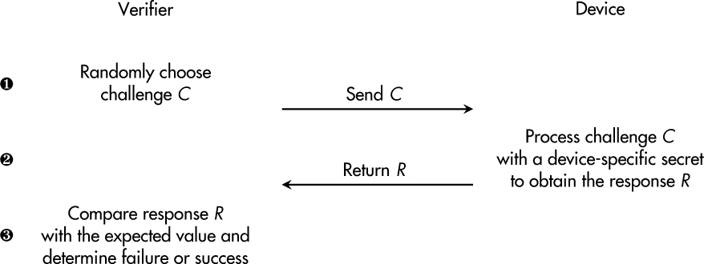
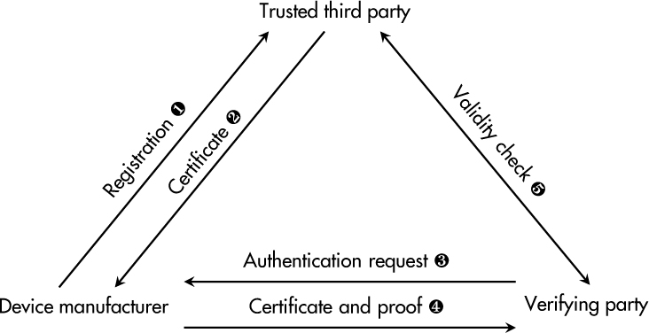
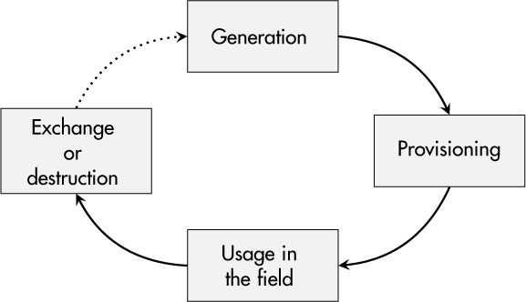

<a id="ch06"></a>

# <a id="page_101"></a>6 ĐỊNH DANH THIẾT BỊ AN TOÀN (SECURE DEVICE IDENTITY)

Trong một thời gian dài, embedded system chạy ẩn danh trong bóng tối và không quan tâm đến truy cập từ xa, các mô hình kinh doanh số hay việc chia sẻ dữ liệu với các thiết bị khác và dịch vụ cloud. Tuy nhiên, ngày nay, những kịch bản đó đã thay đổi về căn bản.

Đột nhiên, nhân viên bảo trì giờ đăng nhập vào thiết bị từ xa và không thể xác minh rằng họ đang làm việc với đúng thiết bị bằng cách nhìn vào các dấu hiệu vật lý. Ngoài ra, các mô hình kinh doanh pay-per-use ngày càng trở nên phổ biến trong các kịch bản công nghiệp, và các thiết bị tự viết hóa đơn của chúng. Khả năng chứng minh nguồn gốc của dữ liệu sử dụng và ánh xạ nó tới một khách hàng cụ thể là thiết yếu trong trường hợp này. Hơn nữa, các thiết bị do các nhà sản xuất khác nhau làm ra đã bắt đầu nói chuyện với nhau và trao đổi dữ liệu. Tất cả những xu hướng này có chung một yêu cầu mạnh: mọi thiết bị cần một định danh duy nhất, và mọi thiết bị phải có khả năng chứng minh nó.

Phần đầu của chương này khảo sát những thuộc tính nào góp phần vào tính duy nhất của thiết bị và có thể làm cơ sở cho định danh, cũng như các quá trình liên kết chặt chẽ là identification (nhận dạng) và authentication (xác thực). Tiếp theo, chúng ta sẽ xem việc hiện thực quản lý định danh thiết bị được nhìn nhận từ hai góc độ: việc lưu trữ on-device một định danh cryptography và việc quản lý life-cycle ở phía nhà sản xuất. Chương kết thúc với hai case study khám phá việc tạo và cung cấp (provisioning) định danh.

<a id="ch00lev1_50"></a>

## <a id="page_102"></a>Mọi thiết bị đều là duy nhất

Việc sản xuất hàng loạt hàng tiêu dùng và linh kiện công nghiệp có thể tạo ấn tượng rằng mọi sản phẩm ra khỏi dây chuyền đều giống hệt nhau, đến từng bit trong firmware của chúng. Tuy nhiên, nếu đúng như vậy, làm sao bạn có thể phân biệt thiết bị này với thiết bị khác? Dĩ nhiên, các sản phẩm từ lâu đã có nhãn dán số serial, nhưng nếu nhãn bị rơi, bị cố ý gỡ bỏ, hay thậm chí bị thay bằng một phiên bản giả mạo thì sao?

Đối với các thiết bị hiện đại, một định danh duy nhất nên là một phần không thể tách rời của chính thiết bị, và thành phần đó nên có khả năng chủ động chứng minh định danh của mình với các thiết bị third-party, cửa hàng sửa chữa và dịch vụ cloud của nhà sản xuất gốc, chỉ để kể vài ví dụ.

Từ góc nhìn lý thuyết, mọi thiết bị đơn lẻ—ngay cả với PCB, microprocessor và RAM giống hệt nhau—rõ ràng là duy nhất, vì tất cả các đơn vị này đều chịu những khác biệt riêng lẻ (dù chỉ nhỏ) về vật liệu, hành vi thời gian, mức tiêu thụ điện, v.v. Giới học thuật đã đang làm việc để khai thác tính duy nhất của những đặc điểm vật lý nhỏ bé này nhằm thiết lập định danh thiết bị. Lĩnh vực nghiên cứu tương ứng tập trung vào *physical unclonable function (PUF)*, gần đây thậm chí đã có mặt trong những sản phẩm thương mại đầu tiên.

Các phần sau khám phá những gì có thể có sẵn trong các thiết bị hiện tại khiến chúng trở nên duy nhất từ góc nhìn thực tế và cách những định danh duy nhất này có thể được chứng minh với các bên khác.

<a id="ch00lev1_51"></a>

## Identification và identifier

Rõ ràng, thuật ngữ *identification* liên quan chặt chẽ đến từ *identity* (định danh). Tuy nhiên, hãy dành một phút để nghĩ về ý nghĩa chính xác của nó.

Nếu chúng ta muốn định nghĩa quá trình identification, chúng ta có thể nói đó là “việc tuyên bố một định danh cho trước.” Ví dụ, nếu bạn gặp ai đó tại một hội nghị, bạn có thể nói, “Chào, tôi tên là Joe!” Bạn tuyên bố rằng mình là Joe. Điều tương tự xảy ra nếu thiết bị của bạn thu thập một số dữ liệu sử dụng—giả sử trong suốt một tháng—rồi kết nối tới backend của bạn để cung cấp dữ liệu cho việc tính phí khách hàng. Có lẽ nó sẽ bắt đầu bằng “Chào backend, tên tôi là XY1337-0815!” Nó tuyên bố là một thiết bị có một “tên” nhất định.

<a id="ch00lev2_61"></a>

### *Identifier duy nhất*

Về tính duy nhất, việc nói với ai đó rằng bạn là Joe rõ ràng là chưa đủ. Có thể có nhiều Joe, thậm chí có thể ở cùng hội nghị. Thêm họ của bạn có thể thu hẹp phạm vi, nhưng tên của bạn vẫn sẽ không duy nhất, ít nhất là ở quy mô toàn cầu. Nếu bạn xét thêm nơi sinh và ngày sinh, bạn sẽ tiến gần hơn đến một tập dữ liệu xác định duy nhất *bạn*. Những thuộc tính này được gọi là *identifier*. Con người có nhiều identifier hơn thế: màu tóc, màu mắt, kích thước, cân nặng, v.v.

Vì thiết bị thường không có tên human-like, các nhà sản xuất phải đi theo một con đường khác cho việc identification. Trong một thời gian dài, các identifier điển hình <a id="page_103"></a>là các giá trị vendor-chosen như loại model, số serial và ngày sản xuất.

Với sự ra đời của internet, nhu cầu về các identifier toàn cầu trở nên rõ ràng. Hồi đó, khái niệm UUID, còn được biết đến là *globally unique identifier (GUID)*, đã được đề xuất. Nó được tiêu chuẩn hóa trong RFC 4122, cùng các tài liệu khác, và nhằm cung cấp các identifier duy nhất 128-bit không đòi hỏi một quá trình đăng ký tập trung. Mặc dù xác suất va chạm identifier không bằng không, trên thực tế nó được coi là rất gần bằng không. Việc tạo UUID có thể, ví dụ, được thực hiện bởi RNG của Linux, như được thể hiện trong [Chương 3](ch03_random_number_generators.vi.md#ch03).

Từ góc nhìn cryptography, các public key được tạo bởi các thuật toán crypto bất đối xứng như RSA và ECDSA cũng hoàn toàn có thể đóng vai trò identifier. Chúng thậm chí có thể được kết hợp với tên chủ thể và các attribute khác để thu được một device certificate duy nhất cho việc identification, như, ví dụ, được tiêu chuẩn hóa trong tiêu chuẩn xác thực mạng IEEE 802.1AR.

<a id="ch00lev2_62"></a>

### *System identity (định danh hệ thống)*

Trong khi một số thiết bị gồm một thành phần trung tâm duy nhất cấu thành toàn bộ thiết bị và định danh của nó, các architecture sản phẩm khác mang tính module hơn và cho phép thay thế một phần trong trường hợp hỏng hóc hay nâng cấp phần cứng. Với các trường hợp sau, việc thảo luận những thành phần nào góp phần vào định danh của thiết bị và những thành phần nào không là đáng giá. Các phần vật lý của một embedded system cung cấp vô số identifier như địa chỉ media access control (MAC) của card mạng, chipset Bluetooth và bộ điều khiển Wi-Fi, nhưng cũng có số serial và identifier duy nhất của CPU, flash memory và phương tiện lưu trữ tháo rời.

Việc đòi hỏi một tập identifier là một phần của system identity cũng có nghĩa là system identity phải được tạo lại hay phê duyệt lại nếu một trong những phần đó thay đổi. Yêu cầu này có thể là một lợi thế cho nhà sản xuất—ví dụ, để buộc người dùng mua phụ tùng cùng thương hiệu—vì mọi lần thay thế đều đòi hỏi sự xác nhận của nhà sản xuất. Tuy nhiên, system identity và việc buộc phải có sự phê duyệt của nhà sản xuất cũng có thể gây thêm khối lượng công việc ở phía nhà sản xuất. Hơn nữa, nếu mọi thay đổi nhỏ đều đòi hỏi một vòng phản hồi với nhà sản xuất gốc, điều đó có thể hạn chế đáng kể sự tự do hành động của nhà vận hành trong công việc kinh doanh hằng ngày.

> **LƯU Ý**
>
> *Đôi khi độ tin cậy của một thiết bị là mục tiêu tối thượng, và nếu phần cứng của nó hỏng, nó phải được nhà vận hành thay thế ngay lập tức. Trong những trường hợp như vậy, việc cho phép định danh của thiết bị có thể chuyển giao được là hợp lý—ví dụ, với một thẻ nhớ tháo rời.*

<a id="ch00lev1_52"></a>

## Authentication và authenticator

Trong ngôn ngữ hằng ngày, *identification* và *authentication* đôi khi được dùng như từ đồng nghĩa, nhưng authentication có nghĩa nhiều hơn rất nhiều so với chỉ tuyên bố một định danh.

Nếu tính hợp lệ và đúng đắn của định danh của bạn thực sự quan trọng—ví dụ, nếu bạn phải xin hộ chiếu hay đăng ký bỏ phiếu—và bạn nói với <a id="page_104"></a>họ “Chào, tôi là Joe,” có lẽ họ sẽ đáp, “Chào Joe, vui lòng cho tôi xem thẻ căn cước.” Họ sẽ bắt bạn *chứng minh* định danh của mình—tương đương analog của một quá trình authentication số.

Thuật ngữ *authentication* có nghĩa là bạn phải *xác nhận* định danh mà bạn đã tuyên bố trong quá trình identification vài giây trước đó. Để làm vậy, bạn cần sở hữu một *authenticator* hợp lệ tương ứng với định danh cho trước. Với con người, authenticator có thể là thẻ căn cước, giấy phép lái xe, v.v. Với tất cả các loại giấy tờ này, một cơ quan có thẩm quyền tại một thời điểm nào đó đã xác minh định danh con người rồi cấp một authenticator tương ứng thường có hiệu lực trong một khoảng thời gian nhất định. Trong thời gian hiệu lực này, cơ quan đó và những bên khác có thể dùng authenticator được cung cấp để xác minh một định danh cụ thể.

Với thiết bị, các authenticator điển hình là symmetric secret key hay asymmetric private key, các authentication token (tạm thời), hay mật khẩu (trong các trường hợp legacy). Những authenticator này được tạo và cấp cho một thiết bị cụ thể (ví dụ, trong quá trình sản xuất), và chúng có thể được dùng để chứng minh bằng cryptography định danh của chính thiết bị đó vào một thời điểm sau.

<a id="ch00lev2_63"></a>

### *Authentication protocol*

Tùy thuộc vào loại authenticator, quá trình authentication được thực hiện theo các cách khác nhau. Một cách tiếp cận phổ biến là một *challenge-response authentication protocol*. [Hình 6-1](#ch06fig01) cho thấy một dạng handshake challenge-response.

<a id="ch06fig01"></a>

*Hình 6-1: Các bước điển hình trong challenge-response authentication*

Quá trình challenge-response authentication bắt đầu bằng việc tạo một challenge ngẫu nhiên *C* ➊ ở phía bên xác minh, sau đó được truyền tới thiết bị. Thiết bị xử lý giá trị không thể đoán trước này bằng authenticator bí mật của nó và tạo ra một response *R* được trả về cho bên xác minh ➋. Ở bước cuối cùng ➌, *R* được so sánh với giá trị kỳ vọng của nó để quyết định xem authentication có thành công không.

Đối với các bí mật đối xứng, thuật toán on-device xử lý challenge cho trước với bí mật device-specific có thể là một hash function hay một cấu trúc HMAC. Tuy nhiên, nhược điểm là bí mật cũng phải có sẵn trong cơ sở dữ liệu của bên xác minh để tính giá trị kỳ vọng đúng, và không chỉ được lưu duy nhất bên trong thiết bị.

<a id="page_105"></a>Ngược lại, asymmetric cryptography cho phép các authenticator device-only không bao giờ rời khỏi thiết bị, đây là giải pháp an toàn nhất. Cụ thể, các digital signature dựa trên RSA hay ECDSA, như được giải thích trong [Chương 2](ch02_cryptography.vi.md#ch02), có thể được dùng để tạo các authentication response từ các challenge ngẫu nhiên. Trong trường hợp này, bên xác minh chỉ cần public key tương ứng để kiểm tra tính hợp lệ của chữ ký được trả về.

> **LƯU Ý**
>
> *Trong hầu hết các trường hợp, authentication chỉ khả thi với các bí mật. Do đó, confidentiality là một protection goal tự nhiên đối với mọi loại authenticator. Nếu bị phá vỡ, việc mạo danh thiết bị trở thành một mối đe dọa có khả năng xảy ra.*

<a id="ch00lev2_64"></a>

### *Chip xác thực chuyên dụng*

Như đã giới thiệu trong [Chương 5](ch05_confidential_data_storage_and_secure_memory.vi.md#ch05), các nhà sản xuất bán dẫn cung cấp nhiều loại chip xác thực không chỉ lưu trữ an toàn các authenticator mà còn cung cấp một phương tiện thuật toán để thực hiện handshake challenge-response cho mục đích authentication.

Cách tiếp cận này có hai ưu điểm. Thứ nhất, việc trích xuất authenticator bí mật từ chip là một nhiệm vụ khá khó khăn đối với kẻ tấn công. Thứ hai, vì những chip này thường đi kèm hỗ trợ tích hợp cho asymmetric cryptography, chủ yếu là digital signature dựa trên elliptic curve, bí mật không bao giờ phải rời khỏi ranh giới vật lý của chip.

Mặt khác, với cách tiếp cận này, giờ bạn có thêm một thành phần trong BOM, bạn cần không gian trên PCB, và công sức tích hợp phần mềm cần thiết cho các thiết bị này khác nhau giữa các nhà cung cấp. Ngoài ra, một attack vector thường bị bỏ qua—cụ thể là việc chuyển vật lý một chip định danh như vậy sang một thiết bị khác. Các package 8-pin đơn giản có thể được tháo hàn và tích hợp vào một thiết bị gốc khác hay thậm chí vào một thiết bị tùy chỉnh của kẻ tấn công. Như trong các cuộc tấn công code-lifting, đối thủ có thể không quan tâm đến bí mật bên trong chip nếu họ có thể di chuyển toàn bộ con chip tới vị trí mong muốn.

<a id="ch00lev2_65"></a>

### *Multifactor authentication (xác thực đa yếu tố)*

Đối với việc xác thực người dùng con người, *multifactor authentication (MFA)* đã thu hút nhiều sự chú ý trong vài năm qua. Theo nguyên tắc defense in depth, MFA đòi hỏi kẻ tấn công phải chiếm được không chỉ một authenticator, như mật khẩu, mà còn ít nhất một yếu tố thứ hai, như một token tạm thời được tạo trong một ứng dụng di động hay bởi một hardware token. Vì mật khẩu được lưu trong bộ não con người (hay trình quản lý mật khẩu) và các authenticator bổ sung thường bắt nguồn từ một thiết bị phần cứng bổ sung hay ít nhất một kênh giao tiếp khác, công sức cần thiết cho các cuộc tấn công thành công cao hơn đáng kể.

Đối với việc xác thực thiết bị, tình huống hơi khác một chút vì thiết bị không dùng bộ não và ứng dụng di động để lưu trữ và tạo authenticator. Tuy nhiên, bạn vẫn có thể cân nhắc một cách tiếp cận đa yếu tố—ví dụ, dùng một authenticator được lưu trong firmware và một authenticator thứ hai bắt nguồn từ một chip xác thực chuyên dụng. Quá trình authentication khi đó sẽ gồm hai handshake, một với thành phần phần cứng <a id="page_106"></a>và một dựa trên phần mềm thiết bị, buộc kẻ tấn công phải xâm phạm hai phần khác nhau của thiết bị nếu họ muốn chiếm được định danh của nó.

Bên cạnh các authenticator tường minh bổ sung, bạn có thể dùng các tham số môi trường ngầm định để tăng cường xác thực thiết bị. Một ví dụ phổ biến là các giới hạn địa lý, còn được biết đến là *geo-fencing*. Trong kịch bản đó, việc xác thực thiết bị (hay hoạt động chung) chỉ thành công nếu vị trí của thiết bị khớp với một khu vực đã định nghĩa trước. Một cách để xác định tham số này là địa chỉ IP public mà thiết bị dùng cho giao tiếp internet. Dĩ nhiên, lợi ích bảo mật từ những thuộc tính xác thực ngầm định này được tối đa hóa nếu một kẻ tấn công đã xâm phạm thiết bị không thể giả mạo các tham số. Chúng nên có thể quan sát được từ bên ngoài chứ không chỉ được thiết bị tự tuyên bố.

<a id="ch00lev2_66"></a>

### *Trusted third party (bên thứ ba tin cậy)*

Trong quá khứ, bên xác minh chính đối với định danh của một thiết bị là nhà sản xuất của chính thiết bị đó. Các quá trình xác thực độc quyền (và có thể không an toàn) đã làm tốt công việc của chúng. Tuy nhiên, trong một hệ sinh thái số đa phương trong các kịch bản IoT và IIoT, nhu cầu về xác thực thiết bị cross-manufacturer trở nên hiển nhiên.

Yêu cầu này có nghĩa là các nhà sản xuất phải tin tưởng authenticator của các thiết bị khác, kể cả của đối thủ cạnh tranh. Vì các quan hệ tin cậy one-to-one giữa các nhà sản xuất sẽ dẫn đến overhead quản lý khổng lồ, khái niệm *trusted third party (TTP)* là cần thiết, như được thể hiện trong [Hình 6-2](#ch06fig02).

<a id="ch06fig02"></a>

*Hình 6-2: Vai trò của một trusted third party trong việc xác thực thiết bị*

Trong cách tiếp cận này, các nhà sản xuất đăng ký định danh thiết bị của họ với TTP ➊. Sau khi xác minh, TTP chứng nhận định danh đã cho và trả về một certificate device-specific ➋. Khi có một yêu cầu xác thực ngoài hiện trường ➌, thiết bị có thể cung cấp certificate đã được cấp và chứng minh bằng cryptography rằng nó sở hữu các authenticator tương ứng ➍. Tuy nhiên, ở điểm này, bên xác minh không thể chắc chắn rằng dữ liệu cryptography đã cho tương ứng với định danh thiết bị thực sự. Cuối cùng, bên xác minh phải kiểm tra tính hợp lệ của việc xác thực ➎, hoặc bằng giao tiếp trực tiếp với <a id="page_107"></a>TTP hoặc bằng cách dùng dữ liệu như public key do TTP cung cấp. Sau đó, một quan hệ tin cậy vững chắc với một thiết bị trước đó chưa biết có thể được thiết lập.

<a id="ch00lev2_67"></a>

### *Certificate và certificate authority*

Tôi đã dùng thuật ngữ *certificate* để mô tả một tài liệu số do TTP cấp để xác nhận định danh của một thiết bị. Về mặt kỹ thuật, các hiện thực phổ biến nhất của khái niệm này là các certificate X.509 v3 dựa trên asymmetric cryptography như được đặc tả trong RFC 5280.

Mục đích của những certificate này là gắn một public key cho trước với chủ thể tương ứng của nó, như một thiết bị, và với một tập attribute bao gồm thời hạn hiệu lực và số serial của certificate. Một *certificate authority (CA)* ký số những giá trị này bằng private key của chính nó. CA này cũng được đưa vào certificate, trong trường `Issuer`. Kết quả là phiên bản nhỏ nhất của một *certificate chain*, nghĩa là một device certificate và public key của nó có thể được xác minh bằng cryptography, và nếu thành công, certificate tiếp theo (cụ thể là certificate của CA) phải được xác minh. Việc xác thực chỉ được tin cậy nếu cả hai lần xác minh đều thành công.

Trên thực tế, một nhà sản xuất có thể có product CA riêng, được chứng nhận bởi một intermediate CA của một TTP, CA này lại được chứng nhận bởi một root CA được công nhận quốc tế. Với quá trình đó, các certificate chain phân cấp khá phức tạp được thiết lập, phải được xác minh lên đến tận root, bất cứ khi nào một thiết bị cần tự xác thực.

Các *root certificate* không được ai chứng nhận; chúng là self-signed và phải có sẵn trong một dạng root store nào đó ở phía bên xác minh. Điều này có nghĩa là các bên xác minh cũng phải tin tưởng vô điều kiện mọi root certificate của họ. Do đó, root store đòi hỏi bảo vệ integrity mạnh; nếu không, kẻ tấn công có thể đưa vào các quan hệ tin cậy mới bằng cách thao túng các certificate được lưu.

Trong một số trường hợp, một certificate không thể được tin cậy cho đến khi thực sự hết hiệu lực—ví dụ, do một private-key compromise (private key bị xâm phạm), thiết bị bị đánh cắp, hay vấn đề tương tự. Cho những tình huống như vậy, CA duy trì một *certificate revocation list (CRL)* liệt kê mọi certificate không còn được tin cậy dù thời hạn hiệu lực của chúng chưa kết thúc. *Online Certificate Status Protocol (OCSP)* là một protocol phổ biến để kiểm tra trạng thái thu hồi của một certificate trong quá trình xác thực, như được tiêu chuẩn hóa trong RFC 6960.

Toàn bộ architecture xác minh, chứng nhận và thu hồi, cùng các quy trình và dịch vụ tương ứng, thường được gọi là *public-key infrastructure (PKI)*. Vì một hệ thống như vậy đòi hỏi công sức bảo trì và tài liệu đáng kể, các công ty nhỏ và medium-sized thường ngần ngại tự hiện thực nó và thay vào đó dựa vào các nhà cung cấp dịch vụ PKI, tức là các TTP.

<a id="ch00lev1_53"></a>

## Life cycle và quản lý định danh

Giờ chúng ta đã đề cập các khái niệm cơ bản về xác thực thiết bị, phần này thiết lập nhu cầu về các chiến lược đáng tin cậy để quản lý *life cycle* của <a id="page_108"></a>định danh thiết bị. Life-cycle management (quản lý life cycle) có bốn bước chính, như được mô tả trong [Hình 6-3](#ch06fig03): tạo định danh, cung cấp nó trong các hệ thống của nhà sản xuất cũng như bên trong thiết bị, sử dụng hằng ngày ngoài hiện trường, và việc thay thế hay hủy định danh đó thường bị lãng quên (often-forgotten).

<a id="ch06fig03"></a>

*Hình 6-3: Life cycle của định danh thiết bị*

> **CẢNH BÁO**
>
> *Đừng coi việc quản lý life-cycle là tùy chọn. Ngay cả khi bạn đã giải quyết mọi thách thức kỹ thuật liên quan đến identifier, cryptography và secure memory, hãy bảo đảm tổ chức của bạn có câu trả lời cho các thách thức tổ chức phía trước.*

<a id="ch00lev2_68"></a>

### *Tạo định danh*

Định danh của một thiết bị có thể được tạo ở nhiều nơi và vào nhiều thời điểm khác nhau. Nơi và thời điểm bạn chọn ảnh hưởng đến các yêu cầu bảo mật và thủ tục của quy trình sản xuất. Nếu bạn dùng dịch vụ electronics manufacturing services (EMS) để sản xuất sản phẩm, một sự hợp tác tin cậy và chặt chẽ với nhà cung cấp dịch vụ của bạn là thiết yếu.

Tạo định danh trên chính thiết bị trong quá trình sản xuất có thể là lựa chọn an toàn nhất, nhưng chỉ khi các bí mật xác thực tương ứng *không bao giờ* rời khỏi thiết bị. Asymmetric cryptography cho phép use case này vì private key được tạo ra có thể nằm lại trên thiết bị, và public key tương ứng có thể được cung cấp cho các bên xác minh tiềm năng. Dĩ nhiên, bạn cũng có thể tạo một bí mật đối xứng trên thiết bị trong quá trình sản xuất, nhưng trong trường hợp đó, key phải được xuất ra sau đó để cho phép xác minh định danh.

Trong khi việc tạo on-device có ưu điểm bảo mật, nó đi kèm các thách thức vận hành và thực tế. Hãy tưởng tượng một thiết bị “mất” định danh của nó vì memory lưu định danh bị hỏng. Nếu đó là nơi lưu trữ duy nhất, một định danh mới phải được tạo sau khi sửa chữa, điều có thể dẫn đến xung đột vì một mục mới được tạo trong cơ sở dữ liệu sản phẩm của bạn, nhưng phần cứng thực ra là cũ. Ngoài ra, khách hàng của bạn sẽ phải thay định danh thiết bị cũ bằng định danh mới trong hệ thống quản lý tài sản của họ. Nếu bạn với tư cách nhà sản xuất có một bản sao lưu định danh, trường hợp này có thể được xử lý dễ dàng, nhưng phải trả giá bằng bảo mật.

Nhược điểm thứ hai của việc tạo on-device có thể là việc định danh sản phẩm có sẵn muộn, vì chúng chỉ có sẵn sau khi một bước sản xuất nhất định hoàn tất. Đôi khi đó có thể chính là điều bạn muốn, <a id="page_109"></a>nhưng nếu định danh thiết bị của bạn phải được đưa vào các hệ thống IT của chính bạn để cho phép vận hành trơn tru ngay từ ngày đầu, bạn có thể muốn chuẩn bị những quy trình đó với định danh thiết bị ngay cả trước khi sản xuất thực sự.

> **CẢNH BÁO**
>
> *On-device identity generation (tạo định danh trên thiết bị) dựa trên key RSA là một quá trình không tất định và mất một lượng thời gian thay đổi. Hạn chế này phải được xem xét khi lên kế hoạch các quy trình sản xuất, đặc biệt đối với các thiết bị low-performance.*

Việc tạo định danh bên ngoài thiết bị mang lại sự linh hoạt hơn trong việc quản lý định danh thiết bị trước khi sản xuất và trong các trường hợp sửa chữa. Các bí mật xác thực được chuẩn bị trước trong một hệ thống quản lý định danh và được cung cấp cho khâu sản xuất ở bước thứ hai. Tuy nhiên, điều này có nghĩa là những định danh này tồn tại trước cả khi thiết bị thực được lắp ráp và, dĩ nhiên, chúng đã mang các protection goal confidentiality và integrity. Việc lộ thông tin hay thao túng dữ liệu trước khi sản xuất có thể có hậu quả nghiêm trọng đối với bảo mật sản phẩm của bạn.

Một điểm cuối cùng có thể ảnh hưởng đến quyết định tạo on-/off-device của bạn là sự tham gia của một TTP. Nếu bạn tạo định danh trong quá trình sản xuất, chúng phải được đăng ký, xác minh và chứng nhận với một bên thứ ba trong một lịch trình chặt chẽ. Dĩ nhiên, điều đó là khả thi và đáng mong muốn, và nó đã được những người dẫn đầu trong lĩnh vực này hiện thực, nhưng nó đòi hỏi một lượng đáng kể công sức về hạ tầng và quản lý quy trình.

<a id="ch00lev2_69"></a>

### *Provisioning (cung cấp định danh)*

Tùy thuộc vào giai đoạn tạo định danh, bước provisioning tiếp theo có hai dạng với các ưu nhược điểm riêng. Trong cả hai trường hợp, kết quả cuối cùng nên là định danh được cung cấp trên chính thiết bị và trong hệ thống product-tracking và quản lý định danh của nhà sản xuất và của nhà cung cấp EMS có tham gia.

Sau khi tạo on-device, mọi hệ thống của nhà sản xuất phải được cung cấp định danh mới, điều đòi hỏi một bước read-out trong quá trình sản xuất. Đối với crypto bất đối xứng, chỉ public key hay một certificate tương ứng từ một TTP phải được lưu trong cơ sở dữ liệu định danh của nhà sản xuất. Tuy nhiên, nếu mong muốn có bản sao lưu các bí mật xác thực, bạn có thể tạo chúng bằng cách trích xuất private key tại thời điểm này.

Việc tạo định danh offline đòi hỏi luồng thông tin theo chiều ngược lại—cụ thể là từ một hệ thống quản lý định danh tới thiết bị sắp được sản xuất. Rõ ràng, một bước lập trình là cần thiết, trong đó bí mật và các attribute của định danh được tạo trước được ghi vào các vị trí memory hay tài nguyên phần cứng cụ thể bên trong sản phẩm. Bước này có thể được tích hợp trong các thủ tục lập trình firmware hiện có hay các quy trình tương tự.

Trong tất cả các trường hợp này, khi dữ liệu nhạy cảm được truyền tới hay từ một thiết bị trong quá trình provisioning, ít nhất integrity và thường cả confidentiality của giao tiếp này nên được bảo đảm. Nếu không, các bí mật xác thực có thể bị lộ, thiết bị có thể kết thúc với một định danh bị thao túng, hay dữ liệu định danh của nhà sản xuất có thể bị hỏng.

> <a id="page_110"></a>**LƯU Ý**
>
> *Nếu định danh thiết bị của bạn được tạo trước khi sản xuất rồi được gửi tới nhà cung cấp EMS qua email hay trên một USB gửi bằng đường bưu điện, hãy cân nhắc kỹ xem điều này có đáp ứng protection goal của bạn không. Nếu thành thật, có lẽ là không.*

<a id="ch00lev2_70"></a>

### *Sử dụng ngoài hiện trường*

Các định danh đã được tạo và cung cấp trước đó được dùng để xác thực ngoài hiện trường. Cho đến giờ mọi thứ đều ổn. Chúng ta có thể thực hiện thêm biện pháp phòng ngừa nào trong quá trình sử dụng hằng ngày không? Chắc chắn rồi. Một hệ thống quản lý định danh cho phép chúng ta thực hiện các kiểm tra sanity và tính hợp lý bất cứ khi nào thiết bị xác thực với hệ thống của chúng ta.

Hãy tưởng tượng các log xác thực của bạn cho thấy cùng một thiết bị kết nối từ hai vị trí trong một khoảng thời gian ngắn. Đây có thể là dấu hiệu cho thấy ai đó đã đánh cắp định danh của một thiết bị và đang dùng nó cho mục đích riêng. Nếu những trường hợp như vậy có thể được xác định sớm và các cuộc điều tra cụ thể được tiến hành kịp thời, thiệt hại có thể được hạn chế đáng kể.

<a id="ch00lev2_71"></a>

### *Thay thế hay hủy bỏ*

Ngay cả khi một số thiết bị (đặc biệt trong các ứng dụng công nghiệp, quân sự hay vũ trụ) được dự định tồn tại mãi mãi về mặt vật lý, các bí mật xác thực của chúng thường thì không. Trên internet, thời hạn hiệu lực phổ biến cho certificate của web server là 90 ngày (như, ví dụ, được Let’s Encrypt hiện thực tại *[https://letsencrypt.org](https://letsencrypt.org)*), nghĩa là những định danh này phải được tạo lại ít nhất mỗi ba tháng.

Rõ ràng, việc làm mới định danh trong các kịch bản IoT và IIoT vẫn còn rất xa những tần suất cao như vậy. Tuy nhiên, ít nhất nếu certificate X.509 được dùng cho mục đích xác thực, thời hạn hiệu lực là một tham số bắt buộc phải được chỉ định, hoặc bởi công ty của bạn hoặc bởi TTP bạn chọn. Một số nhà sản xuất cấp device certificate với thời hạn hiệu lực 20 năm hay hơn, nhưng ngay cả khi crypto được chọn là future-proof, rất khó ước lượng liệu một định danh như vậy còn đáng tin cậy sau 15 năm hay hơn.

Một số sản phẩm mạng (ví dụ, của Cisco) hỗ trợ các protocol quản lý certificate như *Simple Certificate Enrollment Protocol (SCEP)* hay lựa chọn thay thế mới hơn của nó, *Enrollment over Secure Transport (EST)*. Vì đây là vùng đất mới đối với các thiết bị IoT và IIoT, chưa có tiêu chuẩn chung nào được thiết lập tại thời điểm viết sách, nhưng khá rõ ràng rằng tự động hóa là chìa khóa cho việc quản lý định danh và certificate liên tục và đáng tin cậy.

> **LƯU Ý**
>
> *Năm 2022, các nhà sản xuất security gateway dùng để truy cập hạ tầng telematics y tế của Đức tuyên bố rằng các thiết bị phải được thay thế vật lý vì hiệu lực của các định danh cryptography five-year của chúng đã đến hạn. Sau đó, Chaos Computer Club (CCC) đã chứng minh điều ngược lại và, theo lời của chính họ, đã tiết kiệm cho hệ thống y tế Đức* €*400 triệu. Đây chỉ là một ví dụ nhấn mạnh tầm quan trọng của các quy trình identity-renewal vững chắc.*

<a id="page_111"></a>Bước cuối cùng trong life cycle của một định danh theo đúng nghĩa đen là việc hủy bỏ nó. Mặc dù việc gỡ bỏ vật lý không phải lúc nào cũng khả thi, một nhà sản xuất ít nhất nên chuẩn bị sẵn để thu hồi quan hệ tin cậy cho một thiết bị cụ thể nếu nó đến cuối vòng đời trước khi hết thời hạn hiệu lực đã định. Một biện pháp điển hình cho mục đích này là một CRL do CA duy trì hay một flag trạng thái tin cậy trong cơ sở dữ liệu nhà sản xuất của chính bạn.

<a id="ch00lev1_54"></a>

## Case Study: Tạo và cung cấp định danh

Trong case study này, tôi khảo sát tính khả dụng của các identifier cho một STM32-MP157F-DK2 và cách trích xuất chúng để dẫn xuất một system identity. Hơn nữa, chúng ta sẽ xem cách chuẩn bị một certificate signing request trên thiết bị này, sau đó có thể được cung cấp cho một TTP, bên này đến lượt mình có thể cấp một device certificate hợp lệ.

<a id="ch00lev2_72"></a>

### *Identifier và system identity*

Bộ kit đánh giá STM32MP157F-DK2 là một embedded system gồm nhiều thành phần. Nhiều thành phần trong số này đi kèm identifier riêng mà kỹ sư có thể thu thập và dùng để tạo một định danh thiết bị toàn diện.

Một identifier phổ biến là số serial của CPU chính của thiết bị. Về điểm này, *Reference Manual RM0436* của ST cho các thiết bị STM32MP157F nói: “Identifier thiết bị duy nhất 96-bit cung cấp một số tham chiếu, duy nhất cho một thiết bị cho trước và trong mọi ngữ cảnh. Người dùng không thể thay đổi các bit này.” Unique ID (UID) này được lưu bất biến trong OTP memory của chip STM32-MP157F. [Listing 6-1](#ch06list01) cho thấy UID này được chia thành ba word 32-bit có thể được đọc từ các memory address cụ thể.

```
Base address: 0x5C00 5000 (BSEC base address on APB5)
Address offset: 0x234 = UID[31:0]
Address offset: 0x238 = UID[63:32]
Address offset: 0x23C = UID[95:64]
```

<a id="ch06list01"></a>

*Listing 6-1: Các địa chỉ vật lý của UID trong thiết bị STM32MP157F*

Chúng ta có thể dùng công cụ command line `devmem2` để đọc các memory address vật lý. Như được thể hiện trong [Listing 6-2](#ch06list02), ứng dụng xuất ra ba word 32-bit biểu diễn định danh của chip, khi cho trước một tổ hợp base address và các offset UID.

<a id="page_112"></a>

```
# devmem2 0x5c005234
...
Read at address  0x5C005234 (0xb6fb0234): 0x0038003D
# devmem2 0x5c005238
...
Read at address  0x5C005238 (0xb6fb9238): 0x34385114

# devmem2 0x5c00523c
...
Read at address  0x5C00523C (0xb6f1423c): 0x36383238
```

<a id="ch06list02"></a>

*Listing 6-2: Đọc CPU UID của thiết bị STM32MP157F của tôi từ các địa chỉ vật lý*

Trên các hệ thống Linux, số serial cũng có sẵn từ */proc/cpuinfo*. Đầu ra được thể hiện trong [Listing 6-3](#ch06list03) xác nhận rằng số serial giống với số được trích xuất từ các vị trí memory thô trước đó.

```
# cat /proc/cpuinfo | grep Serial
Serial : 0038003D3438511436383238
```

<a id="ch06list03"></a>

*Listing 6-3: Lấy số serial CPU có sẵn trong Linux*

Tuy nhiên, chip STM32MP157F không phải là chip duy nhất trên PCB. *User Manual UM2637* của ST mô tả vô số interface giao tiếp được hiện thực. Bên cạnh mạng Ethernet cổ điển, thiết bị có một IC cung cấp khả năng Wi-Fi và Bluetooth. Tất cả các interface này đều có địa chỉ MAC duy nhất có thể được dùng để dẫn xuất system identity. [Listing 6-4](#ch06list04) cho thấy cách trích xuất những giá trị đó khi chạy trên Linux.

```
# cat /sys/class/net/eth0/address
10:e7:7a:e1:81:65
# cat /sys/class/net/wlan0/address
48:eb:62:c4:0a:08
# cat /sys/kernel/debug/bluetooth/hci0/identity
43:43:a1:12:1f:ac (type 0) 00000000000000000000000000000000 00:00:00:00:00:00
```

<a id="ch06list04"></a>

*Listing 6-4: Trích xuất địa chỉ MAC Ethernet, Wi-Fi và Bluetooth trong Linux*

Cuối cùng, một phần của hệ thống có thể được tháo ra và thay thế dễ dàng: thẻ nhớ tháo rời. Trong trường hợp của tôi, đó là một thẻ microSD chứa một *card identification (CID)*. Giá trị 128-bit này xác định duy nhất một thẻ SD. Trong số các thông tin khác, nó chứa ID nhà sản xuất, số serial sản phẩm và ngày sản xuất. Một lần nữa, Linux cung cấp một mục tương ứng trong `sysfs` của nó có thể được đọc ra như được minh họa trong [Listing 6-5](#ch06list05).

```
# cat /sys/block/mmcblk0/device/cid
275048534431364760dad3df9a013780
# cat /sys/block/mmcblk0/device/serial
0xdad3df9a
```

<a id="ch06list05"></a>

*Listing 6-5: Đọc CID duy nhất của một thẻ SD*

Bên cạnh giá trị `cid`, Linux cung cấp giá trị `serial` cho thẻ SD, vốn chỉ chứa số serial của thẻ nhớ.

Cho case study này, hãy giả định nhóm của bạn đã chọn dùng ID của CPU trung tâm và địa chỉ MAC Wi-Fi làm hai system identifier liên quan. Chúng có thể được kết hợp bằng một hash function, như được thể hiện trong phần tiếp theo.

<a id="ch00lev2_73"></a>

### <a id="page_113"></a>*Certificate Signing Request*

Một *certificate signing request (CSR)* là một cấu trúc dữ liệu yêu cầu một CA chứng nhận rằng một public key cho trước được gắn với một định danh cụ thể, trong trường hợp này là một định danh thiết bị. Linux cung cấp nhiều cách để tạo một CSR và cung cấp thông tin cần thiết. [Listing 6-6](#ch06list06) cho thấy các import cần thiết để thực hiện việc tạo key RSA và tạo CSR với sự trợ giúp của module Python `cryptography`. Ngoài ra, module `subprocess` được đưa vào để lấy các system identifier bằng cách dùng các công cụ command line có sẵn.

```
import subprocess
from cryptography.hazmat.primitives import serialization
from cryptography.hazmat.primitives.asymmetric import rsa
from cryptography import x509
from cryptography.x509.oid import NameOID
from cryptography.hazmat.primitives import hashes
```

<a id="ch06list06"></a>

*Listing 6-6: Các import cần thiết từ các module* `cryptography` *và* `subprocess`

Phần đầu tiên của việc tạo định danh on-device thường dựa trên asymmetric cryptography (trong trường hợp này là RSA). Như được thể hiện trong [Listing 6-7](#ch06list07), một cặp key ngẫu nhiên có thể được tạo chỉ bằng một dòng.

```
# Generate RSA key
key = rsa.generate_private_key(public_exponent=65537, key_size=4096 ➊)

# Write key to disk
with open('dev.key', 'wb') as f:
    f.write(key.private_bytes(
        encoding=serialization.Encoding.PEM,
        format=serialization.PrivateFormat.TraditionalOpenSSL,
        encryption_algorithm=
        serialization.BestAvailableEncryption(➋ b'PrivateKeyPassphrase'),
    ))
```

<a id="ch06list07"></a>

*Listing 6-7: Tạo on-device một cặp key RSA*

Cho case study này, tôi quyết định dùng độ dài key RSA 4,096 bit ➊ để tính đến vòng đời nhiều năm của một thiết bị (I)IoT. Để đơn giản hóa ví dụ này, private key được tạo ra được lưu trong file *dev.key* và được bảo vệ bằng một passphrase tiêu chuẩn ➋. Trong một môi trường sản xuất thực tế, key nên được lưu theo cách an toàn, như được thảo luận trong [Chương 5](ch05_confidential_data_storage_and_secure_memory.vi.md#ch05).

[Listing 6-8](#ch06list08) cho thấy một thủ tục ví dụ về việc thu thập và xử lý identifier.

<a id="page_114"></a>

```
   # Collect system data
➊ output = subprocess.Popen('cat /proc/cpuinfo | grep Serial',
            shell=True, stdout=subprocess.PIPE)
   cpu_serial = output.stdout.read().split()[2](@\newpage@)
➋ output = subprocess.Popen('cat /sys/class/net/wlan0/address',
            shell=True, stdout=subprocess.PIPE)
   wifi_mac = output.stdout.read().split()[0]

   # Hash collected system data
➌ digest = hashes.Hash(hashes.SHA256())
   digest.update(cpu_serial)
   digest.update(wifi_mac)
   system_id = digest.finalize()
➍ system_id = system_id[:4].hex()
```

<a id="ch06list08"></a>

*Listing 6-8: Thu thập và xử lý một identifier on-device*

*(ghi chú: sách in `(@\newpage@)` ở cuối dòng `cpu_serial = …`; đây là lệnh dàn trang LaTeX bị lọt vào, không thuộc code.)*

Ở bước đầu tiên, số serial CPU ➊ và địa chỉ MAC Wi-Fi ➋ của hệ thống được sản xuất được đọc bằng các phương tiện mà Linux cung cấp. Sau đó, hash function SHA-256 ➌ được dùng để xử lý những giá trị đó và dẫn xuất một system identifier 4-byte ➍, identifier này sẽ thay đổi nếu CPU hay chip Wi-Fi bị thay thế trong tương lai. ID của thẻ SD cố ý bị bỏ qua, vì thẻ SD thỉnh thoảng lại hỏng, điều sẽ dẫn đến nhu cầu tạo lại định danh cao một cách không cần thiết.

Đối với một device certificate và một CSR, bạn cần chỉ định một *common name* cho thiết bị, như được thể hiện trong [Listing 6-9](#ch06list09).

```
   # Manufacturer data
   manufacturer = 'IoT Devices Corp'
   manufacturer_device_serial_no = 'IOTDEV-1337-08151234'

   # System name for CSR and certificate
➊ cert_common_name = manufacturer_device_serial_no + '-' + system_id

   # Generate CSR and sign with private key
   csr = x509.CertificateSigningRequestBuilder().subject_name(x509.Name([
       x509.NameAttribute(NameOID.ORGANIZATION_NAME, manufacturer),
    ➋  x509.NameAttribute(NameOID.COMMON_NAME, cert_common_name),
➋ ])).sign(key, hashes.SHA256())

   # Write CSR to disk
   with open('dev.csr', 'wb') as f:
       f.write(csr.public_bytes(serialization.Encoding.PEM))
```

<a id="ch06list09"></a>

*Listing 6-9: Chuẩn bị CSR on-device*

Trong case study này, tên thiết bị duy nhất là sự kết hợp của số serial do nhà sản xuất cấp và system identifier hardware-dependent ➊. Chuỗi này được dùng làm đầu vào cho việc tạo CSR ➋, cùng với tên nhà sản xuất trong trường *organization* của CSR. Cuối cùng, thiết bị ký CSR bằng private key bí mật duy nhất của nó ➌. Sau đó, CSR được lưu trong file *dev.csr*.

File CSR đã lưu phải được truyền tới CA chịu trách nhiệm chứng nhận định danh của các thiết bị được sản xuất. Ngoài ra, nhà sản xuất hay nhà cung cấp EMS <a id="page_115"></a>có thể trích xuất dữ liệu thiết bị đã thu thập và tạo ra vào một cơ sở dữ liệu. Ví dụ, [Listing 6-10](#ch06list010) cho thấy dữ liệu từ một thiết bị STM32MP157F.

```
Collected CPU serial number:  0038003D3438511436383238
Collected Wi-Fi MAC address:  48:eb:62:c4:0a:08
Derived system identifier:    f30cf858
Given device serial number:   IOTDEV-1337-08151234
Common name in certificate:   IOTDEV-1337-08151234-f30cf858
```

<a id="ch06list010"></a>

*Listing 6-10: Ví dụ đầu ra dữ liệu identifier từ thiết bị STM32MP157F của tôi*

Như bạn có thể thấy, một system identifier 4-byte được tạo ra từ các identifier riêng lẻ được liệt kê và được nối vào số serial của thiết bị. Chuỗi này sau đó được dùng làm common name cho CSR được tạo ra.

<a id="ch00lev2_74"></a>

### *Certificate Authority*

Trước khi cấp certificate cuối cùng, hãy xem CSR chứa những gì. [Listing 6-11](#ch06list011) cho thấy cách hiển thị nội dung CSR bằng công cụ command line `openssl req`.

```
$ openssl req -in dev.csr -noout -text
Certificate Request:
    Data:
        Version: 1 (0x0)
      ➊ Subject: O = IoT Devices Corp, CN = IOTDEV-1337-08151234-f30cf858
      ➋ Subject Public Key Info:
            Public Key Algorithm: rsaEncryption
                Public-Key: (4096 bit)
                Modulus:
                    00:d3:a0:14:fb:e1:0e:d0:74:3d:26:d4:ef:a1:ed:
                    ...
                    c9:2a:f5:46:e4:b2:ad:a9:5e:ee:cb:79:85:d9:1e:
                    9f:3e:57
                Exponent: 65537 (0x10001)
        Attributes:
            (none)
            Requested Extensions:
    Signature Algorithm: sha256WithRSAEncryption
  ➌ Signature Value:
         81:98:b1:e8:c2:fe:3a:55:32:39:2e:27:ce:2c:a8:54:bd:04:
         ...
         17:77:6c:a1:5b:4a:a7:ed:22:55:33:23:26:55:05:90:26:d2:
         90:7a:5e:34:65:80:32:4e
```

<a id="ch06list011"></a>

*Listing 6-11: Ví dụ CSR cho thiết bị STM32MP157F cụ thể của tôi*

Chủ thể ➊ được biểu diễn bởi một chuỗi organization (`O`) và một common name (`CN`) như được chỉ định trong script chuẩn bị CSR của chúng ta trong [Listing 6-9](#ch06list09), <a id="page_116"></a>tiếp theo là public key RSA tương ứng ➋. Digital signature của thiết bị ➌ có thể được nhận ra rõ ràng ở cuối request đã cho. CA có thể dùng nó để xác minh xem chủ thể yêu cầu có thực sự có quyền truy cập vào private key tương ứng với public key đã cho trong CSR không.

Các hạ tầng CA và PKI thường gồm các quy trình phức tạp với nhiều biện pháp tổ chức và kỹ thuật để bảo đảm hoạt động đúng đắn và đáng tin cậy. Như được thể hiện trong [Listing 6-12](#ch06list012), chúng ta tạo một CA thử nghiệm còn xa mới production-ready nhưng ổn cho mục đích giáo dục. Thuật ngữ *quick and dirty* (nhanh và ẩu) có thể áp dụng ở đây.

```
$ openssl genrsa -out ca.key 4096
$ openssl req -new -x509 -key ca.key \
              -subj "/C=DE/L=Augsburg/O=Super Trusted Party/CN=CA 123" \
              -out ca.crt
```

<a id="ch06list012"></a>

*Listing 6-12: Tạo nhanh một CA thử nghiệm bằng các công cụ* `openssl`

Chúng ta có thể tạo CA thử nghiệm với sự trợ giúp của công cụ `openssl genrsa`. Lệnh đầu tiên trong [Listing 6-12](#ch06list012) tạo một cặp key RSA 4,096-bit cho CA và lưu nó thành *ca.key*. Vì, trong case study này, đây là root của CA, certificate tương ứng phải là self-signed. Certificate *ca.crt* có thể thu được bằng cách dùng công cụ `openssl req` và cho nó biết các attribute của CA—ví dụ, quốc gia (`DE` cho Đức) và thành phố nơi nó đặt trụ sở (`Augsburg`), tên tổ chức của nó (`Super Trusted Party`) và common name của nó (`CA 123`).

Sau khi CA đã đăng ký và xác minh thành công certificate request đang xét, nó lấy dữ liệu CSR và thêm các attribute như thời hạn hiệu lực. Trong [Listing 6-13](#ch06list013), bạn có thể thấy tham số `-days` được đặt là `3650`, nghĩa là certificate được cấp có hiệu lực trong 10 năm.

```
$ openssl x509 -req -in dev.csr -CA ca.crt -CAkey ca.key -CAcreateserial \
               -days 3650 -out dev.crt
```

<a id="ch06list013"></a>

*Listing 6-13: Tạo một certificate từ một CSR bằng công cụ* `openssl`

Trong quá trình tạo device certificate, CA quyết định độ dài thời hạn hiệu lực, nhưng dĩ nhiên điều đó có ảnh hưởng đến life cycle định danh thiết bị của bạn. Hãy bảo đảm chọn giá trị này một cách có cân nhắc.

Hãy xem kết quả cuối cùng của quá trình đầy đòi hỏi này. Công cụ `openssl x509` có thể xuất ra nội dung device certificate, như được thể hiện trong [Listing 6-14](#ch06list014).

<a id="page_117"></a>

```
$ openssl x509 -in dev.crt -noout -text
Certificate:
    Data:
        Version: 1 (0x0)
        Serial Number:
         ➊ 45:3c:c3:30:c1:e3:c2:a9:49:5c:14:d6:16:5d:79:69:24:6c:31:66
        Signature Algorithm: sha256WithRSAEncryption
      ➋ Issuer: C = DE, L = Augsburg, O = Super Trusted Party, CN = CA 123
        Validity
            Not Before: Apr  5 11:18:13 2024 GMT
          ➌ Not After : Apr  2 11:18:13 2034 GMT
        Subject: O = IoT Devices Corp, CN = IOTDEV-1337-08151234-f30cf858
        Subject Public Key Info:
            Public Key Algorithm: rsaEncryption
                RSA Public-Key: (4096 bit)
                Modulus:
                    00:d3:a0:14:fb:e1:0e:d0:74:3d:26:d4:ef:a1:ed:
                    ...
                    c9:2a:f5:46:e4:b2:ad:a9:5e:ee:cb:79:85:d9:1e:
                    9f:3e:57
                Exponent: 65537 (0x10001)
    Signature Algorithm: sha256WithRSAEncryption
  ➍ Signature Value:
         75:d5:07:71:ec:fe:c6:27:fd:e2:a7:1c:fa:b9:89:b3:9c:0f:
         ...
         8d:fa:f6:f1:53:79:32:1e:a8:ec:6f:f7:03:57:2f:7b:f4:fb:
         45:77:6a:f8:c6:70:72:41
```

<a id="ch06list014"></a>

*Listing 6-14: Nội dung certificate của một thiết bị mẫu*

So với CSR ban đầu, bạn có thể thấy CA đã thêm một số serial certificate ➊ và dữ liệu của chính nó ở trường `Issuer` ➋. Thời hạn hiệu lực ➌ được đặt là 10 năm kể từ thời điểm cấp. Và, cuối cùng, tất cả các attribute này được CA ký ➍ cùng với thông tin của thiết bị và public key của nó. Giờ mọi thực thể tin tưởng CA được dùng đều có thể xác thực thiết bị được sản xuất.

Sau khi cấp certificate, nó phải được cung cấp cho chính thiết bị, nhưng cũng cho hệ thống quản lý định danh của nhà sản xuất. Trong quá trình sản xuất, toàn bộ quá trình tạo, cấp certificate và provisioning này nên chạy với mức độ tự động hóa cao và với các biện pháp phòng ngừa được áp dụng để giảm thiểu các mối đe dọa đối với confidentiality và integrity.

<a id="ch00lev1_55"></a>

## Case Study: Tạo key RSA trong sản xuất

Mặc dù ECDSA có một số ưu điểm so với RSA, như được thảo luận trong [Chương 2](ch02_cryptography.vi.md#ch02), RSA vẫn được dùng rộng rãi trong certificate. Tuy nhiên, nếu bạn làm việc với RSA, hãy lưu ý rằng việc tạo key RSA là một quá trình không tất định và có thể mất lượng thời gian khác nhau.

Case study ngắn thứ hai này khảo sát cần bao nhiêu thời gian trong quá trình sản xuất để tạo các key RSA có độ dài cho trước. [Listing 6-15](#ch06list015) cho thấy một cách đơn giản để phân tích thời gian key-generation của RSA.

<a id="page_118"></a>

```
import time
from cryptography.hazmat.primitives.asymmetric import rsa

time_data = []
for n in range(16):
    start_time   = time.time()
    key = rsa.generate_private_key(public_exponent=65537, key_size=4096)
    elapsed_time = time.time() - start_time
    print('Try', n, ': RSA 4096-bit key generation took',
          '{:.3f}'.format(elapsed_time), 'seconds!')
    time_data.append(elapsed_time)
print('MIN:', '{:.3f}'.format(min(time_data)), 'seconds')
print('MAX:', '{:.3f}'.format(max(time_data)), 'seconds')
print('AVG:', '{:.3f}'.format(sum(time_data)/len(time_data)), 'seconds')
```

<a id="ch06list015"></a>

*Listing 6-15: Một phân tích thời gian key-generation của RSA*

Ví dụ này dùng module Python `cryptography` và các tham số từ case study trước. Nó thực hiện 16 lần thử cho đơn giản, nhưng một phân tích thống kê đúng đắn sẽ đòi hỏi số lần chạy thử lớn hơn. [Listing 6-16](#ch06list016) cho thấy các kết quả mẫu về thời gian key-generation RSA 4,096-bit thu được khi chạy code từ [Listing 6-15](#ch06list015) trên thiết bị STM32MP157F của tôi.

```
# python3 rsa_key_gen_time.py
Try 0 : RSA 4096-bit key generation took 59.920 seconds!
Try 1 : RSA 4096-bit key generation took 28.696 seconds!
Try 2 : RSA 4096-bit key generation took 72.872 seconds!
Try 3 : RSA 4096-bit key generation took 109.765 seconds!
...
Try 12 : RSA 4096-bit key generation took 48.925 seconds!
Try 13 : RSA 4096-bit key generation took 50.885 seconds!
Try 14 : RSA 4096-bit key generation took 90.907 seconds!
Try 15 : RSA 4096-bit key generation took 40.634 seconds!
MIN: 28.696 seconds
MAX: 109.765 seconds
AVG: 62.768 seconds
```

<a id="ch06list016"></a>

*Listing 6-16: Kết quả thời gian key-generation RSA trên thiết bị STM32MP157F của tôi*

Sự biến thiên của thời gian tạo key không hề nhỏ. Việc tạo key RSA có thể hoàn tất trong 30 giây nhưng cũng có thể mất 110 giây hay thậm chí hơn. Sự biến thiên này phải được xem xét khi lên lịch sản xuất, và vì không tồn tại cận trên cho thời gian tạo, bạn phải kỳ vọng những trường hợp ngoại lai có thể mất lâu hơn đáng kể.

<a id="ch00lev1_56"></a>

## Tóm tắt

Không nghi ngờ gì rằng mọi thiết bị đơn lẻ đều là một vật thể duy nhất về mặt vật lý. Với sự trợ giúp của các identifier như số serial CPU, địa chỉ MAC và các giá trị do nhà sản xuất chọn, chúng ta có thể biểu diễn tính duy nhất này trong không gian số và cung cấp cơ sở cho định danh thiết bị.

Tuy nhiên, chỉ tuyên bố một định danh là không đủ đối với hầu hết các ứng dụng. Thiết bị phải có khả năng chứng minh bằng cryptography định danh của chúng với sự trợ giúp của các authenticator duy nhất và bí mật như cryptographic key. Quá trình này được gọi là *authentication*. Việc lưu trữ an toàn những bí mật xác thực đó là thiết yếu để ngăn chặn các cuộc tấn công mạo danh. [Chương 5](ch05_confidential_data_storage_and_secure_memory.vi.md#ch05) đã đưa ra một số ý tưởng cho việc lưu trữ dữ liệu bí mật trong phần cứng hay phần mềm.

<a id="page_119"></a>Một khái niệm phổ biến để thiết lập lòng tin vào định danh thiết bị là đăng ký thiết bị tại các bên thứ ba, những bên xác minh định danh của chúng và cấp các device certificate số. Bất kỳ ai tin tưởng bên cấp đều có thể dùng chúng để xác thực một thiết bị.

Bên cạnh các thách thức kỹ thuật về việc gắn một định danh số với một thiết bị, một lĩnh vực rộng hơn nhiều gồm các quy trình tổ chức phải được đặc tả để cung cấp việc quản lý life-cycle định danh an toàn và đáng tin cậy. Những quy trình này thường có sự tham gia của các nhà cung cấp EMS, TTP và các đặc thù quy trình riêng của bạn, dẫn đến một độ phức tạp không bao giờ nên bị đánh giá thấp.

Càng đi sâu vào chủ đề này, bạn sẽ càng phát hiện ra nhiều vấn đề “thú vị” hơn. Trong nhiều năm, các nhà nghiên cứu đã làm việc trên các hiện thực PUF để khai thác những biến thiên trong quy trình sản xuất nhằm dẫn xuất các định danh chip ngầm định, và những sản phẩm đầu tiên trên thị trường đã chứa các mạch như vậy. Hơn nữa, việc tự động hóa quản lý định danh trong các kịch bản on- and offline (online và offline) cùng các protocol tương ứng như SCEP và EST chắc chắn sẽ nhận được nhiều sự chú ý hơn trong tương lai, tạo ra một bước tiến lớn cho việc quản lý định danh thiết bị an toàn.
