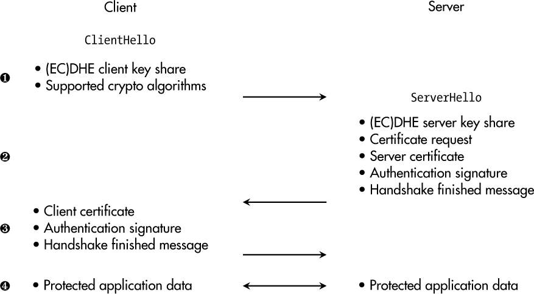
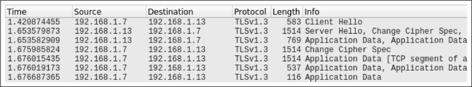
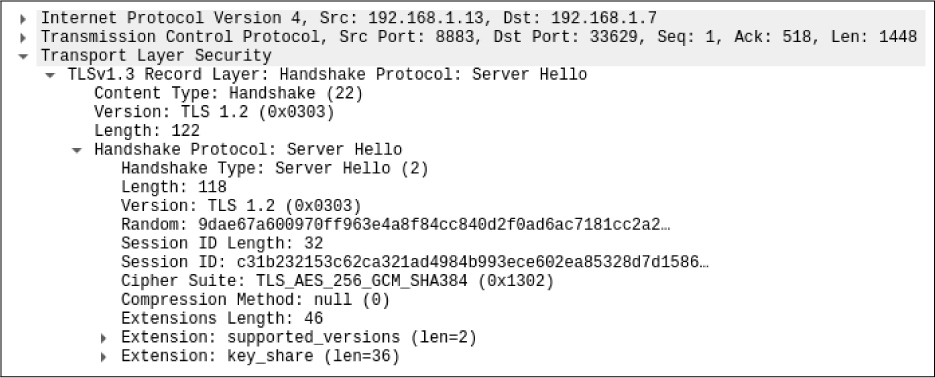

<a id="ch07"></a>

# <a id="page_121"></a>7 GIAO TIẾP AN TOÀN (SECURE COMMUNICATION)

Trong quá khứ, nhiều embedded system hoạt động trong một môi trường *air-gapped*, không kết nối với bất kỳ mạng có dây hay không dây nào. Mặc dù thực hành này vẫn còn có trong một số ngành, nó đang dần biến mất vì lý do đơn giản là không ý tưởng hiện đại nào như bảo trì dự đoán, tối ưu hóa data-driven và truy cập từ xa có thể hoạt động mà không có các kênh giao tiếp phù hợp.

Ngay cả những phương pháp cryptography đầu tiên thời Caesar cũng nhằm bảo vệ giao tiếp, và 2,000 năm sau, không thể hình dung internet mà không có giao tiếp an toàn. Tuy nhiên, một số lượng đáng kể *thiết bị* vẫn không dùng các protocol an toàn để trao đổi dữ liệu với quản trị viên của chúng và các thực thể khác trong môi trường của chúng.

Trong chương này, trước tiên chúng ta sẽ xem xét tập yêu cầu được áp đặt lên các kênh giao tiếp bền vững, tiếp theo là phần giới thiệu protocol phổ biến nhất để giải quyết những thách thức này và một case study thực tế tương ứng. Sau đó, chúng ta sẽ xem xét hai lĩnh vực mà giải pháp tiêu chuẩn không giúp được: giao tiếp non-IP và nhu cầu dự phòng (redundancy).

<a id="ch00lev1_57"></a>

## <a id="page_122"></a>Tất cả các protection goal

Giao tiếp là bản chất vốn có của con người. Chúng ta trao đổi suy nghĩ, hỗ trợ người khác và làm việc cùng nhau theo nhóm. Mọi đứa trẻ thì thầm điều gì đó vào tai ai đó đều ngầm hiểu về việc bảo vệ confidentiality.

Đối với các thông điệp viết, confidentiality đã là một chủ đề trong hàng nghìn năm, như ví dụ về Caesar cho thấy, và nó vẫn hiện diện trong các luật bảo mật bưu chính. Trong nhiều thế kỷ, các quân vương đã dùng ấn triện hoàng gia để bảo đảm integrity và authenticity của tài liệu, trong khi việc nhân bản thông tin bằng in ấn letterpress rõ ràng nhắm tới availability—ngay cả khi một “nguồn thông tin” thất bại, vẫn có những nguồn khác có thể được dùng để có được cùng “dữ liệu giao tiếp” đó.

Giao tiếp số ở quy mô internet đã được thực hành khoảng 30 năm, và không có gì ngạc nhiên khi nó hợp nhất các đòi hỏi về *mọi protection goal* của các cách tiếp cận giao tiếp trước đó. Xét lĩnh vực cụ thể của giao tiếp thiết bị (I)IoT, confidentiality hiển nhiên là hữu ích, vì hoặc các giá trị độc quyền tương ứng với tài sản trí tuệ được truyền đi, hoặc dữ liệu cá nhân về con người được truyền đi, vốn xứng đáng được bảo vệ quyền riêng tư.

Ngoài ra, integrity và authenticity được coi trọng trong nhiều trường hợp—ví dụ, đối với các lệnh điều khiển trong hệ thống công nghiệp. Trong những kịch bản đó, rất quan trọng là nguồn gốc của giao tiếp phải là một bên hợp lệ và các thông điệp không bị thay đổi trên đường đi. Như đã đề cập trước đó, các thiết bị (I)IoT điển hình dựa vào các kênh giao tiếp đang hoạt động. Các sự gián đoạn—ví dụ, những gián đoạn do các cuộc tấn công DoS gây ra—đe dọa hoạt động đúng của hệ thống và có thể cả các mô hình kinh doanh liên quan.

<a id="ch00lev1_58"></a>

## Transport Layer Security

Khi nói về giao tiếp dữ liệu, chúng ta thường bắt đầu bằng việc định vị nó trong *Open Systems Interconnection (OSI) model*. Mô hình này hỗ trợ chúng ta cấu trúc các chồng protocol giao tiếp, như được thể hiện trong [Bảng 7-1](#ch07tab01).

<a id="ch07tab01"></a>

**Bảng 7-1:** Các tầng giao tiếp theo mô hình OSI

| **Số** | **Tầng** | **Mô tả** |
|---|---|---|
| 7 | Application | Xử lý dữ liệu giao tiếp Application-specific |
| 6 | Presentation | Chuyển đổi giữa dữ liệu mạng và ứng dụng |
| 5 | Session | Quản lý session cho giao tiếp giữa các node |
| 4 | Transport | Quản lý việc truyền dữ liệu giữa các node mạng |
| 3 | Network | Quản lý một mạng nhiều bên tham gia |
| 2 | Data link | Truyền các data frame giữa hai thực thể |
| 1 | Physical | Truyền có dây/không dây qua một môi trường vật lý |

<a id="page_123"></a>Tiêu chuẩn Ethernet IEEE 802.3 là một ví dụ điển hình đặc tả các thuộc tính cho tầng 1 và 2. Thường thì Internet Protocol (IP) xử lý tầng network, trong khi Transmission Control Protocol (TCP) và User Datagram Protocol (UDP) đảm nhận các chức năng ở tầng 4 và 5. Các application protocol như HyperText Transfer Protocol (HTTP) phổ biến được biểu diễn ở tầng 7.

Phần này tập trung vào một trong những protocol phổ biến nhất cho giao tiếp an toàn: Transport Layer Security (TLS). Có vẻ hiển nhiên rằng nó nằm ở tầng 4 của mô hình OSI; tuy nhiên, mã hóa và giải mã thường được quy cho tầng 6. Và vì TLS cũng thực hiện một dạng quản lý session, chúng ta có thể nói rằng nó trải dài qua các tầng 4 đến 6 và, nhờ đó, đưa vào một lớp bảo vệ giữa các packet thô được phân phối qua mạng và ứng dụng cuối cùng dùng dữ liệu được truyền.

> **LƯU Ý**
>
> *TLS không phụ thuộc vào ứng dụng. Payload của nó có thể mang bất kỳ application protocol nào như HTTP hay thậm chí các protocol công nghiệp như Modbus.*

<a id="ch00lev2_75"></a>

### *Lịch sử*

Vào những năm 1990, khi Netscape đang phát triển một ứng dụng trình duyệt cùng tên, nhu cầu về giao tiếp internet an toàn trở nên rõ ràng. Năm 1995, Netscape công bố tiền thân của TLS, protocol Secure Sockets Layer (SSL) phiên bản 2.0. SSL 2.0 và SSL 3.0, được phát hành năm sau đó, có các vấn đề bảo mật đáng kể và không bao giờ nên được dùng trên thực tế.

Đáng tiếc là nhiều ứng dụng phần mềm cũng như các tài liệu tiếp thị sản phẩm dùng *SSL* và *TLS* như từ đồng nghĩa. Thông thường, bạn có thể giả định đó là “một phiên bản TLS hiện đại,” nhưng với tư cách khách hàng, tôi sẽ tin tưởng hơn nhiều nếu nhà sản xuất thể hiện know-how bảo mật của mình bằng cách không còn nhắc đến SSL nữa, ở bất kỳ đâu.

Tên protocol mới được giới thiệu năm 1999 với TLS 1.0 (vốn là một phiên bản nâng cấp của SSL 3.0), có lẽ để giảm sự liên tưởng với các điểm yếu của các phiên bản SSL trước. TLS 1.1 đã sửa các vấn đề bảo mật với CBC mode của block cipher vào năm 2006. Tuy nhiên, cả TLS 1.0 và TLS 1.1 đều chính thức bị deprecated vào tháng Ba năm 2021 và không nên được dùng trong các sản phẩm hiện đại.

Phiên bản 1.2 của TLS được đặc tả vào tháng Tám năm 2008 và vẫn đang được dùng rộng rãi. Nó thay việc dùng các hash function yếu như MD5 và SHA-1 bằng phiên bản hiện đại tương ứng, SHA-256, và mở rộng hỗ trợ cho các cipher authenticated encryption như AES-GCM. Tuy nhiên, độ phức tạp của TLS 1.2 trở thành kẻ thù của chính nó, và việc cấu hình đúng không hề tầm thường. Để giảm thiểu sai sót cấu hình và đồng thời tối đa hóa bảo mật và performance, TLS 1.3 được công bố năm 2018. Mọi thiết bị mới nên dùng phiên bản đó theo mặc định.

<a id="ch00lev2_76"></a>

### <a id="page_124"></a>*Kiến thức cơ bản về TLS*

TLS là một tập protocol client-server hợp nhất nhiều cryptographic primitive hiện đại được giới thiệu trong [Chương 2](ch02_cryptography.vi.md#ch02). Đây là hai sub-protocols quan trọng nhất trên thực tế:

**Handshake protocol** Trong subprotocol này, các thuật toán cryptography được dùng để bảo vệ một kênh giao tiếp được thương lượng giữa client và server. Thông thường, ít nhất một trong hai bên được xác thực với bên kia, nhưng xác thực lẫn nhau (mutual authentication) cũng khả thi. Ngoài ra, quá trình handshake thiết lập vật liệu key chung cho các thuật toán crypto được dùng trong giao tiếp tiếp theo. Bất kỳ lỗi hay cuộc tấn công can thiệp nào ở giai đoạn này đều dẫn đến việc kết thúc kết nối.

**Record protocol** Subprotocol này chịu trách nhiệm tổ chức và bảo vệ phần lớn lưu lượng giữa hai endpoint dựa trên các thuật toán và tham số đã thương lượng trong handshake protocol.

Một thuộc tính chung khác của TLS là nó dùng certificate X.509 để xác thực. Tuy nhiên, trái với các device certificate được đề cập trong [Chương 6](ch06_secure_device_identity.vi.md#ch06), common name trong các certificate này thường tương ứng với địa chỉ IP của thiết bị, hostname của nó, hay fully qualified domain name (FQDN) của nó. Đó là vì thông tin này được dùng để thiết lập kết nối cơ bản tới thiết bị ở tầng network ngay từ đầu, và thiết bị khi đó phải chứng minh rằng nó là thực thể hợp lệ tại node mạng này.

Đừng bao giờ đánh giá thấp độ phức tạp của TLS, và hãy giữ các mặc định an toàn bất cứ khi nào bạn không có yêu cầu cụ thể để thay đổi chúng. Các phần sau làm sáng tỏ các thuộc tính chính của hai phiên bản TLS đang được dùng ngày nay.

<a id="ch00lev2_77"></a>

### *TLS 1.3*

TLS 1.3 được đặc tả trong RFC 8446 và là *chính* phiên bản mà các kỹ sư sản phẩm nên triển khai và sử dụng. [Hình 7-1](#ch07fig01) minh họa quá trình handshake cho xác thực lẫn nhau, ví dụ, có thể là một phần của một kịch bản giao tiếp machine-to-machine.

<a id="page_125"></a><a id="ch07fig01"></a>

*Hình 7-1: Một handshake TLS 1.3 điển hình với xác thực lẫn nhau*

Ở bước đầu tiên, client khởi động việc thiết lập kết nối bằng cách gửi thông điệp `ClientHello` ➊ tới một server. Thông điệp này chứa key share của client cho một lược đồ key agreement DHE hay ECDHE, phiên bản TLS được hỗ trợ, và một danh sách các thuật toán crypto và tham số có sẵn. Đáp lại, server cung cấp dữ liệu riêng của nó cho việc trao đổi key dự định, certificate của nó và một chữ ký chứng minh việc sở hữu private key tương ứng. Hơn nữa, nó yêu cầu client tự xác thực và kết thúc phần `ServerHello` ➋ của handshake bằng một thông điệp `Finished`.

Ở phần thứ ba của handshake, client đáp ứng yêu cầu certificate của server bằng cách gửi certificate của nó và một chữ ký chứng minh định danh của nó ➌. Sau thông điệp `Finished` của client, cả hai bên đều có thể chắc chắn về định danh của bên kia và sẵn sàng trao đổi dữ liệu ứng dụng một cách an toàn ➍.

#### Các tùy chọn handshake khác

Bên cạnh các lược đồ key-agreement như DHE và ECDHE bảo đảm perfect forward secrecy nhưng cũng tiêu tốn performance đáng kể, TLS 1.3 còn cung cấp một tùy chọn *pre-shared key (PSK)*, vốn phân phối key tới các thiết bị trong một quá trình trước đó. Tuy nhiên, đây không phải là biến thể mặc định và chỉ nên được dùng trong các trường hợp ngoại lệ và với lý do vững chắc.

<a id="page_126"></a>Để giảm sự cần thiết phải thực hiện một handshake đầy đủ, TLS 1.3 cho phép bạn dùng lại PSK từ các handshake (EC)DHE trước đó nếu client và server đồng ý, nghĩa là các thao tác crypto bất đối xứng tốn kém có thể được tránh và hiệu quả được nâng cao.

Nếu client và server chia sẻ một PSK, TLS 1.3 cung cấp một mode zero round-trip time (0-RTT) cho phép client gửi dữ liệu PSK-encrypted cùng thông điệp đầu tiên của nó, ngay lập tức cho phép giao tiếp dữ liệu ứng dụng. Tuy nhiên, cải thiện tốc độ này phải trả giá: perfect forward secrecy không thể được bảo đảm nữa, và các thông điệp 0-RTT không được bảo vệ trước việc phát lại (replay) các thông điệp đã thu được trước đó.

#### Lựa chọn thuật toán crypto

So với TLS 1.2, TLS 1.3 đã giảm đáng kể tập thuật toán crypto khả dĩ có thể được dùng. Đây là một cải tiến bảo mật mạnh, vì nó ngăn chặn các *downgrade attack* cố tác động vào việc thương lượng tham số crypto để buộc dùng các thuật toán yếu. Trong quá trình dọn dẹp này, *cipher suite*, một tập các thuật toán crypto được hỗ trợ, đã được thu gọn để chỉ chứa crypto đối xứng.

Đối với cryptography đối xứng này, TLS 1.3 đòi hỏi triển khai cipher suite `TLS_AES_128_GCM_SHA256`, nghĩa là AES với key 128-bit phải hoạt động trong GCM mode, và hash function SHA-256 phải có sẵn để được dùng như một HMAC-based extract-and-expand key derivation function (HKDF), vốn liên quan đến việc dẫn xuất các bí mật TLS. Các cipher suite bổ sung `TLS_AES_256_GCM_SHA384` và `TLS_CHACHA20_POLY1305_SHA256` cũng nên được triển khai nhưng không bắt buộc. Hai cipher suite dựa trên CCM mode hoàn thiện năm lựa chọn khả dĩ cho crypto đối xứng trong TLS 1.3, và tất cả đều thuộc lớp các thuật toán AEAD hiện đại.

Về các thuật toán digital signature và certificate, các bản triển khai TLS 1.3 phải hỗ trợ RSA PSS và PKCS1 kết hợp với SHA-256, nhưng cũng cả ECDSA dựa trên đường cong NIST `secp256r1` và SHA-256. Đường cong bắt buộc cho ECDHE cũng là `secp256r1`, nhưng RFC khuyến nghị triển khai thêm X25519. DHE dựa trên các nhóm trường hữu hạn (finite field) cũng khả thi.

<a id="ch00lev2_78"></a>

### *TLS 1.2*

Mặc dù TLS 1.3 là phiên bản mới nhất, nhiều thiết bị vẫn dựa vào TLS 1.2 được đặc tả trong RFC 5246, hoặc ít nhất hỗ trợ việc dùng nó để duy trì tương thích với các thiết bị legacy. Tuy nhiên, điều này đòi hỏi phải có các biện pháp phòng ngừa để bảo đảm giao tiếp an toàn.

#### TLS 1.2 so với TLS 1.3

Một khác biệt có phần hình thức giữa TLS 1.2 và TLS 1.3 là các cipher suite phiên bản 1.2 bao gồm cả thuật toán và tham số bất đối xứng lẫn đối xứng. Ví dụ, cipher suite `TLS_DH_RSA_WITH_AES_256_CBC_SHA384` chỉ định rằng DH (không có chữ *E* của *ephemeral*) được dùng để trao đổi key; việc xác thực dựa trên một certificate RSA; AES với key 256-bit trong CBC <a id="page_127"></a>mode được dùng để mã hóa payload, và SHA-384 là hash function được dùng trong lược đồ key-derivation.

Ngoài định dạng cipher suite khác biệt, TLS 1.2 hỗ trợ và cho phép một tập thuật toán crypto lớn hơn nhiều, điều có thể có hậu quả tiêu cực trong nhiều trường hợp. Bên cạnh khả năng chọn các cơ chế key-exchange tĩnh dựa trên RSA và DH, thậm chí có thể chọn các cipher suite cho phép tường minh việc trao đổi key DH ẩn danh, nghĩa là không có bất kỳ sự xác minh nào đối với đối tác giao tiếp.

TLS 1.2 cũng cho phép bạn chọn các cipher legacy như 3DES và Rivest Cipher 4 (RC4) hay thậm chí cipher `NULL` không mã hóa payload. Hơn nữa, có thể chọn các mode hoạt động như CBC vốn không dẫn đến bảo mật AEAD-compliant.

Tùy chọn nén dữ liệu trước khi truyền nó qua TLS là well-meant (có ý tốt) từ phía các nhà thiết kế và vẫn có trong TLS 1.2, nhưng nó tạo điều kiện cho lỗ hổng, như được cho thấy bởi cuộc tấn công Compression Ratio Info-Leak Made Easy (CRIME).

Bên cạnh những khác biệt security-related đó, TLS 1.2 cũng thiếu một số tối ưu hóa performance được TLS 1.3 và mode 0-RTT đưa vào.

#### Sử dụng an toàn

Chìa khóa cho việc cấu hình an toàn TLS 1.2 nằm ở việc hạn chế mạnh các tùy chọn của nó. Bản triển khai của bạn phải không cho phép các cipher đã deprecated như 3DES, RC4, các export cipher bị làm yếu, CBC mode, và (dĩ nhiên) cipher `NULL`. Việc trao đổi key dựa trên RSA key transport cũng như DH ẩn danh đều phải bị từ chối. Hơn nữa, các tùy chọn như nén dữ liệu phải bị vô hiệu hóa để giảm attack surface.

Nhìn theo chiều ngược lại, cấu hình của bạn chỉ nên bật các cipher suite triển khai trao đổi key DHE và ECDHE và các cipher AEAD đối xứng kết hợp với hash function từ họ SHA-2, nghĩa là TLS 1.2 có thể được cắt gọn để hoạt động tương tự TLS 1.3 và cung cấp các kênh giao tiếp an toàn.

<a id="ch00lev2_79"></a>

### *Yêu cầu đối với thiết bị và hạ tầng*

Giả sử bạn đã quyết định rằng TLS là con đường cho thiết bị của mình và bạn muốn biến nó thành hiện thực, bạn vẫn còn một số yêu cầu cần xem xét trước khi triển khai một giao tiếp semi-secure một cách helter-skelter (hấp tấp, lộn xộn). Từ góc nhìn thiết bị, bạn nên phân tích ít nhất năm khía cạnh:

**Private-key storage** (lưu trữ private key) Nếu thiết bị của bạn phải có khả năng tự xác thực bằng cách ký dữ liệu bằng một private key, nó cần một nơi an toàn để lưu bí mật đó theo cách giữ kín.

**Certificate store** Việc xác minh định danh của các đối tác giao tiếp chỉ khả thi nếu thiết bị của bạn sở hữu các public key và root certificate tương ứng. Những file này không chứa thông tin bí mật nhưng cần được lưu theo cách integrity-protected vì chúng đại diện cho nền tảng tin cậy của thiết bị.

<a id="page_128"></a>**Nguồn ngẫu nhiên đáng tin cậy** Các lược đồ key-generation và key-exchange trong TLS đòi hỏi có sẵn các số ngẫu nhiên đáng tin cậy. Nếu thiết bị của bạn tạo ra “số ngẫu nhiên” dựa trên một giá trị tĩnh, điều này có thể có hậu quả nghiêm trọng đối với bảo mật TLS.

**Nền tảng thời gian đáng tin cậy** Đặc biệt trong các kịch bản công nghiệp, nhưng cũng trong các lĩnh vực ứng dụng khác, các thiết bị thường không cần real-time clock. Tuy nhiên, nếu bạn muốn dùng TLS, thiết bị của bạn phải có khả năng xác minh thời hạn hiệu lực của certificate, điều rõ ràng là không thể nếu time-wise (về mặt thời gian) nó bị kẹt ở những năm 1980.

**Performance crypto** Handshake TLS thực hiện nhiều thao tác dựa trên crypto bất đối xứng. Các thiết bị low-performance có thể chạm tới giới hạn của chúng, ví dụ, nếu chúng phải ký bằng key RSA. Quyết định cơ bản giữa RSA hay ECDSA có thể có tác động mạnh lên điểm này. Cũng tạo ra khác biệt lớn nếu thiết bị của bạn được dự định đóng vai trò client xác thực một lần mỗi ngày, hay nếu nó phải xử lý hàng trăm yêu cầu kết nối và xác thực mỗi phút với vai trò server.

Không chỉ bản thân thiết bị của bạn cần được chuẩn bị cho TLS, mà hạ tầng và quy trình của bạn cũng cần hỗ trợ nó. Một ví dụ phổ biến là việc vận hành một PKI để quản lý việc tạo, cập nhật và thu hồi certificate.

Hơn nữa, real-time clock trong thiết bị của bạn có lẽ phụ thuộc vào các cơ chế đồng bộ thời gian bên ngoài như Network Time Protocol (NTP) và Precision Time Protocol (PTP), vốn đòi hỏi các network service, đồng hồ chủ (master clock) phù hợp, v.v.

<a id="ch00lev2_80"></a>

### *Ví dụ ứng dụng và software library*

Use case phổ biến nhất của TLS là HyperText Transfer Protocol Secure (HTTPS), protocol được dùng trên toàn internet. Nó còn được biết đến là *HTTP over TLS*, vì về cơ bản đó là những gì đang diễn ra: TLS thiết lập một kênh an toàn giữa một client và một web server. Bên trong kênh này, các request và response HTTP thuần được trao đổi. Theo cùng cách đó, có thể đạt được giao tiếp an toàn cho nhiều application protocol khác.

TLS dựa trên TCP, nhưng có cách nào để bảo vệ các ứng dụng như Voice over IP (VoIP) hay game trực tuyến vốn dựa trên UDP hay các protocol stateless khác không? Có, bạn có thể dùng một biến thể gọi là *Datagram Transport Layer Security (DTLS)*. DTLS 1.2 và DTLS 1.3 lần lượt dựa trên TLS 1.2 và TLS 1.3. Chúng bảo đảm cùng mức bảo mật như các phiên bản TCP-based tương ứng nhưng có thể xử lý việc mất và sắp xếp lại thứ tự packet.

Khi nói đến các bản triển khai TLS, OpenSSL có lẽ là phổ biến nhất trên các hệ thống Linux cũng như trong lĩnh vực embedded system. Tuy nhiên, nếu sự minh bạch source code hay footprint nhỏ là điều sản phẩm của bạn quan tâm, Mbed TLS có thể đáng để xem xét. Hơn nữa, có các bản triển khai bằng vô số ngôn ngữ lập trình, như Rustls cho cộng đồng Rust.

<a id="ch00lev1_59"></a>

## <a id="page_129"></a>Case Study: Giao tiếp MQTT an toàn

Trong vài năm qua với tư cách giáo sư, tôi đã thấy nhiều dự án sinh viên dùng protocol MQTT, vì nó khá dễ hiểu và hoàn toàn phù hợp với nhu cầu của các thiết bị resource-constrained trong các kịch bản IoT. Nó được dùng để truyền các giá trị cảm biến như nhiệt độ hay áp suất cũng như để truyền các thông điệp điều khiển như lệnh start và stop cho các cơ cấu chấp hành trong một hệ thống.

Tuy nhiên, nếu tôi yêu cầu một kênh giao tiếp an toàn cho nội dung thông điệp hiển nhiên là nhạy cảm, tôi thường nhận được những câu trả lời như “Nhưng đây chỉ là proof of concept thôi!” hay “Không còn thời gian để giải quyết chủ đề phức tạp này.” Và, “Sao thầy lúc nào cũng hỏi những câu khó chịu như vậy?”

Trong case study này, tôi sẽ thiết lập dịch vụ MQTT broker Eclipse Mosquitto trên board STM32MP157F-DK2 của mình và cấu hình nó đúng cách cho giao tiếp an toàn dựa trên TLS. Hơn nữa, tôi sẽ kiểm thử động bản triển khai để tìm các cấu hình sai.

<a id="ch00lev2_81"></a>

### *Cài đặt và cấu hình Mosquitto*

Vì toolchain cho thiết bị STM32MP157F-DK2 của tôi dựa trên Yocto Project, tôi có thể đơn giản thêm recipe `mosquitto` từ `recipes-connectivity` của layer `meta-networking` vào image của mình để cài đặt phần mềm broker trên thiết bị. Phiên bản tôi nhận được là `2.0.14`. Dĩ nhiên, nó chỉ đi kèm một cấu hình mặc định nằm tại */etc/mosquitto/mosquitto.conf*.

Trong MQTT, broker là một thành phần trung tâm nhận các thông điệp và dữ liệu được các client publish và phân phối thông tin này tới các client subscribe nó. Đối với các client, điều thiết yếu là chỉ chia sẻ dữ liệu của họ với các broker hợp lệ và chỉ dựa vào thông điệp từ các broker họ tin tưởng. Do đó, các MQTT broker phải xác thực bằng cryptography với các client kết nối tới.

Như đã đề cập trước đó, TLS dùng certificate để xác thực, nên bước đầu tiên cho việc xác thực broker là tạo một certificate tương ứng. Tôi đã dùng Python và OpenSSL để tạo một CA và một certificate MQTT broker theo cách tương tự như đã mô tả cho định danh thiết bị trong [Chương 6](ch06_secure_device_identity.vi.md#ch06). Một khác biệt quan trọng là common name được chọn trong certificate: nó tương ứng với hostname *http://mqtt.iot-device-corp.com/* mà thiết bị có thể được truy cập trong mạng của tôi. Điều này quan trọng cho việc xác minh hostname bởi các client, để họ có thể chắc chắn rằng mình đang kết nối với đúng host.

Được trang bị certificate CA `ca.crt`, certificate broker `mqtt_broker.crt` và private key tương ứng của nó `mqtt_broker.key`, chúng ta có thể cấu hình các thiết lập TLS cơ bản cho `mosquitto` như được thể hiện trong [Listing 7-1](#ch07list01).

```
listener 8883
cafile /etc/mosquitto/certs/ca.crt
certfile /etc/mosquitto/certs/mqtt_broker.crt
keyfile /etc/mosquitto/certs/mqtt_broker.key
```

<a id="ch07list01"></a>

*Listing 7-1: Cấu hình TLS cơ bản cho* `mosquitto`

<a id="page_130"></a>Trong khi MQTT thuần thường được cung cấp ở port 1883, phiên bản dùng giao tiếp an toàn dựa trên TLS thường được cung cấp ở port 8883. Các certificate và key cần thiết có thể, ví dụ, được lưu trong */etc/mosquitto/ certs/*. Cho đến giờ mọi thứ đều ổn.

Tuy nhiên, cho đến giờ, hệ thống chỉ được cấu hình cho xác thực server-side. Việc xác thực client sẽ phải được quản lý bằng cách duy trì một file mật khẩu trên thiết bị chứa ứng dụng broker (ví dụ, tại */etc/mosquitto/password_file*), điều có thể tẻ nhạt, và mức bảo mật đi kèm cùng lắm là trung bình. Nhưng vì TLS hỗ trợ xác thực certificate-based lẫn nhau, và Mosquitto có thể tận dụng thủ tục đó cho việc sử dụng ở tầng ứng dụng, nó đáng để xem xét.

[Listing 7-2](#ch07list02) cho thấy hai tùy chọn phải được thêm vào *mosquitto.conf*.

```
require_certificate true
use_identity_as_username true
```

<a id="ch07list02"></a>

*Listing 7-2: Các tùy chọn quan trọng cho xác thực certificate-based của các MQTT client*

Dòng đầu tiên khiến broker yêu cầu một certificate để xác thực từ mỗi client kết nối tới, trong khi dòng thứ hai cho phép dùng common name chứa trong certificate được cung cấp làm username trong ứng dụng MQTT.

Điều quan trọng cần lưu ý là, trong trường hợp này, client certificate phải được cấp bởi CA đã được cung cấp trước đó qua tham số `cafile`. Nếu bạn muốn cung cấp nhiều CA tin cậy cho Mosquitto, tùy chọn `capath` sẽ giúp bạn. Trong trường hợp của tôi, tôi chỉ dùng cùng CA như cho MQTT broker để tạo thêm một certificate, lần này với common name `mqtt-client123`.

<a id="ch00lev2_82"></a>

### *Lần chạy thử đầu tiên*

Sau khi khởi động `mosquitto` với file cấu hình mới, một lần quét `nmap` ngắn cho thấy MQTT broker giờ có sẵn ở port 8883, như được thể hiện trong [Listing 7-3](#ch07list03).

```
$ nmap mqtt.iot-device-corp.com -p 8883
Starting Nmap 7.80 ( https://nmap.org ) at ...
Nmap scan report for mqtt.iot-device-corp.com (192.168.1.13)
Host is up (0.00067s latency).

PORT     STATE SERVICE
8883/tcp open  secure-mqtt

Nmap done: 1 IP address (1 host up) scanned in 0.03 seconds
```

<a id="ch07list03"></a>

*Listing 7-3: Một lần quét* `nmap` *cho thấy port 8883 đang mở*

<a id="page_131"></a>Để kiểm thử giao tiếp an toàn, tôi đã viết một script Python nhỏ dùng client library Eclipse Paho MQTT. [Listing 7-4](#ch07list04) cho thấy các thiết lập cơ bản.

```
broker = "mqtt.iot-device-corp.com"
port   = 8883
client = mqtt.Client("mqtt-client123")
client.tls_set('ca.crt', 'mqtt_client.crt', 'mqtt_client.key')
client.connect(broker, port)
```

<a id="ch07list04"></a>

*Listing 7-4: Cấu hình Paho MQTT client cơ bản trong Python*

Bên cạnh những thứ cần thiết hiển nhiên như hostname và port của MQTT broker, client cũng có thể xử lý các thiết lập TLS như một CA tin cậy trong *ca.crt*, và dữ liệu xác thực của client nằm trong các file *mqtt_client.crt* và *mqtt_client.key*.

Trong ứng dụng kiểm thử, client subscribe topic `foo/bar`, publish một số dữ liệu lên cùng topic, và nhận lại thông tin từ broker, như được thể hiện trong [Listing 7-5](#ch07list05).

```
➊ New connection from 192.168.1.7:46317 on port 8883.
➋ New client connected from 192.168.1.7:46317 as mqtt-client123
       (p2, c1, k60, u'mqtt-client123').
   ...
➌ Received SUBSCRIBE from mqtt-client123
       foo/bar (QoS 0)
   Sending SUBACK to mqtt-client123
➍ Received PUBLISH from mqtt-client123 (d0, q0, r0, m0, 'foo/bar', ... (2 bytes))
   Sending PUBLISH to mqtt-client123 (d0, q0, r0, m0, 'foo/bar', ... (2 bytes))
   ...
   Received DISCONNECT from mqtt-client123
   Client mqtt-client123 disconnected.
```

<a id="ch07list05"></a>

*Listing 7-5: Đầu ra console của* `mosquitto` *trong một lần kiểm thử*

Rõ ràng, một kết nối đã được thiết lập thành công trên port 8883 ➊. Ngoài ra, `mosquitto` dùng trực tiếp common name của client certificate (`mqtt-client123`) làm username đi kèm ➋ cho kết nối này. Cả hai lệnh của client, `SUBSCRIBE` ➌ và `PUBLISH` ➍, cũng được nhận và xử lý đúng ở phía broker.

<a id="ch00lev2_83"></a>

### *Phân tích bảo mật giao tiếp bằng Wireshark và SSLyze*

Ứng dụng có vẻ hoạt động đúng mặc dù chúng ta đã kích hoạt nhiều tính năng bảo mật TLS. Điều đó gieo hy vọng, nhưng với tư cách kỹ sư bảo mật, chúng ta muốn dựa lòng tin vào phân tích kỹ lưỡng hơn là cảm tính.

<a id="page_132"></a>Một trong những công cụ cho phân tích như vậy là Wireshark. Nó cho phép chúng ta bắt lưu lượng giao tiếp mạng và phân tích nó về các thuộc tính bảo mật. Trước tiên tôi cấu hình nó để thu thập mọi dữ liệu được trao đổi giữa trạm kiểm thử và thiết bị STM32MP157F. Sau đó, tôi lọc các packet TLS. [Hình 7-2](#ch07fig02) cho thấy một đoạn kết quả.

<a id="ch07fig02"></a>

*Hình 7-2: Các thông điệp TLS được trao đổi trong giao tiếp MQTT*

Bạn có thể thấy một handshake TLS với các thông điệp `ClientHello` và `ServerHello` đặc trưng của nó đã diễn ra. Sau đó, các packet `Application Data` được mã hóa đã được truyền giữa client và broker.

Như được thể hiện trong [Hình 7-3](#ch07fig03), Wireshark cũng cung cấp chi tiết của việc thương lượng TLS—cụ thể là cipher suite `TLS_AES_256_GCM_SHA384` đã được chọn cho việc truyền dữ liệu khối lượng lớn. Điều này, đến lượt nó, cho chúng ta biết TLS 1.3 được dùng, vì cipher suite cụ thể đó thuộc về phiên bản TLS mới nhất.

<a id="ch07fig03"></a>

*Hình 7-3: Chi tiết của handshake TLS*

> **CẢNH BÁO**
>
> *Hãy cẩn thận khi phân tích phiên bản TLS được dùng trong lưu lượng mạng. Trường legacy* `Version` *nói rằng đó là* `TLS 1.2`*, nhưng thực ra không phải.*

Đến đây, có vẻ như chức năng và các biện pháp bảo mật hoạt động như kỳ vọng. Hãy dùng thêm một công cụ nữa để củng cố sự tự tin của chúng ta vào công việc này. Ứng dụng Python SSLyze có thể kiểm tra mọi loại TLS server về nhiều cạm bẫy và cấu hình sai khác nhau, những thứ sẽ làm giảm bảo mật sản phẩm của bạn nếu không bị phát hiện.

Để bắt đầu quét TLS, chỉ cần nhập hostname và port tương ứng: `sslyze mqtt.iot-device-corp.com:8883`.

<a id="page_133"></a>Các kết quả toàn diện làm sáng tỏ một số chi tiết thú vị. Phần trích trong [Listing 7-6](#ch07list06) liên quan đến việc xác minh certificate.

```
...
 Certificate #0 - Trust
➊ Hostname Validation:         OK - Certificate matches server hostname
➋ Android CA Store (...):      FAILED - Certificate is NOT Trusted ...
   Apple CA Store (...):       FAILED - Certificate is NOT Trusted ...
   Java CA Store (...):        FAILED - Certificate is NOT Trusted ...
   Mozilla CA Store (...):     FAILED - Certificate is NOT Trusted ...
   Windows CA Store (...):     FAILED - Certificate is NOT Trusted ...
...
```

<a id="ch07list06"></a>

*Listing 7-6: Đầu ra console của* `sslyze` *về việc xác minh certificate*

Tin tốt là tôi đã tạo certificate đúng, nghĩa là tôi đã đưa đúng server name của thiết bị vào làm common name trong certificate ➊. Tuy nhiên, cũng xuất hiện nhiều mục `FAILED` ➋. Điều này xảy ra vì certificate của tôi không thuộc các certificate store phổ biến của Android, Windows, Mozilla và tương tự, điều chưa bao giờ nằm trong kế hoạch, nhưng nếu bạn hướng tới khả năng tương thích tin cậy rộng rãi cho certificate của mình, bài kiểm tra này có thể quan trọng đối với bạn.

Phần chính của kết quả là về các cipher suite và phiên bản TLS mà một server chấp nhận. Kết quả trong [Listing 7-7](#ch07list07) cho thấy các phiên bản TLS đã deprecated và các cipher suite tương ứng của chúng đều bị MQTT broker được triển khai từ chối như dự định. Các thiết lập mặc định của `mosquitto` có vẻ đã cấm việc dùng những protocol và cipher cũ này.

```
...
 * SSL 2.0 Cipher Suites:
     Attempted to connect using 7 cipher suites; the server rejected all ...
 * SSL 3.0 Cipher Suites:
     Attempted to connect using 80 cipher suites; the server rejected all ...
 * TLS 1.0 Cipher Suites:
     Attempted to connect using 80 cipher suites; the server rejected all ...
 * TLS 1.1 Cipher Suites:
     Attempted to connect using 80 cipher suites; the server rejected all ...
...
```

<a id="ch07list07"></a>

*Listing 7-7: Việc từ chối mong muốn đối với mọi cipher suite đã deprecated*

Như được thể hiện trong [Listing 7-8](#ch07list08), các thiết lập tiêu chuẩn của `mosquitto` vẫn hỗ trợ TLS 1.2, điều tốt về mặt tương thích ngược, vì nhiều thiết bị legacy ngoài hiện trường không hỗ trợ TLS 1.3, nhưng danh sách các cipher suite được hỗ trợ như `sslyze` đưa ra cho thấy một số điểm yếu.

<a id="page_134"></a>

```
...
 * TLS 1.2 Cipher Suites:
     Attempted to connect using 156 cipher suites.

     The server accepted the following 20 cipher suites:
        TLS_RSA_WITH_AES_256_GCM_SHA384                256
        TLS_RSA_WITH_AES_256_CBC_SHA256                256
        TLS_RSA_WITH_AES_256_CBC_SHA                   256
        ...
        TLS_ECDHE_RSA_WITH_CHACHA20_POLY1305_SHA256    256  ECDH: X25519
        TLS_ECDHE_RSA_WITH_AES_256_GCM_SHA384          256  ECDH: prime256v1
        TLS_ECDHE_RSA_WITH_AES_256_CBC_SHA384          256  ECDH: prime256v1
        TLS_ECDHE_RSA_WITH_AES_256_CBC_SHA             256  ECDH: prime256v1
        ...
        TLS_DHE_RSA_WITH_CHACHA20_POLY1305_SHA256      256  DH (4096 bits)
        TLS_DHE_RSA_WITH_AES_256_GCM_SHA384            256  DH (4096 bits)
        TLS_DHE_RSA_WITH_AES_256_CBC_SHA256            256  DH (4096 bits)
        TLS_DHE_RSA_WITH_AES_256_CBC_SHA               256  DH (4096 bits)
        ...
```

<a id="ch07list08"></a>

*Listing 7-8: Các cipher TLS 1.2 được cung cấp*

Đầu ra cho thấy bản triển khai đang xét vẫn cung cấp các lựa chọn cho phép trao đổi key RSA-based (`TLS_RSA_WITH_...`) và các lựa chọn khác vẫn dùng CBC mode cho việc mã hóa AES dữ liệu ứng dụng. Cả hai đều không được TLS 1.3 hỗ trợ và không còn được khuyến nghị.

Hiểu biết này cho phép chúng ta điều chỉnh lại file *mosquitto.conf* bằng cách chỉ định tham số `ciphers`, như được thể hiện trong [Listing 7-9](#ch07list09).

```
ciphers ECDHE-ECDSA-AES256-GCM-SHA384:ECDHE-RSA-AES256-GCM-SHA384:
        DHE-RSA-AES256-GCM-SHA384:ECDHE-ECDSA-CHACHA20-POLY1305:
        ECDHE-RSA-CHACHA20-POLY1305:DHE-RSA-CHACHA20-POLY1305:
        ECDHE-ECDSA-AES128-GCM-SHA256:ECDHE-RSA-AES128-GCM-SHA256:
        DHE-RSA-AES128-GCM-SHA256
```

<a id="ch07list09"></a>

*Listing 7-9: Giới hạn các cipher TLS 1.2 trong* mosquitto.conf

Điều này giới hạn các cipher TLS 1.2 của `mosquitto` chỉ còn sáu lựa chọn hiện đại cho xác thực RSA-based và ba lựa chọn cho certificate ECDSA, nghĩa là bảo mật của giao tiếp MQTT đang xét được nâng cao thêm một bước.

> **LƯU Ý**
>
> *Mosquitto dựa vào OpenSSL cho giao tiếp TLS an toàn. Nhập* `openssl ciphers` *để liệt kê mọi cipher được OpenSSL cung cấp trên một hệ thống cụ thể.*

<a id="page_135"></a>Về TLS 1.3, các cipher suite được khuyến nghị được hỗ trợ đúng, như được thể hiện trong [Listing 7-10](#ch07list010).

```
...
 * TLS 1.3 Cipher Suites:
     Attempted to connect using 5 cipher suites.

     The server accepted the following 3 cipher suites:
        TLS_CHACHA20_POLY1305_SHA256                   256  ECDH: X25519
        TLS_AES_256_GCM_SHA384                         256  ECDH: X25519
        TLS_AES_128_GCM_SHA256                         128  ECDH: X25519
```

<a id="ch07list010"></a>

*Listing 7-10: Hỗ trợ TLS 1.3 có sẵn như dự định*

Đây là nền tảng cho giao tiếp thiết bị future-proof.

<a id="ch00lev1_60"></a>

## Giao tiếp an toàn không dùng TLS

Như đã đề cập nhiều lần trong chương này, TLS nên là giải pháp mặc định nếu thiết bị của bạn cần giao tiếp an toàn. Tuy nhiên, không phải mọi kịch bản ứng dụng và công nghệ giao tiếp đều cho phép dùng TLS.

Ví dụ, giao tiếp không dây cho các use case chuyên dụng như mạng cảm biến hay mạng mesh có thể dựa vào các protocol độc quyền không bao gồm một TCP/IP stack. Hơn nữa, một số architecture bus có dây như bus controller area network (CAN) đặc tả định dạng thông điệp và cấu trúc dữ liệu riêng mà không dựa vào công nghệ TCP/IP, và chúng có thể đòi hỏi một hành vi real-time nhất định không thể được bảo đảm với TLS. Ngoài ra, các thiết bị rất power-constrained như các bộ điều khiển từ xa battery-powered cho hệ thống báo động, cửa gara và cần cẩu công nghiệp thường dùng tần số 433 và 868 MHz trong băng tần vô tuyến industrial, scientific, and medical (ISM) license-free, và chúng tối ưu nội dung và độ dài thông điệp theo mức tiêu thụ năng lượng, điều khiến một handshake TLS trở nên bất khả thi.

Tuy nhiên, sẽ ngây thơ nếu kết luận rằng những ứng dụng này phải sống mà không có biện pháp bảo mật vì TLS không phù hợp. Vấn đề chỉ đòi hỏi một cách tiếp cận phát triển khác. Với những trường hợp đó, thường không tồn tại giải pháp out-of-the-box, mà phải phát triển các security protocol tùy chỉnh, application-specific. Dĩ nhiên, có kinh nghiệm sâu rộng về cryptography, thiết kế protocol và kiểm chứng những hệ thống như vậy sẽ hữu ích, nhưng trên thực tế, điều đó hiếm khi xảy ra.

Một cách tiếp cận thực dụng có thể là coi TLS 1.3 và các cryptographic primitive mà nó dùng như một cửa hàng self-service. Nếu bạn đang tìm các biện pháp bảo vệ cụ thể (ví dụ, để bảo vệ authenticity và integrity của các lệnh được gửi bởi bộ điều khiển từ xa của bạn), digital signature dựa trên RSA hay ECDSA sẽ là một giải pháp đáng tin cậy. Việc bạn quyết định làm việc với certificate, như TLS, hay tự quản lý các public key thô tùy thuộc vào yêu cầu và khả năng của bạn.

<a id="page_136"></a>Ngoài ra, nếu lưu lượng bus CAN của bạn chứa các thông điệp bí mật, và integrity cũng nằm trong danh sách mong muốn của bạn, AES-GCM hay ChaCha20-Poly1305 có thể là các ứng viên phù hợp. Nếu kịch bản của bạn cho phép quản lý và phân phối các bí mật pre-shared, bạn có thể tránh được các thuật toán key-exchange tốn kém. Nếu không, DHE hay ECDHE, như được TLS 1.3 dùng, có thể là các thuật toán bạn chọn.

Điều này nghe có vẻ khá hời hợt và, ở một mức độ nào đó, đúng là vậy, vì bạn phải làm rõ hàng trăm chi tiết trên con đường đến bản triển khai cụ thể của mình. Tuy nhiên, thông tin này cho bạn một số định hướng về việc hành trình của bạn cần đi đâu.

<a id="ch00lev1_61"></a>

## Dự phòng (redundancy) trong giao tiếp an toàn

Nếu bạn đã đi đến điểm này, bạn đã đọc rất nhiều về cách đạt được giao tiếp an toàn bằng TLS và các tính năng crypto kỳ diệu của nó để bảo vệ confidentiality và integrity của thông điệp cũng như authenticity của các đối tác giao tiếp. Tuy nhiên, ở đầu chương này, tôi đã nói rằng giao tiếp đòi hỏi mọi protection goal, bao gồm cả availability. Nhưng nói rõ: TLS và cryptography nói chung *không thể bảo vệ availability*.

Dĩ nhiên, trong một số use case, availability của dữ liệu được truyền là thiết yếu—ví dụ, trong các lĩnh vực mà các biện pháp an toàn kỹ thuật bảo vệ con người khỏi tai nạn và thương tích, nhưng cũng trong các hệ thống mà thời gian ngừng hoạt động dẫn đến thiệt hại tài chính đáng kể, như trong sản xuất hay vận tải. Trong những ứng dụng đó, nếu một thông điệp bị mất, chức năng đúng của một thiết bị hay toàn bộ hệ thống bị đe dọa. Những mối đe dọa này phải được xử lý bằng *dự phòng logic hay vật lý*.

Tiếp cận vấn đề này ở mức logic có nghĩa là gửi thông điệp nhiều lần hay thêm dữ liệu dự phòng được tạo bởi các mã error-detecting như checksum CRC hay các thuật toán error-correcting như mã Hamming. Điều này hữu ích cho việc truyền qua các kênh nhiễu hay không đáng tin cậy và để xử lý các sự kiện gây nhiễu bắt nguồn, ví dụ, từ nhiễu điện từ hay bức xạ vũ trụ. Tuy nhiên, những biện pháp này không cung cấp sự bảo vệ đầy đủ trước việc cố ý phá hủy và gián đoạn liên tục một đường giao tiếp vật lý.

Cách duy nhất để có khả năng phục hồi trong những tình huống như vậy là triển khai nhiều kênh giao tiếp vật lý. Một ví dụ phổ biến là *ring topology* (cấu trúc mạng vòng), được dùng trong nhiều hạ tầng công nghiệp để kết nối các thiết bị với nhau theo một cấu trúc ring-like. Tuy nhiên, cấu hình đó đòi hỏi các thiết bị phải có hai network interface, trái và phải, và các thông điệp luôn phải được gửi theo cả hai hướng và có thể được nhận trên hai interface khác nhau.

Điều này dẫn đến công sức kỹ thuật và linh kiện trên mỗi thiết bị, và việc lắp đặt toàn bộ hệ thống trở nên đắt hơn. Ngoài ra, độ trễ giao tiếp phụ thuộc vào số lượng thiết bị trong vòng, và băng thông phải được chia sẻ giữa mọi bên tham gia mạng. Tuy nhiên, sự dự phòng vật lý này bền vững trước các thông điệp bị hỏng, cáp bị gãy hay bị cắt<a id="page_137"></a>, và thậm chí việc thay thế thiết bị trong quá trình hệ thống vận hành. Tiêu chuẩn quốc tế IEC 62439 mô tả nhiều cách để đạt được tính sẵn sàng cao trong các mạng công nghiệp, ví dụ, dựa trên ring topology hay mesh topology.

<a id="ch00lev1_62"></a>

## Tóm tắt

IoT và phiên bản công nghiệp tương ứng của nó không thể tồn tại nếu không có giao tiếp an toàn. Một loạt protection goal từ confidentiality đến integrity đến authenticity, và thậm chí availability, được đòi hỏi đối với các kênh giao tiếp hiện đại. Bên cạnh các khả năng cryptography cần thiết, thiết bị cần hỗ trợ các protocol state-of-the-art như TLS 1.3 để đạt được security level cao. Trong một số use case, nơi việc mất thông điệp là trọng yếu và cần có các phương tiện giao tiếp vật lý dự phòng, thiết bị thậm chí phải cung cấp nhiều interface giao tiếp.

Case study của chương này đã cho thấy một bản triển khai ví dụ của một MQTT-broker với giao tiếp TLS-based và các tham số cấu hình cần thiết. Nó cho thấy rằng phân tích bảo mật kỹ lưỡng kết quả cuối cùng có thể giúp phát hiện các cấu hình sai và các cipher suite yếu mà một dịch vụ cung cấp.

Mặc dù TLS là một trong những security protocol phổ biến và được ưa chuộng nhất, còn nhiều protocol khác tồn tại dành cho các ứng dụng chuyên dụng. Ví dụ, Internet Protocol security (IPsec) có thể được dùng để thiết lập một virtual private network (VPN) ở tầng OSI 3, trong khi protocol SSH cho phép quản trị viên truy cập thiết bị từ xa. Ở tầng OSI 2, ý tưởng Time-Sensitive Networking (TSN) đảm nhận việc tách biệt các kênh giao tiếp trên một môi trường vật lý dùng chung, trong khi IEEE 802.1AE (còn được biết đến là *MACsec*) nhắm tới giao tiếp được bảo vệ.

Và ngay cả khi bạn không tìm thấy protocol nào trực tiếp phù hợp với nhu cầu của mình, tập hợp các security protocol hiện đại chắc chắn có thể làm nguồn cảm hứng để giải quyết các thách thức cụ thể của bạn.
