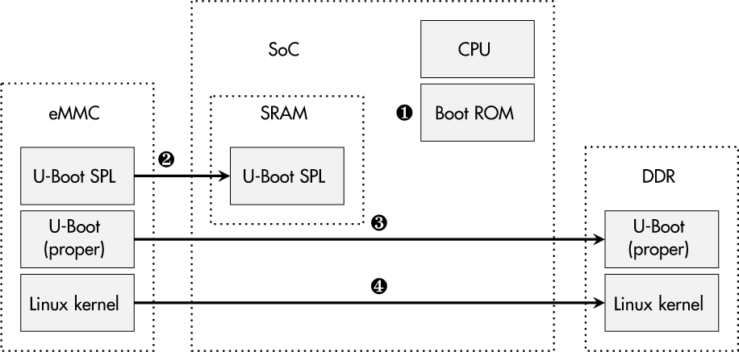
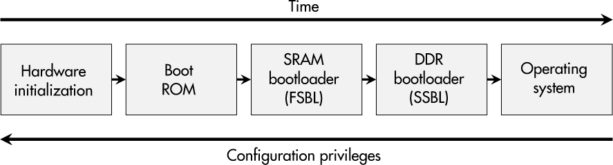
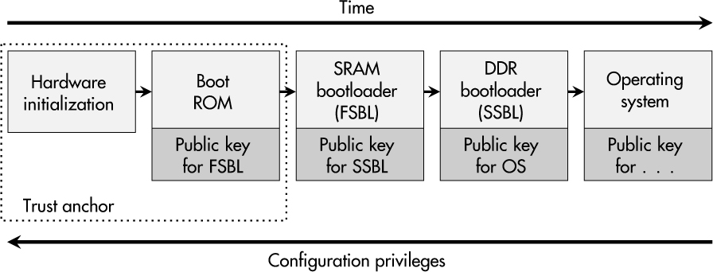
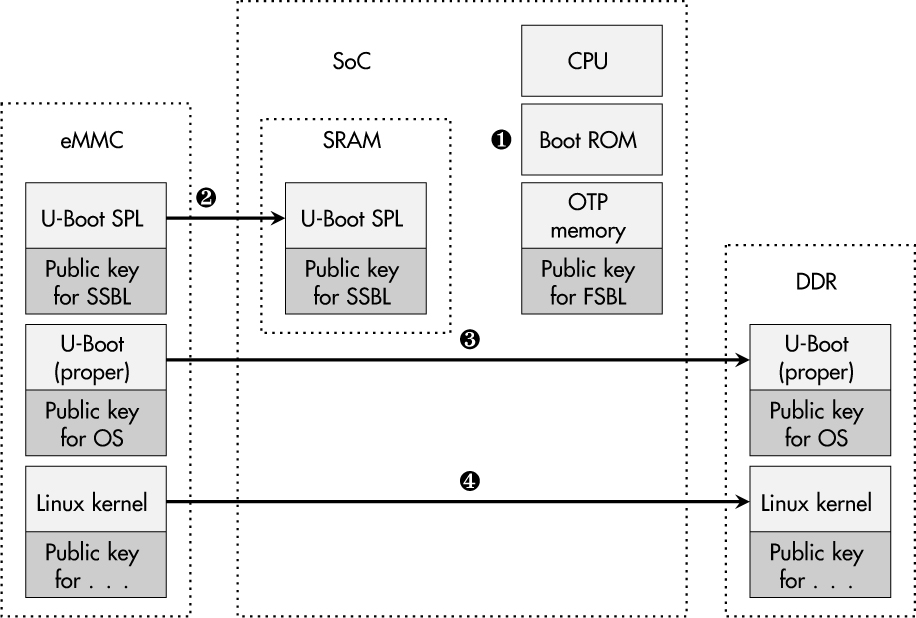
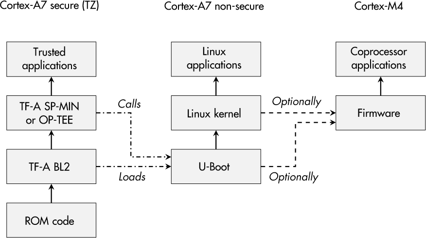
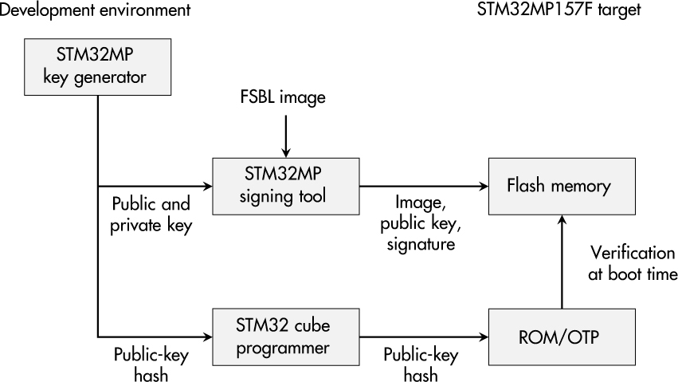

<a id="ch08"></a>

# <a id="page_141"></a>8 SECURE BOOT VÀ TÍNH TOÀN VẸN HỆ THỐNG (SECURE BOOT AND SYSTEM INTEGRITY)

Trong quá trình boot của embedded system, việc khởi tạo phần cứng cơ bản cũng như việc khởi động một OS diễn ra. Nhiều bước trong số này liên quan đến firmware được lưu trong flash memory vì điều đó cho kỹ sư thiết bị khả năng cập nhật. Tuy nhiên, khả năng thay thế này đi kèm một cái giá: kẻ tấn công có thể can thiệp vào dữ liệu đó vì lợi ích riêng của họ.

Trong chương này, tôi sẽ giải thích sự phức tạp của các quá trình boot và nhiều khái niệm bảo vệ khác nhau. Sau khi giới thiệu khái niệm secure boot chain cổ điển, tôi sẽ thảo luận các cân nhắc thực tế như tác động của quá trình secure boot lên các quy trình phát triển và sản xuất. Như thường lệ, lý thuyết và thực tế không phải là một, nên tôi sẽ đưa vào một case study về việc hiện thực secure boot trên nền tảng STM32MP157F.

Dựa trên tính toàn vẹn của quá trình boot, bạn có thể thắc mắc liệu tính toàn vẹn của thiết bị có thể được mở rộng hơn nữa không, nên chương này cũng mô tả cách đạt được bảo vệ integrity cho filesystem và hơn thế nữa. Cuối cùng, tôi sẽ xem xét một giải pháp integrity firmware low-cost cho các hệ thống microcontroller-based không dựa vào flash memory bên ngoài và một quá trình boot phức tạp.

<a id="ch00lev1_63"></a>

## <a id="page_142"></a>Sự phức tạp của việc boot hệ thống

Nhiều vi mạch hiện đại cho embedded system chứa nhiều module con khác nhau và do đó được gọi là *system-on-chips (SoCs)*. Bên cạnh việc có nhiều CPU core, các GPU, real-time core và các coprocessor hỗ trợ tương tự cũng góp phần vào độ phức tạp của hệ thống. Ngoài ra, các SoC bao gồm FPGA tiếp tục trở nên phổ biến và thêm việc xử lý bitstream vào bài toán.

Hơn nữa, một số SoC cung cấp một *trusted execution environment (TEE)*, được dùng để tách biệt việc thực thi phần mềm trọng yếu một cách logic hay vật lý—trên một đơn vị xử lý chuyên dụng—khỏi firmware thông thường. Trong các SoC ARM-based, bạn sẽ gặp các thuật ngữ *ARM TrustZone* và *ARM Trusted Firmware* đại diện cho TEE của ARM. Việc khởi tạo một môi trường như vậy thường diễn ra trong quá trình boot. Và, mặc dù những tính năng đó nhắm tới bảo mật cao hơn, không thể phủ nhận rằng những công nghệ này cũng dẫn đến độ phức tạp còn cao hơn—kẻ thù tự nhiên của tính dễ hiểu và bảo mật.

Các thiết bị SoC thường còn đòi hỏi thêm các thành phần trên PCB—ví dụ, memory double data rate (DDR) volatile và bộ lưu trữ nonvolatile, như một embedded MultiMediaCard (eMMC) hay các flash memory tương tự. Việc khởi tạo các bộ điều khiển on-chip cần thiết và các tham số của chúng là những phần then chốt khác của các quá trình boot hiện đại. [Hình 8-1](#ch08fig01) đưa ra tổng quan về các thành phần phần mềm và phần cứng điển hình của một SoC tham gia vào quá trình boot của nó.

<a id="ch08fig01"></a>

*Hình 8-1: Các thành phần của một quá trình boot SoC điển hình*

Sau khi cấp nguồn, thủ tục boot được khởi động trong phần cứng dựa trên một boot read-only memory (ROM) ➊, thứ khởi tạo các cấu trúc nội bộ và nạp một first-stage bootloader (FSBL) tối giản như U-Boot SPL được sao chép vào SRAM memory nội bộ ➋. Phần mềm này khởi tạo DDR memory bên ngoài và đặt một second-stage bootloader (SSBL) fully-fledged vào đó ➌. SSBL có thể cung cấp nhiều tính năng tiện lợi như chọn phương tiện boot, debug, truy cập console, v.v. Sau đó, OS kernel, vốn trong ngữ cảnh embedded system thường là Linux, được khởi động ➍. <a id="page_143"></a>Ở điểm này, quá trình boot “chính thức” kết thúc, và thiết bị ở trạng thái runtime.

[Hình 8-2](#ch08fig02) cho thấy các bước cần thiết để boot theo thứ tự thời gian.

<a id="ch08fig02"></a>

*Hình 8-2: Các bước của một quá trình boot điển hình*

Có một thuộc tính cơ bản cần nhấn mạnh ở điểm này: các giai đoạn tiếp theo trong một quá trình boot luôn “tin tưởng” các giai đoạn trước chúng. Điều đó có nghĩa là, ví dụ, nếu không có các biện pháp giám sát bên ngoài, một OS không thể phân biệt một boot-loader độc hại với bản gốc; nó chỉ dựa vào mọi tập cấu hình và tham số được truyền cho nó. Do đó, việc bảo vệ boot-process tối ưu phải bắt đầu ngay từ điểm khởi đầu của nó: trong phần cứng.

<a id="ch00lev1_64"></a>

## Các khái niệm bảo vệ boot

Từ góc nhìn của khách hàng hay người dùng thiết bị, integrity thường là một protection goal mong muốn đối với firmware và phần mềm của thiết bị. Một kịch bản rủi ro liên quan là tội phạm mạng cố duy trì phần mềm độc hại trong firmware để tồn tại qua lần khởi động lại hệ thống—ví dụ, để có quyền truy cập backdoor long-lasting. Ngoài ra, việc thao túng các tham số cấu hình low-level và thiết lập OS sẽ không khả thi với các routine xác minh chạy lúc boot. Ngay cả các cuộc tấn công sửa đổi phần mềm của thiết bị trong quá trình giao hàng, như được báo cáo là do các cơ quan tình báo thực hiện, sẽ khiến sản phẩm không hoạt động được nếu có hiện thực bảo vệ integrity vững chắc.

Các tác giả của IEC 62443 (Part 4-2) dường như cũng nghĩ đến những kịch bản này. Yêu cầu embedded device requirement (EDR) 3.14 cho security level (SL) 1 trở lên nhắm tới integrity của quá trình boot. Nó yêu cầu một thiết bị phải có khả năng thực hiện xác minh integrity đối với firmware, phần mềm và dữ liệu cấu hình được dùng trong các quá trình boot và runtime của thiết bị trước khi chúng được thực thi. Bắt đầu từ SL 2, tiêu chuẩn thậm chí đòi hỏi authenticity của mọi phần có thể thay thế của quá trình boot.

Các nhà sản xuất thiết bị thường đồng ý về tầm quan trọng của integrity và authenticity của firmware và phần mềm vì điều đó cũng ngăn kẻ tấn công cài đặt phần mềm tùy chỉnh cho mục đích reverse-engineering. Tuy nhiên, họ còn một rủi ro khác cần xem xét: mất tài sản trí tuệ. Ngay cả ở các giai đoạn boot sớm, know-how như vậy có thể được kết tinh trong phần mềm, như các thuật toán được tối ưu, protocol độc quyền và các bí mật. Do đó, trong một số trường hợp, các nhà cung cấp muốn mã hóa mọi firmware, phần mềm và dữ liệu cấu hình được dùng trong quá trình boot để bảo vệ confidentiality của chúng.

<a id="page_144"></a>Bên liên quan thứ ba trong cuộc chơi này là ngành chip-manufacturing, cung cấp nhiều biện pháp bảo vệ được quảng bá bằng các thuật ngữ tiếp thị đi kèm. Danh sách sau đưa ra tổng quan về các từ khóa điển hình, nhưng dĩ nhiên, nó có thể không nắm bắt được mọi sự sáng tạo tiếp thị trong tương lai:

**Secure boot** Thuật ngữ chung này là thuật ngữ “cổ điển” và phổ biến nhất. Nó thường chỉ việc xác minh step-by-step integrity và authenticity của các thành phần phần mềm được dùng trong suốt quá trình boot. Từ góc nhìn cryptography, việc xác minh dựa trên digital signature và các thuật toán bất đối xứng như RSA hay ECDSA. Bất cứ khi nào việc xác minh chữ ký thất bại, quá trình boot dừng lại. Chi tiết của nó được giải thích trong “Classic Secure Boot Chain” ở [trang 145](#ch00lev1_65).

**Verified boot** Tương tự secure boot, thuật ngữ này nhấn mạnh việc xác minh bằng cryptography các phần phần mềm được thực thi trong boot chain. Intel dùng thuật ngữ này, cùng những thuật ngữ khác, như một phần của công nghệ Boot Guard, và Google dùng nó cho các OS Android và Chrome.

**High-assurance boot** NXP dùng nhãn này để nhấn mạnh việc bảo vệ boot-process cho các thiết bị i.MX. Trong số các biện pháp bảo vệ khác, cách tiếp cận này cũng dùng digital signature để xác minh integrity và authenticity như được mô tả bởi secure boot.

**Authenticated boot** Thuật ngữ này có thể có vẻ diễn tả việc xác thực firmware và các thành phần phần mềm khác. Tuy nhiên, Trusted Computing Group (TCG) dùng thuật ngữ này để mô tả một quá trình boot cho phép báo cáo “một bản ghi chính xác về cách nền tảng đã boot.” Điều đó có nghĩa là các phần mềm được hash trong quá trình boot và được ghi vào một TPM. Thủ tục khởi động không bị gián đoạn nếu phần mềm bị thao túng sắp được thực thi, nhưng trạng thái sau đó, dù là gốc hay đã bị thay đổi, có thể được báo cáo cho một bên ngoài hay được TPM dùng để cấp hay từ chối truy cập vào các bí mật được lưu trữ.

**Measured boot** Microsoft dùng thuật ngữ này trong ngữ cảnh bảo vệ boot TPM-based, trong đó phần mềm được *đo* (measured), hay được hash, trong quá trình boot. Nó tương tự authenticated boot của TCG.

**Trusted boot** Thuật ngữ này đôi khi được thấy liên quan chặt chẽ với các quá trình boot TPM-protected. Tuy nhiên, Microsoft cũng dùng nó để mô tả việc xác minh Windows kernel và các thành phần OS.

**Encrypted boot** Trái với mọi dạng bảo vệ boot khác được liệt kê, khái niệm này nhắm tới confidentiality. Trong trường hợp này, firmware và phần mềm liên quan được lưu ở dạng được mã hóa, thường dựa trên các thuật toán mã hóa đối xứng. Việc giải mã diễn ra on the fly trong quá trình boot và thường được phần cứng hỗ trợ.

> <a id="page_145"></a>**CẢNH BÁO**
>
> *Hãy cẩn thận bất cứ khi nào gặp các thuật ngữ tiếp thị về bảo vệ quá trình boot. Chúng có thể gây hiểu lầm và đôi khi chỉ hiện thực một phần những gì bạn kỳ vọng!*

<a id="ch00lev1_65"></a>

## Classic Secure Boot Chain

Đối với các thiết bị embedded, biến thể quan trọng nhất của việc bảo vệ boot-process là secure boot chain cổ điển, trong đó mọi thành phần tham gia quá trình boot đều xác minh thành phần tiếp theo trước khi chuyển giao việc thực thi. Do đó, có thể đạt được integrity và authenticity của mọi phần mềm trong một quá trình boot, vốn thường là yêu cầu mong muốn của nhiều bên liên quan.

[Hình 8-3](#ch08fig03) cho thấy một quá trình secure boot tuyến tính từ lúc cấp nguồn trong phần cứng cho đến thời điểm OS đang chạy.

<a id="ch08fig03"></a>

*Hình 8-3: Các bước trong một quá trình secure boot cổ điển*

So với [Hình 8-2](#ch08fig02), hãy để ý tập key bổ sung ở mỗi giai đoạn. Đây là các public key dựa trên crypto bất đối xứng như RSA hay ECDSA, nghĩa là chúng không mang bất kỳ bí mật nào nhưng cần thiết để xác minh chữ ký của giai đoạn boot tiếp theo. Ví dụ, bootloader DDR phải mang public key liên quan đến chữ ký của OS kernel được thực thi ở bước boot tiếp theo.

Mặc dù những key này không cần phải giữ bí mật, chúng có một protection goal rất quan trọng cần đáp ứng: integrity. Lý do cho điều đó rất đơn giản. Nếu kẻ tấn công có thể thay một public key, một key self-generated có thể được lưu vào thay thế. Bằng cách thay đổi một verification key, việc xác minh đúng một chữ ký giả mạo, self-generated của một phần mềm bị thao túng trở nên khả thi, điều sẽ phá vỡ secure boot chain.

[Hình 8-4](#ch08fig04) cho thấy cách các public key liên quan được lưu ở nhiều nơi khác nhau bên trong một SoC. Hiển nhiên nhất, một số trong đó thường được lưu trong flash memory, nơi kẻ tấn công dễ dàng thao túng.

<a id="page_146"></a><a id="ch08fig04"></a>

*Hình 8-4: Các thành phần SoC tham gia một quá trình secure boot*

“Mẹo” để xử lý vấn đề này là integrity của secure boot chain có thể được quy về integrity của verification key đầu tiên. Nếu key ban đầu này được lưu trong flash memory, các bảo đảm của quá trình secure boot chỉ đứng vững chừng nào kẻ tấn công không thể thay đổi nội dung memory này.

Các vi mạch hỗ trợ secure boot thường cung cấp OTP memory để đốt vật lý public key đầu tiên hay hash của nó vào thiết bị. Key này sau đó được dùng trong quá trình thực thi boot ROM ➊ để xác minh FSBL. Key cho việc xác minh SSBL được đưa vào FSBL ➋, và SSBL mang public key để xác minh OS kernel ➌, đạt được integrity goal cho toàn bộ boot chain. Chuỗi xác minh này thậm chí có thể được mở rộng tới các kernel module hay phần mềm ứng dụng bằng cách tích hợp thêm public key vào OS kernel ➍.

> **LƯU Ý**
>
> *Hãy nhớ rằng chỉ một secure boot chain bắt đầu trong ROM bên trong một SoC mới là sự bảo vệ bền vững trước việc thao túng phần mềm boot, vì mọi bảo đảm bảo vệ đều có thể được truy ngược về điểm khởi đầu của boot chain.*

<a id="ch00lev1_66"></a>

## Các cân nhắc khi hiện thực secure boot

Đáng tiếc là việc hiện thực secure boot không giống như kích hoạt một tùy chọn duy nhất trong một menu cấu hình, có lẽ đó là lý do tại sao secure boot trên embedded system vẫn chưa phổ biến trên thị trường. Tuy nhiên, các chi tiết sau không nhằm làm developer sợ hãi, mà là để làm một danh sách nhiệm vụ cần ghi nhớ nếu bạn quyết định đảm nhận secure boot.

<a id="ch00lev2_84"></a>

### <a id="page_147"></a>*Yêu cầu phần cứng và phần mềm*

Trước tiên, điều quan trọng là hiểu rằng một secure boot chain nhất quán đòi hỏi mọi phần của chuỗi đó hỗ trợ xác minh chữ ký dựa trên crypto bất đối xứng. Dĩ nhiên, điều đó bao gồm cả microcontroller được chọn chạy toàn bộ phần mềm. Nếu secure boot không phải là một yêu cầu khi mua chip, việc tích hợp nó về sau có thể là không khả thi.

Hãy bảo đảm biến secure boot thành một yêu cầu trong các cuộc thảo luận về architecture thiết bị. Nếu vi mạch trung tâm không hỗ trợ nó, bạn buộc phải hoãn tính năng secure boot sang thế hệ thiết bị tiếp theo.

Ngoài ra, nếu các thành phần phần mềm không hỗ trợ xác minh chữ ký, như có thể là trường hợp với một số bootloader, và bạn không thể tự tích hợp chức năng này, bạn sẽ cần bắt đầu quá trình có thể tẻ nhạt là tìm kiếm và hiện thực các thay thế phù hợp.

Ở đầu cuối của quá trình boot, việc xác minh operating system kernel như bước cuối cùng có thể là đủ. Tuy nhiên, ví dụ trên Linux, bạn cũng có thể muốn xác minh integrity và authenticity của các kernel module, hay thậm chí mở rộng quá trình xác minh sang filesystem và ứng dụng như được thảo luận trong “Integrity Protection Beyond the Boot Process” ở [trang 154](#ch00lev1_69).

Nhưng ngay cả khi mọi phần mềm của bạn đã hỗ trợ xác minh digital signature, vẫn cần nhiều thay đổi để đưa secure boot vào, từ khởi tạo phần cứng đến thiết lập bootloader và có thể cả cấu hình OS kernel.

<a id="ch00lev2_85"></a>

### *Quy trình phát triển*

Về phía phát triển, quá trình tạo chữ ký (ví dụ, trong một CI pipeline) phải được thiết lập. Tùy thuộc vào phần cứng và phần mềm được dùng trong thiết bị, việc tích hợp các công cụ vendor-specific, như cho việc ký và tạo image cuối cùng, có thể là cần thiết. Nếu may mắn, việc dùng công cụ command line `openssl` sẽ là đủ.

> **CẢNH BÁO**
>
> *Quá trình image-signing là then chốt cho việc hiện thực secure boot. Tuy nhiên, nó liên quan đến các private key có nhu cầu bảo vệ confidentiality mạnh. Nếu chúng bị xâm phạm, authenticity và integrity của phần mềm thiết bị không còn có thể được bảo đảm.*

Một trở ngại phổ biến cần vượt qua trong quá trình phát triển các thiết bị được bảo vệ bởi secure boot là việc xử lý các image và thiết bị thử nghiệm. Có nhiều cách tiếp cận khác nhau, tất cả đều hợp lệ trong các tình huống cụ thể của chúng. Một mặt, bạn có thể muốn thực hiện kiểm thử sớm mà không có bất kỳ hạn chế secure boot nào trên các thiết bị hoàn toàn mở. Tuy nhiên, bạn sẽ không thể phát hiện các vấn đề liên quan đến secure boot. Mặt khác, bạn có thể muốn dùng một hay nhiều test signing key trên các thiết bị thử nghiệm để xác thực các image chỉ dành cho kiểm thử. Tuy nhiên, điều này có rủi ro vô tình khóa các thiết bị thử nghiệm với cấu hình hay key sai, điều có thể biến chúng thành những viên gạch điện tử.

<a id="page_148"></a>Trong mọi trường hợp, hãy cẩn thận khi dùng các cặp key khác nhau cho các use case kiểm thử và sản xuất. Nếu chúng bị lẫn lộn, các test image (với các công cụ bổ sung hay ít hạn chế hơn) có thể được xác minh đúng và chạy trên các thiết bị ngoài hiện trường.

<a id="ch00lev2_86"></a>

### *Sản xuất và vòng đời*

Một lĩnh vực khác liên quan đến các hiện thực secure boot là việc sản xuất thiết bị. Vì dữ liệu cấu hình và key phải được đốt vào OTP memory, quy trình sản xuất phải được điều chỉnh để bật secure boot. Kiểm thử secure boot in-production cũng có thể là một sự mở rộng hợp lý. Hãy tưởng tượng nếu mọi bước trước đó đã được thực hiện với sự cẩn thận và công sức lớn, nhưng rồi các thiết bị rời khỏi khâu sản xuất với một quá trình secure boot được kích hoạt sai, có thể dễ dàng bị vượt qua ngoài hiện trường. Trong trường hợp tốt nhất, đó sẽ là một thảm họa về động lực đối với mọi kỹ sư bảo mật, có lẽ còn tệ hơn.

Như thể nhiệm vụ này chưa đủ phức tạp, các hiện thực secure boot còn là mục tiêu hấp dẫn đối với kẻ tấn công và các nhà nghiên cứu. Do đó, các signing key có thể bị xâm phạm trong hạ tầng phát triển của bạn, hay các lỗ hổng trong phần cứng hay firmware ảnh hưởng đến bảo mật quá trình boot có thể bị các bên bên ngoài tìm ra. Cả hai trường hợp đều dẫn đến sự cần thiết phải thay các phần của firmware bằng các phiên bản đã cập nhật, có thể bao gồm một public verification key mới được tạo. Một chức năng cập nhật an toàn, như được mô tả trong [Chương 9](ch09_secure_firmware_update.vi.md#ch09), cũng như một quy trình key- and firmware-management vững chắc, là thiết yếu để xử lý những hoàn cảnh này một cách chuyên nghiệp.

> **LƯU Ý**
>
> *Việc hiện thực secure boot đòi hỏi developer, quản trị viên môi trường IT và kỹ sư sản xuất làm việc cùng nhau. Hãy bảo đảm rằng bảo mật thiết bị được coi là mục tiêu chung đối với mọi người tham gia.*

<a id="ch00lev1_67"></a>

## License open source so với secure boot

Khả năng gắn chặt một phiên bản phần mềm cụ thể vào phần cứng là có giá trị đối với các nhà sản xuất thiết bị, nhưng cuộc chơi này còn một người chơi khác: cộng đồng phần mềm tự do và open source.

Vào khoảng năm 2000, một công ty tên là TiVo đã phát triển một đầu ghi video kỹ thuật số (DVR) ngăn người dùng thực thi phần mềm đã sửa đổi. TiVo không chỉ là người tiên phong về secure boot mà còn thu hút sự chú ý của Richard Stallman và Free Software Foundation (FSF). Thiết bị DVR này chạy phần mềm được cấp phép theo GNU General Public License phiên bản 2 (GPLv2), như Linux, vốn nhằm cho phép người dùng chạy phần mềm tùy chỉnh của riêng họ. Kể từ đó, thuật ngữ *tivoization* đã được dùng để mô tả các cơ chế hạn chế hay cấm việc thực thi phần mềm open source tùy chỉnh trên một thiết bị.

Tiếp theo cuộc xung đột này, FSF đã phát triển GPLv3, một license biến các tuyên bố ngầm định của GPLv2 thành tường minh:

> Corresponding Source được chuyển giao theo phần này phải đi kèm với Installation Information. [. . .] Installation Information [. . .] có nghĩa là mọi phương pháp, [. . .] authorization key, [. . .] cần thiết để cài đặt và thực thi các phiên bản đã sửa đổi.

<a id="page_149"></a>Trong khi Linux kernel và bootloader embedded system phổ biến U-Boot được cung cấp theo GPLv2, các phần mềm khác như GNU Grand Unified Bootloader (GRUB) chịu sự điều chỉnh của GPLv3 và có thể dẫn đến xung đột pháp lý khi được hiện thực trong một kịch bản secure boot.

Làm rõ các mục tiêu đối lập giữa license phần mềm open source và bảo vệ secure boot cho trường hợp riêng của bạn là tuyệt đối cần thiết trước khi đưa ra thị trường, để tránh cho bạn khá nhiều rắc rối.

Điều này có vẻ không đáng để suy nghĩ, nhưng trong một số trường hợp, developer tìm kiếm một giải pháp thỏa mãn cả hai yêu cầu: bảo vệ boot-process và khả năng cài đặt phần mềm đã sửa đổi. Một cách để đạt được sự thỏa hiệp như vậy là hiện thực một tính năng mở khóa (unlock) trong quá trình boot. Tính năng này cho phép vô hiệu hóa việc xác minh secure boot để cho phép thực thi phần mềm (boot) tùy chỉnh, nhưng đồng thời, thiết bị phải bảo đảm rằng mọi dữ liệu nhạy cảm, như key giải mã, authenticator và kiến thức độc quyền, đều bị xóa khỏi memory. Cách tiếp cận này đã được nhiều nhà cung cấp điện thoại di động Android sử dụng.

<a id="ch00lev1_68"></a>

## Case Study: Quá trình secure boot trên một thiết bị STM32MP157F

Trong phần này, tôi xem xét các biện pháp bảo vệ boot-process cụ thể của thiết bị STM32MP157F và các gói phần mềm tương ứng của nó. Tuy nhiên, hãy nhớ rằng đây là một tổng quan rộng chứ không phải hướng dẫn step-by-step. Một hiện thực secure boot toàn diện đòi hỏi công sức đáng kể và rất nhiều fine-tuning.

<a id="ch00lev2_87"></a>

### *Quá trình boot*

Microcontroller đang xét có độ phức tạp boot-process phổ biến, như được thể hiện trong [Hình 8-5](#ch08fig05).

<a id="ch08fig05"></a>

*Hình 8-5: Boot chain của các thiết bị STM32MP157F*

<a id="page_150"></a>Sau power-up, code ROM thực hiện khởi tạo cơ bản nền tảng, nạp FSBL vào RAM nội bộ và chuyển giao việc thực thi cho FSBL. Trong trường hợp này, FSBL là phần Boot Loader stage 2 (BL2) của Trusted Firmware-A (TF-A) do ARM cung cấp. Trong một thiết lập đơn giản, BL2 này khởi tạo DDR memory của thiết bị, nạp SSBL vào đó và thực thi SSBL. Tuy nhiên, nếu muốn dùng ARM TrustZone, FSBL không chỉ nạp SSBL mà còn cả phần mềm runtime cho secure world, rồi sau đó nhảy tới SSBL.

Theo mặc định, nền tảng STM32MP157F dùng bootloader embedded system phổ biến U-Boot làm SSBL. U-Boot đi kèm nhiều tính năng và thường được dùng để boot các kernel embedded Linux. Tiếp theo, Linux nắm quyền điều khiển, khởi chạy các kernel module, service và ứng dụng user-space của nó, và kết thúc quá trình boot.

Một tính năng khác của các thiết bị STM32MP157F, cũng ngày càng thấy nhiều ở các sản phẩm microcontroller và nhà sản xuất khác, là có sẵn một coprocessor. Ở đây, một microcontroller ARM Cortex-M4 bổ sung với RAM chuyên dụng được tích hợp để cho phép thực thi vững chắc các tác vụ real-time, như được thảo luận trong [Chương 10](ch10_robust_device_architecture.vi.md#ch10). Việc nạp firmware vào bộ điều khiển bổ sung này cũng có thể là một phần của quá trình boot. Điều này có thể được khởi động trực tiếp bởi một SSBL như U-Boot hoặc sau đó, từ Linux OS đang chạy.

Nhiều developer sẽ dừng ở đây, dùng nền tảng như đã mô tả và vui vẻ nếu quá trình boot “cứ thế hoạt động.” Tuy nhiên, cho đến giờ, chưa có biện pháp bảo vệ nào trước việc sửa đổi bất kỳ phần firmware nào được xem xét.

<a id="ch00lev2_88"></a>

### *Secure boot bắt đầu trong phần cứng*

Các khái niệm secure boot bền vững phải bắt đầu trong phần cứng. Cho mục đích này, code ROM cần cung cấp một routine xác minh có thể được dùng để xác thực image FSBL. May mắn thay, các thiết bị STM32MP157F có một tính năng tích hợp cho mục đích đó. [Hình 8-6](#ch08fig06) cho thấy tổng quan về quá trình tạo key, ký và xác thực liên quan.

<a id="ch08fig06"></a>

*Hình 8-6: Quá trình ký và provisioning firmware cho các thiết bị STM32MP157F*

<a id="page_151"></a>Con chip đang xét dùng thuật toán ECDSA để đạt được integrity và authenticity của các firmware image. So với RSA, điều này cho phép ký nhanh hơn và key ngắn hơn, nhưng việc xác minh lúc boot có thể mất lâu hơn một chút. Ở phía developer, cặp key ECC phải được tạo bởi công cụ STM32MP Key Generator, cho ra một private key, một public key tương ứng và hash SHA-256 của public key. Thứ sau cùng hữu ích vì nó đòi hỏi ít OTP memory trong chip hơn so với việc lưu toàn bộ public key.

Để chuẩn bị thiết bị cho secure boot, hash public-key phải được đốt vào fuse memory của nó. Điều này có thể đạt được theo nhiều cách. Bạn có thể dùng STM32 Cube Programmer ST-provided hay lệnh `stm32key` của U-Boot. Ngoài ra, tính năng secure secret provisioning (SSP) có thể đáng quan tâm đối với bạn vì nó thiết lập một kênh được bảo vệ giữa một programmer và thiết bị STM32MP157F, khiến nó đặc biệt hữu ích cho mục đích sản xuất an toàn.

> **LƯU Ý**
>
> *Thiết bị STM32MP157F có thể bị khóa sau khi ghi hash public-key vào OTP memory của nó. Điều này là bắt buộc đối với sản xuất nhưng nên được cân nhắc thận trọng trong quá trình phát triển.*

Sau khi provisioning key vào thiết bị, image phải được chuẩn bị cho việc thực thi có xác thực. Một lần nữa, có phần mềm cụ thể được cung cấp, STM32MP Signing Tool, xử lý ECDSA private key pre-generated và hash SHA-256 của image FSBL để thu được digital signature tương ứng cho phần firmware này. Image thu được cũng chứa ECDSA public key và có thể được đặt vào memory nonvolatile của thiết bị.

Lúc boot, code ROM xác minh integrity và authenticity của image FSBL được đưa ra. Trước tiên, public key được cung cấp được xác minh bằng cách so sánh hash của nó với hash được lưu trong OTP memory. Nếu đúng, key được dùng để xác minh tính hợp lệ của chữ ký được lưu và hash của image được cung cấp. Nếu thành công, payload FSBL được thực thi, và `NOTICE: Bootrom authentication succeeded` được xuất ra console. Trong mọi trường hợp khác, quá trình boot dừng lại.

<a id="ch00lev2_89"></a>

### *Secure boot dựa trên BL2 TF-A*

Đối với FSBL, các thiết bị STM32MP157F dựa vào BL2 TF-A của ARM, vốn cũng cung cấp hỗ trợ secure boot. Tuy nhiên, nó bị vô hiệu hóa theo mặc định và phải được kích hoạt bằng cách đặt build flag `TRUSTED_BOARD_BOOT=1`. Sau đó, digital signature của các binary được BL2 nạp được xác minh về integrity và authenticity dựa trên asymmetric cryptography.

BL2 TF-A đòi hỏi một firmware image package (FIP) có thể được tạo bằng ứng dụng `fiptool`. Nó chứa mọi binary cần được nạp và thực thi cùng dữ liệu cryptography cần thiết để xác minh các binary này. Các binary bao gồm, ví dụ, một SSBL và một hiện thực TEE như OP-TEE chạy trong ARM TrustZone. Theo phân loại của TF-A, TEE được ký hiệu là BL32, và SSBL được biết đến là BL33.

<a id="page_152"></a>Một lần nữa, bước đầu tiên là tạo các cặp key (trong trường hợp này là certificate X.509) có thể được dùng để ký và xác minh các phần firmware. Cho nhiệm vụ này, ST cung cấp công cụ `cert_create`.

TF-A đòi hỏi mọi certificate phải là một phần của một chain of trust (CoT). Theo mặc định, public key được lưu trong OTP memory của STM32MP157F được lấy làm root key, nên private key tương ứng là một đầu vào bắt buộc cho công cụ `cert_create`.

Sau khi mọi binary và certificate tương ứng đã được hoàn tất, FIP có thể được tạo, và kết quả có thể được triển khai lên thiết bị. Trong quá trình boot, BL2 TF-A sẽ dùng Mbed TLS để phân tích certificate và STM32MP Crypto Lib để xác minh chữ ký nhằm dùng module hash phần cứng.

Thứ tự nạp và thực thi binary như sau. Trước tiên, BL2 nạp BL32 (OP-TEE) vào memory và xác minh chữ ký của nó. Sau đó, điều tương tự xảy ra với BL33 (U-Boot). Chỉ sau khi xác minh thành công, việc thực thi BL32 mới được bắt đầu, và nó đến lượt mình gọi BL33 sau khi bản thân nó hoàn tất.

<a id="ch00lev2_90"></a>

### *Tính năng secure boot của U-Boot*

Sau code ROM và BL2 TF-A, hiện thực thứ ba tham gia vào secure boot của thiết bị là thủ tục image-authentication của U-Boot. Năm 2013, nền móng cho hỗ trợ secure boot của U-Boot đã được đặt bằng việc đưa vào xác minh chữ ký RSA-based cho các image Flattened Image Tree (FIT).

Để kích hoạt những tính năng này, cũng phải bật nhiều tùy chọn cấu hình—ví dụ, chức năng crypto RSA (`CONFIG_RSA`), hỗ trợ FIT (`CONFIG_FIT`) và xử lý chữ ký trong image FIT (`CONFIG_FIT_SIGNATURE`).

Một lần nữa, việc tạo key là một bước cơ bản. Tuy nhiên, vì U-Boot là một dự án open source, việc tạo key cũng khả thi với các công cụ open source như công cụ command line `openssl`. Tại thời điểm viết sách, U-Boot hỗ trợ digital signature dựa trên RSA-2048, RSA-3072, RSA-4096 và ECDSA với một đường cong 256-bit.

[Listing 8-1](#ch08list01) cho thấy hai lệnh tạo một key RSA 2,048-bit điển hình và một certificate X.509 tương ứng. Cả hai đều cần thiết cho quá trình ký và image-generation sau đó.

```
$ openssl genrsa -out keys/dev.key 2048
$ openssl req -batch -new -x509 -key keys/dev.key -out keys/dev.crt
```

<a id="ch08list01"></a>

*Listing 8-1: Việc tạo key cho việc xác minh image của U-Boot*

Để tạo một image FIT được ký đúng, phải tạo một file Image Tree Source (ITS). [Listing 8-2](#ch08list02) cho thấy một ví dụ.

<a id="page_153"></a>

```
/dts-v1/;
/ {
    description = "U-Boot fitImage for stm32mp157f";
    #address-cells = <1>;
    images {
        kernel {
            description = "Linux kernel";
         ➊  data = /incbin/("zImage");
            type = "kernel";
            arch = "arm";
            os = "linux";
            compression = "none";
            load = <0xC0008000>;
            entry = <0xC0008000>;
            hash-1 {
                algo = "sha256";
            };
        };
        fdt-dk2 {
            description = "FDT dk2";
         ➋  data = /incbin/("stm32mp157f-dk2.dtb");
            type = "flat_dt";
            arch = "arm";
            compression = "none";
            hash-1 {
             ➌ algo = "sha256";
            };
        };
    };

  ➍ configurations {
        default = "dk2";
        dk2 {
            description = "dk2";
            kernel = "kernel";
            fdt = "fdt-dk2";
            signature-1 {
              ➎ algo = "sha256,rsa2048";
              ➏ key-name-hint = "dev";
                 sign-images = "fdt", "kernel";
            };
        };
    };
};
```

<a id="ch08list02"></a>

*Listing 8-2: Một ví dụ về source image FIT*

Ví dụ source image FIT này giả định Linux kernel có sẵn dưới dạng `zImage` ➊ và device tree blob (DTB) của nó cho board STM32MP157F-DK2 được lưu thành *stm32mp157f-dk2.dtb* ➋. Cả hai được hash bằng SHA-256 ➌, nhưng U-Boot cũng hỗ trợ SHA-384 và SHA-512.

<a id="page_154"></a>Lưu ý rằng kernel và DTB chỉ được kết hợp trong phần `configurations` ➍ của file ITS. Điều này ngăn cản các cuộc tấn công mix-and-match cố boot và lạm dụng các cặp kernel và DTB không mong muốn. Việc dùng một chữ ký RSA-2048 ➎ được tạo bởi key *dev.key* ➏ trên cấu hình gồm một kernel cụ thể và một DTB cụ thể chỉ cho phép thực thi đúng tổ hợp tường minh này.

Sau khi xử lý file ITS bằng công cụ `mkimage`, phần firmware cuối cùng đã được ký và sẵn sàng để lưu trên thẻ nhớ của thiết bị STM32MP157F. Khi xác minh thành công trong thủ tục boot của U-Boot, bạn sẽ thấy một thông điệp trong đầu ra serial console tương tự như thông điệp được thể hiện trong [Listing 8-3](#ch08list03).

```
## Loading kernel from FIT Image at c2000000 ...
   Using 'dk2' configuration
   Verifying Hash Integrity ... sha256,rsa2048:dev+ OK
```

<a id="ch08list03"></a>

*Listing 8-3: Việc U-Boot xác minh thành công kernel và DTB*

Sau đó, việc thực thi Linux kernel đã được xác minh là phần thưởng xứng đáng cho công sức vất vả của bạn.

Ngay cả khi toàn bộ chuỗi xác minh “hoạt động” đến điểm này, bạn vẫn còn hai nhiệm vụ quan trọng cần làm:

**Thực hiện kiểm thử toàn diện** Hãy xác nhận rằng mọi sửa đổi của một phần firmware đều thực sự bị phát hiện và quá trình boot bị dừng tương ứng. Rất có thể, do nhầm lẫn, một phần nhỏ của image được tạo không được bảo vệ bởi chữ ký tương ứng, điều có thể mở cửa cho việc thao túng.

**Kiểm tra phần cứng về các điểm yếu đã biết** Các lỗ hổng trong các thành phần phần cứng liên quan đến quá trình boot của bạn có thể phá vỡ bảo mật của toàn bộ chuỗi xác minh. Chỉ là một ví dụ, CVE-2017-7932 và CVE-2017-7936 mô tả những vấn đề phần cứng như vậy không thể được sửa sau khi sản xuất.

<a id="ch00lev1_69"></a>

## Bảo vệ integrity vượt ra ngoài quá trình boot

Secure boot chain cổ điển thường kết thúc tại điểm mà OS nắm quyền điều khiển. Tuy nhiên, kiến trúc sư thiết bị có thể khá có lý khi muốn mở rộng việc bảo vệ integrity và authenticity vượt ra ngoài giai đoạn đó.

<a id="ch00lev2_91"></a>

### *Xác minh kernel module*

Các Linux kernel module có thể nạp được cho phép mở rộng chức năng kernel theo cách module hóa và động. Tuy nhiên, việc sửa đổi một module có thể nạp như vậy mở đường cho kẻ tấn công thực thi code độc hại với quyền kernel. Do đó, việc xác minh integrity và authenticity của các module này trong quá trình nạp là đáng mong muốn.

Linux kernel đã cung cấp hỗ trợ cho tính năng bảo mật này. Ở đó, chữ ký RSA-based của kernel module có thể được xác minh khi nạp một kernel module nhất định, nhưng chức năng này bị vô hiệu hóa theo mặc định. Nó <a id="page_155"></a>phải được kích hoạt trong phần `Enable Loadable Module Support` của cấu hình kernel (`CONFIG_MODULE_SIG`).

Theo mặc định, việc xác minh chữ ký kernel-module chạy ở chế độ *permissive* (dễ dãi): các module không có chữ ký hay public key tương ứng bị đánh dấu là tainted nhưng vẫn được nạp. Để buộc các chữ ký module hợp lệ, tùy chọn `CONFIG _MODULE_SIG_FORCE` phải được bật.

Với các thiết lập tiêu chuẩn cho việc ký module, quá trình build kernel tự động tạo các signing key và certificate X.509 đi kèm lúc biên dịch bằng cách dùng OpenSSL. Các private key được tạo ra được dùng để ký các kernel module đã biên dịch và có thể bị loại bỏ sau đó. Dĩ nhiên, các certificate chứa public verification key phải được tích hợp vào Linux kernel để cho phép xác minh thành công lúc runtime.

<a id="ch00lev2_92"></a>

### *Integrity của filesystem*

Như một phần của quá trình khởi động Linux, kernel thường sẽ mount một hay nhiều filesystem. Chúng có thể chứa binary ứng dụng, dữ liệu cấu hình, certificate tin cậy và public key, tất cả đều dễ bị đối thủ can thiệp. Các filesystem tiêu chuẩn như ext3 và ext4 có các cơ chế để xử lý việc hỏng dữ liệu ngẫu nhiên nhưng không cung cấp bảo vệ integrity từ góc nhìn bảo mật.

Khi xem xét bảo vệ integrity cho dữ liệu filesystem, điều quan trọng là phân biệt giữa bảo vệ dữ liệu ở trạng thái lưu trữ (data at rest) (ví dụ, ở trạng thái power-off) và bảo vệ trước việc thao túng dữ liệu lúc runtime.

#### Bảo vệ filesystem MAC-based

Các stacked filesystem như EncFS và gocryptfs, được đề cập cho việc bảo vệ confidentiality trong [Chương 5](ch05_confidential_data_storage_and_secure_memory.vi.md#ch05), có thể cung cấp thêm bảo vệ integrity dưới dạng HMAC hay authenticated encryption. Những cơ chế này nhắm tới việc bảo vệ data-at-rest vì việc thay đổi dữ liệu lúc runtime là điều mong muốn và, dĩ nhiên, khả thi. Chúng tạo ra các checksum cryptography bất cứ khi nào file được ghi và xác minh chúng khi đọc.

Hơn nữa, bảo vệ integrity cũng có thể đạt được ở mức block device. Crypto target `dm-crypt` phổ biến cho hạ tầng device mapper của Linux có thể dùng `dm-integrity` (`CONFIG_DM_INTEGRITY`), vốn tạo authentication tag khi ghi và xác minh chúng khi dữ liệu được đọc. Ngoài ra, `dm-crypt` hỗ trợ các cipher authenticated encryption như AES-GCM và ChaCha20-Poly1305. Tuy nhiên, nếu chỉ mong muốn bảo vệ integrity, `dm-integrity` cũng có thể được dùng độc lập. Một lần nữa, những biện pháp này nhắm tới bảo vệ integrity trước những kẻ tấn công sửa đổi dữ liệu trong memory nonvolatile.

#### Filesystem read-only

Nếu bạn lo ngại về việc sửa đổi filesystem lúc runtime, có một giải pháp còn đơn giản hơn. Các filesystem read-only như CramFS và SquashFS không hiện thực quyền ghi cho file, nghĩa là đơn giản không có cách nào thay đổi dữ liệu đĩa lúc runtime, ngay cả khi hệ thống bị xâm phạm. Một ưu điểm phi bảo mật khác là việc lưu trữ nén của những filesystem này, làm giảm <a id="page_156"></a>nhu cầu memory nonvolatile. Tuy nhiên, kẻ tấn công có quyền truy cập offline vào phương tiện lưu trữ khối lượng lớn có thể thay filesystem tùy ý.

#### Bảo vệ integrity toàn diện

Cuối cùng, có một giải pháp cung cấp bảo vệ integrity trước cả tấn công offline lẫn tấn công runtime: module `dm-verity` (`CONFIG_DM_VERITY`). Bắt nguồn từ cộng đồng Chrome OS, nó được dự định là một sự mở rộng trực tiếp của secure boot sang integrity filesystem. Ngoài ra, Android 4.4 đã đưa vào hỗ trợ cho nó năm 2013, và nó được bắt buộc nghiêm ngặt năm 2016, bắt đầu từ Android 7.0.

Từ góc nhìn kỹ thuật, `dm-verity` dùng một hash tree trong đó mỗi khối dữ liệu trong một block device cho trước được hash. Sau đó, các tập hash value được hash để thu được các hash next-level, và cứ thế, cho đến khi chỉ còn một root hash duy nhất. Nếu giá trị root-hash này được đưa vào quá trình xác minh secure boot, integrity của mọi dữ liệu bên trong block device có thể được bảo đảm. Lúc runtime, với mỗi lần truy cập file, hash tree được xác minh lên đến root hash. Dĩ nhiên, điều này dẫn đến một filesystem read-only. Quá trình khởi tạo một volume như vậy được hỗ trợ bởi công cụ user-space `veritysetup` sau khi tạo filesystem image.

<a id="ch00lev1_70"></a>

## Write protection như một giải pháp low-cost

Đối với một số microcontroller, đặc biệt các biến thể low-cost và low-performance, secure boot không có sẵn. Tuy nhiên, đó không phải là lời biện hộ hợp lệ cho việc thiếu bảo vệ firmware.

Quá trình boot của những nền tảng này thường đơn giản hơn nhiều vì chúng dùng một RTOS hay thậm chí chỉ chạy phần mềm bare-metal. Hơn nữa, phần mềm và dữ liệu của chúng nhỏ hơn đáng kể và thường nằm ít nhất một phần trong flash memory *nội bộ*. Nhưng vẫn vậy, các mục tiêu integrity và authenticity có thể quan trọng để bảo vệ thiết bị khỏi các sửa đổi độc hại.

Một tính năng đơn giản nhưng mạnh mẽ trong ngữ cảnh này là kích hoạt write protection cho flash memory nội bộ. Firmware được ghi vào thiết bị và memory được “khóa” sau đó. Ngoài ra, các debugging interface như Joint Test Action Group (JTAG) nên bị vô hiệu hóa. Theo nguyên tắc defense in depth, hợp lý khi hiện thực các hàm xác minh bên trong firmware như vậy để kiểm tra xem các lock-bits và các biện pháp anti-debugging khác có được đặt đúng không. Khi đó, ngay cả khi các cơ chế write-protection bị vượt qua—ví dụ, bằng tấn công vật lý—đối thủ vẫn phải đầu tư một lượng reverse engineering đáng kể để phá vỡ hoàn toàn việc bảo vệ integrity firmware.

Dĩ nhiên, phần mềm nội bộ integrity-protected này có thể hiện thực việc xác minh chữ ký cryptography và trở thành điểm khởi đầu của một chuỗi xác minh chuyển các protection goal nội bộ sang dữ liệu được lưu trong memory bên ngoài.

<a id="ch00lev1_71"></a>

## Tóm tắt

Phần cứng processor và các nhà sản xuất của nó đóng vai trò quan trọng trong việc hiện thực các quá trình secure boot cho embedded system. Các architecture độc quyền, độ phức tạp multicore không đồng nhất và một mớ thuật ngữ tiếp thị góp phần tạo nên rào cản cao mà kiến trúc sư thiết bị và developer phải vượt qua khi hướng tới một quá trình boot được bảo vệ.

Nguyên tắc cơ bản rất đơn giản: một thành phần phần cứng bất biến xác minh integrity và authenticity của thành phần phần mềm đầu tiên được nạp. Nếu thành công, việc thực thi được chuyển giao cho phần mềm đó, phần mềm này lại có thể xác minh phần mềm tiếp theo, và cứ thế. Tuy nhiên, trên thực tế, như case study của chương này cho thấy, mỗi giai đoạn của quá trình boot đều khác nhau và đòi hỏi kiến thức product-specific và thường cả các công cụ vendor-specific. Ngoài ra, một loạt cryptographic key phải được quản lý, và các quy trình sản xuất thiết bị thậm chí phải được chuẩn bị cho việc hỗ trợ secure boot. Lợi ích đầy hứa hẹn của biện pháp bảo vệ này đối với bảo mật thiết bị tổng thể đòi hỏi cái giá của nó.

Một hiện thực secure boot bền vững là nền tảng vững chắc cho các biện pháp bảo mật tiếp theo như kernel-module verification, bảo vệ integrity filesystem và nhiều biện pháp runtime integrity. Nó thậm chí có tác động tích cực lên việc bảo vệ trước reverse-engineering và các cách tiếp cận lưu trữ dữ liệu an toàn được mô tả trong [Chương 5](ch05_confidential_data_storage_and_secure_memory.vi.md#ch05), vì nó ngăn kẻ tấn công thực thi code tùy chỉnh trên sản phẩm của bạn và qua đó khám phá phần bên trong của nó.
