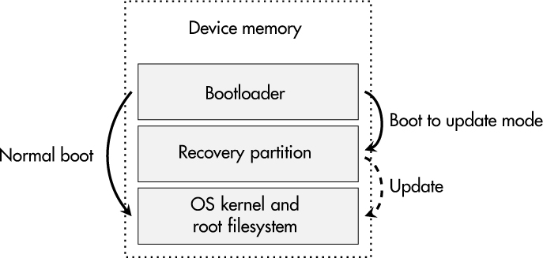
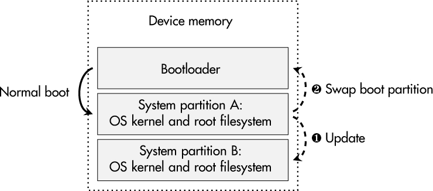
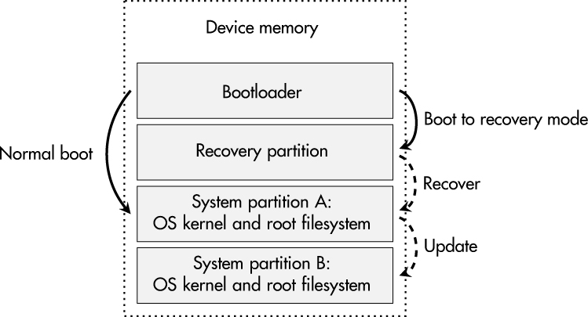

<a id="ch09"></a>

# <a id="page_159"></a>9 CẬP NHẬT FIRMWARE AN TOÀN (SECURE FIRMWARE UPDATE)

Các bản cập nhật bảo mật thật phiền phức, đối với người tiêu dùng, đối với quản trị viên, và đặc biệt đối với nhà sản xuất. Nhà sản xuất liên tục phải để mắt đến các lỗ hổng khả dĩ trong sản phẩm của mình và phản ứng với các thông báo tương ứng, trong khi người dùng và quản trị viên phải áp dụng các bản vá đã công bố một cách kịp thời. Vì chúng ta có thể coi bảo mật của một thiết bị là một trạng thái dễ biến đổi có thể thay đổi vào ngày mai, việc có một chiến lược cập nhật vững chắc là bắt buộc.

Tuy nhiên, việc xử lý cập nhật phần mềm không phải là một quá trình tầm thường. Chỉ các thực thể được ủy quyền mới có thể cung cấp bản cập nhật cho thiết bị, và các bản cập nhật không được phá vỡ chức năng của thiết bị hay biến nó thành một viên gạch đắt tiền. Ngoài ra, các chuyên gia safety thường khá ngần ngại đưa bản vá vào các thiết bị đã được chứng nhận của họ, trong khi các tổ chức chứng nhận tương ứng ngày càng nhận ra tầm quan trọng của các bản cập nhật bảo mật ngay cả trong các lĩnh vực safety-critical.

Chương này đi qua các lựa chọn cho các cách tiếp cận cập nhật an toàn và lý do đằng sau chúng. Một cân nhắc trung tâm là việc triển khai an toàn việc xác minh bản cập nhật và việc áp dụng nó một cách đáng tin cậy trên chính thiết bị. Chương kết thúc với một case study thực tế về cập nhật firmware dựa trên framework SWUpdate phổ biến và một toolchain Yocto-based.

<a id="ch00lev1_72"></a>

## <a id="page_160"></a>Tính tất yếu của cập nhật

Trong một số cộng đồng phát triển phần mềm và sản phẩm, giai đoạn *perpetual beta* (beta vĩnh viễn) là phổ biến: một sản phẩm không bao giờ rời khỏi trạng thái beta, và các tính năng mới liên tục được thêm vào, ngay cả khi phần mềm hay thiết bị đã ở ngoài hiện trường và đang được khách hàng sử dụng thực tế. Khái niệm này đôi khi còn được mô tả là *nguyên tắc quả chuối*, vì loại quả này được thu hoạch khi còn xanh và tiếp tục chín trên đường tới khách hàng và thậm chí sau khi được mua. Trong những trường hợp như vậy, rõ ràng một cách trắng trợn rằng sản phẩm được giao chưa hoàn thiện hoàn toàn và đòi hỏi nhiều bản cập nhật phần mềm để phát huy hết tiềm năng. Một cách tiếp cận cập nhật an toàn là thiết yếu.

Nếu chúng ta nhìn vào các hệ thống công nghiệp và hạ tầng trọng yếu, tình huống rất khác. Mặc dù những hệ thống này thường có vòng đời dài, nhà sản xuất và nhà vận hành của chúng có thể chưa thấy cần quản lý bản vá trong quá khứ. Tuy nhiên, sự gia tăng kết nối và số hóa trong lĩnh vực này, cùng với việc liên tục phát hiện lỗ hổng trong các sản phẩm công nghiệp, buộc các nhà cung cấp và người dùng phải hành động và chuẩn bị cho các quy trình cập nhật an toàn. Tình huống này đặc biệt thách thức vì việc nhà sản xuất hỗ trợ các bản cập nhật bảo mật và các quy trình quản lý bản vá vận hành cho các linh kiện công nghiệp thường phải kéo dài hàng thập kỷ.

Ngay cả khi bạn làm việc trong một ngành tập trung mạnh vào bảo mật và các quy trình phát triển của bạn tạo ra những sản phẩm rất an toàn và bền vững, bạn không thể bảo đảm rằng phần mềm, firmware và các thành phần phần cứng của bạn không có bug. Ngoài ra, bạn không biết liệu các phương pháp tấn công mới—thậm chí chưa được phát minh vào thời điểm phát triển sản phẩm—có gây ra vấn đề bảo mật cho thiết bị của bạn và có thể đòi hỏi thay thế các thuật toán crypto hay tăng cường thêm các tính năng bảo mật không. Tóm lại: không sản phẩm nào hoàn hảo. Hãy chuẩn bị để nó có thể cập nhật được.

Một số trường hợp nổi bật nhấn mạnh nhu cầu hỗ trợ cập nhật an toàn trong các thiết bị embedded và IoT. Các tập lỗ hổng *Urgent/11* năm 2019 và *Ripple20* năm 2020 cho thấy các thành phần phần mềm cơ bản như TCP/IP stack và OS có thể có những điểm yếu nghiêm trọng. Hàng triệu, nếu không phải hàng tỷ, thiết bị bị ảnh hưởng, và nhiều thiết bị được cho là không thể vá được vì chúng không cung cấp phương tiện cần thiết. Cuối cùng, sự bất lực đó buộc khách hàng phải thay thế những thiết bị đó hoặc để họ lại với các hệ thống không an toàn. Ở quy mô này, nó thậm chí có thể gây rủi ro cho toàn xã hội vì những tác nhân có ý đồ xấu biết cách mời những sản phẩm IoT đó vào botnet của chúng. Điểm mấu chốt là mọi thiết bị số được bán trong những năm 2020 nên có một cơ chế cập nhật an toàn.

> **LƯU Ý**
>
> *Tôi không phải là người duy nhất nhấn mạnh nhu cầu về các chiến lược cập nhật an toàn. IEC 62443 cho cybersecurity công nghiệp, United Nations (UN) Regulation 156 cho ngành ô tô và phần cybersecurity của US FD&C Act cho thiết bị y tế cũng đồng ý, chỉ để kể tên một vài.*

<a id="ch00lev1_73"></a>

## <a id="page_161"></a>Yêu cầu bảo mật

Như với mọi khái niệm có thuật ngữ *secure* trong tên gọi, câu hỏi hiển nhiên là những mục tiêu (bảo vệ) nào gắn với nó trong ngữ cảnh cụ thể này. Các phần sau mô tả các yêu cầu bạn phải xem xét cho một bản cập nhật firmware an toàn.

<a id="ch00lev2_93"></a>

### *Authenticity*

Điều thiết yếu là một bản cập nhật firmware có thể chứng minh bằng cryptography authenticity của nó, bảo đảm rằng nó bắt nguồn từ nhà sản xuất gốc của thiết bị đang xét. Điều này ngăn việc cài đặt các bản cập nhật được tạo ra với ý đồ xấu và nên là bắt buộc đối với mọi thủ tục cập nhật an toàn. Mục tiêu này thường đạt được bằng cách ký số một gói cập nhật.

<a id="ch00lev2_94"></a>

### *Confidentiality*

Các firmware image thường xuyên được người ta dùng để reverse engineering thiết bị nhằm liệt kê các software library, để xác định điểm yếu, hay để phân tích các ứng dụng độc quyền tìm tài sản trí tuệ và bí mật. Bảo vệ confidentiality có thể đạt được bằng cách mã hóa toàn bộ hay một phần nội dung bản cập nhật.

Tuy nhiên, hãy bảo đảm bạn hiểu rằng có một rủi ro vì key giải mã tương ứng cần được lưu trên thiết bị, nên kẻ tấn công có thể hoặc trích xuất key đó từ thiết bị, hoặc trích xuất bản cập nhật firmware ở dạng rõ sau khi on-device decryption (giải mã trên thiết bị).

<a id="ch00lev2_95"></a>

### *Kênh phân phối an toàn*

Hai yêu cầu đầu tiên, authenticity và confidentiality, áp đặt yêu cầu lên bản thân file cập nhật. Tuy nhiên, kênh phân phối cũng có thể đáng được bảo vệ (ví dụ, bằng TLS).

Một giao tiếp được xác thực lẫn nhau và được mã hóa giữa thiết bị và một update server thậm chí có thể thay thế cho việc bảo vệ confidentiality của file cập nhật.

<a id="ch00lev2_96"></a>

### *Tùy chọn rollback*

Điều này khá phức tạp. Việc rollback phiên bản phần mềm của một thiết bị về trạng thái cũ hơn đôi khi tuyệt đối hữu ích—ví dụ, nếu một bản cập nhật gây ra các vấn đề nghiêm trọng chưa từng tồn tại trước đó. Mặt khác, kẻ tấn công có thể dùng tính năng này để đưa phần mềm của thiết bị về một phiên bản chứa các lỗ hổng đã biết mà các bản vá sau đó đã sửa. Trong trường hợp đó, việc vận hành các thiết bị có lỗ hổng và việc khai thác chúng trở nên khả thi, mặc dù nhà sản xuất đã cung cấp các bản cập nhật bảo mật.

<a id="page_162"></a>Nếu bạn quyết định triển khai rollback protection, bạn cần hỗ trợ phần cứng tương ứng, như một bộ đếm phiên bản đơn điệu, nonvolatile bên trong CPU chính.

<a id="ch00lev2_97"></a>

### *Giám sát phân bố phiên bản*

Việc giám sát mức độ áp dụng các bản cập nhật bảo mật ngoài hiện trường có thể rất có giá trị, vì làm như vậy cho bạn một cái nhìn tổng quan về tình hình và bối cảnh mối đe dọa tương ứng đối với thiết bị và khách hàng của bạn. Bạn có thể triển khai việc giám sát này bằng một thông báo xác nhận từ mỗi thiết bị sau khi một phiên bản firmware mới đã được cài đặt thành công.

<a id="ch00lev1_74"></a>

## Phân phối và triển khai bản cập nhật

Một câu hỏi trung tâm về cập nhật firmware là, “Làm thế nào file cập nhật tìm được đường vào thiết bị?” Câu trả lời cho câu hỏi đó có tác động đáng kể lên tính dễ dùng, các quy trình và tốc độ phản ứng của việc quản lý bản vá cho thiết bị của bạn.

<a id="ch00lev2_98"></a>

### *Cập nhật cục bộ so với từ xa*

Kể từ những năm 1990, các thiết bị triển khai một cơ chế cập nhật cung cấp một dạng interface nào đó để upload hay lưu một file firmware đã được tải trước từ website của nhà sản xuất. File cập nhật thậm chí có thể bị giới hạn chỉ được nạp tại một interface cục bộ, như qua phương tiện USB. Mặc dù việc phải có mặt tại chỗ để cập nhật có thể là một tính năng bảo mật, cách tiếp cận này có khả năng mở rộng khá kém cho các kịch bản IoT. Hàng triệu thiết bị sẽ đòi hỏi hàng triệu khách hàng có nhận thức bảo mật và hàng triệu lần cài đặt cập nhật thủ công, điều khó có thể khả thi và dẫn đến việc rất ít bản cập nhật thực sự được áp dụng.

Ngành ô tô là một ví dụ thú vị về cập nhật firmware. Trong nhiều năm, việc phát lệnh thu hồi là phổ biến nếu xe có một bug phần mềm hay lỗ hổng đáng kể. Chủ xe phải mang xe của họ đến một xưởng sửa chữa ô tô, nơi thợ máy cài đặt bản cập nhật phần mềm do nhà sản xuất ô tô tương ứng cung cấp, nhà sản xuất này nhận nó từ các nhà cung cấp của bộ điều khiển cụ thể. Ngày nay, ô tô hiện đại có thể nhận bản cập nhật phần mềm qua kết nối với mạng di động. Cách tiếp cận này được gọi là *over-the-air (OTA) update*.

Cập nhật OTA không giới hạn ở ô tô. Chúng có thể được áp dụng cho mọi loại thiết bị IoT, và ngay cả khi thuật ngữ gợi ý rằng bản cập nhật được áp dụng qua các kênh không dây, việc truyền bản cập nhật qua mạng có dây rõ ràng không bị cấm. Ưu điểm chính của khái niệm này là các thiết bị có kết nối tới một backend quản lý cập nhật, thường do nhà sản xuất thiết bị vận hành, cung cấp thông tin về các bản cập nhật mới. Cách tiếp cận này mang lại khả năng mở rộng tốt vì quá trình triển khai cập nhật có thể được nhà sản xuất tự động hóa và lên lịch. Tuy nhiên, một hệ thống như vậy làm lộ các backend server và các thiết bị đang lắng nghe bản cập nhật trước kẻ tấn công từ xa và các cuộc tấn công network-based.

> <a id="page_163"></a>**LƯU Ý**
>
> *Trong một số kịch bản công nghiệp, các thủ tục cập nhật cục bộ thủ công vẫn là mặc định. Tôi từng nghe một người kể rằng họ đích thân đến từng robot trong số hàng trăm robot công nghiệp, cắm một USB, rồi chờ bản cập nhật hoàn tất trước khi tiếp tục hành trình của mình, việc có thể mất hàng tuần cho một bản cập nhật duy nhất. Thật điên rồ!*

<a id="ch00lev2_99"></a>

### *Chiến lược pull so với push*

Không nghi ngờ gì rằng một kết nối trực tiếp giữa thiết bị và một update server ở backend là một giải pháp hợp lý cho việc quản lý cập nhật chuyên nghiệp, nhưng vẫn còn một câu hỏi: Ai kiểm soát thủ tục cập nhật?

Thông thường, thiết bị theo một *pull strategy* cho việc quản lý cập nhật: một ứng dụng client trên thiết bị định kỳ kiểm tra các bản cập nhật mới và tải về các image mới có sẵn. Sau đó, tùy thuộc vào cấu hình của chủ sở hữu, thiết bị có thể tự động cài đặt bản cập nhật (ví dụ, trong một cửa sổ bảo trì được định nghĩa trước) hay nhắc người dùng hoặc quản trị viên phê duyệt việc cài đặt. Sau một lần cập nhật thành công, trạng thái phần mềm mới có thể được báo cáo tới server của nhà sản xuất. Trong trường hợp này, nhà vận hành kiểm soát khi nào và bản cập nhật nào được cài đặt trên thiết bị của họ, đây thường là giải pháp được ưa chuộng cho các kịch bản doanh nghiệp, nhưng họ cũng nhận trách nhiệm về lịch cập nhật đều đặn.

Ngoài ra, nhà sản xuất có thể chọn một *push strategy* cho họ nhiều quyền kiểm soát hơn đối với quá trình cập nhật. Họ thậm chí có thể buộc thiết bị vào chế độ cập nhật. Phương pháp này có thể hợp lý nếu nhà sản xuất tham gia và chịu trách nhiệm về việc cập nhật thiết bị kịp thời, có thể thậm chí theo nghĩa vụ pháp lý. Hơn nữa, bảo mật của các nhóm khách hàng mục tiêu cụ thể như người dùng cá nhân có thể hưởng lợi đáng kể nếu các bản cập nhật được áp dụng tự động và họ không phải tự tổ chức quá trình. Mặt khác, một số khách hàng cố ý chọn vận hành thiết bị với phiên bản firmware cũ, và nếu họ chặn những thiết bị đó truy cập update server, nhà sản xuất sẽ bất lực. Tuy nhiên, nếu những trường hợp như vậy là một phần thách thức của bạn, hợp lý khi tập trung vào việc giám sát trạng thái phần mềm bất cứ khi nào thiết bị kết nối tới các dịch vụ trực tuyến của bạn và từ chối truy cập nếu firmware thiết bị quá cũ, giữ cho một phần lớn thiết bị ngoài hiện trường ở trạng thái an toàn.

Trên thực tế, các chiến lược kết hợp các khía cạnh pull và push là khả thi. Bạn thậm chí có thể để khách hàng quyết định bằng cách cung cấp các tùy chọn cấu hình tương ứng cho thiết bị của mình. Điều này cho phép nhà vận hành tích hợp hoàn hảo thiết bị của bạn vào các quy trình quản lý tài sản và patch-management cụ thể của họ.

<a id="ch00lev1_75"></a>

## Độ chi tiết và định dạng bản cập nhật

Các thuật ngữ *software update* và *firmware update* thường được dùng thay thế cho nhau và cho một phạm vi rộng các kịch bản cập nhật, từ việc ghi lại toàn bộ nội dung memory bên trong một thiết bị đến việc thay đổi một vài tham số cấu hình trong một file duy nhất. Do đó, đối với thiết bị cụ thể của bạn, điều tuyệt đối cần thiết là định nghĩa những phần nào của firmware thiết bị nên có thể thay thế và bạn muốn phân phối dữ liệu đó ở định dạng nào.

<a id="ch00lev2_100"></a>

### <a id="page_164"></a>*Các phần firmware*

Trong ngữ cảnh PC, *firmware* là phần mềm được lập trình vào memory nonvolatile onboard của bo mạch chủ, các bo mạch con được lắp đặt và các thiết bị ngoại vi khác. OS, ứng dụng phần mềm và dữ liệu người dùng, thường được lưu trên ổ cứng, không được coi là firmware. Tuy nhiên, trong ngữ cảnh embedded system, gần như mọi thứ đều có thể được coi là firmware:

**Bootloader** Các thiết bị embedded hiện đại chứa ít nhất một boot-loader, thường là nhiều hơn.

**Firmware coprocessor** Các SoC gần đây bao gồm một tập processor không đồng nhất trong một package. Một số coprocessor này có thể đòi hỏi firmware riêng của chúng.

**Firmware bộ điều khiển** Ở quy mô PCB, một embedded system đơn lẻ có thể có nhiều microcontroller thực thi firmware chuyên dụng.

**FPGA bitstream** Như một phần của SoC hay như một linh kiện rời, FPGA được tích hợp vào vô số thiết bị embedded. Cấu hình của chúng, gọi là *bitstream*, có thể được đọc trực tiếp từ flash memory hay được nạp bởi một bootloader hay một ứng dụng OS.

**Phần mềm bare-metal** Trong các thiết bị chạy không có OS, phần mềm bare-metal là ứng dụng chính.

**OS kernel** Nếu thiết bị của bạn đi kèm một OS hay một RTOS, OS kernel tương ứng là thành phần phần mềm trung tâm.

**Device tree** Các thành phần phần cứng và tham số của chúng cho một embedded system cụ thể thường được mô tả trong một file device-tree được OS kernel nạp.

**Root filesystem** Filesystem cơ bản mà mọi filesystem và overlay khác được mount lên trên chứa dữ liệu then chốt cho hoạt động đúng của một OS.

**Phần mềm ứng dụng** Phần mềm ứng dụng có thể là một phần của root filesystem nhưng cũng có thể nằm trong một hay nhiều phân vùng manufacturer-specific.

Một số phần firmware trong danh sách đó có thể dùng chung một memory nonvolatile; những phần khác có thể đi kèm linh kiện memory rời riêng. Hãy bảo đảm bạn biết mọi thành phần firmware liên quan khi phát triển một khái niệm cập nhật an toàn. Tuy nhiên, đừng quên rằng thiết bị của bạn có lẽ mang dữ liệu duy nhất không được bị ảnh hưởng bởi một bản cập nhật phần mềm:

**Cryptographic key duy nhất** Dữ liệu tương ứng với định danh duy nhất của thiết bị, có lẽ được provisioning trong quá trình sản xuất, là thiết yếu cho việc xác thực thiết bị đáng tin cậy. Ngoài ra, các bí mật, như các key SSH được tạo ở lần boot đầu tiên, nên được giữ lại qua một bản cập nhật phần mềm.

**Dữ liệu hệ thống user-dependent** Khách hàng dựa vào các tài khoản người dùng bổ sung và credential tương ứng cũng như các file cấu hình thiết bị tùy chỉnh.

<a id="page_165"></a>**Phân vùng dữ liệu runtime** Thiết bị của bạn có thể thu thập và lưu dữ liệu runtime user-specific, như lịch sử sensor-value cho các ứng dụng phân tích dữ liệu, nhưng nó cũng có thể ghi log dữ liệu có thể liên quan đến các trường hợp bảo trì và sửa chữa.

<a id="ch00lev2_101"></a>

### *Định dạng bản cập nhật*

Như đã đề cập trước đó, độ chi tiết của các thành phần phần mềm cần được bao quát bởi bản cập nhật khác nhau rất nhiều và không trực tiếp gợi ý một định dạng cụ thể cho việc phân phối bản cập nhật. Nhiều yêu cầu nên được xem xét trước khi quyết định:

**Bao quát toàn diện** Định dạng được chọn nên có khả năng cập nhật càng nhiều thành phần phần mềm của thiết bị càng tốt.

**Hiệu quả** Vì kích thước firmware liên tục tăng, nên có khả năng thu gọn một bản cập nhật firmware xuống chỉ những phần thực sự mới.

**Tính nguyên tử (atomicity)** Việc cài đặt một bản cập nhật nên là một thao tác *không thể chia cắt*, chỉ cho phép hai trạng thái cuối cùng: firmware đã được cập nhật thành công hoặc, khi thất bại, firmware gốc trước khi quá trình cập nhật bắt đầu.

Danh sách sau đưa ra các giải pháp định dạng cập nhật khả dĩ dựa trên các yêu cầu đã nêu trước đó:

**File** Một định dạng cập nhật tầm thường là cung cấp cho thiết bị một tập file đã cập nhật có thể được ghi vào các đường dẫn cụ thể của chúng trong một filesystem. Mặc dù điều này cho phép cập nhật mọi thành phần có trong filesystem của thiết bị, và có thể tạo các gói cập nhật nhỏ, hiệu quả, nhưng atomicity lại phức tạp. Mỗi file được tạo, ghi hay xóa đòi hỏi thao tác riêng của nó, có thể thất bại hay thành công. Trong trường hợp có lỗi, firmware có thể kết thúc ở một trạng thái không xác định.

**Container** Các ứng dụng được container hóa ngày càng trở nên phổ biến trong các embedded system lớn hơn. Việc thay thế toàn bộ container image có thể hiệu quả cho việc quản lý cập nhật của chúng, nhưng chỉ dựa vào các bản cập nhật container-based sẽ bỏ qua các thành phần phần mềm quan trọng như host OS chạy việc quản lý container.

**Image** Việc cập nhật toàn bộ partition image cho phép cập nhật nhiều thành phần phần mềm trong một embedded system và có ưu điểm về atomicity. Cách tiếp cận này có thể dẫn đến các bản cập nhật firmware lớn hơn so với các định dạng khác, nhưng một số bản triển khai cũng hỗ trợ các file cập nhật được nén hay các bản cập nhật vi sai (differential update) để khắc phục vấn đề này.

> **LƯU Ý**
>
> *Các phần firmware không thể truy cập qua filesystem, như các IC phải được cập nhật dựa trên một protocol độc quyền, đòi hỏi cách xử lý tùy chỉnh. Hãy cân nhắc ưu nhược điểm và đưa ra quyết định có ý thức về các khả năng cập nhật nhắm tới cho thiết bị của bạn.*

<a id="ch00lev2_102"></a>

### <a id="page_166"></a>*Vấn đề với package manager*

Bạn có thể thắc mắc tại sao các thiết bị embedded Linux-based trong hầu hết các trường hợp không dựa vào các ứng dụng package manager đã được thiết lập như `apt-get` hay `opkg` vốn được dùng khắp nơi trên các hệ thống desktop và server. Lý do nằm ở độ phức tạp kiểm thử của các hệ thống được cập nhật theo từng package. Cách tiếp cận như vậy đòi hỏi quản lý các *phụ thuộc* giữa mọi package khả dĩ trong một hệ thống, và nó nhân lên số cấu hình phần mềm khả dĩ phải được kiểm thử.

Ngoài ra, vì các thiết bị embedded thường hoạt động trong các ứng dụng hay ngành trọng yếu, kiểm thử toàn diện là bắt buộc. Do đó, nhiều nhà sản xuất tránh dùng package manager và thay vào đó chọn một cách tiếp cận cập nhật image-based, nguyên tử, giới hạn sự tương tác giữa các thành phần phần mềm cần kiểm thử vào các phiên bản cụ thể trong một bản phát hành phần mềm nhất định.

Nếu bạn muốn đi theo con đường đó, có lẽ bạn cần một đối tác cung cấp các dịch vụ kiểm thử tự động và đáng tin cậy xử lý mọi vấn đề đã đề cập, ví dụ, như Canonical cung cấp cho Ubuntu Core OS của họ.

<a id="ch00lev1_76"></a>

## Các chiến lược phân vùng thiết bị

Một thủ tục cập nhật bền vững chỉ khả thi nếu cách phân vùng memory của thiết bị hỗ trợ nó. Tùy thuộc vào memory có sẵn và mức độ sẵn lòng chấp nhận rủi ro, nhiều cách tiếp cận có thể được dùng để thiết kế bố cục phân vùng của hệ thống nhằm hỗ trợ các quá trình cập nhật.

<a id="ch00lev2_103"></a>

### *Phân vùng Update/Recovery*

Bạn có thể tăng cường tính bền vững trước các bản cập nhật firmware thất bại bằng cách đưa vào thêm một *recovery partition*. Phân vùng này chứa các công cụ để tải về và cập nhật phân vùng hệ thống chính, bao gồm OS kernel và root filesystem tương ứng, như được thể hiện trong [Hình 9-1](#ch09fig01).

<a id="ch09fig01"></a>

*Hình 9-1: Recovery partition để thực hiện cập nhật hệ thống*

<a id="page_167"></a>Ưu điểm của cách tiếp cận này là memory footprint thấp của phân vùng bổ sung, điều nên khả thi với nhiều thiết bị. Tuy nhiên, nhược điểm là thiết bị phải được khởi động lại để vào chế độ cập nhật hay recovery. Nếu quá trình cập nhật thất bại, phân vùng chính bị hỏng và không thể boot được nữa, nên recovery partition được boot lại, và một quá trình cập nhật mới có thể được khởi động.

<a id="ch00lev2_104"></a>

### *Cách tiếp cận hệ thống A/B*

Đối với các thiết bị cung cấp nhiều memory nonvolatile, cách tiếp cận *A/B system* có thể là một ứng viên thú vị. [Hình 9-2](#ch09fig02) mô tả bố cục phân vùng cơ bản và thủ tục cập nhật.

<a id="ch09fig02"></a>

*Hình 9-2: Hai bản sao system image giống hệt nhau—A và B*

Trong bố cục này, tồn tại hai bản sao, A và B, của phân vùng hệ thống, cả hai đều chứa ít nhất OS kernel và root filesystem. Lúc boot, phân vùng được đánh dấu là “bootable” (phân vùng A trong [Hình 9-2](#ch09fig02)) được dùng để nạp OS và filesystem cơ bản. Điều này bao gồm một update client có thể nhận các bản cập nhật firmware, xác minh chúng và ghi chúng vào phân vùng hiện không được dùng ➊ (B trong [Hình 9-2](#ch09fig02)). Sau đó, bootloader được cấu hình để đổi phân vùng boot từ A sang B (hay ngược lại) ➋ trước khi khởi động lại vào phiên bản firmware mới.

Trong trường hợp cập nhật thất bại hay phân vùng bị hỏng, phiên bản cũ vẫn có sẵn ở trạng thái ban đầu và có thể được boot lại. Một ưu điểm đáng kể so với việc dùng recovery partition là hoạt động tiêu chuẩn của thiết bị không bị gián đoạn trong quá trình tải về và cài đặt bản cập nhật. Ngoài ra, firmware mới tải về có thể được lưu trực tiếp trên phân vùng không hoạt động thay vì đòi hỏi thêm một vị trí lưu trữ để cache bản cập nhật. Trên các thiết bị Android, khái niệm này được gọi là *seamless system update*, và nó ngày càng được các nhà cung cấp điện thoại triển khai.

Đối với các thiết bị có mức độ trọng yếu còn cao hơn, cả hai cách tiếp cận có thể được kết hợp, như được thể hiện trong [Hình 9-3](#ch09fig03).

<a id="page_168"></a><a id="ch09fig03"></a>

*Hình 9-3: Architecture A/B với một recovery partition bổ sung*

Thiết kế này nhắm tới việc bảo vệ trước các trường hợp cả hai phân vùng hệ thống, A và B, đều bị hỏng vì bất kỳ lý do gì. Đối với các architecture như vậy, hợp lý khi lưu recovery partition trong một memory vật lý khác với các phân vùng hệ thống. Ngay cả khi recovery partition không thể cài đặt lại thành công các phân vùng hệ thống, nó vẫn có thể báo cáo sự cố hệ thống và thực hiện chẩn đoán.

<a id="ch00lev2_105"></a>

### *Một lưu ý về việc cập nhật bootloader*

Bootloader được dùng trên nhiều embedded system. Chúng xử lý việc khởi tạo hệ thống cơ bản, chọn một phương tiện boot và sau đó nạp một OS kernel. Trong nhiều trường hợp, các binary này được coi là một phần firmware “bất biến.”

Tuy nhiên, ngày nay, các bootloader như U-Boot và GRUB là các thành phần phần mềm phức tạp với nhiều tính năng và khả năng. Do đó, bootloader cũng có thể có bug hay thậm chí lỗ hổng bảo mật đòi hỏi cập nhật.

Từ góc nhìn bảo mật, bạn cũng có thể cần thay các public key hay các thuật toán cryptography lỗi thời được dùng cho một quá trình secure boot, như được mô tả trong [Chương 8](ch08_secure_boot_and_system_integrity.vi.md#ch08). Về mặt chức năng, bạn có thể đến lúc muốn cập nhật các thiết lập khởi tạo phần cứng, tham số boot của kernel hay cấu hình boot. Tất cả những lý do này khiến việc cập nhật các boot-loaders và dữ liệu cấu hình của chúng trở thành một cân nhắc xác đáng.

Tuy nhiên, trong hầu hết các hệ thống, chỉ có một bản sao duy nhất cho mỗi bootloader, nghĩa là việc cập nhật nó đi kèm rủi ro làm hỏng thiết bị—ví dụ, trong trường hợp mất điện hay các sự cố khác trong quá trình cập nhật bootloader. Chỉ một số ít SoC và microcontroller hỗ trợ các instance bootloader bổ sung có thể được chạy khi bootloader chính thất bại. Do đó, cập nhật một bootloader luôn là một thủ tục trọng yếu và rủi ro, rất có thể dẫn đến tình huống cần truy cập vật lý vào thiết bị để sửa chữa.

Một giải pháp thỏa hiệp có thể là cách tiếp cận bootloader nhiều giai đoạn, chia chức năng thành hai phần. Giai đoạn đầu được coi là bất biến và có chức năng tối thiểu, nhưng hỗ trợ nhiều bản sao bootloader ở giai đoạn tiếp theo, giai đoạn mang bootloader đầy đủ tính năng. Trong một <a id="page_169"></a>hệ thống như vậy, các vấn đề bảo mật ở giai đoạn đầu vẫn là một vấn đề và sẽ đòi hỏi truy cập vật lý hay một thủ tục cập nhật rủi ro, nhưng giai đoạn thứ hai có thể được lưu dự phòng, cho phép cập nhật low-risk. Tuy nhiên, cách tiếp cận này không phải là tiêu chuẩn và sẽ đòi hỏi thêm công sức phát triển và tùy chỉnh.

<a id="ch00lev1_77"></a>

## Sự tương tác giữa phát triển, backend và thiết bị

Sau khi làm rõ mọi chi tiết ảnh hưởng đến chiến lược cập nhật của bạn, đã đến lúc nói về các quy trình vận hành cần thiết cho việc cập nhật firmware đáng tin cậy và an toàn. Như được mô tả trong [Chương 1](ch01_secure_development_process.vi.md#ch01), nhà sản xuất có trách nhiệm giám sát các lỗ hổng thiết bị bị khai thác ngoài hiện trường và xem xét nghiêm túc các báo cáo lỗ hổng.

Hãy giả định bạn đã lo xong việc đó và nhóm phát triển của bạn có thể cung cấp bản sửa lỗi trong một khung thời gian ngắn. Vẫn còn một câu hỏi vận hành: Các bản cập nhật bảo mật và các cải tiến chức năng nên được gộp chung trong các bản cập nhật firmware, hay mỗi loại nên được cung cấp riêng?

Một số khách hàng phải thực hiện kiểm thử toàn diện thiết bị của bạn trong hạ tầng của họ và, do đó, tránh nâng cấp thiết bị với các chức năng mới có thể đòi hỏi kiểm thử lại. Tuy nhiên, họ có lẽ quan tâm đến các bản sửa lỗi bảo mật góp phần vào tính bền vững và bảo mật của hệ thống họ. Trong những kịch bản như vậy, việc tách riêng bản cập nhật chức năng và bản cập nhật bảo vệ được khuyến nghị.

Ngoài ra, hãy tưởng tượng một phiên bản firmware mới dẫn đến các biến chứng và khách hàng phải hạ cấp về phiên bản trước. Nếu các bản cập nhật bảo mật được đưa vào file cập nhật này, khách hàng của bạn sẽ phải sống chung với các lỗ hổng đã biết trong thiết bị của bạn, ít nhất cho đến khi các vấn đề chức năng được sửa. Tuy nhiên, việc nghiêm túc thực hiện sự tách biệt này dẫn đến nhiều cấu hình phần mềm khả dĩ hơn và nhiều kiểm thử hơn ở phía nhà sản xuất.

Bất kể nội dung của một bản cập nhật firmware là gì, nó phải được nhóm phát triển và các build pipeline tương ứng cung cấp và đóng gói. Nếu cần, firmware phải được mã hóa, thường bằng một lược đồ mã hóa đối xứng như AES. Để đạt được bảo vệ authenticity và integrity, firmware image cuối cùng phải được ký số bằng các thuật toán phù hợp như RSA hay ECDSA.

Cả hai nhiệm vụ đều gồm hai thành phần phải khớp với nhau. Ở phía nhà sản xuất, các artifact firmware do build system tạo ra phải được mã hóa và ký để tạo ra các file cập nhật firmware thực sự sẽ được phân phối. Trên chính thiết bị, việc xác minh chữ ký và giải mã phải được thực hiện.

Nhiều hệ thống cập nhật image-based thực hiện những nhiệm vụ đó cho bạn: Mender, SWUpdate và RAUC. Mender cung cấp toàn bộ hạ tầng, bao gồm phần mềm client trên thiết bị và backend server. SWUpdate và RAUC tạo và áp dụng các file cập nhật firmware, nhưng việc phân phối và giám sát cập nhật thường được thực hiện bởi framework backend Eclipse hawkBit. Các ứng viên khác bao gồm OSTree và swupd, vốn theo một cách tiếp cận revision-based “Git-like” cho cập nhật firmware.

<a id="ch00lev1_78"></a>

## <a id="page_170"></a>Case Study: Cập nhật firmware an toàn với SWUpdate

Case study này đưa ra một ví dụ về các bước thực tế cần thiết để triển khai một architecture cập nhật firmware an toàn. Nó dựa trên tool-chain Yocto do ST cung cấp cho board STM32MP157F-DK2.

Tôi đã chọn SWUpdate làm thành phần phần mềm trung tâm cho bản triển khai này. Kết quả mong muốn là một quá trình cập nhật xác minh authenticity của bản cập nhật dựa trên digital signature và bảo đảm một thủ tục cập nhật đáng tin cậy theo cách tiếp cận A/B system.

<a id="ch00lev2_106"></a>

### *Tùy chỉnh bố cục thẻ SD*

Build system Yocto biên dịch và đóng gói mọi phần mềm liên quan cho firmware image của thiết bị và cung cấp nó ở các định dạng như *.ext4* và *.tar.gz*. Điều này hữu ích cho việc xử lý tiếp, như để tạo image thẻ SD và tạo file cập nhật, nhưng hãy làm từng bước một.

Công cụ STM32 Cube Programmer của ST cũng như shell script tiện dụng *create_sdcard_from_flashlayout.sh* dùng các file bố cục flash memory ở định dạng Tab-Separated Values (TSV). Trong số những thứ khác, một file TSV như vậy chứa một danh sách phân vùng, offset của chúng và các file cần thiết để điền vào chúng. Các cột được chọn của bố cục flash mặc định cho board STM32MP157FDK2 được thể hiện trong [Listing 9-1](#ch09list01).

```
Name       Offset     Binary
fsbl-boot  0x0        arm-trusted-firmware/tf-a-stm32mp157f-dk2-usb.stm32
fip-boot   0x0        fip/fip-stm32mp157f-dk2-optee.bin
fsbl1      0x00004400 arm-trusted-firmware/tf-a-stm32mp157f-dk2-sdcard.stm32
fsbl2      0x00044400 arm-trusted-firmware/tf-a-stm32mp157f-dk2-sdcard.stm32
metadata1  0x00084400 arm-trusted-firmware/metadata.bin
metadata2  0x000C4400 arm-trusted-firmware/metadata.bin
fip-a      0x00104400 fip/fip-stm32mp157f-dk2-optee.bin
fip-b      0x00504400 none
u-boot-env 0x00904400 none
bootfs     0x00984400 st-image-bootfs-openstlinux-eglfs-stm32mp1.ext4
vendorfs   0x04984400 st-image-vendorfs-openstlinux-eglfs-stm32mp1.ext4
rootfs     0x05984400 st-image-core-openstlinux-eglfs-stm32mp1.ext4
```

<a id="ch09list01"></a>

*Listing 9-1: Bố cục flash mặc định cho board STM32MP157F-DK2*

File TSV chứa nhiều dòng liên quan đến bootloader và các artifact trusted firmware ít đáng quan tâm ở điểm này. Tuy nhiên, ba dòng cuối cho thấy hai sự thật quan trọng. Thứ nhất, một phân vùng `bootfs` chuyên dụng chứa các file cấu hình U-Boot, các device-tree blob và Linux kernel dưới dạng một `uImage`. Thứ hai, phân vùng `rootfs` là một ứng viên hoàn hảo để nhân đôi cho cách tiếp cận A/B system. [Listing 9-2](#ch09list02) cho thấy các thay đổi tôi đã thực hiện với file TSV.

<a id="page_171"></a>

```
Name       Offset     Binary
...
bootfs     0x00984400 st-image-bootfs-openstlinux-eglfs-stm32mp1.ext4
vendorfs   0x04984400 st-image-vendorfs-openstlinux-eglfs-stm32mp1.ext4
rootfs-a   0x05984400 st-image-core-openstlinux-eglfs-stm32mp1.ext4
rootfs-b   0x35984400 st-image-core-openstlinux-eglfs-stm32mp1.ext4
userfs     0x65984400 st-image-userfs-openstlinux-eglfs-stm32mp1.ext4
```

<a id="ch09list02"></a>

*Listing 9-2: Bố cục phân vùng được điều chỉnh cho cách tiếp cận cập nhật A/B*

Phân vùng `rootfs` gốc đã được nhân bản, tạo ra hai phân vùng mới: `rootfs-a` và `rootfs-b`. Ngoài ra, một phân vùng `userfs`, đã có sẵn trong toolchain do ST cung cấp, được thêm vào để lưu dữ liệu cần “sống sót” qua một bản cập nhật root filesystem.

Để tạo image thẻ SD với các tham số mới, shell script *create_sdcard _from_flashlayout.sh* cũng phải được điều chỉnh để xử lý đúng các phân vùng mới được đưa vào `rootfs-a` và `rootfs-b`. Kích thước image thẻ SD được đặt là 2,048MB, trong khi cả hai phân vùng root được cấu hình chiếm 768MB, như đã được chỉ ra bởi offset `0x30000000` trong file bố cục flash.

Một thiết lập quan trọng trong script tạo image là việc cấp phát các partition UUID riêng cho các phân vùng `rootfs-a` và `rootfs-b`, như được thể hiện trong [Listing 9-3](#ch09list03).

```
DEFAULT_ROOTFSA_PARTUUID=e91c4e10-16e6-4c0e-bd0e-77becf4a3582
DEFAULT_ROOTFSB_PARTUUID=997046a6-c6f4-4f41-adb4-9fe614b2a92a
```

<a id="ch09list03"></a>

*Listing 9-3: Các UUID riêng cho cả hai bản sao của root filesystem*

Tôi đã dùng lại UUID của phân vùng `rootfs` gốc cho `rootfs-a` và tạo ngẫu nhiên một UUID mới cho `rootfs-b`. Những UUID này có liên quan vì chúng được dùng trong file cấu hình *extlinux.conf* của U-Boot nằm trong phân vùng `bootfs` để xác định phân vùng sẽ được Linux kernel mount làm root filesystem.

Sau đó, architecture phân vùng cơ bản cho case study này đã sẵn sàng để hỗ trợ cập nhật A/B system.

<a id="ch00lev2_107"></a>

### *Cài đặt và cấu hình SWUpdate*

SWUpdate, một công cụ cập nhật firmware feature-rich cho embedded system, cung cấp layer `meta-swupdate` tương ứng cho Yocto. Layer này có thể được clone từ Git repository của nó và thêm vào dự án Yocto STM32MP1.

#### Bổ sung các tính năng bảo mật

Một trong những nhiệm vụ đầu tiên là tạo một recipe vá cấu hình của SWUpdate để cho phép các image được ký và được mã hóa. [Listing 9-4](#ch09list04) cho thấy ba dòng phải được kích hoạt tường minh.

<a id="page_172"></a>

```
CONFIG_HASH_VERIFY=y
CONFIG_SIGNED_IMAGES=y
CONFIG_ENCRYPTED_IMAGES=y
```

<a id="ch09list04"></a>

*Listing 9-4: Kích hoạt các tính năng bảo mật quan trọng của SWUpdate*

Hai tùy chọn `CONFIG_HASH_VERIFY` và `CONFIG_SIGNED_IMAGES` thêm vào SWUpdate các khả năng cho phép nó xác minh hash và digital signature của các image có trong một bản cập nhật phần mềm. Tùy chọn `CONFIG_ENCRYPTED_IMAGES` bật hỗ trợ cho các image AES-encrypted, thứ chúng ta chưa triển khai lúc này, nhưng có thể là một tùy chọn có giá trị cho tương lai.

#### Tạo key

Như được giải thích trong [Chương 2](ch02_cryptography.vi.md#ch02), digital signature là một crypto primitive bất đối xứng cho phép xác minh integrity và authenticity của dữ liệu đã ký. SWUpdate có thể tạo chữ ký dựa trên key RSA thuần hay certificate. Cho case study này, tôi chọn dùng key RSA 4,096-bit. Việc tạo chúng có thể được chia thành ba bước, như được thể hiện trong [Listing 9-5](#ch09list05).

```
$ echo "SuperS3cr3t" > passphrase
$ openssl genrsa -aes256 -passout file:passphrase -out swu_signing_key.pem 4096
$ openssl rsa -in swu_signing_key.pem -pubout -passin file:passphrase
              -out swu_verification_key.pem
```

<a id="ch09list05"></a>

*Listing 9-5: Việc tạo key RSA để ký và xác minh bản cập nhật*

Trước tiên, file *passphrase* được tạo, nên chứa một mật khẩu mạnh. Sau đó, key RSA có thể được tạo (ví dụ, với độ dài 4,096-bit). Private key thu được được mã hóa dựa trên file passphrase đã cho và được lưu thành *swu_signing_key.pem*. Lưu ý rằng đây là RSA private key được dùng để ký một bản cập nhật firmware sau quá trình build. Public key tương ứng được trích xuất và lưu thành *swu_verification_key.pem* ở dòng thứ ba của listing. Điều này cần thiết để đưa key đó vào firmware thiết bị cuối cùng vì nó cần cho việc xác minh chữ ký bản cập nhật.

#### Tập hợp phần mềm (software collection)

Tiếp theo, SWUpdate cần biết những build artifact Yocto nào nên được đưa vào bản cập nhật firmware. Thông tin này được lưu trong file *sw-description*, được dùng để tạo bản cập nhật, nhưng nó cũng được đưa vào chính gói cập nhật firmware.

[Listing 9-6](#ch09list06) cho thấy software collection mà tôi đã định nghĩa cho use case này.

<a id="page_173"></a>

```
software = {
  version = "0.1.0";
➊ hardware-compatibility: ["C02"];
   stable = {
  ➋ rootfs-a: {
      images: (
      {
      ➌ filename = "st-image-core-openstlinux-eglfs-stm32mp1.ext4.gz";
      ➍ compressed = "zlib";
      ➎ device = "/dev/mmcblk0p10";
      ➏ sha256 = "$swupdate_get_sha256(st-image-core-...-stm32mp1.ext4.gz)";
      });
    }
  ➐ rootfs-b: {
      images: (
      {
        filename = "st-image-core-openstlinux-eglfs-stm32mp1.ext4.gz";
        compressed = "zlib";
        device = "/dev/mmcblk0p11";
        sha256 = "$swupdate_get_sha256(st-image-core-...-stm32mp1.ext4.gz)";
      });
    }
  }
}
```

<a id="ch09list06"></a>

*Listing 9-6: Software collection được định nghĩa trong file* sw-description

Điểm đầu tiên bạn có thể vướng phải là tham số `hardware-compatibility` ➊. Tôi đặt nó là `C02` vì đó là revision phần cứng và lắp ráp của board STM32MP157F-DK2 của tôi. Lúc runtime, tham số này phải khớp với dữ liệu được cho trong */etc/hwrevision* (ví dụ, `stm32mp157f-dk2 C02` trong trường hợp của tôi).

Thứ hai, cả hai phân vùng `rootfs-a` ➋ và `rootfs-b` ➐ đều được biểu diễn trong software collection này, mặc dù chỉ một phân vùng sẽ được dùng để cập nhật lúc runtime. Cả hai đều chứa cùng tên file của artifact cần cập nhật ➌—trong trường hợp này là root filesystem do Yocto tạo ra. Tham số `compressed` ➍ cho biết liệu dữ liệu có sẵn ở dạng nén không, trong khi `sha256` ➏ đưa hash value SHA-256 của artifact được cung cấp vào file *sw-description*.

Hai image chỉ khác nhau ở một thuộc tính: phân vùng được chỉ ra bởi tham số `device` ➎. Tham số này xác định nơi client SWUpdate ghi bản cập nhật vào. Trong trường hợp này, */dev/mmcblk0p10* và */dev/mmcblk0p11* là tên thiết bị mà các phân vùng `rootfs-a` và `rootfs-b` đã tạo trước đó có sẵn trong Linux. Nếu */dev/mmcblk0p10* là phân vùng đang hoạt động, bản cập nhật phải được ghi vào */dev/mmcblk0p11*, và ngược lại.

#### Recipe để tạo file cập nhật

Các file cập nhật firmware của SWUpdate có phần mở rộng *.swu*. Layer `meta-swupdate` đi kèm một class hỗ trợ SWU filegeneration bởi Yocto dựa trên các artifact đã được build và lưu trước đó trong thư mục *deploy* của Yocto. [Listing 9-7](#ch09list07) cho thấy code tương ứng cho một recipe Yocto tự động tạo ra một file SWU hợp lệ và được ký số.

<a id="page_174"></a>

```
# Local files to be added to the SWU file
SRC_URI = "file://sw-description"

# Images to build before creating the SWU file
IMAGE_DEPENDS = "st-image-core"

# Images to include within the SWU file
SWUPDATE_IMAGES = "st-image-core-openstlinux-eglfs"

# Format of image to include
SWUPDATE_IMAGES_FSTYPES[st-image-core-openstlinux-eglfs] = ".ext4.gz"

# SWU signing parameters
SWUPDATE_SIGNING = "RSA"
SWUPDATE_PRIVATE_KEY = "path-to-signing-key/swu_signing_key.pem"
SWUPDATE_PASSWORD_FILE = "path-to-unlocking-passphrase/passphrase"
```

<a id="ch09list07"></a>

*Listing 9-7: Code recipe tạo một file cập nhật SWU*

Recipe thêm file *sw-description* đã tạo trước đó và khai báo phụ thuộc vào image `st-image-core`. Trong thư mục *deploy* của Yocto, nội dung cập nhật mong muốn (root filesystem của thiết bị) có thể được tìm thấy trong các file bắt đầu bằng *st-image-core-openstlinux-eglfs*, trong khi máy đích được SWUpdate tự động thêm vào.

Trái với việc tạo image thẻ SD, nơi file có phần mở rộng *.ext4* được dùng (như được thể hiện trong [Listing 9-2](#ch09list02)), bản cập nhật firmware nên càng nhỏ càng tốt để tối ưu thời gian truyền. Do đó, artifact được nén với *.ext4.gz* được dùng cho file SWU. Cuối cùng, để bật việc ký bản cập nhật firmware, tôi đặt `SWUPDATE_SIGNING` thành `"RSA"` và cung cấp đường dẫn tới RSA signing key private và file passphrase tương ứng của nó.

Việc chạy recipe này bảo đảm image `st-image-core` được build rồi tạo ra file *swupdate-swu-gen-openstlinux-eglfs-stm32mp1.swu* trong thư mục *deploy*. File này thực ra là một archive copy-in-and-out (CPIO) chứa file *sw-description* và file chữ ký *sw-description.sig* của nó. Ngoài ra, file nén *st-image-core-openstlinux-eglfs-stm32mp1.ext4.gz*, chứa root filesystem, cũng được đóng gói trong archive này.

> **LƯU Ý**
>
> *Nếu bạn thắc mắc tại sao không có file chữ ký nào cho root filesystem, hãy nhớ rằng file* sw-description *chứa hash của image này, hash sẽ thay đổi nếu ai đó đã can thiệp vào nó. Chữ ký của file mô tả cũng bảo vệ authenticity và integrity của root filesystem.*

<a id="ch00lev2_108"></a>

### *Tùy chỉnh device-specific*

Giờ hãy chuyển sang thiết bị, update client và các tùy chỉnh cần thiết để SWUpdate hoạt động đúng.

#### Update daemon

Để cài đặt client thiết bị của SWUpdate và các thành phần web server của nó, `swupdate` và `swupdate-www` phải được thêm vào core image của ST. Về cấu hình, <a id="page_175"></a>cân nhắc đầu tiên ở phía thiết bị là nó nên hỗ trợ những phương thức cập nhật nào. Nói chung, SWUpdate cung cấp ba cách điển hình:

**Mongoose mode** Daemon này cung cấp một web interface đơn giản để cho phép cập nhật thủ công qua mạng.

**Suricatta mode** Kết hợp với hawkBit của Eclipse, SWUpdate hỗ trợ các thiết lập cập nhật OTA toàn diện có thể được quản lý và điều khiển bởi một instance server trung tâm.

**Cài đặt cục bộ** Nếu file SWU có sẵn cục bộ (ví dụ, trên một USB flash drive), bản cập nhật có thể được cài đặt trực tiếp mà không cần kết nối mạng.

Cho case study này, tôi đã chọn mongoose daemon. Vì hệ thống đang xét dùng `systemd` để cấu hình và quản lý service Linux, một file service (*swupdate.service*) có thể được tạo như được thể hiện trong [Listing 9-8](#ch09list08) và được cài đặt trong thư mục */etc/systemd/system/*.

```
[Unit]
Description=SWUpdate daemon

[Service]
Type=simple
ExecStart=/usr/bin/swupdate -w '-r /www -p 8080' -e 'stable,rootfs-b'

[Install]
WantedBy=multi-user.target
```

<a id="ch09list08"></a>

*Listing 9-8: Một file service cơ bản để khởi động* `swupdate` *ở mongoose mode sau khi boot*

Binary của SWUpdate nằm tại */usr/bin/swupdate*. Nó có thể được khởi động ở chế độ mongoose daemon lúc boot hệ thống với tham số command line `-w`. Các argument `-r /www` và `-p 8080` theo sau trong dấu nháy đơn bảo nó dùng ứng dụng web mặc định nằm tại */www* và bind web server của nó vào port 8080.

Chuỗi được cung cấp sau tùy chọn `-e` định nghĩa phần nào của software collection kỳ vọng nên được cài đặt trong trường hợp có cập nhật. Trong kịch bản mặc định, nơi `rootfs-a` là phân vùng đang hoạt động, daemon nên được khởi động với `-e 'stable,rootfs-b'` để bảo đảm một bản cập nhật tiềm năng được ghi vào `rootfs-b`, phân vùng không hoạt động.

Bên cạnh việc đặt các tùy chọn cấu hình bằng argument command line, bạn cũng có thể cung cấp file cấu hình *swupdate.cfg* tại một đường dẫn khớp với cấu hình compile-time của client—ví dụ, */etc/swupdate/*. Như được thể hiện trong [Listing 9-9](#ch09list09), các tham số logging, đường dẫn tới key và các shell script post-update là những thiết lập điển hình bạn có thể muốn đặt ở đây.

<a id="page_176"></a>

```
globals :
{
    verbose = true;
    loglevel = 5;
    syslog = true;
    postupdatecmd = "/etc/swupdate/postupdate.sh";
    public-key-file = "/etc/swupdate/swu_verification_key.pem";
};
```

<a id="ch09list09"></a>

*Listing 9-9: Một file cấu hình ví dụ cho* `swupdate`

Tuy nhiên, việc bạn dùng argument command line hay file cấu hình chủ yếu là vấn đề sở thích.

#### Các tác vụ post-update

Mỗi thiết bị, architecture của nó và chiến lược cập nhật của nó đều khác nhau. Do đó, một công cụ chung như SWUpdate không thể tự động suy ra phải làm gì trước và sau khi một bản cập nhật firmware được ghi vào thiết bị memory hay phân vùng tương ứng. Trên command line, các tham số `-p` và `-P` lần lượt cho phép định nghĩa đường dẫn tới các lệnh *post-update* và *pre-update*.

Trong trường hợp của tôi, chỉ cần một routine post-update để chuẩn bị thiết bị cho việc boot phiên bản firmware mới. [Listing 9-10](#ch09list010) cho thấy nội dung của shell script *postupdate.sh* được thực thi sau khi cài đặt bản cập nhật, như được định nghĩa trong *swupdate.cfg*.

<a id="page_177"></a>

```
   #!/bin/sh

➊ if grep -q PARTUUID=e91c4e10-16e6-4c0e-bd0e-77becf4a3582
           /boot/mmc0_extlinux/stm32mp157f-dk2_extlinux.conf; then

      # Update swupdate service parameters
      mount PARTUUID=997046a6-c6f4-4f41-adb4-9fe614b2a92a /mnt
    ➋ sed -i 's/rootfs-b/rootfs-a/g' /mnt/etc/systemd/system/swupdate.service
      umount /mnt

      # Update rootfs boot parameter in extlinux.conf
    ➌ sed -i 's/PARTUUID=e91c4e10-16e6-4c0e-bd0e-77becf4a3582/
                 PARTUUID=997046a6-c6f4-4f41-adb4-9fe614b2a92a/g'
          /boot/mmc0_extlinux/stm32mp157f-dk2_extlinux.conf

else

      # Update swupdate service parameters
      mount PARTUUID=e91c4e10-16e6-4c0e-bd0e-77becf4a3582 /mnt
      sed -i 's/rootfs-a/rootfs-b/g' /mnt/etc/systemd/system/swupdate.service
      umount /mnt
      # Update rootfs boot parameter in extlinux.conf
      sed -i 's/PARTUUID=997046a6-c6f4-4f41-adb4-9fe614b2a92a/
                PARTUUID=e91c4e10-16e6-4c0e-bd0e-77becf4a3582/g'
          /boot/mmc0_extlinux/stm32mp157f-dk2_extlinux.conf
   fi

➍ reboot
```

<a id="ch09list010"></a>

*Listing 9-10: Một script để chuẩn bị thiết bị cho việc boot firmware đã cập nhật*

Câu lệnh `if` đầu tiên ➊ kiểm tra xem file cấu hình U-Boot của board, *stm32mp157f-dk2_extlinux.conf*, nằm tại */boot/mmc0_extlinux/*, có chứa partition UUID mặc định `e91c4e10-16e6-4c0e-bd0e-77becf4a3582` không. Nếu có, `rootfs-a` là phân vùng đang hoạt động, và bản cập nhật vừa được ghi vào `rootfs-b`. Do đó, file cấu hình *swupdate.service* trên phân vùng mới phải được đặt để cập nhật phân vùng soon-to-be-inactive, `rootfs-a` ➋.

Sau đó, partition UUID trong file cấu hình của U-Boot được thay bằng UUID đại diện cho `rootfs-b` ➌. Điều này bảo đảm U-Boot khởi động Linux kernel với root filesystem mới. Nếu có gì đó thất bại trước thao tác này hay xảy ra mất điện, thiết bị sẽ chỉ boot vào firmware hiện có. Nhưng nếu mọi thứ suôn sẻ, phân vùng cho root filesystem được hoán đổi và thiết bị được cố ý khởi động lại ➍. Dĩ nhiên, thủ tục tương tự hoạt động theo chiều ngược lại nếu script phát hiện `rootfs-b` là phân vùng đang hoạt động.

Hiển nhiên, đây chỉ là một bản triển khai khả dĩ của một script post-update hoạt động cho architecture cụ thể trong case study này. Thiết bị của bạn có thể đòi hỏi các cấu hình lại hoàn toàn khác trước hay sau khi cài đặt một bản cập nhật firmware.

<a id="ch00lev2_109"></a>

### *Đánh giá quá trình cập nhật*

Để kết thúc case study này, tôi đã flash image 2GB đã tạo trước đó vào một thẻ microSD 16GB và boot board STM32MP157F-DK2 từ nó. Trước tiên, tôi kiểm tra phân vùng root filesystem nào đang hoạt động. [Listing 9-11](#ch09list011) cho thấy cả hai bản sao A (`mmcblk0p10`) và B (`mmcblk0p11`) đều có sẵn và có kích thước đúng. Dấu gạch chéo ở đầu bên phải của dòng cho biết `rootfs-a` hiện đang được mount làm root filesystem.

```
# lsblk
NAME         MAJ:MIN RM   SIZE RO TYPE MOUNTPOINTS
mmcblk0      179:0    0  14.4G  0 disk
...
|-mmcblk0p10 179:10   0   768M  0 part /
|-mmcblk0p11 179:11   0   768M  0 part
...
```

<a id="ch09list011"></a>

*Listing 9-11: Phân vùng* `mmcblk0p10` *được mount làm root filesystem*

<a id="page_178"></a>Ở bước thứ hai, tôi in các log của daemon `swupdate` đã cài đặt. [Listing 9-12](#ch09list012) cho thấy các dòng được chọn của đầu ra.

```
   # journalctl -u swupdate.service
➊ Apr 28 21:34:54 stm32mp1 systemd[1]: Started SWUpdate daemon.
   ...
   Apr 28 21:34:54 stm32mp1 swupdate[520]: [INFO ] : SWUPDATE running :
       ➋ [main] : Running on stm32mp157f-dk2 Revision C02
   ...
   Apr 28 21:34:54 stm32mp1 swupdate[520]: [INFO ] : SWUPDATE running :
       ➌ [main] : software set: stable mode: rootfs-b
   ...
   Apr 28 21:34:54 stm32mp1 swupdate[520]: [INFO ] : SWUPDATE running :
          [start_mongoose] : Mongoose web server version 7.8 with pid 533
       ➍ started on [0.0.0.0:8080] with web root [/www]
   ...
```

<a id="ch09list012"></a>

*Listing 9-12: Các log của service* `swupdate`

Kết quả cho thấy daemon đã khởi động ➊ và board cũng vậy, vì revision phần cứng đã được đọc đúng ➋. Hơn nữa, cấu hình rằng một bản cập nhật tiềm năng nên được ghi vào `rootfs-b` ➌ được hiển thị như mong muốn. Ngoài ra, việc khởi động web server đi kèm với port đã cấu hình và thư mục đã cho được xác nhận ➍.

Tôi dùng một trình duyệt thông thường để kết nối tới địa chỉ IP của thiết bị trên port 8080, và nó ngay lập tức hiển thị web interface mặc định của SWUpdate. Ở đó, file SWU do Yocto tạo ra có thể được upload lên thiết bị, và một thanh tiến trình hiển thị phần trăm hoàn tất cập nhật. Ngay sau khi đạt 100 phần trăm, thiết bị khởi động lại như kỳ vọng, và một lần xem lại `lsblk`, như được thể hiện trong [Listing 9-13](#ch09list013), cho thấy việc hoán đổi từ bản sao A sang bản sao B đã thành công. Lần thử cập nhật thứ hai cũng hoạt động thành công và hoán đổi root filesystem trở lại `mmcblk0p10`.

```
# lsblk
NAME         MAJ:MIN RM   SIZE RO TYPE MOUNTPOINTS
mmcblk0      179:0    0  14.4G  0 disk
...
|-mmcblk0p10 179:10   0   768M  0 part
|-mmcblk0p11 179:11   0   768M  0 part /
...
```

<a id="ch09list013"></a>

*Listing 9-13: Phân vùng* `mmcblk0p11` *được mount làm root filesystem sau khi cập nhật*

Cuối cùng, để kiểm thử việc xác minh digital signature, tôi cũng đã thử sửa đổi file cập nhật firmware một cách có ý đồ xấu bằng cách trích xuất các file gốc, đổi phân vùng đích của `rootfs-a` thành `/dev/mmcblk0p9`, và kết hợp các file đã sửa đổi lại thành một archive CPIO hợp lệ. Tuy nhiên, khi upload qua <a id="page_179"></a>web interface, nó nhanh chóng phản hồi bằng thông điệp `Update failed`. Xem dữ liệu log trên thiết bị cho thấy việc xác minh chữ ký đã thất bại như kỳ vọng ([Listing 9-14](#ch09list014)).

```
# journalctl -u swupdate.service
...
Apr 29 04:03:57 stm32mp1 swupdate[520]: [TRACE] : SWUPDATE running :
       [swupdate_verify_file] : Verify signed image: Read 581 bytes
Apr 29 04:03:57 stm32mp1 swupdate[520]: [ERROR] : SWUPDATE failed [0] ERROR :
       EVP_DigestVerifyFinal failed, error 0x2000068 0
Apr 29 04:03:57 stm32mp1 swupdate[520]: [TRACE] : SWUPDATE running :
       [swupdate_verify_file] : Error Verifying Data
...
```

<a id="ch09list014"></a>

*Listing 9-14: Việc xác minh chữ ký thất bại đối với bản cập nhật firmware đã bị sửa đổi.*

Việc kiểm thử các routine xác minh cập nhật phần mềm về *hành vi từ chối* đúng không chỉ có giá trị trong quá trình phát triển. Việc tích hợp các test case tương tự vào kiểm thử phát hành hay kiểm thử sản xuất cũng hoàn toàn hợp lý, vì đây sẽ không phải lần đầu tiên việc xác minh bị tắt do vô tình.

<a id="ch00lev1_79"></a>

## Tóm tắt

Việc cung cấp các bản cập nhật phần mềm và firmware cho thiết bị thoạt nhìn có vẻ không phải là một nhiệm vụ quá khó. Tuy nhiên, nếu mọi yêu cầu về bảo mật, khả năng mở rộng và độ tin cậy đều được xem xét, nó trở thành một chủ đề phức tạp ảnh hưởng đến các development pipeline, bố cục memory nonvolatile, các backend service và các quy trình của khách hàng.

Chương này nhấn mạnh nhu cầu tất yếu phải cung cấp các cơ chế cập nhật an toàn cho mọi loại thiết bị IoT vì không thiết bị nào hoàn hảo, và đến một lúc nào đó, cả nhà sản xuất lẫn khách hàng sẽ đòi hỏi các bản cập nhật firmware phải được phân phối và áp dụng an toàn và không được làm hỏng thiết bị. Để đạt được những yêu cầu này, nhà sản xuất phải bảo đảm bảo vệ authenticity và integrity, họ phải thảo luận định dạng và độ chi tiết của bản cập nhật, và việc phân vùng memory phải hỗ trợ các thủ tục cập nhật nguyên tử và fail-safe. Ngoài ra, phải vận hành các backend server lên lịch, phân phối và giám sát việc triển khai cập nhật ngoài hiện trường.

Nếu bạn vẫn nghĩ tất cả điều này là quá sức đối với bạn, và có lẽ thiết bị của bạn sẽ không bao giờ cần bất kỳ bản cập nhật nào vì đó là thực tế trong những thập kỷ qua, hãy lôi phân tích rủi ro cho thiết bị nối mạng của bạn ra và xem xét lại các đánh giá tác động trong trường hợp bạn không thể sửa các lỗ hổng. Ngoài ra, hãy bảo đảm bạn thêm “lạm dụng cập nhật” vào danh sách mối đe dọa nếu bạn đang dùng một cơ chế cập nhật trông như một lời mời đối thủ cài đặt phần mềm tùy chỉnh của họ.
