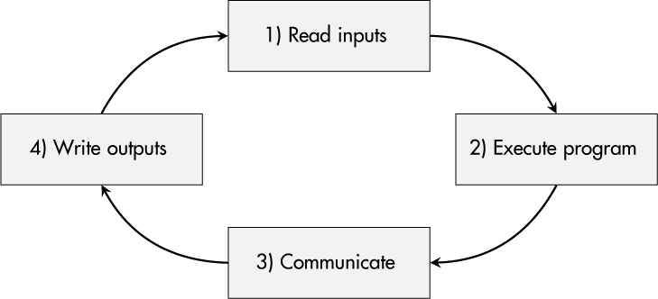
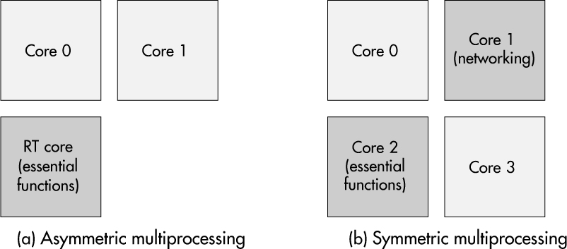

<a id="ch10"></a>

# <a id="page_181"></a>10 ARCHITECTURE THIẾT BỊ BỀN VỮNG (ROBUST DEVICE ARCHITECTURE)

Tính bền vững (robustness) là tính năng then chốt *nhất* đối với các linh kiện trong các ngành như ô tô, hàng không vũ trụ và tự động hóa công nghiệp. Cả bụi bẩn lẫn nhiệt độ đóng băng hay nóng rực đều không được gây hại cho những thiết bị đó. Các sản phẩm trong nhóm này được chế tạo để tồn tại qua một vòng đời dài. Chúng được thiết kế với yêu cầu *bền vững vật lý* là ưu tiên cao.

Tuy nhiên, vì kết nối và giao tiếp đang gia tăng ngay cả trong những lĩnh vực khá bảo thủ đó, một mối lo mới đã xuất hiện: *bền vững số* (digital robustness). Các mối đe dọa như các cuộc tấn công DoS network-based nhắm tới việc gián đoạn dịch vụ tạm thời, điều có thể là trọng yếu đối với các hệ thống real-time phụ thuộc vào phản ứng hệ thống kịp thời. Do đó, protection goal *availability* trở nên quan trọng hơn đối với những embedded system như vậy.

Trong chương này, tôi nhấn mạnh tầm quan trọng của các architecture thiết bị bền vững đối với các thiết bị có kết nối đang phải đối mặt với áp lực mạng ngày càng tăng. Tôi thảo luận tác động lên các hệ thống real-time và các chức năng thiết yếu của thiết bị embedded. Sau đó, chúng ta sẽ xem xét các chiến lược đối phó với các cuộc tấn công DoS lên embedded system ở mức phần cứng, OS và ứng dụng. Case study của chương này sau đó xem xét hành vi real-time và tính bền vững của một embedded system Linux-based trong nhiều điều kiện khác nhau.

<a id="ch00lev1_80"></a>

## <a id="page_182"></a>Thiết bị dưới áp lực mạng

Gần như mọi thiết bị đều có một dạng network interface nào đó, dù là Wi-Fi, Ethernet hay một tiêu chuẩn mạng domain-specific như bus CAN. Các mối đe dọa như cáp bị cắt và thiết bị phá sóng (jammer) chặn các kênh giao tiếp không dây là well known. Vì chúng dẫn đến việc mất vật lý availability của môi trường giao tiếp, các thông điệp được gửi qua các kênh bị ảnh hưởng sẽ bị mất và không đến được thiết bị đã kết nối ban đầu. Mặc dù vấn đề này ảnh hưởng đến giao tiếp tổng thể của hệ thống, tài nguyên của bản thân thiết bị không bị tác động, và (ngay cả khi được thiết kế hoàn hảo) thiết bị cũng sẽ không thể giúp gì trong tình huống này.

Các mối đe dọa được đề cập trong chương này có bản chất hơi khác. Chúng được khởi động qua một kết nối mạng, nhưng trái với việc nhắm vào các kênh giao tiếp, chúng tác động lên hoạt động và tài nguyên của thiết bị. Điều này có thể đơn giản như một packet sai trên port sai, khiến một thiết bị công nghiệp được thiết kế cẩu thả bỏ dở mọi thứ và nhảy vào một chế độ cập nhật không được tài liệu hóa trong khi làm ngưng chức năng điều khiển của nó. Tuy nhiên, làm quá tải một thiết bị bằng một số lượng lớn thông điệp thường là mối đe dọa chính hơn.

Những điểm yếu như vậy của thiết bị có thể bị kích hoạt trong nhiều dịp, xảy ra thường xuyên hơn khi độ phức tạp của mạng tăng lên, khi nhà vận hành đưa vào các quy trình quản lý bảo mật, và khi attack surface tăng. Hãy xem xét một số trường hợp điển hình.

<a id="ch00lev2_110"></a>

### *Thiết bị lân cận hoạt động sai*

Một hệ thống càng phức tạp và không đồng nhất, xác suất một thiết bị một ngày nào đó trở nên mất kiểm soát và broadcast hàng tấn thông điệp tới mọi bên tham gia trong cùng mạng càng cao. Lưu lượng liên tục và có thể là high-volume này có thể vô tình làm lộ ra sự kém tin cậy của các thiết bị được kết nối trong lĩnh vực này.

<a id="ch00lev2_111"></a>

### *Protocol fuzzing*

*Fuzzing* là một kỹ thuật kiểm thử bảo mật lặp đi lặp lại việc tạo ra các đầu vào bị biến đổi ngẫu nhiên, sai định dạng và đưa chúng vào một thiết bị với mục tiêu làm lộ ra các corner case chưa được xem xét. Developer thường áp dụng fuzzing để kiểm thử thiết bị của chính họ. Các nhà tích hợp hệ thống, nhà vận hành và nhà nghiên cứu cũng dùng fuzzing để phân tích tính bền vững và bảo mật của thiết bị, và để phát hiện hành vi không mong muốn.

<a id="ch00lev2_112"></a>

### *Quét mạng và quét lỗ hổng*

Các môi trường IT đã quen với việc thường xuyên bị quét để tìm port mạng đang mở, các máy client có lỗ hổng và các instance server bị cấu hình sai. Các môi trường như cơ sở sản xuất công nghiệp ít có khả năng chịu các phương pháp bảo mật IT như vậy hơn nhiều, nhưng trong tương lai thì sẽ có. Các linh kiện nên <a id="page_183"></a>có khả năng xử lý những lần quét như vậy và không thể hiện hành vi bất ngờ, như sai lệch tạm thời về tốc độ xử lý hay thậm chí hỏng hoàn toàn thiết bị.

<a id="ch00lev2_113"></a>

### *Tấn công flooding*

Ngay khi kẻ tấn công có quyền truy cập vào một mạng, họ có thể gửi packet tới các thiết bị được kết nối. Một số công cụ có thể khởi động các cuộc tấn công DoS network-based chỉ bằng một one-liner mà ngay cả script kiddie cũng có thể dễ dàng thực hiện. Các thiết bị thực sự bền vững không nên bị ảnh hưởng bởi những cuộc tấn công như vậy và nên tiếp tục hoạt động đúng.

<a id="ch00lev2_114"></a>

### *Architecture bền vững*

Nhiều trường hợp tính bền vững thấp trước giao tiếp mạng bất thường là do các bug lẽ ra phải được phát hiện trong quá trình kiểm thử chức năng và kiểm thử bảo mật, vốn là một phần bắt buộc của quy trình phát triển an toàn được mô tả trong [Chương 1](ch01_secure_development_process.vi.md#ch01). Tuy nhiên, các lỗ hổng DoS của một số thiết bị phát sinh từ các quyết định architecture mà bạn có thể đã đưa ra cho thiết bị của mình.

Nếu bạn là một phần của một nhóm kỹ thuật tự hào về các sản phẩm được gia cố của mình, hãy tiến thêm một bước và biến bền vững số thành một tính năng high-priority. Các phần sau đưa ra lời khuyên cho việc xây dựng bền vững số.

<a id="ch00lev1_81"></a>

## Các chức năng thiết yếu của thiết bị

Nói rằng một cuộc tấn công flooding không được ảnh hưởng đến chức năng của thiết bị thì dễ, nhưng việc triển khai thực tế các biện pháp bảo vệ đòi hỏi những cân nhắc chi tiết hơn bạn có thể kỳ vọng. Rõ ràng là khả năng giao tiếp có thể bị ảnh hưởng bởi tải thông điệp cao và có thể bị giảm hay thậm chí mất hoàn toàn, điều ảnh hưởng đến mọi tính năng thiết bị phụ thuộc vào dữ liệu nhận được từ các thực thể khác và có thể cả các thao tác cần truyền dữ liệu từ thiết bị của bạn tới các bên tham gia mạng khác. Những tác động này là không thể tránh khỏi từ góc nhìn của thiết bị và đòi hỏi các biện pháp giảm thiểu tương ứng.

Part 4-2 của tiêu chuẩn công nghiệp IEC 62443 đề cập các yêu cầu bảo mật kỹ thuật cho các linh kiện công nghiệp, và nó bao gồm yêu cầu cụ thể CR 7.1 xử lý việc bảo vệ DoS trên embedded system. Đòi hỏi trung tâm của nó là một thiết bị nên duy trì các *chức năng thiết yếu* (essential function) của nó ngay cả dưới một cuộc tấn công DoS và khi đang hoạt động ở *degraded mode* (chế độ suy giảm). Nếu bạn muốn đáp ứng yêu cầu này, câu hỏi hiển nhiên bạn phải đặt ra trước tiên là, “Các chức năng thiết yếu của thiết bị của tôi thực sự là gì?”

Hãy xem xét ba loại thiết bị chung và các chức năng thiết yếu khả dĩ của chúng.

<a id="ch00lev2_115"></a>

### *Cảm biến*

*Cảm biến* đo các tham số môi trường. Dù là theo dõi nhiệt độ, khoảng cách, giá trị pH hay mức đầy, nhiệm vụ của cảm biến là nắm bắt <a id="page_184"></a>tình trạng hiện tại và truyền nó tới một hệ thống điều khiển hay giám sát. Tuy nhiên, nếu kênh giao tiếp và/hoặc tài nguyên thiết bị tương ứng có thể bị quá tải và khả năng giao tiếp bị mất, cảm biến vẫn nên có khả năng thu thập dữ liệu của nó.

Trong trường hợp này, chức năng thiết yếu có thể là việc cảm nhận đúng và lưu trữ các giá trị thu được. Từ góc nhìn kỹ thuật sản phẩm, điều này có thể dẫn đến một yêu cầu mới—cụ thể là một buffer dữ liệu đủ lớn và một thủ tục khôi phục cho khi giao tiếp hoạt động trở lại.

<a id="ch00lev2_116"></a>

### *Cơ cấu chấp hành (actuator)*

Các *actuator* như bộ truyền động, van, động cơ hay thậm chí laser tác động lên thế giới vật lý. Chúng thường được tham số hóa bởi một instance bộ điều khiển trung tâm, vốn giao tiếp với actuator—ví dụ, qua một mạng Ethernet.

Hãy giả sử một bộ truyền động đang hoạt động ở 1,000 vòng mỗi phút thì đột nhiên một cuộc tấn công DoS vào network interface của nó bắt đầu. Chức năng thiết yếu (quay bộ truyền động ở một tốc độ nhất định) có nên tiếp tục hoạt động không? Từ góc nhìn bảo mật và availability, điều đó có thể hợp lý. Tuy nhiên, các chuyên gia safety có thể lập luận rằng hệ thống không còn ở trạng thái an toàn nữa và nên phản ứng bằng việc tắt máy để tránh hành vi không an toàn.

<a id="ch00lev2_117"></a>

### *Bộ điều khiển*

Các *thiết bị điều khiển* cho ô tô, tự động hóa công nghiệp hay hạ tầng trọng yếu thường theo các nguyên tắc đơn giản được minh họa trong [Hình 10-1](#ch10fig01): nhận đầu vào, xử lý chúng bằng một chương trình cho trước, có thể thực hiện một số giao tiếp, rồi đặt các tín hiệu đầu ra mới.

<a id="ch10fig01"></a>

*Hình 10-1: Chu kỳ thực thi điển hình của một thiết bị điều khiển*

Sau đó, chu kỳ bắt đầu lại. Tuy nhiên, trong trường hợp có áp lực mạng, khe giao tiếp có thể tiêu tốn quá nhiều thời gian và tài nguyên. Một lần nữa, bạn cần định nghĩa chiến lược của mình: có thể hợp lý khi nói rằng việc thực thi chu kỳ (ngoại trừ giao tiếp) là chức năng thiết yếu nên tiếp tục chạy, ngay cả khi thiết bị bị áp lực qua network interface. Nếu bản thân giao tiếp mạng là thiết yếu, câu hỏi sẽ là liệu nó có tuyệt đối cần thiết cho từng chu kỳ đơn lẻ hay ít nhất một lần trong 10 chu kỳ là chấp nhận được, chẳng hạn.

<a id="page_185"></a>Nếu các yêu cầu đã định nghĩa không thể được đáp ứng lúc runtime, hệ thống có lẽ nên dừng lại. Một ví dụ tốt về những thiết bị như vậy có thể là các linh kiện ô tô đọc giá trị cảm biến bàn đạp và điều khiển động cơ tương ứng. Kiến trúc sư và developer của các bộ điều khiển này phải đặc tả các chức năng thiết yếu của thiết bị để chuẩn bị cho trường hợp giao tiếp cảm biến hay task tương ứng của nó thất bại—vì bất kỳ lý do gì.

> **LƯU Ý**
>
> *Định nghĩa các chức năng thiết yếu của thiết bị là một quyết định thiết kế cơ bản có thể có ảnh hưởng đáng kể đến architecture phần mềm và phần cứng của thiết bị. Hãy bảo đảm xem xét chủ đề này sớm và nghiêm túc.*

<a id="ch00lev1_82"></a>

## Hệ thống real-time

Bền vững số liên quan đến gần như mọi sản phẩm, vì hỏng hóc thiết bị thường dẫn đến thiệt hại tài chính cho nhà vận hành. Tuy nhiên, nó đặc biệt đáng mong muốn đối với các *real-time embedded system*. Những thiết bị này không chỉ được yêu cầu duy trì availability của dịch vụ mà còn phải bảo đảm rằng, khi có một sự kiện ban đầu, kết quả của thao tác thiết bị *sẵn có trước một thời hạn cho trước*.

Mặc dù các processor high-performance và thời gian phản ứng super-fast có thể là kết quả của một yêu cầu như vậy, những tính năng đó không bắt buộc. Ràng buộc quan trọng duy nhất là phản hồi của hệ thống được cung cấp *trước khi hết giới hạn thời gian*, dù đó là một micro giây hay nửa phút.

Hệ thống real-time có ba nhóm khác nhau về tác động của việc trễ hạn: hệ thống soft, firm và hard real-time.

<a id="ch00lev2_118"></a>

### *Hệ thống soft real-time*

Các *soft real-time system* có thể chịu đựng việc trễ hạn, thậm chí thường xuyên. Tuy nhiên, tính hữu ích và giá trị của các kết quả bị trễ liên tục giảm. Nếu trễ hạn đáng kể, kết quả có thể trở nên vô giá trị. Ví dụ ứng dụng bao gồm trạm thời tiết, truyền âm thanh trực tiếp và chơi game video.

<a id="ch00lev2_119"></a>

### *Hệ thống firm real-time*

Một lần trễ hạn trong một *firm real-time system* dẫn đến một lỗi hay chất lượng dịch vụ bị suy giảm. Tuy nhiên, những lần trễ chỉ xảy ra không thường xuyên có thể chấp nhận được. Một ví dụ về hệ thống như vậy có thể là một robot pick-and-place. Nếu bộ điều khiển của nó trễ hạn, linh kiện đang được xử lý có thể bị hỏng hay bị đặt sai cách, nhưng sau khi xử lý lỗi đơn lẻ này, thiết bị có thể tiếp tục hoạt động bình thường.

<a id="ch00lev2_120"></a>

### *Hệ thống hard real-time*

Các *hard real-time system* phải thỏa mãn các yêu cầu cao nhất. Đối với những hệ thống này, bất kỳ lần trễ hạn nào cũng là trọng yếu. Tùy thuộc vào ứng dụng, nó có thể <a id="page_186"></a> thậm chí dẫn đến hậu quả thảm khốc. Các ví dụ điển hình là các bộ điều khiển động cơ trong máy bay hay tàu hỏa, các quy trình sản xuất high-quality và các thiết bị y tế như máy tạo nhịp tim.

<a id="ch00lev2_121"></a>

### *Tác động của tấn công DoS*

Nếu thiết bị của bạn thuộc một trong các nhóm real-time này, bạn phải xem xét các tác động tiềm năng tương ứng của các cuộc tấn công DoS, hay thậm chí áp lực mạng xảy ra vô tình, trong quá trình đánh giá mối đe dọa và rủi ro và giảm thiểu các điểm yếu phát sinh tương ứng.

<a id="ch00lev1_83"></a>

## Cạn kiệt tài nguyên và các chiến lược phòng ngừa

Các cuộc tấn công DoS network-based, như flooding, nhắm tới việc *cạn kiệt tài nguyên tạm thời* trên thiết bị đích. Trong một kịch bản đơn giản, kẻ tấn công có thể đạt được điều này bằng cách dùng phần lớn băng thông mạng có sẵn để gửi packet tới một thiết bị đích. Thiết bị nạn nhân nhận mọi packet và phải xử lý chúng. Năng lực xử lý cần thiết phụ thuộc vào loại và nội dung của các packet mạng.

Tuy nhiên, nếu sự tích tụ packet mạng đạt đến mức làm đầy mọi buffer nội bộ và thiết bị không thể xử lý packet nhanh hơn tốc độ chúng đến network interface, tình trạng cạn kiệt tài nguyên CPU xảy ra. Thiết bị không thể thực hiện các tác vụ đang xếp hàng của nó nữa, kể cả các chức năng thiết yếu.

> **CẢNH BÁO**
>
> *Nguyên nhân của việc cạn kiệt tài nguyên không nhất thiết phải là một cuộc tấn công có chủ đích. Một lần quét mạng cẩu thả bằng* `nmap` *có thể đủ để tạm thời gây ra cạn kiệt tài nguyên trên thiết bị của bạn, như được thể hiện trong case study của chương này.*

Việc phòng ngừa toàn diện tình trạng cạn kiệt tài nguyên không phải lúc nào cũng khả thi trên thực tế và phụ thuộc vào các tham số thiết bị cụ thể và năng lực của kẻ tấn công. Tuy nhiên, một sự tách biệt mạnh giữa các chức năng thiết yếu và các thao tác thứ yếu là một architecture vững chắc có thể tiếp tục hoạt động ở degraded mode, ngay cả dưới áp lực mạng đáng kể. Một tập tài nguyên thiết bị cho trước có thể được phân phối giữa các thao tác trọng yếu và các thao tác kém trọng yếu hơn bằng hai chiến lược cơ bản:

**Cấp phát tài nguyên cố định** Việc cấp phát tĩnh tài nguyên cho các task có ưu điểm là cung cấp một sự phân tách nhiệm vụ minh bạch và rõ ràng. Tuy nhiên, các giới hạn cố định dẫn đến kém hiệu quả lúc runtime, khi một tài nguyên không được task được cấp phát dùng đến và một task khác sẽ có lợi từ việc dùng tài nguyên đó nhưng không được phép.

**Cấp phát tài nguyên động** Để thúc đẩy việc dùng tài nguyên hiệu quả, tài nguyên có thể được cấp phát cho các task cụ thể lúc runtime, dựa trên các attribute của task được dùng để dẫn xuất một thước đo ưu tiên.

Những cách tiếp cận này nên được xem xét trong quá trình thiết kế architecture phần cứng của thiết bị và lựa chọn các đơn vị xử lý chính. <a id="page_187"></a>Hơn nữa, việc chọn và cấu hình OS có thể có tác động đáng kể lên tính bền vững của thiết bị.

<a id="ch00lev1_84"></a>

## Các lựa chọn triển khai hardware-level

Architecture phần cứng của một thiết bị định nghĩa các điều kiện tài nguyên tính toán cơ bản của nó. Trong quá trình phát triển, các IC cho nhiều mục đích khác nhau được chọn, bao gồm microcontroller, SoC multicore và FPGA, nhưng cũng cả các chip chuyên dụng như Ethernet PHY xử lý giao tiếp mạng ở tầng physical.

Nếu tính bền vững trước network flooding là một trong những mối quan tâm chính của bạn và bạn tính đến điều đó ở giai đoạn sớm của quy trình phát triển, bạn có thể thiết kế architecture phần cứng của thiết bị theo cách giảm đáng kể rủi ro của các cuộc tấn công DoS network-based.

<a id="ch00lev2_122"></a>

### *Đơn vị tiền xử lý chuyên dụng*

[Hình 10-2](#ch10fig02) cho thấy khái niệm cơ bản khi đưa vào một đơn vị tiền xử lý chuyên dụng cho lưu lượng mạng. Ý tưởng chính đằng sau architecture này là sự tách biệt vật lý giữa processor của ứng dụng chính và việc xử lý mạng, hoặc ít nhất là một phần của nó.

<a id="ch10fig02"></a>

*Hình 10-2: Một architecture với tiền xử lý lưu lượng mạng*

Một ví dụ cụ thể về architecture như vậy là một *communication preprocessor* (bộ tiền xử lý giao tiếp) triển khai một TCP/IP stack và lo việc xử lý các packet mạng và payload của chúng. Việc truyền dữ liệu liên quan giữa processor chính và đơn vị tiền xử lý được thực hiện qua một interface tốt nhất là đơn giản. Trong trường hợp một cuộc tấn công flooding hay chỉ là tải mạng rất cao vì lý do không rõ, đơn vị giao tiếp có khả năng bị cạn kiệt tài nguyên, nhưng processor ứng dụng phía sau nó sẽ không bị tác động và sẽ có thể thực hiện các chức năng thiết yếu của thiết bị.

Việc dùng một *hardware packet filtering unit* (đơn vị lọc packet phần cứng) là ví dụ thứ hai của cách tiếp cận này. Ở đây, network stack vẫn nằm trên đơn vị xử lý chính, và bộ tiền xử lý chỉ được dùng để lọc luồng packet mạng đến network interface của thiết bị. Các quy tắc lọc có thể, ví dụ, bao gồm giới hạn tốc độ để bảo đảm processor ứng dụng của bạn chỉ nhận số lượng packet mà nó có thể xử lý.

Một architecture như vậy có thể được triển khai bằng các IC mạng cụ thể cung cấp chức năng này, nhưng, tại thời điểm viết sách, những IC này khá hiếm trong embedded system. Đối với các thiết bị có FPGA, bộ điều khiển MAC có thể được triển khai bằng logic số, theo sau là một core packet-filtering tùy chỉnh trước khi chuyển dữ liệu mạng tới CPU chính.

> <a id="page_188"></a>**CẢNH BÁO**
>
> *Hãy cẩn thận khi thiết kế giao tiếp giữa processor chính và đơn vị tiền xử lý. Nếu bên trước phụ thuộc nặng nề vào bên sau, thiết bị có thể thất bại bất chấp architecture vững chắc.*

<a id="ch00lev2_123"></a>

### *Architecture multicore*

Nếu bền vững số xuất hiện quá muộn trong danh sách yêu cầu và thiết kế phần cứng đã được cố định, bạn có thể may mắn nếu đã chọn một SoC multicore làm đơn vị xử lý chính trong thiết bị. Phải thừa nhận rằng các core riêng lẻ trong chip multicore không hoàn toàn tách biệt và độc lập với nhau; chúng chia sẻ tài nguyên như bus, cache memory, v.v. Tuy nhiên, một sự phân phối task well-considered giữa các core, như được thể hiện trong [Hình 10-3](#ch10fig03), có thể giảm xác suất xảy ra sự kiện DoS.

<a id="ch10fig03"></a>

*Hình 10-3: Dùng architecture multicore cho tính bền vững*

Ngày càng nhiều SoC cho embedded system triển khai *asymmetric multiprocessing (AMP)*. Chúng bao gồm một hay nhiều core high-performance dùng để chạy các OS feature-rich, như Linux, và một hay nhiều core nhỏ hơn, ví dụ, vượt trội trong các ứng dụng real-time. Một cách tiếp cận hướng tới tăng tính bền vững có thể là cấp phát các chức năng thiết yếu như task điều khiển cho core real-time chuyên dụng, như được chỉ ra bởi [Hình 10-3](#ch10fig03)a. Các cấu trúc tương tự khả thi trên các SoC kết hợp hard processor với các soft core nằm trong FPGA fabric.

Nếu thiết bị của bạn chạy trên một SoC *symmetric multiprocessing (SMP)*—nghĩa là nó có hai, bốn, tám hay thậm chí nhiều core cùng loại hơn—bạn vẫn có các lựa chọn để cải thiện tính bền vững. Architecture trong [Hình 10-3](#ch10fig03)b nhằm tách các task mạng khỏi các chức năng thiết yếu bằng cách gắn các process của chúng vào các core chuyên dụng. Khái niệm này được biết đến là *core pinning*, hay *processor affinity*, và phải được OS của bạn hỗ trợ.

> **CẢNH BÁO**
>
> *Một lần nữa, các phụ thuộc (giao tiếp) giữa các process trên các core khác nhau có thể phá vỡ sự tách biệt dự định và nên được thiết kế cẩn thận.*

<a id="ch00lev1_85"></a>

## <a id="page_189"></a>Khả năng của hệ điều hành

Một nhiệm vụ trung tâm của OS là quản lý các CPU core, các vùng memory và một tập đa dạng interface phần cứng. Thành phần xử lý nhiệm vụ khó khăn là cấp phát thời gian xử lý lúc runtime được gọi là *scheduler*. Hoàn toàn hợp lý khi xem xét khả năng và trách nhiệm của OS và scheduler khi nói về việc ngăn ngừa cạn kiệt tài nguyên.

<a id="ch00lev2_124"></a>

### *Các lựa chọn hệ điều hành*

Khi nói đến việc chọn OS, kỹ sư thiết bị về cơ bản có bốn lựa chọn: phần mềm bare-metal không có OS, một real-time OS, một OS đầy đủ tính năng, hay một tổ hợp OS hypervisor-based.

#### Phần mềm bare-metal không có OS

Trong các thiết bị và ứng dụng đơn giản, OS có thể thậm chí không cần thiết. Các sự kiện và việc cấp phát tài nguyên tương ứng có thể được xử lý bằng các vòng lặp polling hay các interrupt service routine.

#### Real-Time OS

Một RTOS là một OS low-complexity dành riêng cho các ứng dụng real-time rất coi trọng độ tin cậy. Scheduler của nó quản lý tài nguyên dựa trên độ ưu tiên của task: các task có độ ưu tiên cao hơn có thể ngắt các task đang chạy có độ ưu tiên thấp hơn.

Trong một hệ thống như vậy, điều quan trọng là không cấu hình các task networking-related ở mức ưu tiên cao nhất, vì làm như vậy có thể dẫn đến các tình huống DoS network-induced. Trên thực tế, bạn có thể tìm thấy nhiều RTOS khác nhau ngoài hiện trường, bao gồm các RTOS thương mại như QNX hay VxWorks, nhưng cũng cả các biến thể open source như FreeRTOS, RIOT hay Zephyr.

#### OS đầy đủ tính năng (Fully Fledged OS)

Nhiều thiết bị hiện đại, feature-rich dựa vào các library và công cụ open source xử lý, ví dụ, giao tiếp mạng, trình bày giao diện người dùng hay các tác vụ data-processing. Những thiết bị đó thường dựa trên một OS đầy đủ tính năng như Linux. Tuy nhiên, những OS phức tạp và không hoàn toàn tất định như vậy có chung một nhược điểm: thiếu khả năng real-time phù hợp. Trong phần tiếp theo, tôi sẽ thảo luận một khả năng giúp Linux có khả năng real-time hơn.

#### Tổ hợp OS hypervisor-based

Một số nhà sản xuất muốn kết hợp các ưu điểm real-time của RTOS với nhiều library và khả năng của Linux. Trong những trường hợp này, một lớp trừu tượng khác được đưa vào bên dưới các OS đó: một *hypervisor* đảm nhận nhiệm vụ cấp phát tài nguyên phần cứng và qua đó đóng vai trò quan trọng trong việc tách các chức năng thiết yếu (có lẽ chạy trên một RTOS) khỏi các chức năng hỗ trợ được triển khai trong Linux. Những thiết lập này làm tăng thêm độ phức tạp của architecture phần mềm sản phẩm của bạn.

<a id="ch00lev2_125"></a>

### <a id="page_190"></a>*Linux với real-time patch*

Trong cấu hình điển hình cho các hệ thống desktop và server, Linux không cung cấp khả năng real-time đáng tin cậy. Tuy nhiên, trong nhiều năm, cộng đồng real-time đã duy trì một kernel patch được biết đến là `PREEMPT_RT`. Nó bao gồm nhiều thay đổi đối với Linux kernel có chung mục tiêu cho phép *preemption* (chiếm quyền) các kernel thread và các primitive in-kernel, nghĩa là tính không tất định trong việc lập lịch task được giảm bớt và việc cấp phát tài nguyên tính toán tiến gần hơn đến một hệ thống thuần priority-based. Trong các phiên bản Linux kernel hiện tại, bạn có thể kích hoạt hỗ trợ real-time bằng tùy chọn cấu hình `CONFIG_PREEMPT_RT`.

Việc lập lịch thread trong Linux diễn ra dựa trên một scheduling policy và một độ ưu tiên lập lịch tĩnh. Các thread “thông thường” được lập lịch với các policy như `SCHED_OTHER`, `SCHED_IDLE` hay `SCHED_BATCH` và độ ưu tiên 0. Các thread phải đáp ứng yêu cầu real-time được lập lịch với một trong các policy sau:

`SCHED_FIFO` Scheduler này tuân theo *nguyên tắc first-in first-out (FIFO)*, nghĩa là một thread đang chạy được thực thi cho đến khi bị chiếm quyền bởi một thread có độ ưu tiên tĩnh cao hơn.

`SCHED_RR` Cách tiếp cận lập lịch *round-robin (RR)* cổ điển tương tự `SCHED_FIFO` ngoại trừ việc các thread chỉ được phép chạy trong một khoảng thời gian tối đa đã định nghĩa. Sau đó, thread bị ngắt và được thêm vào cuối hàng đợi của các thread có cùng độ ưu tiên. Các thread có độ ưu tiên cao hơn có thể chiếm quyền các thread có độ ưu tiên thấp hơn.

`SCHED_DEADLINE` Trái với các scheduler khác, scheduler này dựa trên *global earliest deadline first (GEDF)*. Nó không dựa vào độ ưu tiên tĩnh mà gán chúng một cách động. Các quyết định của nó dựa trên deadline tuyệt đối của một thread và tổng thời gian tính toán của nó.

> **LƯU Ý**
>
> *Mặc dù* `PREEMPT_RT` *làm cho Linux hoạt động giống một real-time OS hơn, nó vẫn là một phần mềm phức tạp không phù hợp với nhiều yêu cầu hard real-time.*

<a id="ch00lev1_86"></a>

## Các cân nhắc về ứng dụng và protocol

Mặc dù chương này chủ yếu liên quan đến architecture thiết bị bền vững ở mức phần cứng và OS, tôi không muốn bỏ qua mức ứng dụng và giao tiếp. Nhiều tình huống DoS trong thực tế phát sinh từ thiết kế phần mềm và protocol cẩu thả.

Những vấn đề như vậy có thể được đưa vào ở nhiều giai đoạn khác nhau của quy trình phát triển. Một đặc tả protocol có thể đã thiếu một định nghĩa vững chắc về hành vi đúng trong các corner case—ví dụ, giá trị tối thiểu hay tối đa của các tham số thông điệp. Hơn nữa, ngay cả những bug đơn giản trong phần mềm, như thiếu kiểm tra biên, có thể dẫn đến các tác dụng phụ không mong muốn như vòng lặp vô tận hay deadlock trong một số hoàn cảnh nhất định. Khi đó, nếu kiểm thử bảo mật chỉ được thực hiện qua loa, các thiết bị rời khỏi khâu sản xuất với firmware cho kẻ tấn công cơ hội kích hoạt một sự kiện DoS với công sức ít ỏi như một packet mạng duy nhất.

<a id="page_191"></a>Các phần sau đưa ra các gợi ý thực tế để giải quyết vấn đề phức tạp này. Khả năng quan trọng mà bạn nên tìm kiếm là việc kẻ tấn công có thể *buộc một chuyển trạng thái* bên trong thiết bị của bạn dẫn đến DoS.

<a id="ch00lev2_126"></a>

### *Xác định các lỗi logic*

Thiết kế protocol là một nhiệm vụ phức tạp, nhưng nhiều công ty đi theo con đường này và phát triển định dạng thông điệp và giao tiếp độc quyền riêng của họ. Nếu bạn ở trong tình huống như vậy, hãy bảo đảm làm hết sức để loại bỏ các lỗi logic trong protocol của mình.

Thứ nhất, bạn có thể làm điều đó ở mức khái niệm bằng cách đặt những câu hỏi như: Khoảng hợp lệ cho mỗi giá trị trong thông điệp của chúng ta là gì? Một bên tham gia mạng có thể buộc thiết bị của chúng ta vào một trạng thái không xác định không? Tính hợp lệ và tính hợp lý của các giá trị thông điệp có được xác minh trước khi chúng được dùng không? Thứ hai, việc kiểm thử bản triển khai protocol của bạn bằng các thông điệp chỉ đáp ứng một phần đặc tả hay thậm chí cố ý tìm cách thao túng trạng thái thiết bị có thể hữu ích để phát hiện lỗ hổng.

<a id="ch00lev2_127"></a>

### *Triển khai việc xác thực đầu vào và bên gửi*

Trong nhiều kịch bản embedded system, đối thủ có thể giao tiếp trực tiếp với một thiết bị—ví dụ, qua mạng. Ngay cả khi phần mềm client chính thức *nên* được dùng để tương tác với thiết bị của bạn, kẻ tấn công có thể đơn giản tự tạo các thông điệp bị thao túng của riêng họ, nên thiết bị không nên tin tưởng bất kỳ packet nào đến network interface của chúng.

Các lệnh trọng yếu, như chuyển sang chế độ cập nhật và dừng mọi hoạt động, chỉ nên được cho phép sau khi authenticity của bên gửi đã được xác minh thành công. Do đó, thái độ mặc định của developer nên là *kỳ vọng* đầu vào độc hại và triển khai các cơ chế xác thực và lọc đầu vào phù hợp tương ứng, dù ở mức firewall hay bên trong ứng dụng xử lý payload của thông điệp.

<a id="ch00lev2_128"></a>

### *Phân tích các biện pháp bảo vệ chủ động*

Đôi khi kẻ tấn công có thể lạm dụng các biện pháp bảo vệ chủ động để buộc thiết bị vào trạng thái DoS. Ví dụ, quá trình đăng nhập của bạn có thể được gia cố để ngăn các cuộc tấn công brute-force bằng cách chỉ cho phép 10 lần thử đăng nhập. Sau khi đạt giới hạn đó, thiết bị chuyển sang chế độ khóa mà từ đó nó chỉ có thể được kích hoạt lại bằng một thủ tục khôi phục. Mặc dù đây có thể là một biện pháp bảo mật hoàn toàn hợp lý, nó cũng cho phép kẻ tấn công buộc xảy ra tình huống DoS, ngay cả đối với người dùng hợp lệ, bằng cách nhập sai credential người dùng 10 lần.

Các cấu hình firewall chặn IP dựa trên lượng lưu lượng của chúng có cơ chế tương tự. Trong trường hợp đó, kẻ tấn công có thể giả mạo địa chỉ IP bên gửi của các thiết bị hợp lệ và kích hoạt tính năng bảo vệ bằng cách gửi một số lượng lớn packet. Kết quả là, các nỗ lực giao tiếp của các thiết bị hợp lệ sẽ bị chặn sau đó.

<a id="ch00lev2_129"></a>

### <a id="page_192"></a>*Đưa vào chaos engineering và fuzzing*

Trí tưởng tượng của con người có giới hạn. Thật phi thực tế khi giả định rằng developer sẽ lường trước mọi vấn đề tiềm năng có thể dẫn đến một sự kiện DoS trên thiết bị của bạn. Tuy nhiên, có hai phương pháp kiểm thử đẩy các giới hạn ở khía cạnh này.

*Chaos engineering* là một dạng kiểm thử độ tin cậy và khả năng phục hồi cho các hệ thống IT, đưa “sự hỗn loạn” vào một hạ tầng IT dưới dạng các sự cố ngẫu nhiên của dịch vụ hay ứng dụng. Trong lĩnh vực kiểm thử embedded system, “sự hỗn loạn” này có thể là các process bị crash hay việc mất các kênh giao tiếp để phân tích hành vi của thiết bị trong các hoàn cảnh bất lợi.

Lĩnh vực *fuzzing* có thể được áp dụng cho các protocol giao tiếp, nhưng cũng cho dữ liệu đầu vào như các file cấu hình hay certificate mà một thiết bị xử lý. Nó có thể được dùng để tạo ra một số lượng lớn thông điệp kiểm thử hay file kiểm thử bằng cách biến đổi thông minh dữ liệu đầu vào nhiều lần. Bằng cách này, bạn có thể phát hiện các trường hợp dẫn đến trạng thái DoS mà lẽ ra rất khó tìm thấy bằng phân tích thủ công của con người.

> **LƯU Ý**
>
> *Dù vậy, hãy nhớ rằng tư duy và nhận thức của nhóm phát triển sản phẩm của bạn có thể là những yếu tố quyết định trong việc phát hiện sớm các lỗ hổng DoS trong quy trình phát triển.*

<a id="ch00lev1_87"></a>

## Case Study: Các lựa chọn về tính bền vững trên một thiết bị STM32MP157F

Trong case study này, tôi sẽ phân tích khả năng real-time và tính bền vững của một thiết bị STM32MP157F. Tôi sẽ làm sáng tỏ các phương pháp đo và công cụ tương ứng được dùng để mô phỏng áp lực CPU và áp lực mạng trên một thiết bị.

<a id="ch00lev2_130"></a>

### *Các thuộc tính hệ thống cơ bản*

Về các lựa chọn hardware-level, thiết bị STM32MP157F đang xét cung cấp hai core Cortex-A7 chạy ở 800 MHz và một core Cortex-M4 chuyên dụng ở 209 MHz cho các ứng dụng real-time. Thông tin cơ bản này cho phép chúng ta kết luận rằng cả việc pin task vào một trong các core A7 lẫn việc chuyển các ứng dụng phần mềm thiết yếu sang core M4 tách biệt đều khả thi. Về nguyên tắc, dùng core M4 như một đơn vị tiền xử lý cho lưu lượng Ethernet thậm chí có thể là một lựa chọn, nhưng đó có lẽ không phải là giải pháp đầu tiên tôi theo đuổi, và nó sẽ đòi hỏi phân tích tính khả thi thêm dựa trên architecture của SoC.

Đơn vị MAC có trong ngoại vi Ethernet của STM32MP157F hỗ trợ tốc độ truyền dữ liệu 10, 100 và 1,000Mbps. Sau khi xem *Reference Manual RM0436* của ST cho các thiết bị STM32MP157F, rõ ràng là module này thậm chí đi kèm khả năng lọc packet hardware-assisted. Các packet nhận được có thể được lọc dựa trên địa chỉ MAC nguồn và đích, tag virtual local area network (VLAN) trong Ethernet frame của một packet, địa chỉ IP nguồn và đích, và port nguồn và đích của các thông điệp TCP và UDP. Đáng tiếc là module không có bất kỳ dạng tính năng rate-limiting nào, điều sẽ hữu ích cho việc bảo vệ DoS.

<a id="page_193"></a>Phần thứ ba của phân tích ban đầu này liên quan đến Linux OS chạy trên thiết bị STM32MP157F của tôi. Như đã mô tả trước đó, Linux có thể được vá hay cấu hình để hoạt động tương tự một hệ thống real-time. Với lệnh và đầu ra được thể hiện trong [Listing 10-1](#ch10list01), tôi kiểm tra xem hệ thống Linux của tôi, được Yocto tạo ra dựa trên image `st-image-core` của ST, có đi kèm khả năng lập lịch real-time không.

```
# uname -a
Linux stm32mp1 5.15.67 #1 SMP PREEMPT ...
```

<a id="ch10list01"></a>

*Listing 10-1: Các thuộc tính Linux kernel của hệ thống của tôi*

Chuỗi `SMP` chỉ ra rằng hệ thống Linux đang xét được cấu hình lúc biên dịch để hỗ trợ các architecture multicore đối xứng như dual core A7 của STM32MP157F, trong khi `PREEMPT` cho biết Linux kernel được biên dịch với tùy chọn `CONFIG_PREEMPT`. Hệ thống chạy một *low-latency kernel*, nghĩa là code kernel không được thực thi trong một critical section có thể bị ngắt bởi các task higher-priority. Tuy nhiên, cấu hình này không nên bị nhầm lẫn với chỉ báo `PREEMPT_RT`, vốn đại diện cho một Linux kernel có thể chiếm quyền hoàn toàn được bật bởi `CONFIG_PREEMPT_RT`.

<a id="ch00lev2_131"></a>

### *Đo trên low-latency kernel*

Bạn có thể đo hành vi độ trễ của một thiết bị theo hai cách. Nếu bạn có quyền truy cập nội bộ vào hệ thống Linux của thiết bị, bạn có thể chạy phần mềm phân tích hành vi lập lịch của hệ thống Linux đó. Mặt khác, ví dụ, nếu bạn phân tích một linh kiện third-party, bạn có thể buộc phải coi thiết bị đang kiểm thử là một hộp đen. Trong trường hợp đó, bạn chỉ có thể quan sát hành vi độ trễ của thiết bị đối với các tín hiệu đầu vào và đầu ra—ví dụ, bằng một oscilloscope hay một logic analyzer. Trong khi cách tiếp cận thứ nhất phù hợp hơn để cho thấy các khả năng nguyên tắc của một thiết bị, cách thứ hai có thể cho ra kết quả gần với một use case cụ thể hơn nhiều.

Trong case study này, tôi dùng công cụ `cyclictest` để phân tích khả năng real-time của hệ thống vì tôi có quyền truy cập Linux console của thiết bị và tôi chưa có một ứng dụng cụ thể nào trong đầu. Công cụ này đo độ trễ giữa thời điểm thực thi được lập trình và thời điểm thực thi thực tế của một task real-time được lập lịch với `SCHED_FIFO`. [Listing 10-2](#ch10list02) cho thấy một bài kiểm tra mẫu và kết quả của nó.

```
# cyclictest --mlockall --smp --interval=200 --distance=0 --priority=80
    --loops=40000
...

T: 0 (  874) P:80 I:200 C:  38735 Min:   15 Act:   47 Avg:   36 Max:  158
T: 1 (  875) P:80 I:200 C:  38596 Min:   15 Act:   42 Avg:   35 Max:  165
```

<a id="ch10list02"></a>

*Listing 10-2: Độ trễ task ở chế độ idle*

Tham số `--mlockall` được dùng để giảm overhead và ảnh hưởng từ chính công cụ, trong khi `--smp` cần thiết cho việc kiểm thử trên hệ thống multicore. Thread đo được thực thi mỗi 200 *µ*s như được đặt bởi tùy chọn `--interval`<a id="page_194"></a>, và không có khác biệt giữa chu kỳ đo của các thread khác nhau, như được ký hiệu bởi `--distance=0`. Các task đo được thực thi 40,000 lần (`--loops=40000`) với độ ưu tiên task là 80 (`--priority=80`).

Đầu ra kết quả cho thấy hai dòng, một cho mỗi CPU core. Các chữ cái `P`, `I` và `C` lần lượt đại diện cho thiết lập độ ưu tiên, khoảng đo và số lần đo đã thực hiện. Các giá trị bên phải cho thấy độ trễ tối thiểu, hiện tại, trung bình và tối đa quan sát được. Con số ngoài cùng bên phải là quan trọng nhất vì nó chỉ ra độ trễ worst-case cho các task được lập lịch, có thể chấp nhận được hoặc không đối với bạn.

Ở trạng thái hiện tại, hệ thống Linux đang xét với một low-latency kernel `PREEMPT` cho thấy độ trễ tối đa là 158 và 165 *µ*s. Tuy nhiên, nếu tôi dùng một thiết bị thứ hai trên cùng mạng để thực hiện một cuộc tấn công SYN flooding—ví dụ, bằng cách chạy `hping3 --syn --flood` `device-ip`, độ trễ tối đa bị ảnh hưởng đáng kể, như được thể hiện trong [Listing 10-3](#ch10list03).

```
# cyclictest --mlockall --smp --interval=200 --distance=0 --priority=80
    --loops=40000
...

T: 0 (  902) P:80 I:200 C:  14253 Min:   15 Act: 2406 Avg:  409 Max: 5475
T: 1 (  903) P:80 I:200 C:  40000 Min:   15 Act:   15 Avg:   23 Max:  185
```

<a id="ch10list03"></a>

*Listing 10-3: Ảnh hưởng của SYN flooding lên độ trễ task*

Trong tình huống như vậy, ngay cả với một low-latency kernel, độ trễ task có thể tăng lên hơn 5 ms, gấp nhiều lần khoảng thời gian task thực tế. Rõ ràng, điều này có thể là trọng yếu nếu ứng dụng của bạn phải đáp ứng yêu cầu real-time. [Listing 10-4](#ch10list04) cho thấy một kết quả đo mẫu trong khi một lần quét port đơn giản được thực hiện bằng `nmap` `device-ip`.

```
# cyclictest --mlockall --smp --interval=200 --distance=0 --priority=80
    --loops=40000
...

T: 0 (  932) P:80 I:200 C:  37581 Min:   14 Act:   41 Avg:   46 Max: 6573
T: 1 (  933) P:80 I:200 C:  39086 Min:   15 Act:   46 Avg:   34 Max:  199
```

<a id="ch10list04"></a>

*Listing 10-4: Ảnh hưởng của một lần quét SYN bằng* `nmap` *lên độ trễ task*

Tóm lại, chúng ta có thể thấy rằng low-latency kernel của bản phân phối Linux tiêu chuẩn cho thiết bị STM32MP157F không thể cung cấp các tính năng real-time mạnh. Ngay cả những khoảng thời gian ngắn có lưu lượng mạng cao cũng có thể ảnh hưởng đến thời gian phản ứng của hệ thống.

<a id="ch00lev2_132"></a>

### *Đo trên real-time kernel*

Nếu tính bền vững là một trong những yêu cầu hàng đầu của bạn, bạn có thể muốn tìm một bản phân phối Linux triển khai một kernel có thể chiếm quyền hoàn toàn để đáp ứng các ràng buộc real-time. May mắn thay, ST cung cấp layer Yocto `meta-st-x-linux-rt` cho thiết bị STM32MP157F. Sau khi thêm nó vào build system của mình, tôi chỉ <a id="page_195"></a>phải đặt `MACHINE=stm32mp15-rt` và re-create (tạo lại) môi trường build trước khi có thể dùng `bitbake` để tạo image `st-image-core` và một Linux kernel với `CONFIG_PREEMPT_RT` được bật.

Sau khi boot image mới, tôi double-checked (kiểm tra kỹ lại) rằng kernel thực sự cung cấp khả năng real-time. Đầu ra trong [Listing 10-5](#ch10list05) cho thấy tính năng `PREEMPT_RT` điển hình như mong muốn.

```
# uname -a
Linux stm32mp15-rt 5.15.67-rt49 #1 SMP PREEMPT_RT ...
```

<a id="ch10list05"></a>

*Listing 10-5: Các tính năng Linux kernel bao gồm khả năng real-time*

Một lần nữa, bạn có thể kiểm tra hành vi real-time của hệ thống bằng `cyclictest` như trong phần trước. [Listing 10-6](#ch10list06) cho thấy các tác động tích cực của real-time kernel.

```
# cyclictest --mlockall --smp --interval=200 --distance=0 --priority=80
    --loops=40000
...

T: 0 ( 1195) P:80 I:200 C:  40000 Min:   15 Act:   17 Avg:   19 Max:   64
T: 1 ( 1196) P:80 I:200 C:  39838 Min:   16 Act:   25 Avg:   18 Max:   72
```

<a id="ch10list06"></a>

*Listing 10-6: Độ trễ task của real-time kernel ở chế độ idle*

So với các giá trị của low-latency kernel trong [Listing 10-2](#ch10list02), 158 và 165 *µ*s, độ trễ tối đa lần lượt giảm đáng kể xuống 64 và 72 *µ*s. Kết quả được thể hiện trong [Listing 10-7](#ch10list07) cho thấy hành vi thậm chí còn tốt hơn.

```
# cyclictest --mlockall --smp --interval=200 --distance=0 --priority=80
    --loops=40000
...

T: 0 ( 1186) P:80 I:200 C:  40000 Min:   15 Act:   29 Avg:   24 Max:   91
T: 1 ( 1187) P:80 I:200 C:  39800 Min:   16 Act:   34 Avg:   19 Max:   77
```

<a id="ch10list07"></a>

*Listing 10-7: Ảnh hưởng của SYN flooding lên độ trễ của real-time kernel*

Độ trễ tối đa của hệ thống Linux không vượt quá 100 *µ*s, ngay cả khi đối mặt với một cuộc tấn công SYN flooding được thực hiện bằng `hping3`.

Bạn có thể quan sát một tác động tương tự trong [Listing 10-8](#ch10list08), được ghi lại trong khi chạy các lần quét mạng trên thiết bị đang kiểm thử.

```
# cyclictest --mlockall --smp --interval=200 --distance=0 --priority=80
    --loops=40000
...

T: 0 ( 1189) P:80 I:200 C:  40000 Min:   15 Act:   17 Avg:   20 Max:   78
T: 1 ( 1190) P:80 I:200 C:  39837 Min:   16 Act:   23 Avg:   19 Max:   73
```

<a id="ch10list08"></a>

*Listing 10-8: Ảnh hưởng của một lần quét SYN bằng* `nmap` *lên độ trễ của real-time kernel*

<a id="page_196"></a>Trong khi các lệnh `nmap` thông thường gây ra độ trễ worst-case hơn 6 ms đối với image tiêu chuẩn với low-latency kernel của nó, real-time kernel được phân tích trong phần này chỉ có thể bị kích động làm tăng độ trễ tối đa ít hơn 15 *µ*s so với trạng thái idle.

Tất cả những điều này có nghĩa là một low-latency Linux kernel không bảo đảm bất kỳ tính bền vững nào, và ngay cả một Linux kernel có thể chiếm quyền hoàn toàn cũng chỉ tiến gần đến hành vi real-time. Nếu đây là một lựa chọn khả thi cho bạn, hãy bảo đảm hiểu rằng bạn đánh đổi performance lấy tính tất định khi chuyển sang real-time Linux kernel. Hơn nữa, các tính năng như quản lý năng lượng động và frequency scaling của SoC có thể bị vô hiệu hóa để đạt được hành vi real-time.

> **LƯU Ý**
>
> *Mọi phép đo độ trễ tối đa được trình bày phải được coi chỉ là ước lượng thô. Thiết bị của bạn có thể rơi vào tình trạng còn tệ hơn, dẫn đến thời gian phản ứng tối đa còn cao hơn.*

<a id="ch00lev2_133"></a>

### *Real-Time coprocessor*

Nếu bạn hướng tới việc đáp ứng các yêu cầu hard real-time, Linux có lẽ không phải là lựa chọn tốt nhất của bạn. Tuy nhiên, STM32MP157F cung cấp thêm một core Cortex-M4 cho chính mục đích đó. Quá trình phát triển và build firmware M4 chuyên dụng nằm ngoài phạm vi của case study này, nhưng bạn có thể dùng STM32CubeIDE của ST hay makefile tùy chỉnh ưa thích của bạn cho mục đích đó.

Hãy giả sử bạn đã tạo một file firmware *m4_fw.elf* chứa ứng dụng real-time của mình. Thông thường, bạn sẽ đặt file đó trong thư mục */lib/firmware/*, vì nó là firmware cho một coprocessor. [Listing 10-9](#ch10list09) cho thấy việc khởi tạo cơ bản framework `remoteproc` của Linux để chuẩn bị thực thi firmware M4.

```
# echo -n "/lib/firmware/" > /sys/module/firmware_class/parameters/path
# echo -n "m4_fw.elf" > /sys/class/remoteproc/remoteproc0/firmware
```

<a id="ch10list09"></a>

*Listing 10-9: Khởi tạo firmware M4 bằng framework* `remoteproc`

Ở bước đầu tiên, đường dẫn firmware */lib/firmware/* được ghi vào node `sysfs` tương ứng. Sau đó, tên của file firmware cụ thể, trong trường hợp này là *m4_fw.elf*, được truyền cho instance remote processor `remoteproc0`, đại diện cho core real-time M4.

Ở điểm này, chưa có gì chạy. Đầu ra trong [Listing 10-10](#ch10list010) xác nhận rằng M4 vẫn đang offline. Để khởi động firmware được cung cấp, từ khóa `start` phải được ghi vào `remoteproc0/state`.

<a id="page_197"></a>

```
# cat /sys/class/remoteproc/remoteproc0/state
offline
# echo start > /sys/class/remoteproc/remoteproc0/state
... remoteproc remoteproc0: powering up m4
... remoteproc remoteproc0: Booting fw image m4_fw.elf, size 456520
...  remoteproc0#vdev0buffer: assigned reserved memory node ...
... virtio_rpmsg_bus virtio0: rpmsg host is online
...  remoteproc0#vdev0buffer: registered virtio0 (type 7)
... remoteproc remoteproc0: remote processor m4 is now up
# cat /sys/class/remoteproc/remoteproc0/state
running
```

<a id="ch10list010"></a>

*Listing 10-10: Khởi động firmware M4 bằng framework* `remoteproc`

Sau đó, core được cấp nguồn, và việc thực thi ứng dụng real-time bắt đầu. Giờ, ngay cả khi hệ thống Linux chịu tải mạng cao và đang cạn kiệt tài nguyên, firmware real-time sẽ tiếp tục hoạt động ở tần số clock CPU 209 MHz của nó mà không bị xáo trộn. Ngoài ra, trạng thái của `remoteproc0` đã thay đổi thành `running` tương ứng.

Như được thể hiện trong [Listing 10-11](#ch10list011), hệ thống Linux có thể dừng việc thực thi firmware bằng cách ghi `stop` vào `remoteproc0/state`.

```
# echo stop > /sys/class/remoteproc/remoteproc0/state
... remoteproc remoteproc0: warning: remote FW shutdown without ack
... remoteproc remoteproc0: stopped remote processor m4
```

<a id="ch10list011"></a>

*Listing 10-11: Dừng firmware M4 bằng framework* `remoteproc`

Nếu cần cho ứng dụng của bạn, framework remote processor messaging (RPMsg) của Linux cho phép trao đổi thông tin giữa các CPU chính và coprocessor. Tuy nhiên, hãy bảo đảm tránh các phụ thuộc mạnh của ứng dụng real-time vào hệ thống Linux vì điều này có thể khiến toàn bộ thiết bị của bạn vấp ngã, một lần nữa.

<a id="ch00lev1_88"></a>

## Tóm tắt

Nhiều ngành coi tính bền vững là một tính năng cơ bản cho mọi thiết bị của họ. Tuy nhiên, khi nói đến các hệ thống được kết nối và tự động hóa cao, cả khách hàng lẫn nhà sản xuất thường gặp khó khăn trong việc đặc tả hiểu biết của họ về bền vững số.

Chương này đã bắc cầu khoảng cách giữa thế giới real-time của embedded system và protection goal bảo mật availability. Những điều quan trọng nhất mà kỹ sư và kiến trúc sư thiết bị nên rút ra là họ phải xem xét áp lực số tiềm năng trên mạng và các interface khác, các chức năng thiết yếu của thiết bị nên hoạt động đúng ngay cả khi bị tấn công, và các quyết định architecture hỗ trợ hành vi real-time thực sự.

Các lựa chọn để đạt được một architecture thiết bị bền vững trải dài từ việc tích hợp tài nguyên phần cứng chuyên dụng đến sự phân tách nhiệm vụ trong các SoC multicore đến việc lựa chọn và cấu hình cẩn thận OS của thiết bị. Nhưng, một lần nữa, như case study của chương này cho thấy, không gì thay thế được việc đánh giá thực tế hành vi của thiết bị trong trạng thái idle và các tình huống áp lực tiềm năng.
