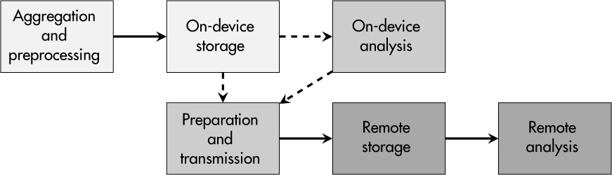

<a id="ch12"></a>

# <a id="page_223"></a>12 GIÁM SÁT HỆ THỐNG (SYSTEM MONITORING)

Giám sát (monitoring) thường đi kèm một hàm ý tiêu cực vì nó gợi ý rằng dữ liệu được thu thập để theo dõi bởi một thứ gì đó hay một ai đó. Tuy nhiên, nhiều mô hình kinh doanh số như bảo trì dự đoán sẽ không hoạt động nếu thiếu giám sát và phân tích dữ liệu tiếp theo. Tương tự như vậy, việc bảo vệ liên tục các thiết bị đòi hỏi ghi log và phân tích dữ liệu để phát hiện và truy vết các hoạt động độc hại.

Việc tạo ra các logfile phong phú trong các hệ thống IT đã phổ biến từ nhiều thập kỷ. Tuy nhiên, khi nói đến embedded system, log có thể không nhận được sự chú ý xứng đáng. Trong quá khứ, dung lượng lưu trữ thấp và việc thiếu kết nối internet là những lý do chính đáng để xếp việc giám sát hệ thống xuống hàng thứ yếu, nhưng may mắn thay, ngày nay những hạn chế đó đã tiếp tục giảm bớt.

Trong chương này, tôi giải thích lợi ích của việc giám sát thiết bị vì lý do bảo mật. Ngoài ra, tôi thảo luận các hạn chế tài nguyên trên embedded system và nhiều khía cạnh của các quy trình ghi log và việc quản lý chúng. Để tổng kết mọi thứ, case study cuối cùng của cuốn sách xem xét dữ liệu log có sẵn trên một thiết bị STM32MP157F và cách phân tích nó.

<a id="ch00lev1_96"></a>

## <a id="page_224"></a>Giám sát vì những lý do đúng đắn

Nhiều công ty bị cáo buộc là “bạch tuộc dữ liệu” vì họ thu thập mọi dữ liệu có thể chạm tay tới, dù từ web service, hạ tầng IT hay thiết bị end-user. Đối với họ, việc thu thập này dẫn đến các mô hình kinh doanh sinh lời, nhưng sự phát triển này hiển nhiên mâu thuẫn với các nỗ lực bảo vệ quyền riêng tư nhằm bảo vệ con người khỏi bị theo dõi, giám sát và do thám.

Về mặt pháp lý, GDPR của châu Âu là một ví dụ về việc chống lại thu thập dữ liệu quá mức, nhưng các yêu cầu pháp lý khác—như UN Regulation 155 trong lĩnh vực ô tô, IEC 62443-4-2 cho ngành tự động hóa công nghiệp và tiêu chuẩn Critical Infrastructure Protection (CIP) CIP-007-6 của North American Electric Reliability Corporation (NERC)—đòi hỏi tường minh việc giám sát bảo mật các sản phẩm có kết nối, bởi nhà sản xuất hoặc nhà vận hành. Tóm lại, hãy nhận thức rằng hai mặt của đồng xu thu thập dữ liệu và giám sát luôn phải được cân bằng cẩn thận.

Trong một số lĩnh vực, giám sát đã là thực hành phổ biến từ lâu; ví dụ, camera giám sát và nhân viên an ninh để mắt tới các mối đe dọa an ninh vật lý đối với tòa nhà và khuôn viên doanh nghiệp. Ngành ngân hàng có truyền thống lâu đời về giám sát giao dịch và phản ứng với các hoạt động bất thường. Cuối cùng nhưng không kém phần quan trọng, việc giám sát lưu lượng mạng bởi firewall và hệ thống phát hiện xâm nhập là một phần của mọi hạ tầng IT tử tế. Việc thu thập dữ liệu và giám sát hệ thống nhân danh bảo mật rõ ràng thường được chấp nhận, nhưng nó luôn phải nằm trong giới hạn hợp lý.

Giám sát hệ thống có nhiều ưu điểm đối với bảo mật thiết bị. Dữ liệu log có thể đặc biệt hữu ích trong hai trường hợp. Thứ nhất, mọi cuộc tấn công vào thiết bị của bạn đều đi qua nhiều giai đoạn bao gồm do thám, phân phối, khai thác, cài đặt, chỉ huy và điều khiển (command and control), và hành động theo mục tiêu. Mỗi giai đoạn có thể để lại dấu vết trong các logfile của thiết bị, cho phép bạn phát hiện cuộc tấn công sớm, phản ứng tương ứng và qua đó ngăn chặn thiệt hại thêm. Thứ hai, dữ liệu log có thể là một nguồn vô cùng giá trị trong các quy trình điều tra số (forensic) sau khi một sự cố đã xảy ra. Hãy tưởng tượng thiết bị của bạn bị tấn công ngoài hiện trường, nhưng bạn không có dữ liệu gì để tái dựng và hiểu những gì đã xảy ra. Mù tịt trong tình huống như vậy không chỉ khiến bạn không có manh mối gì mà còn có thể là một rủi ro đáng kể cho hoạt động kinh doanh của bạn.

Nói chung, giám sát thiết bị làm tăng tính minh bạch trên toàn bộ quần thể thiết bị của bạn ngoài hiện trường và cho bạn cái nhìn tổng quan về việc sản phẩm của bạn được dùng khi nào, ở đâu và như thế nào. Trong hạ tầng trọng yếu, việc giám sát như vậy thậm chí có thể cần thiết để đáp ứng các yêu cầu pháp lý hay chứng nhận. Ngoài ra, như đã đề cập trong [Chương 9](ch09_secure_firmware_update.vi.md#ch09), việc biết trạng thái các phiên bản firmware được triển khai trên thiết bị ngoài hiện trường có thể hữu ích trong việc hiểu bối cảnh mối đe dọa của khách hàng.

Bên cạnh các use case bảo mật thuần túy, giám sát thậm chí có thể là một công cụ hỗ trợ để xử lý và phân tích khiếu nại của khách hàng. Ví dụ, dữ liệu log có thể chứng minh rằng một end user đã thực hiện các thay đổi cấu hình thủ công dẫn đến các chế độ hoạt động trái phép, gây quá tải các linh kiện cơ khí và khiến máy bị hỏng.

<a id="ch00lev1_97"></a>

## <a id="page_225"></a>Giám sát đúng thứ

Các embedded system chạy Linux, giao tiếp với nhiều dịch vụ và tương tác với cảm biến và actuator đã đạt tới độ phức tạp không cho phép ghi lại toàn bộ trạng thái thiết bị tại bất kỳ thời điểm nào. Lựa chọn duy nhất là *giám sát có chọn lọc* các thuộc tính và sự kiện của hệ thống.

> **CẢNH BÁO**
>
> *Ghi log dữ liệu hệ thống là con dao hai lưỡi (double-edged sword). Nó có thể cực kỳ hữu ích cho các kỹ sư dịch vụ của bạn trong quá trình xử lý sự cố, nhưng nếu log của bạn chứa username, mật khẩu và các dữ liệu nhạy cảm khác, kẻ tấn công có thể rất trân trọng những thông tin miễn phí đó.*

<a id="ch00lev2_150"></a>

### *Tương tác người dùng và access control*

Một điểm khởi đầu tốt là giám sát các sự kiện liên quan đến tương tác người dùng và access control.

#### Phiên người dùng

Nếu con người đăng nhập vào một thiết bị, họ không làm vậy mà không có ý định, dù được ủy quyền hay có ý đồ xấu. Việc biết lịch sử đăng nhập của user và có khả năng đối chiếu nó với các hoạt động real-world của một người nhất định có thể cho thấy một tài khoản đã bị lạm dụng. Ví dụ, người tương ứng với một user ảo có thể đang đi nghỉ và do đó rõ ràng không hoạt động.

Ngoài ra, một số lượng lớn lần đăng nhập thất bại có thể cho thấy một cuộc tấn công brute-force đã được thực hiện. Cuối cùng, thông tin thời gian và ngày tháng của các phiên người dùng có thể giúp tái dựng dòng thời gian của một cuộc tấn công.

#### Vi phạm access-control

Như được mô tả trong [Chương 11](ch11_access_control_and_management.vi.md#ch11), user và process nên bị hạn chế ở mức quyền tối thiểu cần thiết để hoàn thành nhiệm vụ của chúng. Bên cạnh tác dụng tích cực của các hạn chế truy cập lúc runtime, những biện pháp đó cũng có thể mang lại thông tin có giá trị về user hay process nào đã *cố* truy cập một tài nguyên bị cấm, điều có thể giúp phát hiện các cuộc tấn công ở giai đoạn sớm.

#### Hoạt động filesystem

Các file tạm thời đột ngột xuất hiện và các thay đổi vĩnh viễn đối với file cấu hình hay file hệ thống có thể cho thấy các hoạt động độc hại. Chúng có thể được khởi động bởi các process chạy trên thiết bị, có thể vì chúng đã bị xâm phạm thông qua việc khai thác một lỗ hổng chưa biết. Nhưng một người dùng con người cũng có thể là nguồn gốc của việc thao túng, điều có thể gợi ý một cuộc tấn công từ người trong nội bộ. Giám sát ít nhất một tập con các file trọng yếu và các sự kiện của chúng có thể có giá trị trong những trường hợp như vậy.

#### Phương tiện tháo rời

Đôi khi chỉ cần cắm một USB thumb drive hay một thẻ nhớ vào thiết bị là có thể kích hoạt một cuộc tấn công. Nếu sản phẩm của bạn cung cấp những tính năng như vậy, hoàn toàn hợp lý khi ghi log thông tin về thời điểm phương tiện đó được cắm vào hay tháo ra và có thể cả những identifier của nó.

<a id="ch00lev2_151"></a>

### <a id="page_226"></a>*Giao tiếp*

Mặc dù việc giám sát mọi dữ liệu chạy trên mọi kênh giao tiếp của một thiết bị thường không khả thi do lượng dữ liệu khổng lồ được truyền, một số metadata nhất định hay thông tin được gửi hay nhận cụ thể có thể cung cấp những hiểu biết có giá trị.

#### Giao tiếp mạng

Dữ liệu giao tiếp nhận được từ các nguồn bên ngoài cũng như dữ liệu thiết bị của bạn gửi đi có thể cho ra các gợi ý về hoạt động độc hại. Ví dụ, một lượng lớn lưu lượng từ một số địa chỉ IP nhất định có thể đại diện cho các cuộc tấn công DoS có mục tiêu. Các packet không tiêu chuẩn của các protocol giao tiếp có thể đại diện cho đối thủ đang kiểm tra phản ứng của thiết bị trước các request bị thao túng.

Các kết nối mới từ thiết bị của bạn tới các vị trí và địa chỉ IP chưa biết hay một lượng lưu lượng mạng đi ra tăng bất thường cũng có thể cho thấy thiết bị đã bị xâm phạm.

#### Giao tiếp low-level

Trái với các hệ thống IT cổ điển, một embedded system thường có nhiều interface low-level như bus I<sup>2</sup>C, kết nối serial hay các chân general-purpose input/output (GPIO). Giao tiếp của chúng thường mang dữ liệu cảm biến hay điều khiển, điều một lần nữa có thể là nguồn để phát hiện hành vi bất ngờ như việc buộc actuator vào một chế độ hoạt động nguy hiểm.

Ghi log trạng thái và dữ liệu giao tiếp của những interface này có thể không phải là tính năng tiêu chuẩn, nhưng tùy thuộc vào mức độ trọng yếu của chúng, việc hiện thực nó có thể đáng cân nhắc.

<a id="ch00lev2_152"></a>

### *Hành vi ứng dụng*

Trái với việc nhìn giám sát bảo mật từ góc độ user hay interface giao tiếp, việc cân nhắc một cách tiếp cận application-centric có thể hợp lý.

#### Hoạt động dịch vụ

Một số dịch vụ cung cấp thông tin thú vị về trạng thái thiết bị của bạn, đặc biệt là những dịch vụ có kết nối từ xa. Ví dụ, một SSH daemon cho phép các phiên từ xa có thể cung cấp lịch sử các lần thử đăng nhập với địa chỉ IP và username tương ứng.

Một web server cũng có thể ghi log các request HTTP mà nó nhận được, điều có thể làm lộ các hoạt động thù địch trong giao tiếp ở tầng ứng dụng.

#### Ứng dụng tùy chỉnh

Các thành phần phần mềm độc quyền, ví dụ, liên quan đến mô hình kinh doanh của bạn, có thể cung cấp hiểu biết sâu sắc về việc sử dụng thiết bị. Do đó, việc tích hợp các phương tiện giám sát vào các ứng dụng quan trọng mà bạn tự phát triển nên là điều khá tự nhiên.

#### <a id="page_227"></a>Ứng dụng third-party

Bất cứ khi nào bạn cho phép người dùng cài đặt các ứng dụng do bên thứ ba phát triển trên thiết bị, bạn đối mặt với các mối đe dọa phổ biến bắt nguồn từ các thành phần phần mềm không đáng tin cậy. Bên cạnh việc quản lý truy cập nghiêm ngặt cho những chương trình đó, giám sát liên tục hành vi của chúng là một biện pháp hợp lý.

<a id="ch00lev2_153"></a>

### *Hành vi hệ thống*

Cuối cùng nhưng không kém phần quan trọng, “tình trạng sức khỏe” tổng thể của thiết bị có thể làm lộ các cuộc tấn công hay ít nhất là hành vi bất ngờ mà bạn có thể phân tích thêm.

#### Mức sử dụng hệ thống

Các giá trị sử dụng hệ thống điển hình, như tải CPU và mức tiêu thụ memory, thường được developer và nhân viên bảo trì biết rõ. Một thiết bị cho thấy các giá trị cao bất thường có thể cho thấy có phần mềm bổ sung chạy trên thiết bị—ví dụ, một crypto miner hay một dịch vụ backdoor do kẻ tấn công cài đặt. Nhưng đó cũng có thể chỉ là tác dụng phụ của một cuộc tấn công nhắm vào các interface low-level hay network interface.

#### Process và hệ thống bị crash

Các process của thiết bị bạn có thỉnh thoảng bị crash không? Tôi hy vọng là không, nhưng có thể chúng chỉ crash trong những trường hợp hiếm mà bạn chưa bao quát khi kiểm thử. Nếu các process đơn lẻ hay thậm chí toàn bộ hệ thống crash nhiều lần, điều đó có thể là do một kẻ tấn công đang dò thiết bị của bạn để tìm lỗ hổng tiềm năng. Nếu được phát hiện và phân tích đủ sớm, bạn có thể hành động và ngăn chặn thiệt hại thêm.

#### Lỗi và cảnh báo

Mặc dù các thông báo lỗi và cảnh báo có thể là một phần của hành vi hoàn toàn bình thường của thiết bị, chúng cũng có thể là bằng chứng cho thấy một đối thủ đang can thiệp vào các dịch vụ hay tùy chọn cấu hình của thiết bị trong giai đoạn do thám.

<a id="ch00lev2_154"></a>

### *Giám sát risk-based*

Những biện pháp giám sát nào hợp lý cho sản phẩm của bạn nên được quyết định dựa trên phân tích mối đe dọa và rủi ro của thiết bị, như được mô tả trong [Chương 1](ch01_secure_development_process.vi.md#ch01). Ví dụ, nếu bạn phát hiện rằng tải mạng cao là một rủi ro cho các hoạt động real-time của thiết bị, giám sát giao tiếp mạng và mức sử dụng hệ thống là một ý hay. Nếu thiết bị của bạn cho phép chạy các Docker container third-party, giám sát hoạt động của những gói phần mềm có tiềm năng nguy hiểm đó nên có trong danh sách của bạn. Và nếu thiết bị của bạn có một web interface cho mục đích cấu hình, ghi log các sự kiện web server trở thành điều cần thiết.

> **LƯU Ý**
>
> *Có thể tồn tại nhiều nguồn thông tin có giá trị khác cho giám sát bảo mật, đặc thù cho thiết bị của bạn. Hãy tìm ra chúng và dùng chúng để bảo vệ thiết bị.*

<a id="ch00lev1_98"></a>

## <a id="page_228"></a>Thiết kế một lược đồ giám sát

Mặc dù giám sát hệ thống không phải là điều mới với các hệ thống IT, việc hiện thực nó một cách hiệu quả luôn là một thách thức—đặc biệt khi nói đến việc ghi log các sự kiện và quy trình trên embedded system. Tùy thuộc vào khả năng của một sản phẩm cụ thể và các yêu cầu sử dụng nó, phải tìm ra một trade-off giữa xử lý on-device và xử lý server-based.

[Hình 12-1](#ch12fig01) cho thấy một architecture data-flow chung của dữ liệu log, bắt đầu với việc thu thập, lưu trữ cục bộ và có thể phân tích on-device. Trong khi các thiết bị bị hạn chế sẽ giữ phần này khá gọn nhẹ, các thiết bị mạnh hơn có thể tổng hợp nhiều dữ liệu hơn và thực hiện phân tích on-device để tối đa hóa các hiểu biết tiềm năng.

<a id="ch12fig01"></a>

*Hình 12-1: Một architecture ghi log chung*

Thông thường, các thiết bị nối mạng truyền ít nhất một phần thông tin thu thập được tới một server từ xa, dù trên mạng cục bộ hay trên internet. Điều này không chỉ cho phép lưu trữ lượng dữ liệu log lớn hơn mà còn cho phép phân tích dữ liệu performance-intensive cho từng thiết bị đơn lẻ và trên toàn bộ quần thể thiết bị. Điều sau đặc biệt dẫn đến chất lượng giám sát bảo mật tăng đáng kể.

<a id="ch00lev2_155"></a>

### *Thách thức đối với embedded system*

Khi nói đến các kịch bản (I)IoT với các thiết bị khá hạn chế và có thể có quần thể khá lớn, thiết kế cụ thể của quy trình giám sát phải đối mặt với nhiều thách thức.

#### Tài nguyên hạn chế

Embedded system có thể bị hạn chế ở nhiều chiều, khiến developer gặp khó khăn trong việc xác định lượng tài nguyên dùng cho giám sát. Một số thiết bị chạy bằng pin, và việc thu thập (chưa nói đến truyền) dữ liệu log sẽ là gánh nặng thêm cho thời lượng pin. Đối với các sản phẩm dựa trên microcontroller nhỏ, việc thu thập dữ liệu log không khả thi từ góc nhìn performance vì đơn giản là không còn thời gian cho những tác vụ như vậy. Một số hệ thống có không gian lưu trữ hạn chế và chỉ lưu được lượng nhỏ dữ liệu log, trong khi những hệ thống khác không có kết nối mạng high-bandwidth cần thiết để truyền dữ liệu giám sát tới các server trung tâm. Một số thiết bị có tất cả những hạn chế này.

Đối với các sản phẩm hiện có, vốn được tối ưu cho nhiệm vụ chuyên dụng duy nhất của chúng, thường khó hay gần như không thể tích hợp giám sát bảo mật <a id="page_229"></a>như một add-on. Nhưng điều đó không nên là lời biện hộ để loại bỏ mọi tính năng giám sát. Nếu bạn xác định được nhu cầu giám sát bảo mật sớm trong vòng đời phát triển, bạn có cơ hội dành riêng tài nguyên cho mục đích tuyệt đối quan trọng này.

#### Nguồn thời gian được đồng bộ

Timestamp đúng là thiết yếu để tương quan các sự kiện bên trong một thiết bị và với các sự kiện của các thiết bị và thành phần hệ thống khác. Cho mục đích này, các nguồn thời gian phải được đồng bộ, điều không thể coi là đương nhiên trên embedded system.

Hỗ trợ cho các protocol đồng bộ, như NTP, có lẽ phải được bật một cách có chủ đích, và các nhà tích hợp dùng sản phẩm của bạn cũng như nhà vận hành các hệ thống này phải cung cấp một hạ tầng phù hợp, như đồng hồ chủ và time server trong mạng của họ.

#### Giao tiếp an toàn

Việc truyền an toàn dữ liệu giám sát từ thiết bị tới một server thu thập trung tâm đi kèm nhiều điều kiện tiên quyết. Thiết bị phải có khả năng xác thực server trung tâm; nếu không, nó có thể bị lừa gửi dữ liệu có giá trị tới các bên không được ủy quyền.

Server cũng phải có khả năng xác minh định danh của thiết bị cung cấp dữ liệu, vì các thiết bị giả có thể gây xáo trộn đáng kể quá trình giám sát bằng cách gửi dữ liệu bị thao túng. Ngoài ra, bản thân việc truyền dữ liệu nên được bảo vệ ở mọi khía cạnh của giao tiếp an toàn, như được mô tả trong [Chương 7](ch07_secure_communication.vi.md#ch07).

#### Lưu trữ cục bộ integrity-protected

Nếu bạn quyết định dựa một phần hay thậm chí hoàn toàn vào việc ghi log device-side mà không truyền ra bên ngoài, bạn phải chuẩn bị cho câu hỏi, “Làm thế nào bạn thực sự bảo đảm rằng dữ liệu log không bị thay đổi vào một thời điểm nào đó?” Câu hỏi này thậm chí có thể được đặt ra bởi các cơ quan pháp lý hay tại tòa án, ví dụ, nếu thiết bị của bạn là một phần của hạ tầng trọng yếu quốc gia.

Việc bảo vệ system-integrity như được mô tả trong [Chương 8](ch08_secure_boot_and_system_integrity.vi.md#ch08) là một yêu cầu cơ bản cho các giải pháp vững chắc đối với thách thức này.

#### Lưu trữ cục bộ confidentiality-protected

Như đã đề cập trong phần trước, dữ liệu log có thể không chỉ hữu ích cho việc debug thiết bị mà còn cho kẻ tấn công trong giai đoạn do thám của họ. Do đó, bạn chắc chắn có thể coi các logfile là asset cần được bảo vệ confidentiality.

Các biện pháp như filesystem được mã hóa, như được giải thích trong [Chương 5](ch05_confidential_data_storage_and_secure_memory.vi.md#ch05), có thể là một giải pháp. Một lựa chọn khác là hiện thực một lược đồ mã hóa lai dùng public key của một log server trung tâm để mã hóa một symmetric key cục bộ ngẫu nhiên, key này đến lượt nó được dùng để mã hóa dữ liệu log được tạo cục bộ. Trong trường hợp đó, chỉ server từ xa sở hữu private key tương ứng mới có thể giải mã và phân tích thông tin log.

<a id="ch00lev2_156"></a>

### <a id="page_230"></a>*Giám sát quá trình ghi log on-device*

Giám sát bảo mật liên tục có thể đóng vai trò trung tâm trong việc phát hiện tấn công, phản ứng kịp thời với sự cố và phân tích forensic toàn diện sau khi bị xâm phạm, nghĩa là các quy trình ghi log on-device liên quan được kỳ vọng hoạt động đúng. Tuy nhiên, sẽ ngây thơ nếu giả định rằng các quy trình giám sát vốn bền vững và miễn nhiễm với mọi loại ảnh hưởng. Điều quan trọng là cài đặt các biện pháp kiểm tra xem các thủ tục ghi log liên quan có hoạt động đúng không.

Dù bộ lưu trữ log cục bộ chỉ có vài megabyte hay vài gigabyte, nó luôn hữu hạn. Trong một số trường hợp, có thể có cám dỗ nói rằng một memory nhất định có thể chứa “nhiều sự kiện log hơn số mà một thiết bị cụ thể có thể tạo ra,” nhưng hãy nhớ rằng hành vi ghi log có thể thay đổi với các phiên bản firmware tương lai, các thiết bị trong kịch bản công nghiệp có thể hoạt động hàng thập kỷ, và các tính năng và nội dung mới có thể làm giảm đáng kể dung lượng lưu trữ. Do đó, giám sát dung lượng lưu trữ log là một nhiệm vụ bắt buộc. Ngoài ra, bạn phải quyết định cách phản ứng nếu không gian lưu trữ cạn kiệt, hay thậm chí trước khi điều đó xảy ra. Ví dụ, nếu có thể, log có thể được nén và lưu trữ tới một vị trí từ xa, hay các sự kiện cũ nhất có thể bị ghi đè bởi các sự kiện mới đến.

Ngoài các vấn đề storage-capacity cục bộ, các kết nối từ xa được dùng để truyền dữ liệu log cũng có thể bị ảnh hưởng. Bạn có thể dễ dàng hình dung băng thông của giao tiếp như vậy có thể giảm đột ngột hay mất kết nối hoàn toàn. Trong những trường hợp như vậy, thiết bị có trách nhiệm quyết định liệu dữ liệu đã thu thập có được lưu tạm thời tại một nơi cục bộ cho đến khi kết nối được thiết lập lại và vị trí từ xa có thể bắt kịp lại, hay dữ liệu giám sát nên bị loại bỏ ít nhất một phần hay thậm chí hoàn toàn.

Hơn nữa, các ứng dụng ghi log của bạn có thể gặp phải các bug chưa biết một cách khó chịu, hay đối thủ có thể cố ý tấn công hệ thống giám sát của bạn. Cả hai kịch bản đều có thể dẫn đến crash các phần hệ thống trọng yếu và khiến bạn mù tịt về dữ liệu giám sát. Mặc dù thiết bị của bạn không thể phục hồi từ mọi tình huống khả dĩ, việc tự động khởi động lại các dịch vụ giám sát sau khi crash và ghi log cục bộ các sự kiện về việc có thể mất khả năng giám sát có thể đáng giá.

<a id="ch00lev2_157"></a>

### *Phân tích và quản lý log tập trung*

Trong nhiều use case, việc có một vị trí lưu trữ tập trung cho dữ liệu giám sát cũng như việc phân tích và tương quan thông tin từ toàn bộ quần thể thiết bị có giá trị lớn. Trong số các ưu điểm khác, cách tiếp cận này cho phép bạn phản ứng với các sự kiện security-related ngoài hiện trường trong một khung thời gian ngắn. Nếu một kẻ tấn công đang nghịch các file cấu hình hay file hệ thống trọng yếu, bạn có thể muốn biết điều đó càng sớm càng tốt. Cách tiếp cận này cũng cho phép bạn đưa một lịch sử dài dữ liệu log thiết bị vào các phân tích hiện tại, và một khi dữ liệu đã được truyền, việc thao túng hay hủy thông tin log on-device sẽ trở nên hiển nhiên.

Tuy nhiên, việc hiện thực hàng thứ hai của architecture ghi log được thể hiện trong [Hình 12-1](#ch12fig01) chẳng hề đơn giản. Một thách thức trong các kịch bản (I)IoT có thể <a id="page_231"></a>là khả năng mở rộng của hệ thống giám sát trung tâm và việc có sẵn năng lực phân tích tương ứng. Dĩ nhiên, điều này phụ thuộc vào quy mô quần thể thiết bị của bạn. Trong khi vài nghìn sản phẩm có thể quản lý được, khả năng mở rộng trở thành trọng tâm khi giám sát số lượng thiết bị six-digit hay thậm chí hơn. Điều này không chỉ đòi hỏi dung lượng lưu trữ trung tâm khổng lồ mà còn cả con người và thuật toán sàng lọc toàn bộ dữ liệu để xác định hành vi thiết bị bất ngờ, các hoạt động độc hại mới nổi hay các indicator of compromise (IoC).

Các hệ thống được dùng cho mục đích này thường được biết đến là *security information and event management (SIEM)* vì chúng thu thập dữ liệu sự kiện liên quan đến giám sát bảo mật và cung cấp phương tiện để tìm cây kim trong đống rơm như thành ngữ vẫn nói. Ví dụ về các nền tảng phân tích như vậy, open source hay thương mại, bao gồm Elastic Stack, Graylog và Splunk, chỉ để kể tên một vài. Mặc dù big data analytics và trí tuệ nhân tạo có thể hỗ trợ mạnh cho nhiệm vụ này, trong nhiều trường hợp, sự phán đoán và có thể cả điều tra thủ công của một chuyên gia con người là cần thiết.

Như được giải thích trong [Chương 1](ch01_secure_development_process.vi.md#ch01), mọi product life cycle an toàn phải thiết lập một dạng quy trình incident- and vulnerability-response nào đó. Hãy bảo đảm các nhóm vận hành hệ thống SIEM có kết nối chặt chẽ với các nhóm phát triển và quản lý sản phẩm, điều sẽ cho phép bạn nâng cao hiệu quả trong việc xử lý sự cố và lỗ hổng.

Với tất cả ưu điểm của các hệ thống và quy trình giám sát tập trung, đừng quên đánh giá một cách phê phán những dữ liệu nào bạn *thực sự* cần cho cách tiếp cận giám sát đã chọn. Chất đống dữ liệu không cần thiết chỉ làm giải pháp của bạn kém hiệu quả và có thể dẫn đến xung đột với GDPR của châu Âu hay các luật tương tự, đặc biệt nếu cơ sở dữ liệu của bạn chứa thông tin nhận dạng cá nhân (personally identifiable information, PII).

> **LƯU Ý**
>
> *Nếu bạn chưa quen với các hạn chế pháp lý về việc thu thập PII, hãy tìm hiểu kỹ chủ đề đó. Ngay cả dữ liệu khá “kỹ thuật” như địa chỉ IP và MAC cũng có thể được truy ngược về thể nhân và do đó đòi hỏi được xử lý đặc biệt hay hoàn toàn không nên được thu thập.*

<a id="ch00lev1_99"></a>

## Case Study: Ghi log sự kiện trên một thiết bị STM32MP157F

Case study này trình bày các công cụ và cấu hình điển hình để trích xuất dữ liệu giám sát từ một embedded system Linux-based như board STM32MP157F-DK2.

<a id="ch00lev2_158"></a>

### *Giám sát user-session bằng journald*

Các hệ thống Linux chạy `systemd`, như firmware STM32MP157F-DK2 của tôi, đi kèm công cụ `journald`, thu thập thông tin có giá trị về các process hệ thống cơ bản.

Ví dụ, [Listing 12-1](#ch12list01) cho thấy một loạt mục log được trích xuất từ `journalctl` bằng cách dùng `grep logind`.

<a id="page_232"></a>

```
# journalctl | grep logind
...
Apr 28 21:07:31 stm32mp1 systemd-logind[650]: New session c1 of user root.
Apr 28 21:13:51 stm32mp1 systemd-logind[650]: Session c1 logged out. ...
Apr 28 21:13:51 stm32mp1 systemd-logind[650]: Removed session c1.
Apr 28 22:54:57 stm32mp1 systemd-logind[650]: New session c2 of user root.
Apr 28 22:55:10 stm32mp1 systemd-logind[650]: Session c2 logged out. ...
Apr 28 22:55:10 stm32mp1 systemd-logind[650]: Removed session c2.
May 14 13:26:18 stm32mp1 systemd-logind[650]: New session c3 of user lservice.
May 14 13:39:24 stm32mp1 systemd-logind[650]: Removed session c3.
May 27 11:58:58 stm32mp1 systemd-logind[650]: New session c4 of user root.
```

<a id="ch12list01"></a>

*Listing 12-1: Các mục* `journald` *điển hình cho phiên người dùng*

Các log cho thấy rõ user root đã có hai phiên vào ngày 28 tháng Tư và local service user `lservice` đã đăng nhập khoảng 13 phút vào ngày 14 tháng Năm. Nếu điều này không khớp với một đợt kiểm tra chính thức của một kỹ thuật viên từ công ty bạn, đó có thể là dấu hiệu của truy cập trái phép.

Daemon `journald` có thể chạy ở nhiều chế độ, trong đó có hai chế độ là *volatile* và *persistent*. Trong khi lựa chọn thứ nhất chỉ lưu dữ liệu journal cho đến khi hệ thống khởi động lại, lựa chọn thứ hai khiến `journald` lưu dữ liệu log của nó dưới */var/log/ journal* một cách bền vững, điều có thể hữu ích cho forensic. Bạn có thể đặt tùy chọn tương ứng `Storage=persistent` trong file cấu hình */etc/ systemd/journald.conf* của nó.

Các tham số cấu hình khác như `SystemMaxUse=` và `RuntimeMaxUse=` cũng như `SystemKeepFree=` và `RuntimeKeepFree=` lần lượt xác định giới hạn kích thước file journal cho lưu trữ on-disk và in-memory, nhờ đó có thể tránh các tình huống trọng yếu do logfile tiêu thụ quá nhiều memory.

<a id="ch00lev2_159"></a>

### *Giám sát sự kiện kernel bằng auditd*

Linux kernel cung cấp một audit framework thu thập thông tin về các sự kiện có khả năng security-relevant xảy ra bên trong kernel. Đó là cùng framework được các hệ thống MAC như SELinux hay AppArmor dùng để theo dõi và hạn chế truy cập vào tài nguyên hệ thống, như được mô tả trong [Chương 11](ch11_access_control_and_management.vi.md#ch11).

Công cụ user-space `auditd` xây dựng trên framework này và cho phép lưu trữ bền vững các sự kiện bảo mật trong memory nonvolatile của thiết bị.

#### Cài đặt

Nếu bạn đã cài đặt thành công AppArmor hay một hệ thống MAC phổ biến khác trên thiết bị, audit framework có lẽ đã hoạt động. Nếu không, bạn có thể đặt `CONFIG_AUDIT=y` trong cấu hình Linux kernel để bật nó.

Layer `meta-oe` cho Yocto chứa recipe để cài đặt công cụ `auditd` từ *meta-oe/recipes-security/audit*. Nó có thể được thêm vào image của bạn một cách đơn giản bằng cách đặt `IMAGE_INSTALL += "auditd"`. Sau khi boot hệ thống với phần mềm mới <a id="page_233"></a>được cài đặt, bạn sẽ thấy hệ thống của bạn giờ chứa file */var/ log/audit/audit.log*, vốn là nơi mặc định để lưu trữ bền vững dữ liệu audit của kernel.

#### Tùy chỉnh

Audit framework là một công cụ mạnh với quyền truy cập sâu vào các process hệ thống, nên điều quan trọng là chỉ định tường minh loại sự kiện bạn muốn giám sát. Bạn có thể dùng `auditctl` để thêm các watch rule vào một service `auditd` đang chạy, như được thể hiện trong [Listing 12-2](#ch12list02).

```
# auditctl -D
No rules
# auditctl -w /etc/passwd -p rwa -k users_credentials
# auditctl -l
-w /etc/passwd -p rwa -k users_credentials
```

<a id="ch12list02"></a>

*Listing 12-2: Thêm audit rule bằng* `auditctl`

Tham số `-D` gỡ bỏ mọi rule đang hoạt động. Lệnh thứ hai trong [Listing 12-2](#ch12list02) cài đặt một rule giám sát file */etc/passwd* (`-w /etc/ passwd`) đối với truy cập đọc (`r`) và ghi (`w`) cũng như thay đổi attribute file (`a`). Tùy chọn `-k` cho phép thêm một chuỗi key tùy ý mang lại cho rule một ý nghĩa nhất định và tăng tốc việc tìm kiếm log sau này.

Tuy nhiên, các rule do `auditctl` đặt chỉ có hiệu lực cho đến khi hệ thống khởi động lại. Để cài đặt watch rule một cách bền vững, bạn phải thêm chúng vào file */etc/audit/audit.rules*. Như được thể hiện trong [Listing 12-3](#ch12list03), các rule trong file này thực ra giống với các lời gọi command line tới `auditctl`, chỉ không có tên công cụ ở đầu.

```
## SSH daemon configuration
-w /etc/default/dropbear -p wa -k ssh_config
-w /etc/dropbear -p rwa -k ssh_config

## Users and credentials
-w /etc/passwd -p rwa -k users_credentials
-w /etc/shadow -p rwa -k users_credentials

## auditd configuration
-w /etc/audit/ -p wa -k auditd_config

## Audit management tools
-w /sbin/auditctl -p x -k audit_tools
-w /sbin/auditd -p x -k audit_tools
```

<a id="ch12list03"></a>

*Listing 12-3: Một ví dụ về audit rule bền vững*

Giám sát file-access có thể hữu ích trong nhiều kịch bản. Ví dụ, nếu bạn bật truy cập SSH vào thiết bị dựa trên daemon `dropbear` <a id="page_234"></a>phổ biến, có thể hợp lý khi theo dõi các thay đổi của file cấu hình tương ứng, file mà—nếu bị thao túng—có khả năng mở một backdoor vào thiết bị của bạn. Hơn nữa, truy cập vào */etc/passwd* và */etc/shadow* là các dấu hiệu phổ biến của hoạt động độc hại. Những kẻ tấn công nâng cao cũng có thể nhắm vào chính hệ thống audit, điều khiến các file chứa audit rule và các công cụ audit trở thành mục tiêu đáng theo dõi.

Sau khi bật các rule, bạn có thể dùng công cụ `ausearch` để lọc dữ liệu audit, như được minh họa trong [Listing 12-4](#ch12list04) cho các watch rule cấu hình SSH đã cài đặt.

```
# ausearch -k ssh_config
time->Thu Apr 28 23:12:57 ...
type=PROCTITLE msg=audit(1651187577.140:366): proctitle=...
type=SYSCALL msg=audit(1651187577.140:366): arch=40000028 syscall=290 ...
... uid=0 gid=0 ... comm="auditctl" exe="/sbin/auditctl" ...
type=CONFIG_CHANGE ... op=add_rule key="ssh_config" ...
# touch /etc/default/dropbear
# ausearch -k ssh_config
...
time->Thu Apr 28 23:24:47 ...
type=PROCTITLE msg=audit(1651188287.600:379): proctitle=...
type=PATH msg=audit(1651188287.600:379): ... name="/etc/default/dropbear" ...
type=PATH msg=audit(1651188287.600:379): ... name="/etc/default/" ...
type=CWD msg=audit(1651188287.600:379): cwd="/home/root"
type=SYSCALL msg=audit(1651188287.600:379): arch=40000028 syscall=322 ...
... uid=0 gid=0 ... comm="touch" exe="/bin/touch.coreutils" ...
```

<a id="ch12list04"></a>

*Listing 12-4: Dùng* `ausearch` *để tìm các hoạt động đáng ngờ*

Lời gọi đầu tiên tới `ausearch` với key `ssh_config` báo cáo rằng một rule mới với key này đã được công cụ `auditctl` thêm vào. Sau đó, tôi chỉ touch (thậm chí không thao túng) file cấu hình nằm tại */etc/default/dropbear*. Lời gọi thứ hai tới `ausearch` nói rõ rằng user root (`uid=0 gid=0`) đã dùng công cụ `touch` để truy cập file */etc/default/dropbear* khi đang ở thư mục */home/ root* chỉ 12 phút sau khi rule mới được nạp. Ví dụ này cho thấy sức mạnh có lợi của việc có sẵn dữ liệu giám sát cho các file hệ thống trọng yếu.

Bên cạnh việc theo dõi truy cập file, `auditd` cũng có thể chặn bắt các syscall. Tuy nhiên, vì những rule như vậy ảnh hưởng trực tiếp đến performance, bạn chỉ nên dùng chúng nếu coi chúng là tuyệt đối cần thiết.

<a id="ch00lev2_160"></a>

### *Ghi log sự kiện dịch vụ và ứng dụng*

Mặc dù `auditd` cung cấp các dịch vụ mạnh để giám sát hành vi kernel và ghi log các truy cập vào tài nguyên hệ thống, nó không nắm bắt được một phần quan trọng của thiết bị: các sự kiện cụ thể do dịch vụ và ứng dụng tạo ra.

#### <a id="page_235"></a>Ghi log sự kiện ứng dụng bằng syslog

Trong firmware STM32MP157F của tôi, BusyBox hiện thực một phiên bản tối giản của `syslogd` mà một số ứng dụng dùng để lưu thông tin log trong file */var/log/messages*. Một ví dụ về ứng dụng như vậy là SSH daemon gọn nhẹ `dropbear`.

[Listing 12-5](#ch12list05) cho thấy các thông điệp log tương ứng sau nhiều lần thử đăng nhập SSH.

```
# grep /var/log/messages -e dropbear
Apr 29 09:06:38 stm32mp1 authpriv.info dropbear[819]:
  Child connection from ::ffff:192.168.13.17:37214
Apr 29 09:06:40 stm32mp1 authpriv.notice dropbear[819]:
  pam_unix(dropbear:auth): ... rhost=::ffff:192.168.13.17  user=rservice
Apr 29 09:06:42 stm32mp1 authpriv.warn dropbear[819]:
  pam_authenticate() failed, rc=7, Authentication failure
Apr 29 09:06:42 stm32mp1 authpriv.warn dropbear[819]:
➊ Bad PAM password attempt for 'rservice' from ::ffff:192.168.13.17:37214
Apr 29 09:06:51 stm32mp1 authpriv.notice dropbear[819]:
➋ PAM password auth succeeded for 'rservice' from ::ffff:192.168.13.17:37214
Apr 29 09:07:01 stm32mp1 authpriv.info dropbear[819]:
➌ Exit (rservice) from <::ffff:192.168.13.17:37214>: Disconnect received
Apr 29 09:07:11 stm32mp1 authpriv.info dropbear[825]:
  Child connection from ::ffff:192.168.13.17:48656
...
Apr 29 09:07:16 stm32mp1 authpriv.warn dropbear[825]:
  Bad PAM password attempt for 'root' from ::ffff:192.168.13.17:48656
...
Apr 29 09:07:20 stm32mp1 authpriv.warn dropbear[825]:
  Bad PAM password attempt for 'root' from ::ffff:192.168.13.17:48656
...
Apr 29 09:07:23 stm32mp1 authpriv.warn dropbear[825]:
  Bad PAM password attempt for 'root' from ::ffff:192.168.13.17:48656
Apr 29 09:07:23 stm32mp1 authpriv.info dropbear[825]:
➍ Exit before auth from ...: (user 'root', 3 fails): Exited normally
```

<a id="ch12list05"></a>

*Listing 12-5: Các lần thử đăng nhập SSH được* `syslogd` *ghi log*

Dữ liệu log trước tiên cho thấy một `Bad PAM password attempt` ➊ cho user `rservice`, ngay sau đó là một `PAM password auth` thành công ➋ cho cùng user. Phiên được thiết lập bị đóng chỉ 10 giây sau đó ➌. Hơn nữa, có thể thấy ba lần thử đăng nhập thất bại cho user root, cuối cùng khiến SSH daemon thoát khỏi quá trình đăng nhập ➍. Dữ liệu log như vậy có thể cực kỳ hữu ích để phát hiện các cuộc tấn công brute-force vào tài khoản SSH hay các lần thử đăng nhập cho các user bất thường và từ các địa chỉ IP bất ngờ.

#### <a id="page_236"></a>Dùng logfile application-specific

Một số ứng dụng không dựa vào dịch vụ của `syslogd` theo mặc định, mà tự tạo và quản lý logfile riêng của chúng. Một ví dụ là web server `apache2` chạy trên board STM32MP157F-DK2 của tôi. Các logfile *access_log* và *error_log* của nó có thể được tìm thấy dưới */var/log/apache2/*. [Listing 12-6](#ch12list06) cho thấy các request HTTP mẫu từ địa chỉ IP 192.168.13.17.

```
# cat /var/log/apache2/access_log
...
192.168.13.17 - - [29/Apr/...09:35:46 +0000] "GET / HTTP/1.1" 200 45
192.168.13.17 - - [29/Apr/...09:35:58 +0000] "GET /admin/ HTTP/1.1" 404 196
192.168.13.17 - - [29/Apr/...09:36:27 +0000] "GET /config/ HTTP/1.1" 404 196
192.168.13.17 - - [29/Apr/...09:37:29 +0000] "GET /cgi-bin/ HTTP/1.1" 404 196
192.168.13.17 - - [29/Apr/...09:38:33 +0000] "GET / HTTP/1.1" 200 45
...
```

<a id="ch12list06"></a>

*Listing 12-6: Các mục access log mẫu từ* `apache2`

Thông tin này không chỉ cung cấp lịch sử các trang web được web server phục vụ thành công mà còn cả các request có thể làm lộ các hoạt động thù địch điển hình cho giai đoạn do thám. Ở đây, một kẻ tấn công đã kiểm tra tính khả dụng của các thư mục con */admin/*, */config/* và */cgi-bin/*. Một lần nữa, phát hiện sớm có thể ngăn chặn các cuộc tấn công và thiệt hại về sau.

<a id="ch00lev2_161"></a>

### *Ghi log tới một server từ xa*

Mọi công cụ đã đề cập trước đó đều hoạt động cục bộ trên thiết bị, điều có thể đủ cho mục đích forensic device-specific bất cứ khi nào bạn có quyền truy cập vật lý hay từ xa vào nó. Tuy nhiên, như đã gợi ý trước đó trong chương này, việc thu thập dữ liệu log tập trung có thể có lợi theo nhiều cách. Mặc dù việc thiết lập một hạ tầng giám sát tập trung vượt ra ngoài trọng tâm device-centered của cuốn sách này, tôi muốn chỉ ra rằng mọi dữ liệu được các công cụ này thu thập đều có thể được truyền tới các vị trí từ xa.

Ví dụ, daemon `journald` có thể được mở rộng bằng một service gọi là `systemd-journal-remote` để ghi log dữ liệu tới một server từ xa. Công cụ `audisp` và plug-in `audisp-remote` của nó có thể cho phép tổng hợp log tập trung cho dữ liệu được Linux audit framework và `auditd` thu thập. Ngoài ra, các công cụ cụ thể như `auditbeat` có thể được dùng để gửi dữ liệu audit tới một Elastic Stack, chẳng hạn. Hơn nữa, `rsyslog` và `syslog-ng` là các hiện thực `syslog` hiện đại cho phép ghi log tới các vị trí từ xa. Cuối cùng, một số công cụ này thậm chí có thể tương tác với nhau, nghĩa là `journald`, ví dụ, có thể được cấu hình để chuyển tiếp dữ liệu log tới một daemon `syslog`, daemon này đến lượt nó có thể lo việc truyền từ xa.

<a id="ch00lev1_100"></a>

## <a id="page_237"></a>Tóm tắt

Yêu cầu một thiết bị tổng hợp và truyền dữ liệu hệ thống và thông tin sự kiện tới một server trung tâm thì đơn giản. Tuy nhiên, khi bạn bắt đầu hiện thực những biện pháp như vậy, bạn sẽ gặp nhiều trở ngại cần vượt qua, từ các vấn đề pháp lý đến các ràng buộc thiết bị đến nguồn nhân lực cần thiết để vận hành liên tục các dịch vụ security-monitoring.

Trong chương này, tôi đã thảo luận các thông tin điển hình có thể hữu ích cho việc giám sát bảo mật embedded system, từ các phiên người dùng và tương tác của họ đến metadata lưu lượng mạng đến các lần crash hệ thống và thông báo lỗi. Rõ ràng, bạn càng muốn giám sát nhiều, bạn càng cần nhiều tài nguyên on-device và server. Một cách tiếp cận risk-based là hoàn toàn hợp lý để tìm ra sự thỏa hiệp giữa sự minh bạch thiết bị đầy đủ và mức sử dụng tài nguyên tối thiểu cho sản phẩm cụ thể của bạn.

Giám sát hệ thống là một lớp thiết yếu trong chiến lược defense-in-depth của bạn vì ngay cả khi mọi biện pháp bảo vệ bạn hiện thực đều thất bại, giám sát có thể cho phép bạn phát hiện các cuộc tấn công và bất thường đang diễn ra. Giám sát có thể tạo ra sự khác biệt giữa việc thoát nạn với một vết bầm nhẹ và việc hủy hoại danh tiếng của sản phẩm và công ty bạn.
