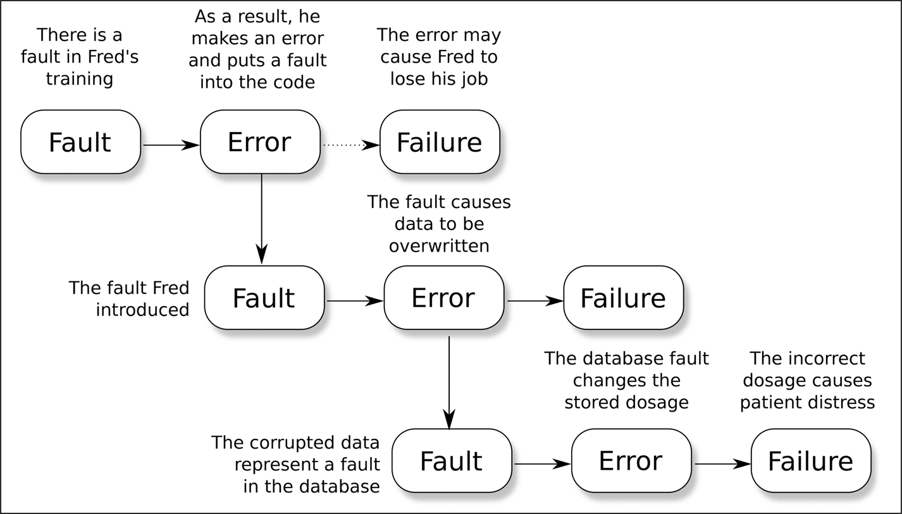
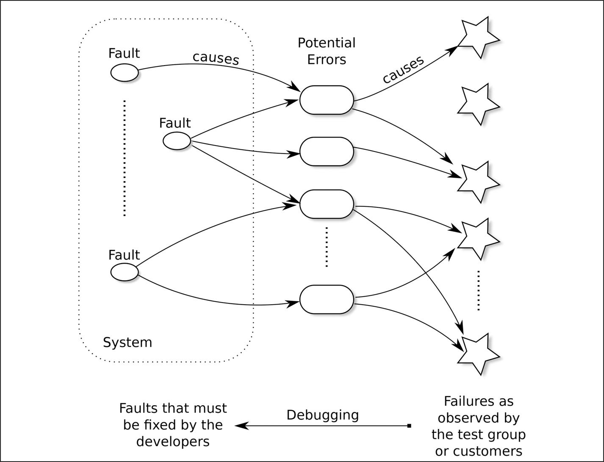

<a id="p10"></a>

<a id="chapter2"></a>

# 2 Thuật ngữ về an toàn

DOI: [10.1201/9781003598145-2](https://doi.org/10.1201/9781003598145-2)

> *To-day chúng ta học gọi tên các bộ phận.*
>
> Henry Reed (1942)

Để thảo luận về phần mềm safety-critical, chúng ta cần phân biệt những thuật ngữ gần như có thể thay thế cho nhau trong cách dùng hằng ngày. Ví dụ, việc phân biệt giữa một “fault,” một “error,” và một “failure” cho phép chúng ta xử lý chúng bằng những kỹ thuật khác nhau; việc phân biệt giữa “availability” (tính sẵn sàng) và “reliability” (độ tin cậy) cho phép chúng ta cân bằng hai yếu tố này trong hệ thống của mình. Chương này mô tả một vài thuật ngữ như vậy.

## 2.1 Thuật ngữ an toàn chung

### 2.1.1 An toàn (Safety)

Trong một cuốn sách về an toàn, có vẻ hợp lý khi định nghĩa thuật ngữ đó có nghĩa là gì. Đáng tiếc là điều này không dễ. ISO 26262 định nghĩa một hệ thống phân cấp các thuật ngữ:

- “Harm” (tổn hại) nghĩa là thương tích thể chất hoặc tổn hại đến sức khỏe của con người.
- “Risk” (rủi ro) nghĩa là sự kết hợp giữa xác suất xảy ra tổn hại và mức độ nghiêm trọng của tổn hại đó.
- “Unreasonable risk” (rủi ro bất hợp lý) nghĩa là một rủi ro bị đánh giá là không thể chấp nhận được trong một bối cảnh nhất định theo các quan niệm đạo đức xã hội hợp lệ.
- “Safety” (an toàn) nghĩa là sự vắng mặt của rủi ro bất hợp lý.

Tôi tin rằng ngay cả định nghĩa đầu tiên trong số này cũng chưa thỏa đáng: tổn hại cũng có thể là về tài chính hoặc tinh thần, và nó có thể xảy ra với môi trường chứ không phải với một con người.

Trong tài liệu tham khảo [<a id="b2refbib2_1"></a>[1](#refbib2_1)], Philip Koopman và William Widen đề cập đến câu hỏi định nghĩa thế nào là “an toàn”, đặc biệt đối với các thiết bị tự hành. Hệ thống phân cấp định nghĩa của họ khác với của ISO 26262.

- “Loss” (tổn thất) nghĩa là một kết cục bất lợi, bao gồm hư hại cho hệ thống, các ngoại ứng xã hội tiêu cực, hư hại cho tài sản hoặc môi trường, thương tích hoặc tử vong cho động vật hoặc con người.
- <a id="p11"></a>“Risk” (rủi ro) nghĩa là sự kết hợp giữa xác suất xảy ra một tổn thất, hoặc một chuỗi tổn thất, và tầm quan trọng của các hậu quả đối với các bên liên quan.
- “Safety constraint” (ràng buộc an toàn) nghĩa là một giới hạn được áp đặt lên rủi ro bởi các yêu cầu của các bên liên quan.
- “Acceptably safe” (an toàn ở mức chấp nhận được) nghĩa là hệ thống đáp ứng mọi ràng buộc an toàn, như được chứng tỏ bằng một Safety Case.<a id="fn2_12b"></a>[<sup>1</sup>](#fn2_1)

Định nghĩa này rộng hơn định nghĩa trong ISO 26262 và gần hơn với những gì chúng ta thường coi là an toàn.

<a id="aned2"></a>

> Giai thoại 2.[⏎](ch06_the_safety_case.vi.md#b6aned2) *Vào tháng Chín năm 2023, tại sân bay địa phương của tôi, một tên tội phạm đã trèo qua hàng rào vành đai, hand-propped (quay cánh quạt bằng tay để khởi động) một chiếc máy bay đang đỗ và cất cánh trong chốc lát trước khi rơi xuống và làm hư hại hai chiếc máy bay đang đỗ khác. Một người đã chứng kiến sự việc và chạy đến chiếc máy bay bị đánh cắp, nghĩ rằng sẽ thấy một người đã chết hoặc bị thương nặng. Thật khó tin, tên tội phạm không bị thương về thể chất, nhưng người chứng kiến bị căng thẳng tinh thần vì đã nghĩ mình sẽ thấy một xác chết, còn chủ sở hữu của những chiếc máy bay bị hư hại chịu tổn thất tài chính và sự bất tiện nghiêm trọng. Theo thuật ngữ của ISO 26262, sự cố này không gây ra “harm” nào.*

<a id="sec2_1_2"></a>

### 2.1.2 Văn hóa an toàn (Safety Culture)

> *Nếu bạn tin chắc rằng tổ chức của mình có một văn hóa an toàn tốt, gần như chắc chắn là bạn đã nhầm.*
>
> James Reason

Một Safety Culture là thiết yếu trong một tổ chức phát triển làm việc với các thiết bị và hệ thống có khả năng gây ra tổn thất hoặc tổn hại. Các tiêu chuẩn đòi hỏi phải có một văn hóa như vậy, nhưng đó không nên là động lực để xây dựng nó trong một công ty.

Annex B của ISO 26262-2 cung cấp một danh sách các ví dụ cho thấy văn hóa an toàn tốt hoặc kém, bao gồm “groupthink” (tư duy bầy đàn; xấu), sự đa dạng trí tuệ trong nhóm (tốt), và một hệ thống khen thưởng trừng phạt những người đi short-cuts gây nguy hại cho an toàn (tốt), và một hệ thống khen thưởng ưu tiên chi phí và tiến độ (xấu).

Mọi người liên quan đến việc phát triển một thiết bị safety-critical đều cần ý thức được rằng mạng sống con người có thể phụ thuộc vào chất lượng của thiết kế và hiện thực.

Cuộc điều tra chính thức về thảm họa Deepwater Horizon (tài liệu tham khảo [<a id="b2refbib2_2"></a>[2](#refbib2_2)]) đã đề cập cụ thể đến văn hóa an toàn trong ngành dầu khí: *“Các nguyên nhân trực tiếp của vụ phun trào giếng Macondo có thể được truy ngược về một chuỗi những sai lầm có thể xác định được của BP, Halliburton và Transocean, vốn bộc lộ những thất bại mang tính hệ thống trong quản lý rủi ro đến mức chúng khiến người ta nghi ngờ văn hóa an toàn của toàn ngành.”*

<a id="fn2_1"></a>

[<sup>1</sup>](#fn2_12b)Xem [Chương 6](ch06_the_safety_case.vi.md) để biết mô tả về Safety Case.

<a id="p12"></a>Thuật ngữ “safety culture” xuất hiện 116 lần trong báo cáo chính thức Nimrod Review (tài liệu tham khảo [<a id="b2refbib2_3"></a>[3](#refbib2_3)]) sau cuộc điều tra về vụ rơi máy bay Nimrod XV230 năm 2006. Cụ thể, báo cáo này có cả một chương mô tả những gì đòi hỏi ở một văn hóa an toàn và nói rõ rằng *“Những thiếu sót trong hệ thống đảm bảo khả năng bay (airworthiness) hiện tại của MOD là rất nhiều và bao gồm … một Safety Culture đã để cho ‘kinh doanh’ lấn át Airworthiness.”*

Có thông tin rằng, vào ngày 2 tháng Bảy năm 2014, một thợ máy làm việc cho Southwest Airlines được giao thực hiện một đợt kiểm tra bảo dưỡng cụ thể trên một chiếc Boeing 737-700. Anh ta còn để ý thấy hai vết nứt trên thân máy bay và đã báo cáo chúng. Chiếc máy bay phải ngừng bay để sửa chữa. Người thợ máy bị hãng hàng không kỷ luật vì “thực hiện công việc nằm ngoài phạm vi nhiệm vụ của mình”. Trong một văn hóa an toàn lành mạnh, bất kỳ nhà phát triển nào làm việc trên một sản phẩm safety-critical đều có quyền được biết cách đánh giá một rủi ro, và có nghĩa vụ đưa các cân nhắc về an toàn lên ban quản lý.

Như Les Chambers đã nói trong blog của ông vào tháng Hai năm 2012 khi bình luận về thảm họa Deepwater Horizon:

> *Chúng ta có nghĩa vụ đạo đức phải bước ra khỏi những sandbox toán học của mình và nhận thêm trách nhiệm xã hội đối với những hệ thống chúng ta xây dựng, ngay cả khi điều này có nghĩa là xung đột đe dọa sự nghiệp với một ông sếp quyền lực. Tri thức là đồng tiền truyền thống của ngành kỹ thuật, nhưng chúng ta cũng phải giao dịch bằng niềm tin.*

Một câu hỏi khác mà Chambers đề cập trong bài blog đó là liệu việc đẩy một quyết định “lên trên” có chấp nhận được hay không. Trong sự cố được mô tả ở <a id="b2aned1"></a>[Giai thoại 1](ch01_introduction.vi.md#aned1), tôi đã từ chối ký tài liệu phát hành và đẩy quyết định cho sếp của mình. Liệu điều đó có giúp tôi được miễn trừ về mặt đạo đức hoặc pháp lý khỏi mọi tội lỗi trong vụ việc này không, nếu thiết bị đã được xuất xưởng và đã gây ra thương tích? Thực tế, sếp của tôi cũng từ chối ký và việc xuất hàng đã bị trì hoãn với chi phí rất lớn.

> Giai thoại 3 *Tại một hội nghị về các hệ thống safety-critical mà tôi tham dự cách đây vài năm, một nhóm chúng tôi đang trò chuyện trong giờ nghỉ giải lao. Một đại biểu nói rằng anh ta có một người bạn là luật sư. Luật sư này khá thường xuyên bào chữa cho những kỹ sư bị cáo buộc đã phát triển một sản phẩm có lỗi gây ra thương tích nghiêm trọng hoặc tử vong. Có vẻ như luật sư này thường tự tin rằng ông có thể giúp chứng minh người kỹ sư vô tội nếu vụ việc được đưa ra tòa. Nhưng trong nhiều trường hợp, vụ việc không bao giờ được đưa ra tòa vì người kỹ sư đã tự tử. Giai thoại này đã khiến cuộc trò chuyện chết lặng, khi chúng tôi suy ngẫm về những hàm ý của nó đối với từng người chúng tôi.*

Một yếu tố thiết yếu của Safety Culture là nó cũng là một “Just Culture” (văn hóa công bằng), đối xử công bằng với những người tham gia vào việc phát triển và triển khai một sản phẩm. Trong một văn hóa như vậy, mọi người sẵn sàng thừa nhận sai lầm, vì biết rằng họ sẽ được đối xử công bằng. Hãy tưởng tượng bạn đã dành vài tuần để phát triển một formal model ([Chương 18](ch18_formal_verification.vi.md)) cho một thuật toán phức tạp trong sản phẩm đang phát triển và đã chứng minh được tính đúng đắn của nó. Chứng minh của bạn sẽ tạo nên một phần lớn bằng chứng cho việc chứng nhận. Một tuần trước khi các assessor đến để audit chứng nhận, bạn phát hiện ra một sai lầm trong <a id="p13"></a>mô hình của mình. Trong một just culture, bạn sẽ không ngần ngại công khai sai lầm đó, cho dù nó có thể gây bất lợi cho việc chứng nhận, và có thể cả cho công việc của bạn.

Tài liệu tham khảo [<a id="b2refbib2_4"></a>[4](#refbib2_4)] của Sidney Dekker so sánh những câu hỏi được đặt ra khi một sự cố safety-affecting xảy ra trong hai kiểu văn hóa:

- Một Retributive Culture (văn hóa trừng phạt):
  - Quy tắc nào đã bị vi phạm?
  - Ai đã làm điều đó?
  - Vi phạm tệ đến mức nào, và vì vậy người đó đáng phải chịu gì?
  - Người quản lý, phòng ban hay cơ quan nào được quyết định người đó đáng phải chịu gì?
- Một Restorative Culture (văn hóa phục hồi):
  - Ai đã (có thể) bị tổn thương?
  - Nhu cầu của họ là gì?
  - Ai có nghĩa vụ đáp ứng những nhu cầu đó?
  - Cộng đồng đóng vai trò gì trong việc rút ra bài học từ sự việc?

Trong nhiều trường hợp, người chịu trách nhiệm về sự cố (người so-called “nạn nhân thứ hai”) đã bị tổn thương và cần được giúp đỡ. Một restorative culture không có nghĩa là người gây ra sự cố không phải chịu trách nhiệm, nhưng nó có nghĩa là bối cảnh mà trong đó sai lầm xảy ra được xem xét đến.

Trong tài liệu tham khảo [[4](#refbib2_4)], Dekker chỉ ra nghiên cứu cho thấy một restorative just culture có thể cải thiện tinh thần, sự gắn bó và mức độ hài lòng với công việc của những người làm việc trong một dự án.

<a id="sec2_1_3"></a>

### 2.1.3 Functional Safety và SOTIF

Functional Safety dựa trên ý tưởng rằng nghiên cứu về an toàn của thiết bị là nghiên cứu về failure của các thành phần: một hệ thống sẽ vẫn an toàn trừ khi một trong các thành phần của nó bị hỏng hoặc hoạt động sai. Ví dụ, IEC 61508 định nghĩa “functional safety” theo nghĩa *“correct functioning of the … safety-related systems”* (sự hoạt động đúng của các hệ thống … liên quan đến an toàn) và ISO 26262 định nghĩa nó theo nghĩa *“absence of unreasonable risk … caused by malfunctioning behaviour”* (sự vắng mặt của rủi ro bất hợp lý … gây ra bởi hành vi hoạt động sai). Đây là cách tiếp cận không bị thách thức trong suốt thế kỷ 20, bắt đầu từ những ngày đầu của kỹ thuật an toàn, khi người ta đặt câu hỏi liệu máy bay two-engined hay four-engined thì an toàn hơn.<a id="fn2_22b"></a>[<sup>2</sup>](#fn2_2)

Nhìn bề ngoài, mối liên hệ giữa an toàn và failure có vẻ chặt chẽ: safety function phải tiếp tục hoạt động để mang lại an toàn, và vì vậy failure của nó là một mối đe dọa đối với an toàn.

<a id="fn2_2"></a>

[<sup>2</sup>](#fn2_22b)Một máy bay four-engined đối mặt với số lần hỏng động cơ nhiều gấp đôi so với một máy bay two-engined, nhưng mỗi lần hỏng ít nghiêm trọng hơn.

Mối liên hệ này giờ đang bị thách thức mạnh mẽ: nhiều nghiên cứu đã phát hiện rằng hầu hết (trong một số nghiên cứu lên tới 93%) các tình huống nguy hiểm xảy ra khi không có gì bị hỏng: khi <a id="p14"></a>mọi thành phần đều hoạt động đúng như đặc tả. Nancy Leveson đã lập luận từ năm 2004 (xem, ví dụ, tài liệu tham khảo [<a id="b2refbib2_5"></a>[5](#refbib2_5)] và [<a id="b2refbib2_6"></a>[6](#refbib2_6)]) rằng các hệ thống ngày nay phức tạp đến mức không thể dự đoán được mọi tương tác khả dĩ có thể dẫn đến failure, và chúng ta cần những mô hình tinh vi hơn để đánh giá an toàn của một hệ thống.

Tài liệu tham khảo [[5](#refbib2_5)] mô tả một tai nạn xảy ra với một lò phản ứng hóa học computer-controlled ở Anh, đã làm rò rỉ các chất bên trong nó ra khí quyển trong một sự cố mà mọi thành phần đều hoạt động đúng—không có gì hoạt động sai. Sự cố Ariane 5 trong lần phóng đầu tiên năm 1996 cũng là một sự cố mà mọi thành phần đều hoạt động theo đặc tả của chúng.

Thuật ngữ SOTIF (Safety of the *Intended* Functionality) đã được đặt ra để mô tả tình huống này.

Cách tiếp cận Functional Safety (failure-based) có thể phù hợp với các hệ thống đơn giản, trong khi SOTIF phù hợp hơn với các hệ thống phức tạp. Rất khó biết chính xác ranh giới nằm ở đâu. Điều này được thảo luận thêm trong [Mục 9.3](ch09_the_device_within_the_system.vi.md#sec9_3) ở trang 98.

<a id="sec2_1_4"></a>

### 2.1.4 Tiêu chuẩn mang tính quy định (prescriptive) và tiêu chuẩn Goal-Based

Các tiêu chuẩn quốc tế cho việc phát triển các sản phẩm safety-critical nằm giữa hai thái cực: prescriptive và goal-based.

> *Prescriptive standard* (tiêu chuẩn mang tính quy định) quy định và cấm đoán các quy trình, kỹ thuật, công cụ, v.v. Chúng không nêu mục tiêu của việc phát triển, mà chỉ nêu những gì bạn phải làm, và không được làm, để đạt được mục tiêu đó. Nếu một chứng nhận được cấp theo một prescriptive standard, một công ty thường sẽ không tuyên bố rằng, “Sản phẩm của chúng tôi an toàn.” Thay vào đó, nó sẽ tuyên bố rằng, “Sản phẩm của chúng tôi đáp ứng các yêu cầu của tiêu chuẩn X.”
>
> *Goal-based standard* (tiêu chuẩn dựa trên mục tiêu), ngược lại, nêu mục tiêu phải đạt được và để việc lựa chọn các quy trình, kỹ thuật và công cụ phù hợp cho tổ chức phát triển. Điều này đặt gánh nặng lớn hơn lên nhóm phát triển; họ không chỉ phải định nghĩa các quy trình, công cụ và kỹ thuật của mình, mà còn phải biện minh cho sự thỏa đáng của chúng. Công việc audit cũng khó khăn hơn vì assessor không thể chuẩn bị một checklist từ tiêu chuẩn rồi đơn giản đánh dấu từng mục. Một khi đã được chứng nhận theo một goal-based standard, về nguyên tắc, một công ty có thể tuyên bố rằng, “Sản phẩm của chúng tôi an toàn ở mức thỏa đáng.”

Trách nhiệm chứng minh sự an toàn trong một prescriptive standard thuộc về nhóm soạn ra tiêu chuẩn: nhóm đó thực chất đang nói rằng, *“Nếu bạn làm X, Y và Z và tránh làm A, B và C, thì sản phẩm thu được sẽ an toàn ở mức thỏa đáng.”* Với một goal-based standard, trách nhiệm đó chuyển sang nhà phát triển sản phẩm.

Ưu điểm của goal-based standard là chúng không khóa chặt vào những công nghệ lỗi thời. Chu kỳ cập nhật một tiêu chuẩn thường là một thập kỷ hoặc hơn, và các kỹ thuật phần mềm đang thay đổi nhanh hơn thế nhiều. Một prescriptive standard out-of-date có thể đòi hỏi việc sử dụng một kỹ thuật hoặc công cụ out-of-date.

Trong phiên bản đầu tiên của IEC 61508, xuất bản năm 2000, hầu như mọi tham chiếu đến các bài báo mô tả các công cụ và kỹ thuật được khuyến nghị đều từ những năm 1980, với một số từ những năm 1970. Trong phiên bản thứ hai, xuất bản năm 2010, các <a id="p15"></a>năm phổ biến nhất của các bài báo được tham chiếu là 1993 và 1988. Bài sớm nhất là năm 1950 và muộn nhất là năm 2007. Trong phiên bản thứ ba, các năm phổ biến nhất là 1991 và 1997. IEC 61508 mô tả khả năng chấp nhận PASCAL (phát hành năm 1970) và FORTRAN 77 (phát hành năm 1978 sau lần phát hành đầu tiên năm 1958) để lập trình các hệ thống safety-critical, nhưng không nhắc đến Rust.

Thật nản lòng và lãng phí khi một công ty áp dụng các kỹ thuật vào việc phát triển chỉ vì tiêu chuẩn đòi hỏi: *“Chúng tôi biết điều này là vô ích, nhưng tiêu chuẩn nói chúng tôi phải làm, và làm thì dễ hơn là tranh cãi với assessor.”* Đây là một lời than đặc biệt ai oán khi assessor được chỉ định đã đọc kỹ tiêu chuẩn, nhưng có thể không ý thức được bản chất thay đổi nhanh chóng của ngành công nghiệp phần mềm.

Trên dải phổ giữa các tiêu chuẩn hoàn toàn goal-based và hoàn toàn prescriptive, phải nói rằng hầu hết các tiêu chuẩn được thảo luận trong cuốn sách này nằm gần đầu prescriptive hơn. UL 4600, một tiêu chuẩn bao quát an toàn của các hệ thống tự hành, là một tiêu chuẩn hoàn toàn goal-based và ISO/PAS 8800 chủ yếu là goal-based, mặc dù nó phải tham chiếu đến nhiều mục khác nhau của ISO 26262, vốn mang tính prescriptive.

<a id="sec2_1_5"></a>

### 2.1.5 Hazard, rủi ro, biện pháp giảm thiểu và rủi ro tồn dư

Các thuật ngữ “hazard” (mối nguy) và “risk” (rủi ro) được dùng khác nhau trong các tiêu chuẩn khác nhau. ISO 26262-1 định nghĩa hazard là *“potential source of harm caused by malfunctioning behaviour of the item”<a id="fn2_32b"></a>[<sup>3</sup>](#fn2_3)* (nguồn tổn hại tiềm tàng gây ra bởi hành vi hoạt động sai của item), trong khi IEC 61508, ISO/PAS 8800 và ISO 14971 định nghĩa cùng thuật ngữ đó là *“potential source of harm”* (nguồn tổn hại tiềm tàng) mà không nhắc đến hoạt động sai. Điều này khớp với định nghĩa của IEC Guide 51. ISO/PAS 8800 chỉ ra rõ ràng rằng nó đã loại bỏ mệnh đề “malfunctioning”. EN 50716 không định nghĩa trực tiếp thuật ngữ này, nhưng tham chiếu đến định nghĩa của IEC.

Trong cuốn sách này, tôi dùng các thuật ngữ như sau: Một tảng băng trôi là một *hazard;* một *rủi ro* là một con tàu sẽ đâm vào nó. Một *biện pháp giảm thiểu (mitigation)* có thể là sơn tảng băng màu vàng để nó dễ thấy hơn. Ngay cả khi đã được sơn vàng, vẫn còn *rủi ro tồn dư (residual risk)* là một vụ va chạm có thể xảy ra vào ban đêm hoặc trong sương mù.

Tôi dùng thuật ngữ “hazard” như một thứ thụ động tồn tại trong môi trường và có thể là nguyên nhân của các rủi ro. Rủi ro thì chủ động và có thể làm phát sinh các tình huống nguy hiểm. Khi một rủi ro đã được nhận diện, nếu nó đủ nghiêm trọng, nó sẽ cần được giảm thiểu; tức là, phải có hành động để giảm nó xuống một mức có thể chấp nhận được.

Lấy một ví dụ sát với phần mềm nhúng hơn, memory dùng để lưu dữ liệu và chương trình có thể là một hazard. Các rủi ro gắn với nó có thể bao gồm:

<a id="fn2_3"></a>

[<sup>3</sup>](#fn2_32b)Làm rõ rằng điều này liên quan đến Functional Safety chứ không phải SOTIF.

*Rủi ro: Các hiệu ứng thứ cấp của tia vũ trụ.*

Ở đây cả tia vũ trụ lẫn chip memory đều là hazard. Rủi ro là một tia vũ trụ có thể gây ra một bit-flip trong memory cấu hình, làm thay đổi chế độ hoạt động của thiết bị một cách bất ngờ và có thể làm phát sinh một tình huống nguy hiểm.

<a id="p16"></a>Một biện pháp giảm thiểu rủi ro này có thể là dùng memory kiểm tra và sửa lỗi (ECC) để các lỗi được phát hiện và các single bit-flips được sửa.

Các rủi ro tồn dư bao gồm việc không phải mọi lỗi đều được memory ECC phát hiện (đặc biệt là các lỗi 3-bit), việc ứng dụng có thể không xử lý đúng interrupt báo lỗi memory, và việc ECC có thể không bao phủ các cache.

*Rủi ro: Cạn kiệt memory.*

Một ứng dụng có thể bị memory leak và, khi không thể truy cập thêm memory, có thể hỏng theo một cách bất ngờ, có thể gây ra một tình huống nguy hiểm.

Một biện pháp giảm thiểu có thể là để mỗi ứng dụng dành riêng đủ memory một cách tĩnh lúc khởi động và không bao giờ giải phóng nó.

Vẫn còn một rủi ro tồn dư là lượng memory được cấp phát tĩnh không đủ khi phát sinh một điều kiện chưa bao giờ được tính đến trong quá trình thiết kế và kiểm thử.

Thông thường, có nhiều rủi ro gắn với mỗi hazard, và nhiều biện pháp giảm thiểu gắn với mỗi rủi ro.

<a id="sec2_1_6"></a>

### 2.1.6 Availability, Reliability và Dependability

Khi một subsystem phần mềm được gọi, nó có thể không đưa ra được câu trả lời kịp thời, hoặc nó có thể phản hồi kịp thời nhưng với câu trả lời sai.

Việc không đưa ra được câu trả lời trong khoảng thời gian khiến nó còn hữu ích được gọi là một vấn đề về *availability* (tính sẵn sàng); việc đưa ra kịp thời một câu trả lời sai là một vấn đề về *reliability* (độ tin cậy).

Tăng availability nhìn chung làm giảm reliability và *ngược lại.* Hãy xét một server thực hiện một dạng tính toán nào đó. Chúng ta có thể tăng reliability của server đó bằng cách cho hai server thực hiện cùng phép tính rồi so sánh câu trả lời của chúng. Đây là một kỹ thuật lâu đời:

> *Khi công thức rất phức tạp, nó có thể được sắp xếp theo đại số để tính toán theo hai hoặc nhiều cách khác biệt, và có thể làm hai hoặc nhiều bộ thẻ. Nếu giờ các hằng số giống nhau được dùng với mỗi bộ, và nếu trong những hoàn cảnh này các kết quả khớp nhau, chúng ta có thể khá yên tâm về độ chính xác của chúng.*
>
> Charles Babbage, 1837 (tài liệu tham khảo [<a id="b2refbib2_7"></a>[7](#refbib2_7)])

Đáng tiếc là, mặc dù nó cải thiện reliability của một số hệ thống, việc nhân đôi kiểu này làm giảm availability — nếu một trong hai server không sẵn sàng, thì toàn bộ hệ thống không sẵn sàng.

Với sự đối nghịch này giữa availability và reliability, điều quan trọng trong quá trình thiết kế là phải hiểu cái nào quan trọng hơn trong thiết kế đó và làm thế nào để đạt được sự cân bằng. Tôi khám phá chủ đề này sâu hơn trong [Mục 10.1](ch10_balancing_design_aspects.vi.md#sec10_1).

<a id="p17"></a>Tương đối dễ nghĩ ra những hệ thống mà reliability là thiết yếu cho an toàn, ngay cả khi phải đánh đổi availability. Khó hơn, nhưng vẫn có thể, hình dung ra những hệ thống mà availability quan trọng hơn. Trong tài liệu tham khảo [<a id="b2refbib2_8"></a>[8](#refbib2_8)], Mats Heimdahl mô tả một ví dụ far-fetched có chủ ý về một hệ thống mà bất kỳ sự gia tăng reliability nào cũng sẽ khiến hệ thống kém an toàn hơn.

Lưu ý rằng, trong khi các client của một service nhìn chung có thể đo *availability* của server mà chúng đang truy cập (ví dụ, bằng cách đặt timeout), chúng thường không thể đo được *reliability* của server — nếu các client đã biết câu trả lời đúng thì có lẽ chúng đã không cần gọi server.

Phần lớn việc kiểm thử chương trình thực chất là kiểm thử reliability, trong khi chỉ kiểm tra availability một cách tiện thể.

Trong cuốn sách này, tôi dùng thuật ngữ “dependability” (tính đáng tin cậy) để chỉ hoặc “availability” hoặc “reliability,” tùy theo cái nào quan trọng hơn đối với hệ thống đang được xem xét. Một định nghĩa phổ biến của “dependable” là một hệ thống được coi là dependable nếu nó cung cấp một service có thể được tin cậy một cách có cơ sở.

<a id="sec2_1_7"></a>

### 2.1.7 Fault, error và failure

IEEE 24765 phân biệt ba thuật ngữ này theo cách sau.

- Một lập trình viên có thể đưa một *fault* vào chương trình bằng cách gõ một thứ không mong muốn vào trình soạn thảo. Một fault là một khiếm khuyết thụ động, còn được gọi là một “bug”.
- Đôi khi một fault có thể khiến chương trình hoạt động theo cách tạo ra một kết quả không mong muốn, khi đó fault đã gây ra một *error*.
- Đôi khi một error gây ra một *failure* của hệ thống.

Theo lời của EN 50716, *“Failure” là một sự kiện, khác với “fault”, vốn là một trạng thái.*

Từ quan trọng trong những mô tả này là “đôi khi”: một fault không phải lúc nào cũng gây ra error và một error không phải lúc nào cũng gây ra failure. Ví dụ, nếu lập trình viên định gõ

```
char x[10];
```

cho một biến cục bộ, và vô tình gõ thành

```
char x[11];
```

thì điều đó khó có thể gây ra error trừ khi hệ thống rất thiếu memory. Tuy nhiên, đó vẫn là một fault trong code.

Nếu một lập trình viên tạo ra một hệ thống mở một file mỗi 10 giây, nhưng không đóng các file đó, thì *fault* này sẽ gây ra một *error* mỗi 10 giây (rò rỉ một file descriptor). Tuy nhiên, error đó sẽ không gây ra *failure* trong một thời gian — chưa gây ra trong khoảng 90 ngày trên chiếc laptop mà tôi đang gõ đoạn văn này, vốn cho phép tới 777101 file descriptor mở. Để xem một ví dụ thực tế, hãy xem [Giai thoại 17](ch11_error_detection_and_handling.vi.md#aned17) ở trang 132.

<a id="p18"></a>Như được minh họa trong <a id="b2fig2_1"></a>[Hình 2.1](#fig2_1), một error ở một cấp trong hệ thống có thể gây ra một fault ở cấp khác. Trong hình đó, một fault trong việc đào tạo Fred khiến anh ta chèn một bug vào code (anh ta mắc một error bằng cách chèn một fault). Fred mất việc vì sai lầm này (một failure — ít nhất là đối với Fred). Fault trong code dẫn đến một failure trong hệ thống tổng thể.

<a id="fig2_1"></a>



*Hình 2.1: Fault, error và failure.[⏎](#b2fig2_1)*

Việc phân biệt giữa fault, error và failure cho phép chúng ta xử lý chúng theo những cách khác nhau — chúng ta muốn giảm số fault bị đưa vào hệ thống, phát hiện và loại bỏ fault trước khi chúng trở thành error, phát hiện error và ngăn chúng trở thành failure và, nếu một failure có xảy ra, xử lý nó theo cách an toàn nhất có thể.

<a id="sec2_1_8"></a>

### 2.1.8 Ngôn ngữ informal, Semi-formal và formal

Các ngôn ngữ tự nhiên — tiếng Anh, tiếng Quan Thoại, tiếng Đức, tiếng Inuktitut — đều mơ hồ và tinh tế.

Lời giới thiệu oft-repeated dành cho một ex-employee, *“You'll be lucky to get this person to work for you,”* minh họa sự mơ hồ của tiếng Anh. Một lời giới thiệu xin việc khác, nghe nói từng được viết cho một ứng viên xin vị trí giáo sư triết học, *“Người này có chữ viết tay rất đẹp,”* minh họa sự tinh tế của nó.

Một ngôn ngữ như vậy được coi là *informal* (phi hình thức) vì cả cú pháp (ngữ pháp) lẫn ngữ nghĩa (ý nghĩa) của nó đều mơ hồ.

Có thể làm cho cú pháp của một ngôn ngữ trở nên formal, trong khi vẫn giữ sự linh hoạt của ngữ nghĩa informal; những ngôn ngữ như vậy được gọi là *semi-formal* (bán hình thức). Ngôn ngữ mô hình hóa thống nhất UML, và ngôn ngữ mô hình hóa hệ thống SysML, đều thường được dùng theo cách semi-formal. Cú pháp là well-defined ở chỗ một đầu mũi tên tam giác rỗng luôn có nghĩa là “generalization,” và một hình người que luôn có nghĩa là “actor”. <a id="p19"></a>Tuy nhiên, khi một block trong sơ đồ SysML được gắn nhãn “Braking System,” không có định nghĩa nào về ý nghĩa của nó, mà cách hiểu tiếng Anh thông thường được ngầm định.

Ngôn ngữ toán học cho phép chúng ta diễn đạt các ý tưởng về những cái phổ quát. Toán học không hiểu một tam giác thực sự là gì, nhưng nó có thể chứng minh rằng tổng các góc trong *bất kỳ* tam giác nào cũng bằng 180 độ. Nguyên lý đối ngẫu trong hình học nhấn mạnh sự trừu tượng hóa khỏi thế giới thực khi nói rằng, với một vài ràng buộc, chúng ta có thể hoán đổi các thuật ngữ “điểm” và “đường thẳng” mà mọi định lý hình học vẫn đúng. Ví dụ, hai điểm/đường thẳng xác định một đường thẳng/điểm.

Nếu chúng ta có thể diễn đạt các thiết kế của mình bằng một ngôn ngữ toán học (tức là *formal)*, thì lẽ ra phải có thể suy luận về các khái niệm phổ quát. Với thiết kế hệ thống của mình, chúng ta lẽ ra phải có thể chứng minh bằng toán học rằng với *bất kỳ* tổ hợp và chuỗi request và interrupt nào, hệ thống sẽ tiếp tục tiến triển và không bị treo cứng.

Chứng minh tính đúng đắn của một hệ thống khác với việc kiểm thử nó: *Kiểm thử* chứng tỏ rằng nó hoạt động với tập điều kiện cụ thể đã xảy ra trong quá trình kiểm thử, trong khi *chứng minh* chứng tỏ rằng nó hoạt động trong mọi điều kiện.

<a id="sec2_1_9"></a>

### 2.1.9 Safety, liveness và fairness

Sẽ thuận tiện nếu có thể phân biệt giữa các thuộc tính safety, liveness và fairness của một hệ thống, các thuật ngữ được Leslie Lamport đặt ra lần đầu năm 1983. Một cách không hình thức:

- *Một safety property* nói rằng hệ thống không bao giờ làm điều gì xấu, tức là nó vẫn an toàn. Ví dụ, hệ thống không bao giờ truyền thông điệp A trừ khi trước đó nó đã nhận được thông điệp B.
- *Một liveness property* nói rằng hệ thống luôn luôn rốt cuộc sẽ làm điều gì đó tốt, tức là nó sẽ tiến triển và không bị live- hay dead-lock.<a id="fn2_42b"></a>[<sup>4</sup>](#fn2_4) Ví dụ, nếu nhận được thông điệp B, thì rốt cuộc thông điệp A luôn sẽ được truyền.
- *Một fairness property* nói rằng, nếu hệ thống cố thực hiện các hành động, thì rốt cuộc các hành động đó sẽ thành công, tức là hệ thống sẽ không cho phép một hoạt động “chiếm quyền” khiến các request của một hoạt động khác mãi mãi không được đáp ứng.

Có nhiều biến thể của fairness, từ strong fairness đến các dạng yếu hơn, như được mô tả cẩn thận trong tài liệu tham khảo [<a id="b2refbib2_9"></a>[9](#refbib2_9)]. Tài liệu đó tóm tắt weak fairness và strong fairness như sau:

- Weak fairness của *A* khẳng định rằng *A* rốt cuộc phải xảy ra nếu *A* được enable một cách *liên tục* (continuously).
- Strong fairness của *A* khẳng định rằng *A* rốt cuộc phải xảy ra nếu *A* được enable một cách *lặp đi lặp lại* (continually).

Trong các định nghĩa này, “continuously” nghĩa là “không bị gián đoạn” còn “continually” nghĩa là “lặp đi lặp lại, có thể có gián đoạn”.

<a id="fn2_4"></a>

[<sup>4</sup>](#fn2_42b)Một dead-lock xảy ra khi hai thread mỗi thread đều dừng lại chờ thread kia trước khi có thể tiến triển. Một live-lock là khi hai thread vẫn thực thi nhưng mỗi thread liên tục nhường cho thread kia nên không có tiến triển nào.

<a id="p20"></a>Trong trường hợp một safety property, có một tập hữu hạn (mặc dù có thể rất lớn) các trạng thái cần được kiểm tra để xác nhận liệu thuộc tính đó có đúng với một hệ thống cụ thể hay không. Trong trường hợp này, việc kiểm tra có thể không khả thi trên thực tế, nhưng về lý thuyết có thể thực hiện được. Đối với một liveness property, số trạng thái khả dĩ cần kiểm tra có thể là vô hạn vì từ “rốt cuộc” (eventually).

### 2.1.10 Backward error recovery và forward error recovery

Khi một fault gây ra một error, error đó đôi khi có thể bị bắt lại và một dạng phục hồi nào đó diễn ra trước khi failure xảy ra. Hai dạng error recovery chính là:

*Backward Error Recovery* (phục hồi lỗi lùi).

Khi phát hiện một error, hệ thống quay về (“roll back”) một trạng thái previously-stored được biết (hoặc được tin) là nhất quán và lành mạnh. Việc input có vẻ đã gây ra error sau đó được áp dụng lại hay bị loại bỏ, và client được thông báo thế nào, khác nhau giữa các hiện thực.

Một trong những nhược điểm của backward error recovery là cần phải lưu dữ liệu xác định trạng thái hệ thống trước khi xử lý một request đến để nó sẵn có nếu cần rollback.

*Forward Error Recovery* (phục hồi lỗi tiến).

Cách này loại bỏ nhược điểm chính của backward error recovery — nhu cầu lưu trạng thái hệ thống — bằng cách chuyển sang một trạng thái lành mạnh định trước, độc lập với cả trạng thái trước đó lẫn input đã gây ra error.

### 2.1.11 Hệ thống ngẫu nhiên (Accidental Systems)

Năm 2010, một thí nghiệm đã được thực hiện ở Biển Bắc, ngoài khơi bờ biển phía đông nước Anh. Con tàu 500-tonne, *THV Galatea*, được cho đi qua một khu vực mà tín hiệu GPS đã bị cố tình gây nhiễu. Đúng như dự kiến, vị trí của con tàu trở nên không chính xác (màn hình trên đài chỉ huy cho thấy nó di chuyển với tốc độ siêu thanh từ giữa Na Uy đến giữa Ireland!), nhưng ngoài dự kiến, radar của con tàu cũng bị hỏng. Nhóm thí nghiệm liên hệ với nhà sản xuất radar và được cho biết rằng radar không phụ thuộc vào GPS. Sau đó họ liên hệ với các nhà sản xuất linh kiện trong radar và phát hiện ra rằng một linh kiện nhỏ, thực tế, có sử dụng tín hiệu định thời GPS.

Radar đó tạo thành một “accidental system” (hệ thống ngẫu nhiên). Nhà sản xuất linh kiện nhỏ biết rằng bất kỳ hệ thống nào tích hợp nó đều sẽ dựa vào tính toàn vẹn của tín hiệu GPS, nhưng không biết đến hệ thống radar. Nhà thiết kế radar thì không biết về sự phụ thuộc đó. Không ai có bức tranh đầy đủ, và vì vậy một hệ thống đã được xây dựng với những phụ thuộc ngẫu nhiên. Hệ thống đó hẳn đã không được kiểm thử trong điều kiện bị gây nhiễu GPS, vì sự phụ thuộc của nó vào GPS là không được biết đến.

Với sự gia tăng độ phức tạp, các hệ thống nhúng software-based giờ đây thường là accidental system. Có lẽ những người thiết kế một hệ thống hoàn chỉnh không biết <a id="p21"></a>rằng một thành phần được tích hợp có thể không chịu được multi-threading hoặc có chứa đệ quy có thể vượt quá kích thước stack được cấp phát.

## 2.2 Thuật ngữ Software-Specific

### 2.2.1 Phần mềm

Trong một cuốn sách dành riêng cho phần mềm nhúng, có vẻ lạ khi hỏi *phần mềm* là gì — theo trực giác, mọi người cảm thấy mình có thể phân biệt giữa phần mềm và phần cứng. Nếu nó làm bạn đau khi rơi trúng chân, thì nó là phần cứng.

Nhưng còn một Application-Specific Integrated Circuit (ASIC) được thiết kế bởi một công cụ phần mềm thì sao? Còn 5000 dòng code C được sinh ra bởi một công cụ mô hình hóa thì sao?

Tài liệu tham khảo [<a id="b2refbib2_10"></a>[10](#refbib2_10)], do Rail Safety and Standards Board xuất bản, xử lý sự phân biệt giữa phần cứng và phần mềm một cách thực dụng bằng cách lưu ý rằng phần mềm về bản chất phức tạp hơn phần cứng:

> *Theo kinh nghiệm, chúng tôi gợi ý rằng nếu một thiết bị có đủ ít trạng thái lưu trữ bên trong đến mức có thể bao phủ tất cả chúng trong kiểm thử một cách thực tế, thì tốt hơn có thể coi nó là phần cứng và chứng tỏ rằng nó đáp ứng các yêu cầu an toàn của mình bằng cách phân tích thiết kế và kiểm thử thiết bị hoàn chỉnh, bao gồm kiểm thử vét cạn mọi tổ hợp input và trạng thái.*

Đó là định nghĩa chúng ta sẽ dùng trong cuốn sách này. Nếu hệ thống đủ đơn giản để có thể được kiểm thử vét cạn, thì nó sẽ được coi là phần cứng; nếu không thì là phần mềm.

Lưu ý rằng đây là một định nghĩa one-way. Chắc chắn, các hệ thống nhúng được xem xét trong cuốn sách này quá phức tạp để kiểm thử vét cạn và vì vậy sẽ được coi là phần mềm. Tuy nhiên, trong nhiều năm qua, cũng không thể kiểm thử vét cạn một số thiết bị phần cứng. Ví dụ, ngay cả một RAM 64 kbit (nhỏ đến nực cười theo tiêu chuẩn ngày nay) có ${2}^{64 \times 1024}$ trạng thái khả dĩ — một con số có 19 728 chữ số — và, theo định nghĩa trong tài liệu tham khảo [[10](#refbib2_10)], có thể được coi là phần mềm. Tôi sẽ bỏ qua cách hiểu đó.

Có một khía cạnh khác của phần mềm thường bị bỏ qua: dữ liệu cấu hình. Commission Regulation (EC) No 482/2008 của Liên minh Châu Âu định nghĩa rõ ràng thuật ngữ “phần mềm” bao gồm cả dữ liệu cấu hình đi kèm:

> *‘phần mềm’ nghĩa là các chương trình máy tính và dữ liệu cấu hình tương ứng …*
>
> *‘dữ liệu cấu hình’ nghĩa là dữ liệu cấu hình một hệ thống phần mềm chung cho một trường hợp sử dụng cụ thể;*

Sau vụ rơi một máy bay vận tải quân sự Airbus A400M vào ngày 9 tháng Năm năm 2015, một giám đốc điều hành của Airbus Group đã xác nhận trong một cuộc phỏng vấn với tờ báo Đức <a id="p22"></a>*Handelsblatt* rằng vụ rơi là do một cấu hình phần mềm bị lỗi. Cụ thể, vị giám đốc nói rằng *“Lỗi không nằm trong bản thân code, mà nằm trong các thiết lập cấu hình được lập trình vào electronic control unit (ECU) của các động cơ.”*

Việc kiểm định một chương trình cùng với dữ liệu cấu hình của nó chưa được hiểu rõ vì bài toán tổ hợp gắn với cấu hình. Nếu một chương trình nhận 5 tùy chọn cấu hình, mỗi tùy chọn có thể nhận bất kỳ giá trị nào trong 3 giá trị, thì thực ra có ${3}^{5} = 243$ chương trình khác nhau cần kiểm chứng — xem phần thảo luận về combinatorial testing trong [Mục 22.3](ch22_integration_and_system_testing.vi.md#sec22_3). Tầm quan trọng của việc đưa dữ liệu cấu hình vào kiểm chứng chương trình đang ngày càng được công nhận, và các tiêu chuẩn mới nhiều khả năng sẽ xuất hiện trong vài năm tới.

### 2.2.2 Heisenbug và Bohrbug

Niels Bohr đã mô tả một mô hình nguyên tử vững chắc, kiểu billiard-ball, và đoạt giải Nobel năm 1922 cho công trình của mình. Werner Heisenberg, một học trò và đồng nghiệp của Bohr, đã cải tiến mô hình này để khiến nguyên tử trở nên bất định hơn nhiều: một mô hình xác suất về vị trí có thể của các electron, neutron và proton. Điều này đã mang về cho Heisenberg giải Nobel năm 1932.

Nguồn gốc của các thuật ngữ liên quan *Bohrbug* và *Heisenbug* không rõ ràng, mặc dù Jim Gray đã dùng thuật ngữ “Heisenbug” trong một bài báo năm 1983. Người ta tin rằng nó ra đời vào khoảng đầu những năm 1980.

Nguyên tử thế nào thì bug cũng thế. Một Bohrbug là một bug vững chắc, được xác định rõ ràng, với các thuộc tính không thay đổi khi thêm code debug để tìm nó. Mỗi lần một dòng code cụ thể được thực thi với các giá trị cụ thể của các biến input, hệ thống lại hoạt động sai.

Ngược lại, một Heisenbug là một will-of-the-wisp xuất hiện rồi biến mất theo cách khiến nó cực kỳ khó nắm bắt. Heisenbug do những vấn đề định thời tinh vi gây ra: Thread A chạy trên lõi xử lý 0 làm điều gì đó ảnh hưởng đến thread B chạy trên lõi xử lý 1 nếu, và chỉ nếu, một interrupt loại C xảy ra, ….

Heisenbug được các nhóm kiểm thử báo cáo là non-reproducible: *“Lần thứ tám chúng tôi chạy test case 1243, hệ thống bị crash. Chúng tôi đã chạy lại test case đó vài chục lần kể từ đó, và không có failure nào khác xảy ra. Không có memory dump nào. Vui lòng sửa bug.”*

Một đặc điểm của Heisenbug là cùng một fault có thể làm phát sinh những failure khác nhau, và các failure có thể xảy ra muộn hơn nhiều so với khi fault được kích hoạt, và ở một đoạn code hoàn toàn khác. Đây là điều khiến việc debug trở nên khó khăn: kiểm thử phát hiện ra các *failure,* trong khi các nhà phát triển phải sửa các *fault.* Đối với mọi fault, nhưng đặc biệt là với Heisenbug, đường đi từ failure, qua error, đến fault là many-to-many và điều này khiến việc truy vết fault gây ra một failure cụ thể trở nên rất khó khăn — xem <a id="b2fig2_2"></a>[Hình 2.2](#fig2_2).

<a id="fig2_2"></a>



*Hình 2.2: Truy vết failure ngược về fault.[⏎](#b2fig2_2)*

Ở cấp độ mà một tester có thể quan sát, nhiều failure có vẻ giống hệt nhau. Các error gây ra các failure là vô hình đối với cả tester lẫn lập trình viên, và những fault khác nhau có thể làm phát sinh các error về cơ bản giống hệt nhau.

Jim Gray đã chỉ ra, mặc dù không phải trong bối cảnh các hệ thống safety-critical, rằng người dùng thích Heisenbug hơn Bohrbug; họ thích một failure xảy ra ngẫu nhiên <a id="p23"></a>khoảng một lần mỗi tháng hơn là một failure xảy ra mỗi khi một lệnh nhất định được nhập trong một ngữ cảnh cụ thể. Vì lý do này, đã có nghiên cứu (ví dụ, tài liệu tham khảo [<a id="b2refbib2_11"></a>[11](#refbib2_11)] của Emery Berger) về việc chuyển Bohrbug thành Heisenbug. Ví dụ, nếu cấp phát cho một object nhiều memory hơn mức thực sự cần và memory được cấp phát theo xác suất, thì một memory overflow trở thành một Heisenbug thay vì một Bohrbug.

Bản chất khó nắm bắt của Heisenbug khiến chúng đặc biệt khó sửa, và một số nhà nghiên cứu, đặc biệt là Andrea Borr (xem, ví dụ, tài liệu tham khảo [<a id="b2refbib2_12"></a>[12](#refbib2_12)]), đã phát hiện ra rằng các nỗ lực sửa Heisenbug thường khiến tình hình tệ hơn trước.

Những lập trình viên thiếu nghiêm túc đã mở rộng phép ẩn dụ Bohrbug và Heisenbug theo những hướng hài hước hơn. Được đặt theo tên Erwin Schrödinger (đoạt giải Nobel năm 1933), Schrödingbug, chẳng hạn, là một fault đã nằm trong code nhiều năm và chưa bao giờ gây ra vấn đề gì ngoài thực địa. Một ngày nọ, khi đọc code, một lập trình viên để ý thấy bug đó. Ngay lập tức, các báo cáo từ thực địa bắt đầu đổ về vì bug đó, giờ đã bị quan sát, giống như con mèo của Schrödinger, đột nhiên thức dậy trong sản phẩm đã xuất xưởng.

### 2.2.3 Real-Time

Thuật ngữ *real-time* có lẽ là một trong những thuật ngữ gây nhầm lẫn và bị dùng sai nhiều nhất trong phát triển phần mềm. Một hệ thống là real-time đơn giản nếu hành vi được yêu cầu của nó có bao gồm một ràng buộc thời gian.

<a id="p24"></a>Do đó, một chương trình tính toán dự báo thời tiết từ dữ liệu currently-available là một chương trình real-time vì một dự báo xuất sắc cho khoảng thời gian 12 giờ tới là vô dụng nếu phải mất 14 giờ để tạo ra nó. Tương tự, các phép tính bảng lương mà các công ty thực hiện để trả lương cho nhân viên là real-time vì việc không hoàn thành chúng đúng hạn có thể dẫn đến những nhân viên rất không vui.

Trong thế giới nhúng, một hệ thống là real-time nếu một phần hợp đồng của nó chỉ định một khoảng thời gian mà trong đó nó sẽ phản hồi: *“Hệ thống này đọc cảm biến mỗi* $10 \pm 2$ *ms và cung cấp dữ liệu đã xử lý trong vòng 5 ms kể từ lúc đọc.”*

> Ngụy biện 1 *“Real-time” nghĩa là “nhanh.”*
>
> *Thực tế, các hệ thống real-time có xu hướng chậm hơn các hệ thống non-real-time vì cần có bộ đệm thời gian để bảo đảm rằng các deadline luôn được đáp ứng, bất kể định thời của các subsystem khác.*

<a id="sec2_2_4"></a>

### 2.2.4 Lập trình theo hợp đồng (Programming by Contract)

Ý tưởng programming by contract hay contract-first development được Bertrand Meyer nghĩ ra cho ngôn ngữ lập trình Eiffel vào cuối những năm 1980<a id="fn2_52b"></a>[<sup>5</sup>](#fn2_5) và giờ đã có trong các ngôn ngữ khác, như Ada và Rust. Programming by contract định nghĩa một hợp đồng hình thức three-part giữa một client yêu cầu một service và server cung cấp service đó:

1. Client phải bảo đảm rằng request của nó đáp ứng các precondition của server. Ví dụ, một precondition để gọi hàm thêm một phần tử vào hàng đợi có thể là hàng đợi chưa đầy.
2. Server bảo đảm rằng một số post-conditions nhất định sẽ áp dụng cho phản hồi của nó. Khi thêm một phần tử vào hàng đợi, điều này sẽ bao gồm việc hàng đợi có đúng một phần tử nhiều hơn trước và phần tử cuối cùng trong hàng đợi là phần tử do client cung cấp.
3. Server bảo đảm rằng một số invariant nội bộ nhất định sẽ áp dụng khi thoát ra để lần gọi tiếp theo tới nó cũng sẽ được trả lời đúng.

Nếu các hợp đồng được code vào chương trình server khi nó được viết, thì chúng không chỉ có thể được kiểm tra lúc runtime để bắt những bug vốn khó nắm bắt, mà còn có thể được dùng để hỗ trợ các công cụ phân tích tĩnh; xem tài liệu tham khảo [<a id="b2refbib2_13"></a>[13](#refbib2_13)] và [Chương 21](ch21_static_analysis.vi.md).

Ví dụ, với hàm `add()` của hàng đợi ở trên, một công cụ phân tích tĩnh, như SPARK prover của Ada, có thể phân tích toàn bộ code base để xác định xem liệu hàm đó có bao giờ có thể bị gọi khi hàng đợi đã đầy hay không.

<a id="fn2_5"></a>

[<sup>5</sup>](#fn2_52b)Lưu ý rằng Eiffel Software là chủ sở hữu bản quyền của thuật ngữ liên quan *Design by Contract*.

## Tài liệu tham khảo

<a id="refbib2_1"></a>[1] P. Koopman and W. Widen, “Redefining Safety for Autonomous Vehicles,” in *SafeComp 2024*, 2024.[⏎](#b2refbib2_1)

<a id="refbib2_2"></a>[2] B. Graham, W. K. Reilly, F. Beinecke, D. F. Boesch, T. D. Garcia, C. A. Murray, and F. Ulmer, “Deep Water — The Gulf Oil Disaster and the Future of Offshore Drilling: Report to the President,” 2011.[⏎](#b2refbib2_2)

<a id="refbib2_3"></a>[3] C. Haddon-Cave, *The Nimrod Review*. UK Government, 2009. [https://www.gov.uk/government/publications/the-nimrod-review](https://www.gov.uk/government/publications/the-nimrod-review).[⏎](#b2refbib2_3)

<a id="refbib2_4"></a>[4] S. Dekker, *Just Culture: Restoring Trust and Accountability in Your Organization*. CRC Press, third ed., 2017.[⏎](#b2refbib2_4)

<a id="refbib2_5"></a>[5] N. Leveson, “A new accident model for engineering safer systems,” *Safety Science*, pp. 237–270, 2004.[⏎](#b2refbib2_5)

<a id="refbib2_6"></a>[6] N. G. Leveson, “System Safety Engineering: Back To The Future.” Available at [http://sunnyday.mit.edu/book2.pdf](http://sunnyday.mit.edu/book2.pdf), 2008.[⏎](#b2refbib2_6)

<a id="refbib2_7"></a>[7] C. Babbage, “On the Mathematical Powers of the Calculating Engine.” (*Published in Origins of Digital Computers: Selected Papers* (ed. B. Randell) Springer-Verlag, 1973), 1837.[⏎](#b2refbib2_7)

<a id="refbib2_8"></a>[8] M. P. E. Heimdahl, “Safety and software intensive systems: Challenges old and new,” in *2007 Future of Software Engineering*, FOSE ‘07, (Washington, DC, USA), pp. 137–152, IEEE Computer Society, 2007.[⏎](#b2refbib2_8)

<a id="refbib2_9"></a>[9] L. Lamport, *Specifying Systems: The TLA<sup>+</sup> Language and Tools for Hardware and Software Engineers*. Addison-Wesley, 2003.[⏎](#b2refbib2_9)

<a id="refbib2_10"></a>[10] Rail Safety and Standards Board, “Engineering Safety Management (The Yellow Book),” 2007. Available from [www.yellowbook-rail.org.uk](http://www.yellowbook-rail.org.uk).[⏎](#b2refbib2_10)

<a id="refbib2_11"></a>[11] E. D. Berger, “Software needs seatbelts and airbags,” *Commun. ACM*, vol. 55, pp. 48–53, Sept. 2012.[⏎](#b2refbib2_11)

<a id="refbib2_12"></a>[12] A. J. Borr and C. Wilhelmy, “Highly-Available Data Services for UNIX Client-Server Networks: Why Fault Tolerant Hardware Isn't the Answer,” in *Hardware and Software Architectures for Fault Tolerance*, pp. 285–304, 1993.[⏎](#b2refbib2_12)

<a id="refbib2_13"></a>[13] R. Ceballos, R. M. Gasca, and D. Borrego, “Constraint Satisfaction Techniques for Diagnosing Errors in Design by Contract Software,” in *Proceedings of the 2005 conference on specification and verification of component-based systems*, SAVCBS ‘05, (New York, NY, USA), ACM, 2005.[⏎](#b2refbib2_13)
