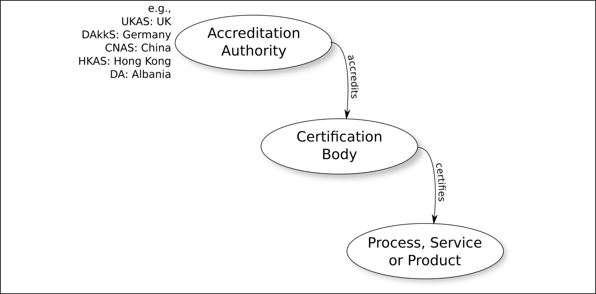
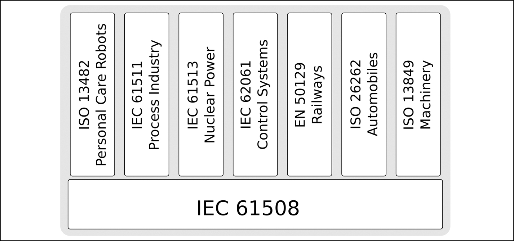
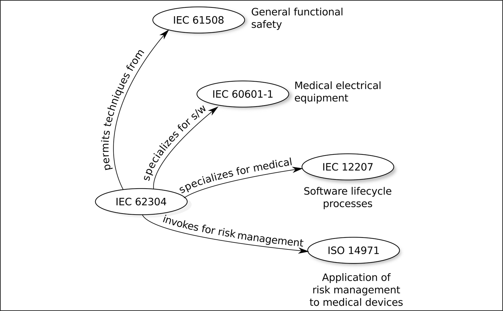

# 3 Các tiêu chuẩn an toàn và chứng nhận

DOI: [10.1201/9781003598145-3](https://doi.org/10.1201/9781003598145-3)

> *Quá thường xuyên, những người soạn tiêu chuẩn tập trung vào câu hỏi điều gì tạo nên good practice, và đánh mất tầm nhìn về những gì người tuân theo các tiêu chuẩn đó thực sự cần chứng tỏ để cho thấy sự an toàn. An toàn được chứng tỏ không phải bằng việc tuân thủ các quy trình được quy định, mà bằng việc đánh giá các hazard, giảm thiểu các hazard đó, và chứng tỏ rằng rủi ro tồn dư là chấp nhận được.*
>
> A.J.Rae (trích từ tài liệu tham khảo [[1](#refbib3_1)])

## 3.1 Các tổ chức tiêu chuẩn

Người ta nói rằng một điều tốt về các tiêu chuẩn là, nếu bạn không thích một tiêu chuẩn, thì luôn có một tiêu chuẩn khác mà bạn có thể áp dụng thay thế. Trong tài liệu tham khảo [[2](#refbib3_2)], John McDermid và Andrew Rae nói *“thật khó đếm [các tiêu chuẩn kỹ thuật an toàn], nhưng có lẽ có tới vài trăm.”* Và, dĩ nhiên, không có ranh giới rõ ràng nào bao quanh các tiêu chuẩn an toàn — liệu ISO 29119, tiêu chuẩn bao quát kiểm thử phần mềm, có phải là một tiêu chuẩn an toàn không?

Cũng có rất nhiều tổ chức soạn ra tiêu chuẩn. Trong cuốn sách này, tôi tập trung vào một số ít tiêu chuẩn được công bố chủ yếu bởi bốn tổ chức: International Electrotechnical Commission (IEC), International Organization for Standardization (ISO), European Electrotechnical Committee for Standardization (CENELEC) và UL Standards and Engagement (UL).

Cả IEC và ISO đều đặt trụ sở tại Geneva, và mặc dù mỗi tổ chức tự soạn ra tiêu chuẩn của mình, nhiều tiêu chuẩn được cross-issued. Vì vậy, ISO/IEC/IEEE 42010, tiêu chuẩn mô tả cách ghi lại architecture của một hệ thống, có các tiền tố chung.

CENELEC đặt trụ sở tại Brussels, và chịu trách nhiệm về tiêu chuẩn hóa ở Châu Âu trong lĩnh vực kỹ thuật điện. Mặc dù là một tổ chức Châu Âu, các tiêu chuẩn của nó (có tiền tố *EN)*, đặc biệt là những tiêu chuẩn liên quan đến hệ thống đường sắt, được sử dụng trên khắp thế giới.

UL được thành lập với tên Underwriters Laboratory vào năm 1894 và là một công ty tư nhân có trụ sở tại Northbrook, Illinois, Mỹ. Website của UL viết, *“Thông qua phân tích dữ liệu, ý kiến chuyên gia và thảo luận, chúng tôi làm việc để đưa các thành viên của các ủy ban kỹ thuật đến sự đồng thuận về một bộ yêu cầu an toàn chung.”* Tiêu chuẩn UL 4600 được nhắc đến nhiều lần trong cuốn sách này như một tiêu chuẩn goal-based.

Một đặc điểm chung của IEC, ISO, CENELEC và UL là, không giống các tổ chức tiêu chuẩn như Internet Engineering Task Force (IETF) và Distributed Management Task Force (DMTF), họ thu phí để truy cập các tiêu chuẩn. Một giấy phép single-user để đọc IEC 61508 có giá khoảng US\$3 500: khoảng US\$4,82 cho mỗi trang trong số 726 trang của bản tiếng Anh. Đây là giá cho một giấy phép single-user và nếu nhiều người trong một tổ chức cần đọc nó, thì phải mua hoặc nhiều giấy phép hoặc một giấy phép site đắt hơn. Có những trang internet[1](#fn3_1) cung cấp quyền truy cập 24-hour vào một số tiêu chuẩn với giá vài euro. Điều này thừa nhận rằng thường thì người ta chỉ cần tra cứu một tiêu chuẩn, chứ không cần sở hữu một bản đầy đủ để dùng nhiều lần.

> Giai thoại 4 *Một công ty mà tôi từng làm việc đã mua cho tôi một bản của một trong các tiêu chuẩn an toàn — một giấy phép cho một người đọc. Đáng tiếc là, khi bản PDF được tải về, mọi trang đều bị đánh dấu tên của người trong phòng mua hàng của công ty, người thực sự đã đặt hàng. Nói một cách nghiêm ngặt, chỉ người đó mới được phép đọc nó, còn tôi thì không được phép xem.*

Nguồn thu này đã bị chỉ trích vì dựng lên một rào cản giữa các công ty, đặc biệt là các công ty nhỏ, và những bản hợp pháp của các tiêu chuẩn quan trọng. Đã có đề xuất rằng IEC và ISO nên cung cấp tiêu chuẩn miễn phí và lấy nguồn thu từ chính quá trình tiêu chuẩn hóa: một khoản phí bản quyền mỗi khi một tổ chức chứng nhận cấp chứng nhận theo một tiêu chuẩn. Điều này sẽ khuyến khích việc soạn ra những tiêu chuẩn hữu ích, vì một tiêu chuẩn càng được dùng thường xuyên thì nguồn thu từ nó càng lớn. Tuy nhiên, các câu hỏi về xung đột lợi ích có thể nảy sinh nếu mô hình này được áp dụng, vì IEC và ISO buộc phải độc lập với quá trình chứng nhận.

Các tiêu chuẩn của ISO, IEC và CENELEC được soạn ra về cơ bản theo cùng một cách: các chuyên gia trong ngành làm việc để tạo ra một tiêu chuẩn, và việc chấp nhận tiêu chuẩn phụ thuộc vào kết quả bỏ phiếu của từng quốc gia tham gia. Trong ISO và IEC, mỗi quốc gia có một phiếu. Vì vậy, Anh, Đức, Trung Quốc và Mỹ mỗi nước có một phiếu IEC hoặc ISO, cũng như Luxembourg, Mông Cổ và Bhutan. Trong CENELEC, việc bỏ phiếu có trọng số, với một số quốc gia (ví dụ, Pháp, Đức, Ý, Anh và Türkiye) có nhiều phiếu hơn các nước khác (ví dụ, Malta và Iceland).

Để tác động đến cuộc bỏ phiếu cho một tiêu chuẩn cụ thể, một kỹ sư cần tham gia vào tổ chức tiêu chuẩn của quốc gia mình: Bureau voor Normalisatie ở Bỉ, British Standards Institution (BSI) ở Anh, Deutsches Institut für Normung (DIN) ở Đức, American National Standards Institute (ANSI) ở Mỹ, Standards Council of Canada (SCC), v.v.

UL không bao gồm các tổ chức quốc gia: các tiêu chuẩn của nó hình thành từ thảo luận của các chuyên gia trong ngành trong một ủy ban kỹ thuật. Có hai cấp thành viên nhóm làm việc:

1. Stakeholder, những người có thể đưa ra và bình luận về các đề xuất, nhưng không có quyền bỏ phiếu.
2. Technical Committee Member, những người, ngoài việc đưa ra và bình luận về các đề xuất, còn có thể bỏ phiếu về việc có nên thực hiện các thay đổi hay không.

[1](#fn3_13b)ví dụ, [https://www.evs.ee/en/](https://www.evs.ee/en/)

Trở thành một stakeholder tương đối dễ, nhưng để là thành viên ủy ban kỹ thuật thì phải chứng tỏ năng lực kỹ thuật trong lĩnh vực mà tiêu chuẩn đang được phát triển bao quát.

## 3.2 Công nhận (Accreditation) và chứng nhận (Certification)

[Hình 3.1](#fig3_1) minh họa quá trình công nhận và chứng nhận:

- *Chứng nhận một sản phẩm, dịch vụ hoặc quy trình.*

  Một công ty muốn có một trong các quy trình, dịch vụ hoặc sản phẩm của mình được chứng nhận theo một tiêu chuẩn cụ thể có thể self-declare rằng nó đáp ứng mọi yêu cầu của tiêu chuẩn phù hợp, có thể thuê một công ty bên ngoài độc lập để xác nhận lời công bố đó.

  Ngoài ra, công ty có thể thuê một tổ chức chứng nhận độc lập để thực hiện việc chứng nhận.

- *Công nhận các tổ chức chứng nhận.*

  Về nguyên tắc, bất kỳ công ty nào cũng có thể đóng vai trò một tổ chức chứng nhận bên ngoài, nhưng các công ty có thể được “công nhận” (accredited) để cấp chứng nhận cho một tiêu chuẩn cụ thể ở một cấp cụ thể. Chứng nhận từ một tổ chức không được công nhận có giá trị thương mại thấp hơn chứng nhận từ một tổ chức được công nhận.

  Các tổ chức chứng nhận được các cơ quan công nhận quốc gia công nhận để thực hiện những loại chứng nhận cụ thể. Vì vậy, một tổ chức chứng nhận có thể được công nhận để thực hiện chứng nhận phần cứng (nhưng không phải phần mềm) theo IEC 61508 đến safety integrity level 2 (SIL 2).

  Một công ty đang tìm kiếm một tổ chức chứng nhận nên kiểm tra cẩn thận các công nhận của các ứng viên để bảo đảm rằng chứng nhận cuối cùng được cấp sẽ đáng tin cậy đối với khách hàng của mình và vì vậy có giá trị thương mại.

- *Công nhận các cơ quan công nhận.*

  Mỗi nền kinh tế[2](#fn3_2) thuộc International Accreditation Forum (IAF) có một hoặc nhiều thành viên là cơ quan công nhận, những cơ quan này công nhận các tổ chức chứng nhận. Vì không có cơ quan nào cao hơn, câu hỏi hiển nhiên là *quis custodiet ipsos custodes?*— ai công nhận các cơ quan công nhận? Câu trả lời là những nền kinh tế ký Multilateral Recognition Arrangement (MLA) của IAF sẽ kiểm chứng sự tuân thủ của nhau trong một chu kỳ đánh giá đồng cấp liên tục. Danh sách các nền kinh tế đã ký MLA có thể được tìm thấy trên website của IAF tại [https://www.iaf.nu](https://www.iaf.nu).

*Hình 3.1: Công nhận và chứng nhận.[⏎](#b3fig3_1)*

Ngoài Liên minh Châu Âu, nơi có các quy định ngược lại, không có lý do gì khiến một công ty đặt trụ sở ở một quốc gia cụ thể cần tìm chứng nhận từ một tổ chức chứng nhận được công nhận ở quốc gia đó; có thể sẽ có lợi về mặt thương mại khi lấy chứng nhận từ một công ty được công nhận bởi quốc gia nơi có nhiều khách hàng nhất.

Vào thời điểm viết sách, IAF đang sáp nhập với một hiệp hội khác và tên của nó nhiều khả năng sẽ thay đổi trong vòng đời của cuốn sách này.

Đạt được chứng nhận theo một tiêu chuẩn như IEC 61508 không dễ dàng. Tài liệu tham khảo [[3](#refbib3_3)] được viết bởi Martin Lloyd và Paul Reeve, hai assessor rất giàu kinh nghiệm, vào thời điểm đó làm việc cho một tổ chức chứng nhận ở Anh. Tài liệu này mô tả tỷ lệ thành công mà họ đã chứng kiến gần đây đối với các chứng nhận IEC 61508:2000 và IEC 61511 cho các sản phẩm software-based. Trong số mười hai công ty đã hoàn tất quá trình chứng nhận tại thời điểm báo cáo, chỉ có ba (25%) đạt được chứng nhận — những công ty khác đã thất bại, trong một số trường hợp sau khi đã đầu tư rất nhiều tiền bạc và thời gian. Tài liệu tham khảo [[3](#refbib3_3)] đặc biệt hữu ích vì nó liệt kê một số lý do thất bại phổ biến. Martin đã công bố một bài báo khác vào đầu năm 2015 (tài liệu tham khảo [[4](#refbib3_4)]), cập nhật tài liệu tham khảo [[3](#refbib3_3)] để bao gồm kinh nghiệm từ năm 2010 đến 2015. Nhiều lý do thất bại cũ vẫn còn tồn tại, nhưng tỷ lệ thất bại đã giảm. Martin tin rằng điều này là vì các công ty ngày càng ý thức rõ hơn về những gì được yêu cầu và ít có khả năng bắt đầu quá trình chứng nhận hơn nếu họ không có đủ bằng chứng cần thiết.

Để tối đa hóa cơ hội được chứng nhận cho một sản phẩm, sẽ hữu ích nếu làm việc với tổ chức chứng nhận đã chọn từ sớm trong quá trình phát triển. Đặc biệt hữu ích là thảo luận cấu trúc của lập luận sẽ được trình bày trong safety case (xem [Chương 6](ch06_the_safety_case.vi.md)) với các assessor của tổ chức chứng nhận từ rất lâu trước đợt audit cuối cùng. Ngay cả trước khi bằng chứng được bổ sung, một sự đồng thuận rằng lập luận sẽ là thỏa đáng nếu được bằng chứng hỗ trợ cũng rất đáng có.

[2](#fn3_23b)Để tránh các vấn đề chính trị, IAF dùng thuật ngữ *economy* (nền kinh tế) cho thứ mà thông thường sẽ được gọi là *country* (quốc gia).

## 3.3 Vì sao chúng ta cần các tiêu chuẩn này?

Trong một số lĩnh vực, nhu cầu về tiêu chuẩn là rất rõ ràng. Nếu không có tiêu chuẩn nào định nghĩa hình dạng và kích thước của các ổ cắm điện trong nhà chúng ta, thì sẽ không thể mua một thiết bị điện với sự tin tưởng rằng nó sẽ cắm được vào nguồn điện. Thực ra sẽ rất tiện lợi nếu các ổ cắm điện được tiêu chuẩn hóa trên toàn thế giới.

Nhu cầu về các tiêu chuẩn định nghĩa cách các thiết bị safety-critical được chế tạo và phân loại thì ít hiển nhiên hơn.

Trong lịch sử, việc tạo ra các tiêu chuẩn (và không chỉ những tiêu chuẩn safety-related) thường được thúc đẩy bởi các thảm họa. Một thảm họa xảy ra và công chúng đòi hỏi rằng nó không bao giờ được lặp lại. Phản ứng là tạo ra một tiêu chuẩn mà ngành công nghiệp phải tuân thủ, với ý định nâng cao chất lượng sản phẩm và giảm khả năng lặp lại. Theo nghĩa này, tiêu chuẩn trở thành một quy định để bảo vệ một công chúng không hiểu quy trình kỹ thuật.

Từ góc nhìn của một tổ chức phát triển sản phẩm, các tiêu chuẩn có thể là một định nghĩa hữu ích về các thực hành “thỏa đáng”. Một công ty mới bước vào việc phát triển một ứng dụng safety-critical sẽ thấy một bộ công cụ và kỹ thuật hữu ích được liệt kê trong IEC 61508, ISO 26262, EN 50716 và các tiêu chuẩn khác.

Việc tuân thủ các tiêu chuẩn như vậy cũng có thể là một biện pháp giảm thiểu trong trường hợp có một vụ kiện ra tòa: *“Chúng tôi đã tuân theo các best practice của ngành như được định nghĩa trong ….”*

Từ góc nhìn của một công ty mua một thành phần hoặc subsystem để dùng trong một ứng dụng safety-critical, tiêu chuẩn tạo thành một cách nói tắt giúp đơn giản hóa các quan hệ hợp đồng: *“Thành phần phải được một tổ chức được công nhận chứng nhận theo IEC 61508 ở SIL 3”* thì dễ viết hơn một tuyên bố tường minh về tỷ lệ failure chấp nhận được, các quy trình phát triển, v.v.

Trong một cuộc thảo luận bàn tròn tại một hội nghị của các kỹ sư an toàn mà tôi từng tham dự, ban hội thảo được hỏi liệu an toàn hệ thống có được cải thiện trong thập kỷ trước nhờ số lượng tiêu chuẩn đã xuất hiện hay không. Sự đồng thuận nhất trí của các chuyên gia là an toàn *đã* được cải thiện, nhưng là vì người ta chú ý nhiều hơn đến việc phát triển phần mềm, chứ không phải vì sự tồn tại của các tiêu chuẩn.

## 3.4 Làm việc theo một tiêu chuẩn

Khi một công ty chế tạo một sản phẩm sẽ được chứng nhận theo một tiêu chuẩn cụ thể, việc các kỹ sư tập trung vào tiêu chuẩn đó là điều tự nhiên. Tuy nhiên, các tiêu chuẩn khác cũng có thể hữu ích. Đối với một nhà sản xuất ô tô, tiêu chuẩn chính có thể là ISO 26262, nhưng tiêu chuẩn này dựa trên IEC 61508 và việc quen thuộc với tiêu chuẩn đó sẽ hữu ích. Phần lớn ISO 14971, một tiêu chuẩn y tế, hữu ích trong bất kỳ ngành nào, và các tiêu chuẩn đường sắt của CENELEC, đến từ một ngành có lịch sử an toàn lâu dài, rất hữu ích trong bất kỳ bối cảnh nào. Mục tiêu của chúng ta là tạo ra một sản phẩm an toàn, chứ không phải một sản phẩm đáp ứng đúng câu chữ nghiêm ngặt của một tiêu chuẩn.

## 3.5 Vòng đời của một tiêu chuẩn

Khi một phiên bản mới của một tiêu chuẩn xuất hiện, vòng đời của tiêu chuẩn bị thay thế là có giới hạn, thường là năm năm. Phiên bản 2 của IEC 61508 được phát hành năm 2010 và vì vậy phiên bản 1 của tiêu chuẩn đó đã “biến mất” vào năm 2015. Sau thời điểm đó, không còn có thể đạt được chứng nhận theo nó nữa, và điều này gây ra một số nghi ngờ đối với những sản phẩm ngoài thực địa đã được chứng nhận theo phiên bản đầu tiên: liệu chúng có thể tiếp tục được xuất xưởng không, liệu chứng nhận IEC 61508 của chúng có còn được coi là hợp lệ không? Không có câu trả lời rõ ràng cho những câu hỏi này, nhưng một công ty đang xin chứng nhận khi một phiên bản mới của tiêu chuẩn sắp ra mắt có thể thấy việc trì hoãn chứng nhận là có lợi về mặt thương mại.

EN 50716 đã thay thế EN 50128 và EN 50657 vào năm 2023 và có yêu cầu rằng cả hai tiêu chuẩn bị thay thế phải được rút lại trước ngày 30 tháng Mười năm 2026.

## 3.6 Các tiêu chuẩn Functional Safety

Khái niệm functional safety được giới thiệu ở trang 13; mục này mô tả một vài tiêu chuẩn liên quan đến nó.

### 3.6.1 IEC 61508

#### 3.6.1.1 Tiêu chuẩn

IEC 61508 có lẽ là tiêu chuẩn cơ bản nhất liên quan đến functional safety; xem [Hình 3.2](#fig3_2). Tiêu chuẩn này có tên *Functional safety of electrical/electronic/programmable electronic safety-related systems* và gồm bảy phần, ba phần đầu mang tính normative,[3](#fn3_3) bao quát việc quản lý dự án chung và việc phát triển các thành phần phần cứng và phần mềm.

*Hình 3.2: Một số tiêu chuẩn functional safety IEC 61508-based.[⏎](#b3fig3_2)*

Bốn phần còn lại mang tính informative và chứa các định nghĩa từ vựng cùng các ví dụ và hướng dẫn áp dụng ba phần đầu.

IEC 61508 được phát hành lần đầu vào khoảng năm 2000 (các phần được phát hành vào những thời điểm hơi khác nhau) và phiên bản thứ hai được xuất bản năm 2010. Vào lúc tôi viết những dòng này, phiên bản thứ ba được lên lịch xuất bản trong nửa đầu năm 2026.

[3](#fn3_33b)Một phần “normative” của tiêu chuẩn định nghĩa những gì phải, hoặc không được, làm. Hầu hết các tiêu chuẩn cũng bao gồm các mục informative cung cấp giải thích, hướng dẫn và thông tin bổ sung, nhưng không tạo thành một phần của bản thân tiêu chuẩn.

Mô hình chung được dùng trong IEC 61508 là một thiết bị công nghiệp vốn có thể làm phát sinh các hazard về an toàn, và một safety function giám sát nó và chuyển nó vào trạng thái an toàn khi phát hiện ra một tình huống nguy hiểm.

Từ góc nhìn phát triển phần mềm, đóng góp giá trị nhất của IEC 61508 có lẽ là 20 bảng trong Annex A và B của [phần 3](part3_design_patterns.vi.md), mỗi bảng liệt kê các kỹ thuật là *bắt buộc* (M), *không được khuyến nghị* (NR), *được khuyến nghị,* (R) *rất được khuyến nghị* (HR) hoặc *không được khuyến nghị cũng không bị khuyến nghị không dùng* (PR) cho mỗi giai đoạn của vòng đời phát triển phần mềm, cho mỗi systematic capability level.

#### 3.6.1.2 Các chuyên biệt hóa của IEC 61508

Như có thể thấy từ [Hình 3.2](#fig3_2), IEC 61508 đã được chuyên biệt hóa cho một số ngành, nhưng mức độ liên kết giữa IEC 61508 và tiêu chuẩn industry-specific khác nhau.

EN 50129, tiêu chuẩn đường sắt, nói rằng nó “phù hợp” với IEC 61508, nhưng cũng nói rằng, nếu hệ thống tuân thủ tiêu chuẩn đường sắt, thì không cần chứng tỏ thêm sự tuân thủ IEC 61508. EN 50716 liệt kê IEC 61508 trong danh mục tài liệu tham khảo của nó, nhưng thực ra không nhắc đến nó trong văn bản.

Tiêu chuẩn ô tô, ISO 26262, sao chép nhiều bảng từ IEC 61508, với những thay đổi tinh tế và, ở một số chỗ, không mấy tinh tế. Các tiêu chuẩn khác, như ISO 13482 về an toàn robot, dựa vào IEC 61508 ít trực tiếp hơn nhiều, mặc dù, ngay cả ở đó, các ý tưởng bắt nguồn từ IEC 61508 vẫn được đưa vào.

Có lẽ sự dựa dẫm thú vị nhất vào IEC 61508 được nhắc đến trong đặc tả y tế IEC 62304. Đặc tả này không trực tiếp liên quan đến functional safety và vì vậy được mô tả ở bên dưới ([Mục 3.7.1](#sec3_7_1)) và không xuất hiện trong [Hình 3.2](#fig3_2). IEC 62304 dành cho IEC 61508 một cái gật đầu khá miễn cưỡng trong Appendix C.7:

> *Người đọc tiêu chuẩn [IEC 62304] được khuyến khích dùng IEC 61508 như một nguồn cho các phương pháp, kỹ thuật và công cụ phần mềm tốt, đồng thời thừa nhận rằng các cách tiếp cận khác, cả hiện tại lẫn tương lai, cũng có thể mang lại kết quả tốt tương đương.*

Người ta có thể hình dung cuộc thảo luận tại cuộc họp nơi câu này được thêm vào: một cuộc họp có lẽ có cả những người nhiệt thành với IEC 61508 lẫn những người chỉ trích nó.

#### 3.6.1.3 Safety Integrity Level (SIL) và Systematic Capability Level (SC)

Đối với các safety function của một hệ thống (khác với phần mềm), IEC 61508 định nghĩa một tập các *safety integrity level* (SIL). Các phân loại tương đương cho phần mềm được gọi là *Systematic Capability Level* (SC).

Cả hai đều có giá trị từ 1 (ít nghiêm ngặt nhất) đến 4 (nghiêm ngặt nhất) và cả hai đều hoàn toàn dựa trên xác suất failure, qua đó gắn chặt các khái niệm an toàn và failure với nhau. Có hai loại hệ thống được xem xét:

1. *Các hệ thống chỉ được dùng khi phát sinh một yêu cầu (demand) cụ thể.*

   Chúng được gọi là các hệ thống “on-demand” và có thể được đặt đối lập với các hệ thống phải hoạt động liên tục để duy trì an toàn. IEC 61508 chia các hệ thống on-demand thành những hệ thống được dự kiến sẽ ít khi được kích hoạt (ít hơn một lần mỗi năm) và những hệ thống sẽ được kích hoạt thường xuyên hơn.

   Ví dụ, hãy xét hệ thống cung cấp tuyến phòng thủ cuối cùng chống lại sự cố nóng chảy lõi của một lò phản ứng hạt nhân nếu mọi tuyến phòng thủ khác đều thất bại: hệ thống này được dự định là *không bao giờ* được kích hoạt; chắc chắn, người ta sẽ không mong đợi nó phải hoạt động thường xuyên hơn một lần mỗi năm.

   Đối với một hệ thống như vậy, phần mềm được coi là SC 4 với xác suất 95% nếu có thể chứng tỏ rằng đã có 300000 lần kích hoạt không có failure.

2. *Các hệ thống phải hoạt động liên tục để duy trì an toàn hoặc hoạt động on-demand thường xuyên hơn một lần mỗi năm.*

   Ở đây các giá trị SC (với độ tin cậy 95%) dao động từ $3 \times {10}^{6}$ giờ hoạt động failure-free cho SC 1 đến $3 \times {10}^{9}$ giờ cho SC 4.

Lưu ý sự phân biệt giữa các hệ thống on-demand, infrequently-invoked, nơi SC dựa trên xác suất phần mềm sẽ phản ứng đúng khi cần, và các hệ thống liên tục, nơi SC dựa trên xác suất không có failure trong một giờ sử dụng.

Như Odd Nordland đã chỉ ra (tài liệu tham khảo [[5](#refbib3_5)] liên quan đến các giá trị tương đương trong IEC 61508:2010), những con số này mang tính thống kê, và để có thể lập luận về chúng cho một thiết bị cụ thể, cần phải có một mẫu thống kê các failure để phân tích. [Bảng 3.1](#tbl3_1) liệt kê xác suất xảy ra một failure trong một khoảng thời gian nhất định cho một hệ thống đáp ứng SIL 4 (hoặc phần mềm ở SC 4), và có thể thấy rằng việc chờ đợi một mẫu thống kê (chẳng hạn, 10 hoặc 100) các failure sẽ cần rất nhiều kiên nhẫn. Có thể lập luận rằng, ngoại trừ một số hệ thống chuyên biệt, SIL 4 không chỉ là một mục tiêu không thể đạt tới, mà còn là một mục tiêu không bao giờ có thể được biện minh, có lẽ trừ khi dùng formal method.

*Bảng 3.1 Xác suất failure của một thiết bị SIL 4.[⏎](#b3tbl3_1)*

| **Giờ** | ≡ | **Năm** | **Xác suất xảy ra một failure trong khoảng thời gian đó** |
|---|---|---|---|
| 100000 |  | 11 | 0,001 |
| 1000000 |  | 114 | 0,00995 |
| 10000000 |  | 1141 | 0,09516 |
| 100000000 |  | 11408 | 0,63212 |
| 1000000000 |  | 114077 | 0,99995 |

Một ngoại lệ có thể là một thành phần nhúng được dùng trong nhiều thiết bị và có các bản ghi tốt về việc sử dụng và failure. Có khoảng 250 triệu ô tô ở Mỹ. Nếu một thành phần được lắp trên 10% số xe đó và mỗi xe hoạt động trung bình 2 giờ mỗi ngày, thì thành phần đó sẽ đạt khoảng $2 \times {10}^{10}$ giờ hoạt động mỗi năm. Tuy nhiên, để tận dụng được số giờ hoạt động này, cần phải biết số lượng failure, và những con số này có thể khó thu thập. Nếu phần mềm trong tính năng cảnh báo chuyển làn của ô tô bị hỏng, nhiều khả năng người lái chỉ đơn giản tắt nó đi rồi bật lại và không bao giờ bận tâm báo cáo failure đó.

### 3.6.2 ISO 26262

#### 3.6.2.1 Tiêu chuẩn

Như được minh họa trong [Hình 3.2](#fig3_2), ISO 26262 là sự chuyên biệt hóa của IEC 61508 cho ô tô, xe tải, xe buýt, semi-trailers[4](#fn3_4) và xe máy. ISO 26262 có mười hai phần, và phần 10, phần hướng dẫn áp dụng các phần khác, là một điểm khởi đầu hữu ích khi mới tiếp cận tiêu chuẩn.

[Phần 2](part2_the_project.vi.md) đến [7](part7_appendices.vi.md) mô tả quy trình được phê duyệt cho việc phát triển sản phẩm: đi qua quản lý an toàn ([phần 2](part2_the_project.vi.md)), giai đoạn concept của sản phẩm ([phần 3](part3_design_patterns.vi.md)), phát triển system-level ([phần 4](part4_design_validation.vi.md)), phát triển phần cứng ([phần 5](part5_implementation.vi.md)), phát triển phần mềm ([phần 6](part6_implementation_verification.vi.md)), và sản xuất ([phần 7](part7_appendices.vi.md)). Các phần khác cung cấp tài liệu hỗ trợ cho những phần này.

ISO 26262-6 đề cập đến phần mềm, và, giống IEC 61508, bao gồm các bảng kỹ thuật recommended và highly-recommended cho mỗi Automotive Safety Integrity Level — ASIL. Có 15 bảng như vậy và nội dung của chúng chồng lấn với các bảng trong IEC 61508, nhưng hoàn toàn không giống hệt.

Phần 12 của ISO 26262 điều chỉnh các chương trước để áp dụng cho xe máy.

#### 3.6.2.2 ISO 26262 và ASIL

ISO 26262 thay khái niệm SIL bằng khái niệm ASIL — một Automotive Safety Integrity Level. Không giống SIL của IEC 61508, ASIL không dựa trên xác suất failure mỗi giờ sử dụng. Thay vào đó, các sự kiện có thể gây thương tích được liệt kê và một ASIL được tính cho mỗi sự kiện bằng cách xem xét ba khía cạnh:

[4](#fn3_43b)Thuật ngữ này làm tôi bối rối cho đến khi Wikipedia cho tôi biết rằng nó là thứ mà người Anh chúng tôi gọi là articulated lorry (xe đầu kéo rơ-moóc).

1. *Loại thương tích nào có thể phát sinh từ sự kiện này?*

   Annex B.2 của ISO 26262-3 đưa ra các mô tả y khoa về những thương tích có thể xảy ra, ví dụ *“gãy các đốt sống cổ phía trên đốt sống cổ thứ ba kèm tổn thương tủy sống.”* Những mô tả này có thể được dùng để đánh giá mức độ nghiêm trọng của rủi ro trên thang từ S0 (không có thương tích) đến S3 (thương tích life-threatening và gây tử vong).

   Lấy ví dụ một cơ cấu điện tử để nâng hoặc hạ cửa kính sau dành cho hành khách của ô tô. Nếu nó đóng cửa kính trong khi một hành khách đang để tay chắn đường, và nó không phát hiện được lực cản để dừng chuyển động, nó có thể gây thương tích nhẹ (S1 — thương tích nhẹ và vừa). Tuy nhiên, một sự kiện khác có thể là nó đóng vào một đứa trẻ đang thò đầu ra ngoài cửa sổ. Điều đó có thể gây thương tích nghiêm trọng hơn (có lẽ là S2 — thương tích nặng và life-threatening, nhưng có khả năng sống sót).

2. *Người lái, người đi bộ và hành khách bị phơi nhiễm với sự kiện này đến mức nào?*

   ISO 26262 đánh giá mức độ phơi nhiễm (exposure), cả về tần suất xảy ra lẫn thời lượng, trên thang từ E0 (khó tin là xảy ra) đến E4 (xác suất cao) và đưa ra hướng dẫn thêm rằng E1 được áp dụng cho các sự kiện xảy ra ít hơn một lần mỗi năm và E2 cho các sự kiện xảy ra vài lần mỗi năm. Lưu ý rằng đánh giá này phụ thuộc vào khu vực địa lý nơi chiếc xe được bán. Ví dụ, phanh anti-lock được kích hoạt thường xuyên hơn trong mùa đông Canada so với ở miền nam California.

   Tôi chưa thực hiện nghiên cứu cần thiết, nhưng ngờ rằng việc nâng cửa kính có lẽ là việc xảy ra vài lần mỗi năm — E2. Bản thân tiêu chuẩn dùng tình huống một chiếc xe gặp một máy bay hạ cánh trên đường cao tốc ngay trước mặt làm ví dụ cho E0.

3. *Bao nhiêu người lái có thể kiểm soát tình huống và tránh được thương tích?*

   Thang ở đây là từ C0 (nhìn chung kiểm soát được) đến C3 (khó kiểm soát hoặc không thể kiểm soát). Một lần nữa, cần phải nghiên cứu, nhưng tôi ngờ rằng khả năng người lái hoặc hành khách khác kiểm soát được việc cửa kính đóng vào tay hoặc cổ là khá thấp — điều đó có lẽ sẽ xảy ra trước khi có ai để ý. Vì vậy, nó có lẽ sẽ được phân loại là C3.

Với ba phân loại này, ASIL gắn với sự kiện có thể được tra từ một bảng; xem [Bảng 3.2](#tbl3_2).

*Bảng 3.2 Gán ASIL[⏎](#b3tbl3_2)*

| **Mức nghiêm trọng** | **Khả năng xảy ra** | **Khả năng kiểm soát** |  |  |
|---|---|---|---|---|
| C1 | C2 | C3 |  |  |
| S1 | E1 | QM | QM | QM |
| E2 | QM | QM | QM |  |
| E3 | QM | QM | ASIL A |  |
| E4 | QM | ASIL A | ASIL B |  |
| S2 | E1 | QM | QM | QM |
| E2 | QM | QM | ASIL A |  |
| E3 | QM | ASIL A | ASIL B |  |
| E4 | ASIL A | ASIL B | ASIL C |  |
| S3 | E1 | QM | QM | ASIL A |
| E2 | QM | ASIL A | ASIL B |  |
| E3 | ASIL A | ASIL B | ASIL C |  |
| E4 | ASIL B | ASIL C | ASIL D |  |

Trong ví dụ cửa kính đóng vào cổ một đứa trẻ, các phân loại là S2, E2 và C3. Bằng cách tra [Bảng 3.2](#tbl3_2), có thể thấy rằng safety function để ngăn thương tích này sẽ cần được đánh giá theo các yêu cầu của ASIL A.

Có thể rút ra một số nhận xét khác từ [Bảng 3.2](#tbl3_2). Ví dụ, có nhiều vị trí trong bảng không được gán ASIL nào, mà thay vào đó được ghi “QM” (quality management). Đối với những tổ hợp này, không có yêu cầu phải dùng ISO 26262, nhưng thành phần phải được phát triển theo các quy trình quản lý chất lượng tuân thủ một tiêu chuẩn quốc tế như IATF 16949 (“Automotive Quality Management”) kết hợp với ISO 9001 (“Quality Management”).

Cũng có thể thấy từ [Bảng 3.2](#tbl3_2) rằng ASIL D rất hiếm — nó chỉ xuất hiện ở một vị trí trong bảng: vị trí kết hợp mức nghiêm trọng thương tích cao nhất với mức phơi nhiễm cao nhất và khả năng kiểm soát tình huống thấp nhất. Qua nhiều năm đã có một sự lạm phát ASIL, với việc các công ty đòi hỏi các thành phần ASIL D một cách không cần thiết.

#### 3.6.2.3 Hệ thống Mixed-ASIL

Ngoại trừ những thành phần nhỏ nhất, hiếm khi tìm thấy một hệ thống hoàn chỉnh chỉ có một ASIL duy nhất.

Trước đây, nhìn chung có một sự phân chia rõ ràng giữa các khía cạnh safety-related của một phương tiện với các chức năng giải trí, dẫn đường và các chức năng khác không ảnh hưởng trực tiếp đến an toàn. Các ứng dụng safety-related được phát triển một cách cách ly cả với các ứng dụng non-safety lẫn với nhau, theo một loạt đặc tả được gọi là AutoSAR (Automotive Open System ARchitecture) — xem, ví dụ, tài liệu tham khảo [[6](#refbib3_6)], tài liệu đặc tả các yêu cầu đối với một hệ điều hành AutoSAR.

Ngày nay, sự cách ly vật lý như vậy không còn khả thi nữa, vì các nhà sản xuất đang tìm cách giảm chi phí bằng cách gộp các thành phần phần cứng. Một bộ vi xử lý multicore duy nhất giờ có thể đảm nhận công việc trước đây do một tá hoặc nhiều vi điều khiển hơn đảm nhận, và các cảm biến có thể được dùng chung — một kỹ thuật được gọi là sensor fusion. Nếu hai subsystem mỗi cái đều cần một camera hướng ra phía sau từ về cơ bản cùng một vị trí, thì tại sao phải lắp hai camera?

Ngay khi hai subsystem, có thể có ASIL khác nhau, dùng chung phần cứng, câu hỏi về sự cách ly nảy sinh. Làm thế nào thiết kế có thể bảo đảm rằng một subsystem sẽ không can thiệp vào subsystem khác? Annex D của ISO 26262-6 và Annex F của IEC 61508-3 đề cập đến câu hỏi cách ly giữa các thành phần và liệt kê một số nguồn tương tác không mong muốn tiềm tàng cần được xử lý trong quá trình thiết kế:

*Định thời.* Làm thế nào chúng ta có thể bảo đảm rằng một subsystem sẽ không chiếm nhiều thời gian xử lý đến mức một subsystem khác bị bỏ đói?

*Deadlock và livelock.* Điều gì ngăn hai subsystem không liên quan dùng chung một synchronization object (ví dụ, một mutex) tạo thành deadlock hoặc livelock?

*Memory.* Làm thế nào thiết kế bảo đảm rằng một subsystem sẽ không ghi vào memory của một subsystem khác?

*Ngoại vi.* Các thành phần có dùng chung ngoại vi không? Làm thế nào để tránh xung đột?

*Truyền thông điệp.* Nếu một subsystem phụ thuộc vào việc nhận thông điệp từ một subsystem khác, làm thế nào hệ thống bảo đảm an toàn tiếp tục được duy trì nếu một thông điệp bị mất, bị hỏng, bị trễ hoặc bị nhân đôi?

Mặc dù danh sách này có thể hữu ích, nó còn lâu mới đầy đủ. Hầu hết các hệ điều hành hiện đại đều cung cấp các công cụ để bảo đảm bảo vệ memory, chia sẻ công bằng thời gian xử lý, cách ly một phần các ngoại vi, v.v. Âm thầm nguy hiểm hơn là các tương tác giữa các thành phần nằm ngoài tầm kiểm soát của cả các subsystem lẫn hệ điều hành. Trên nhiều bộ xử lý, các phần tử “ẩn”, như instruction cache và data cache, tensor programming unit và graphics programming unit, DMA controller và NVRAM controller, dùng chung tài nguyên (bus, v.v.) với các ứng dụng theo cách vô hình và phần lớn không thể kiểm soát được bởi các ứng dụng. Các lỗ hổng bảo mật như Meltdown và Spectre đã được phát hiện trên nhiều bộ xử lý cũng có khả năng góp phần làm giảm sự cách ly giữa các phần tử. Trong môi trường này, làm thế nào để bảo đảm sự cách ly cần thiết?

#### 3.6.2.4 ISO 26262 và SEooC

ISO 26262 đưa ra khái niệm “Safety Element out of Context” (SEooC) và toàn bộ Section 9 của Part 10 được dành để mô tả SEooC. Một SEooC là một element[5](#fn3_5) sẽ được dùng trong một hệ thống ô tô, nhưng không được thiết kế riêng để dùng trong hệ thống đó.

Ví dụ, một hệ thống ô tô có thể cần một database và, thay vì thiết kế và phát triển một database mới, các nhà thiết kế có thể dùng MySQL. Trong trường hợp này, MySQL sẽ là một SEooC.

Tôi khám phá SEooC (và khái niệm tương đương trong các tiêu chuẩn khác) sâu hơn trong [Chương 8](ch08_using_pre_existing_software_components.vi.md) ở phía sau.

## 3.7 Một số tiêu chuẩn không đề cập đến Functional Safety

Ngoài IEC 61508 và ISO 26262, còn có nhiều tiêu chuẩn liên quan đến functional safety. Mục này mô tả các tiêu chuẩn an toàn *không* đề cập đến functional safety.

[5](#fn3_53b)Các thuật ngữ *element,system* và *item* có nghĩa chính xác trong ISO 26262 — ở đây tôi dùng chúng theo nghĩa chung.

### 3.7.1 IEC 62304 và ISO 14971

IEC 62304 (Medical device software — Software life cycle processes) được xuất bản năm 2006 để đề cập đến các quy trình vòng đời cho phần mềm trong thiết bị y tế và một bản sửa đổi đã được ban hành năm 2015.

Theo cách tương tự như định nghĩa SIL của IEC 61508 và ASIL của ISO 26262, IEC 62304 định nghĩa ba lớp rủi ro có thể gắn với một thiết bị y tế cụ thể. Các thiết bị không thể gây thương tích hay tổn hại đến sức khỏe của bệnh nhân, người vận hành thiết bị hoặc người đứng xem được phân loại là Class A. Nếu có thể gây thương tích non-serious, thì thiết bị là Class B. Nếu có thể gây tử vong hoặc thương tích nghiêm trọng, thì thiết bị là Class C.

Sự phân loại này được định nghĩa trong [mục 4.3](ch04_representative_companies.vi.md#sec4_3) của IEC 62304 và theo sau là một tuyên bố đã gây ra nhiều tranh luận: nếu một điều kiện nguy hiểm có thể phát sinh *“từ một failure của hệ thống phần mềm khi không hoạt động như đặc tả, thì xác suất của failure đó phải được giả định là 100 phần trăm.”* Điều này gây bối rối, vì không có khung thời gian nào được đưa ra, và nhiều nhà thiết kế mà tôi từng làm việc cùng đã hỏi làm thế nào một giả định như vậy có thể được đưa vào một failure model.

> Giai thoại 5.[⏎](#b3aned5) *Tuyên bố của IEC 62304 rằng phải giả định phần mềm luôn hỏng trái ngược với tình huống tôi từng gặp trong một dự án đường sắt, nơi kỹ sư an toàn khăng khăng rằng xác suất failure của phần mềm phải được đặt bằng không vì “phần mềm không bao giờ hao mòn và do đó không bao giờ hỏng.” Tôi chỉ ra rằng điều này đi ngược lại kinh nghiệm thông thường, nhưng không thể lay chuyển được ông ta.*

Tôi không phải là luật sư và không thể diễn giải câu 100 phần trăm trong IEC 62304 theo cách nào khác ngoài việc bảo đảm rằng, khi failure model cho thiết bị y tế được tạo ra (xem [Mục 7.4](ch07_foundational_analyses.vi.md#sec7_4)), tỷ lệ failure của các thành phần phần mềm của nó lớn hơn không. Điều này ngụ ý rằng phần mềm sẽ hỏng với xác suất 100% như IEC 62304 yêu cầu, mặc dù là trong một khoảng thời gian vô hạn, mà có lẽ đó không phải là điều IEC 62304 muốn nói. Tôi ngờ rằng câu đó được thêm vào tiêu chuẩn để tránh kiểu tranh luận được minh họa trong [Giai thoại 5](#aned5).

IEC 62304 tập trung hoàn toàn vào các quy trình và định nghĩa một số quy trình như vậy cho việc tạo ra phần mềm cho một thiết bị y tế:

*Quy trình phát triển phần mềm.* Quy trình này được chia thành tám quy trình con bao quát các bước từ lập kế hoạch ban đầu đến phát hành phần mềm.

*Quy trình bảo trì phần mềm.* Quy trình này thực chất bao quát cùng tám quy trình con đó.

*Quy trình quản lý cấu hình phần mềm.* Quy trình này bao gồm việc nhận diện và xử lý đúng SOUP (xem [Chương 8](ch08_using_pre_existing_software_components.vi.md)) và xử lý các yêu cầu thay đổi đối với thiết bị.

*Quy trình giải quyết vấn đề phần mềm.* Quy trình này bao gồm nghĩa vụ thông báo cho người dùng thiết bị về các bug có khả năng nguy hiểm.

Như được minh họa trong [Hình 3.3](#fig3_3), IEC 62304 chuyên biệt hóa IEC 60601 cho phần mềm và kết hợp ISO 14971 (“Medical devices — Application of risk management to medical devices”) để cung cấp quy trình nhận diện và quản lý hazard và rủi ro. Việc này bao gồm *nhận diện* các hazard và rủi ro, *đánh giá* mức độ nghiêm trọng của chúng, *kiểm soát* chúng khi cần thiết, và *tiếp tục* giám sát các rủi ro trong suốt vòng đời sản phẩm. Nhìn chung, phần lớn thông tin này sẽ nằm trong một hazard and risk analysis — xem [Mục 7.3](ch07_foundational_analyses.vi.md#sec7_3).

*Hình 3.3: IEC 62304 và một số người bạn của nó.[⏎](#b3fig3_3)*

### 3.7.2 UL 4600

Công việc soạn UL 4600 bắt đầu vào cuối năm 2018; phiên bản 1 ra mắt vào tháng Tư năm 2020, phiên bản 2 vào tháng Ba năm 2022 và phiên bản 3 vào tháng Bảy năm 2023. Chỉ riêng mốc thời gian này đã cho thấy sự khác biệt so với các tiêu chuẩn IEC và ISO, vốn có xu hướng được cập nhật mỗi 10 đến 15 năm.

UL 4600 hoàn toàn goal-based,[6](#fn3_6) đòi hỏi nhà phát triển phải tạo ra một safety case ([Chương 6](ch06_the_safety_case.vi.md)) chứng tỏ liệu công việc kỹ thuật an toàn trên sản phẩm đã được thực hiện thỏa đáng hay chưa.

UL 4600 tập trung vào các sản phẩm tự hành, nhưng tôi tin rằng các nguyên tắc trong đó có thể được áp dụng ở những nơi khác. Nó đặt ra các yêu cầu về cách safety case phải được cấu trúc và chỉ định mỗi yêu cầu là Mandatory, Required (tức là bắt buộc nếu liên quan đến sản phẩm), Highly Recommended hoặc Recommended. Các điều khoản khác trong tiêu chuẩn bao gồm:

- 

  [6](#fn3_63b)Xem [Mục 2.1.4](ch02_terminology_of_safety.vi.md#sec2_1_4) để biết sự phân biệt giữa tiêu chuẩn goal-based và tiêu chuẩn prescriptive.

  Conformance: điều khoản này chỉ ra những phần nào của safety case cần được đánh giá để chứng tỏ sự tuân thủ các yêu cầu liên quan.

- Pitfall: đây là các anti-patterns, thường có dạng “Nếu X đúng, thì Y có thể xảy ra.” Ví dụ, *“Việc ghi nhận công lao cho công nghệ proven-in-use được dùng trong một môi trường hoạt động khác hoặc cho một mục đích khác dễ dẫn đến over-crediting các thuộc tính an toàn.”* Các pitfall cần được xử lý, hoặc bằng cách chứng tỏ rằng X không đúng hoặc rằng rủi ro của Y đã được giảm thiểu đầy đủ.

Một khái niệm bắt buộc trong UL 4600 là việc duy trì các Safety Performance Indicator (SPI): một khía cạnh then chốt của Safety Culture của công ty.

UL 4600 mô tả một số tình huống mà một chiếc ô tô tự lái sẽ cần có khả năng xử lý, và một trong số đó hiện là một vấn đề thực sự:

> *Một đám đông đã tràn ra đường tại một hiện trường hỏa hoạn. Thiết bị ứng cứu khẩn cấp, nhân viên ứng cứu, nạn nhân và những người đứng xem đang di chuyển mà không tuân theo các quy tắc sử dụng đường thông thường. Có vòi cứu hỏa, những mảnh vụn đang cháy rơi xuống, những vụ nổ nhỏ, tín hiệu giao thông mất điện, mặt đường hư hỏng và những sự gián đoạn khác đối với các kỳ vọng về hạ tầng thông thường.*

Năm 2024, người ta phát hiện ra rằng các ô tô tự lái đang trở thành chướng ngại vật tại các hiện trường khẩn cấp: chúng có xu hướng dừng lại, chắn đường xe cứu thương và xe cứu hỏa. Một người lái xe có thể được bảo tránh sang một bên, nhưng một chiếc ô tô tự lái thì không. Vào tháng Mười Hai năm 2024, Waymo đã thông báo rằng các xe không người lái của họ giờ có thể phát hiện các phương tiện khẩn cấp và phản hồi các tín hiệu tay của cảnh sát.

Philip Koopman là động lực chính đằng sau UL 4600 và cuốn sách của ông, tài liệu tham khảo [[7](#refbib3_7)], cung cấp một bản tóm tắt dễ tiếp thu về tiêu chuẩn này.

### 3.7.3 ISO/PAS 8800

Hậu tố “PAS” có nghĩa là *Publicly Available Specification*. Điều này có nghĩa là nó trông giống một tiêu chuẩn, nhưng chưa trải qua toàn bộ quá trình tiêu chuẩn hóa: thực chất nó đã được fast-tracked.

ISO/PAS 8800 là một phần mở rộng của ISO 26262 và ISO 21448 để đề cập đến các hệ thống trong phương tiện đã được phát triển thông qua việc sử dụng Artificial Intelligence (AI): ví dụ, deep neural network, K-nearest neighbour và support-vector machine.

ISO/PAS 8800 liệt kê các mục của ISO 26262 cần được bao quát khi chứng nhận một hệ thống AI-developed, nhưng trọng tâm chính của nó là việc tạo ra một Assurance Argument (safety case được mô tả trong [Chương 6](ch06_the_safety_case.vi.md) ở phía sau). Nó thừa nhận rằng, đối với các hệ thống AI, các yêu cầu an toàn nhiều khả năng sẽ được định lượng theo thống kê (ví dụ, *“tỷ lệ phân loại false positive SHALL nhỏ hơn 0,1%”*) và lập luận cùng bằng chứng biện minh rằng yêu cầu đã được đáp ứng cũng sẽ mang tính thống kê.

Goal Structuring Notation (GSN: xem [Phụ lục A](ch25_appendix_a_goal_structuring_notation.vi.md)), và các ký hiệu đồ họa Claims-Argument-Evidence (CAE) được nêu ra như những ví dụ có thể dùng để biểu diễn lập luận. Tiêu chuẩn lưu ý rằng chúng dựa trên Structured Assurance Case Metamodel (SACM: xem trang 64). Annex B của ISO/PAS 8800 cung cấp một ví dụ assurance argument dùng GSN.

### 3.7.4 ISO 21448

Như đã phác thảo trong [Mục 2.1.3](ch02_terminology_of_safety.vi.md#sec2_1_3), có vẻ như phân tích *an toàn* không giống với phân tích *failure*, đặc biệt trong các hệ thống lớn hơn: trong nhiều trường hợp khi một tình huống nguy hiểm phát sinh, không có gì bị hỏng. Tuy nhiên, ISO 26262 và IEC 61508 đều dựa trên việc failure hoặc hoạt động sai của một thành phần phần cứng hay phần mềm gây ra một tình huống nguy hiểm. ISO 26262 đặc biệt tường minh về mặt này, khi định nghĩa “functional safety” là *“absence of unreasonable risk due to hazards caused by malfunctioning behaviour of E/E systems”* (sự vắng mặt của rủi ro bất hợp lý do các hazard gây ra bởi hành vi hoạt động sai của các hệ thống E/E). Vì vậy, rủi ro bất hợp lý gây ra không phải bởi hoạt động sai, mà bởi chức năng dự định, bị loại trừ một cách tường minh. [Mục 9.3](ch09_the_device_within_the_system.vi.md#sec9_3) ở trang 98 cung cấp một ví dụ về tình huống như vậy.

ISO 21448 *(Road vehicles — Safety of the intended functionality)* được xuất bản năm 2022 nhằm đề cập cụ thể đến tình huống mà sự nguy hiểm phát sinh từ một giới hạn của hệ thống chứ không phải từ một thành phần hoạt động sai. ISO 21448 làm rõ rằng functional safety (như trong ISO 26262 và IEC 61508) và safety of the intended functionality (SOTIF) là khác biệt và bổ sung cho nhau.

Mặc dù chỉ tham chiếu STAMP/STPA ([Mục 9.3](ch09_the_device_within_the_system.vi.md#sec9_3)) trong một phụ lục, ISO 21448 thực sự ngầm sử dụng loại phân tích được minh họa trong [hình 9.1](ch09_the_device_within_the_system.vi.md#fig9_1) khi nó xem xét những thiếu sót trong bức tranh tư duy của bộ điều khiển về môi trường mà phương tiện đang di chuyển trong đó, và các hành động khả dĩ của con người trong bối cảnh đó.

Việc nhận diện các hazard và rủi ro tiềm tàng cho SOTIF là khó và, ở mức độ lớn, dựa vào *phán đoán kỹ thuật*. Để hỗ trợ việc này, ISO 21448 cung cấp một danh sách các cụm từ hướng dẫn (tương tự thủ tục HAZOP được mô tả trong [Mục 7.3.1](ch07_foundational_analyses.vi.md#sec7_3_1)) có thể được dùng trong các buổi brain-storming, bao gồm “do not understand,” “false recognition,” “intentional.” Từ hướng dẫn cuối cùng này thật thú vị: điều gì xảy ra khi người lái hoặc một người đi bộ cố ý vi phạm một quy định giao thông hoặc quy tắc xã hội? Trong nhiều phân tích an toàn, các hành vi cố ý không an toàn bị bỏ qua.

Một điều đáng thất vọng về ISO 21448 là nó chỉ bao quát các phương tiện giao thông đường bộ. Có nhiều lĩnh vực khác, đặc biệt là y tế, nơi SOTIF có thể ảnh hưởng đến an toàn hệ thống.

Ngoài ISO 21448, Safety Critical Systems Club (SCSC) có một nhóm làm việc đang xem xét thách thức này và phiên bản 4.0 của báo cáo của họ (tài liệu tham khảo [[8](#refbib3_8)]) đã được phát hành năm 2024, nhưng người ta thừa nhận rằng còn cần nhiều công sức hơn nữa. Năm 2024, nhóm làm việc này đã hợp nhất với nhóm làm việc “Safe AI” của SCSC.

Chủ đề SOTIF được khám phá thêm trong [Mục 9.3](ch09_the_device_within_the_system.vi.md#sec9_3) ở trang 98.

## 3.8 Tóm tắt

Có nhiều tiêu chuẩn liên quan đến việc phát triển phần mềm để triển khai trong các hệ thống safety-critical trong hàng không, hệ thống đường sắt, thiết bị y tế, hệ thống công nghiệp, robot, nhà máy điện hạt nhân, v.v. Các tiêu chuẩn này trải dài từ rất prescriptive (“làm X và Y, và không làm Z”), đến goal-based hơn (“hãy chế tạo một sản phẩm an toàn và biện minh vì sao bạn tin nó an toàn”).

Cuốn sách này tập trung vào IEC 61508, ISO 26262, ISO/PAS 8800, IEC 62304 và EN 50716 vì chúng đề cập đến các hệ thống nhúng. Ngoài ra, tôi dùng UL 4600 như một ví dụ về hướng mà tôi nghĩ mọi tiêu chuẩn Functional Safety nên phát triển theo.

Các tiêu chuẩn Functional Safety định nghĩa các mức độ trọng yếu khác nhau cho thiết bị đang được chế tạo và quy định các quy trình và kỹ thuật được coi là áp dụng được cho mỗi mức. Trong mỗi trường hợp, ý định là giảm xác suất failure của thiết bị. Cách tiếp cận này đã bị Nancy Leveson chỉ trích, bà đã đề xuất ngược lại một cách tiếp cận an toàn dựa trên lý thuyết hệ thống (systems-theoretical) thay vì dựa trên lý thuyết độ tin cậy (reliability-theoretical).

## Tài liệu tham khảo

[1] A. Rae, “Acceptable Residual Risk: Principles, Philosophy and Practicalities,” in *2nd IET International Conference on System Safety*, (London), 2007.[⏎](#b3refbib3_1)

[2] J. McDermid and A. Rae, “Goal-Based Safety Standards: Promises and Pitfalls,” in *2012 Safety Critical Systems Symposium*, SSS ‘12, (Bristol, UK), Safety-Critical Systems Club, 2012.[⏎](#b3refbib3_2)

[3] P. Reeve and M. Lloyd, “IEC 61508 and IEC 61511 assessments—some lessons learned,” in *4th IET International Conference on Systems Safety 2009*, 2009.[⏎](#b3refbib3_3)

[4] M. Lloyd, “Trying to introduce IEC 61508: Successes and Failures,” in *Warsaw Functional Safety Conference*, 25–26 February 2015.[⏎](#b3refbib3_4)

[5] O. Nordland, “A Devil's Advocate on SIL 4,” in *2012 Safety Critical Systems Symposium*, SSS ‘12, (Bristol, UK), Safety-Critical Systems Club, 2012.[⏎](#b3refbib3_5)

[6] AUTOSAR, “Requirements on Operating System,” 2011. V3.0.0, R4.0 Rev 3, Final.[⏎](#b3refbib3_6)

[7] P. Koopman, *The UL 4600 Guidebook: What to include in an Autonomous Vehicle Safety Case*. Self Published, 2022.[⏎](#b3refbib3_7)

[8] Safety of Autonomous Systems Working Group, *Safety Assurance Objectives for Autonomous Systems*. [https://scsc.uk/scsc-153C: SCSC-153C](https://scsc.uk/scsc-153C:SCSC-153C), 2024.[⏎](#b3refbib3_8)
