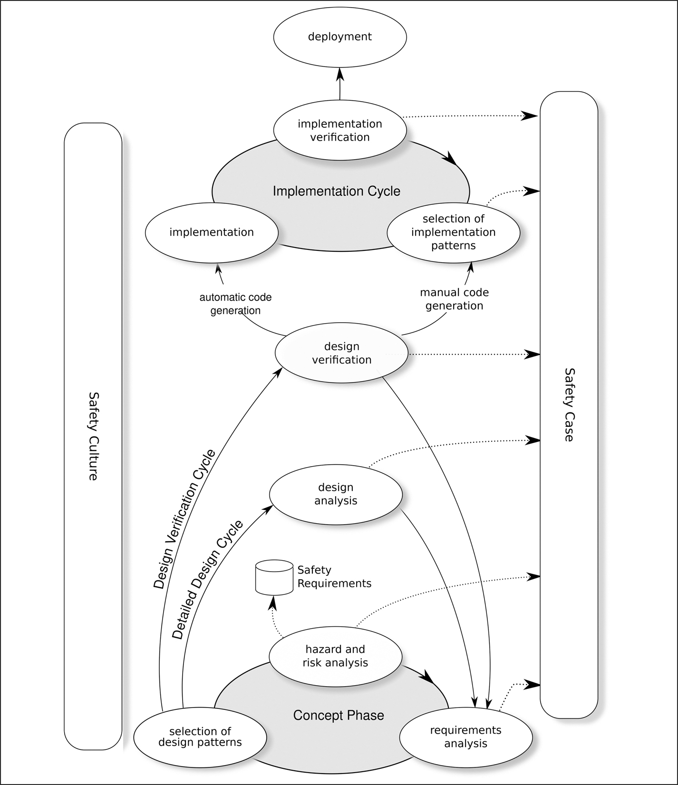

# 5 Các phương pháp phát triển

DOI: [10.1201/9781003598145-5](https://doi.org/10.1201/9781003598145-5)

## 5.1 Từ Waterfall đến eXtreme Programming

Có nhiều phương pháp phát triển, trải dài từ waterfall thuần túy (mà Bossavit dành cả một chương và một phụ lục trong tài liệu tham khảo [[1](#refbib5_1)]), qua waterfall cải tiến, design-to-schedule, spiral, theory-W, joint application development, rapid application development, timebox development, rapid prototyping, agile development với SCRUM, cho đến eXtreme programming.

Theo kinh nghiệm của tôi, spiral model của Boehm, bao gồm các invariant được mô tả trong bài báo sau này của ông (tài liệu tham khảo [[2](#refbib5_2)]), là phương pháp phát triển có khả năng cao nhất tạo ra một sản phẩm nhúng safety-critical tốt. Tuy nhiên, tôi biết rằng mỗi công ty đều có các quy trình riêng và vì vậy, xuyên suốt cuốn sách này, tôi sử dụng cách tiếp cận tổng hợp được phác thảo trong [Hình 5.1](#fig5_1). Điều thú vị cần lưu ý là EN 50716, tiêu chuẩn thay thế EN 50128, khuyến nghị các phương pháp agile (cũng như waterfall và V-model): điều mà tiêu chuẩn trước đó không đề cập. Đây có thể là một dấu hiệu cho thấy sự không phù hợp của phương pháp waterfall đang được thừa nhận.

*Hình 5.1: Cách tiếp cận được đề xuất.[⏎](#b5fig5_1)*

Các cách tiếp cận V-model và waterfall ngụ ý rằng việc kiểm chứng và kiểm thử chỉ bắt đầu sau khi việc triển khai đã hoàn tất — trái ngược hoàn toàn với kiểm thử “shift-left”. ISO 26262-2 nêu đích danh *“sự phụ thuộc nặng nề vào kiểm thử ở cuối chu kỳ phát triển sản phẩm”* như một ví dụ về văn hóa an toàn kém. [Hình 7-2](ch07_foundational_analyses.vi.md#fig7_2) trong ISO/PAS 8800 minh họa một quy trình phát triển theo mô hình V, nhưng phủ lên nó một vòng lặp để chỉ ra rằng đó không phải là một chữ V duy nhất: thay vào đó, nó là cơ sở của một cách tiếp cận lặp.

Tài liệu tham khảo [[3](#refbib5_3)] của Thor Myklebust *et al* đề cập đến câu hỏi những phần nào của quy trình agile SCRUM cần được thay đổi để nó phù hợp với việc phát triển phần mềm safety-critical: ba thực hành agile được mở rộng cho môi trường an toàn và “SafeScrum” thu được trông giống spiral model của Boehm, có thể với thời gian ngắn hơn cho mỗi vòng xoắn ốc.

IEC TS 61508-3-2 đề xuất một cách tiếp cận rất khác, dùng formal method để xác nhận tính đúng đắn của từng bước phát triển: chứng minh bằng toán học tính nhất quán của các yêu cầu, chứng minh rằng thiết kế thỏa mãn các yêu cầu (an toàn) và chứng minh rằng phần triển khai (chương trình) thỏa mãn thiết kế. Phương pháp được đề xuất là một phương pháp tinh chỉnh (refinement): thiết kế là một refinement hình thức của các yêu cầu và phần triển khai là một refinement hình thức của thiết kế.

## 5.2 Các nhiệm vụ cần thiết

Trong quá trình phát triển, một số nhiệm vụ nhất định phải được hoàn thành (mặc dù không theo tuần tự) trong khuôn khổ văn hóa an toàn của công ty phát triển.

- *Giai đoạn Concept.* Trong giai đoạn này, được thể hiện ở phần dưới cùng của [Hình 5.1](#fig5_1), các yêu cầu cho một hệ thống được phân tích và các đề xuất được đưa ra cho những thiết kế khả dĩ. Hazard and Risk analysis ([Mục 7.3](ch07_foundational_analyses.vi.md#sec7_3)) được thực hiện để nhận diện các yêu cầu an toàn của hệ thống và những yêu cầu này được phản hồi trở lại các thiết kế tiềm năng đang được xem xét.

  Người ta dự kiến rằng các yêu cầu có được vào thời điểm này là chưa đầy đủ và sẽ thay đổi khi dự án tiến triển: thường thì một khía cạnh nào đó của thiết kế khiến một yêu cầu trở nên không kinh tế hoặc thậm chí không thể đáp ứng. Nhìn chung, các yêu cầu an toàn được dự kiến sẽ ít thay đổi hơn các yêu cầu chức năng.

- *Chu kỳ thiết kế chi tiết.* Một khi đã chọn được một hoặc nhiều thiết kế ứng viên, có thể thực hiện một phân tích an toàn đầy đủ và, theo spiral model của Boehm, có thể đưa ra quyết định liệu dự án còn khả thi hay không. Nếu một failure analysis được thực hiện bằng một Markov model đơn giản ([Chương 14](ch14_markov_models.vi.md)), hoặc bằng các kỹ thuật tinh vi hơn như fault tree analysis ([Chương 15](ch15_the_fault_tree.vi.md)), thì phải biết failure rate dự đoán của phần mềm. Xác định failure rate của phần mềm là một vấn đề hóc búa mà tôi đề cập trong [Chương 16](ch16_software_failure_rates.vi.md).

- *Chu kỳ kiểm chứng thiết kế.* Khi các phần tử của thiết kế đã được chọn, thiết kế phải được kiểm chứng: nó có xử lý được mọi tình huống khả dĩ không, thiết bị có thể bị treo cứng và không tiến triển không, v.v.? Các kỹ thuật mạnh nhất ở đây là formal method ([Chương 18](ch18_formal_verification.vi.md)) và discrete event simulation ([Mục 17.2](ch17_semi_formal_verification.vi.md#sec17_2)).

- *Chu kỳ triển khai.* Một khi thiết kế đã được kiểm chứng, việc triển khai bắt đầu và phải chọn các pattern để triển khai và kiểm chứng phần triển khai của sản phẩm.

  Trong thực tế, việc triển khai thường bắt đầu trước khi thiết kế được kiểm chứng đầy đủ, có thể là để kiểm tra hiệu quả của các thuật toán được đề xuất, và việc làm prototype này được các tiêu chuẩn khuyến khích. Như [Hình 5.1](#fig5_1) minh họa, nếu có một định nghĩa hình thức của thiết kế, việc viết code có thể được tự động hóa.

Tôi đã tránh nói liệu các chu kỳ này chỉ được thực hiện một lần cho việc phát triển một thiết bị (một quy trình waterfall), hay được thực hiện cho mỗi chức năng, có lẽ lặp lại mỗi vài tuần (một quy trình agile) hoặc thậm chí hằng ngày (eXtreme programming).

Có thể lưu ý một điểm từ danh sách trên: tôi đã nhấn mạnh vào thiết kế và kiểm chứng thiết kế nhiều hơn là vào triển khai và kiểm chứng triển khai. Điều đó là có chủ ý, và trong [Chương 18](ch18_formal_verification.vi.md) tôi cố gắng biện minh cho điều này và cho khẳng định của tôi rằng các kỹ năng cần cho thiết kế và cho triển khai khác nhau đủ nhiều để khó có khả năng một người có thể làm cả hai.

Một điểm khác được [Hình 5.1](#fig5_1) nhấn mạnh là vai trò trung tâm của safety case. Mọi phân tích và quyết định được đưa ra trong dự án đều phải trở thành các phần tử của safety case như được mô tả trong [Chương 6](ch06_the_safety_case.vi.md), nơi cũng gợi ý rằng safety case nên là động lực dẫn dắt dự án chứ không phải là một artifact được tạo ra như một hoạt động “wrap-up” vào cuối dự án.

## 5.3 Các quy trình phát triển và các tiêu chuẩn

Cuốn sách này tập trung vào các khía cạnh kỹ thuật hơn là các khía cạnh thủ tục và quy trình của các tiêu chuẩn. Tuy nhiên, mỗi tiêu chuẩn mà chúng ta đang xem xét đều định nghĩa một quy trình nên được tuân theo khi tạo ra một sản phẩm software-based.

Trong tài liệu tham khảo [[4](#refbib5_4)], Martyn Thomas đưa ra một nhận xét rất sắc sảo về lý do vì sao các quy trình tốt lại quan trọng đối với một dự án:

> *Điều khiến các quy trình tốt trở nên thiết yếu là sự tin tưởng mà chúng mang lại vào output của chúng: không có các quy trình kiểm thử well-defined thì bạn không thể diễn giải kết quả kiểm thử; không có version control chặt chẽ thì bạn không thể tin tưởng rằng sản phẩm đã được kiểm thử chính là sản phẩm đã được kiểm tra, hoặc đã được tích hợp vào hệ thống. Vì vậy các quy trình chặt chẽ, có thể audit được là cần thiết nếu chúng ta muốn tin tưởng vào sản phẩm, **nhưng việc một quy trình đã được tuân theo trong quá trình phát triển một sản phẩm không cho bạn biết bất cứ điều gì về các thuộc tính của bản thân sản phẩm.*** (tôi nhấn mạnh)

Vì vậy, các quy trình chặt chẽ cần được áp dụng trong quá trình phát triển một sản phẩm, không phải vì điều đó sẽ bảo đảm rằng sản phẩm có chất lượng tốt, mà vì nếu không có chúng, chúng ta sẽ không thể xây dựng được lập luận safety case của mình.

> Ngụy biện 2 *Một quy trình tốt dẫn đến phần mềm tốt.*
>
> _________________*Đo mức độ tuân thủ một quy trình (“tài liệu thiết kế tồn tại và đã được review và phát hành trước khi bắt đầu viết code…”) thì dễ hơn đo chất lượng phần mềm. Có một giả định ngầm trong một số tiêu chuẩn, đặc biệt là IEC 62304, rằng chất lượng của quy trình là thước đo chất lượng của kết quả cuối cùng. Điều này không đúng.*

## 5.4 Confirmation Review

Ẩn trong [Hình 5.1](#fig5_1) là câu hỏi khi nào mỗi hoạt động có thể được coi là hoàn tất: các artifact được tạo ra sẽ được phê duyệt thế nào? Người phê duyệt phải có năng lực kỹ thuật, nhưng cũng phải độc lập với người tạo ra artifact. ISO 26262-2, IEC 61508-1 và ISO/PAS 8800 định nghĩa các mức độ độc lập cần thiết cho các safety integrity level và các artifact khác nhau. Ví dụ, ISO/PAS 8800 nói rằng người thực hiện cái được gọi là “confirmation review” của assurance argument (safety case), đối với các hệ thống ASIL-D, phải *“độc lập, về mặt quản lý, nguồn lực và thẩm quyền phát hành, với phòng ban chịu trách nhiệm tạo ra … work product”*. Nói cách khác, người phê duyệt một artifact không nên chịu áp lực từ vị trí của họ trong hệ thống phân cấp của công ty để đưa ra sự phê duyệt.

## Tài liệu tham khảo

[1] L. Bossavit, *The Leprechauns of Software Engineering: How Folklaw Turns into Fact and What to Do about It*. Leanpub, 2013.[⏎](#b5refbib5_1)

[2] B. Boehm and W. Hansen, “Spiral Development: Experience, Principles, and Refinements,” *Spiral Development Workshop February 9, 2000*, p. 47, 07 2000.[⏎](#b5refbib5_2)

[3] T. Myklebust, T. Stålhane, and G. Hanssen, “Use of Agile Practices when developing Safety-Critical software,” ISSC 2016, 08 2016.[⏎](#b5refbib5_3)

[4] M. Thomas, “Engineering Judgement,” in *SCS*, pp. 43–47, 2004.[⏎](#b5refbib5_4)
