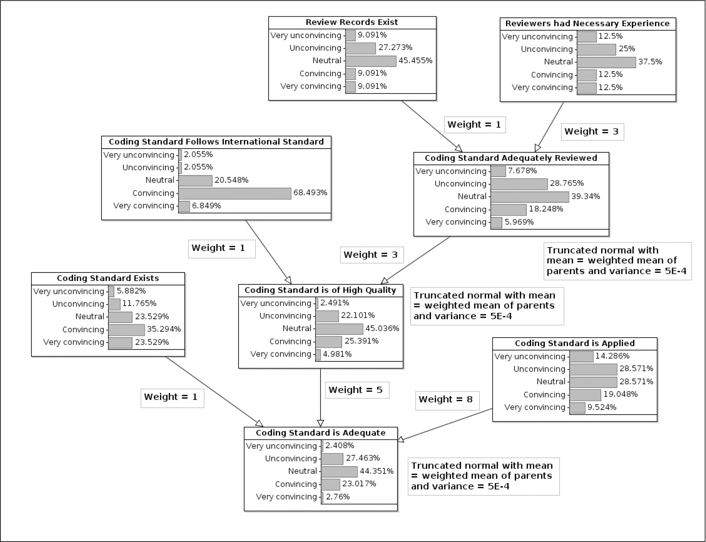
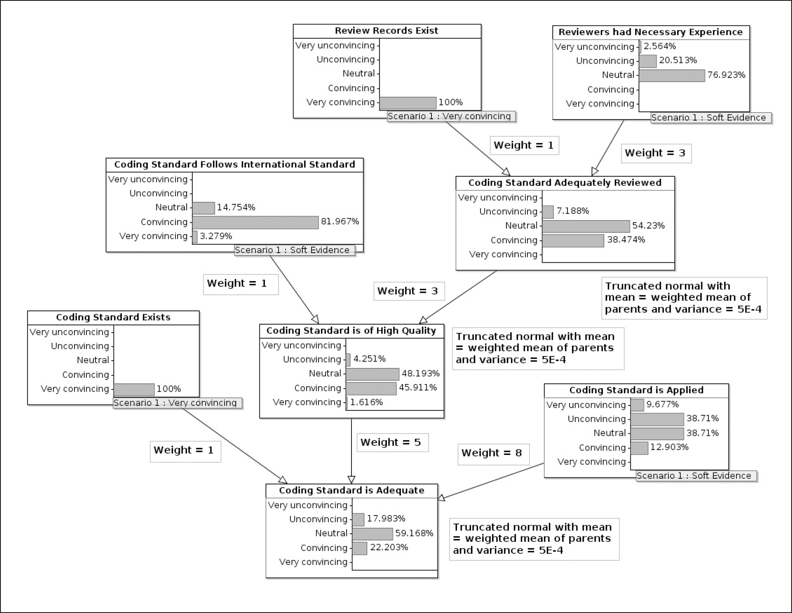
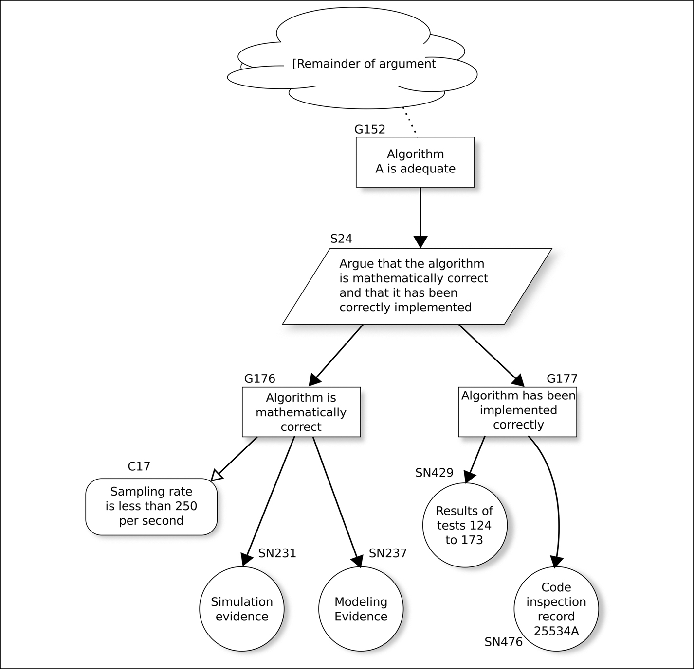
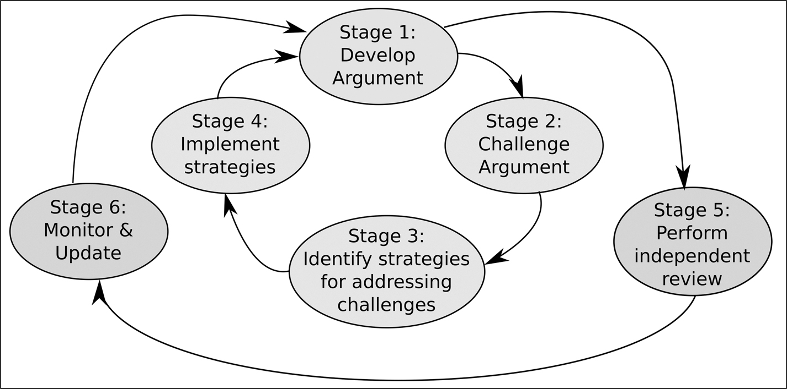

# 6 Safety case

DOI: [10.1201/9781003598145-6](https://doi.org/10.1201/9781003598145-6)

> *Nimrod Safety Case là cơ hội tốt nhất để phát hiện những khiếm khuyết thiết kế nghiêm trọng của Nimrod, vốn đã nằm im lìm trong nhiều năm. Nếu Nimrod Safety Case được soạn ra với kỹ năng, sự cẩn trọng và sự chú ý đúng mức, thì các rủi ro hỏa hoạn thảm khốc đối với phi đội Nimrod MR2 … đã được nhận diện và xử lý, và việc mất chiếc XV230 vào tháng Chín năm 2006 đã có thể tránh được.*
>
> Tài liệu tham khảo [[1](#refbib6_1)]

## 6.1 Assurance case hay safety case?

Safety case là một loại cụ thể của “assurance case” tổng quát hơn. Một assurance case có thể được chuẩn bị để biện minh cho nhiều tuyên bố khác nhau: rằng hệ thống bảo mật ở mức thỏa đáng, rằng dự án có đủ nhân sự, rằng sản phẩm đã sẵn sàng để triển khai, rằng sản phẩm an toàn ở mức thỏa đáng, v.v. Trong chương này, tôi đề cập đến safety case: lập luận để biện minh liệu sản phẩm hoặc dịch vụ có an toàn ở mức thỏa đáng hay không.

Như [Hình 5.1](ch05_development_methodologies.vi.md#fig5_1) ở trang 48 cho thấy, việc tạo ra safety case là thiết yếu. Trong các tiêu chuẩn goal-based[1](#fn6_1) hơn, như UL 4600 và ISO/PAS 8800, safety case thực sự là trọng tâm của tiêu chuẩn. Như ISO/PAS 8800 nói:

> *… ngoài việc cung cấp hướng dẫn để điều chỉnh hoặc mở rộng bộ ISO 26262 và ISO 21448, tài liệu này tập trung vào các nguyên tắc hỗ trợ việc tạo ra một **project-specific assurance argument** cho sự an toàn của các phần tử AI trong các hệ thống on-board của xe. (tôi nhấn mạnh)*

IEC 61508-1 nói rằng:

> *Để tuân thủ tiêu chuẩn này, phải chứng tỏ được rằng mọi yêu cầu liên quan đã được thỏa mãn theo các tiêu chí được yêu cầu đã chỉ định … LƯU Ý: Điều này có thể được thực hiện dưới dạng một safety case (sự biện minh) cung cấp các lập luận rõ ràng, toàn diện và có thể bảo vệ được, được hỗ trợ bởi bằng chứng, rằng mọi yêu cầu normative liên quan trong tiêu chuẩn đã được đáp ứng khi vận hành trong môi trường hoạt động dự định.*

[1](#fn6_16b)Xem [Mục 2.1.4](ch02_terminology_of_safety.vi.md#sec2_1_4) để biết sự phân biệt giữa tiêu chuẩn prescriptive và tiêu chuẩn goal-based.

## 6.2 Safety case là gì?

Định nghĩa often-quoted về safety case là nó là *“một lập luận có cấu trúc, được hỗ trợ bởi một khối bằng chứng, cung cấp một luận cứ thuyết phục, toàn diện và hợp lệ rằng một hệ thống là an toàn cho một ứng dụng nhất định trong một môi trường hoạt động nhất định.”* (từ một định nghĩa của Bộ Quốc phòng Anh, 2004).

Vì những lý do tôi đưa ra trong [Mục 6.9](#sec6_9), định nghĩa này giờ được coi là một định nghĩa không an toàn.

Trong tài liệu tham khảo [[2](#refbib6_2)], Philip Koopman và William Widen đề xuất một định nghĩa khác, dựa trên kinh nghiệm của họ khi soạn UL 4600: một safety case là *“lập luận có cấu trúc, được hỗ trợ bởi một khối bằng chứng, cung cấp một lập luận thuyết phục, dễ hiểu (comprehensible),[2](#fn6_2) và vững chắc rằng các nỗ lực kỹ thuật an toàn đã bảo đảm một hệ thống đáp ứng một tập toàn diện các ràng buộc an toàn.”*

Định nghĩa này chuyển trọng tâm khỏi bản thân hệ thống và đặt nó vào công việc kỹ thuật đã được thực hiện để kiểm chứng rằng hệ thống đáp ứng các yêu cầu an toàn của nó. Nó cũng loại bỏ cụm từ “một môi trường hoạt động nhất định,” vì, đặc biệt đối với các hệ thống tự hành, không thể định nghĩa được phạm vi các môi trường hoạt động khả dĩ.

## 6.3 Lịch sử

Không rõ ý tưởng về safety case bắt nguồn từ đâu, nhưng thuật ngữ này xuất hiện trong [mục 17.4](ch17_semi_formal_verification.vi.md#sec17_4) của báo cáo của Hon Lord Cullen về thảm họa Piper Alpha, xuất bản năm 1990. Bối cảnh là phần mô tả một Formal Safety Assessment (FSA) bao gồm một HAZOP, một đánh giá rủi ro định lượng, fault tree analysis, phân tích yếu tố con người và các audit an toàn. Section 17.11 của báo cáo Cullen định nghĩa safety case là *“một phương tiện mà nhờ đó bên vận hành chứng tỏ cho chính mình thấy sự an toàn của các hoạt động của mình.”*

## 6.4 Nội dung của safety case

Safety case bao gồm bốn phần:

[2](#fn6_26b)Tôi đã hỏi Phil liệu đây có phải là lỗi in của “comprehensive” (toàn diện) không và ông trả lời rằng ông thích cả hai thuật ngữ!

1. **Ranh giới của sản phẩm hoặc dịch vụ**

   Những gì được bao gồm và bị loại trừ trong hệ thống mà chúng ta đang đưa ra các tuyên bố? Đối với một thiết bị được lắp vào ô tô, việc cập nhật phần mềm over-the-air có được bao gồm hay không? Đối với một thiết bị trong bệnh viện, việc nó được một y tá chưa qua đào tạo sử dụng có được bao gồm hay không? Đối với bất kỳ thiết bị nào, khả năng bị sử dụng với ý đồ xấu có được bao gồm không?

   > Giai thoại 6 *Tôi từng làm việc trong nhóm chuẩn bị safety case cho một tổ chức đào tạo phi công và, không suy nghĩ nhiều, chúng tôi đã nói rõ rằng mọi hoạt động không được nhà chức trách sân bay cho phép đều nằm ngoài ranh giới đang được xem xét. Rồi sự cố được mô tả trong [giai thoại 2](ch02_terminology_of_safety.vi.md#aned2) ở trang 11 xảy ra và đã có một cuộc thảo luận dài về việc liệu những hoạt động không được phép như vậy có thể được loại trừ khỏi safety case một cách hợp lý hay không.*

2. **Tuyên bố Top-Level**

   Chúng ta đang tuyên bố điều gì về sản phẩm hoặc dịch vụ? Các ví dụ có thể là: “Chúng tôi tuyên bố rằng…
   - … sản phẩm đã được phát triển theo ISO 26262.”
   - … phân tích thuyết phục đã được thực hiện để chứng tỏ rằng sản phẩm đáp ứng các ràng buộc an toàn của nó.”
   - … sản phẩm an toàn ở mức thỏa đáng để triển khai.”

   Tuyên bố này thường được giới hạn bởi một giả định như “khi được triển khai trong môi trường đã được định nghĩa của nó” hoặc “khi được sử dụng theo Safety Manual.” Đối với các hệ thống tự hành, việc chỉ định một “môi trường đã được định nghĩa” thường đầy thách thức vì thường không thể dự đoán được mọi điều kiện mà hệ thống có khả năng gặp phải sau khi triển khai: ví dụ, xem [Hình 9.2](ch09_the_device_within_the_system.vi.md#fig9_2) ở trang 101.

3. **Lập luận**

   Điều gì thuyết phục chúng ta rằng tuyên bố được đáp ứng? Mặc dù đối với một hệ thống rất đơn giản, lập luận này có thể được viết bằng ngôn ngữ tự nhiên, đối với bất kỳ hệ thống bình thường nào, sẽ cần một ký hiệu semi-formal. Các ký hiệu được dùng phổ biến nhất là *goal structuring notation* (GSN) và *Bayesian belief network* (BBN). Chúng được mô tả trong [Phụ lục A](ch25_appendix_a_goal_structuring_notation.vi.md) và [B](ch26_appendix_b_bayesian_belief_networks.vi.md).

   Dù dùng ký hiệu nào, trước khi thu thập bằng chứng, sẽ hữu ích nếu hỏi assessor, người sẽ chứng nhận sản phẩm, rằng *“nếu tôi trình bày bằng chứng để hỗ trợ lập luận này, liệu nó có thuyết phục được ông không?”* Đây là cơ hội để assessor nói, *“Không, phần này của lập luận sẽ không thuyết phục được tôi; anh sẽ phải cung cấp thêm sự biện minh ở đây.”* Làm việc này sớm trong quá trình chuẩn bị safety case giúp tránh lãng phí thời gian thu thập và sắp xếp những bằng chứng không thuyết phục hoặc không liên quan.

4. **Bằng chứng**

   ISO 26262-10 chỉ ra rằng *“Một lập luận không có bằng chứng hỗ trợ là vô căn cứ, và do đó không thuyết phục. Bằng chứng không có lập luận thì không được giải thích.”*

   Một khi cấu trúc của lập luận đã được thống nhất, bằng chứng cho mỗi tuyên bố cơ sở (“leaf node” trong đồ thị GSN hoặc BBN) phải được xác định và làm cho có thể truy cập được. Một bằng chứng có thể là một tài liệu, một kết quả kiểm thử, một hồ sơ đào tạo, một formal model, các chứng minh định lý, hoặc bất kỳ artifact nào khác. Nếu bằng chứng ở dạng số, thì sẽ thuận tiện nếu đưa URL vào trong safety case: nhấp vào leaf node, và artifact hiện ra.

   Vì lý do được đưa ra trong [Mục 6.9](#sec6_9), UL 4600 nói rất rõ rằng bằng chứng không được thu thập cho đến khi cấu trúc lập luận đã hoàn chỉnh và được thống nhất. Nếu bằng chứng được thu thập sớm, có nguy cơ lập luận sẽ được xây dựng xoay quanh bằng chứng sẵn có, thay vì bằng chứng được dùng để hỗ trợ lập luận.

Mỗi tuyên bố con trong lập luận có lẽ sẽ có nhiều bằng chứng để hỗ trợ nó. Hãy xét tuyên bố con rằng *“Một coding standard thỏa đáng được áp dụng trong quá trình phát triển.”* Tuyên bố này có thể được chia nhỏ thành các tuyên bố con cấp dưới riêng lẻ:

*Có một coding standard hiện hành.*

Bằng chứng ở đây có thể là chính tài liệu[3](#fn6_3) định nghĩa các quy tắc viết code.

*Coding standard có chất lượng thỏa đáng.*

Bằng chứng ở đây có thể là hồ sơ các đợt review đã diễn ra khi tiêu chuẩn được đề xuất lần đầu, hồ sơ các đợt review mà sau đó nó được đưa qua để giữ cho nó cập nhật, và năng lực của những người đã review và phê duyệt nó. Nếu coding standard phù hợp với một tiêu chuẩn được công bố quốc tế (ví dụ, MISRA C) thì đó cũng sẽ là bằng chứng về chất lượng.

*Coding standard thực sự đang được các lập trình viên sử dụng.*

Bằng chứng cho điều này có thể khó tìm hơn. Có lẽ có thể phân tích một số module được lấy ngẫu nhiên; có lẽ có thể phỏng vấn các nhà phát triển, hỏi họ về coding standard; có lẽ có thể cung cấp output từ một công cụ phân tích tĩnh được thiết kế để kiểm tra các quy tắc của coding standard; có lẽ một hồ sơ về việc code của ai đó bị từ chối vì vi phạm một quy tắc của coding standard sẽ là bằng chứng hỗ trợ.

Nếu *eliminative argumentation* đang được sử dụng trong quá trình chuẩn bị safety case (xem [Mục 6.10](#sec6_10)), thì mọi cuộc phỏng vấn với các nhà phát triển nên được đặt câu hỏi theo hướng phủ định. Thay vì hỏi, *“Bạn có tuân theo coding standard khi viết code không?”,* câu hỏi tốt hơn sẽ là *“Bạn có thể nghĩ ra bất kỳ lần nào code không đáp ứng coding standard đã được check in vào code repository không?”*

[3](#fn6_36b)Tôi dùng thuật ngữ “tài liệu” để bao gồm tài liệu giấy, trang web, WIKI hoặc bất cứ thứ gì công ty dùng để kiểm soát và truyền đạt các quy trình đến các kỹ sư của mình.

Ví dụ về việc đánh giá một coding standard được phát triển thêm trong [Hình 6.1](#fig6_1) và [6.2](#fig6_2) và [Mục 6.12](#sec6_12).

*Hình 6.1: Một đoạn của lập luận safety case.[⏎](#b6fig6_1)*

*Hình 6.2: Lập luận sau khi các quan sát được đưa vào.[⏎](#b6fig6_2)*

## 6.5 Safety Performance Indicator

Safety Performance Indicator (SPI) thường được đưa vào safety case. Đây là những giá trị đo được, khá giống Key Performance Indicator (KPI) trong một dự án, cho phép giám sát sự an toàn của sản phẩm đã xuất xưởng. Ví dụ, đối với một thiết bị được lắp trong một ô tô tự lái, một SPI có thể là số lần người lái phải vô hiệu hóa thiết bị và giành lại quyền điều khiển trên mỗi kilomet xe chạy, cùng với một ngưỡng chấp nhận được có lẽ là 0,001 lần giành quyền điều khiển mỗi kilomet. Khi đó safety case nên chỉ định rằng dữ liệu này đang được thu thập và hành động cần thực hiện nếu ngưỡng định trước bị vượt qua.

## 6.6 Confidence argument

Lập luận safety case như được mô tả ở trên có thể được coi là một risk argument: liệu chúng ta đã giảm đủ các rủi ro gắn với hệ thống hay chưa? Trong tài liệu tham khảo [[3](#refbib6_3)], Linling Sun và Tim Kelly chỉ ra rằng đôi khi chúng ta có thể cần biện minh vì sao một bằng chứng cụ thể hỗ trợ một tuyên bố. Đôi khi điều đó là hiển nhiên. Nếu chúng ta tuyên bố rằng có một coding standard, thì một link tới coding standard là đủ. Nhưng nếu tuyên bố của chúng ta là nhóm phát triển đã được đào tạo thỏa đáng, thì liệu một link tới hồ sơ đào tạo có đủ không? Chúng ta có cần lập luận rằng chúng mô tả các khóa đào tạo đã diễn ra gần đây và có liên quan đến dự án hiện tại không?

Khoảng trống giữa bằng chứng và tuyên bố mà nó được cho là hỗ trợ được gọi là “assurance deficit” và một confidence argument có thể được chuẩn bị song song với risk argument để biện minh vì sao một bằng chứng cụ thể hoặc một tập các tuyên bố con hỗ trợ tuyên bố đó.

Tôi tin rằng việc đánh giá assurance deficit là một lý do để diễn đạt lập luận safety case bằng một ký hiệu định lượng, như BBN, thay vì một ký hiệu định tính như GSN. Với một ký hiệu định lượng, nhà phân tích có thể diễn đạt trực tiếp độ lớn của deficit trong lập luận.

## 6.7 Khi nào nên chuẩn bị safety case?

Theo truyền thống, việc chuẩn bị safety case được coi là một hoạt động wrapping-up vào cuối dự án. Tài liệu tham khảo [[4](#refbib6_4)] của Simon Diemert, Jeff Joyce và tôi trình bày một lập luận về lý do vì sao nó có thể và nên được thực hiện sớm hơn nhiều. Bài báo mô tả hai dự án. Trong một dự án, safety case được chuẩn bị như một hoạt động wrapping-up và việc chuẩn bị nó đã phát hiện ra một số lượng đáng kể các artifact cần thiết để biện minh cho tuyên bố top-level, nhưng chưa từng nằm trong kế hoạch dự án. Điều này có thể dẫn đến việc dự án bị trễ nghiêm trọng. Trong dự án còn lại, safety case được chuẩn bị sớm và đã xác định được rằng một số artifact đang được đưa vào kế hoạch dự án thực ra là không cần thiết, nhờ đó giảm chi phí và rủi ro trễ hạn của dự án.

Chắc chắn danh sách các bằng chứng cần thiết để thỏa mãn lập luận an toàn cung cấp một cơ sở hữu ích cho việc lập kế hoạch dự án.

## 6.8 Chúng ta tạo safety case cho ai?

Một câu hỏi quan trọng là, *“Chúng ta đang cố thuyết phục ai bằng lập luận có cấu trúc của mình?”* Khi tôi đặt câu hỏi này cho các kỹ sư đang chuẩn bị một safety case, câu trả lời knee-jerk thường là *“Chúng tôi đang chuẩn bị case cho assessor để được cấp chứng nhận. Tiêu chuẩn đòi hỏi phải có.”*

Tôi nghĩ rằng đây là câu trả lời sai. Trước khi assessor xem safety case, một số nhóm người khác cần được nó thuyết phục.

Nhóm đầu tiên là chính các tác giả của safety case. Nếu họ không thực sự tin vào lập luận, thì họ không nên đưa nó ra. Như tài liệu tham khảo [[5](#refbib6_5)] viết, *“Rõ ràng đạo đức nghề nghiệp đòi hỏi các assurance stakeholder phải trình bày những lập luận mà họ tin là đúng, hợp lệ và có liên quan.”*

Nhóm thứ hai là toàn bộ đội ngũ làm việc trên việc phát triển hệ thống. Nếu các nhà phát triển không tin vào sự an toàn của sản phẩm họ đang chế tạo, thì văn hóa an toàn được mô tả trong [Mục 2.1.2](ch02_terminology_of_safety.vi.md#sec2_1_2) không tồn tại trong công ty.

Nhóm thứ ba là ban quản lý và các giám đốc điều hành của công ty tạo ra sản phẩm. Như đã thấy trong nhiều đợt thu hồi sản phẩm vì lo ngại về an toàn, danh tiếng của một công ty có thể rất mong manh. Xuất xưởng một sản phẩm gây hại cho con người là tốn kém cả về đạo đức lẫn tài chính.

Nhóm thứ tư là các khách hàng tiềm năng. Thiết bị đang được phát triển có lẽ sẽ được bán và người mua cần được thuyết phục rằng họ không tự đặt mình vào trách nhiệm pháp lý, cùng với chi phí thu hồi và tiếng xấu đi kèm. Các tiêu chuẩn nói rõ rằng, khi một công ty mua một thành phần, nó trở nên chịu trách nhiệm pháp lý về mọi thiệt hại do thành phần đó gây ra.

Nếu bốn nhóm này hài lòng với cấu trúc của lập luận safety case và bằng chứng được trình bày trong đó, thì việc thuyết phục một assessor bên ngoài từ công ty chứng nhận sẽ dễ dàng.

Tôi nhận ra rằng đây là một lời khuyên lý tưởng hóa khó có thể đạt được đầy đủ trong bất kỳ tổ chức nào, nhưng đó là một mục tiêu mà chúng ta nên phấn đấu hướng tới. Định nghĩa safety case trong báo cáo Piper Alpha (xem [Mục 6.3](#sec6_3)) thật thú vị: “một phương tiện mà nhờ đó bên vận hành chứng tỏ *cho chính mình* thấy sự an toàn của các hoạt động của mình.” Lưu ý rằng đối tượng hướng tới là chính bên vận hành, chứ không phải bất kỳ assessor bên ngoài nào.

## 6.9 Một vấn đề nghiêm trọng với safety case

Có một vấn đề cơ bản khi tạo ra một safety case: confirmation bias (thiên kiến xác nhận). Confirmation bias, còn được gọi là *myside bias,* là xu hướng tìm kiếm hoặc diễn giải thông tin theo cách xác nhận những niềm tin sẵn có của mình.

Nancy Leveson đã chỉ ra trong tài liệu tham khảo [[6](#refbib6_6)] rằng:

> *Con người sẽ tập trung vào và diễn giải bằng chứng theo cách xác nhận mục tiêu mà họ đã đặt ra cho mình. Nếu mục tiêu là chứng minh hệ thống an toàn, họ sẽ tập trung vào những bằng chứng cho thấy nó an toàn và tạo ra một lập luận cho sự an toàn. Nếu mục tiêu là chứng tỏ hệ thống không an toàn, bằng chứng được sử dụng và cách diễn giải bằng chứng sẵn có sẽ rất khác. Con người cũng có xu hướng diễn giải bằng chứng mơ hồ là ủng hộ quan điểm sẵn có của mình.*

Một ví dụ nổi bật về việc thái độ này có thể chiếm ưu thế ra sao được làm rõ trong *Nimrod Review* (tài liệu tham khảo [[1](#refbib6_1)]) do Sir Charles Haddon-Cave QC soạn ra, khi điều tra vụ rơi một máy bay Nimrod năm 2006:

> *… Nimrod safety case là một công việc đáng buồn từ đầu đến cuối. … Việc tạo ra nó là một câu chuyện về sự bất tài, sự tự mãn và sự hoài nghi.*
>
> *Quy trình Nimrod Safety Case đã bị phá hoại nghiêm trọng bởi một tình trạng uể oải chung: một giả định phổ biến của những người liên quan rằng Nimrod ‘dù sao cũng an toàn’ [vì nó đã bay thành công trong 30 năm] và nhiệm vụ soạn Safety Case về cơ bản đã trở thành một bài tập giấy tờ và ‘đánh dấu ô’ (tickbox).*

Khi chuẩn bị safety case, chúng ta nên ý thức về confirmation bias của mình và bảo đảm rằng việc tạo ra safety case là một phần không thể tách rời của dự án phát triển, chứ không phải một thứ add-on.

> Giai thoại 7[⏎](#b6aned7) *Khi giảng dạy về safety case, tôi thường dùng một thí nghiệm tôi học được từ tài liệu tham khảo [[7](#refbib6_7)] của Rolf Dobelli, dựa trên nghiên cứu của Peter Wason. Tôi viết các số 2, 4, 6, 8, 10 lên bảng trắng và yêu cầu người tham gia suy ra quy tắc đằng sau dãy số bằng cách đề xuất số tiếp theo, số này tôi sẽ thêm vào danh sách nếu nó thỏa mãn quy tắc (ẩn).*
>
> *Chắc chắn sẽ có người đề xuất 12, và tôi nói rằng số đó phù hợp với quy tắc và thêm nó vào dãy. Sau đó có người đề xuất 14 và số đó cũng được thêm vào. Sau một lúc, với số mới nhất trên bảng có lẽ là 26, ai đó, có thể là để đùa, có thể đề xuất 153. Và tôi viết số đó lên. Sau một vài đề xuất nữa, cả lớp nhận ra rằng quy tắc là “số tiếp theo phải lớn hơn số trước đó” chứ không phải “số tiếp theo bằng số trước đó cộng hai.”*
>
> *Các đề xuất 12, 14, 16, v.v., vốn chỉ đơn giản xác nhận những gì mọi người đã tin, đã khơi ra ít thông tin hơn nhiều so với những đề xuất, như 153, đi ngược lại điều mà mọi người thường tin.*
>
> *Điều tương tự cũng đúng khi chuẩn bị các lập luận safety case. Chúng ta tìm bằng chứng để xác nhận niềm tin pre-existing rằng hệ thống an toàn, hay chúng ta chủ động tìm bằng chứng đi ngược lại niềm tin của mình? Cách thứ hai cung cấp thông tin hữu ích hơn.*

Chính nhu cầu tránh confirmation bias đã khiến định nghĩa safety case của Bộ Quốc phòng trong [Mục 6.2](#sec6_2) trở nên nguy hiểm: nếu chúng ta yêu cầu các kỹ sư tạo ra một lập luận để chứng tỏ rằng hệ thống an toàn, thì, như trong [Giai thoại 7](#aned7), họ sẽ chỉ tìm kiếm lập luận và bằng chứng cho thấy nó an toàn, bỏ qua những bằng chứng trái ngược.

Trong tài liệu tham khảo [[8](#refbib6_8)], Sidney Dekker gợi ý rằng một cách tốt hơn để tạo ra một safety case là yêu cầu các nhà phát triển chứng tỏ rằng hệ thống *không an toàn* — với hy vọng rằng họ sẽ thất bại. Điều này gần với ý tưởng eliminative argumentation; xem mục tiếp theo.

## 6.10 Thêm sự nghi ngờ vào safety case

Thêm sự nghi ngờ vào safety case có thể giúp loại bỏ confirmation bias. Khái niệm được gọi là Eliminative Argumentation (còn được gọi là Eliminative Induction) được John Goodenough *et al.* giới thiệu trong tài liệu tham khảo [[9](#refbib6_9)]. Nó được gọi là “dialectic argumentation” trong tiêu chuẩn GSN (tài liệu tham khảo [[10](#refbib6_10)]).

Tôi thấy nó rất hiệu quả trong việc củng cố một safety case. Trong một trường hợp, tôi đã giúp áp dụng nó cho safety case của một sản phẩm mà các phiên bản trước đó đã qua nhiều lần chứng nhận theo IEC 61508 và ISO 26262. Sử dụng eliminative induction, chúng tôi đã tìm ra hơn 20 vấn đề an toàn tiềm tàng chưa được phát hiện trong các safety case trước đó: xem tài liệu tham khảo [[11](#refbib6_11)].

Ý tưởng cơ bản của eliminative argumentation là đảo ngược lập luận của một safety case để confirmation bias được tận dụng làm lợi thế. Thay vì hỏi mọi người *“vì sao hệ thống này an toàn?”,* chúng ta hỏi, *“vì sao hệ thống này có thể không an toàn?”* Những nghi ngờ được câu hỏi sau nêu ra sau đó cần được xử lý.

Eliminative argumentation đưa thêm các ký hiệu vào GSN để xử lý ba loại nghi ngờ (được gọi là “defeater” vì chúng được dùng để đánh bại lập luận):

1. **Rebutting Defeater.** Loại này tấn công trực tiếp các tuyên bố, có lẽ bằng cách đưa ra một phản ví dụ. Ví dụ, trong lập luận ở [Hình 6.3](#fig6_3), nếu chúng ta có thể tìm ra bất kỳ tình huống nào mà thuật toán không đúng (ví dụ, nó giả định interrupt 4 luôn xảy ra trước interrupt 7), thì chúng ta đã bác bỏ tuyên bố G176.
2. **Undermining Defeater.** Loại này tấn công bằng chứng thay vì tuyên bố. Ví dụ, trong [Hình 6.3](#fig6_3), bằng chứng mô phỏng trong SN231 có thể không thuyết phục vì mô phỏng chạy trong thời gian quá ngắn.
3. **Undercutting Defeater.** Loại này tấn công mối liên kết giữa tuyên bố và bằng chứng. Ví dụ, trong [Hình 6.3](#fig6_3), có thể hồ sơ kiểm tra code (SN476) được phê duyệt đúng cách, nhưng nó lại đề cập đến một phiên bản trước đó của thuật toán: cả tuyên bố lẫn bằng chứng đều đúng, nhưng bằng chứng không hỗ trợ tuyên bố.

*Hình 6.3: Mẫu một lập luận GSN.[⏎](#b6fig6_3)*

Cách tiếp cận nhận diện defeater cho phép các thành viên trong nhóm bày tỏ sự lo lắng về điều gì đó họ để ý thấy trong quá trình phát triển. Điều này khuyến khích thái độ đặt câu hỏi và báo cáo cần có cho một văn hóa an toàn tốt ([Mục 2.1.2](ch02_terminology_of_safety.vi.md#sec2_1_2)). Chỉ cần đổi một câu hỏi từ *“Hệ thống này đã sẵn sàng phát hành chưa?”* thành *“Bạn có thể nghĩ ra lý do nào khiến hệ thống này chưa sẵn sàng phát hành không?”* là đã cho phép một kỹ sư bày tỏ mối lo ngại theo cách mang tính xây dựng.

Tôi cũng thấy rằng việc dùng hình thức đặt câu hỏi này có thể nâng cao tinh thần trong nhóm phát triển. Trong nhiều lần khi tôi hỏi một câu hỏi phủ định như vậy, người kỹ sư sau đó đã nói *“Tôi đã có nỗi lo đó trong đầu từ lâu rồi và chưa bao giờ có cơ hội nói ra trước đây. Tôi mừng là anh đã cho tôi cơ hội.”*

Với điều này, [Hình 6.4](#fig6_4) (phỏng theo tài liệu tham khảo [[12](#refbib6_12)] của Richard Hawkinsʉ) mô tả các hoạt động cần thiết để tạo ra một safety case tốt:

*Hình 6.4: Tạo ra một safety case (phỏng theo tài liệu tham khảo [[12](#refbib6_12)]).[⏎](#b6fig6_4)*

Giai đoạn 1: chuẩn bị tuyên bố, lập luận và bằng chứng của safety case.

Giai đoạn 2: khuyến khích mọi người liên quan tìm ra các lỗ hổng trong lập luận.

Giai đoạn 3: xác định cách xử lý những lỗ hổng đó.

Giai đoạn 4: hiện thực các chiến lược đó và lặp lại từ Giai đoạn 1 cho đến khi không tìm thấy thêm lỗ hổng nào.

Giai đoạn 5: đưa safety case qua review và phê duyệt độc lập. Lặp lại từ Giai đoạn 1 khi cần.

Giai đoạn 6: liên tục giám sát hệ thống trong suốt quá trình phát triển và vận hành, và cập nhật safety case từ Giai đoạn 1 bất cứ khi nào cần.

## 6.11 Các ký hiệu safety case

Đối với tất cả trừ những hệ thống đơn giản nhất, cần có một dạng ký hiệu semi-formal nào đó để diễn đạt lập luận của safety case. Có ba ký hiệu phổ biến:

1. Goal Structuring Notation (GSN).

   Đây là một ký hiệu đã được tiêu chuẩn hóa, được định nghĩa trong tài liệu tham khảo [[10](#refbib6_10)]. Nó cố ý mang tính định tính: không thể thêm một mức độ tin tưởng dạng số vào một tuyên bố hay một bằng chứng. GSN được mô tả thêm trong [Phụ lục A](ch25_appendix_a_goal_structuring_notation.vi.md).

2. Bayesian Belief Network (BBN).

   Ký hiệu này chưa được tiêu chuẩn hóa, nhưng nhiều công cụ thương mại (ví dụ, Socrates của Critical Systems Labs) hỗ trợ việc thêm thông tin Bayes vào một lập luận được diễn đạt bằng GSN. Như được giải thích trong [Phụ lục B](ch26_appendix_b_bayesian_belief_networks.vi.md), thông tin bổ sung này cho phép người dùng diễn đạt các mức độ tin tưởng vào các bằng chứng hoặc các tuyên bố con và khiến lập luận trở nên định lượng.

3. Structured Assurance Case Metamodel (SACM).

   Bản thân đây không phải là một cấu trúc lập luận, mà là một mô hình (dùng ký hiệu UML) về cách một lập luận có thể được diễn đạt. Tiêu chuẩn GSN (tài liệu tham khảo [[10](#refbib6_10)]) có một mục mô tả cách nó tương thích với SACM. Một ưu điểm của định dạng SACM-compliant là SACM định nghĩa một định dạng trao đổi XML-based, để một safety case có thể được chia sẻ với một tổ chức khác (ví dụ, một khách hàng) theo một định dạng chuẩn.

## 6.12 Ví dụ về safety case

Hãy xem [Hình 6.1](#fig6_1) ở trang 56. Hình này minh họa, bằng ký hiệu BBN, một phần rất nhỏ của một lập luận safety case, hỗ trợ tuyên bố con rằng “Coding Standard is Adequate” (coding standard là thỏa đáng) – cùng ví dụ đã được dùng ở trang 55.

[Hình 6.1](#fig6_1) lập luận rằng nếu coding standard thực sự tồn tại, nếu nó có chất lượng cao, và nếu các lập trình viên thực sự áp dụng nó trong công việc, thì coding standard là thỏa đáng. [Hình 6.1](#fig6_1) dùng ký hiệu BBN, và vì vậy nhà phân tích có thể chỉ ra rằng ba điều kiện này không quan trọng ngang nhau: sự tồn tại của coding standard kém quan trọng hơn nhiều (có trọng số 1) so với việc nó có đang được các lập trình viên áp dụng hay không (trọng số 8).

Tuyên bố rằng tiêu chuẩn có chất lượng cao được đưa ra bằng cách lập luận rằng nó tuân theo một tiêu chuẩn quốc tế (ví dụ, MISRA C) và rằng nó đã được những người đủ năng lực review thỏa đáng.

Có nhiều cách để diễn đạt mức độ tin tưởng vào một tuyên bố, và trong [Hình 6.1](#fig6_1), nhà phân tích đã quyết định dùng một thang rời rạc với năm mức: Very Convincing, Convincing, Neutral, Unconvincing và Very Unconvincing. Tài liệu tham khảo [[13](#refbib6_13)] đưa ra một số ví dụ mà các chuyên gia thấy dễ áp dụng một hàm liên tục hơn là một hàm rời rạc. Các mức trong [Hình 6.1](#fig6_1) là các xác suất tiên nghiệm (prior): các giá trị mà nhà phân tích dự kiến sẽ thấy dựa trên kinh nghiệm với các dự án khác trong công ty phát triển hoặc, trong trường hợp của một assessor, dựa trên kinh nghiệm qua nhiều công ty.[4](#fn6_4)

[Hình 6.2](#fig6_2) minh họa các xác suất *hậu nghiệm* (a posteriori) một khi nhà phân tích đã nghiên cứu dự án thực tế. Có thể thấy rằng bản thân coding standard có tồn tại: nhà phân tích thấy bằng chứng cho tuyên bố đó thuyết phục 100% — có lẽ vì nó đã được đưa cho cô ấy xem. Tuy nhiên, cô ấy kém tin tưởng hơn vào tuyên bố rằng tiêu chuẩn đang được các lập trình viên áp dụng trong công việc day-to-day; cô thấy bằng chứng đó phần lớn không thuyết phục. Đây là một thước đo của assurance deficit được mô tả ở trang 58. Cô ấy cũng tin chắc 100% rằng coding standard đã được review, nhưng kém tin tưởng hơn rằng những người review là đủ năng lực.

Khi phép tính đã được thực hiện, mạng cung cấp một giá trị có trọng số cho biết bằng chứng thuyết phục đến mức nào đối với tuyên bố con chính rằng coding standard là thỏa đáng. Trong một lập luận safety case thực, giá trị này sẽ được đưa vào như một giá trị trong lập luận lớn hơn, và mỗi leaf node (tức là các node không có mũi tên đi vào) sẽ được gắn với một bằng chứng. Một trong những ưu điểm của mạng Bayes là bằng chứng và ước lượng độ tin cậy đi kèm của nó cũng có thể được thêm vào các node non-leaf. Khi đó mức độ tin cậy sẽ được truyền cả ngược lẫn xuôi như được mô tả trong [Phụ lục B](ch26_appendix_b_bayesian_belief_networks.vi.md).

Sẽ luôn có một yếu tố phán đoán chủ quan của nhà phân tích trong công việc này và tài liệu tham khảo [[14](#refbib6_14)] của Bev Littlewood *et al.* đưa ra một số nhận xét thú vị về ảnh hưởng của việc tham gia tạo ra một safety case đối với các nhà phân tích và các chuyên gia lĩnh vực:

> *Lý tưởng nhất, ngôn ngữ BBN cho phép các chuyên gia diễn đạt niềm tin của họ về một bài toán phức tạp trong một khuôn khổ xác suất hình thức. Trong thực tế, chúng tôi dự kiến cả việc các chuyên gia có thể thấy BBN họ tạo ra là chưa thỏa đáng lẫn việc chính quá trình xây dựng và kiểm định nó có thể làm thay đổi những niềm tin này. … [Các chuyên gia] cần thấy nhiều hàm ý (non-obvious) khác nhau của mô hình để quyết định xem có hàm ý nào trong số đó đi ngược lại trực giác của họ hay không.*

Đây là những tác động tích cực, ngụ ý rằng việc tạo ra một safety case dựa trên BBN không chỉ cho phép các chuyên gia lĩnh vực bày tỏ ý kiến của mình, mà còn phơi bày những điểm không nhất quán giữa các chuyên gia và thậm chí giữa những quan điểm mâu thuẫn mà một chuyên gia nắm giữ.

> Giai thoại 8 *Một prescriptive standard, như IEC 61508 (hoặc, ở mức độ thấp hơn, ISO 26262), đặt ra những gì cần làm để đạt được sự tuân thủ. Điều này được phản ánh trong các checklist, như checklist do The CASS Scheme Ltd. cung cấp, được một số assessor dùng khi thực hiện chứng nhận IEC 61508:2010.*
>
> *Tôi đã đề xuất rằng sẽ tốt hơn nếu công bố một BBN chuẩn thay vì một checklist. Một checklist là nhị phân — mục đó được bao quát hoặc không — trong khi một BBN cho phép ghi lại một mức độ tin tưởng. Dữ liệu đã ẩn danh hóa từ các BBN sau đó có thể được phản hồi lại để cải thiện các prior.*
>
> *Cho đến nay, các tổ chức tiêu chuẩn và các công ty liên quan chưa hề tỏ ra hào hứng với ý tưởng này.*

[4](#fn6_46b)Thuật ngữ “prior” được giải thích đầy đủ hơn trong [Phụ lục B](ch26_appendix_b_bayesian_belief_networks.vi.md).

## 6.13 Định lượng hay không?

Một khác biệt lớn giữa cách biểu diễn lập luận bằng BBN và bằng GSN là cách biểu diễn GSN không được định lượng. Điều này khiến việc cân đo giá trị của các phần khác nhau trong lập luận và định lượng “assurance deficit” trở nên khó khăn: *“Lập luận con A và B đều được dùng để lập luận rằng X đúng, nhưng chúng tôi dựa vào A nhiều hơn hẳn so với B.”* Một BBN cho phép chúng ta diễn đạt chúng ta dựa vào A nhiều hơn *bao nhiêu*.

Việc thiếu định lượng cũng khiến không thể thực hiện một phân tích độ nhạy (sensitivity analysis) để xác định nơi đáng dành thêm thời gian củng cố một bằng chứng cụ thể nhằm cải thiện độ tin tưởng tổng thể vào lập luận. [Hình 6.2](#fig6_2) chỉ ra rõ ràng rằng sẽ đáng để dành một chút thời gian bảo đảm rằng các lập trình viên thực sự để ý đến coding standard.

Lời phản bác là việc dùng một ký hiệu định lượng, như BBN, dẫn đến sự tự tin thái quá vào những thứ mà xét cho cùng là những giá trị không thể gán một cách chính xác. Rất dễ để ba câu “Chúng tôi tin khoảng 75%” biến thành “Độ tin tưởng tổng thể là 88,4375762%” — có thể đúng về mặt toán học nhưng với một độ chính xác hoàn toàn gây hiểu lầm.

## 6.14 Lập luận “đồ giặt bẩn” (Dirty Laundry)

Một điểm khác đôi khi được nêu ra để chống lại định dạng lập luận BBN là lập luận “dirty laundry” (vạch áo cho người xem lưng). Một safety case BBN phơi bày không thương tiếc những điểm yếu của một công ty. Nếu một assessor bên ngoài muốn tìm một điểm yếu để thăm dò, BBN cung cấp nó ở một dạng rất dễ tiếp cận. [Hình 6.2](#fig6_2) cho thấy rõ rằng chúng ta không tin chắc rằng các lập trình viên thực sự đang dùng coding standard. Đây có phải là thông tin chúng ta muốn phơi bày cho assessor không?

Những câu trả lời đầu tiên cho câu hỏi đó đến từ phần thảo luận về văn hóa an toàn của một công ty trong [Mục 2.1.2](ch02_terminology_of_safety.vi.md#sec2_1_2) và việc xác định đối tượng hướng tới của safety case trong [Mục 6.8](#sec6_8). Assessor đứng ở vị trí thứ năm trong danh sách các đối tượng hướng tới. Khi được dùng trong một văn hóa an toàn vững mạnh, mục đích của safety case là để tổ chức phát triển tự thăm dò điểm yếu của chính mình, chứ không phải để thuyết phục một assessor bên ngoài về một lập luận đáng ngờ. Một assessor giàu kinh nghiệm sẽ không bao giờ mong đợi thiết kế, hiện thực và kiểm chứng của một sản phẩm là hoàn hảo, và không có lập luận nào như vậy là thuyết phục. Điều mà BBN cho phép chúng ta làm là nhận diện điểm yếu từ trước và quyết định liệu chúng có cần được củng cố để tạo ra một sản phẩm đủ an toàn hay không.

Tuy nhiên, tôi từng biết một assessor thiếu kinh nghiệm dùng sự định lượng này để chống lại nhà phân tích: *“Tại sao anh không tin tưởng 100% vào bằng chứng này? Nó có vấn đề gì?”* Với những assessor như vậy, có thể hữu ích nếu giữ cấu trúc của BBN, nhưng bỏ đi phần định lượng.

## 6.15 Security case và safety case

Đã có nhiều nỗ lực hoặc đưa các khía cạnh bảo mật vào một safety case, hoặc kết hợp safety case và security case của hệ thống trong một phân tích duy nhất. Tài liệu tham khảo [[15](#refbib6_15)] của Jason Jaskolka mô tả một ví dụ, lấy từ ngành đo đếm điện, về một security and resilience case kết hợp. Jaskolka tóm tắt một trong những khó khăn khi kết hợp an toàn và bảo mật như sau:

> *… chúng ta không được quên khác biệt then chốt giữa việc lập luận về an toàn và lập luận về bảo mật, ở chỗ bảo mật liên quan đến sự hiện diện của một đối thủ thông minh. Việc có một đối thủ thông minh ngụ ý rằng các mối đe dọa bảo mật sẽ tiến hóa …*

Trong tài liệu tham khảo [[16](#refbib6_16)], Peter Bernard Ladkin hình dung đối thủ thông minh đó và đặt câu hỏi liệu sự tương tác giữa công ty vận hành một hệ thống safety-critical và một kẻ tấn công độc hại có thể được mô hình hóa như một dạng lý thuyết trò chơi hay không. Thực ra đây là một dạng lý thuyết meta-game, vì mỗi bên có thể chọn trò chơi nào để chơi. Ông tin rằng cách tiếp cận này phù hợp hơn nhiều cho việc đánh giá các mối đe dọa bảo mật so với các cách tiếp cận hazard và rủi ro được mô tả trong các tiêu chuẩn an toàn.

Tài liệu tham khảo [[17](#refbib6_17)] của Rob Alexander *et al.* đưa ra một nhận định rất sâu sắc về những khác biệt lý thuyết giữa bảo mật và an toàn:

> *… rất nhiều nỗ lực trong an toàn hệ thống truyền thống đã được dồn vào việc gán xác suất cho các sự kiện cơ bản và tính toán xác suất của các tai nạn bắt nguồn từ tổ hợp các sự kiện đó. Việc gán xác suất cho hành động của những đối thủ thông minh không xác định [vốn là trọng tâm của bảo mật] là đáng ngờ — sự bất định của chúng ta ở đó mang tính epistemic (do thiếu kiến thức) chứ không phải aleatory (do ngẫu nhiên).*

Tuy nhiên, bài báo tiếp tục chỉ ra rằng các lỗi thiết kế giờ đã nhiều hơn các failure ngẫu nhiên trong phân tích an toàn, và vì vậy phân tích an toàn ngày càng phải xử lý các loại vấn đề epistemic vốn là trọng tâm của bảo mật. Điều này đặc biệt đúng với các accidental system (trang 20) và là một nền tảng khác của SOTIF ([Mục 2.1.3](ch02_terminology_of_safety.vi.md#sec2_1_3)).

Theo thuật ngữ được giới thiệu ở trang 17, một lỗ hổng bảo mật là một fault không dẫn đến error cho đến khi nó bị phát hiện, và khi đó xác suất xảy ra error lập tức thay đổi từ không thành một giá trị gần bằng một. Điều này khác với hành vi của một Heisenbug, nơi xác suất xảy ra error lớn hơn không, nhưng giữ nguyên không đổi.

Đây là một lĩnh vực đang có rất nhiều nghiên cứu; tiêu chuẩn ISO/SAE 21434: “Road vehicles – Cybersecurity engineering” đã được phát hành năm 2021.

## 6.16 Safety case hồi tố (Retrospective)

[Mục 6.7](#sec6_7) ở trên lập luận rằng thời điểm tốt nhất để tạo ra safety case là gần đầu dự án. Tuy nhiên, đôi khi cần phải tạo một safety case cho một sản phẩm đã tồn tại và chưa có safety case nào được tạo ra trong quá trình phát triển. Một ưu điểm của việc phát triển hồi tố là đã có lịch sử ngoài thực địa và có thể dựa một phần safety case vào các giá trị proven-in-use (PIU): *“Hệ thống đã chứng tỏ t giờ sử dụng ngoài thực địa với n failure đã xảy ra; do đó chúng tôi lập luận rằng hệ thống đáp ứng mức safety integrity Y.”*

Toàn bộ một safety case không bao giờ có thể được xây dựng chỉ từ PIU,[5](#fn6_5) nhưng dữ liệu PIU có thể hỗ trợ một sub-argument mạnh mẽ miễn là có thể chứng tỏ đủ lịch sử.

## 6.17 Tương lai của safety case

Nhiều nghiên cứu hiện nay tập trung vào hướng mà safety case cần chuyển dịch. Ví dụ, tài liệu tham khảo [[18](#refbib6_18)] của Jane Fenn *et al.* nhấn mạnh rằng các safety case hiện nay tập trung vào thiết kế hệ thống, chứ không phải vào việc vận hành hệ thống ngoài thực địa.

Trong bài báo đó, Jane mở rộng safety case do Critical Systems Labs soạn cho Large Hadron Collider của CERN để bao gồm một lập luận vận hành. Safety case tiêu chuẩn có tuyên bố con rằng hệ thống energy-tracking giám sát đúng các điện áp output và kích hoạt nếu chúng vượt ra ngoài phạm vi. Điều đó liên quan đến thiết kế hệ thống.

Phần mở rộng của Jane cung cấp một lập luận vận hành rằng hệ thống energy-tracking được giám sát và bảo trì thỏa đáng. Điều đó liên quan đến việc vận hành hệ thống.

[5](#fn6_56b)Như Terry Pratchett nói, “Việc đơn thuần tích lũy bằng chứng quan sát không phải là chứng minh.”

## Tài liệu tham khảo

[1] C. Haddon-Cave, *The Nimrod Review*. UK Government, 2009. [https://www.gov.uk/government/publications/the-nimrod-review](https://www.gov.uk/government/publications/the-nimrod-review).[⏎](#b6refbib6_1)

[2] P. Koopman and W. Widen, “Redefining Safety for Autonomous Vehicles,” in *SafeComp 2024*, 2024.[⏎](#b6refbib6_2)

[3] L. Sun and T. Kelly, “Elaborating the Concept of Evidence in Safety Cases,” in *Proceedings of the 21st Safety-Critical Systems Symposium*, pp. 111–127, Safety-Critical Systems Club, 2013.[⏎](#b6refbib6_3)

[4] C. Hobbs, S. Diemert, and J. Joyce, “Driving the Development Process from the Safety Case,” in *2024 Safety Critical Systems Symposium*, SSS ‘24, (Bristol, UK), Safety-Critical Systems Club, 2024.[⏎](#b6refbib6_4)

[5] “Structured Assurance Case Metamodel (SACM),” Technical Report formal/2018-02-02, Object Management Group, 2018.[⏎](#b6refbib6_5)[⏎](#b6refbib6_5)

[6] N. Leveson, “White Paper on the Use of Safety Cases in Certification and Regulation,” 2011.[⏎](#b6refbib6_6)

[7] R. Dobelli, *Die Kunst des klaren Denkens*. München: Deutscher Taschenbuch Verlag GmbH, 2011.[⏎](#b6refbib6_7)

[8] S. Dekker, *The Field Guide to Understanding Human Error*. Ashgate, Aldershot, Hants., rev. ed., 2006.[⏎](#b6refbib6_8)

[9] J. Goodenough, C. Weinstock, and A. Klein, “*Eliminative Argumentation: A Basis for Arguing Confidence in System Properties*,” Tech. Rep. CMU/SEI-2015-TR-005, Carnegie Mellon University, 2015.[⏎](#b6refbib6_9)

[10] SCSC, “*GSN Community Standard*,” Tech. Rep. SCSC-141C, Safety-Critical Systems Club, 2021. [https://scsc.uk/r141C](https://scsc.uk/r141C).[⏎](#b6refbib6_10)

[11] C. Hobbs, “Verbesserung des Sicherheitsnachweises durch Induktion,” in *Proceedings of ESE Kongress 2018*, 2018.[⏎](#b6refbib6_11)

[12] R. D. Hawkins, “Developing Compelling Safety Cases,” *arXiv:2502.00911v1*, February 2025.[⏎](#b6refbib6_12)

[13] M. K. Cowles, *Applied Bayesian Statistics*. New York: Springer, 2013.[⏎](#b6refbib6_13)

[14] B. Littlewood, L. Strigini, D. Wright, and P.-J. Courtois, “Examination of Bayesian Belief Network for Safety Assessment of Nuclear Computer-based Systems,” *DeVa ESPRIT Long Term Research Project* *No.* *20072*, vol. 70, 1998.[⏎](#b6refbib6_14)

[15] J. Jaskolka, “Challenges in Assuring Security and Resilience of Advanced Metering Infrastructure,” in *IEEE Electrical Power and Energy Conference*, IEEE EPEC, 2018.[⏎](#b6refbib6_15)

[16] P. B. Ladkin, “Risks People Take and Games People Play,” in *2015 Safety Critical Systems Symposium*, SSS ‘15, Safety-Critical Systems Club, 2015.[⏎](#b6refbib6_16)

[17] R. Alexander, R. Hawkins, and T. Kelly, “From Safety Cases to Security Cases,” in *2017 Safety Critical Systems Symposium*, SSS ‘17, (Bristol, UK), Safety-Critical Systems Club, 2017.[⏎](#b6refbib6_17)

[18] J. Fenn, R. D. Hawkins, and M. Nicholson, “Practical Examples of a New Approach to Creating Clear Operational Safety Cases,” *Safety Critical Systems Symposium (SSS ‘25)*, February 2025.[⏎](#b6refbib6_18)
