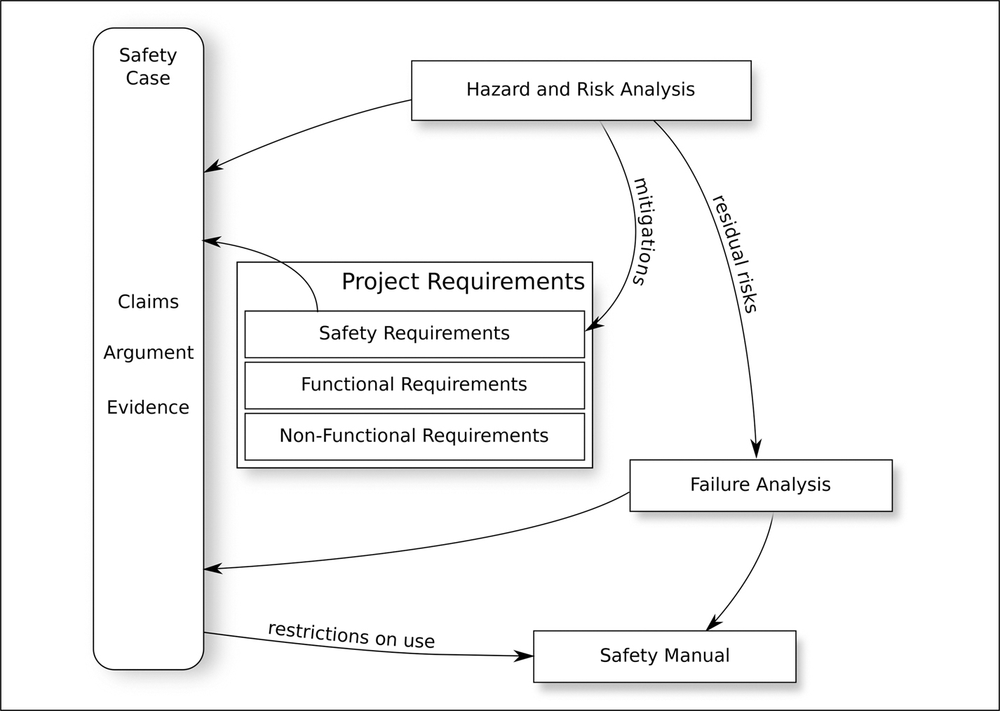
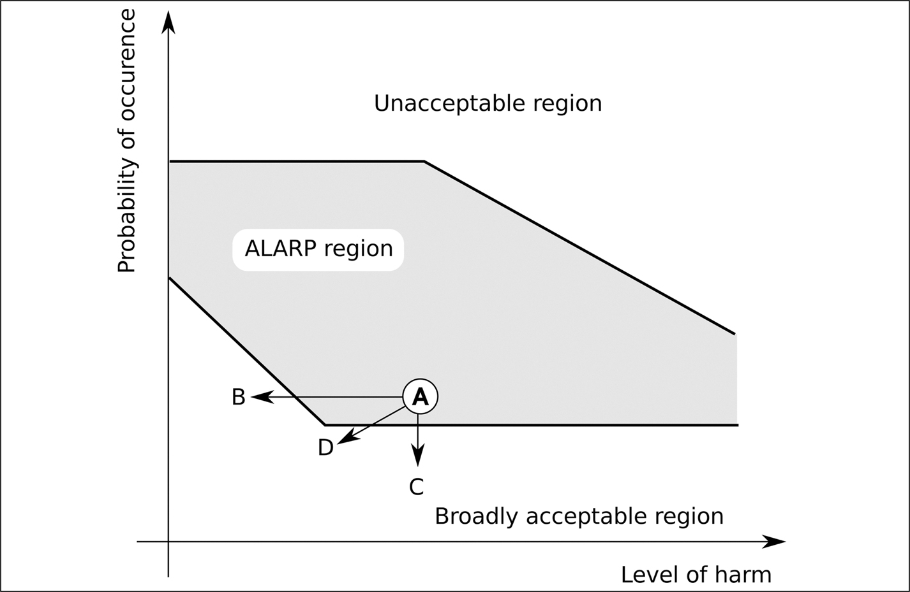
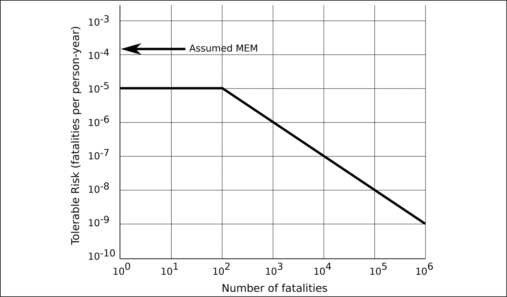
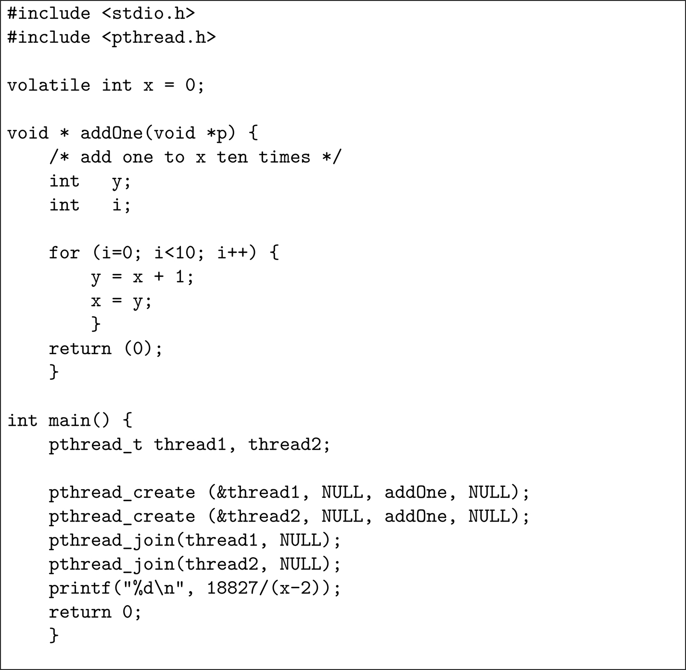
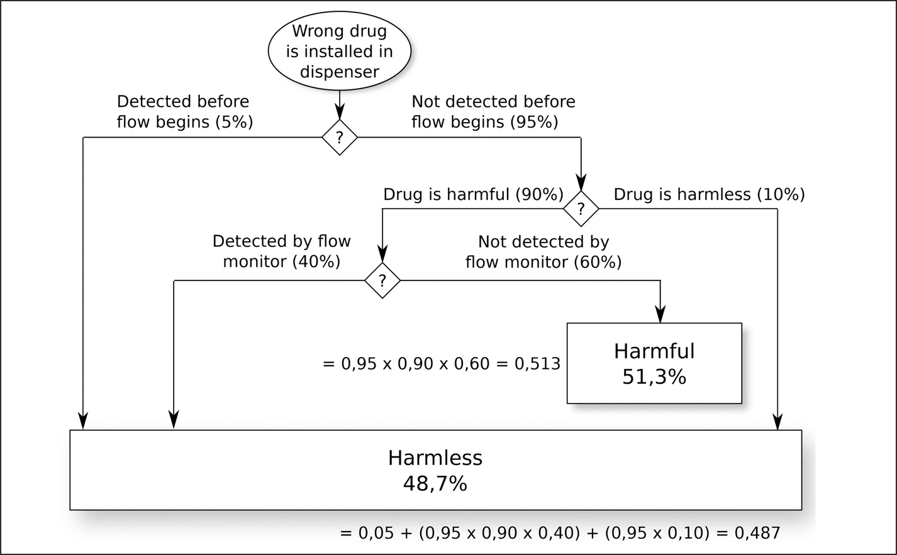
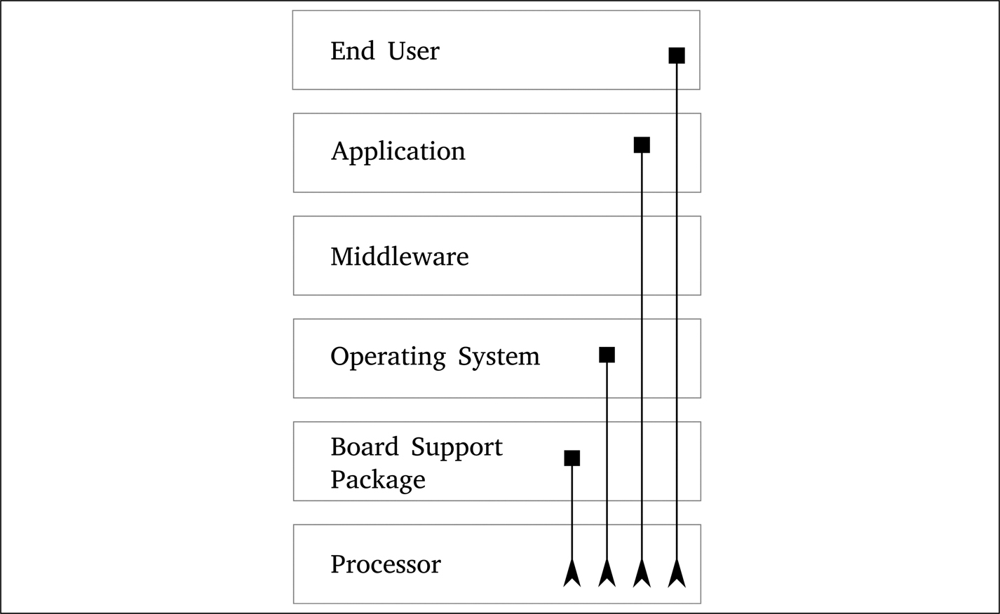

# 7 Các phân tích nền tảng

DOI: [10.1201/9781003598145-7](https://doi.org/10.1201/9781003598145-7)

> *Hầu hết các nhà phát triển phần mềm, tin rằng “tài liệu” là một tập hợp các mô tả dài dòng, thiếu cấu trúc, mang tính giới thiệu, chiếm hàng nghìn trang; họ nghĩ đến thứ văn bản mà không ai muốn viết và không ai tin. Ngược lại, các Kỹ sư trong những ngành truyền thống hơn, nghĩ đến các bản vẽ thiết kế chính xác, sơ đồ mạch và các đặc tả toán học về thuộc tính của linh kiện; họ nhận ra rằng tài liệu là phương tiện thiết kế chính của họ. Các nhà phát triển phần mềm không biết cách tạo ra tài liệu chính xác cho phần mềm và coi tài liệu là thứ nghĩ đến sau cùng. Thực tế, nó nên thể hiện sự suy tính trước chứ không phải suy nghĩ sau.*
>
> David Parnas (Tài liệu tham khảo [[1](#refbib7_1)])

## 7.1 Các phân tích

Tôi đã muốn đặt tên chương này là “*Tài liệu* nền tảng” thay vì “Các phân tích nền tảng” vì đó là cách chúng ta có xu hướng nghĩ về những hoạt động này — chúng tạo ra tài liệu. Tuy nhiên, mục tiêu là hoàn thành các phân tích, còn các tài liệu ghi lại những phân tích đó chỉ là thứ yếu.

Danh sách các phân tích sau đây không đầy đủ, nhưng những phân tích được đưa vào có thể được coi là cơ sở cho phần còn lại.

**Safety case.**

Cụm từ này dùng thuật ngữ “case” theo nghĩa pháp lý, như trong “the case for the prosecution” (lập luận buộc tội của bên công tố). Nó là một lập luận có lý lẽ giải thích vì sao bạn tin rằng sản phẩm bạn đang phát triển đã được đưa qua phân tích kỹ thuật an toàn chuyên nghiệp để bảo đảm rằng nó đáp ứng các ràng buộc an toàn của mình: xem [Chương 6](ch06_the_safety_case.vi.md).

**Hazard and risk analysis.**

Phân tích này nhận diện các hazard và rủi ro gắn với việc sử dụng sản phẩm cuối cùng. Để biết sự phân biệt giữa một “hazard” và một “risk” cũng như ý nghĩa của “mitigation,” xem trang 15.

Phân tích này, được mô tả trong [Mục 7.3](#sec7_3), đặc biệt then chốt vì các yêu cầu an toàn của dự án và dữ liệu cho failure analysis đều được rút ra từ nó.

**Failure analysis.**

Mọi hệ thống rốt cuộc đều hỏng, và nếu bạn đang mong đợi chứng nhận theo một đặc tả Functional Safety (trái với SOTIF),[1](#fn7_1) thì điều quan trọng là phải hiểu hệ thống của bạn được dự kiến sẽ hỏng thường xuyên đến mức nào và theo những cách nào.

Ngoài kết quả của các phân tích này, hai tài liệu cơ bản tạo thành một phần của việc phát triển bất kỳ sản phẩm safety-critical nào:

**Safety plan.**

Tài liệu này đặt ra các thực hành cụ thể cần tuân theo trong quá trình phát triển sản phẩm. Ví dụ, một công ty có thể có nhiều coding standard, mỗi cái phù hợp cho một kiểu viết code khác nhau; safety plan chỉ định cái nào sẽ được dùng cho dự án. Nó cũng định nghĩa chính xác trách nhiệm và thẩm quyền của từng thành viên trong nhóm dự án.

**Safety manual.**

Nếu bạn mua bất kỳ sản phẩm nào, bạn có thể sẽ thấy một safety manual kèm theo — đó là loại tài liệu đi kèm một chiếc máy cắt cỏ đã mua và bảo bạn đừng thử dùng nó để tỉa râu. Ngoài việc bao quát trách nhiệm pháp lý như vậy, trong một sản phẩm phần mềm nhúng, nó còn định nghĩa môi trường mà trong đó sản phẩm phải được sử dụng và cung cấp một danh sách các điều cấm: ví dụ, *“hàm* `abc()` *MUST NOT[2](#fn7_2) được gọi trừ khi hàm* `xyz()` *trước đó đã trả về EOK.”*

Đây không phải là những phân tích duy nhất sẽ được thực hiện: xem [Chương 17](ch17_semi_formal_verification.vi.md) về phân tích thiết kế hệ thống, [Chương 22](ch22_integration_and_system_testing.vi.md) về phân tích phần hiện thực và [Chương 23](ch23_the_offline_tools.vi.md) về phân tích các công cụ được dùng trong quá trình phát triển.

## 7.2 Các mối quan hệ qua lại

Các phân tích được liệt kê ở trên không độc lập với nhau và cũng không được thực hiện tuần tự. [Hình 7.1](#fig7_1) minh họa một số mối quan hệ qua lại:

[1](#fn7_17b)Xem [Mục 2.1.3](ch02_terminology_of_safety.vi.md#sec2_1_3) để biết sự phân biệt.

[2](#fn7_27b)Trong các yêu cầu, các từ như SHALL, MUST, MUST NOT, MAY thường được viết hoa theo RFC2119 và RFC8174 (tài liệu tham khảo [[2](#refbib7_2)] và [[3](#refbib7_3)]). Điều này giúp tránh phải định nghĩa ý nghĩa của những từ đó trong mỗi tài liệu yêu cầu.

- Hazard and risk analysis mô tả các cách giảm thiểu những rủi ro đã nhận diện, được gọi là “mitigation.” Mỗi mitigation trở thành một yêu cầu an toàn. Ví dụ, nếu một rủi ro cụ thể có thể được giảm bằng cách lắp các bộ nguồn dự phòng kép, điều này tạo ra một yêu cầu an toàn rằng phải lắp hai bộ nguồn. [Hình 22.3](ch22_integration_and_system_testing.vi.md#fig22_3) ở trang 303 đưa ra một ví dụ về việc rút ra một yêu cầu an toàn theo cách này.

  Hazard and risk analysis cũng nhận diện các rủi ro tồn dư vẫn còn lại ngay cả sau khi các mitigation đã được áp dụng, và những rủi ro này trở thành các phần tử cơ bản của failure analysis. Ví dụ, ngay cả với các bộ nguồn kép, vẫn có thể có một rủi ro tồn dư là nguồn điện sẽ bị mất vào một thời điểm then chốt; điều này phải được tính đến trong failure analysis.

- Hazard and risk analysis và failure analysis trở thành các thành phần thiết yếu của safety case.

- Safety case ghi lại lập luận về việc sản phẩm có đủ an toàn hay không và, bằng cách xem xét các rủi ro tồn dư, đặt ra các giới hạn về môi trường mà trong đó sản phẩm có thể được sử dụng. Các giới hạn này được liệt kê trong safety manual đi kèm sản phẩm.

*Hình 7.1: Mối quan hệ qua lại giữa các phân tích.[⏎](#b7fig7_1)*

## 7.3 Hazard and Risk Analysis (HARA)

Như tôi đã đề cập trong [Mục 2.1.5](ch02_terminology_of_safety.vi.md#sec2_1_5), các thuật ngữ “hazard” và “risk” có nghĩa mơ hồ trong các tiêu chuẩn khác nhau. Trong mục này, tôi dùng các thuật ngữ đó như được định nghĩa trong [Mục 2.1.5](ch02_terminology_of_safety.vi.md#sec2_1_5).

Mục đích của phân tích này là nhận diện các hazard và rủi ro gắn với sản phẩm, xác định các mitigation để giảm những rủi ro đó đến mức cần thiết, rồi xác định những rủi ro tồn dư nào vẫn còn.

### 7.3.1 Nhận diện các hazard và rủi ro

Việc nhận diện các hazard và các rủi ro gắn với chúng không dễ, nhưng có những phương pháp semi-structured có thể giúp ích, ví dụ, HAZOP (“hazard and operability study”) và HACCP (“hazard analysis critical control points”).

Thủ tục HAZOP được định nghĩa trong IEC 61882 (tài liệu tham khảo [[4](#refbib7_4)]) và ban đầu được tạo ra để nhận diện các rủi ro gắn với các nhà máy sản xuất hóa chất. Nó dùng một loạt các từ và cụm từ hướng dẫn (more, less, as well as, early, late, before, …) để khơi gợi ý tưởng về các rủi ro tiềm tàng trong một buổi brainstorming có cấu trúc. Ví dụ, khi xem xét một số hazard và rủi ro gắn với một thiết bị y tế, từ hướng dẫn “more” (nhiều hơn) có thể khơi gợi những câu hỏi như:

- Hazard: giao diện người dùng của thiết bị.
  - Điều gì xảy ra nếu người vận hành nhập *nhiều* chữ số *hơn* mức cần thiết?
  - Điều gì xảy ra nếu *nhiều hơn* một người vận hành đăng nhập cùng lúc?
- Hazard: giao diện với bệnh nhân.
  - Điều gì xảy ra nếu lượng thuốc được đặt vào bộ phân phối *nhiều hơn* mức được chỉ định?
  - Điều gì xảy ra nếu chu vi cánh tay bệnh nhân *lớn hơn* mức mà vòng bít có thể chứa?
  - Điều gì xảy ra nếu thời gian từ khi thiết bị được khởi động đến lần kiểm tra đầu tiên *dài hơn* 30 phút?

Và cứ thế. Mỗi từ hướng dẫn nên gợi ra những suy nghĩ giàu tưởng tượng về các rủi ro tiềm tàng gắn với thiết bị. Một phần mở rộng của thủ tục HAZOP được mô tả trong [Mục 9.4](ch09_the_device_within_the_system.vi.md#sec9_4) trong bối cảnh hệ thống lớn hơn, và phần mở rộng đó có thể áp dụng được cho một số thiết bị nhúng.

> Giai thoại 9 *Một assessor bên ngoài lần đầu giới thiệu cho tôi IEC 61882, và tôi rất hoài nghi về việc một kỹ thuật được thiết kế cho các nhà máy hóa chất lớn lại áp dụng được cho việc phát triển phần mềm nhúng. Sau khi dùng kỹ thuật này trong nhiều năm, tôi thực sự thấy nó rất hữu ích.*

HACCP được đưa ra vào những năm 1960 để kiểm soát các điều kiện có khả năng nguy hiểm trong ngành chế biến thực phẩm, nhưng từ đó đã được điều chỉnh để áp dụng cho các lĩnh vực khác. Nó được định nghĩa trong bộ đặc tả ISO 22000 và định nghĩa bảy nguyên tắc:

1. Thực hiện một hazard analysis.
2. Xác định các critical control point nơi có thể thực hiện kiểm tra. Ý tưởng là tránh chỉ có một điểm kiểm soát duy nhất ở cuối chuỗi sản xuất, nơi các điều kiện nguy hiểm có thể không thấy được.
3. Đặt các giới hạn tới hạn cho mỗi critical control point.
4. Định nghĩa các yêu cầu giám sát critical control point để bảo đảm rằng các điểm kiểm soát đang hoạt động đúng.
5. Định nghĩa các hành động khắc phục cần thực hiện nếu một giới hạn tới hạn định trước bị vượt quá.
6. Giám sát toàn bộ hệ thống HACCP để bảo đảm rằng nó đang hoạt động như dự kiến.
7. Lưu giữ hồ sơ đầy đủ về quy trình.

ISO 14971, mặc dù được viết cho các thiết bị y tế, cung cấp một bộ hướng dẫn hữu ích để nhận diện và giảm thiểu các hazard và rủi ro và có thể được dùng một cách có lợi ngay cả trong các dự án non-medical. Các phiên bản trước của ISO 14971 đã nhắc cụ thể đến HAZOP như những quy trình phù hợp để nhận diện rủi ro trong thiết bị y tế, nhưng khuyến nghị này đã bị loại bỏ khỏi phiên bản 2019.

Các nguồn hữu ích khác về danh sách các hazard tiềm tàng là UL 4600, vốn chứa chi tiết về nhiều pitfall khác nhau, và ANSI/AAMI/IEC TIR80002-1:2009 (tài liệu tham khảo [[5](#refbib7_5)]), trong đó Phụ lục B và C chứa một danh sách các rủi ro và hazard cần được xem xét khi phát triển một thiết bị y tế. TIR80002 nhắm tới các ứng dụng y tế, nhưng nhiều rủi ro được liệt kê cũng áp dụng được cho các lĩnh vực khác. Có rất nhiều rủi ro như vậy, chẳng hạn *“Hàm truyền giá trị theo microlit nhưng driver lại mong đợi giá trị theo mililit,” “Trạng thái an toàn chưa bao giờ được định nghĩa,”* và *“Hướng dẫn sử dụng kém khiến người dùng không hiệu chuẩn thiết bị y tế đúng cách, dẫn đến hằng số hiệu chuẩn sai.”*

> Giai thoại 10 *Năm 2014, tôi đã tham dự buổi trình bày tài liệu tham khảo [[6](#refbib7_6)] của Harold Thimbleby, tại đó ông đã trình diễn giao diện người dùng trên một số thiết bị y tế di động mà một y tá có thể dùng một cách hợp lý trong suốt một ngày làm việc.*
>
> *Một điểm của bài giảng là chứng tỏ một việc bề ngoài dễ dàng như nhập một giá trị số (ví dụ, liều thuốc) lại có thể khác nhau nhiều đến vậy từ thiết bị này sang thiết bị khác. Ở một số thiết bị, bàn phím số được bố trí giống điện thoại (1, 2, 3 ở trên cùng); các thiết bị khác lại bố trí giống máy tính bỏ túi (7, 8, 9 ở trên cùng). Các nút DELETE hoặc CLEAR cũng không nhất quán về hành vi, và các lỗi gõ phím (ví dụ, nhập dấu thập phân thứ hai trong một số) được xử lý khác nhau.*
>
> *Như Thimbleby đã nói khi ông chứng tỏ việc nhập sai một giá trị số dễ dàng đến mức nào, đây không chỉ là một failure đang chờ xảy ra, mà là một failure đã xảy ra ở nhiều bệnh viện và đã giết chết bệnh nhân.*

Một loại rủi ro không được bỏ qua trong hazard and risk analysis là loại phát sinh từ các hazard bảo mật. Về nguyên tắc, một khi kẻ tấn công đã khai thác một điểm yếu bảo mật để truy cập vào hệ thống, hành vi có thể bị gây ra là không thể dự đoán và, theo nghĩa đó, có thể được ví như các failure phần cứng ngẫu nhiên hoặc các Heisenbug phần mềm. Tài liệu tham khảo [[7](#refbib7_7)] của Simon Burton *et al.* đưa ra một số ví dụ về các yêu cầu functional security (khác với safety) theo định dạng của một safety case.

Một điểm cần lưu ý là các hazard được nhận diện trong một HAZOP thường không bao gồm các tác động tiêu cực bên ngoài do hệ thống gây ra, chẳng hạn một ô tô tự lái dừng lại tại hiện trường một vụ tai nạn và chắn đường của các phương tiện khẩn cấp.

### 7.3.2 Giảm thiểu rủi ro

Một khi một rủi ro đã được nhận diện, cần phải làm gì với nó, nếu có? Biết rằng không hệ thống nào có thể an toàn tuyệt đối, liệu một mức rủi ro cụ thể có chấp nhận được không? Tổng quát hơn, thế nào là “đủ an toàn”?

Có nhiều cách trả lời câu hỏi cuối cùng này, và cách tiếp cận cần được chọn và ghi lại thành tài liệu ngay từ đầu dự án. Các cách tiếp cận sau thường được sử dụng và đều được mô tả chi tiết trong Annex A của EN 50126-2.

Lưu ý rằng, dù chọn cách tiếp cận nào, phân tích cũng sẽ cần được xem xét lại trong quá trình phát triển sản phẩm. Application note 9 của International Engineering Safety Management (iESM: tài liệu tham khảo [[8](#refbib7_8)]) nói: *“Thứ được cho là một mức rủi ro có thể chấp nhận được ở giai đoạn đặc tả của một dự án không nhất thiết là thứ được (hoặc sẽ được) coi là chấp nhận được về sau. Khi một nguyên tắc chấp nhận rủi ro như As Low As Reasonably Practicable (ALARP) được sử dụng, rủi ro phải được giảm không chỉ đến một mức pre-defined mà đến một mức có thể chứng tỏ là thấp nhất có thể một cách hợp lý trên thực tế. Điều này có thể không hiển nhiên cho đến khi bước vào giai đoạn thiết kế.”*

#### ALARP.

Từ viết tắt này có nghĩa là “as low as reasonably practicable” (thấp nhất có thể một cách hợp lý trên thực tế) và quy trình được phác thảo trong Annex C của IEC 61508-5. Về bản chất, các rủi ro được đánh giá là thuộc một trong ba loại:

1. Những rủi ro rõ ràng là quá lớn để có thể chấp nhận theo các chuẩn mực xã hội hoặc các chuẩn mực khác. Những rủi ro như vậy phải được giảm thông qua mitigation.
2. Những rủi ro nhỏ đến mức có thể chấp nhận được trong xã hội nơi hệ thống sẽ được triển khai. Những rủi ro này, một khi đã được nhận diện và ghi lại, phải được giám sát để bảo đảm rằng chúng không tăng lên, nhưng ngoài ra thì có thể bỏ qua.
3. Những rủi ro nằm giữa hai thái cực này. Những rủi ro này phải được giảm đến “mức thấp nhất khả thi trên thực tế,” cân bằng giữa lợi ích và chi phí của việc giảm rủi ro.

Các vùng này được minh họa trong [Hình 7.2](#fig7_2) và ranh giới của các vùng cho một dự án cụ thể phải được thống nhất trước khi bắt đầu phân tích rủi ro. Annex G.2 của EN 50126-2 cung cấp chi tiết về các vùng ALARP thực tế được dùng cho dự án phát triển Copenhagen Metro, nhưng cũng nhấn mạnh rằng ranh giới của các vùng sẽ khác nhau đối với mỗi dự án.

*Hình 7.2: Vùng ALARP.[⏎](#b7fig7_2)*

Một rủi ro, như rủi ro được đánh nhãn A, nằm trong vùng ALARP và có thể được giảm thiểu bằng cách giảm mức tổn hại mà nó có thể gây ra (chuyển nó đến B), bằng cách giảm xác suất nó xảy ra (đến C), hoặc cả hai (đến D).

Việc giảm thiểu các rủi ro trong vùng ALARP phụ thuộc vào sự cân bằng giữa chi phí của rủi ro và chi phí giảm thiểu nó. Điều này thường có nghĩa là phải thực hiện việc đánh giá khó chịu về giá trị của một mạng người hoặc của ô nhiễm môi trường. Vì vậy, nếu một rủi ro, như A trong [Hình 7.2](#fig7_2), đã được nhận diện, và đã xác định được rằng, nếu không được giảm thiểu, nó có khả năng dẫn đến một tai nạn mỗi 10 năm một lần, thì chi phí của tai nạn đối với công ty (chẳng hạn €10000000 tiền bồi thường thiệt hại và tổn thất danh tiếng) phải được cân nhắc so với chi phí thực hiện mitigation (chẳng hạn €1500000 mỗi năm cho việc đào tạo nhân sự bổ sung).

Với những giá trị đó, mitigation sẽ không được thực hiện, vì nó không cost-effective.

#### GAMAB.

Một phương án thay thế cho ALARP, được dùng đặc biệt ở Pháp, là *globalement au moins aussi bon (GAMAB)[3](#fn7_3)*.

Phương pháp này nói rằng, khi được đo bằng một chỉ số chấp nhận được nào đó, bất kỳ hệ thống mới nào cũng phải đưa ra một mức rủi ro không tệ hơn mức mà bất kỳ hệ thống tương đương hiện có nào đưa ra. Tùy theo sản phẩm, chỉ số đó có thể là số thương vong mỗi năm, số người bị thương mỗi giờ hoạt động, hoặc một thước đo phù hợp nào khác.

GAMAB đôi khi được gọi là GAME *(globalement au moins équivalent)[4](#fn7_4)*, mặc dù GAME không bao hàm cùng ý tưởng cải tiến liên tục vốn ngầm có trong GAMAB.

[3](#fn7_37b)Nghĩa đen: “xét tổng thể, ít nhất cũng tốt bằng.”

[4](#fn7_47b)Nghĩa đen, “xét tổng thể, ít nhất cũng tương đương.”

#### MEM.

Nguyên tắc minimum endogenous mortality (MEM — tỷ lệ tử vong nội sinh tối thiểu) đôi khi cũng được sử dụng, đặc biệt cho các dự án đường sắt, mặc dù nó ít được chấp nhận rộng rãi hơn ALARP hay GAMAB. Nó được Albert Kuhlman giới thiệu trong tài liệu tham khảo [[9](#refbib7_9)].

Tỷ lệ tử vong nội sinh, *R*, là xác suất một người trong khu vực nơi thiết bị mới sẽ được triển khai sẽ tử vong hoặc bị thương nặng trong một năm nhất định do một tai nạn. Các ca tử vong do bệnh tật bị loại trừ, trong khi các ca tử vong do tai nạn lao động, tai nạn trên đường phố, v.v. được tính vào.

Ở các nước phát triển, *R* đạt mức tối thiểu ở nhóm tuổi từ 5 đến 15 và $R ≈ 2 \times {10}^{- 4}$ ca tử vong mỗi người mỗi năm. MEM khẳng định rằng, đối với nhóm dân số mục tiêu, hệ thống mới không nên “ảnh hưởng đáng kể đến con số này.” Cụm từ này thường được hiểu là, “không nên làm nó tăng quá 5%”. Điều này có nghĩa là một hệ thống mới được triển khai ở một nước phát triển không nên làm tăng tỷ lệ tử vong nội sinh quá $0 , 05 \times 2 \times {10}^{- 4} = {10}^{- 5}$.

Như được minh họa trong [Hình 7.3](#fig7_3), (lấy từ EN 50126-2), mức 10% phải được điều chỉnh để tính đến số ca tử vong có khả năng xảy ra cùng một lúc, vì xã hội ít khoan dung hơn với những tai nạn gây ra nhiều ca tử vong. Ví dụ, trong [Hình 7.3](#fig7_3), giả định rằng thiết bị sẽ được triển khai ở một khu vực có MEM khoảng $2 \times {10}^{- 4}$ và xác suất tử vong cho phép mỗi năm là khoảng ${10}^{- 5}$ đối với một số ít ca tử vong, giảm xuống ${10}^{- 9}$ đối với các sự cố liên quan đến một triệu người.

*Hình 7.3: Minimum Endogenous Mortality.[⏎](#b7fig7_3)*

Trong các phép tính này, đôi khi người ta giả định rằng 100 thương tích nhẹ hoặc 10 thương tích nặng tương đương với một ca tử vong.

### 7.3.3 Đánh giá các rủi ro tồn dư

Ngay cả sau khi một rủi ro đã được giảm thiểu, có lẽ vẫn sẽ còn một rủi ro tồn dư nào đó. Trong một số ít trường hợp, mitigation có thể giảm rủi ro tồn dư xuống không, nhưng thông thường vẫn sẽ còn một mức rủi ro chấp nhận được nào đó.

## 7.4 Failure analysis

Phân tích nền tảng thứ ba, cùng với safety case và hazard and risk analysis, là failure analysis.

Mọi hệ thống đều hỏng, và đối với các hệ thống safety-critical, điều quan trọng là phải biết chúng hỏng thường xuyên đến mức nào và theo cách nào. Về cơ bản, điều này có nghĩa là xem xét các rủi ro tồn dư đã được nhận diện trong hazard and risk analysis.

Trong [Hình 5.1](ch05_development_methodologies.vi.md#fig5_1) ở trang 48, failure analysis được thể hiện là được thực hiện trong hai giai đoạn: một phép tính “quick-and-dirty” được thực hiện trong giai đoạn concept để xác định liệu thiết kế được đề xuất *có thể* đáp ứng các yêu cầu dependability của hệ thống hay không, và sau đó là một phân tích tinh vi hơn, chu kỳ thiết kế chi tiết, để xác định liệu hệ thống *sẽ* đáp ứng các yêu cầu của nó hay không. Phân tích thứ nhất có thể được thực hiện bằng một công cụ thô sơ như Markov model (xem [Chương 14](ch14_markov_models.vi.md)), vì mục đích không phải là xác định liệu thiết kế *sẽ* đáp ứng các yêu cầu hay không; thay vào đó, mục đích là loại bỏ những thiết kế *không thể* đáp ứng các yêu cầu.

Phân tích thứ hai, tinh vi hơn, có thể được thực hiện bằng một sự kết hợp của bốn cách: bottom-up component-oriented ([Mục 7.4.1](#sec7_4_1)), top-down component-oriented ([Mục 7.4.2](#sec7_4_2)), event-driven ([Mục 7.4.3](#sec7_4_3)) hoặc function-driven ([Mục 7.4.4](#sec7_4_4) và [9.5](ch09_the_device_within_the_system.vi.md#sec9_5)).

### 7.4.1 Cách tiếp cận Bottom-Up

Cách này lần lượt lấy từng thành phần của hệ thống và đặt câu hỏi: “Thành phần này sẽ hỏng thường xuyên đến mức nào và điều gì sẽ xảy ra nếu nó hỏng?” Kỹ thuật này, được gọi là Failure Mode, Effect and Criticality Analysis (FMECA), đặc biệt phổ biến khi phân tích các failure phần cứng. Với phần cứng, rất dễ nhận diện các thành phần và các failure mode của chúng (ví dụ, điện trở R10 có thể hỏng bằng cách bị hở mạch hoặc bị ngắn mạch).

FMECA có một số hạn chế, bao gồm độ phức tạp tổ hợp xuất hiện khi tính đến các failure dây chuyền: điện trở R10 bị ngắn mạch đặt thêm áp lực lên tụ C23, qua đó làm giảm tuổi thọ của nó và, nếu C23 bị ngắn mạch, thì điện trở R72 sẽ nóng lên, …

FMECA cũng có thể được áp dụng cho phần mềm, khi đó nó đôi khi được gọi là Software FMECA (SWFMECA).

> Ngụy biện 3 *Người ta thường nói (và được lặp lại trong nhiều tiêu chuẩn) rằng phần mềm không hỏng một cách ngẫu nhiên — mọi failure phần mềm đều mang tính hệ thống và bất kỳ ai phân tích failure phần mềm theo thống kê đều rơi vào trạng thái phạm tội. Có nhiều bài báo học thuật giải thích vì sao đây là một ngụy biện, nhưng một chương trình đơn giản cũng đủ: xem [Hình 7.4](#fig7_4).*
>
> 
>
> 
>
> *Hình 7.4: Một chương trình C two-threaded đơn giản.[⏎](#b7fig7_4)*
>
> *Chương trình này, khi được thực thi trên bất kỳ máy tính nào, đặc biệt là máy có nhiều lõi, sẽ crash với một floating point exception cứ vài nghìn triệu lần thực thi lại có một lần. Sự hiện diện của các chương trình khác cũng đang thực thi trên cùng máy tính sẽ làm thay đổi xác suất failure.*
>
> *Điều thú vị là IEC 61513, một trong các tiêu chuẩn điện hạt nhân, có đề cập trực tiếp đến điều này. Nó nói: “Vì các tác nhân kích hoạt software fault được gặp phải một cách ngẫu nhiên trong quá trình hệ thống hoạt động, nên các software failure cũng xảy ra một cách ngẫu nhiên.”*

Một hạn chế khác của FMECA đặc biệt liên quan đến phần mềm là việc định nghĩa các failure mode của các thành phần ngày càng khó khăn. Đối với một điện trở, các mode tương đối rõ ràng (hở mạch hoặc ngắn mạch), nhưng các failure mode của một system-on-a-chip (SoC) như SoC M2 Ultra của Apple với 134000000000 transistor là gì? Khả năng bộ điều khiển direct memory access (DMA) hỏng trong khi các thành phần khác vẫn tiếp tục hoạt động là bao nhiêu? Điều đó sẽ được phát hiện thế nào?

Phần mềm giống SoC hơn nhiều so với điện trở.

Trong phạm vi những hạn chế này, kỹ thuật FMECA khá straight-forward:

1. Liệt kê các thành phần của hệ thống.

2. Ước lượng failure rate, *λi*, của mỗi thành phần. Đối với các linh kiện điện tử, nhiều tổ chức công bố các ước lượng failure rate; đối với các thành phần phần mềm, cần dùng những kỹ thuật tinh tế hơn — xem [Chương 16](ch16_software_failure_rates.vi.md).

3. Nhận diện các failure mode của mỗi thành phần và gán cho mỗi mode một tỷ lệ xác suất, *αi*. R10 có thể hỏng bằng cách bị hở mạch hoặc bị ngắn mạch, nhưng nếu trường hợp thứ nhất có khả năng xảy ra cao hơn trường hợp thứ hai, thì ${α}_{1} = 0 , 7$ có thể được gắn với trường hợp thứ nhất và ${α}_{2} = 0 , 3$ với trường hợp thứ hai.

4. Ước lượng ảnh hưởng của failure của mỗi thành phần lên hành vi của hệ thống. Đây thực chất là một tham số mức độ nghiêm trọng, *β*, định nghĩa ảnh hưởng của failure trên một thang nào đó (ví dụ, catastrophic, critical, marginal, negligible).

5. Xác định failure của mỗi thành phần sẽ được phát hiện nhanh đến mức nào. Trong trường hợp các thành phần mà failure của chúng khiến toàn bộ hệ thống hỏng một cách thảm khốc, điều này có thể tương đối dễ. Failure của những thành phần chỉ gây suy giảm hoặc failure hệ thống trong những tình huống hiếm gặp có thể vẫn ẩn giấu như những time-bombs trong hệ thống trong một thời gian dài.

6. Với mỗi thành phần, tính phần đóng góp của nó vào failure của hệ thống:

   $$\begin{array}{l} {C}_{r} = t \; β \; Σ ( {α}_{i} \; {λ}_{i} ) \end{array} \tag{7.1}$$

   trong đó *t* là khoảng thời gian mà hệ thống phải duy trì hoạt động. So sánh giá trị *Cr* của các thành phần khác nhau cho phép tập trung cải tiến thiết kế vào những lĩnh vực sẽ thu được nhiều lợi ích nhất về dependability.

7. Ước lượng thời gian cần để sửa chữa thành phần một khi failure của nó đã được phát hiện. Trong trường hợp một thành phần phần mềm, thuật ngữ “sửa chữa” nhiều khả năng là chỉ việc khởi động lại thành phần hoặc khởi động lại hệ thống. Thời gian sửa chữa sẽ khác nhau giữa các thành phần: những thành phần mà failure của chúng gây ra failure hệ thống có thể được sửa càng sớm càng tốt sau khi phát hiện; những thành phần gây suy giảm có thể chưa được sửa cho đến đợt bảo trì định kỳ tiếp theo. Lưu ý rằng, ngoại trừ các trường hợp thay thế định kỳ, việc sửa chữa không thể bắt đầu cho đến khi đã phát hiện — đây là lý do vì sao việc phát hiện lại quan trọng đến vậy.

8. Xây dựng một mô hình toán học về các đặc tính failure của hệ thống (một tổ hợp các thành phần) và giải mô hình này để xác định availability của hệ thống và độ nhạy của nó đối với các tham số ước lượng khác nhau.

### 7.4.2 Cách tiếp cận Top-Down

Cách tiếp cận bottom-up nói, *“Nếu thành phần này hỏng, tình trạng nguy hiểm nào có thể xảy ra?”* Cách tiếp cận top-down bắt đầu với các tình trạng nguy hiểm và hỏi, *“Điều gì có thể khiến tình trạng nguy hiểm cụ thể này xảy ra?”*

Dùng các công ty tiêu biểu của chúng ta từ [Chương 4](ch04_representative_companies.vi.md), công ty thành phần Beta Component Incorporated (BCI) có thể xem xét tình trạng có khả năng nguy hiểm là hệ điều hành bị cạn kiệt không gian stack. Điều này có thể xảy ra thế nào? Có lẽ nếu việc lồng interrupt quá sâu. Với sự bảo vệ (mitigation) được cung cấp, khả năng điều này xảy ra là bao nhiêu? Các tình trạng nguy hiểm trên thiết bị ô tô của Alpha Device Corporation (ADC) có thể bao gồm các lệnh đồng thời tăng tốc và đạp phanh. Điều này có thể xảy ra nếu cảm biến A cho một over-reading và cảm biến B cho một under-reading trong cùng một cửa sổ thời gian. Điều gì sẽ khiến cảm biến A cho số đọc đó? Nếu tốc độ lớn hơn 200 km/h. Và cứ thế.

Một cách tiếp cận top-down có thể được thực hiện bằng fault tree analysis (FTA). Điều này được xem xét chuyên sâu trong [Chương 15](ch15_the_fault_tree.vi.md).

> Giai thoại 11 *Ví dụ ở trên về một chiếc ô tô đồng thời tăng tốc và phanh không hoàn toàn là lý thuyết. Tôi từng có một sinh viên làm việc với tôi, cô ấy cần một ví dụ về một hệ thống mà cô có thể chứng minh hình thức là đúng, dùng công cụ Rodin; xem [Mục 18.8](ch18_formal_verification.vi.md#sec18_8).*
>
> *Trong một tạp chí kỹ thuật, cô đã tìm thấy một bài báo của một nhà sản xuất ô tô hàng đầu, trong đó có một bảng trạng thái của các hệ thống phát hiện va chạm và cruise control của họ. Chúng tôi quyết định rằng đây sẽ là một bài tập tốt để cô mô hình hóa nó với ý định chứng minh một số đặc tính của thiết kế, bao gồm việc không có cách nào để hệ thống có thể đồng thời ra lệnh phanh và tăng tốc. Rodin đã không thể chứng minh invariant này, và lý do trở nên rõ ràng khi chúng tôi phân tích thiết kế — thiết kế có khiếm khuyết và, trong những điều kiện bất thường, tình trạng nguy hiểm này có thể xảy ra.*

### 7.4.3 Cách tiếp cận Event-Centric

Cả hai cách tiếp cận bottom-up và top-down được mô tả ở trên đều xử lý các thành phần của hệ thống, mặc dù từ các hướng khác nhau. Ngược lại, một Event Tree Analysis (ETA) bắt đầu với các sự kiện. [Hình 7.5](#fig7_5) minh họa một phần rất nhỏ của một event tree có thể gắn với một thiết bị y tế.

*Hình 7.5: Ví dụ về event tree.[⏎](#b7fig7_5)*

Sự kiện được xem xét trong ví dụ này là thuốc sai được đưa vào bộ phân phối. Tình huống có khả năng nguy hiểm này có thể được người vận hành phát hiện trước khi dòng chảy bắt đầu (được đánh giá là có xác suất 5%), và, ngay cả khi dòng chảy bắt đầu, thuốc có thể vô hại đối với bệnh nhân (10%). Ngay cả khi dòng chảy bắt đầu và thuốc có hại, bộ giám sát dòng chảy có thể phát hiện ra rằng thuốc sai đang được phân phối, có lẽ dựa trên độ nhớt của nó (40%).

Khi các xác suất đã được đo và thêm vào event tree, rất dễ tính xác suất của một kết cục nguy hiểm, trong trường hợp này là 51,3% số lần thuốc sai được đưa vào bộ phân phối.

Hiệu quả của ETA phụ thuộc vào việc hệ thống được well-understood đủ để có thể nhận diện một tập toàn diện các sự kiện có khả năng nguy hiểm. Thủ tục HAZOP được định nghĩa trong IEC 61882 và được mô tả trong [Mục 7.3.1](#sec7_3_1) đã được dùng như một cách semi-structured để nhận diện các sự kiện này, và nếu nó đã được dùng để thực hiện hazard and risk analysis, thì các rủi ro tồn dư từ đó có thể giúp các nhà phân tích lường trước các sự kiện có khả năng nguy hiểm.

Một nhược điểm của ETA là giả định ngầm của nó rằng các sự kiện được nhận diện là độc lập với nhau. Trên thực tế, điều này khó có thể đúng. Có lẽ sự kiện top-level trong [Hình 7.5](#fig7_5) phụ thuộc vào một sự kiện khác, chẳng hạn, “Y tá bị yêu cầu làm ca thứ hai liên tiếp.” Điều đó có thể làm tăng xác suất thuốc sai được lắp vào bộ phân phối, và các sự kiện khác, chẳng hạn liều lượng sai được nhập vào. Sự kiện thuốc sai được đưa vào bộ phân phối cũng có thể bắt nguồn từ các sự kiện khác, chẳng hạn một vấn đề dán nhãn ở phòng cấp phát thuốc.

### 7.4.4 Cách tiếp cận Function-Centric

Các kỹ thuật được mô tả ở trên là component-based (FMECA và FTA) và event-based (ETA). Cũng có thể xây dựng một failure analysis xoay quanh các chức năng mà thiết bị thực hiện. Theo một cách nào đó, điều này có thể mạnh hơn các cách tiếp cận component- và event-based vì nó có thể mang tính dự đoán, dự đoán các failure mode khả dĩ.

Ví dụ, các thiết bị mà ADC (xem [Chương 4](ch04_representative_companies.vi.md)) sản xuất để lắp vào ô tô có thể thực hiện các chức năng liên kết với nhau: đọc một cảm biến, xử lý dữ liệu cảm biến, đặt mức ga, v.v. Các chức năng này gọi các chức năng bên trong Hệ điều hành của Beta Component Incorporated: cấp phát và giải phóng memory, lập lịch các task, lấy thông điệp ra khỏi message queue, v.v.

Functional Resonance Analysis Method (FRAM) được Erik Hollnagel nghĩ ra và, như được mô tả trong [Mục 9.5](ch09_the_device_within_the_system.vi.md#sec9_5) ở trang 102, thường được áp dụng cho các hệ thống lớn, nhưng các kỹ thuật này cũng áp dụng được cho một số thiết bị nhúng.

## 7.5 An toàn và failure

[Mục 9.3](ch09_the_device_within_the_system.vi.md#sec9_3) ở trang 98 xem xét mức độ phức tạp của hệ thống mà ở đó việc phân tích qua failure rate nên chuyển sang SOTIF. Chắc chắn đối với các hệ thống phức tạp, cách tiếp cận failure analysis được coi là không phù hợp: hơn 90% các tình huống nguy hiểm xảy ra khi không có gì bị hỏng.

## 7.6 Các phân tích của các công ty ví dụ

### 7.6.1 Safety manual

Đối với các công ty ví dụ được giới thiệu trong [Chương 4](ch04_representative_companies.vi.md), Beta Component Incorporated (BCI) sẽ giao một safety manual, cùng với hệ điều hành, cho Alpha Device Corporation (ADC). Nếu ADC vi phạm bất kỳ điều cấm nào trong safety manual, điều đó sẽ làm mất hiệu lực chứng nhận của BCI: thực chất ADC coi như đã mua một hệ điều hành chưa được chứng nhận. Nếu việc vi phạm một điều cấm là có lợi, thì ADC sẽ cần thảo luận lý do của điều cấm đó với BCI và xem liệu có work-around nào chấp nhận được không. Nếu có, thì BCI sẽ phát hành một bản sửa đổi chính thức của safety manual cho ADC.

Sẽ thuận tiện cho ADC nếu BCI có thể cung cấp các quy tắc cho một công cụ phân tích tĩnh để kiểm tra sự tuân thủ safety manual. Ví dụ, nếu safety manual của BCI nói rằng tham số thứ hai của hàm `doit()` phải luôn được đặt là NULL, thì điều này có thể được kiểm tra bằng phân tích tĩnh. Định dạng quy tắc của mỗi công cụ phân tích code tĩnh đều khác nhau, nhưng BCI có thể phát hành các quy tắc cho một công cụ kiểm tra open-source như Coccinelle (xem trang 279).

Có thể một số hạn chế trong các safety manual của BCI sẽ cần được chuyển qua ADC đến khách hàng cuối cùng của sản phẩm của ADC.

ADC cũng sẽ phải xử lý các ràng buộc trong các safety manual khác gắn với sản phẩm của mình: safety manual của nhà cung cấp bộ xử lý và của các nhà cung cấp mọi thành phần phần mềm và phần cứng khác được tích hợp; xem [Hình 7.6](#fig7_6). Ở mỗi cấp, một số yêu cầu của các safety manual bên dưới có thể được đáp ứng, nhưng những yêu cầu khác cần được chuyển tiếp lên. Ví dụ, nhà cung cấp phần cứng bộ xử lý có thể đặt những hạn chế sau trong safety manual của mình:

- *Register 7 phải được đặt thành 0xFFFF trước khi lập trình memory management unit.*

  Điều này có lẽ sẽ được board support package xử lý và sẽ không cần chuyển lên cao hơn.

- *Phải dùng Timer A chứ không phải timer B cho mọi timing interrupt.*

  Điều này có lẽ sẽ được hệ điều hành của BCI xử lý.

- *Bộ xử lý không được chạy ở xung nhịp quá 2 GHz.*

  Điều này sẽ được xử lý bằng thiết kế phần cứng board của ADC.

- *Bộ xử lý không được sử dụng ở độ cao trên 5000 mét so với mực nước biển (có lẽ vì yêu cầu về làm mát).*

  Chỉ người dùng cuối của sản phẩm của ADC mới có thể kiểm soát điều này.

*Hình 7.6: Xử lý Processor Safety Manual.[⏎](#b7fig7_6)*

Sẽ rất thuận tiện cho ADC nếu BCI chỉ ra một cách *rõ ràng không mơ hồ* những yêu cầu nào của safety manual phần cứng được hệ điều hành của mình xử lý, và những yêu cầu nào ADC sẽ phải xử lý.

ADC sẽ công bố một safety manual cùng với thiết bị hoàn chỉnh của mình, cung cấp cho khách hàng các giới hạn sử dụng, bao gồm việc chuyển tiếp yêu cầu rằng *“thiết bị này không được sử dụng ở độ cao trên 5 000 mét so với mực nước biển.”*

### 7.6.2 Hazard và rủi ro

BCI có thể đã nhận diện rủi ro sau:

> **BCI Risk 0734:** Nếu một lỗi memory làm hỏng dữ liệu cấu hình chứa scheduling policy, hệ điều hành có thể âm thầm lập lịch các thread không đúng, khiến ứng dụng hoạt động không thể đoán trước.

Các rủi ro của ADC sẽ ở cấp cao hơn, cấp thiết bị, và có thể bao gồm:

> **ADC Risk 1007:** Nếu người lái xe chọn mode 3 trong khi đang phanh, độ trễ trong việc nhận ra sự thay đổi mode có thể cho phép công suất động cơ bị tăng lên không đúng.

### 7.6.3 Các yêu cầu an toàn

Chúng ta sẽ giả sử rằng mỗi rủi ro được nhận diện ở trên đều cần mitigation. Điều này dẫn đến yêu cầu an toàn đầu tiên của BCI:

> **BCI Safety Requirement 0734-A:** Mọi dữ liệu cấu hình SHALL được lưu trữ theo cách mà sự hỏng memory có thể được phát hiện.

Trước yêu cầu này, nhóm thiết kế của BCI xem xét nhiều cách hiện thực nó và quyết định rằng việc đặt một checksum trên dữ liệu cấu hình và kiểm tra nó mỗi khi dữ liệu được sử dụng sẽ tạo ra một chi phí hiệu năng không thể chấp nhận được (sự cân bằng giữa an toàn và khả năng sử dụng — xem [Mục 10.2](ch10_balancing_design_aspects.vi.md#sec10_2)). Sau khi brainstorming thêm, nhóm quyết định lưu mỗi giá trị Boolean, không phải như một bit đơn, mà như một octet chứa các mẫu bit đặc trưng (0x55 và 0xAA), nhưng vẫn còn một mối lo ngại rằng một compiler tối ưu hóa tốt có thể nhận ra rằng các giá trị chỉ được dùng như Boolean và tối ưu chúng trở lại thành các bit đơn. Điều này tạo ra thêm hai yêu cầu an toàn:

> **BCI Safety Requirement 0734-B:** Giá trị của mỗi dữ liệu cấu hình SHALL được lưu trữ dưới dạng các giá trị nhiều bit đặc trưng sao cho không có sự hỏng một bit hoặc hai bit nào dẫn đến một giá trị hợp lệ khác.

> **BCI Safety Requirement 0734-C:** Cách lưu trữ các giá trị nhiều bit theo yêu cầu 0734-B SHALL bảo đảm rằng compiler chạy ở bất kỳ mức tối ưu hóa nào cũng không thu gọn chúng thành một bit đơn.

Lưu ý sơ đồ đánh số — cần phải chứng tỏ rằng mỗi rủi ro đã nhận diện đều đã được giảm thiểu (hoặc cố ý không giảm thiểu), và việc dùng một sơ đồ đánh số chung giúp đơn giản hóa việc truy vết.

### 7.6.4 Failure analysis

Phần mô tả việc ADC sử dụng các kỹ thuật Bayes để dự đoán failure rate của sản phẩm trong [Mục 16.8](ch16_software_failure_rates.vi.md#sec16_8) minh họa một số kết quả có thể tạo thành một phần của Failure Analysis.

### 7.6.5 Các rủi ro tồn dư

Trong trường hợp dữ liệu cấu hình của BCI, mitigation được chấp nhận có thể không miễn nhiễm với các lỗi triple-bit.

Các rủi ro tồn dư này sẽ tạo thành một phần của failure analysis; xem [Mục 7.4](#sec7_4). Từ góc nhìn của BCI, thông tin thống kê về tần suất và loại lỗi memory trong DRAM có thể được dùng để ước lượng xác suất xảy ra một sự hỏng không bị phát hiện trên mỗi giờ sử dụng, và con số này có thể được dùng trong failure model.

### 7.6.6 Safety case

Cả ADC và BCI đều sẽ phải chuẩn bị safety case. Việc BCI có giao safety case của mình cho ADC như một phần của việc giao sản phẩm hay không hoàn toàn là một quyết định thương mại. Với lập luận “dirty laundry” ([Mục 6.14](ch06_the_safety_case.vi.md#sec6_14)), việc BCI có sẵn lòng cung cấp safety case cho ADC hay không, dù ở dạng đầy đủ hay đã lược bớt, sẽ phải là một phần của thỏa thuận thương mại.

## Tài liệu tham khảo

[1] D. L. Parnas, *Precise Documentation: The Key to Better Software*, pp. 125–148. Berlin, Heidelberg: Springer Berlin Heidelberg, 2011.[⏎](#b7refbib7_1)

[2] S. Bradner, “RFC2119: Key words for use in RFCs to Indicate Requirement Levels,” 1997.[⏎](#b7refbib7_2)

[3] B. Leiba, “RFC8174: Ambiguity of Uppercase vs Lowercase in RFC 2119 Key Words,” 2017.[⏎](#b7refbib7_3)

[4] IEC, “IEC61882: Hazard and operability studies (HAZOP studies) —Application guide,” 2001.[⏎](#b7refbib7_4)

[5] ANSI/AAMI/IEC, “*Medical device software — Part 1: Guidance on the application of ISO 14971 to medical device software*,” tech. rep., Association for the Advancement of Medical Instrumentation, Arlington, VA, USA, 2009.[⏎](#b7refbib7_5)

[6] H. Thimbleby, “Safety versus Security in Healthcare IT,” in *Addressing Systems Safety Challenges, Proceedings of the 22nd Safety-Critical Systems Symposium* (C. Dale and T. Anderson, eds.), pp. 133–146, 2014.[⏎](#b7refbib7_6)

[7] S. Burton, J. Likkei, P. Vembar, and M. Wolf, “Automotive Functional Safety = Safety + Security,” in *Proceedings of the First International Conference on Security of Internet of Things*, SecurIT ‘12, (New York, NY, USA), pp. 150–159, ACM, 2012.[⏎](#b7refbib7_7)

[8] A. R. Consulting, “iESM, Application Note 9: Safety Integrity Within Engineering Safety Management,” 2022.[⏎](#b7refbib7_8)

[9] A. Kuhlman, *Einführung in die Sicherheitswissenschaft*. Verlag TÜV Rheinland, 1981.[⏎](#b7refbib7_9)
