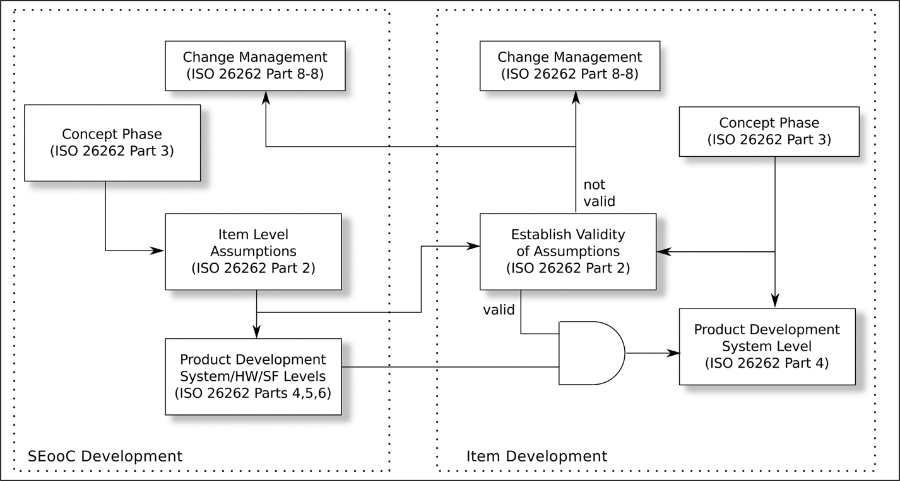

# 8 Sử dụng các thành phần phần mềm Pre-Existing

DOI: [10.1201/9781003598145-8](https://doi.org/10.1201/9781003598145-8)

> *Tôi sống nhờ món súp ngon, chứ không nhờ lời lẽ hoa mỹ.*
>
> Molière

Một hệ thống được xây dựng từ các thành phần. Chương này xem xét một số khía cạnh của việc đưa các thành phần bên ngoài vào một hệ thống sẽ phải qua chứng nhận. Tôi dùng các thuật ngữ “integrator” (bên tích hợp) và “component supplier” (nhà cung cấp thành phần) để chỉ lần lượt nhóm xây dựng hệ thống và nguồn cung cấp các thành phần.

Lưu ý rằng nhà cung cấp thành phần có thể là một dự án khác trong công ty của bên tích hợp, một nhà cung cấp thương mại bên ngoài, hoặc một dự án open-source.

## 8.1 SOUP dưới bất kỳ tên gọi nào khác

IEC 62304 có một thuật ngữ dễ nhớ cho những loại thành phần này: SOUP, hay *Software Of Unknown Provenance,* mặc dù đôi khi “uncertain” được thay cho “unknown” và “pedigree” được thay cho “provenance,” qua đó tạo ra bốn cách diễn giải cho cùng một từ viết tắt.

Thứ tương đương với SOUP trong IEC 61508 là “pre-existing software.” Trong ISO 26262, nó được gọi là “Safety Element out of Context” (SEooC) như được mô tả trong [Mục 3.6.2.4](ch03_safety_standards_and_certification.vi.md#sec3_6_2).

IEC 62304 định nghĩa SOUP là một trong hai loại:

1. Một software item đã được phát triển và có sẵn rộng rãi, vốn không được phát triển với mục đích tích hợp vào thiết bị y tế.
2. Phần mềm đã được phát triển trước đó mà không có đủ hồ sơ về các quy trình phát triển.

Định nghĩa đầu tiên có nghĩa là bất kỳ thành phần pre-existing nào được đưa vào để dùng trong một sản phẩm đều phải được coi là SOUP, bất kể nó đã được phát triển thế nào và có được chứng nhận hay không.

IEC 61508-3 đặc biệt chỉ ra rằng các thư viện phần mềm cần được đưa vào danh sách các thành phần pre-existing. Nó cũng lưu ý rằng phần mềm pre-existing thường chứa các tính năng không cần thiết trong sản phẩm mới: những tính năng phải được chứng tỏ là không can thiệp vào hoạt động hoạt động an toàn của các tính năng được sử dụng.

## 8.2 SOUP đã được chứng nhận hay chưa được chứng nhận

Đối với nhiều thành phần được tích hợp vào một hệ thống đã được chứng nhận, không có lựa chọn giữa việc dùng phiên bản đã được chứng nhận hay chưa được chứng nhận, vì nhà cung cấp thành phần không thể cung cấp phiên bản đã được chứng nhận. Điều này đúng với nhiều sản phẩm open-source rất hữu ích và phổ biến, bao gồm Linux, Apache và MySQL.

Khi một nhà cung cấp thành phần có cả phiên bản đã được chứng nhận và chưa được chứng nhận của một thành phần, bên tích hợp phải quyết định nên mua sản phẩm commercial-grade không có chứng nhận, hay phiên bản đã được chứng nhận vốn thường đắt hơn.

Có hai câu hỏi mà bên tích hợp cần trả lời khi xem xét loại giao dịch mua này. Câu thứ nhất mang tính kỹ thuật: *“Thiết kế dựa vào thành phần này đến mức nào để duy trì functional safety, và liệu có thể thay đổi thiết kế để bớt dựa vào nó mà không ảnh hưởng không thể chấp nhận được đến chi phí sản phẩm, chi phí kiểm chứng hoặc ngày giao hàng không?”*

Câu hỏi thứ hai thuần túy dành cho quản lý dự án: *“Nếu một thành phần cụ thể là thiết yếu để duy trì functional safety, thì việc tự chuẩn bị bằng chứng chứng nhận in-house hay trả thêm tiền cho một thành phần pre-certified sẽ tốn kém hơn về tiền bạc, rủi ro dự án và thời gian dự án?”*

Đối với các hệ thống ô tô, ISO 26262-9 cho phép rõ ràng, trong một số điều kiện nghiêm ngặt, việc phân rã một hệ thống thành các subsystem có ASIL khác nhau. Ví dụ, một hệ thống ASIL C có thể được phân rã thành một phần ASIL C và một phần QM(C) (tức là một thành phần “quality management” mà chỉ cần chứng tỏ rằng nó được phát triển theo một hệ thống quản lý chất lượng thỏa đáng). Việc chứng tỏ mức quản lý chất lượng này cho một thành phần third-party có thể rẻ hơn việc mua một thành phần đã được chứng nhận.

## 8.3 Sử dụng các thành phần Non-Certified

Các tiêu chuẩn đặt ra những đòi hỏi đối với các thành phần bought-in. Tùy theo tiêu chuẩn cụ thể và mức assurance, sẽ cần nhiều bằng chứng trước khi sản phẩm cuối cùng có thể được chứng nhận.

### 8.3.1 ISO/PAS 8926

ISO/PAS 8926 có tên *“Road vehicles — Functional safety — Use of pre-existing software architectural elements.”* Thuật ngữ PAS có nghĩa là “Publicly Available Specification” và chỉ ra rằng tài liệu này không phải là một tiêu chuẩn đầy đủ. Thông thường, một PAS được soạn nhanh hơn một tiêu chuẩn đầy đủ để đáp ứng một nhu cầu cấp bách. Dự kiến nội dung của ISO/PAS 8926 sẽ được đưa vào phiên bản tiếp theo của ISO 26262.

ISO 26262-8 định nghĩa một quy trình “qualifying” (thẩm định, thay vì “certifying” — chứng nhận) phần mềm có sẵn để re-use trong một hệ thống. Đã có một số nhầm lẫn về chính xác khi nào một phần mềm có sẵn có thể đi theo con đường thẩm định này và khi nào nó phải được làm lại để đáp ứng đầy đủ các yêu cầu chứng nhận ISO 26262. ISO/PAS 8926 được viết ra một phần để làm rõ điều này.

Theo một cách nào đó, ISO/PAS 8926 là một sự thất vọng: mặc dù được ban hành năm 2024, nó vẫn khăng khăng rằng mọi failure phần mềm đều mang tính hệ thống (xem [Mục 16.1](ch16_software_failure_rates.vi.md#sec16_1) để biết lời phản bác của tôi đối với ý tưởng đó).

ISO/PAS 8926 đưa ra hai tiêu chí để xác định quy trình cần tuân theo khi một phần mềm pre-existing được đưa vào một sản phẩm sẽ được chứng nhận theo ISO 26262:

1. Mức độ bất định về việc phần mềm có chứa fault hay không.

   Mức này được đánh giá là P1 nếu phần mềm được phát triển theo ISO/IEC/IEEE 12207 hoặc IEC 61508, P2 nếu nó không phải P1 nhưng mọi khoảng trống trong quy trình phát triển đã được đánh giá, hoặc P3 (không phải P1 cũng không phải P2).

2. Độ phức tạp của phần mềm.

   Mức này được đánh giá là C1 (độ phức tạp cao), C2 (độ phức tạp cao, nhưng được đánh giá là chấp nhận được) hoặc C3 (không phải C1 cũng không phải C2). Các metric có thể được dùng để đánh giá độ phức tạp bao gồm cyclomatic complexity của McCabe (xem [Mục 20.3.7](ch20_code_coverage_metrics.vi.md#sec20_3_7)), số dòng code, metric độ phức tạp của Halstead, độ sâu của cây kế thừa hoặc một phân tích Function Point.

Một phần mềm được đánh giá là P3/C3 hoàn toàn không phù hợp để dùng trong một sản phẩm safety-critical. Phần mềm được đánh giá P1/C1 hoặc P2/C1 được xếp vào class I và phần mềm khác vào class II.

Để dùng một thành phần phần mềm class I, chỉ cần tuân theo con đường thẩm định như được định nghĩa trong ISO 26262. Đối với phần mềm class II, cần định nghĩa và thực hiện thêm các hoạt động bổ sung.

### 8.3.2 IEC 61508

Trong các tiêu chuẩn chúng ta đang xem xét, IEC 61508 vạch ra con đường rõ ràng nhất cho việc xử lý phần mềm pre-existing. Trong [phần 3](part3_design_patterns.vi.md), ba con đường khả dĩ được đưa ra:

1. Route 1*S*: phát triển tuân thủ IEC 61508.
2. Route 2*S*: proven-in-use (PIU).
3. Route 3*S*: đánh giá một quá trình phát triển không tuân thủ.

Cách đặt tên kỳ lạ cho các route này được giải thích trong IEC 61508-3. Chữ S biểu thị “systematic” (thực chất là “software”), để phân biệt các route này với các route tương đương cho phần cứng, 1*H*, v.v.

Các route này là riêng của IEC 61508. IEC 62304 và ISO 26262 có những cách riêng để đưa vào lần lượt SOUP và SEooC. Tôi đưa vào các nhận xét về những cách này khi thích hợp trong phần mô tả các route của IEC 61508 dưới đây.

#### 8.3.2.1 Route 1*S*

Route 1*S* chỉ áp dụng được nếu thành phần ban đầu được phát triển theo IEC 61508 và mọi artifact chứng nhận (tài liệu, phân tích, kết quả kiểm chứng, v.v.) đều tồn tại. Trong hầu hết các trường hợp, đây là một route không thực tế; khó có khả năng một thành phần non-certified lại được phát triển theo cách mà mọi artifact của IEC 61508 đều đã được tạo ra, lưu trữ để dùng sau này và được cập nhật, nhưng chưa bao giờ được dùng trước đó.

#### 8.3.2.2 Route 2*S*

Route 2*S* đòi hỏi bên tích hợp chứng tỏ rằng thành phần đã được sử dụng trong một số giờ nhất định ở một vai trò tương đương với vai trò mà nó sẽ được dùng trong sản phẩm tích hợp, với các hồ sơ sẵn có về failure và việc sử dụng. IEC 61508-2 cung cấp phác thảo của case phải được trình bày để chứng tỏ route 2*S* và bắt đầu bằng lời cảnh báo:

> *Một element chỉ được coi là proven in use khi nó có chức năng được giới hạn và chỉ định rõ ràng và khi có đủ bằng chứng tài liệu để chứng tỏ rằng khả năng xảy ra bất kỳ systematic fault nguy hiểm nào là đủ thấp để đạt được các safety integrity level yêu cầu của các safety function sử dụng element đó. Bằng chứng phải dựa trên phân tích kinh nghiệm vận hành của một cấu hình cụ thể của element cùng với phân tích tính phù hợp và kiểm thử.*

Một phụ lục của [phần 3](part3_design_patterns.vi.md) của IEC 61508, được gọi là IEC TS 61508-3-1, đã được ban hành năm 2016 để giải thích thêm về route 2*S*. Phụ lục này đã được đưa vào phiên bản thứ ba của IEC 61508-3 và được mở rộng để bao quát phần mềm ở SC 3 và SC 4. Cụ thể, nó làm rõ rằng, nếu có bất kỳ sửa đổi nào đối với phần mềm, thì phần mềm đó không còn có thể được coi là proven-in-use nữa.

#### 8.3.2.3 Route 3*S*

Route 3*S* thực chất có nghĩa là bên tích hợp, hoặc nhà cung cấp thành phần dưới sự chỉ đạo của bên tích hợp, thực hiện hồi tố công việc thiết kế và kiểm chứng cần thiết để thỏa mãn IEC 61508 — định nghĩa các yêu cầu an toàn, biện minh cho việc sử dụng thành phần, ghi lại thiết kế của thành phần, ghi lại việc kiểm chứng và kiểm định đã thực hiện trên thành phần, thực hiện một hazard and risk analysis, tạo một safety case, thực hiện một failure analysis và chuẩn bị một safety manual. Điều này gần với cách tiếp cận được mô tả trong ISO/PAS 8926 cho việc sử dụng phần mềm pre-existing.

IEC 62304 yêu cầu cụ thể (mục 5.1.7) rằng phải thực hiện một hazard and risk analysis trên thành phần.

Route 3*S* có thể kéo theo một khối lượng công việc khổng lồ. Ngay cả việc chuẩn bị một safety manual cho một thành phần phức tạp như Linux hay MySQL[1](#fn8_1) cũng có thể mất thời gian đáng kể. Về mặt này, IEC 61508 nói:

> *Safety manual có thể được rút ra từ tài liệu riêng của nhà cung cấp pre-existing software element và các hồ sơ về quy trình phát triển của nhà cung cấp element, hoặc có thể được tạo ra hay bổ sung bằng các hoạt động thẩm định thêm do bên phát triển hệ thống liên quan đến an toàn hoặc các bên thứ ba thực hiện. Trong một số trường hợp, reverse engineering[2](#fn8_2) có thể là cần thiết để tạo ra tài liệu đặc tả và thiết kế đủ để đáp ứng các yêu cầu của điều khoản này, tùy thuộc vào các điều kiện pháp lý hiện hành (ví dụ bản quyền hoặc quyền sở hữu trí tuệ).*

Ngoài việc tạo ra một safety manual một cách hồi tố, còn có những nhiệm vụ quan trọng khác cần xem xét. Bên tích hợp sẽ cần chuẩn bị bằng chứng để chứng tỏ những điều sau.

- Các giả định mà nhà cung cấp thành phần đưa ra về việc sử dụng thành phần phù hợp với cách sử dụng thực tế mà nó sẽ được đưa vào.

  Có lẽ nhà cung cấp thành phần chỉ dự định cho thành phần được dùng ở tốc độ interrupt thấp hơn 1000 lần mỗi giây, nhưng trong thiết bị tích hợp, tốc độ interrupt cao hơn có thể xảy ra.

  ISO 26262-10 có một sơ đồ minh họa giao diện giữa nhà cung cấp thành phần (SEooC) và bên tích hợp. Tôi đã điều chỉnh sơ đồ đó một chút trong [Hình 8.1](#fig8_1) và nó cho thấy rằng nhà phát triển SEooC có trách nhiệm định nghĩa các giả định được đưa ra về cách element sẽ được sử dụng, và bên tích hợp có trách nhiệm bảo đảm rằng những giả định đó là chấp nhận được. Những giả định đó thường được giao trong safety manual của SEooC.

- Các failure mode và failure rate của thành phần đã được phân tích.

  Thành phần sẽ xuất hiện trong failure analysis của thiết bị tích hợp, và sẽ cần thông tin về các failure mode và failure rate của nó.

- Các impact analysis đang được thực hiện đối với các bug tìm thấy trong thành phần.

  Câu hỏi được đặt ra trong impact analysis là, *“Có bug nào trong số này có thể ảnh hưởng đến hoạt động an toàn của thiết bị không?”* Đây là một hoạt động sẽ tiếp diễn trong suốt vòng đời của thiết bị và có thể khó khăn với một sản phẩm open-source, nơi mặc dù danh sách bug có thể truy cập tự do, chúng thường chỉ có thể được một chuyên gia diễn giải. Điều này có thể là không thể đối với một sản phẩm thương mại closed-source, nơi nhà cung cấp không công khai danh sách bug.

  Mức độ xem xét kỹ lưỡng các báo cáo bug này cũng được yêu cầu trong Section 7.1.3 của IEC 62304.

[1](#fn8_18b)Tôi dùng Linux và MySQL làm ví dụ trong mục này vì chúng là những công nghệ well-known và well-proven hoàn toàn có thể trở thành một phần của một thiết kế hệ thống. Lập luận tương tự cũng áp dụng cho nhiều phần mềm open-source hoặc phần mềm thương mại off-the-shelf khác.

[2](#fn8_28b)Tức là tạo ra tài liệu thiết kế từ phần hiện thực thay vì tạo ra phần hiện thực từ thiết kế.

*Hình 8.1: SEooC và việc phát triển item (ISO 26262-10).[⏎](#b8fig8_1)*

Đây là điều khiến một số bên tích hợp ngần ngại dùng phần mềm open-source trong các hệ thống safety-critical. Việc tạo ra một failure analysis cho một sản phẩm như Linux có thể đắt đỏ đến mức không kham nổi và có thể dựa vào chuyên môn mà nhóm của bên tích hợp không có. Tương tự, việc theo dõi các báo cáo bug của Linux, kiểm tra từng cái về tác động tiềm tàng lên sản phẩm trong suốt vòng đời sản phẩm, có thể rất time-consuming. Dĩ nhiên, bug không chỉ ảnh hưởng đến các thành phần, mà còn đến toàn bộ hệ thống, và công ty phát triển sản phẩm phải có một quy trình để thông báo cho khách hàng về các bug.

## 8.4 Sử dụng một thành phần đã được chứng nhận

Nếu nhà cung cấp thành phần có một thành phần đã được chứng nhận, thì route 1*S* trở thành route thực tế nhất. Điều này mang lại những lợi ích rõ ràng, nhưng có một cái bẫy cần tránh. Đôi khi người ta tin rằng *“bằng việc mua các thành phần đã được chứng nhận, chúng ta có thể chắc chắn về việc chứng nhận sản phẩm cuối cùng.”* Xem Ngụy biện 4 để thấy một lời bác bỏ nhanh ý tưởng đó.

> Ngụy biện 4. SIL 3 + SIL 3 = SIL 3
>
> *Các công ty dễ bị cám dỗ tin rằng nếu họ mua hai thành phần, mỗi thành phần được chứng nhận SIL 3 theo IEC 61508, tức là xác suất failure mỗi giờ hoạt động đã được chứng tỏ là* $< {10}^{- 7}$, *và kết hợp chúng vào một hệ thống dựa vào cả hai, thì hệ thống đó cũng phù hợp để được chứng nhận SIL 3.*
>
> *Một phép tính số học đơn giản cho thấy điều này không đúng:*
>
> $$\begin{array}{l} 1.0 - ( 1.0 - {10}^{- 7} ) ( 1.0 - {10}^{- 7} ) = 2 \times {10}^{- 7} > {10}^{- 7} \end{array}$$
>
> *Tổ hợp này chỉ có thể được chứng nhận ở SIL 2.*

Tuy nhiên, có những lợi ích *thực sự* có được từ việc dùng một thành phần pre-certified.

Thứ nhất, nếu chứng nhận của thành phần được cơ quan chứng nhận của bên tích hợp chấp nhận, thì có thể tránh được route 2*S* và 3*S*. Về nguyên tắc, nếu công ty đã cấp chứng nhận cho thành phần được công nhận (xem [Hình 3.1](ch03_safety_standards_and_certification.vi.md#fig3_1) ở trang 28), thì người ta sẽ mong đợi bất kỳ cơ quan chứng nhận được công nhận nào khác cũng chấp nhận nó. Tôi thấy không phải lúc nào cũng vậy; đôi khi một công ty chứng nhận nghi ngờ một chứng nhận do công ty khác cấp. Không rõ điều này là do động cơ thương mại hay do một mối lo ngại thực sự về chất lượng chứng nhận của công ty kia.

Thứ hai, các điều kiện của chứng nhận sẽ đặt nghĩa vụ lên nhà cung cấp thành phần phải thông báo cho bên tích hợp về bất kỳ bug nào được phát hiện trong thành phần có khả năng ảnh hưởng đến hoạt động an toàn. Đối với một thành phần non-certified, như đã mô tả ở trên, thông tin này có thể không sẵn có.

Có một lợi ích *không* đi kèm với việc mua một thành phần đã được chứng nhận — việc dùng một thành phần đã được chứng nhận không làm giảm trách nhiệm đạo đức hay pháp lý của bên tích hợp. IEC 62304 nói điều này rõ ràng nhất:

> *Khi architecture hệ thống thiết bị y tế có bao gồm một thành phần được mua về (đây có thể là một thành phần đã mua hoặc một thành phần không rõ nguồn gốc), chẳng hạn một máy in/máy vẽ có chứa SOUP, thì thành phần được mua về đó trở thành trách nhiệm của nhà sản xuất và phải được đưa vào việc quản lý rủi ro của thiết bị y tế.*

Lưu ý rằng điều này không chỉ bao gồm các thành phần phần mềm như MySQL, vốn được tích hợp trực tiếp vào sản phẩm, mà còn cả code nhúng bên trong các thiết bị có nguồn gốc từ một bên thứ ba—một máy in postscript có thể chứa một lượng code đáng kể. Khi chuẩn bị phân tích như vậy, chúng ta cần cẩn thận với các “accidental system” thuộc loại được mô tả ở trang 20. Trong trường hợp đó, có thể rất khó nhận diện và truy cập được toàn bộ code.

## 8.5 Đồng bộ các chu kỳ phát hành

Dù dùng thành phần đã được chứng nhận hay chưa được chứng nhận, câu hỏi về việc đồng bộ các chu kỳ phát hành cần được giải quyết. Mỗi thành phần có thể có một chu kỳ phát hành khác nhau, và các chu kỳ phát hành này cần được co-ordinated với chu kỳ phát hành của sản phẩm tích hợp. [Mục 6.1](ch06_the_safety_case.vi.md#sec6_1) của IEC 62304 cũng nhắc chúng ta rằng cần tính đến khả năng thành phần third-party trở nên không còn được hỗ trợ; nếu tổ chức tạo ra nó biến mất hoặc ngừng hỗ trợ thành phần, tình huống đó sẽ được xử lý thế nào bởi hệ thống quản lý chất lượng (QMS) của bên tích hợp?

## 8.6 Các công ty ví dụ

Đối với công ty hư cấu Alpha Device Corporation được giới thiệu trong [Chương 4](ch04_representative_companies.vi.md), quyết định mua phiên bản đã được chứng nhận hay chưa được chứng nhận của hệ điều hành của Beta Component Incorporated có vẻ rõ ràng — ADC dự định mua phiên bản đã được chứng nhận. Quyết định này dựa trên nhận định kỹ thuật rằng hệ điều hành là then chốt để duy trì functional safety trong thiết bị, và trên cân nhắc thương mại về rủi ro đối với ngày kết thúc phát triển nếu dùng phiên bản chưa được chứng nhận.

Đó chưa phải là kết thúc câu chuyện. QMS của ADC định nghĩa cách mà các thành phần third-party có thể được đưa vào một sản phẩm. Những quy định này bao gồm việc thực hiện một đợt audit các quy trình phát triển của nhà cung cấp và, để giảm thiểu rủi ro BCI ngừng hỗ trợ thành phần, quyền truy cập source code và hệ thống build của thành phần.

Vì vậy, thỏa thuận hợp đồng giữa ADC và BCI bao gồm một tùy chọn cho ADC thực hiện một đợt audit on-site hằng năm đối với các thủ tục phát triển của BCI. Việc này có thể do nhân viên từ nhóm quản lý chất lượng của ADC hoặc một auditor bên ngoài do ADC chọn thực hiện. Điều này làm tăng chi phí của hệ điều hành vì BCI sẽ phải dành nhân sự cho đợt audit mỗi năm.

Quyền truy cập source code hệ điều hành của ADC gây tranh cãi nhiều hơn vì đây là tài sản trí tuệ của BCI. Sau nhiều cuộc đàm phán, có thể đạt được một thỏa thuận đặt source code và các công cụ để build nó vào escrow — một nơi trung lập mà ADC có thể truy cập nếu BCI ngừng kinh doanh. Thỏa thuận này cũng đòi hỏi rằng, khi BCI sửa bug cho thành phần, phiên bản trong escrow phải được cập nhật.
