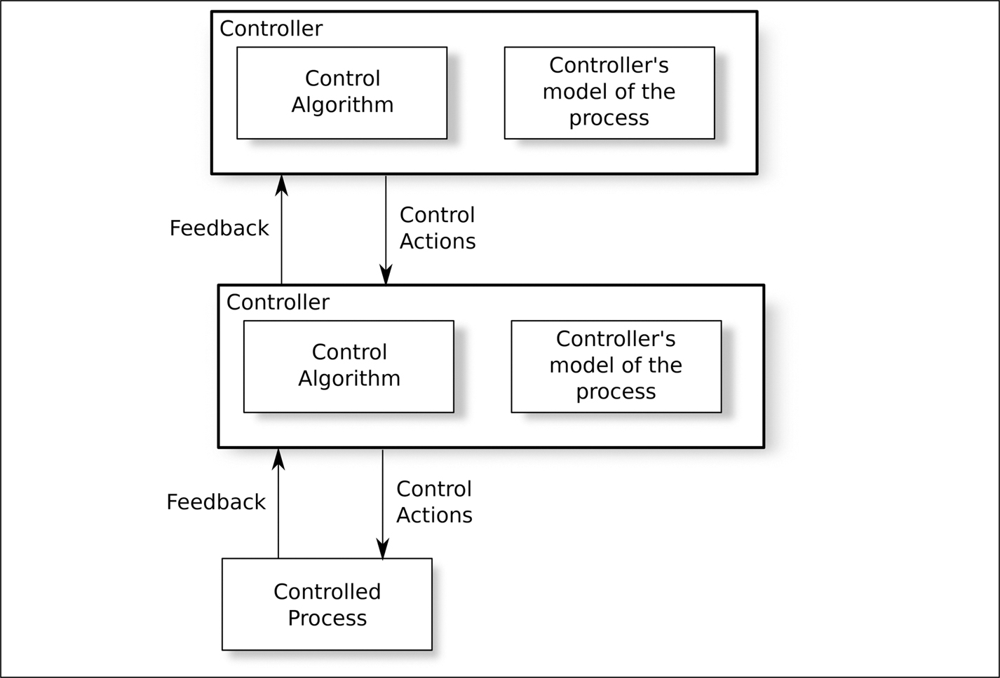
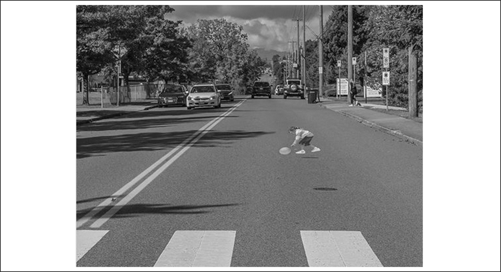
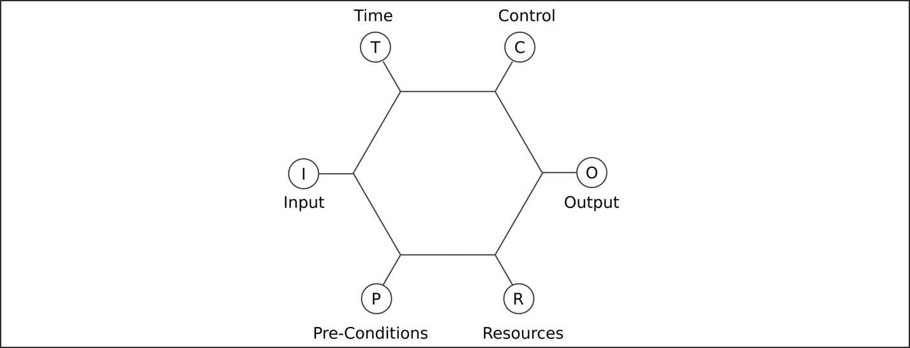
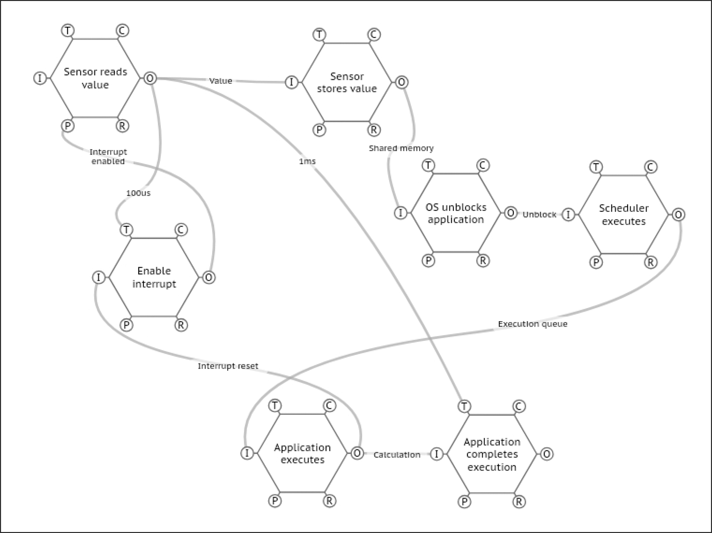

# 9 Thiết bị bên trong hệ thống

DOI: [10.1201/9781003598145-9](https://doi.org/10.1201/9781003598145-9)

## 9.1 Hệ thống lớn hơn

Trọng tâm của cuốn sách này là phần mềm trong một thiết bị nhúng, nhưng, vì hai lý do, tôi nghĩ việc xem xét cả hệ thống lớn hơn sẽ tích hợp thiết bị đó cũng hữu ích:

1. Các hệ thống phức tạp thể hiện những hành vi bất ngờ mà việc xem xét bản thân các thành phần không làm lộ ra, mà chỉ xảy ra khi các thành phần tương tác với nhau. Điều này được gọi là “emergent behavior” (hành vi trồi). Trước khi hệ thống lớn hơn được triển khai, các nhà phân tích an toàn sẽ cố dự đoán các emergent behavior khả dĩ và để làm việc này, họ sẽ cần các mô hình chi tiết của các thành phần.
2. Bản thân các thiết bị chúng ta đang tạo ra cũng ngày càng phức tạp, và một số kỹ thuật phân tích trước đây chỉ dành cho toàn bộ hệ thống giờ có thể áp dụng được cho từng thiết bị nhúng riêng lẻ. Chương này mô tả một số kỹ thuật như vậy.

Ngày càng nhiều, hệ thống lớn hơn mà các thiết bị của chúng ta được tích hợp vào là những hệ thống số, socio-technical, bao gồm cả con người lẫn máy móc. Hãy xem hệ thống Horizon của British Post Office như được mô tả trong tài liệu tham khảo [[1](#refbib9_1)] của James Christie. Cốt lõi của hệ thống này là phần mềm chưa bao giờ được cho là ảnh hưởng đến an toàn khi nó được phát triển và triển khai lần đầu: nó chỉ thực hiện một số chức năng kế toán. Tuy nhiên, hệ thống đó đã gây ra tổn hại đáng kể: ít nhất bốn ca tử vong, ít nhất 236 người phải vào tù dù vô tội, sự đổ vỡ của nhiều cuộc hôn nhân, sự mất danh tiếng và tổn hại tài chính nghiêm trọng. Trong cuộc điều tra về thảm kịch này, phần mềm và các quy trình phát triển phần mềm đã được xem xét chi tiết.

Safety Critical Systems Club (SCSC) có một nhóm làm việc cung cấp hướng dẫn về assurance cho các hệ thống phức tạp và phiên bản đầu tiên của hướng dẫn này được phát hành vào tháng Hai năm 2025: xem tài liệu tham khảo [[2](#refbib9_2)].

## 9.2 Machine learning

Machine learning với deep neural network và support vector machine đã rất thành công kể từ khi được Warren McCulloch và Walter Pitts giới thiệu vào năm 1943 (tài liệu tham khảo [[3](#refbib9_3)]), nhưng con người rất khó xác định chính xác những gì đã được học.

> Giai thoại 12 *Cách đây một thời gian, tôi làm việc với một công ty ô tô ở Châu Âu. Công ty đó đã xây dựng một đường thử và các ô tô tự lái đã học cách lái quanh đường thử đó một cách an toàn. Sau đó công ty xây dựng một đường thử thứ hai, giống hệt đường thứ nhất, ở một vùng khác của đất nước. Những chiếc xe đã học trên đường thứ nhất không thể lái quanh đường mới, dù nó giống hệt! Cuộc điều tra sau đó phát hiện ra rằng những chiếc xe đã học nội dung của các bảng quảng cáo dọc đường thử thứ nhất. Với những bảng quảng cáo khác trên đường thứ hai, những gì đã học trở nên vô dụng.*

Vấn đề hiểu chính xác hệ thống machine-learning đã học được gì được gọi là “model interpretability”. Tài liệu tham khảo [[4](#refbib9_4)] của Zachary Lipton chỉ ra rằng thuật ngữ này chưa được định nghĩa đúng đắn và liệt kê nhiều cách hiểu khả dĩ. Lipton cũng chỉ ra rằng các quy định ở Liên minh Châu Âu nói rằng những cá nhân bị ảnh hưởng bởi các quyết định thuật toán có *quyền* được giải thích về cách các quyết định đó được đưa ra. Điều này bổ sung một sự cần thiết về mặt pháp lý bên cạnh sự cần thiết về mặt an toàn của việc hiểu những gì đã được học.

Hàng triệu giờ dữ liệu input cảm biến đã được ghi lại từ những chiếc xe manually-driven và từ các môi trường mô phỏng như CARLA.[1](#fn9_1) Các ô tô (bán) tự lái đang học từ những dữ liệu này. Tương tự, các thiết bị y tế đang học cách phát hiện khối u trong các ảnh chụp. Điều này đưa vào một số chiều mới cho việc xem xét dữ liệu (xem [Mục 1.4.5](ch01_introduction.vi.md#sec1_4_5)), cả về chất lượng và độ đầy đủ của dữ liệu được dùng để huấn luyện lẫn về tính toàn vẹn của các trọng số mạng nơ-ron thu được. Nó cũng đặt ra câu hỏi làm thế nào để chứng tỏ thỏa đáng sự an toàn của các hệ thống này. ISO/PAS 8800 đề cập đến những vấn đề này.

Trên đường, một chiếc xe chắc chắn sẽ gặp những điều kiện mà nó chưa được huấn luyện, ví dụ một người đàn ông hóa trang thành vịt Donald băng qua trước mặt nó,[2](#fn9_2) hoặc một máy bay hỏng động cơ hạ cánh xuống con đường phía trước. Khi đó câu hỏi sẽ là nó đã khái quát hóa từ dữ liệu huấn luyện chính xác đến mức nào. Đáng tiếc là, cho đến khi sự kiện hiếm gặp đó xảy ra, điều này là không thể đo được.

Philip Koopman đã lập luận (ví dụ, trong tài liệu tham khảo [[5](#refbib9_5)] và [[6](#refbib9_6)]) rằng phân phối xác suất của những sự kiện hiếm gặp này là heavy-tailed và không có lý do chính đáng nào để huấn luyện một ô tô tự lái xử lý một con vịt Donald khổng lồ băng qua đường, vì bất kỳ chiếc xe riêng lẻ nào gần như chắc chắn sẽ không bao giờ gặp một con như vậy trong suốt vòng đời của nó. Tuy nhiên, nếu những sự kiện hiếm gặp này không nằm trong dữ liệu huấn luyện, chiếc xe sẽ làm gì khi gặp một “con vịt” như vậy? Tài liệu tham khảo [[5](#refbib9_5)] chứa một kết quả khá đáng buồn:

[1](#fn9_19b)[https://carla.org/](https://carla.org/)

[2](#fn9_29b)Đây không phải là một kịch bản bịa ra: nó đã xảy ra ở Fort Lee, New Jersey, Mỹ vào ngày 31 tháng Mười năm 2014.

> *Vấn đề heavy tail safety ceiling xảy ra khi (a) tổng tập hợp các bất ngờ tiềm ẩn là tương đối lớn, và (b) tốc độ xuất hiện tổng hợp của các bất ngờ tiềm ẩn có rủi ro không thể chấp nhận được là thường xuyên hơn mục tiêu an toàn của hệ thống. Trong tình huống này, hệ thống không an toàn ở mức chấp nhận được. Tệ hơn, việc sửa các bất ngờ khi chúng xuất hiện sẽ không giải quyết được vấn đề, vì việc giảm thiểu một loại bất ngờ sẽ không thay đổi đáng kể kích thước của tập hợp lớn các bất ngờ tiềm ẩn.*

Một khúc mắc khác của cách tiếp cận machine learning là có nên cho phép thiết bị tiếp tục học ngoài thực địa hay không, hoặc từ kinh nghiệm của chính nó hoặc từ kinh nghiệm của các thiết bị khác ngoài thực địa. Nếu hệ thống học một cách động, thì khó thấy chính xác điều gì có thể được chứng nhận, và có khả năng những người vận hành có ý đồ xấu có thể khiến hệ thống học những hành vi nguy hiểm. Mặt khác, nếu việc học của nó được cố định tại thời điểm sản xuất và sau đó chỉ được cập nhật theo chu kỳ bảo trì, thì hành vi nguy hiểm có thể tồn tại trong thiết bị trong một thời gian dài.

Vấn đề kiểm tra một hệ thống machine learning safety-critical không phải là mới. Tài liệu tham khảo [[7](#refbib9_7)] của Zeshan Kurd *et al.* có tên *“Developing Artificial Neural Networks for Safety Critical Systems”* và xuất hiện vào cuối năm 2006. Thực ra nó đã được gửi đến tạp chí từ năm 2003. Trong tất cả các chủ đề trong cuốn sách này, đây là chủ đề đang phát triển nhanh nhất hiện nay. Tôi đang trình bày hiện trạng kỹ thuật vào thời điểm viết sách, nhưng rất có thể mục này sẽ trở nên cổ lỗ và mang tính lịch sử trong vòng đời của cuốn sách.

## 9.3 Safety of the Intended Functionality (SOTIF)

SOTIF, tình huống mà một tình huống nguy hiểm xảy ra mặc dù mọi thành phần đều hoạt động đúng như thiết kế, được mô tả trong [Mục 2.1.3](ch02_terminology_of_safety.vi.md#sec2_1_3) ở trang 13.

Với các hệ thống tự hành, rất dễ dựng lên các ví dụ về những tình huống nguy hiểm mà mọi thứ đều hoạt động như dự định. Hãy xét một ô tô tự lái đang chạy trên đường với một chiếc xe manually-driven bám quá sát phía sau. Một đứa trẻ trượt ván từ trên dốc xuống về phía con đường. Hệ thống của ô tô tự lái có thể hoạt động như sau:

1. Hệ thống camera phát hiện đứa trẻ trên ván trượt và nhận diện *đúng* nó với xác suất 87% là một đứa trẻ (xác suất 9% là một túi giấy bị gió thổi và 4% là một con chó).
2. Hệ thống diễn giải ước lượng *đúng* tốc độ của đứa trẻ là $15 \pm 3$ km/h.
3. Hệ thống logic bác bỏ *đúng* việc nhận diện là một đứa trẻ vì trẻ em không di chuyển với tốc độ đó trừ khi đang đi xe đạp. Vật thể hẳn phải là một túi giấy bị gió thổi.
4. Hệ thống ra quyết định, khi đứng trước lựa chọn đâm vào một túi giấy hoặc phanh gấp và có thể gây hại cho người đang lái xe quá sát phía sau, đã quyết định *đúng* là đâm vào “túi giấy.”

Tình huống nguy hiểm đã xảy ra ở đây, không phải vì failure của bất kỳ thành phần nào, mà vì trí tưởng tượng không đầy đủ của nhà thiết kế hệ thống, người đã xem xét một đứa trẻ đi xe đạp, nhưng không xét đến một đứa trẻ đi ván trượt. Thế giới ô tô tự lái đầy rẫy những ví dụ tương tự, nhưng có thật: ví dụ, chiếc ô tô tự lái của Uber không nhận ra Elaine Herzberg đang *dắt* một chiếc xe đạp vào ngày 18 tháng Ba năm 2018 và sự cố taxi Cruise ở San Francisco vào ngày 2 tháng Mười năm 2023. Tài liệu tham khảo [[8](#refbib9_8)] của Phil Koopman lưu ý rằng trong sự cố Cruise *“Việc kéo lê người đi bộ sau đó là do [xe tự hành] làm một việc được thiết kế để tăng cường an toàn (đạt tới một trạng thái so-called Minimal Risk Condition) nhưng lại diễn ra sai …”* Chiếc taxi không chỉ hành động đúng như nó được thiết kế để hành động, mà còn gây ra tổn hại trong khi cố ngăn chặn tổn hại.

SOTIF rõ ràng áp dụng được cho việc phân tích các hệ thống phức tạp, đặc biệt là emergent behavior của chúng. Một failure analysis gần như chắc chắn áp dụng được cho một thiết bị chạy phần mềm single-threaded, run-to-completion trên một vi điều khiển single-core với một executive time-triggered. Một failure analysis có thể không không áp dụng được cho một thiết bị chạy một chương trình multi-threaded, safety-affecting cùng với nhiều subsystem phần mềm chưa được chứng nhận trên một bộ vi xử lý multi-core với một hệ điều hành phức tạp. Câu hỏi là ranh giới giữa failure analysis và SOTIF analysis nằm ở đâu.

“System-Theoretic Accident Model and Processes” (STAMP) của Nancy Leveson, vốn dựa trên lý thuyết hệ thống chứ không phải lý thuyết độ tin cậy, được giới thiệu trong tài liệu tham khảo [[9](#refbib9_9)] và có thể áp dụng được cho các hệ thống ở bất kỳ mức độ phức tạp nào. Có hai dạng STAMP:

1. Systems-Theoretic Process Analysis (STPA) để phân tích một hệ thống trong quá trình phát triển nhằm nhận diện các tình huống nguy hiểm khả dĩ.
2. Causal Analysis Using System Theory (CAST) để phân tích nguyên nhân của một sự cố nguy hiểm sau khi hệ thống đã được triển khai.

[Hình 9.1](#fig9_1) minh họa hai cấp của một mô hình trừu tượng STAMP phân cấp. Một hệ thống bao gồm một hệ phân cấp các quá trình được điều khiển, trong đó mỗi bộ điều khiển có một “mental model” (mô hình tư duy) về quá trình mà nó đang điều khiển. Ví dụ, theo thời gian, một người lái ô tô xây dựng một mental model về cách những người lái xe, người đi xe đạp và người đi bộ phía trước có thể phản ứng và lái xe tương ứng. Một người mới lái có một mô hình thô sơ hơn nhiều và vì vậy phải thận trọng hơn để tránh một tình huống nguy hiểm.

*Hình 9.1: Cấu trúc của một mô hình STAMP.[⏎](#b9fig9_1)*

Trong mô hình STAMP, bộ điều khiển có thể là một chính phủ, một tổ chức, một con người hoặc một subsystem phần mềm hay phần cứng. Annex E của ISO/PAS 8800 có một ví dụ STPA hoàn chỉnh về một hệ thống nhận diện người tham gia giao thông dễ bị tổn thương (VRU) và phanh.

Như một ví dụ high-level của [Hình 9.1](#fig9_1), một chính phủ (bộ điều khiển highest-level) có thể ban hành các control action (luật) để điều khiển các công ty sản xuất ô tô tự lái. Chính phủ có một “mental model” về cách ô tô tự lái sẽ tương tác với các phương tiện giao thông khác và ban hành các luật phù hợp. Chính phủ nhận phản hồi từ các tổ chức bị ảnh hưởng và có thể thay đổi luật (các control action) dựa trên phản hồi đó. Sự tương tác này lan xuống qua các quá trình đang được điều khiển.

Một ví dụ khác của [Hình 9.1](#fig9_1) có thể là một thiết bị y tế. Ở đây, bộ điều khiển top-level có thể là một y tá hoặc bác sĩ có mental model về cách thiết bị hoạt động, đưa ra các control action (nhấn các nút trên thiết bị). Thiết bị sau đó thực hiện các hành động cần thiết trên bệnh nhân (“quá trình được điều khiển”) và phản hồi thông tin (ví dụ, nhịp tim) trở lại người vận hành, người sau đó có thể đưa ra thêm các control action.

Các tình huống nguy hiểm xảy ra khi phản hồi từ quá trình được điều khiển không hợp lệ (ví dụ, một cảm biến gửi dữ liệu sai), các control action bị quá trình được điều khiển diễn giải sai, hoặc mental model của bộ điều khiển sai hoặc không đầy đủ. Tình huống cuối cùng này là khó xử lý nhất.

Các ví dụ về những tình huống có khả năng nguy hiểm liên quan đến một “mental model” không đúng bao gồm:

- một ảo ảnh quang học. ISO 21448 tái hiện [Hình 9.2](#fig9_2) như một ví dụ về ảo ảnh. Ảo ảnh này do *Community Against Preventable Injuries* ở Vancouver tạo ra và, vì không có đứa trẻ nào ở đó, chỉ là một hình dán trên mặt đường, một LIDAR sẽ báo không có chướng ngại vật, trong khi camera có thể báo có một đứa trẻ.[3](#fn9_3) Một khi ô tô tự lái trở nên common-place, có lẽ chúng ta có thể chờ đợi rất nhiều bức vẽ như vậy từ những người thấy vui khi làm rối trí những chiếc xe.
- sử dụng tính năng đỗ xe tự động của ô tô khi có một vật dài nhô ra từ phía sau xe.

*Hình 9.2: Một ảo ảnh quang học (Nguồn: The Community Against Preventable Injuries).[⏎](#b9fig9_2)*

[3](#fn9_39b)Những người tạo ra hình dán chỉ ra rằng, không giống các vạch qua đường 3D ở các nước khác, “Pavement Patty” không phải là một công trình lắp đặt cố định. Cô bé chỉ được lắp đặt trong vài ngày, trên một đoạn đường có tầm nhìn thoáng và biển báo để cảnh báo người lái khi họ đến gần. Cô bé được dự định là một thứ để khơi gợi các cuộc trò chuyện.

Theo định nghĩa, các kịch bản nguy hiểm có thể phát sinh do chức năng dự định là khó dự đoán — nếu chúng dự đoán được thì chúng đã được đưa vào thiết kế hệ thống. ISO 21448 xem xét các kịch bản theo hai trục: chúng đã biết hay chưa biết và chúng an toàn hay không an toàn, như được minh họa trong [Bảng 9.1](#tbl9_1).

*Bảng 9.1 Các loại kịch bản SOTIF[⏎](#b9tbl9_1)*

|  | **Không an toàn** | **An toàn** |
|---|---|---|
| **Đã biết** | Vùng 2 | Vùng 1 |
| **Chưa biết** | Vùng 3 | Vùng 4 |

Vùng 4, chứa các kịch bản an toàn nhưng chưa biết (không lường trước), bị bỏ qua trong ISO 21448, và trọng tâm của đặc tả là thu hẹp Vùng 2 và 3 bằng cách mở rộng Vùng 1. Điều này được xem xét từ hai góc nhìn: những sự kiện nguy hiểm nào có thể phát sinh từ hành vi dự định nguy hiểm của hệ thống, và đâu là những nguyên nhân tiềm tàng của hành vi nguy hiểm?

Một ví dụ từ góc nhìn thứ nhất là adaptive cruise control thể hiện một “hiệu ứng đàn accordion” nếu nhiều phương tiện dùng nó đang di chuyển cùng nhau. Độ trễ trong các vòng điều khiển có thể khiến dao động trở nên nguy hiểm, đòi hỏi người lái phải can thiệp.

Các ví dụ từ góc nhìn thứ hai là một người đi bộ mặc áo khoác dày, có đệm, làm ảnh hưởng đến hiệu năng của các cảm biến siêu âm, hoặc mặt trời mọc làm ảnh hưởng đến hiệu năng của một camera video.

SOTIF analysis được đề xuất thực chất bắt đầu bằng việc nhận diện và đánh giá các trigger event gắn với các thuật toán (ví dụ, thuật toán chưa được huấn luyện để xử lý một phương tiện khẩn cấp chạy xuyên qua một đám kẹt xe) và các sự kiện ảnh hưởng đến các cảm biến và cơ cấu chấp hành (ví dụ, Electro-Magnetic Interference).

Một khi các trigger event đã được nhận diện, có thể xác định các mức rủi ro chấp nhận được bằng một lập luận GAMAB/GAME (xem trang 76) hoặc ALARP (xem trang 75). Việc này sẽ tính đến thống kê giao thông của quốc gia nơi phương tiện sẽ được phát hành (ví dụ, NHTSA cho Mỹ, ONISR cho Pháp, BASt cho Đức). Các thống kê này nêu chi tiết số lượng ô tô trên đường, quãng đường trung bình một chiếc xe chạy mỗi năm, số lượng các loại tai nạn khác nhau, v.v.

## 9.4 HAZOP

Thủ tục HAZOP như được định nghĩa trong IEC 61882 được mô tả trong [Mục 7.3.1](ch07_foundational_analyses.vi.md#sec7_3_1) ở trang 73.

Một điểm yếu của quy trình HAZOP, đặc biệt khi áp dụng cho một hệ thống lớn, có thể liên quan đến hành động của con người, là kết quả của nó được diễn đạt bằng một ngôn ngữ phi hình thức (tự nhiên) (ví dụ, tiếng Anh). Điều này khiến việc xử lý các rủi ro đã nhận diện bằng máy tính và phân tích chúng bằng số trở nên khó khăn. Đặc biệt, nó khiến việc cập nhật các rủi ro sau khi hệ thống được triển khai và có dữ liệu thực địa trở nên khó khăn. Điều này đã dẫn đến một số đề xuất tạo ra một ontology hình thức (một tập tên gọi đã được định nghĩa) cho các thuật ngữ được dùng trong quy trình HAZOP. Trong tài liệu tham khảo [[10](#refbib9_10)], Abdul Aziz *et al.* mô tả một phương pháp xây dựng một ontology như vậy bằng PR-OWL, phiên bản xác suất của Web Ontology Language. Sau đó một mạng Bayes tổng quát được xây dựng cho loại sản phẩm đang được phân tích và mạng này sau đó được tinh chỉnh cho sản phẩm cụ thể. Kết quả là một bức tranh định lượng về các rủi ro.

## 9.5 Functional Resonance Analysis Method (FRAM)

FRAM được mô tả trong cuốn sách của Erik Hollnagel, tài liệu tham khảo [[11](#refbib9_11)]. Nó thường được áp dụng cho các hệ thống lớn: ví dụ, các thủ tục và quy trình trong một bệnh viện. Khi các thiết bị nhúng chúng ta chế tạo ngày càng phức tạp hơn, đây là một kỹ thuật cũng có thể áp dụng cho chúng.

Áp dụng FRAM là một quy trình four-step:

1. Nhận diện các chức năng (hoạt động) mà hệ thống thực hiện và, với mỗi chức năng, định nghĩa các điều kiện cần để nó bắt đầu, các output nó sẽ tạo ra, các ràng buộc thời gian đối với chức năng và các tài nguyên nó cần.

   Ví dụ, trong một thiết bị nhúng, chức năng “đọc cảm biến tốc độ” có thể phụ thuộc vào một interrupt cụ thể để bắt đầu, có thể có output là đặt số đọc vào một vị trí shared memory cụ thể, có thể cần hoàn thành trong vòng 1 ms kể từ interrupt và có thể cần interrupt đã được enable và vị trí shared memory đã được cấp phát trước khi nó có thể hoạt động.

2. Xác định sự biến thiên mà chức năng có thể phải chịu.

   Trong ví dụ đọc cảm biến tốc độ, thời gian chức năng cần có thể thay đổi tùy theo các thread higher-priority đang chạy và output của chức năng có thể thay đổi nếu giá trị đọc được không hợp lệ. Mỗi yếu tố này đều có thể ảnh hưởng đến chức năng tiếp theo ở phía sau.

3. Dùng một công cụ để kiểm tra mô hình xem có cộng hưởng (resonance) không: trạng thái mà sự biến thiên ở một chức năng có thể gây ra một phản hồi dương dẫn đến hoạt động sai của thiết bị.

   Trong ví dụ cảm biến tốc độ, có lẽ nếu phản ứng với interrupt bị trễ do việc thực thi một thread higher-priority khi số đọc từ cảm biến không hợp lệ (vốn mất nhiều thời gian xử lý hơn), điều này có thể ảnh hưởng xấu đến chức năng tiếp theo trong chuỗi, khiến nó mất nhiều thời gian hơn bình thường, điều này lại khiến chức năng đọc phản ứng với interrupt tiếp theo còn muộn hơn, và cứ thế, tình hình ngày càng tệ hơn cho đến khi một interrupt bị bỏ lỡ.

4. Giảm thiểu ảnh hưởng của cộng hưởng bằng cách thêm các rào chắn và các counter-measures khác để giảm ảnh hưởng của nó lên hệ thống.

FRAM là một ngôn ngữ đồ họa, được hỗ trợ bởi công cụ open source FRAM Model Visualiser (FMV) chạy trên trình duyệt web.[4](#fn9_4)

[Hình 9.3](#fig9_3) minh họa node mà từ đó mô hình FMV được xây dựng: một hình lục giác với mỗi góc có một vai trò cụ thể. Các hình lục giác này sau đó có thể được nối với nhau (ví dụ, output của một node đưa vào input của một node khác).

*Hình 9.3: Node FRAM cơ bản.[⏎](#b9fig9_3)*

[Hình 9.4](#fig9_4) minh họa một phiên bản đơn giản hóa của ví dụ đọc cảm biến tốc độ đã nêu ở trên: một cảm biến, được kích hoạt bởi một interrupt, đọc và lưu một giá trị, có thể vào một message queue. Điều này khiến hệ điều hành unblock và lập lịch cho ứng dụng, ứng dụng này enable lại interrupt và xử lý số đọc. Lưu ý ràng buộc rằng ứng dụng nên hoàn thành việc thực thi trong vòng 1 ms kể từ khi số đọc cảm biến sẵn sàng. Trong thực tế, sẽ có nhiều phụ thuộc giữa các hoạt động hơn những gì được thể hiện trong [Hình 9.4](#fig9_4).

[4](#fn9_49b)Có tại [https://fmv.zerprize.co.nz/](https://fmv.zerprize.co.nz/)

*Hình 9.4: Một mô hình FRAM đơn giản hóa.[⏎](#b9fig9_4)*

> Giai thoại 13 *Một trong những lần đầu tiên tôi dùng FRAM, tôi đang phân tích một vụ va chạm giữa một chiếc thuyền và một máy bay chở khách đang cất cánh từ mặt nước ở cảng Vancouver. Tôi đã mô hình hóa các khía cạnh hàng không và hàng hải của sự cố, nhưng không tìm ra cách nào để kết nối hai phần này với nhau. Tôi đã xin lời khuyên từ David Slater, một chuyên gia FRAM. Ông chỉ nhìn qua mô hình của tôi một lần và nói rằng nó đã phơi bày rất rõ nguyên nhân gốc rễ: không có mối liên kết nào được thiết lập giữa thế giới hàng không và thế giới hàng hải trong cảng!*

## Tài liệu tham khảo

[1] J. Christie, “The Post Office Horizon IT scandal and the presumption of the dependability of computer evidence,” *Digital Evidence and Electronic Signature Law Review*, pp. 49–70, 11 2020.[⏎](#b9refbib9_1)

[2] Safer Complex Systems Working Group, *Guidance on the Through-Life Assurance of Complex Systems*. SCSC-200, 2025.[⏎](#b9refbib9_2)

[3] W. Mcculloch and W. Pitts, “A Logical Calculus of Ideas Immanent in Nervous Activity,” *Bulletin of Mathematical Biophysics*, vol. 5, pp. 127–147, 1943.[⏎](#b9refbib9_3)

[4] Z. Lipton, “The Mythos of Model Interpretability,” in *Proceedings of the* *2016 ICML Workshop on Human Interpretability in Machine Learning*, 2016.[⏎](#b9refbib9_4)

[5] P. Koopman, “The Heavy Tail Safety Ceiling,” in *Automated and Connected Vehicle Systems Testing Symposium*, (Greenville, South Carolina, USA), 2018.[⏎](#b9refbib9_5)

[6] P. Koopman, A. Kane, and J. Black, “Credible Autonomy Safety Argumentation,” in *2019 Safety Critical Systems Symposium*, SSS ‘19, (Bristol, UK), Safety-Critical Systems Club, 2019.[⏎](#b9refbib9_6)

[7] Z. Kurd, T. Kelly, and J. Austin, “Developing Artificial Neural Networks for Safety Critical Systems,” *Neural Computing and Applications*, vol. 16, pp. 11–19, 01 2006.[⏎](#b9refbib9_7)

[8] P. Koopman, “Anatomy of a Robotaxi Crash: Lessons from the Cruise Pedestrian Dragging Mishap,” 2024.[⏎](#b9refbib9_8)

[9] N. Leveson, “A new accident model for engineering safer systems,” *Safety Science*, pp. 237–270, 2004.[⏎](#b9refbib9_9)

[10] A. Aziz, S. Ahmed, and F. I. Khan, “An Ontology-Based Methodology for Hazard Identification and Causation Analysis,” *Process Safety and Environmental Protection*, vol. 123, pp. 87–98, 2019.[⏎](#b9refbib9_10)

[11] E. Hollnagel, *FRAM: The Functional Resonance Analysis Method — Modelling Complex Socio-technical Systems*. CRC Press, 2012.[⏎](#b9refbib9_11)
