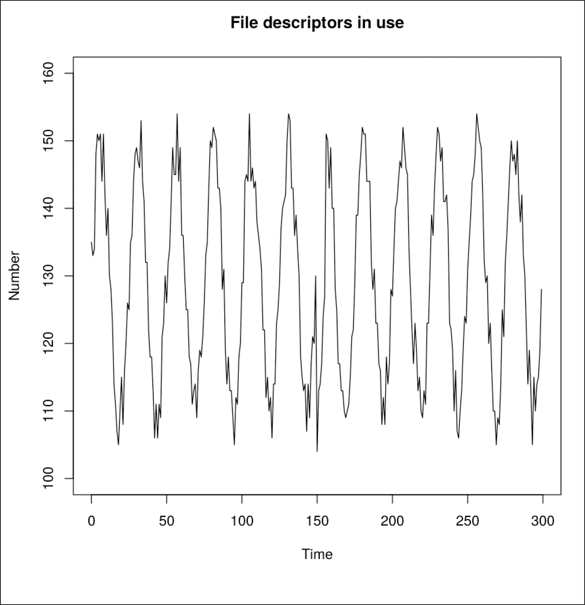
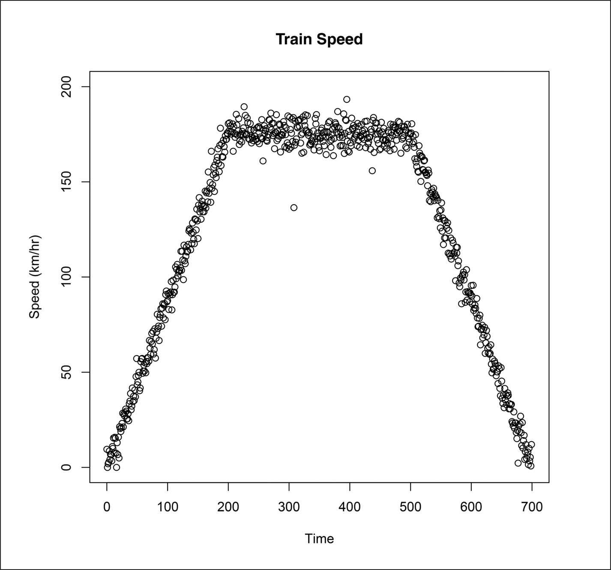
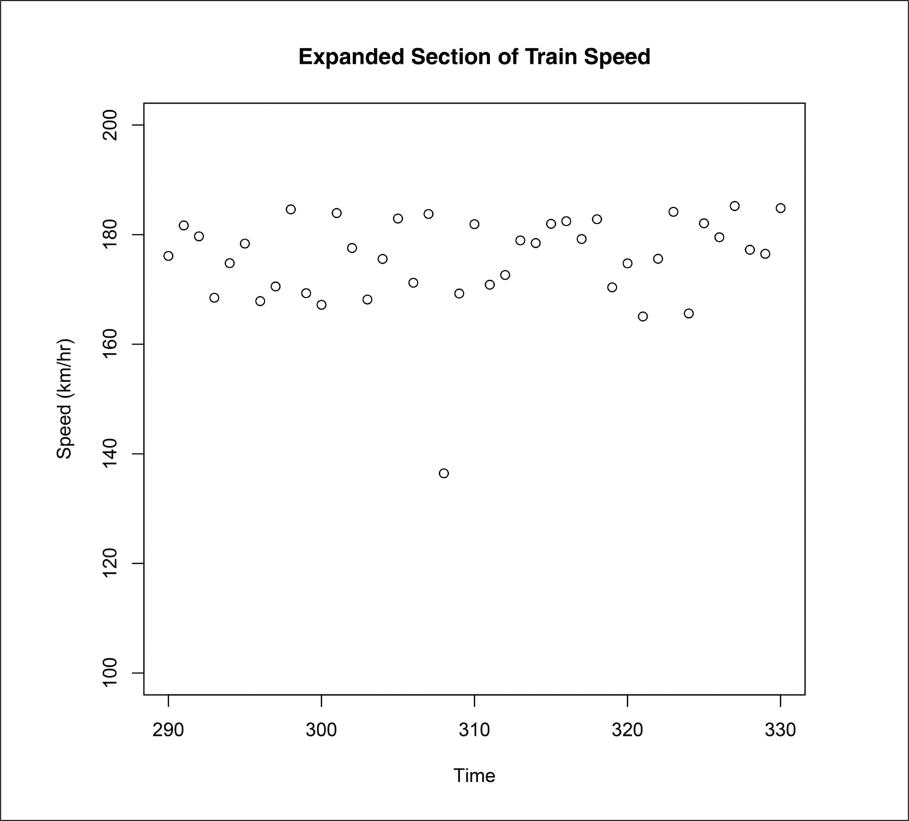
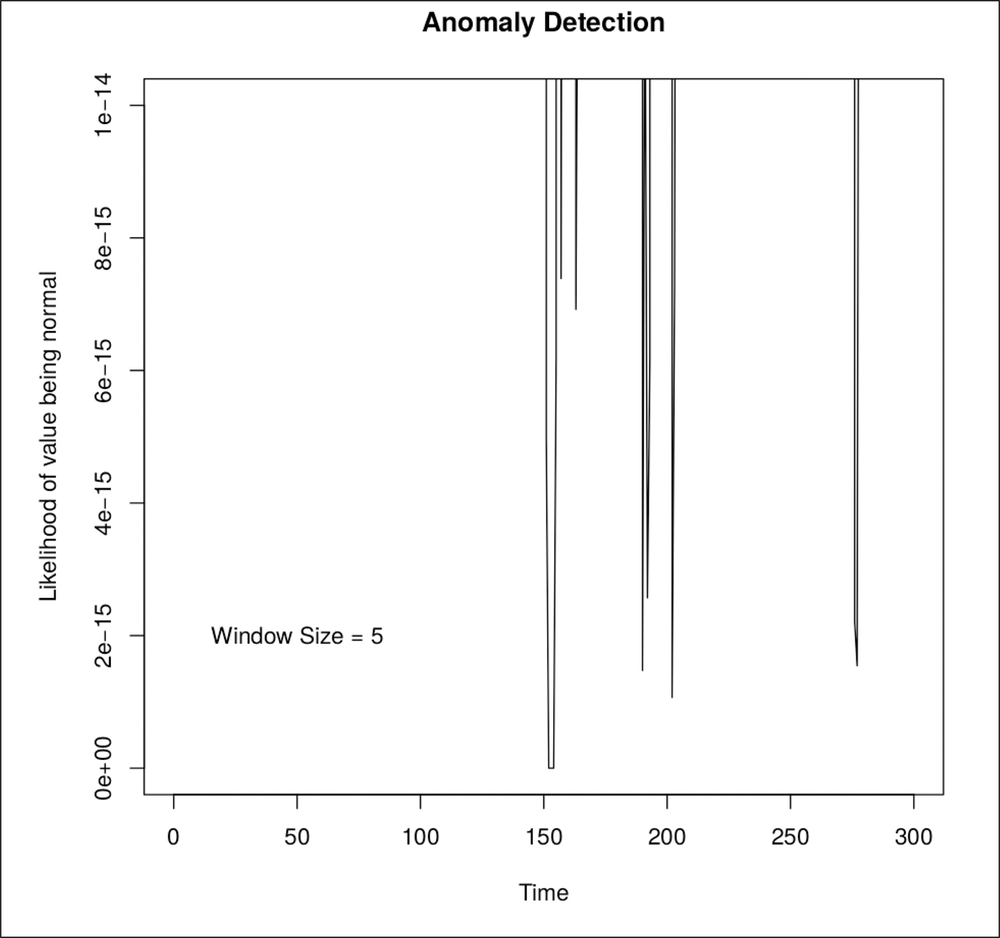
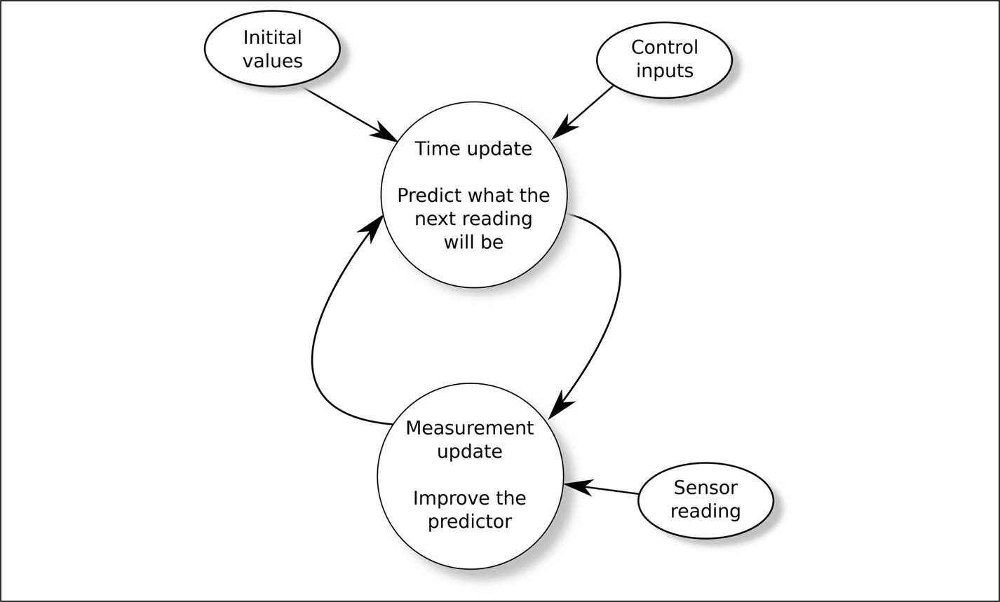
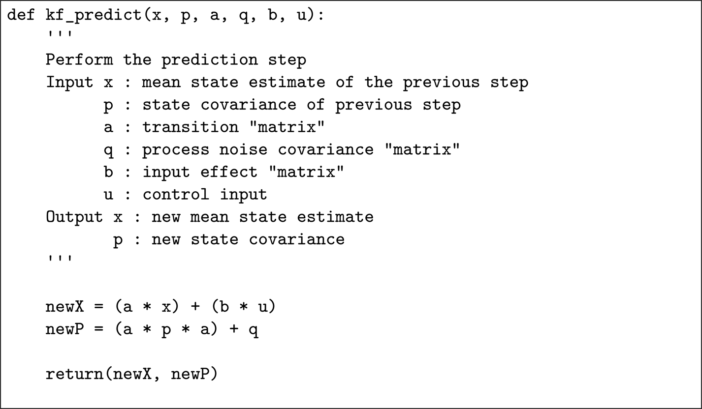
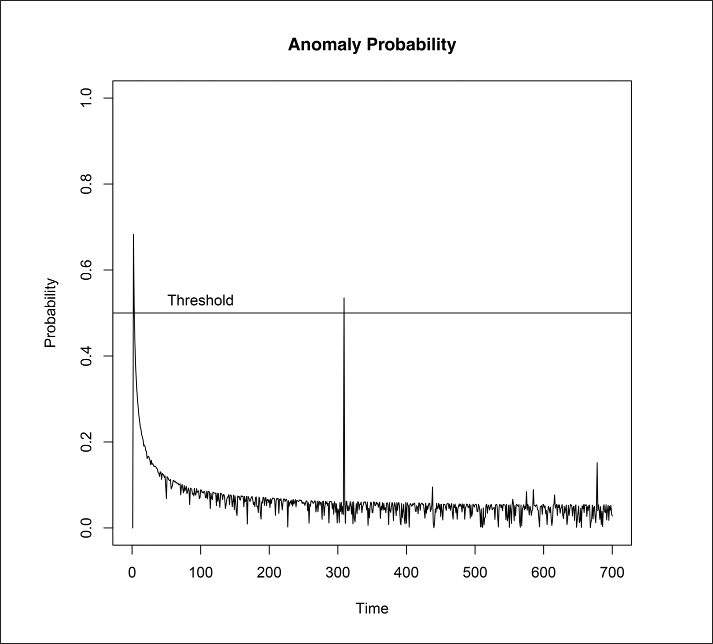
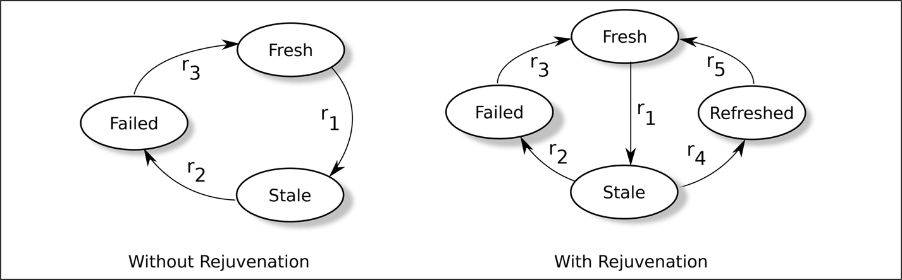
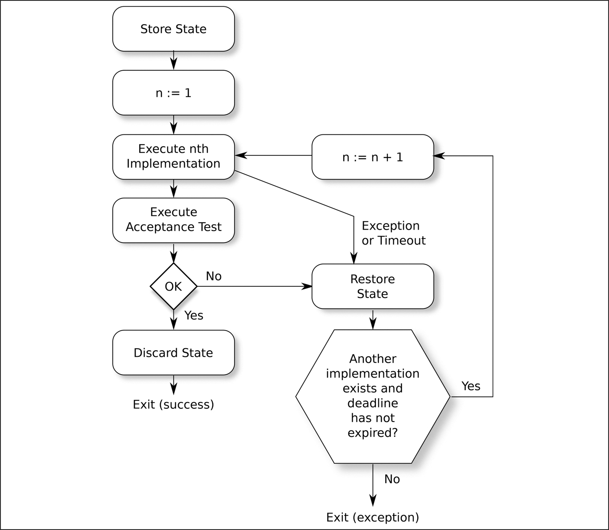

<a id="p116"></a>

<a id="chapter11"></a>

# 11 Phát hiện và xử lý lỗi

DOI: [10.1201/9781003598145-11](https://doi.org/10.1201/9781003598145-11)

> *Định luật số XVIII: Để đạt được độ không đáng tin cậy cao thì rất tốn kém. Không hiếm khi chi phí của một hạng mục tăng lên gấp mười cho mỗi lần độ suy giảm đạt được tăng gấp mười.*
>
> Norman R. Augustine

## 11.1 Vì sao phải phát hiện lỗi?

Với chuỗi fault → error → failure được mô tả ở trang 17, trong một hệ thống đang chạy, việc phát hiện error do fault (chưa được phát hiện) gây ra và thực hiện hành động phù hợp trước khi error gây ra failure có thể rất hữu ích. Một khi hệ thống đã chạy, thì đã quá muộn để phát hiện fault, nhưng error thường để lại những dấu vết có thể quan sát được. Bằng cách phát hiện error, có thể tránh được failure hoàn toàn, nhưng ngay cả khi không tránh được, vẫn có thể ghi log chi tiết về vấn đề và thông báo cho hệ thống lớn hơn, nơi thành phần đang hỏng được nhúng vào, trước khi failure xảy ra.

Một số kỹ thuật phát hiện error, như được liệt kê trong mục 7.4.12 của ISO 26262-6, khá đơn giản và có khả năng được áp dụng cho bất kỳ hoạt động phát triển phần mềm nào — ví dụ, các hàm thực hiện kiểm tra phạm vi đối với tham số input của chúng — trong khi những kỹ thuật khác, như kiểm tra “plausibility” (tính hợp lý), tinh tế hơn và được xem xét trong chương này.

## 11.2 Phát hiện lỗi và các tiêu chuẩn

Table A.2 của IEC 61508-3 khuyến nghị đưa *fault detection* vào thiết kế phần mềm đối với phần mềm ở SC 2 trở lên. Mô tả liên quan được đưa ra trong C.3.1 của IEC 61508-7 cho thấy rằng, theo thuật ngữ chuẩn “fault,” “error,” và “failure”, tiêu chuẩn thực ra đang đề cập đến error chứ không phải fault.

ISO 26262-6 dành mục 7.4.12 và Annex E cho nhiều cơ chế phát hiện error khác nhau, khuyến nghị kiểm tra phạm vi và kiểm tra plausibility đối với dữ liệu input cùng nhiều dạng giám sát nội bộ và bên ngoài. Annex E lặp lại ý tưởng rằng các error phần mềm ngẫu nhiên không do wear-out hay lão hóa gây ra, và chỉ ra việc thiếu một <a id="p117"></a>mô hình xác suất trưởng thành. Với các mô hình được liệt kê trong tài liệu tham khảo [<a id="b11refbib11_1"></a>[1](#refbib11_1)], một số có từ những năm 1980, điểm cuối cùng này thật đáng thất vọng.

<a id="sec11_3"></a>

## 11.3 Phát hiện bất thường (Anomaly Detection)

Anomaly detection là việc áp dụng một thuật toán lên một chuỗi sự kiện để quyết định xem một hoặc nhiều sự kiện có bất ngờ hay không dựa trên lịch sử cho đến thời điểm đó. Con người rất giỏi việc này: chỉ cần liếc qua <a id="b11fig11_1"></a>[Hình 11.1](#fig11_1) là đủ để một người biết rằng, ngay cả với tín hiệu nhiễu, có điều gì đó lạ đã xảy ra quanh thời điểm 150. Mục này mô tả hai loại thuật toán khác nhau để phát hiện những bất thường như vậy và quyết định chúng bất thường *đến mức nào*.

<a id="fig11_1"></a>



*Hình 11.1: Trace mẫu cho anomaly detection.[⏎](#b11fig11_1)*

Mục đích của việc phát hiện một bất thường là nó có thể là một error do một fault gây ra. Nếu error này có thể được phát hiện và xử lý trước khi failure xảy ra, thì hệ thống có thể chuyển sang design safe state của nó (xem [Mục 12.1](ch12_expecting_the_unexpected.vi.md#sec12_1)) một cách có kiểm soát.

Có thể nhận diện hai loại bất thường: *contextual anomaly* (bất thường theo ngữ cảnh), như bất thường trong [Hình 11.1](#fig11_1) quanh thời điểm 150, nơi bản thân các điểm không bất thường, nhưng mẫu hình thì có, và *point anomaly* (bất thường điểm), như xảy ra trong <a id="b11fig11_2"></a>[Hình 11.2](#fig11_2) tại thời điểm 308, nơi một vài điểm bất ngờ xuất hiện.

<a id="fig11_2"></a>



*Hình 11.2: Dữ liệu mẫu.[⏎](#b11fig11_2)*

Phần còn lại của chương này đề cập đến việc phát hiện bất thường lúc runtime. Anomaly detection cũng có thể hữu ích offline, trong quá trình kiểm thử tích hợp — xem [Mục 22.7](ch22_integration_and_system_testing.vi.md#sec22_7).

### 11.3.1 Anomaly detection và các tiêu chuẩn

Mặc dù không được liệt kê tường minh, anomaly detection là một dạng kiểm tra plausibility, như được khuyến nghị trong mục 7.4.12 của ISO 26262-6. Một chuỗi phép đo được thực hiện và, với mỗi phép đo, câu hỏi được đặt ra là, *“giá trị này hợp lý đến mức nào, với lịch sử các giá trị trước đó và kiến thức về vật lý của hệ thống?”*

Cả hai thuật toán anomaly detection được mô tả trong phần còn lại của mục này đều bao gồm một dạng học không giám sát để tạo ra một đường cơ sở về “hành vi bình thường”, từ đó có thể phát hiện các bất thường. Việc biện minh cho việc dùng một thuật toán có học thay vì một thuật toán tĩnh có thể khó hơn, vì chức năng của hệ thống không được định nghĩa trước, mà phụ thuộc vào những gì hệ thống học được. Những thuật toán động như vậy không được các tiêu chuẩn khuyến khích.

Điều này có thể được giảm thiểu phần nào, với cái giá là giảm tính linh hoạt, bằng cách cho hệ thống học trong một môi trường có kiểm soát, có lẽ trong quá trình kiểm thử kiểm chứng hoặc từ các event log thu thập được ngoài thực địa. Thuật toán tĩnh thu được sau đó có thể được triển khai.

<a id="p118"></a>

### 11.3.2 <a id="p118"></a>Các thuật toán phát hiện bất thường

Nhiều kỹ thuật đã được đề xuất để phát hiện bất thường, và bản khảo sát trong tài liệu tham khảo [<a id="b11refbib11_2"></a>[2](#refbib11_2)] của Varun Chandola *et al.*, liệt kê vài chục kỹ thuật.

Neural network và support vector machine đặc biệt hữu ích cho anomaly detection (xem tài liệu tham khảo [<a id="b11refbib11_3"></a>[3](#refbib11_3)] của Markos Markou và Sameer Singh) vì không cần đưa ra giả định *tiên nghiệm* nào về các thuộc tính của dữ liệu. Mạng được huấn luyện trên “hành vi bình thường” và, khi gặp một bất thường, không phản hồi bằng một output mạnh. Nhìn chung, khi một neural network được dùng làm bộ phân loại, chính điểm yếu của nó trong việc xử lý bất thường khiến nó phản hồi kém. Như tài liệu tham khảo [[3](#refbib11_3)] chỉ ra, chính điểm yếu này lại trở thành điểm mạnh khi mạng thực sự được dùng để phát hiện bất thường.

Phần lớn nghiên cứu đang được thực hiện về anomaly detection nhắm vào việc phát hiện các cuộc xâm nhập mạng của những kẻ tấn công độc hại và việc kiểm tra các database tài chính để tìm các mẫu hình gian lận.

<a id="p119"></a>Một lĩnh vực đầy hứa hẹn mà tôi nghĩ có lẽ chưa được phát triển đầy đủ là dùng biến đổi wavelet để phát hiện bất thường. Biến đổi wavelet của một chuỗi thời gian, như những chuỗi được thể hiện trong [Hình 11.1](#fig11_1) và [11.2](#fig11_2), bảo toàn cả khía cạnh phổ lẫn, vì có thể thay đổi tỷ lệ của wavelet, khía cạnh thời gian của nó.

Tôi xem xét hai loại anomaly detection trong phần còn lại của chương này: Markov chain và Kalman filter.

### 11.3.3 Các ví dụ

Làm ví dụ cho anomaly detection, chúng ta sẽ dùng các mẫu hư cấu được minh họa trong [Hình 11.1](#fig11_1) và [11.2](#fig11_2).

Các giá trị trong [Hình 11.1](#fig11_1) biểu diễn số lượng chính xác tài nguyên đang được sử dụng theo thời gian. Tôi đã giả định rằng tài nguyên là một file descriptor đang mở, nhưng nó có thể là một lượng memory, một số mutex đang bị khóa, hoặc bất kỳ tài nguyên nào khác mà mức sử dụng có thể được đo chính xác. Rõ ràng có điều gì đó kỳ lạ xảy ra quanh thời điểm $t = 150$.<a id="p120"></a>

> Giai thoại 16 *Khi thảo luận về bất thường, tôi thường nhắc đến nghệ sĩ Thụy Sĩ Ursus Wehrli. Wehrli tạo ra “TIDYING UP ART” (nghệ thuật dọn dẹp), chẳng hạn những bãi đỗ xe với mọi chiếc xe cùng màu đỗ cạnh nhau, hoặc một bát súp chữ cái với các chữ cái theo thứ tự bảng chữ cái. Điểm mấu chốt là chúng ta có xu hướng nghĩ về một bất thường như một thứ khác biệt với xung quanh nó; với các ví dụ của Wehrli, sự bất thường nằm ở tính quy củ: việc xe được đỗ theo màu hay mì trong bát súp được xếp theo thứ tự bảng chữ cái mới là bất thường.*
>
> *Việc rò rỉ file descriptor được mô tả trong <a id="b11aned17"></a>[Giai thoại 17](#aned17) là một ví dụ về một bất thường “quy củ”. Các file descriptor bị rò rỉ cực kỳ đều đặn, và điều này là bất thường.*

[Hình 11.2](#fig11_2) trình bày một loại bất thường khác. Các giá trị được giả định là các phép đo tốc độ từ một radar Doppler forward-facing trên một đoàn tàu. Đoàn tàu tăng tốc đến khoảng 170 km/h, chạy ổn định ở tốc độ đó một lúc rồi dừng lại.

Trái với [Hình 11.1](#fig11_1), nơi các giá trị là số đếm chính xác, trong [Hình 11.2](#fig11_2) có nhiễu trên các số đọc do bản chất của radar gây ra và có một số giá trị mà, nhìn bằng mắt, ngay lập tức có vẻ bất thường: đặc biệt là các giá trị tại $t = 308$ và $t = 437$. <a id="b11fig11_3"></a>[Hình 11.3](#fig11_3) phóng to phần của [Hình 11.2](#fig11_2) quanh bất thường tại $t = 308$. Một tình huống như vậy, nơi một cảm biến đang cung cấp các giá trị không chính xác và có thể bất thường, và nơi hệ thống chính cần xử lý chúng, phản ánh các điều kiện trên chuyến bay Qantas Flight 73, như được mô tả ở trang 290.

<a id="fig11_3"></a>



*Hình 11.3: Góc nhìn phóng to của dữ liệu mẫu.[⏎](#b11fig11_3)*

Chúng ta có thể dễ dàng nhận ra các bất thường trong [Hình 11.1](#fig11_1) và [11.2](#fig11_2), vì chúng ta không chỉ thấy những gì xảy ra trước chúng, mà còn cả những gì xảy ra sau đó. Câu hỏi chúng ta cần giải quyết cho hệ thống đang chạy là “khi đang nhận các giá trị từ radar trong [Hình 11.2](#fig11_2) tại thời điểm $t = 308$, mà không có lợi thế nhìn được vào tương lai, thì số đọc 136,5 km/h mà chúng ta vừa nhận được có bất thường không? Nếu có, thì bất thường *đến mức nào*?”

### 11.3.4 Markov chain

#### 11.3.4.1 Andrey Markov

Markov chain và các Markov model được mô tả trong [Chương 14](ch14_markov_models.vi.md) được đặt theo tên Andrey Markov, một thành viên của một gia đình toán học Nga, với anh trai và con trai ông cũng có những khám phá toán học quan trọng. Ông sống từ năm 1856 đến 1922 và có nhiều đóng góp quan trọng cho lý thuyết các quá trình ngẫu nhiên. Cuộc đời ông gắn với giới học thuật mặc dù ông đã bị cách chức giáo sư tại Đại học St. Petersburg năm 1908 vì từ chối báo cáo với chính quyền về bất kỳ khuynh hướng cách mạng nào trong số sinh viên của mình.

#### 11.3.4.2 Các trạng thái hệ thống

Bước đầu tiên trong việc biểu diễn một hệ thống dưới dạng Markov chain là liệt kê các trạng thái khả dĩ của nó. Đối với hệ thống được thể hiện trong [Hình 11.1](#fig11_1), một cách hiển nhiên nhưng sai để biểu diễn trạng thái tại bất kỳ thời điểm nào là dùng số file descriptor đang được sử dụng. Nếu 131 file descriptor đang được sử dụng, thì hệ thống ở “trạng thái 131.”

Mặc dù cách này đơn giản, đáng tiếc là nó phá vỡ giả định cơ bản của Markov chain — rằng xác suất ở trạng thái *j* tại thời điểm $t + 1$ chỉ phụ thuộc vào việc ở trạng thái *i* tại thời điểm *t*. Lịch sử về việc trạng thái *i* đã đạt được như thế nào là không liên quan. Điều này được mô tả kỹ hơn trong [Chương 14](ch14_markov_models.vi.md), nhưng hãy giả sử đối với hệ thống trong [Hình 11.1](#fig11_1) rằng số file descriptor đang được sử dụng hiện tại là 131 và chúng ta muốn dự đoán có bao nhiêu sẽ được sử dụng ở thời điểm lấy mẫu tiếp theo. Để áp dụng một Markov chain, chúng ta phải giả định rằng điều này sẽ không phụ thuộc vào bất kỳ giá trị nào trước đó. Trong [Hình 11.1](#fig11_1), điều này không đúng, vì việc sử dụng file descriptor rõ ràng có tính chu kỳ, và giá trị 131 có thể xuất hiện ở cả phần đi xuống lẫn phần đi lên của chu kỳ. Trong một chu kỳ đi xuống, xác suất chuyển từ 131 descriptor đang được sử dụng sang 129 cao hơn nhiều so với trong một chu kỳ đi lên.

<a id="p122"></a>Để tránh điều này, cách biểu diễn trạng thái hệ thống của chúng ta sẽ phải bao gồm chi tiết về việc hệ thống đang ở phần đi xuống hay đi lên của chu kỳ. Vì vậy, trạng thái hệ thống hiện tại có thể được định nghĩa gồm hai phần: số file descriptor đang được sử dụng và việc, trong khoảng thời gian trước đó, số descriptor đang được sử dụng tăng lên hay giảm xuống. Vậy trạng thái hệ thống có thể là 131U hoặc 131D. Nếu số descriptor không thay đổi giữa các lần đọc, thì chúng ta có thể dùng một hậu tố thứ ba, nhưng tôi đã giả định rằng hậu tố là U.

Về nguyên tắc, khi đó có thể vẽ một sơ đồ thể hiện các chuyển trạng thái khả dĩ giữa các trạng thái và khả năng xảy ra của chúng. Từ [Hình 11.1](#fig11_1), việc chuyển từ trạng thái 131U sang trạng thái 133U có vẻ có khả năng xảy ra, trong khi việc chuyển từ trạng thái 131U sang trạng thái 110D có vẻ rất khó xảy ra. Tôi nói “về nguyên tắc” vì sơ đồ sẽ chứa nhiều trạng thái và có nhiều mũi tên giữa các trạng thái biểu thị các chuyển trạng thái tiềm năng. Dùng dữ liệu học được mô tả trong mục tiếp theo, sẽ có khoảng 100 trạng thái và 2014 mũi tên giữa chúng. [Hình 14.2](ch14_markov_models.vi.md#fig14_2) ở trang 171 minh họa một Markov chain nhỏ hơn nhiều, và ngay cả hình đó cũng trông khá rối mắt.

Trong một số hệ thống, bản thân các trạng thái hệ thống tạo thành một Markov chain; trong các hệ thống khác, có thể xảy ra trường hợp bên trong hệ thống đang hoạt động theo một Markov chain, nhưng các trạng thái này không thể thấy trực tiếp. Trong trường hợp sau, có thể dùng kỹ thuật “hidden Markov model”, theo đó các đặc tính *có thể* thấy được sẽ được dùng thay cho bản thân các trạng thái Markov.

#### 11.3.4.3 Học các xác suất chuyển trạng thái

Để xác định khi nào một điều gì đó là bất thường, chúng ta cần biết thế nào là bình thường. Đối với một Markov chain, chúng ta xây dựng xác suất chuyển giữa các trạng thái bằng cách quan sát hành vi bình thường, có thể trong quá trình kiểm thử hệ thống, có thể trong quá trình thử nghiệm ngoài thực địa. Điều này cho phép chúng ta xây dựng một ma trận xác suất chuyển trạng thái.

Việc huấn luyện bao gồm quan sát hệ thống và xác định tỷ lệ các chuyển trạng thái ra khỏi trạng thái *i* là chuyển sang trạng thái *j*. Ví dụ, đối với hệ thống trong [Hình 11.1](#fig11_1), chương trình của tôi đã quan sát 10000 lần đọc và tính các xác suất chuyển trạng thái. Nó thấy rằng các xác suất chuyển ra khỏi trạng thái 131U như được thể hiện trong <a id="b11tbl11_1"></a>[Bảng 11.1](#tbl11_1). Lưu ý rằng bảng đó được chia tùy ý thành “đi lên” (dùng nhiều file descriptor hơn) và “đi xuống” (dùng ít file descriptor hơn) để dễ đọc.

<a id="tbl11_1"></a>

<a id="tbl11_1"></a>*Bảng 11.1 Các chuyển trạng thái từ trạng thái 131U[⏎](#b11tbl11_1)*

| Chuyển đi xuống | Chuyển đi lên |  |  |
|---|---|---|---|
| Trạng thái mới | Xác suất | Trạng thái mới | Xác suất |
| 117D | 0,0250 | 131U | 0,0625 |
| 118D | 0,0250 | 132U | 0,0375 |
| 119D | 0,0125 | 133U | 0,0250 |
| 121D | 0,0250 | 134U | 0,0750 |
| 122D | 0,0125 | 135U | 0,0750 |
| 124D | 0,0250 | 136U | 0,0500 |
| 125D | 0,0250 | 137U | 0,1000 |
| 126D | 0,0125 | 138U | 0,0375 |
| 127D | 0,0250 | 139U | 0,0875 |
| 129D | 0,0500 | 140U | 0,0250 |
| 130D | 0,0250 | 141U | 0,0125 |
|  |  | 142U | 0,0250 |
|  |  | 143U | 0,0875 |
|  |  | 144U | 0,0375 |
| Tổng | 0,2625 | Tổng | 0,7375 |

Nếu hệ thống đang ở trạng thái 131U, thì lần thay đổi trạng thái trước đó là “đi lên”: tức là, hướng tới việc sử dụng nhiều file descriptor hơn. Từ trạng thái đó, xác suất lớn hơn (73,75% so với 26,25%) là nó sẽ tiếp tục đi lên, có lẽ tới tận 144 descriptor đang được sử dụng. Ở giai đoạn này của phân tích, có lẽ sẽ tốt hơn nếu thay U và D trên mỗi trạng thái bằng một chỉ báo không chỉ của lần thay đổi trạng thái gần nhất, mà là trung bình của một vài lần thay đổi trạng thái gần nhất.

Một cách hình thức hơn, trong quá trình học, chúng ta xây dựng một ma trận

$$\begin{array}{l} P = ( \begin{array}{llll} {p}_{1 , 1} & {p}_{1 , 2} & . . . & {p}_{1 , N} \\ {p}_{2 , 1} & {p}_{2 , 2} & . . . & {p}_{2 , N} \\ ⋮ & ⋮ & ⋮ & ⋮ \\ {p}_{N , 1} & {p}_{N , 2} & . . . & {p}_{N , N} \end{array} ) \end{array} \tag{11.1}$$

<a id="p123"></a>trong đó ${p}_{i , j}$ là xác suất chuyển sang trạng thái *j* tại thời điểm $t + 1$ nếu đang ở trạng thái *i* tại thời điểm *t*. Trong quá trình học,

$$\begin{array}{l} {p}_{i , j} = \frac{{N}_{i , j}}{{N}_{i}} \end{array} \tag{11.2}$$

trong đó *N<sub>i</sub>* là số lần hệ thống rời khỏi trạng thái *i*, và ${N}_{i , j}$ là số lần hệ thống chuyển trực tiếp sang trạng thái *j* từ trạng thái *i*.

Từ góc nhìn thực tế, ma trận này có khả năng rất thưa (tức là có nhiều phần tử bằng không). Vì vậy, có thể tốt hơn nếu lưu nó dưới dạng một associative array<a id="fn11_111b"></a>[<sup>1</sup>](#fn11_1) thay vì một ma trận.

Rõ ràng, một số phần tử của ma trận chuyển trạng thái sẽ bằng không. Ví dụ, nếu trong giai đoạn học trên các file descriptor, hệ thống chưa bao giờ chuyển trực tiếp từ 131 sang 148 file descriptor đang được sử dụng, thì phần tử trong *P* (Phương trình 11.1) tương ứng với chuyển trạng thái đó sẽ bằng không. Việc có các số không trong ma trận chuyển trạng thái sẽ gây ra vấn đề trong giai đoạn phân tích, vì vậy sẽ hữu ích nếu thay tất cả các số không bằng những số rất nhỏ (ví dụ, ${10}^{- 6}$).

#### 11.3.4.4 Tìm kiếm một bất thường

Một khi đã xác định được thế nào là “bình thường” trong giai đoạn học, chúng ta có thể tìm kiếm các bất thường xảy ra trong quá trình hoạt động của hệ thống.

<a id="fn11_1"></a>

[<sup>1</sup>](#fn11_111b)Associative array là một mảng được đánh chỉ số bằng một giá trị không phải số nguyên. Ví dụ, `x[‘sValue’]`, trong đó mảng x được đánh chỉ số bằng một chuỗi. Một số ngôn ngữ, như Python và Rust (nơi nó được gọi là HashMap), hỗ trợ trực tiếp associative array; trong các ngôn ngữ khác, cấu trúc này có thể phải được mô phỏng.

Mục tiêu là xem xét một chuỗi các chuyển trạng thái của hệ thống và xác định, với ma trận xác suất chuyển trạng thái (Phương trình 11.1), khả năng chuỗi đó xảy ra trong hoạt động bình thường là bao nhiêu. Với một “cửa sổ” gồm *N* chuyển trạng thái liên tiếp, khả năng (likelihood) được tính như sau:

$$\begin{array}{l} L = {\prod}_{t = 1}^{N - 1} P ( {X}_{t - 1} , {X}_{t} ) \end{array} \tag{11.3}$$

trong đó $P ( a , b )$ là xác suất chuyển từ trạng thái *a* sang trạng thái *b*. Từ phương trình này có thể thấy vì sao các giá trị không được thay bằng các giá trị nhỏ nhưng dương — bất kỳ một số không đơn lẻ nào cũng sẽ chi phối toàn bộ phép tính. Một khi phép tính này đã được thực hiện, cửa sổ được dịch đi một khoảng thời gian và phép tính được lặp lại.

Cần thử nghiệm một chút để xác định kích thước cửa sổ — độ dài của chuỗi cần quan sát, *N*. <a id="b11fig11_4"></a>[Hình 11.4](#fig11_4) hiển thị phân tích trên số file descriptor đang được sử dụng với kích thước cửa sổ $N = 5$; trục tung là thước đo <a id="p125"></a>khả năng chuỗi năm trạng thái đó xảy ra trong hoạt động bình thường, mà không có bất thường nào.

<a id="fig11_4"></a>



*Hình 11.4: Output từ phân tích Markov.[⏎](#b11fig11_4)*

Có thể thấy rằng thước đo khả năng của chuỗi chuyển trạng thái sau thời điểm $t = 150$ thực chất bằng không: rõ ràng có một bất thường tại thời điểm đó. Phép tính cũng tìm thấy các bất thường quanh thời điểm 202 và 261. Những bất thường này không hiển nhiên ngay khi nhìn vào [Hình 11.1](#fig11_1).

<a id="sec11_3_5"></a>

### 11.3.5 Kalman filter

#### 11.3.5.1 Lịch sử của Kalman filter

Kalman filter được đặt theo tên Rudolf E. Kálmán, một nhà toán học Hungary đã di cư sang Mỹ năm 1943 khi 13 tuổi. Ông giới thiệu Kalman filter trong tài liệu tham khảo [<a id="b11refbib11_4"></a>[4](#refbib11_4)], được xuất bản năm 1960. Người ta thường nói rằng Thorvald Nicolai Thiele vào thế kỷ 19 và Peter Swerling vào thế kỷ 20 đã nghĩ ra bộ lọc này sớm hơn Kálmán, và một số manh mối thậm chí có thể được truy ngược về Gauss.

#### 11.3.5.2 Tóm tắt thuật toán Kalman rời rạc

Kalman filter là một thuật toán dự đoán/hiệu chỉnh, như được minh họa trong <a id="b11fig11_5"></a>[Hình 11.5](#fig11_5). Tại thời điểm *T*, thuật toán dự đoán giá trị sẽ nhận được từ các cảm biến tại thời điểm $T + 1$, và, khi nhận được số đọc thực tế, nó điều chỉnh bộ dự đoán để chính xác hơn vào lần sau. Sau đó nó đưa ra một dự đoán mới và quá trình này tiếp diễn vô thời hạn. Việc dự đoán số đọc tiếp theo sẽ là gì hữu ích cho anomaly detection vì, một khi thuật toán đã ổn định và dự đoán chính xác, một khác biệt lớn giữa giá trị dự đoán và giá trị thực tế biểu thị một bất thường tiềm tàng.

<a id="fig11_5"></a>



*Hình 11.5: Kalman filter.[⏎](#b11fig11_5)*

<a id="p126"></a>Thuật toán có thể trông đáng sợ về mặt toán học,<a id="fn11_211b"></a>[<sup>2</sup>](#fn11_2) nhưng đối với hầu hết các hệ thống thì rất đơn giản để lập trình, đặc biệt là, như thường thấy, khi các giá trị là one-dimensional. Tốc độ tàu được đưa ra trong [Hình 11.2](#fig11_2) là các số đơn được lấy mẫu ở mỗi timer tick. Nếu có hai nguồn input tốc độ (ví dụ, radar Doppler và đếm số vòng quay bánh xe), thì có thể dùng một bộ lọc two-dimensional để phát hiện bất thường giữa các số đọc. Ví dụ, trong <a id="b11tbl11_2"></a>[Bảng 11.2](#tbl11_2), không cảm biến nào tự nó có vẻ bất thường; điều bất thường là một cảm biến đang phát hiện sự giảm tốc, trong khi cảm biến kia thì không.

<a id="tbl11_2"></a>

<a id="tbl11_2"></a>*Bảng 11.2 Hai cảm biến cung cấp dữ liệu tốc độ.[⏎](#b11tbl11_2)*

| Cảm biến | Các số đọc tốc độ liên tiếp (km/hr) |  |  |  |  |  |  |  |
|---|---|---|---|---|---|---|---|---|
| Radar | 170 | 168 | 171 | 172 | 171 | 169 | 170 | 173 |
| Tốc kế | 170 | 168 | 165 | 166 | 162 | 161 | 161 | 155 |

#### 11.3.5.3 Chi tiết thuật toán Kalman

Tài liệu tham khảo [<a id="b11refbib11_5"></a>[5](#refbib11_5)] của Greg Welch và Gary Bishop đưa ra một phần giới thiệu nhẹ nhàng về thuật toán. Trong phần sau, tôi dùng ký hiệu từ bài báo đó, nhưng đơn giản hóa phần giải thích đi phần nào.

Giả sử trạng thái của hệ thống có thể được mô tả bằng một vector, $\vec{x}$ gồm *n* giá trị (đối với các phép đo radar Doppler trong [Hình 11.2](#fig11_2), $n = 1$; đối với các giá trị radar và tốc kế trong [Bảng 11.2](#tbl11_2), $n = 2$). Một Kalman filter dự đoán giá trị tương lai của $\vec{x}$ nếu hệ thống có thể được mô tả tại thời điểm *k* bằng một phương trình có dạng

$$\begin{array}{l} {\vec{x}}_{k} = A {\vec{x}}_{k - 1} + B {\vec{u}}_{k - 1} + {\vec{w}}_{k - 1} \end{array} \tag{11.4}$$

và các phép đo (giá trị cảm biến) mà nó nhận được

$$\begin{array}{l} {\vec{z}}_{k} = H {\vec{x}}_{k} + {\vec{v}}_{k} \end{array} \tag{11.5}$$

Ý nghĩa chính xác của các số hạng được đưa ra bên dưới, nhưng, tóm lại, Phương trình 11.4 nói rằng giá trị mới của $\vec{x}$ tại thời điểm *k* là một bội số nào đó của giá trị $\vec{x}$ ở thời điểm trước, cộng với một control input nào đó (ví dụ, người lái đạp phanh), cộng với một nhiễu (error) nào đó vốn có trong hệ thống.

Phương trình 11.5 nói rằng phép đo mới $( \vec{z} )$ là một bội số của giá trị $\vec{x}$ mà chúng ta dự đoán, cộng với một nhiễu (error) nào đó trong phép đo.

Chính xác hơn:

<a id="fn11_2"></a>

[<sup>2</sup>](#fn11_211b)Tham khảo [Phụ lục D](ch28_appendix_d_notations.vi.md) để có danh sách các ký hiệu thông dụng được sử dụng.

- ${\vec{x}}_{k}$ là trạng thái của hệ thống tại thời điểm *k*. Trạng thái này không được phần mềm biết, phần mềm chỉ biết các phép đo có nhiễu của $\vec{x}$ mà nó nhận được từ các cảm biến. Nhìn chung, ${\vec{x}}_{k}$ là một vector bao gồm mọi giá trị cần quan tâm (ví dụ, quãng đường, tốc độ, gia tốc). Trong trường hợp đơn giản nhất, như với tốc độ tàu trong [Hình 11.2](#fig11_2), ${\vec{x}}_{k}$ có thể là một số đơn.

- *A* là một ma trận $n \times n$ liên hệ ${\vec{x}}_{k + 1}$ với ${\vec{x}}_{k}$ theo vật lý của bài toán, giả sử không có nhiễu trên các số đọc cảm biến.

  Một ví dụ cho một đoàn tàu di chuyển trên đường ray là quãng đường mới đã đi bằng quãng đường trước đó đã đi, cộng với tốc độ trung bình nhân với độ dài khoảng thời gian. Trong hầu hết các ứng dụng, *A* không thay đổi theo thời gian và, nếu $\vec{x}$ là một số đơn, thì *A* trở thành một số đơn (hay, chính xác hơn, một ma trận $1 \times 1$), thường bằng 1.

- Nhìn chung, điều kiện của hệ thống sẽ thay đổi theo những thay đổi của các control input, và từ thiết kế hệ thống, chúng ta biết những thay đổi này nên là gì. Chúng ta có thể báo cho Kalman filter về những thay đổi này để nó không coi chúng là bất thường.

  Ví dụ, nếu hệ thống có thông tin về vị trí cần điều khiển của người lái, thì thông tin này có thể được đưa vào phương trình — nếu người lái giảm công suất, thì chúng ta sẽ mong đợi đoàn tàu chạy chậm lại. Đây là thông tin hữu ích cho thuật toán khi nó dự đoán giá trị tiếp theo của $\vec{x}$. Giá trị này cũng có thể bao gồm các yếu tố môi trường; ví dụ, đoàn tàu bắt đầu leo dốc.

  *B* là một ma trận $n \times l$ liên hệ một hoặc nhiều control input với các giá trị mới của $\vec{x}$.

- ${\vec{u}}_{k}$ là một vector độ dài *l* liên hệ control input được chỉ định bởi *B* với sự thay đổi dự kiến của ${\vec{x}}_{k - 1}$.

- ${\vec{w}}_{k}$ là nhiễu trong bản thân quá trình (không phải nhiễu trong các phép đo). Đối với nhiều hệ thống, bản thân quá trình không có nhiễu — chỉ các phép đo của chúng ta về nó là có nhiễu. Trong những trường hợp đó, ${\vec{w}}_{k}$ có thể được đặt là (0, 0, 0, …, 0).

- ${\vec{z}}_{k} ∈ {R}^{m}$ là phép đo lấy từ *m* cảm biến tại thời điểm (rời rạc) *k*. Một lần nữa, nếu chỉ có một cảm biến duy nhất, như trong trường hợp tốc độ tàu trong [Hình 11.2](#fig11_2), thì ${\vec{z}}_{k}$ chỉ là một số.

- *H* là một ma trận $m \times n$ liên hệ trạng thái thực tế của hệ thống với một phép đo. Nếu chỉ có một cảm biến, thì *H* là một số đơn, thường có giá trị 1.

- ${\vec{v}}_{k}$ là nhiễu trong các phép đo. Nhiễu này được giả định là độc lập với ${\vec{w}}_{k}$.

#### 11.3.5.4 Các hạn chế

Như được minh họa trong Phương trình 11.4, phải có khả năng biểu diễn các giá trị hệ thống tại thời điểm *k* theo các giá trị hệ thống tại thời điểm $k - 1$ một cách tuyến tính. Điều này có thể không phù hợp với một số bất thường nội bộ, như số file descriptor đang mở, nơi không có định luật vật lý nào chi phối giá trị.

Kalman filter chỉ hoạt động hoàn hảo nếu các giá trị nhiễu (${\vec{w}}_{k}$ và ${\vec{v}}_{k}$) độc lập với nhau và có phân phối Gauss với giá trị trung bình bằng không. Trong phần sau, tôi giả định rằng các ma trận hiệp phương sai lần lượt là *Q* và *R*. Đối với việc phát hiện <a id="p128"></a>các bất thường nội bộ, thay vì sensor-based, cả ${\vec{w}}_{k}$ lẫn ${\vec{v}}_{k}$ thường bằng không, và vì vậy hạn chế này không phát sinh.

Kalman filter đã được mở rộng để giải quyết những hạn chế này bằng việc đưa ra Extended Kalman Filter và Unscented Kalman Filter (xem tài liệu tham khảo [<a id="b11refbib11_6"></a>[6](#refbib11_6)] của Eric Wan và Rudolph van der Merwe).

#### 11.3.5.5 Dự đoán và hiệu chỉnh

Dùng các ký hiệu được liệt kê ở trên, các phương trình dự đoán và hiệu chỉnh như sau:

*Dự đoán*

$$\begin{array}{ll} {\vec{x}}_{k} & = A {\vec{x}}_{k - 1} + B {u}_{k - 1} \end{array} \tag{11.6}$$

$$\begin{array}{ll} {P}_{k} & = A {P}_{k - 1} {A}^{T} + Q \end{array} \tag{11.7}$$

Phương trình 11.6 chỉ đơn giản nói rằng dự đoán tốt nhất chúng ta có thể đưa ra về giá trị tiếp theo của $\vec{x}$ là áp dụng ma trận *A* lên giá trị trước đó của $\vec{x}$ rồi điều chỉnh theo bất kỳ control input nào.

Trong Phương trình 11.7, *P* là ma trận hiệp phương sai của các error và có thể được khởi tạo bằng bất kỳ giá trị khác không nào vì nó sẽ lặp dần đến một giá trị đúng theo thời gian. *Q* là hiệp phương sai nhiễu quá trình và thường có thể được đặt là một giá trị rất nhỏ (nên tránh giá trị 0, nhưng đối với một mô hình one-dimensional, một giá trị như $Q = {10}^{- 5}$ sẽ không phải là bất hợp lý).

*Hiệu chỉnh*

$$\begin{array}{ll} {K}_{k} & = {P}_{k}^{∗} {H}^{T} ( H {P}_{k}^{∗} {H}^{T} + R {)}^{- 1} \end{array} \tag{11.8}$$

$$\begin{array}{ll} {\vec{x}}_{k} & = {\vec{x}}_{k}^{∗} + {K}_{k} ( {z}_{k} - H {\vec{x}}_{k}^{∗} ) \end{array} \tag{11.9}$$

$$\begin{array}{ll} {P}_{k} & = ( I - {K}_{k} H ) {P}_{k}^{∗} \end{array} \tag{11.10}$$

trong đó các dấu sao biểu thị các giá trị dự đoán cho thời điểm *k*.

#### 11.3.5.6 Anomaly detection bằng Kalman filter

Một Kalman filter có thể được dùng để phát hiện các giá trị bất thường đọc từ các cảm biến. Một giá trị dự đoán $( {\vec{x}}_{k}^{∗} )$ cho số đọc tiếp theo có thể được so sánh với số đọc thực tế khi nó đến và hiệu số

$$\begin{array}{l} {\vec{v}}_{k} = {\vec{z}}_{k} - H {\vec{x}}_{k}^{∗} \end{array} \tag{11.11}$$

có thể được tính (xem Phương trình 11.9). Hiệu số này biểu thị theo một cách nào đó “mức độ bất ngờ” của giá trị cảm biến, và

$$\begin{array}{l} {e}^{2} = {v}_{k} {P}_{k} {v}_{k}^{T} \end{array} \tag{11.12}$$

có phân phối *χ*<sup>2</sup> với số bậc tự do bằng số phép đo. Vì vậy, có thể đặt bất kỳ mức độ tin cậy mong muốn nào lên mức độ bất thường của một số đọc cụ thể.

#### 11.3.5.7 Xác suất bất thường cho ví dụ đoàn tàu

<a id="b11fig11_7"></a>[Hình 11.7](#fig11_7) minh họa xác suất bất thường của các giá trị được đưa ra trong [Hình 11.2](#fig11_2). Như đã nói ở trên, đây là một ứng dụng đặc biệt đơn giản của Kalman filter vì nó one-dimensional, giá trị duy nhất cần quan tâm là tốc độ của đoàn tàu. Điều này có nghĩa là mọi vector và ma trận đều thu gọn thành các số đơn giản, và code trở nên cực kỳ đơn giản. Ví dụ, bộ dự đoán thu gọn thành hai dòng code Python non-comment tính Phương trình 11.6 và 11.7 như được thể hiện trong <a id="b11fig11_6"></a>[Hình 11.6](#fig11_6).

<a id="fig11_6"></a>



*Hình 11.6: Code bộ dự đoán Kalman.[⏎](#b11fig11_6)*

<a id="fig11_7"></a>



*Hình 11.7: Xác suất bất thường.[⏎](#b11fig11_7)*

Tôi đã đặt tùy ý ngưỡng hành động là 0,5 trong [Hình 11.7](#fig11_7), nhưng giá trị đó sẽ là application-specific. Lưu ý rằng, một khi hệ thống đã ổn định và bộ lọc có thể đưa ra các dự đoán hợp lý về giá trị tiếp theo, xác suất bất thường nhìn chung vẫn thấp, ngoại trừ giá trị tại thời điểm $t = 308$, mà chúng ta biết từ [Hình 11.2](#fig11_2) là bất thường. Điều thú vị là giá trị khác có vẻ bất thường trong [Hình 11.2](#fig11_2), khi $t = 437$, xuất hiện như một đỉnh nhọn trong [Hình 11.7](#fig11_7), nhưng ở mức thấp hơn nhiều so với tại $t = 308$.

Cả ngưỡng cần thực hiện hành động lẫn việc lựa chọn hành động đều system-dependent. Có lẽ giá trị cảm biến nhận được tại $t = 308$ sẽ bị loại bỏ và được thay bằng một bản sao của giá trị tại $t = 307$.

## 11.4 Rejuvenation (trẻ hóa)

Giờ chúng ta chuyển từ việc phát hiện error sang một phương pháp xử lý chúng. Như đã nói ở trên, mục đích của chúng ta là ngăn một error trở thành failure hoặc, nếu không thể, chuẩn bị cho failure theo cách có kiểm soát nhất có thể.

Rejuvenation là một cách phá vỡ mối liên kết giữa error và failure một cách có kiểm soát. Thuật ngữ “rejuvenation” chỉ là cách nói hình thức của “thỉnh thoảng nhấn nút RESET.” Hầu hết những người làm việc với máy tính đều biết rằng tắt máy rồi bật lại là cách chữa nhiều chứng bệnh phần mềm, và việc áp dụng nguyên tắc này, khi có thể, cho cả các hệ thống nhúng có vẻ hợp lý. Hiển nhiên, có một số thiết bị, ví dụ một máy tạo nhịp tim cấy ghép, mà rejuvenation có thể không thực tế và sẽ cần một dạng phục hồi khác.

Mục đích đằng sau rejuvenation là chặn và loại bỏ các error trước khi chúng trở thành failure. Các fault trong code có thể đã gây ra một số error — các thread <a id="p131"></a>zombie, phân mảnh dữ liệu và những hỏng hóc memory kiểu Heisenbug, rò rỉ tài nguyên, v.v. — đã xảy ra nhưng chưa gây ra failure.

Điều thú vị cần lưu ý là vấn đề trên chuyến bay Qantas Flight 72 được mô tả ở trang 290 đã được giải quyết bằng rejuvenation. Theo báo cáo chính thức của Australian Transport Safety Bureau:

> *Một khi failure mode bắt đầu, hành vi bất thường của ADIRU tiếp diễn cho đến khi thiết bị bị tắt. Sau khi nguồn của nó được bật tắt lại (tắt OFF rồi bật ON), thiết bị hoạt động bình thường.*

### 11.4.1 Khi nào nên rejuvenate

Nhiều hệ thống nhúng có một giới hạn thời gian hoạt động tự nhiên. Một máy bay bay không quá 20 giờ, một thiết bị y tế được sử dụng liên tục không quá một tháng, một chiếc ô tô được lái không quá vài giờ, v.v. Với giới hạn này, không rõ tại sao việc khởi động lại lại không được đưa vào các yêu cầu vận hành vào những thời điểm thuận tiện này. Một phần có thể là do xu hướng tự nhiên muốn làm anh hùng của nhà thiết kế: việc đòi hỏi khởi động lại hệ thống định kỳ bị coi là một lựa chọn dễ dãi.

### 11.4.2 Rejuvenation làm gì?

Nhìn từ góc độ của một nhà phân tích availability, rejuvenation là một dạng thay thế định kỳ, như xảy ra trong bảo trì phần cứng — ví dụ, động cơ piston trên một máy bay hạng nhẹ phải được thay mỗi 1 800 giờ thay vì chờ nó hỏng rồi mới sửa.

<a id="b11fig11_8"></a>[Hình 11.8](#fig11_8) minh họa tác dụng của rejuvenation bằng cách so sánh hai Markov model (xem [Chương 14](ch14_markov_models.vi.md)). Trong sơ đồ left-most, nơi không có rejuvenation, hệ thống chuyển từ trạng thái mới (fresh) sang trạng thái cũ (stale) (tức là trạng thái mà các error đang xuất hiện, nhưng chưa có failure nào xảy ra) với tốc độ *r*<sub>1</sub> mỗi giờ. Một khi ở trạng thái stale, có một tốc độ, *r*<sub>2</sub>, mà hệ thống chuyển sang trạng thái failure. Tốc độ *r*<sub>3</sub> sau đó biểu thị tốc độ sửa chữa.

<a id="fig11_8"></a>



*Hình 11.8: Tác dụng của rejuvenation.[⏎](#b11fig11_8)*

Hình right-most trong [Hình 11.8](#fig11_8) cho thấy rejuvenation ảnh hưởng đến hệ thống thế nào. Khi hệ thống ở trạng thái stale, rejuvenation xảy ra với tốc độ *r*<sub>4</sub>, và điều này có thể tránh việc chuyển sang trạng thái failed.<a id="p132"></a>

<a id="aned17"></a>

> Giai thoại 17[⏎](#b11aned17) *Tôi từng làm việc trên một hệ thống mission-critical (may mắn là không phải safety-critical) ở khu tài chính City of London. Chúng tôi đã lắp đặt một hệ thống có độ tin cậy cao dựa trên virtual synchrony; xem [Mục 13.5](ch13_replication_and_diversification.vi.md#sec13_5). Sau khi vượt qua một số trục trặc ban đầu, chúng tôi tự hào về việc hệ thống hoạt động 24 giờ mỗi ngày, 365,25 ngày mỗi năm.*
>
> *Sau ba năm, nó hỏng. Cuộc điều tra cho thấy có một fault trong code mở một file thường xuyên nhưng không đóng nó. Error là các file descriptor đang bị dùng cạn dần. Failure xảy ra khi chúng cạn kiệt.*
>
> *Nếu chúng tôi đã triển khai rejuvenation (chẳng hạn, khởi động lại hệ thống hằng năm), fault vẫn sẽ còn đó và các error vẫn sẽ xảy ra, nhưng failure sẽ không xảy ra.*

### 11.4.3 Chọn *r*<sub>4</sub>

Các vấn đề chính gắn với rejuvenation là xác định tốc độ rejuvenation đúng $( {r}_{4} )$ và giảm thời gian cần để hoàn tất rejuvenation (bằng cách tối đa hóa *r*<sub>5</sub>). Nếu *r*<sub>4</sub> quá lớn, tức là nhấn nút reset rất thường xuyên, thì availability của hệ thống giảm. Nếu *r*<sub>4</sub> quá nhỏ, kỹ thuật này ít tác dụng, vì chuyển trạng thái *r*<sub>2</sub> có thể chiếm ưu thế khi hệ thống ở trạng thái stale, gây ra failure và lại ảnh hưởng đến availability của hệ thống.

Có nhiều cách chọn *r*<sub>4</sub>. Nếu hệ thống có thời gian hoạt động $\frac{1}{r}$ sao cho $\frac{1}{r} ≫ \frac{1}{{r}_{2}}$, thì rejuvenation có thể diễn ra trong thời gian bảo trì của nó. Như đã mô tả ở trên, điều này có thể đúng với các hệ thống trong máy bay, ô tô, tàu hỏa, thiết bị y tế và các hệ thống khác thường xuyên được tạm ngừng hoạt động. Trong trường hợp này, điều thiết yếu là khoảng thời gian rejuvenation tối đa phải được nêu tường minh trong safety manual và được đưa vào như một phần của tuyên bố trong safety case:

> *Chúng tôi tuyên bố rằng hệ thống làm X miễn là nó được vận hành không quá Y giờ giữa các lần reset.*

Dĩ nhiên, có những hệ thống không được tạm ngừng hoạt động đủ thường xuyên để rejuvenation có thể diễn ra trong bảo trì định kỳ, ví dụ, một bộ giám sát áp suất đầu khoan dưới đáy biển, hoặc một thiết bị giám sát rung động từ một máy phát điện hoạt động liên tục, và những hệ thống này cần được xử lý khác.

Trong những trường hợp này, rejuvenation có thể cần được kích hoạt bởi một hệ thống anomaly detection; xem [Mục 11.3](#sec11_3). Ví dụ, có thể kích hoạt rejuvenation nếu số file descriptor đang mở vượt quá một ngưỡng định trước hoặc lượng memory trống giảm xuống dưới một ngưỡng.

### 11.4.4 Rejuvenation trong các hệ thống replicated

Trong những trường hợp đã dùng một thiết kế replicated hoặc diverse, đặc biệt là một mô hình hot/cold-standby thuộc loại được thể hiện trong [Hình 13.2](ch13_replication_and_diversification.vi.md#fig13_2) ở trang 146, rejuvenation <a id="p133"></a>có thể hữu ích không chỉ để làm sạch subsystem đang hoạt động (hot), mà còn để thực tập cơ chế chuyển đổi và bảo đảm rằng subsystem cold (non-operating) không bị hỏng âm thầm.<a id="fn11_311b"></a>[<sup>3</sup>](#fn11_3) Nếu việc này được thực hiện trước khi subsystem hot hỏng, thì vẫn có thể nhanh chóng chuyển ngược lại subsystem ban đầu nếu phát hiện ra rằng subsystem dự phòng không sẵn sàng.

Trong mô hình này, rejuvenation có thể được kích hoạt theo thời gian (gọi switch-over mỗi X giờ) hoặc bất cứ khi nào phát hiện bất thường trong subsystem hot (đang hoạt động). Kalyanaraman Vaidyanathan *et al.* mô tả một cách thiết kế hệ thống như vậy trong tài liệu tham khảo [<a id="b11refbib11_7"></a>[7](#refbib11_7)], dùng một loại stochastic Petri net đặc biệt (xem [Mục 17.3](ch17_semi_formal_verification.vi.md#sec17_3)). Mặc dù phân tích trong tài liệu tham khảo [[7](#refbib11_7)] được thực hiện trên một mạng máy tính, các kết quả cũng đúng cho một hệ thống nhúng replicated hoặc diverse. Lưu ý rằng tài liệu này dùng thuật ngữ “prediction-based rejuvenation” cho cái mà cuốn sách này gọi là anomaly-triggered rejuvenation.

### 11.4.5 Rejuvenation và các tiêu chuẩn

IEC 61508-2, phần phần cứng của IEC 61508, đề cập đến khái niệm “proof testing” cho phần cứng. Khái niệm này được định nghĩa trong IEC 61508-4 như sau:

> *proof test: phép kiểm tra định kỳ được thực hiện để phát hiện các failure ẩn nguy hiểm trong một hệ thống safety-related để, nếu cần, việc sửa chữa có thể khôi phục hệ thống về điều kiện “như mới” hoặc gần nhất có thể với điều kiện này.*

Đây là thứ tương đương về phần cứng của rejuvenation được mô tả ở trên, và tài liệu tham khảo [<a id="b11refbib11_8"></a>[8](#refbib11_8)] của Stuart Main và Ron Bell cung cấp hiểu biết về sự phức tạp của việc chọn, theo các thuật ngữ của [Hình 11.8](#fig11_8), một giá trị phù hợp cho *r*<sub>4</sub>. Tài liệu này cũng bao quát trường hợp proof test không hoàn hảo — trong trường hợp của chúng ta là khi, do thiết kế hệ thống, rejuvenation không thể triệt để.

<a id="fn11_3"></a>

[<sup>3</sup>](#fn11_311b)Một subsystem được gọi là đã hỏng âm thầm (failed silently) nếu failure của nó chưa được hệ thống nhận ra.

<a id="sec11_5"></a>

## 11.5 Recovery block

Một kỹ thuật đặc biệt đơn giản (và hiệu quả) khác để phát hiện error và phục hồi là kỹ thuật “recovery block”. Thuật ngữ “block” phản ánh nguồn gốc của phương pháp từ ngôn ngữ ALGOL được dùng vào những năm 1970. Tài liệu tham khảo [<a id="b11refbib11_9"></a>[9](#refbib11_9)] của Jim Horning *et al.* là một trong những tài liệu sớm nhất về kỹ thuật này (1974), và bài báo năm 1994 của Brian Randell và Jie Xu, tài liệu tham khảo [<a id="b11refbib11_10"></a>[10](#refbib11_10)], mô tả khái niệm này đã tiến hóa thế nào cho đến lúc đó. Người ta thường tin rằng công trình này ban đầu nảy sinh như một phản ứng trước “cuộc khủng hoảng phần mềm” được nhận diện tại các Hội nghị Software Engineering của NATO năm 1968 và 1969.<a id="p134"></a>

> Ngụy biện 5 *Trước đó tôi đã nhắc đến cuốn sách của Laurent Bossavit về những leprechaun của software engineering (tài liệu tham khảo [<a id="b11refbib11_11"></a>[11](#refbib11_11)]). [Chương 8](ch08_using_pre_existing_software_components.vi.md) của cuốn sách đó chứa một lập luận rất mạnh rằng “sự thật” well-known rằng các hội nghị NATO được triệu tập để đáp lại sự nhận thức ngày càng tăng về cuộc khủng hoảng phần mềm, thực ra, hoàn toàn sai. Có vẻ như không ai trong nhóm những người lừng lẫy tại các hội nghị, bao gồm cả một danh sách who's-who những tên tuổi phần mềm (Bauer, Dijkstra, Hoare, Naur, Randell, Wirth, và rất, rất nhiều người khác), từng nhắc đến một “cuộc khủng hoảng”, và thuật ngữ này mãi đến năm năm sau các hội nghị mới bắt đầu được sử dụng.*

Recovery block được nhắc đến tường minh trong mục 7.4.12 của ISO 26262-6 như một “Safety mechanism for error handling.”

Pattern cơ bản của một recovery block là, thay vì gọi một hàm cụ thể để thực hiện một phép tính, chúng ta cấu trúc code như sau:

```
ensure <acceptance test> by <function1>
else by <function2>
...
else by <functionN>
else error
```

`acceptance test` là một routine đánh giá kết quả do hàm trả về và cho biết liệu kết quả đó có chấp nhận được hay không trong ngữ cảnh hệ thống.

Luồng thực thi được minh họa trong <a id="b11fig11_9"></a>[Hình 11.9](#fig11_9), nơi recovery block được kết hợp với backward error recovery.<a id="fn11_411b"></a>[<sup>4</sup>](#fn11_4) Tiến trình thực thi `function1` và `acceptance test` được gọi trên kết quả. Nếu kết quả được thấy là chấp nhận được, thì quá trình tiếp tục với block chương trình tiếp theo. Nếu kết quả không chấp nhận được, thì `function2` được gọi và giá trị trả về của nó được `acceptance test` kiểm tra. Rốt cuộc, hoặc thu được một kết quả chấp nhận được, hoặc mọi hàm đều đã được thử và một lối thoát `error` được thực hiện — có lẽ là chuyển hệ thống sang design safe state của nó; xem [Mục 12.1](ch12_expecting_the_unexpected.vi.md#sec12_1).

<a id="fig11_9"></a>



*Hình 11.9: Recovery block với backward error recovery.[⏎](#b11fig11_9)*

Có nhiều biến thể của kỹ thuật cơ bản này, có thể được coi là một loại N-version programming, như được mô tả trong [Mục 13.4.2](ch13_replication_and_diversification.vi.md#sec13_4_2). Một biến thể bắt nguồn từ nhận xét rằng các cách triển khai khác nhau của hàm không cần tính ra kết quả giống hệt nhau, chúng chỉ cần trả về kết quả *chấp nhận được*. Vì vậy `function1` có thể cố gắng xử lý đầy đủ các tham số input, trong khi `function2` có thể thực hiện một phép tính đơn giản hơn cho ra một câu trả lời gần đúng hơn.

Một nhận xét thứ hai nảy sinh từ thực tế là hầu hết các fault còn sót lại trong code đã xuất xưởng có khả năng là Heisenbug. Nếu đúng như vậy thì pattern có thể được đơn giản hóa:

```
ensure <acceptance test>
by <function1>
else by <function1>
else error
```

<a id="fn11_4"></a>

[<sup>4</sup>](#fn11_411b)Xem trang 20 để biết mô tả về sự khác biệt giữa backward recovery và forward recovery.

Việc gọi lại cùng một hàm (`function1`) nếu kết quả đầu tiên không chấp nhận được có khả năng dẫn đến một kết quả chấp nhận được. Theo định nghĩa, các điều kiện chính xác cần để kích hoạt Heisenbug khó có khả năng lặp lại.

Làm ví dụ về việc dùng recovery block với cùng một routine được gọi hai lần, hãy xét chương trình 2-threaded trong [Hình 7.4](ch07_foundational_analyses.vi.md#fig7_4) ở trang 79. Trên máy tính của tôi, chương trình này cứ vài trăm triệu lần thực thi lại hỏng một lần. Thực thi chương trình liên tục 1 000 lần mỗi giây có nghĩa là nó sẽ crash khoảng mỗi tuần một lần. Bắt crash đó và chỉ đơn giản chạy lại cùng chương trình một lần sẽ tăng thời gian giữa các lần crash lên khoảng 8 triệu năm.

Một nhược điểm của recovery block là mọi side effect (thay đổi hệ thống) do một routine tạo ra, mà output của nó rốt cuộc bị acceptance routine từ chối, phải được hoàn tác trước khi phép tính được lặp lại. Những side effect này bao gồm cái mà tài liệu tham khảo [[10](#refbib11_10)] gọi là “information smuggling”, khi routine thay đổi các cấu trúc dữ liệu bên ngoài nhóm chương trình tham gia xử lý hoặc thậm chí tạo ra các tiến trình mới một cách động.

Recovery block cũng có thể cung cấp một mức độ bảo vệ nào đó chống lại các cuộc tấn công bảo mật, vì kẻ tấn công phải làm hỏng cả phần triển khai *lẫn* <a id="p136"></a>acceptance test trước khi một giá trị xấu có thể được tạo ra một cách âm thầm. Trong Turing Lecture thứ hai (2000), Brian Randell đã báo cáo về một thí nghiệm mà nhóm của ông thực hiện với một hệ thống được triển khai bằng recovery block. Người dùng được khuyến khích thực hiện những thay đổi tùy ý đối với code của nhiều cách triển khai khác nhau. Sau một thời gian ngắn, hệ thống đã được mài giũa đến mức không có lượng sửa đổi nào gây ra error trong hoạt động của nó.

Đáng tiếc là không có ngôn ngữ lập trình hiện đại nào hỗ trợ trực tiếp recovery block (mặc dù D đến khá gần), nhưng các cấu trúc cần thiết có thể được cung cấp trong hầu như bất kỳ ngôn ngữ nào thông qua macro hoặc meta-programming.

## 11.6 Một lưu ý về Diverse Monitor

Tôi đã có thể đưa pattern diverse monitor vào chương này như một phương tiện phát hiện error (đó là cách nó được liệt kê trong mục 7.4.6 của ISO 26262-6) hoặc vào chương về diversification vì nó là một dạng thiết kế diverse. Thực tế, tôi đã đưa nó vào [Mục 13.7](ch13_replication_and_diversification.vi.md#sec13_7) ở trang 159 như một dạng replication.

## 11.7 Tóm tắt

Một khi hệ thống đã được triển khai và đang chạy ngoài thực địa, thì đã quá muộn để phát hiện fault. Tuy nhiên, chúng ta có thể phá vỡ chuỗi fault → error → failure bằng cách phát hiện các error khi chúng phát sinh và thực hiện hành động để tránh failure.

Anomaly detection là một cơ chế để phát hiện sự hiện diện của error. Rejuvenation là một cách tránh failure (trong trường hợp hệ thống replicated), hoặc ít nhất là khiến failure xảy ra một cách có kiểm soát, có thể vào thời điểm thuận tiện cho hệ thống xử lý. Recovery block cho phép phát hiện và có thể sửa một error trước khi nó gây ra failure.

## Tài liệu tham khảo

<a id="refbib11_1"></a>[1] M. Prasad, L. Flowrence, and C. Srikrishna, “Overview of Software Reliability Models,” *International Journal of Engineering and Management Research*, vol. 3, pp. 11–15, October 2013.[⏎](#b11refbib11_1)

<a id="refbib11_2"></a>[2] V. Chandola, A. Banerjee, and V. Kumar, “Anomaly detection: A survey,” *ACM Comput. Surv.*, vol. 41, pp. 15:1–15:58, July 2009.[⏎](#b11refbib11_2)

<a id="refbib11_3"></a>[3] M. Markou and S. Singh, “Novelty detection: A review - Part 2:: Neural network based approaches,” *Signal Processing*, vol. 83, pp. 2499–2521, 12 2003.[⏎](#b11refbib11_3)

<a id="refbib11_4"></a>[4] R. E. Kalman, “A New Approach to Linear Filtering and Prediction Problems,” *Journal of Fluids Engineering*, vol. 82, 1960.[⏎](#b11refbib11_4)

<a id="refbib11_5"></a>[5] G. Welch and G. Bishop, “*An Introduction to the Kalman Filter*,” tech. rep., University of North Carolina at Chapel Hill, Chapel Hill, NC, USA, 1995.[⏎](#b11refbib11_5)

<a id="refbib11_6"></a>[6] E. A. Wan and R. van der Merwe, “The unscented Kalman filter for nonlinear estimation,” *Proceedings of the* *IEEE 2000 Adaptive Systems for Signal Processing, Communications, and Control Symposium (Cat. No.00EX373)*, pp. 153–158, 2000.[⏎](#b11refbib11_6)

<a id="refbib11_7"></a>[7] K. Vaidyanathan, R. E. Harper, S. W. Hunter, and K. S. Trivedi, “Analysis and implementation of software rejuvenation in cluster systems,” in *Proceedings of the ACM SIGMETRICS 2001 Conference on Measurement and Modeling of Computer Systems*, pp. 62–71, ACM Press, 2001.[⏎](#b11refbib11_7)

<a id="refbib11_8"></a>[8] S. Main and R. Bell, “Proof Testing … the Challenges,” in *Proceedings of the* *20th Safety-Critical Systems Symposium*, SSS'12, Springer-Verlag, 2012.[⏎](#b11refbib11_8)

<a id="refbib11_9"></a>[9] J. J. Horning, H. C. Lauer, P. M. Melliar, and B. Randell, “A Program Structure For Error Detection And Recovery,” in *Lecture Notes in Computer Science*, pp. 171–187, Springer-Verlag, 1974.[⏎](#b11refbib11_9)

<a id="refbib11_10"></a>[10] B. Randell and J. Xu, “The evolution of the recovery block concept,” in *In Software Fault Tolerance*, pp. 1–22, John Wiley & Sons Ltd, 1994.[⏎](#b11refbib11_10)

<a id="refbib11_11"></a>[11] L. Bossavit, *The Leprechauns of Software Engineering: How Folklaw Turns into Fact and What to Do about It*. Leanpub, 2013.[⏎](#b11refbib11_11)
