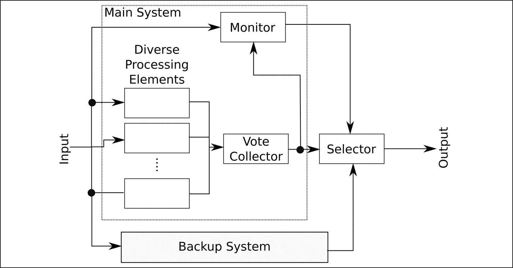
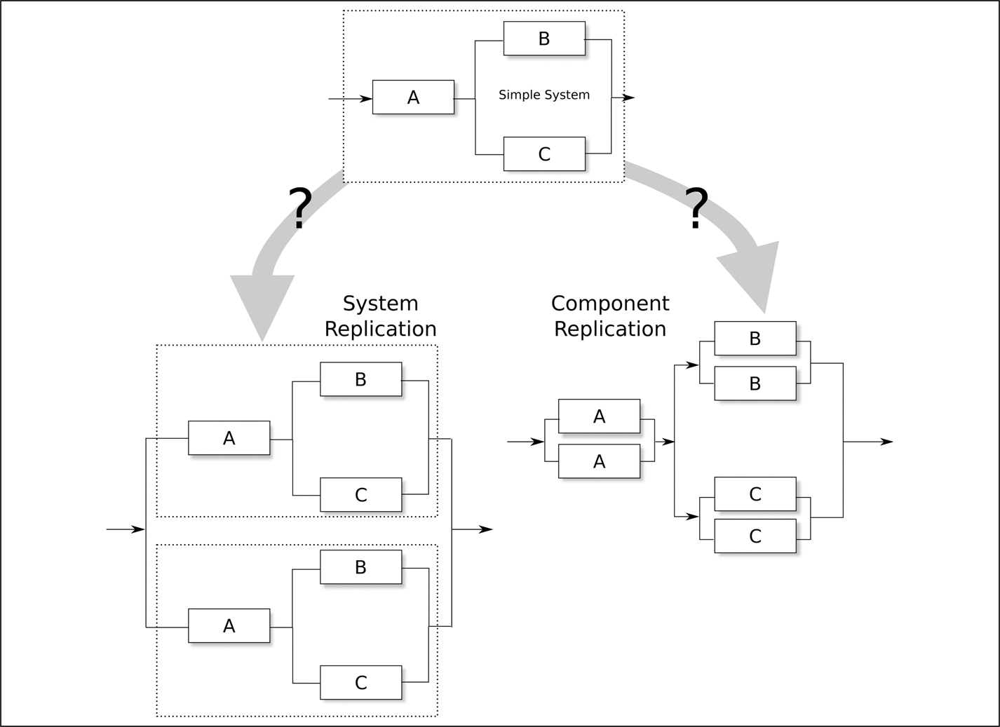
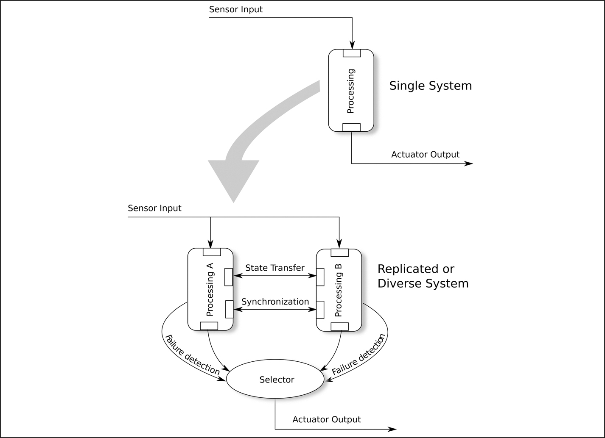
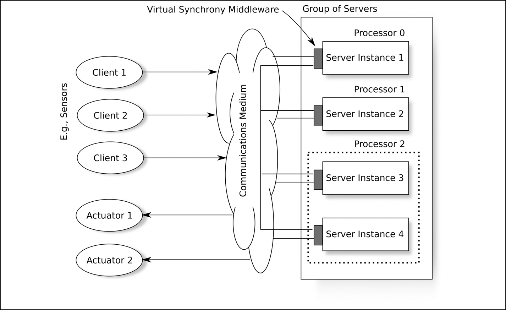
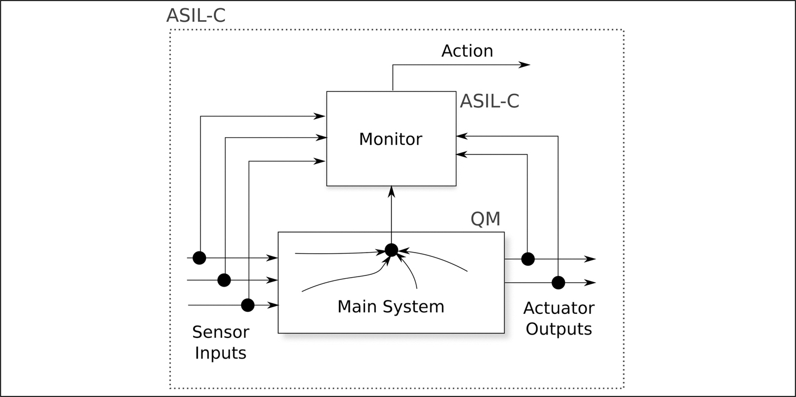
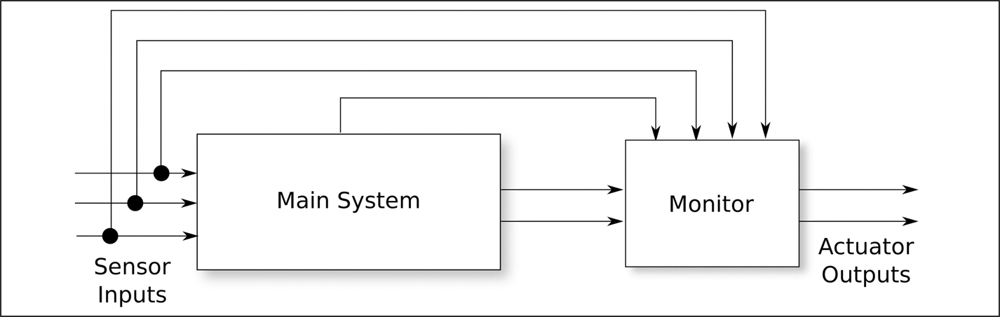

<a id="p144"></a>

<a id="chapter13"></a>

# 13 Replication và diversification

DOI: [10.1201/9781003598145-13](https://doi.org/10.1201/9781003598145-13)

> *Cách kiểm tra chắc chắn và hiệu quả nhất đối với các lỗi phát sinh trong quá trình tính toán là cho các máy tính riêng biệt và độc lập thực hiện cùng các phép tính; và cách kiểm tra này còn trở nên quyết định hơn nữa nếu chúng thực hiện các phép tính bằng những phương pháp khác nhau.*
>
> Dionysius Lardner, 1834

Chương này mô tả một số architectural pattern dựa trên replication (nhân bản: hai hoặc nhiều hệ thống giống hệt nhau) và diversification (đa dạng hóa: hai hoặc nhiều cách triển khai khác nhau của hệ thống).

Replication hoặc diversification được dùng để tăng hoặc availability hoặc reliability của một hệ thống — xem trang 16 để biết giải thích về sự phân biệt này. Như được mô tả trong [Mục 10.1](ch10_balancing_design_aspects.vi.md#sec10_1), tăng availability hoặc reliability nhìn chung làm giảm cái còn lại.

Câu trích năm 1837 của Babbage ở trang 16 về thiết kế phần mềm diverse không hẳn là câu đầu tiên. Câu trích từ bài báo năm 1834 của Dionysius Lardner (tài liệu tham khảo [<a id="b13refbib13_1"></a>[1](#refbib13_1)]) ở đầu chương này có trước nó ba năm. Ý tưởng lặp lại (nhân bản) một phép tính do con người thực hiện, chứ không phải máy tính điện tử, đã có từ nhiều thế kỷ trước, khi nó được dùng trong các phòng kế toán. Cuốn Compact Oxford English Dictionary trên giá sách của tôi đưa ra định nghĩa đầu tiên của “computer” như sau: *“Người tính toán; người làm tính, người tính sổ; đặc biệt là người được thuê để thực hiện các phép tính trong đài thiên văn, trong đo đạc, v.v.”* Đây là định nghĩa phù hợp với nhận xét của Lardner.

## 13.1 Replication và diversification trong các tiêu chuẩn

Replication và diversification được khuyến nghị trong cả IEC 61508 lẫn ISO 26262. IEC 61508-7 và EN 50716 mô tả một kỹ thuật rất gần với N-version programming ([Mục 13.4.2.3](#sec13_4_2_3)). IEC 61508-7 cũng khuyến nghị cụ thể sự đa dạng trong triển khai để giảm xác suất xảy ra các common-cause failure, mặc dù nó thừa nhận rằng một fault trong đặc tả chung có thể dẫn đến một common-cause failure.

Khái niệm một external monitor diversely-implemented ([Mục 13.7](#sec13_7)) được liệt kê là một kỹ thuật được khuyến nghị trong IEC 61508-3 và được mô tả chi tiết hơn trong IEC 61508-7. Trong phiên bản 1 của IEC 61508, external monitor được gọi là “safety bag”; trong các phiên bản sau, tên của nó đổi thành “diverse monitor”, cái tên có ưu điểm <a id="p145"></a>là mang tính mô tả hơn phần nào. EN 50716 vẫn dùng thuật ngữ “safety bag” và khuyến nghị nó như một software architecture ở mọi SIL. ISO 26262-6 cũng khuyến nghị diverse monitor.

Figure G.1-1 của ISO/PAS 8800 minh họa một architecture có cả một computation engine diverse lẫn một diverse monitor: xem <a id="b13fig13_6"></a>[Hình 13.6](#fig13_6), hình minh họa các khía cạnh chính của architecture này.

<a id="fig13_6"></a>



*Hình 13.6: Architecture phỏng theo ISO/PAS 8800[⏎](#b13fig13_6)*

Replication được khuyến nghị cho phần mềm thiết bị y tế trong IEC/TR 80002-1.<a id="fn13_113b"></a>[<sup>1</sup>](#fn13_1)

## 13.2 Replication thành phần hay replication hệ thống?

Nhân bản các thành phần hay nhân bản các hệ thống thì tốt hơn? Cụ thể, thiết kế nào trong hai thiết kế ở phần dưới của <a id="b13fig13_1"></a>[Hình 13.1](#fig13_1) có khả năng mang lại dependability cao hơn? Câu trả lời có thể khác nhau tùy hệ thống, đặc biệt nếu các thành phần có các failure mode khác nhau, nhưng nhìn chung, nhân bản các thành phần tốt hơn nhân bản các hệ thống. Điều này suy ra từ bất đẳng thức:

$$\begin{array}{l} φ ( \vec{x} ∐ \vec{y} ) \; \; \ge \; \; φ ( \vec{x} ) ∐ φ ( \vec{y} ) \end{array} \tag{13.1}$$

<a id="fig13_1"></a>



*Hình 13.1: Replication hệ thống và replication thành phần.[⏎](#b13fig13_1)*

trong đó các ký hiệu được định nghĩa như trong [Phụ lục D](ch28_appendix_d_notations.vi.md) ở trang 339.

<a id="fn13_1"></a>

[<sup>1</sup>](#fn13_113b)Medical device software — Guidance on the application of ISO 14971 to medical device software

Nếu các thành phần là phần cứng, thì replication thành phần có thêm một ưu điểm, vì có thể không cần nhân bản *tất cả* các thành phần để đạt được dependability cần thiết, dẫn đến một sản phẩm rẻ hơn so với nhân bản toàn bộ hệ thống.

## 13.3 Replication

### 13.3.1 Áp dụng replication

Động lực cho replication thường bắt nguồn từ quan điểm rằng, nếu một hệ thống đơn lẻ không thể đáp ứng các yêu cầu dependability cần thiết, thì bằng cách nhân bản nó, có thể đạt được một mức dependability cao hơn nhiều. Điều này có thể đúng nếu replication được xử lý rất cẩn thận, nhưng thường thì độ phức tạp tăng thêm của replication lấn át các ưu điểm.

Hãy xem <a id="b13fig13_2"></a>[Hình 13.2](#fig13_2). Phần trên của hình đó thể hiện một hệ thống nhúng chung nhận giá trị từ các cảm biến, thực hiện một dạng tính toán nào đó và đưa output tới các cơ cấu chấp hành (phanh, hướng lái, màn hình, đèn, v.v.). Khi một failure analysis được thực hiện trên thiết kế này, có thể thấy rằng dependability của nó không thỏa đáng và một biện pháp “đơn giản” nằm ở replication, như được thể hiện ở phần dưới của hình. Như có thể thấy, replication thực ra mang lại thêm độ phức tạp:<a id="p147"></a>

1. *Cần một bộ chọn (selector) để so sánh các output và chọn giữa chúng.*

   Nếu ý định là tăng *reliability* của hệ thống, thì selector chỉ cung cấp output cho các cơ cấu chấp hành nếu có sự đồng thuận; điều này làm giảm *availability* của hệ thống, vì cả *A* và *B* đều phải đang hoạt động để có thể thực hiện việc so sánh.

   Để tăng *availability*, selector sẽ chuyển giá trị đầu tiên nó nhận được tới các cơ cấu chấp hành; điều này không cho *reliability* cao hơn giải pháp không nhân bản, nhưng cho availability cao hơn.

2. *Có thể cần một dạng chuyển giao trạng thái (state transfer) nào đó.*

   Nếu hệ thống lưu trạng thái, thì ít nhất trạng thái sẽ phải được chia sẻ khi một bản sao khởi động — nó sẽ cần được đưa về khớp với bản sao đang hoạt động. Nếu dùng cách tiếp cận cold-standby ([Mục 13.3.2](#sec13_3_2)), thì có thể cần state transfer bất cứ khi nào trạng thái thay đổi trên subsystem đang hoạt động để bảo đảm rằng subsystem dự phòng có lịch sử (trạng thái) cần thiết để tiếp quản bất cứ lúc nào.

3. *Có thể cần một dạng đồng bộ hóa nào đó.*

   Nếu các hệ thống chạy độc lập, chúng có thể cần co-ordinate các phản hồi trước khi trình chúng cho selector.

<a id="fig13_2"></a>



*Hình 13.2: Replication ngây thơ.[⏎](#b13fig13_2)*

Sức mạnh của replication là nó cho phép thiết kế tập trung rõ ràng vào hoặc availability hoặc reliability. Để có *availability* tối đa, hai (hoặc nhiều hơn) subsystem sẽ cùng hoạt động và selector sẽ lấy output đầu tiên được cung cấp, một hệ thống so-called 1oo2 (một trong hai). Để có *reliability* tối đa, selector sẽ chờ output từ cả hai subsystem và so sánh chúng. Nó chỉ chấp nhận các output nếu chúng khớp nhau: 2oo2 (hai trong hai). Ở chế độ 2oo2, nếu một subsystem hỏng, thì toàn bộ hệ thống sẽ dừng, availability đã bị hy sinh để đổi lấy reliability.

Một dạng replication đặc biệt hữu ích là “virtual synchrony”, được mô tả trong [Mục 13.5](#sec13_5).

<a id="sec13_3_2"></a>

### 13.3.2 Cold standby

Mô hình “cold-standby” là một trường hợp cụ thể của phần dưới [Hình 13.2](#fig13_2), trong đó chỉ một trong các subsystem đang hoạt động và subsystem kia giám sát hành vi của nó, sẵn sàng tiếp quản nếu đối tác đang hoạt động bị hỏng. Trong trường hợp này, selector trở thành một công tắc nối đối tác đang hoạt động với các cơ cấu chấp hành. Việc dùng cold-standby đưa vào những điểm hỏng tiềm tàng khác:

- *Failure của subsystem đang nghỉ (cold) được phát hiện thế nào?*

  Sau failure của subsystem đang hoạt động, có thể chuyển sang subsystem dự phòng, chỉ để phát hiện ra rằng nó đã hỏng từ vài giờ trước. Module state transfer có thể vẫn đang chấp nhận các cập nhật trạng thái đến, nhưng phần còn lại của phần mềm có thể không sẵn sàng. Trong nhiều hệ thống, failure âm thầm như vậy là yếu tố quan trọng nhất trong xác suất failure tổng thể của hệ thống.

- <a id="p148"></a>*Làm thế nào selector (một công tắc) biết rằng subsystem đang hoạt động đã hỏng và cần chuyển sang subsystem dự phòng?*

  Liệu đôi khi nó có chuyển một cách không cần thiết không, và, nếu có, xác suất subsystem cold đã hỏng âm thầm ảnh hưởng thế nào đến xác suất failure tổng thể của hệ thống? Liệu đôi khi nó có không phát hiện ra failure và vẫn được chuyển tới một subsystem đã hỏng không? Việc không phát hiện ra failure đặc biệt nguy hại, vì nó có nghĩa là hệ thống đã hỏng trong khi một subsystem đang hoạt động tốt vẫn sẵn có và không được sử dụng.

- *Failure của selector ảnh hưởng thế nào đến dependability của hệ thống?*

  Tùy theo thiết kế hệ thống thực tế, selector có thể là một thành phần rất phức tạp, bản thân nó cũng có thể bị hỏng.

Một nhược điểm khác của architecture cold-standby là nó khó mở rộng. Nếu dependability yêu cầu cần ba subsystem trở lên, thì selector trở nên rất phức tạp và error-prone.

### 13.3.3 Time replication

Biết rằng hầu hết các bug gặp phải ngoài thực địa là Heisenbug, chỉ đơn giản chạy mỗi phép tính hai lần và so sánh các câu trả lời có thể đủ để phát hiện một bug. Thực hiện phép tính lần thứ ba và tìm thấy hai câu trả lời giống hệt nhau khi đó có thể đủ để thu được một kết quả đáng tin cậy, sự thỏa đáng của thiết kế được đánh giá trong failure analysis — xem [Chương 15](ch15_the_fault_tree.vi.md).

Dạng replication này được gọi là “time replication”, vì thứ được nhân bản là thời gian: hệ thống chạy chậm hơn, nhưng đáng tin cậy hơn. Rob Ashmore từng chỉ ra cho tôi rằng *time replication* cũng có thể được coi là *state diversity* vì trạng thái hệ thống sẽ khác đi khi phép tính được lặp lại.

## 13.4 Diversification

Diversification đưa replication tiến thêm một bước, với hai subsystem trong [Hình 13.2](#fig13_2) khác nhau theo một cách nào đó. Các điểm đa dạng hóa khả dĩ bao gồm phần cứng, phần mềm và dữ liệu, như được mô tả dưới đây.

<a id="sec13_4_1"></a>

### 13.4.1 Đa dạng phần cứng

Có thể cho hai subsystem trong [Hình 13.2](#fig13_2) chạy trên các bộ xử lý khác nhau (có lẽ một bộ xử lý ARM và một bộ xử lý x86). Lợi ích của việc này không rõ ràng. Chắc chắn, nó sẽ kéo theo nhiều công việc hơn (các board support package khác nhau, các layout board khác nhau, các compiler khác nhau, v.v.), và chúng ta cũng phải xem xét loại fault của bộ xử lý mà chúng ta đang cố phòng ngừa: Heisenbug hay Bohrbug.

<a id="p149"></a>Heisenbug có thể phát sinh trong bộ xử lý. Mọi bộ xử lý hiện đại đều đi kèm một cuốn *errata* có thể khiến người đọc dựng tóc gáy! Vào thời điểm viết sách, *errata* của một bộ xử lý phổ biến chứa những tuyên bố từ nhà sản xuất chip, chẳng hạn như,

> *“Trong những trường hợp rất hiếm, Automatic Data prefetcher có thể dẫn đến deadlock hoặc hỏng dữ liệu. Không có kế hoạch sửa.”*

và

> *“Một imprecise external abort, nhận được trong khi bộ xử lý đi vào WFI, có thể gây ra deadlock bộ xử lý. Không có kế hoạch sửa.”*

Ngay cả không có *errata* của chip, Heisenbug cũng có thể phát sinh từ nhiễu điện từ (xem tài liệu tham khảo [<a id="b13refbib13_2"></a>[2](#refbib13_2)]), tác động của các hạt thứ cấp từ các sự kiện tia vũ trụ hoặc, đối với nhiều chip memory, “row hammering” (xem tài liệu tham khảo [<a id="b13refbib13_3"></a>[3](#refbib13_3)]). Nhóm bảo mật tại Vrije Universiteit Amsterdam (VUSec), nhóm đầu tiên mô tả row hammering, đã có thể dùng hiệu ứng này để giành quyền root trên một thiết bị Android. Người ta từng cho rằng việc dùng memory Error-Correcting Code (ECC) có thể phòng ngừa row hammering, nhưng tài liệu tham khảo [<a id="b13refbib13_4"></a>[4](#refbib13_4)] cho thấy điều này không đúng.

Tuy nhiên, chúng ta không cần diversity để bảo vệ chống lại Heisenbug; chúng ta có thể dùng replication. Nếu một Heisenbug như vậy ảnh hưởng đến hoạt động của một bộ xử lý, thì cực kỳ khó có khả năng nó ảnh hưởng đến bộ xử lý kia theo cùng cách vào cùng thời điểm — đó là bản chất của Heisenbug.

Đa dạng hóa phần cứng *sẽ* hiệu quả chống lại Bohrbug trong bộ xử lý. Tuy nhiên, chúng rất hiếm. Bohrbug được báo cáo gần đây nhất có lẽ là lỗi phép chia năm 1994 trong bộ xử lý x86 Pentium, vốn không thể tính $\frac{4195835}{3145727}$. Chấp nhận chi phí của một thiết kế bộ xử lý diverse, phòng trường hợp nhà sản xuất chip đã đưa vào một Bohrbug, có thể không phải là một chiến lược cost-effective.

<a id="sec13_4_2"></a>

### 13.4.2 Đa dạng phần mềm

#### 13.4.2.1 Đa dạng Code-Level đơn giản

Có nhiều cấp độ đa dạng phần mềm. Có lẽ đơn giản nhất là dùng hai hoặc nhiều compiler khác nhau, hoặc cùng một compiler với các tùy chọn khác nhau, để biên dịch cùng một source code.

Tinh vi hơn một chút là dùng một công cụ để biến đổi một source code thành một source code tương đương. Ví dụ, công cụ CIL có thể biến đổi một chương trình nguồn C sang dạng three-address code. Source code tương đương này có thể tạo ra object code rất khác khi được biên dịch, mặc dù điều này sẽ cần được kiểm tra vì bản thân compiler có thể đang chuyển input của nó sang dạng three-address code.

<a id="p150"></a>Một ví dụ khác, dùng các định luật de Morgan, đoạn code

```
unsigned char doit(unsigned char x, unsigned char y)
    {
    unsigned char s;
    s = x & y;
    return s;
    }
```

có thể được chuyển thành

```
unsigned char doit(unsigned char x, unsigned char y)
    {
    unsigned char s;
    unsigned char x1 = ~x;
    unsigned char y1 = ~y;
    s = x1 | y1;
    return ~s;
    }
```

vốn tương đương về mặt logic nhưng, với hầu hết các compiler, sẽ tạo ra object code khác. Nếu cả hai cách biểu diễn này đều được thực thi, các kết quả có thể được so sánh trước khi bất kỳ hành động rẽ nhánh nào được thực hiện dựa trên kết quả.

<a id="sec13_4_2_2"></a>

#### 13.4.2.2 Coded processor

Ý tưởng đằng sau “coded processor” là một sự mở rộng của khái niệm đa dạng chương trình. Một phiên bản được mã hóa của mỗi biến được lưu cùng với biến đó và được dùng để phát hiện các lỗi tính toán gây ra bởi compiler sai, lỗi phần cứng (bit flip) và việc chuyển vòng task sai.

Khi các biến được thao tác (ví dụ, `z = x + y` hoặc `if (x > 0)`), các mã đi kèm cũng vậy. Phần mềm hoặc phần cứng sau đó có thể kiểm tra phép tính bằng cách kiểm tra tính hợp lệ của mã mới. Kỹ thuật này được dùng trong hệ thống đường sắt không người lái ở Lyon, trên tuyến Météor ở Paris và trên tuyến tàu điện ngầm Canarsie ở New York.

Kỹ thuật này được đề cập trong IEC 61508-7 và ISO 26262-5. EN 50716 không nhắc tường minh đến coded processing. Coded processor được mô tả trong nhiều ấn phẩm, bao gồm tài liệu tham khảo [<a id="b13refbib13_5"></a>[5](#refbib13_5)] của Jürgen Mottok *et al.*, tài liệu tham khảo [<a id="b13refbib13_6"></a>[6](#refbib13_6)] của Daniel Dollé và tài liệu tham khảo [<a id="b13refbib13_7"></a>[7](#refbib13_7)] của Martin Hoffmann *et al.*

Ý tưởng cơ bản được P. Forin phát triển năm 1989 và bao gồm việc lưu một dạng mã hóa $( {x}_{c} )$ của mỗi toán hạng số học $( {x}_{f} )$, được tính như sau:

$$\begin{array}{l} {x}_{c} = A \times {x}_{f} + {B}_{x} + D \end{array} \tag{13.2}$$

trong đó *A* ban đầu được cho là tốt nhất nên là một số nguyên tố lớn, ${B}_{x} < A$ là một chữ ký duy nhất và tĩnh nào đó của *x<sub>f</sub>* (ví dụ, một giá trị rút ra từ địa chỉ memory của nó) bảo đảm rằng $z = x + y$ không thể bị âm thầm thực thi thành $z = x + x$, và *D* là một số thứ tự tăng lên sau mỗi chu kỳ tính toán. Việc đưa *D* vào bảo đảm rằng nếu một trong các biến đã được tính trước đó, nhưng việc lưu nó <a id="p151"></a>vào memory đã không diễn ra đúng, có lẽ do một lỗi caching, thì giá trị cũ không thể bị truy cập mà không bị phát hiện lỗi.

Tài liệu tham khảo [[7](#refbib13_7)] (và các bài báo khác) báo cáo rằng, mặc dù một số nguyên tố lớn thường không phải là một lựa chọn tồi cho *A*, có những non-primes còn tốt hơn. Bài báo đó phát hiện rằng $A = 58 \; 368$ (non-prime) là kém, $A = 58 \; 831$ (số nguyên tố) tốt hơn, nhưng $A = 58 \; 659$ (non-prime) còn tốt hơn nữa.

Khi hai biến, chẳng hạn *x<sub>f</sub>* và *y<sub>f</sub>*, được kết hợp để tạo thành *z<sub>f</sub>* (ví dụ, ${z}_{f} = {x}_{f} + {y}_{f}$), các giá trị mã hóa đi kèm *x<sub>c</sub>* và *y<sub>c</sub>* được kết hợp để cho ra giá trị mã hóa của *z<sub>f</sub>, z<sub>c</sub>*, bằng cách tính ${z}_{c} = {x}_{c} ⊕ {y}_{c}$. Phép ⊕ đối với mã cũng tương đương như phép + đối với giá trị. Kết quả của phép tính khi đó có thể được xác nhận với sai số trong khoảng $≈ \frac{1}{A}$ (điều này giải thích vì sao *A* nên lớn) bằng cách kiểm tra rằng ${z}_{c} = A \times {z}_{f} + {B}_{z} + D$ hoặc, đơn giản hơn, rằng

$$\begin{array}{l} ( {z}_{c} - {B}_{z} - D ) \; \; \; \text{mod} \; \; \; A = 0 \end{array} \tag{13.3}$$

Dĩ nhiên, việc tính thêm *z<sub>c</sub>* làm tăng đáng kể chi phí tính toán và việc lưu một giá trị mã hóa cùng mỗi biến đòi hỏi nhiều memory hơn.

[Phụ lục C](ch27_appendix_c_calculating_2_3_4.vi.md) ở trang 335 có một ví dụ về coded processing trong thực tế.

Tài liệu tham khảo [<a id="b13refbib13_8"></a>[8](#refbib13_8)] của Ute Wappler và Christof Fetzer mô tả một thí nghiệm được thực hiện bằng cách tiêm fault (xem [Mục 22.1](ch22_integration_and_system_testing.vi.md#sec22_1)) vào một chương trình tính hash MD5. Kỹ thuật coded processor không chỉ phát hiện mọi fault được tiêm vào khiến output sai, mà còn phát hiện tất cả, trừ 0,06%, các fault được tiêm vào cho ra câu trả lời đúng nhưng làm hỏng trạng thái bên trong — ngụ ý rằng phép tính tiếp theo có thể sai.

Tài liệu tham khảo [[7](#refbib13_7)] của Martin Hoffmann *et al.* mô tả các thí nghiệm trong đó nhiều lỗi bit được đưa vào các instruction và register. Dùng một giá trị tốt cho *A* (58659), coded processing đã phát hiện mọi sự hỏng two-bit; dùng một giá trị kém cho *A* (58368), nó không phát hiện được 77 trong số 120720 sự hỏng two-bit được tiêm vào.

<a id="sec13_4_2_3"></a>

#### 13.4.2.3 N-Version Programming

Đa dạng hóa phần mềm có thể được đẩy đi xa hơn nhiều. N-version programming được Algirdas Avižienis đề xuất năm 1975 trong tài liệu tham khảo [<a id="b13refbib13_9"></a>[9](#refbib13_9)]. Ông định nghĩa kỹ thuật này như sau:

> *N-version programming là … việc tạo ra một cách độc lập* $N \ge 2$ *chương trình tương đương về chức năng từ cùng một đặc tả ban đầu. N chương trình này sở hữu mọi thuộc tính cần thiết để thực thi đồng thời, trong quá trình đó các vector so sánh (“c-vectors”) được các chương trình tạo ra tại những điểm nhất định. …*
>
> *“Tạo ra các chương trình một cách độc lập” ở đây có nghĩa là các nỗ lực lập trình được thực hiện bởi N cá nhân hoặc nhóm không tương tác với nhau trong quá trình lập trình. Bất cứ khi nào có thể, các thuật toán và ngôn ngữ lập trình (hoặc trình dịch) khác nhau được dùng trong mỗi nỗ lực.*

Avižienis phản bác lập luận rằng N-version programming đắt đỏ đến mức không kham nổi bằng cách nói rằng chi phí kiểm chứng và kiểm định giảm đi có thể bù đắp cho chi phí lập trình tăng lên.

<a id="p152"></a>Đáng tiếc là, nhiều nghiên cứu, bao gồm nghiên cứu được mô tả trong tài liệu tham khảo [<a id="b13refbib13_10"></a>[10](#refbib13_10)] của John Knight và Nancy Leveson, đã phát hiện ra rằng các fault trong code không độc lập trong N-Version programming:

> *Đối với bài toán cụ thể được lập trình cho thí nghiệm này, chúng tôi kết luận rằng giả định về tính độc lập của các lỗi, vốn là nền tảng cho một số phân tích về N-Version programming, không đúng.*

Điều này có thể là vì nhiều fault lập trình do các đặc tả mơ hồ gây ra và các đặc tả là như nhau đối với cả *N* nhóm. Ngoài ra, hầu hết các fault xuất hiện trong code phức tạp, và code phức tạp đối với một nhóm có khả năng cũng phức tạp đối với các nhóm khác. Điều này được phản ánh trong IEC 61508-7, nơi nói: *“Trong thực tế, có thể rất khó đạt được và chứng tỏ được tính độc lập giữa các phiên bản, vốn là nền tảng của cách tiếp cận N-version.”*

Các lập luận ủng hộ và phản đối N-version programming đã gây ra một cuộc khẩu chiến nghiêm trọng trong tài liệu kỹ thuật, với những cảm xúc lên rất cao.

#### 13.4.2.4 Recovery block

Recovery block, như được mô tả trong [Mục 11.5](ch11_error_detection_and_handling.vi.md#sec11_5), cũng có thể được coi là một dạng diversification.

### 13.4.3 Đa dạng dữ liệu

Trong tất cả các dạng đa dạng, đa dạng dữ liệu có lẽ là hữu ích nhất và ít gây tranh cãi nhất.

> Giai thoại 20 *Tôi từng gặp một Bohrbug trong một chương trình nhúng xảy ra khi một vòng lặp kết thúc ở giá trị 1023. Trong ngữ cảnh đó, giá trị này rất khó xảy ra và vì vậy không có failure nào xảy ra trong quá trình kiểm thử, nhưng một failure đã xảy ra ngoài thực địa, với những kết quả thú vị (nhưng, may mắn là, không nguy hiểm). Nếu dữ liệu được mã hóa theo hai định dạng dữ liệu khác nhau, thì bất thường đó đã có thể được phát hiện và xử lý.*

Ý tưởng là lưu cùng một thông tin bằng hai hoặc nhiều cách biểu diễn dữ liệu khác nhau. Ví dụ, trong một thuật toán tính toán việc phanh của một đoàn tàu, cùng một thông tin có thể được giữ dưới dạng dữ liệu trong cả miền thời gian lẫn miền tần số. Điều này cung cấp một hàng phòng thủ chống lại cả Bohrbug lẫn Heisenbug trong chương trình. Ví dụ, một chương trình có thể chứa một Bohrbug kích hoạt bất cứ khi nào xảy ra tràn số nguyên. Sự tràn số như vậy có thể xảy ra khi xử lý chuỗi thời gian, nhưng không xảy ra khi xử lý thông tin phổ tần số.

<a id="sec13_5"></a>

<a id="p153"></a>

## 13.5 <a id="p153"></a>Virtual synchrony

Virtual synchrony, còn được gọi là group synchrony, là một architecture hỗ trợ cả replication lẫn diversification. Kỹ thuật này được Kenneth Birman và Robbert van Renesse giới thiệu vào early-1990s và được mô tả trong tài liệu tham khảo [<a id="b13refbib13_11"></a>[11](#refbib13_11)].

Có nhiều phần mở rộng và biến thể của ý tưởng nền tảng của virtual synchrony, nhưng, về cốt lõi, nó dựa trên hai khái niệm rất đơn giản:

1. Các server tham gia và rời khỏi các group. Khi tham gia, chúng được cung cấp một bản sao up-to-date của trạng thái group. Group cung cấp một service, hoặc cho các thành viên của group hoặc cho các client nằm bên ngoài group.

   Mỗi server có thể, nhưng không bắt buộc, biết về các thành viên khác của group.

2. Khi các thông điệp từ client đến và thành phần group thay đổi (server tham gia hoặc rời đi), thông báo về các sự kiện này được đưa đến mọi server trong group theo cùng một thứ tự. Vì vậy, nếu một thành viên của group được thông báo rằng server X đã rời group rồi nhận được request của client Y, thì mọi thành viên của group sẽ thấy hai sự kiện đó theo thứ tự đó.

Hai khái niệm này bảo đảm rằng mọi server bắt đầu ở cùng một trạng thái (việc căn chỉnh trạng thái của một thành viên group mới là một phần của protocol), và rằng mỗi server nhận được cùng các thông điệp theo đúng cùng một thứ tự. Với những bảo đảm này, mọi server rốt cuộc phải đạt tới cùng một trạng thái — đây là đồng bộ *ảo* (virtual), không phải hoạt động locked-step. Phần lớn độ phức tạp thuật toán của virtual synchrony nằm ở việc duy trì các góc nhìn chung về thành phần group hiện tại trong điều kiện server và đường truyền bị hỏng.

Đối với một số hệ thống, nhu cầu về thứ tự đến giống hệt nhau của mọi sự kiện tại mỗi server trong group có thể được nới lỏng và đưa ra các bảo đảm khác:

*Bảo đảm thứ tự người gửi (Sender order).*

Mọi thông điệp từ mỗi client được chuyển tới mỗi thành viên group theo thứ tự chúng được gửi. Không có bảo đảm rằng các thông điệp được gửi từ hai client *khác nhau* sẽ được chuyển tới các thành viên group theo cùng một thứ tự.

*Bảo đảm thứ tự nhân quả (Causal order).*

Nếu một thông điệp *s*<sub>1</sub> khiến một chương trình gửi thông điệp *s*<sub>2</sub>, thì *s*<sub>1</sub> sẽ được chuyển tới mỗi thành viên group trước *s*<sub>2</sub>.

*Bảo đảm thứ tự toàn phần hay thứ tự thống nhất (Total or agreed order).*

Nếu bất kỳ thành viên group nào nhận được *s*<sub>1</sub> trước *s*<sub>2</sub>, thì mọi thành viên group đều vậy. Đây là thứ tự được mô tả ở trên và là thứ tự được giả định trong các ví dụ dưới đây.

Làm ví dụ, hãy xem <a id="b13fig13_3"></a>[Hình 13.3](#fig13_3). Group này có bốn instance server, mỗi instance được liên kết với middleware virtual synchrony. Các instance có thể là bản sao hoặc các bản triển khai diverse.

<a id="fig13_3"></a>



*Hình 13.3: Môi trường virtual synchrony ví dụ.[⏎](#b13fig13_3)*

Như được thể hiện trong [Hình 13.3](#fig13_3), nhà thiết kế đã quyết định chạy server 3 và 4 trên cùng một bộ xử lý.<a id="fn13_213b"></a>[<sup>2</sup>](#fn13_2) Điều này bảo đảm rằng chúng không chạy locked-step. Thực ra, với công sức cần để ép hoạt động locked-step, điều này có lẽ không cần thiết — các server trên các bộ xử lý khác nhau dù sao cũng sẽ sớm phân kỳ.

Trong [Hình 13.3](#fig13_3), tôi đã vẽ cơ chế giao tiếp giữa các client và các server như một đám mây. Trong thực tế, đây có thể là bất kỳ phương tiện nào hỗ trợ thông điệp: một mạng wide-area (WAN), một mạng local-area (LAN), một backplane trong một rack, các đường mạch giữa các bộ xử lý trên một bo mạch printed-circuit, hoặc các cơ chế truyền nội bộ giữa các lõi trên một bộ xử lý multicore. Kết nối càng gần, virtual synchrony hoạt động càng tốt.

Có ba client trong [Hình 13.3](#fig13_3). Giả sử client 1 và client 3 gửi một request tới thứ mà chúng tin là một server duy nhất, vào khoảng cùng một thời điểm. Middleware virtual synchrony nhân bản và sắp thứ tự các thông điệp đến này và bảo đảm rằng mỗi trong bốn instance server nhận được chúng theo cùng một thứ tự.

<a id="fn13_2"></a>

[<sup>2</sup>](#fn13_213b)Thuật ngữ “processor” được dùng ở đây để chỉ bất kỳ phần tử xử lý nào: nó có thể là một chip xử lý hoặc một lõi trên một bộ xử lý multicore.

Mỗi server tin rằng nó đang hành động một mình và vì vậy thực hiện bất kỳ phép tính nào được yêu cầu và trả lời bằng một câu trả lời, có thể để gửi tới một cơ cấu chấp hành. Middleware virtual synchrony chấp nhận các câu trả lời này, vốn đến vào những thời điểm khác nhau, và thực hiện một hành động định trước. Hành động đó có thể là gửi câu trả lời đầu tiên tới cơ cấu chấp hành và loại bỏ các câu trả lời khác. Trong một hệ thống khác, middleware có thể <a id="p155"></a>được cấu hình để chờ đa số phản hồi của các server, so sánh chúng và gửi giá trị được thống nhất cho client (có lẽ là phản hồi phổ biến nhất, có lẽ là trung bình cộng của các phản hồi).

Trong mọi trường hợp, client đã gửi một thông điệp duy nhất tới thứ mà nó tin là một server duy nhất, và một phản hồi duy nhất đã được trả về.

<a id="aned21"></a>

> Giai thoại 21.[⏎](#b13aned21) *Tôi từng được nhờ tư vấn về một hệ thống vận hành virtual synchrony trên một mạng wide-area (WAN). Do độ trễ dài và rất biến động trên WAN cùng xác suất cao các gói tin bị mất trên đường truyền, các thuật toán virtual synchrony đã dành một lượng thời gian không cân xứng để tính toán lại và phân phối lại thông tin về thành phần group. Cuối cùng, dự án đã bị hủy.*

Kỹ thuật này có một số ưu điểm so với các sơ đồ replication khác:

1. *Nó chịu được Heisenbug.*

   Đây có thể là ưu điểm chính của nó. Giả sử rằng, trong [Hình 13.3](#fig13_3), server 2 gặp một Heisenbug khi xử lý request của client 3 và hoặc bị crash hoặc trả về câu trả lời sai. Khó có khả năng các instance khác sẽ gặp cùng Heisenbug đó—đó là lý do nó được gọi là Heisenbug! Trong trường hợp này, server 2 sẽ biến mất khỏi group, và một phản hồi từ các server khác sẽ được chuyển tới cơ cấu chấp hành miễn là vẫn còn đủ quorum thành viên group.

2. *Nó mở rộng tốt (tuyến tính) theo số lượng instance server.*

   Điều này cho phép cung cấp bất kỳ mức dependability nào. Ngược lại, như tài liệu tham khảo [<a id="b13refbib13_12"></a>[12](#refbib13_12)] của Jim Gray *et al.* chỉ ra, thời gian giao dịch tăng theo *N*<sup>3</sup> trong các architecture replication khác.

3. *Nó có thể được tinh chỉnh để cung cấp reliability hoặc availability.*

   Bằng cách thay đổi cách middleware xử lý các phản hồi, hệ thống có thể được cấu hình tĩnh hoặc động để cung cấp availability hoặc reliability. Ví dụ, loại bỏ mọi phản hồi trừ phản hồi đầu tiên làm tăng availability với cái giá là reliability; chờ phản hồi cuối cùng và so sánh tất cả làm tăng reliability với cái giá là availability. Việc chọn các thuật toán ở giữa (ví dụ, chờ hai phản hồi đầu tiên) cho phép kiểm soát phần nào sự cân bằng availability/reliability. Điều này đặc biệt hữu ích khi sự cân bằng cần thay đổi động, như được mô tả trong [Mục 10.1](ch10_balancing_design_aspects.vi.md#sec10_1).

4. *Nó tránh được failure âm thầm.*

   Mọi instance của server đều hoạt động mọi lúc, giảm rủi ro failure âm thầm vốn làm khổ architecture cold-standby.

5. *Selector hay công tắc trong [Hình 13.2](#fig13_2) được loại bỏ.*

   Vì mọi instance server đều hoạt động mọi lúc, không có công tắc nào có thể là một điểm hỏng khác.

6. <a id="p156"></a>*Nhìn chung, không cần thay đổi đáng kể nào, cả ở client lẫn ở server, để đưa virtual synchrony vào.*

   Kỹ thuật này có thể được đưa dễ dàng vào một hệ thống non-replicated hiện có để cung cấp mức dependability cao hơn; mỗi client có thể tiếp tục tin rằng nó đang truy cập một server duy nhất, và mỗi server có thể không biết về các thành viên group khác.

   Điều này đặc biệt quan trọng trong các hệ thống có server phức tạp. Ví dụ, hãy xét một hệ thống trong ô tô tính đến tốc độ hiện tại của xe, điều kiện mặt đường (ướt/khô, lên dốc/xuống dốc, có trải nhựa/không trải nhựa, v.v.) và các input cảm biến mô tả các chướng ngại vật phía trước rồi quyết định lực tác dụng lên phanh. Hệ thống này có lẽ sẽ được một chuyên gia control-system lập trình và code thu được có khả năng rất phức tạp. Thật không hợp lý khi yêu cầu lập trình viên này còn phải tính đến các vấn đề bổ sung gắn với replication: đồng bộ hóa, trao đổi trạng thái, v.v. Trong một môi trường virtually synchronous, lập trình viên của bộ điều khiển phức tạp được giải thoát khỏi những thách thức này.

7. *Nó là một kỹ thuật đã được tiêu chuẩn hóa.*

   Mặc dù không được nhắc đến tường minh trong ISO 26262 hay IEC 61508 (vì được bao quát bởi tiêu đề chung “replication”), nó được đề cập trong *application interface specification* (AIS) của Service Availability Forum, có tại [https://www.associationvoice.com/16627](https://www.associationvoice.com/16627).

8. *Tránh được state transfer.*

   Ngoại trừ khi một thành viên mới tham gia group, không cần sao chép trạng thái từ một server đang hoạt động sang một server thụ động như với architecture cold-standby. Ngay cả khi một thành viên mới tham gia group, có thể không cần state transfer. Mặc dù ít hệ thống hoàn toàn không có trạng thái, nhiều hệ thống có trạng thái time-limited. Ví dụ, một hệ thống trong ô tô dùng input camera để quyết định có nên đạp phanh hay không có thể cần các khung hình camera từ 10 giây gần nhất, nhưng sẽ không quan tâm đến dữ liệu cũ 20 giây. Nếu các phản hồi từ một thành viên group mới bị bỏ qua trong 20 giây, thì thành viên đó sẽ tự đồng bộ với các thành viên khác.

Dĩ nhiên, virtual synchrony cũng có những nhược điểm. Thứ nhất, để bảo đảm trạng thái các server không phân kỳ, mọi thay đổi trạng thái trong server phải chỉ diễn ra như kết quả của các thông điệp nhận được. Ví dụ, điều này có nghĩa là một server không được tạo một số ngẫu nhiên cục bộ nếu điều đó có thể làm thay đổi trạng thái của nó.

Thứ hai, nó lãng phí thời gian xử lý — trong [Hình 13.3](#fig13_3), cả bốn server đều đang thực hiện cùng một phép tính! Có những cơ chế trong virtual synchrony để giảm mức công việc này, đặc biệt nếu không có thay đổi trạng thái server nào phát sinh hoặc nếu phép tính dài và thay đổi trạng thái nhỏ. Nhưng, nhìn chung, công việc sẽ bị nhân bản.

Nhược điểm thứ ba thoạt nhìn có vẻ là quan trọng nhất: toàn bộ khái niệm thành phần group mà virtual synchrony dựa vào là bất khả — xem tài liệu tham khảo [<a id="b13refbib13_13"></a>[13](#refbib13_13)] của Tushar Chandra *et al*. Hãy xem [Hình 13.3](#fig13_3). Nếu instance server 1 mất liên lạc với các instance khác, thì các <a id="p157"></a>instance khác đó không thể xác định liệu điều này là do instance 1 đã crash hay vì, mặc dù nó vẫn đang chạy, đường truyền tới nó đã bị mất.

Nếu các kênh truyền dài và mong manh, như trong <a id="b13aned21"></a>[Giai thoại 21](#aned21), thì đây là một vấn đề đáng kể. Instance 1 có thể vẫn còn sống và đang cung cấp service cho một số client, trong khi các client khác được kết nối tới group chứa các instance 2 đến 4. Theo cách này, hệ thống đã bị chia tách và hai phần đang phân kỳ. Một failure đường truyền như vậy ít có khả năng xảy ra hơn khi các kênh ngắn hơn — một LAN, một backplane, một đường mạch trên bo mạch, v.v. — và sự bất khả về mặt logic của thành phần group nhất quán trở nên ít quan trọng hơn.

Việc dựa trên một điều bất khả có vẻ là một nhược điểm đáng kể, nhưng có những cách thực dụng để tránh vấn đề. Một cách thực dụng, nhưng không hoàn hảo, để xử lý “điều bất khả” là để tập con nhỏ hơn các instance server (instance 1, trong trường hợp này) tự kết liễu nếu chúng mất liên lạc với hơn một nửa group. Nếu instance 1 đột ngột chuyển từ server 1 trong một group 4 thành viên sang server 1 trong một group 1 thành viên, nó sẽ cố ý hỏng. Instance 2 sẽ chuyển từ server 2 trong một group 4 thành viên sang server 1 trong một group 3 thành viên và sẽ tiếp tục chạy.

> Giai thoại 22 *Lần đầu tiên tôi làm việc với một hệ thống virtual synchrony là vào những năm 1990. Đây không phải là một thiết bị nhúng; thay vào đó, các node là các workstation được kết nối bằng một LAN. Ở một chỗ, cáp LAN đi dưới một cánh cửa và, không tránh khỏi, cuối cùng cáp bị đứt ở đúng chỗ đó. Hệ thống đã chạy mà không có failure system-level nào trong vài năm khi điều này xảy ra, nhưng, đáng tiếc là, chúng tôi đã không ý thức đầy đủ về nhu cầu cấu hình cho vấn đề này, và LAN bị chia đúng làm đôi — vì vậy cả hai nửa đều tắt như đã mô tả ở trên. Để ngăn điều này xảy ra lần nữa, chúng tôi đã phân phối lại các trọng số logic gắn với các node để các node không thể bị chia đúng làm đôi nữa (và đi lại dây cáp).*

Tóm lại, pattern virtual synchrony là một cách đã được kiểm thử, chứng minh và tiêu chuẩn hóa để cung cấp replication theo cách mà hệ thống chịu được Heisenbug. Nó đặc biệt hữu ích khi dependability phải được “thêm vào” một hệ thống hiện có.

Có một số bản triển khai thương mại và open-source của middleware, bao gồm *Spread* (xem [http://www.spread.org](http://www.spread.org)), được thiết kế riêng để hoạt động trên WAN.

Các thuật toán được dùng để duy trì một góc nhìn nhất quán về thành phần group trên mọi thành viên của group khi các thành viên hỏng và phục hồi thì đơn giản, nhưng rất tinh tế. Nhiều thuật toán đã được công bố bị phát hiện có chứa những khiếm khuyết có thể ảnh hưởng đến hoạt động của hệ thống trong những tình huống khó xảy ra. Tài liệu tham khảo [<a id="b13refbib13_14"></a>[14](#refbib13_14)] của Massimo Franceschetti và Jehoshua Bruck chứa một thuật toán đơn giản, và chưa bị thách thức, mà tôi đã triển khai thành công. Tài liệu tham khảo [[14](#refbib13_14)] thừa nhận sự bất khả về mặt logic của điều nó đang cố làm (tài liệu tham khảo [[13](#refbib13_13)]), và giảm thiểu, dù hiển nhiên là không loại bỏ, các ảnh hưởng của điều này.

PAXOS của Leslie Lamport (tài liệu tham khảo [<a id="b13refbib13_15"></a>[15](#refbib13_15)]: xuất bản năm 1998, nhưng được viết năm 1990) là một thuật toán khác để duy trì sự đồng thuận về thành phần group khi <a id="p158"></a>đường truyền không đáng tin cậy. Thuật ngữ PAXOS bắt nguồn từ óc hài hước của Lamport: ông kể về một khám phá khảo cổ hoàn toàn hư cấu trên hòn đảo Paxos của Hy Lạp, cho biết *“rằng quốc hội đã hoạt động bất chấp thói quen hay đi lại của các nhà lập pháp part-time. Các nhà lập pháp duy trì các bản sao nhất quán của hồ sơ quốc hội, bất chấp việc họ thường xuyên rời khỏi phòng họp và sự đãng trí của những người đưa tin. Protocol của quốc hội Paxon cung cấp một cách mới để triển khai cách tiếp cận state-machine cho việc thiết kế các hệ thống phân tán.”*

## 13.6 Bộ xử lý Locked-Step

Dạng replication này có hai bộ xử lý chạy cùng code theo kiểu locked-step, mỗi bộ thực thi cùng một instruction mã máy vào cùng một thời điểm.

<a id="aned23"></a>

> Giai thoại 23.[⏎](#b13aned23) *Vào những năm 1980, tôi làm việc trên một hệ thống ở Thụy Sĩ có bộ xử lý nhân đôi và memory nhân ba. Các bộ xử lý chạy locked-step, và memory còn được bảo vệ thêm bằng 8 bit parity cho mỗi word 32-bit. Máy tính gồm hàng trăm bo mạch wire-wrapped; đó là máy tính duy nhất tôi từng lập trình mà cần đến một cái thang để bảo trì.*

Việc thực thi chương trình trên các bộ xử lý locked-step có một lịch sử thú vị. Vào những năm 1980, phần mềm rất đơn giản, còn phần cứng bộ xử lý rất phức tạp và dễ lỗi — trong trường hợp hệ thống được nhắc đến trong <a id="b13aned23"></a>[Giai thoại 23](#aned23), locked-step cung cấp một cách phát hiện lỗi phần cứng, đặc biệt là loại bug phổ biến nhất thời đó, hỏng đầu nối.

Vào cuối những năm 1990 và đầu thế kỷ 21, phần cứng trở nên tích hợp hơn nhiều, và số lượng mối hàn và mối nối wire-wrapped giảm đáng kể. Ở mức độ lớn, phần cứng bộ xử lý có thể được loại khỏi failure analysis vì tuổi thọ của nó giờ được đo bằng hàng trăm năm. Vào thời điểm này, xử lý locked-step là vô dụng vì hầu hết mọi fault đều nằm trong phần mềm và, với các bộ xử lý locked step, cả hai bộ xử lý sẽ hỏng đồng thời đối với cả Heisenbug lẫn Bohrbug.

Trong vài năm gần đây, các đường mạch trong vi mạch tích hợp đã hẹp đi. Năm 2005, độ rộng đường mạch 100 nm là điển hình; đến năm 2010, con số này đã giảm xuống 32 nm, đến năm 2018 các đường mạch 7 và 8 nm đã được xuất xưởng và đến năm 2024 con số này đã giảm xuống 3 nm. Do sự thu nhỏ này, bộ xử lý và chip memory đã trở nên dễ bị cross-talk giữa các đường mạch, lão hóa nhiệt, nhiễu electro-magnetic và hiệu ứng tia vũ trụ hơn. Xử lý Locked-step một lần nữa có thể có tác động tích cực lên khía cạnh reliability của failure analysis, trong khi có tác động tiêu cực lên availability. Dĩ nhiên, nó vẫn sẽ không bắt được dạng bug phần mềm nào.

Thường thì các bộ xử lý locked-step đơn giản được dùng kết hợp với một bộ vi xử lý mạnh. Bộ vi xử lý thực hiện các phép tính phức tạp và chuyển <a id="p159"></a>một lệnh tới các bộ xử lý locked-step (ví dụ, “tác dụng một lực 678 Newton lên phanh”) và chính các bộ xử lý locked-step mới thực sự giao tiếp với các cơ cấu chấp hành phần cứng.

<a id="sec13_7"></a>

## 13.7 Diverse monitor

### 13.7.1 Pattern External Monitor

<a id="b13fig13_4"></a>[Hình 13.4](#fig13_4) minh họa architecture của một external monitor (đôi khi được gọi là “safety bag”). Architecture này đã được dùng rộng rãi trong các hệ thống tín hiệu đường sắt từ những năm 1980 — xem tài liệu tham khảo [<a id="b13refbib13_16"></a>[16](#refbib13_16)] của Peter Klein.

<a id="fig13_4"></a>



*Hình 13.4: Diverse monitor.[⏎](#b13fig13_4)*

Hệ thống chính thực hiện chức năng của mình là đọc các giá trị input và biến đổi chúng thành các giá trị output. Monitor quan sát các input và output, và cũng có thể quan sát các trạng thái bên trong của hệ thống chính.

Hệ thống chính phức tạp hơn monitor *rất nhiều*. Ví dụ, trong một ứng dụng phanh đường sắt, hệ thống chính có thể nhận input tốc độ và quãng đường từ các cảm biến và các giới hạn di chuyển (“bạn được phép đi thêm 34 km từ vị trí này”) từ thiết bị bên đường ray. Có tính đến độ dốc và các khúc cua của đường ray phía trước, tốc độ hiện tại và nhiều yếu tố khác, nó tính toán điểm tối ưu mà tại đó nên phanh nếu không nhận được giới hạn di chuyển nào thêm. Nó thông báo cho người lái điều này bằng một hệ thống đồ họa tinh vi và, nếu người lái không phản ứng phù hợp, nó tiếp quản quyền điều khiển và đạp phanh. Có nhiều chỗ có thể hỏng trong chuỗi này.

Ngược lại, monitor *rất* đơn giản. Trong nhiều hệ thống, nó có thể được triển khai bằng phần cứng mà không có phần mềm nào, có thể dùng một field-programmable gate array (FPGA). Trong ví dụ phanh tàu, nó cũng có thể đọc các giới hạn di chuyển và <a id="p160"></a>tốc độ, nhưng các phép tính của nó đơn giản hơn nhiều. Ví dụ, nếu đoàn tàu còn cách giới hạn di chuyển của nó trong vòng hai phút, monitor sẽ đạp phanh.

Nếu có thể chứng tỏ rằng, dù hệ thống chính làm gì, monitor vẫn giữ cho đoàn tàu an toàn, thì có thể chỉ cần chứng nhận monitor là đủ. Điều này dựa vào việc monitor hoàn toàn độc lập với hệ thống chính, và điều này có thể khó lập luận, đặc biệt trong một môi trường ảo hóa, nơi monitor và hệ thống chính có thể dùng chung một thành phần phần cứng.

Khi thiết kế một hệ thống ô tô, có thể áp dụng việc phân rã automotive safety integrity level (ASIL) do ISO 26262-9 cung cấp. Ví dụ, nếu toàn bộ hệ thống sẽ được chứng nhận ở ASIL C, thì, với một số điều kiện nhất định, ISO 26262-9 cho phép phân rã nó thành một thành phần ASIL C và một thành phần “quality management” (QM) mà ISO 26262 không áp dụng. Trong [Hình 13.4](#fig13_4), hệ thống chính có thể quá phức tạp để được chứng nhận ở ASIL C, nhưng nó có thể được quản lý bởi các quy trình QM. Nếu tính đầy đủ và tính độc lập của monitor có thể được chứng tỏ, thì toàn bộ hệ thống có thể được chứng nhận ở ASIL C.

<a id="b13fig13_5"></a>[Hình 13.5](#fig13_5) thể hiện một cấu hình khác của monitor. Giờ nó nằm nối tiếp với các output từ hệ thống chính và có thể thay đổi chúng trước khi chúng đến các cơ cấu chấp hành.

<a id="fig13_5"></a>



*Hình 13.5: Diverse monitor: cấu hình thay thế.[⏎](#b13fig13_5)*

Một lần nữa, monitor đơn giản hơn hệ thống chính *rất nhiều*, và độc lập với nó. Monitor kiểm tra tính hợp lý của các output từ hệ thống chính. Ví dụ, trong một thiết bị y tế, hệ thống chính có thể đang tính toán và áp dụng một lưu lượng thuốc tối ưu. Mặc dù monitor kém tinh vi hơn, nó vẫn có thể phát hiện rằng, với các điều kiện input, lưu lượng thuốc do hệ thống chính cấu hình không thể nào hợp lệ và có thể giới hạn nó về một giá trị an toàn.

Nhìn chung, dù dùng cấu hình nào, monitor cũng đang cung cấp hành vi non-optimal, nhưng dù sao vẫn an toàn. Sự đơn giản của nó, so với hệ thống chính, khiến nó tăng reliability với cái giá là availability: có thể hệ thống chính đã thực hiện một phép tính đúng nhưng rất tinh vi, mà đối với monitor đơn giản lại có vẻ sai. Trong trường hợp này, monitor có thể đưa hệ thống ra khỏi hoạt động một cách không cần thiết.

<a id="p161"></a>

### 13.7.2 <a id="p161"></a>Watchdog diverse monitor

Watchdog là một diverse monitor rất phổ biến. Trong cấu hình của [Hình 13.4](#fig13_4), watchdog (monitor) không đọc input hay output: nó chỉ đơn giản dùng một timer. Nếu hệ thống chính không định kỳ “kick” watchdog bằng cách gửi cho nó một thông điệp, watchdog sẽ “sủa” (bark), thường là ép hệ thống vào design safe state của nó.

Khó khăn với cách tiếp cận watchdog là tìm một vị trí phù hợp trong code của hệ thống chính để kick watchdog, và đặt khoảng thời gian mà trong đó watchdog phải được kick. Rõ ràng, bất cứ thứ gì đang kick watchdog cũng phải ngừng làm việc đó nếu một failure đã xảy ra trong hệ thống chính, nhưng người ta dễ bị cám dỗ đặt việc kick watchdog vào một routine timer interrupt. Cách này gần như không bảo vệ được gì vì, ngay cả khi gần như toàn bộ code trong hệ thống chính đã hỏng, timer interrupt vẫn có thể đang đến và interrupt handler vẫn có thể đang kick watchdog. Để tránh điều này, tiến trình kick watchdog phải có khả năng xác định liệu hệ thống có đang hoạt động đúng hay không. Điều này có thể không dễ xác định.

Cũng có một sự thỏa hiệp cần đưa ra về khoảng thời gian sau đó watchdog sẽ sủa. Nếu đặt quá thấp, thì hành vi bất thường, nhưng đúng, của hệ thống chính làm trễ việc kick sẽ gây ra một lần chuyển không cần thiết sang design safe state. Nếu đặt quá cao, thì một tình trạng hỏng có thể kéo dài quá lâu để có thể bảo đảm an toàn.

## 13.8 Kết hợp tính toán diverse với diverse monitor

ISO/PAS 8800 có một architectural pattern cho thiết kế diverse mà tôi đã điều chỉnh trong [Hình 13.6](#fig13_6). Hình này cho thấy các giá trị cảm biến được phân phối tới nhiều phần tử xử lý diverse (các phần tử machine-learned), những phần tử này chuyển kết quả của chúng tới một subsystem để hợp nhất các kết quả. Các giá trị cảm biến và các kết quả đã hợp nhất được một external monitor giám sát để xác định rằng các kết quả là an toàn. Trong trường hợp hệ thống chính bị hỏng, architecture còn có một hệ thống dự phòng đọc các input cảm biến và đưa ra output.

Một selector thấy cả ba kết quả đã tính và chọn giữa chúng: nếu monitor đang ghi đè hệ thống chính, thì nó output của monitor được chọn thay vì output từ hệ thống chính; nếu hệ thống chính không đưa ra output, thì output từ hệ thống dự phòng được chọn.

## 13.9 Tóm tắt

Replication và diversification là những kỹ thuật mạnh để cải thiện availability hoặc reliability của một hệ thống. Tuy nhiên, việc dùng chúng không miễn phí — chúng thêm các thành phần và độ phức tạp vào hệ thống, và việc áp dụng replication kém có thể thực sự làm giảm dependability. Failure âm thầm của một thành phần đang ở chế độ cold-standby đặc biệt nguy hại.

## Tài liệu tham khảo

<a id="refbib13_1"></a>[1] D. Lardner, “Babbage's Calculating Engine,” *The Edinburgh Review*, vol. 59, 1834.[⏎](#b13refbib13_1)

<a id="refbib13_2"></a>[2] K. Armstrong, “Including Electromagnetic Interference (EMI) in Functional Safety Risk Asessments,” in *Proceedings of the* *20th Safety-Critical Systems Symposium*, SSS'12, pp. 97–114, Springer-Verlag, 2012.[⏎](#b13refbib13_2)

<a id="refbib13_3"></a>[3] Y. Kim, R. Daly, J. Kim, C. Fallin, J. Lee, D. Lee, C. Wilkerson, K. Lai, and O. Mutlu, “Flipping bits in memory without accessing them: An experimental study of DRAM disturbance errors,” in *ACM/IEEE 41st International Symposium on Computer Architecture, ISCA 2014*, *Minneapolis, MN, USA*, *June 14-18, 2014*, pp. 361–372, 2014.[⏎](#b13refbib13_3)

<a id="refbib13_4"></a>[4] L. Cojocar, K. Razavi, C. Giuffrida, and H. Bos, “Exploiting Correcting Codes: On the Effectiveness of ECC Memory against Rowhammer Attacks,” 2018.[⏎](#b13refbib13_4)

<a id="refbib13_5"></a>[5] J. Mottok, F. Schiller, T. Völkl, and T. Zeitler, “A Concept for a Safe Realization of a State Machine in Embedded Automotive Applications,” in *Proceedings of the 26th International Conference on Computer Safety, Reliability, and Security*, SAFECOMP'07, (Berlin, Heidelberg), pp. 283–288, Springer-Verlag, 2007.[⏎](#b13refbib13_5)

<a id="refbib13_6"></a>[6] D. Dollé, “Vital software: Formal method and coded processor,” in *3rd European Congress on Embedded Real Time Software, ERTS 2006*, *Toulouse, France*, *January 25-27,* 2006.[⏎](#b13refbib13_6)

<a id="refbib13_7"></a>[7] M. Hoffmann, P. Ulbrich, C. Dietrich, H. Schirmeier, D. Lohmann, and W. Schröder-Preikschat, “A Practitioner's Guide to Software-Based Soft-Error Mitigation Using AN-Codes,” in *Proceedings of the 2014 IEEE 15th International Symposium on High-Assurance Systems Engineering*, HASE ‘14, (USA), pp. 33–40, IEEE Computer Society, 2014.[⏎](#b13refbib13_7)

<a id="refbib13_8"></a>[8] U. Wappler and C. Fetzer, “Hardware Failure Virtualization Via Software Encoded Processing,” in *5th IEEE International Conference on Industrial Informatics (INDIN 2007)*, vol. 2, pp. 977–982, IEEE Computer Society, June 2007.[⏎](#b13refbib13_8)

<a id="refbib13_9"></a>[9] A. Avižienis, “Fault-tolerance and fault-intolerance: Complementary approaches to reliable computing,” in *Proceedings of the International Conference on Reliable Software*, (New York, NY, USA), pp. 458–464, ACM, 1975.[⏎](#b13refbib13_9)

<a id="refbib13_10"></a>[10] J. C. Knight and N. G. Leveson, “An Experimental Evaluation of the Assumption of Independence in Multi-Version Programming,” *IEEE Transactions on Software Engineering*, vol. SE 12, no. 1, pp. 96–109, 1996.[⏎](#b13refbib13_10)

<a id="refbib13_11"></a>[11] K. P. Birman, *Building Secure and Reliable Network Applications*. Upper Saddle River, NJ, USA: Prentice Hall PTR, 1st ed., 1996.[⏎](#b13refbib13_11)

<a id="refbib13_12"></a>[12] J. Gray, P. Helland, P. O'Neil, and D. Shasha, “The Dangers of Replication and a Solution,” in In *Proceedings of the 1996 ACM SIGMOD International Conference on Management of Data*, pp. 173–182, 1996.[⏎](#b13refbib13_12)

<a id="refbib13_13"></a>[13] T. D. Chandra, V. Hadzilacos, S. Toueg, and B. Charron-bost, “On the Impossibility of Group Membership,” 1996.[⏎](#b13refbib13_13)

<a id="refbib13_14"></a>[14] M. Franceschetti and J. Bruck, “A Group Membership Algorithm with a Practical Specification,” *IEEE Trans. Parallel Distrib. Syst.*, vol. 12, pp. 1190–1200, Nov. 2001.[⏎](#b13refbib13_14)

<a id="refbib13_15"></a>[15] L. Lamport, “The Part-Time Parliament,” *ACM Transactions on Computer Systems 16, 2 (May 1998), 133-169. Also appeared as SRC Research Report 49*., May 1998. ACM SIGOPS Hall of Fame Award in 2012.[⏎](#b13refbib13_15)

<a id="refbib13_16"></a>[16] P. Klein, “The Safety-Bag Expert System in the Electronic Railway Interlocking System ELEKTRA,” *Expert Systems with Applications*, vol. 3, pp. 499–506, 1991.[⏎](#b13refbib13_16)
