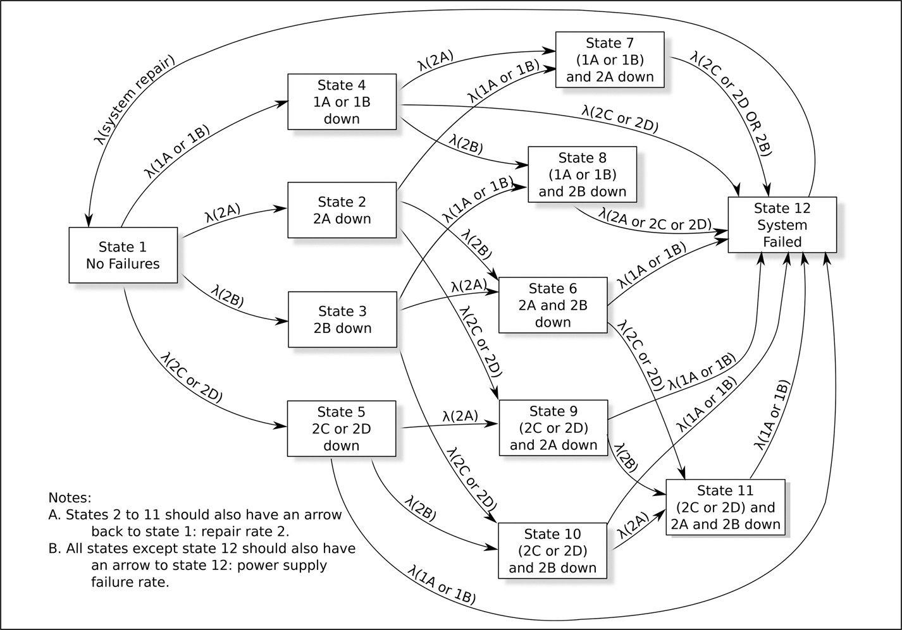
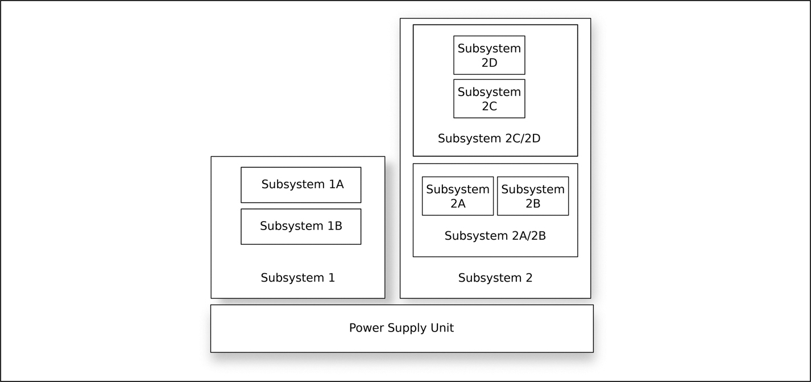

# 14 Markov model

DOI: [10.1201/9781003598145-14](https://doi.org/10.1201/9781003598145-14)

> *Nếu có khả năng 50-50 rằng một điều gì đó có thể trục trặc, thì 9 trên 10 lần nó sẽ trục trặc.*
>
> Paul Harvey

Có một giả định ngầm làm nền tảng cho mọi failure model của các hệ thống phần mềm — giả định rằng chúng ta có thể dự đoán failure rate của các thành phần phần mềm. Chắc chắn, để tạo ra bất kỳ dạng failure analysis nào cho một hệ thống có chứa phần mềm, bao gồm phân tích Markov trong chương này và fault tree analysis trong [Chương 15](ch15_the_fault_tree.vi.md), chúng ta cần có khả năng dự đoán failure rate của phần mềm. Việc chuẩn bị những dự đoán như vậy là một chủ đề quan trọng và được trình bày trong [Chương 16](ch16_software_failure_rates.vi.md).

## 14.1 Markov model

Markov chain đã được giới thiệu trong [Chương 11](ch11_error_detection_and_handling.vi.md) như một phương tiện phát hiện bất thường trong hoạt động của hệ thống. Chương này đề cập đến việc dùng chúng để ước lượng failure rate của một hệ thống. Cả hai kỹ thuật này đều dựa trên cùng một khái niệm: tìm các xác suất steady-state của việc hệ thống ở trong các trạng thái cụ thể khi nó chuyển giữa các trạng thái theo các xác suất gắn với các chuyển trạng thái khác nhau.

Các mô hình (chain) được xem xét trong chương này đơn giản hơn nhiều so với những mô hình có khả năng gặp phải trong anomaly detection. Nhìn chung, chúng có đủ ít trạng thái để có thể vẽ được các sơ đồ chuyển trạng thái như [Hình 14.2](#fig14_2).

*Hình 14.2: Một ví dụ về Markov model.[⏎](#b14fig14_2)*

## 14.2 Markov model và các tiêu chuẩn

Markov model được nhắc đến trong part 9 của ISO 26262, cùng với fault tree analysis, như một công cụ định lượng phù hợp để tiến hành phân tích an toàn.

IEC 61508 nhiệt tình hơn với việc mô hình hóa Markov. [Phần 7](part7_appendices.vi.md) mô tả kỹ thuật này và đưa ra một số tài liệu tham khảo. Tuy nhiên, các tác giả của mục này trong IEC 61508 ý thức được những hạn chế do các giả định Markov áp đặt (xem mục tiếp theo) và nói, *“Khi phải xử lý các luật non-exponential — các mô hình semi-Markov — thì nên dùng mô phỏng Monte-Carlo.”* Mô phỏng Monte-Carlo là chủ đề của [Mục 17.2](ch17_semi_formal_verification.vi.md#sec17_2) về discrete event simulation trong cuốn sách này.

## 14.3 Các giả định Markov

Phân tích dependability bằng mô hình hóa Markov cực kỳ đơn giản, nhưng cái giá phải trả cho sự đơn giản này là nó đưa ra các giả định; nhà phân tích cần đánh giá tính áp dụng được của chúng trước khi áp dụng kỹ thuật này cho một hệ thống cụ thể. Tôi tin rằng nó là một công cụ hữu ích để thực hiện đánh giá nhanh xem liệu một thiết kế có thể thỏa đáng hay không, như được thể hiện trong *giai đoạn concept* của [Hình 5.1](ch05_development_methodologies.vi.md#fig5_1) ở trang 48. Discrete event simulation ([Mục 17.2](ch17_semi_formal_verification.vi.md#sec17_2)) và Petri net ([Mục 17.3](ch17_semi_formal_verification.vi.md#sec17_3)) đưa ra ít giả định hơn nhưng khó áp dụng hơn.

Trong chương này, kỹ thuật Markov được mô tả thông qua một ví dụ. Để bất kỳ phân tích Markov nào có hiệu lực, phải đưa ra các giả định sau về hệ thống đang được phân tích:

1. *Khi hệ thống ở một trạng thái cụ thể, lịch sử về cách nó đến được trạng thái đó không liên quan đến việc quyết định điều gì sẽ xảy ra tiếp theo.*

   Điều này có nghĩa là phương pháp này chỉ có hiệu lực khi failure rate có thể được giả định là không đổi.

   Ví dụ, lấy một hệ thống có ba thành phần: A, B và C. Nếu trạng thái hệ thống hiện tại là A đang hoạt động còn B và C đã hỏng, thì tương lai của hệ thống không phụ thuộc theo bất kỳ cách nào vào việc B hay C hỏng trước. Nếu có những phụ thuộc như vậy thì số trạng thái cần được tăng lên:
   - A đang hoạt động, B và C đã hỏng, trong đó B hỏng trước
   - A đang hoạt động, B và C đã hỏng, trong đó C hỏng trước

   Kiểu phân chia nhỏ này có thể nhanh chóng gây ra sự bùng nổ số trạng thái trong mô hình.

2. *Thời gian giữa các lần xảy ra sự kiện failure phải có phân phối mũ âm.*

   Đây thực ra là một hệ quả trực tiếp của giả định ở trên, vì phân phối mũ âm là phân phối liên tục memoryless (không có trí nhớ) duy nhất. Một quá trình như vậy được gọi là Poisson Process.

   Những hàm ý của nó có thể hơi phản trực giác. Ví dụ, hãy xét một hệ thống phần cứng có các thành phần A và B, mỗi thành phần chạy liên tục và mỗi thành phần có thời gian trung bình đến khi hỏng là 1 năm. Hệ thống đã chạy được 11 tháng và thành phần A vừa hỏng (không có gì vô lý với thời gian trung bình đến khi hỏng của nó). B còn lại bao nhiêu tuổi thọ? Đối với một hệ thống memoryless, câu trả lời phải là 1 năm.

   Bất chấp hạn chế bề ngoài này, các failure xảy ra với thời gian giữa các lần xảy ra phân phối negatively-exponentially đã được dùng để mô hình hóa failure của phần cứng cơ khí, mặc dù chúng có thể được coi là phù hợp hơn với phần mềm, vì phần mềm không hao mòn. Nếu các thành phần A và B trong ví dụ trên là các module phần mềm, chúng ta sẽ không ngạc nhiên khi tuổi thọ dự kiến của B vẫn là 1 năm — nó không bị hao mòn. Trong tài liệu tham khảo [[1](#refbib14_1)], Norman Fenton và Martin Neil chỉ ra điều này và lưu ý rằng chính việc phần mềm không hao mòn khiến Poisson Process trở thành một mô hình hữu ích để biểu diễn failure của nó.

   Ngay cả khi failure của phần mềm không thể được mô hình hóa hoàn toàn như một Poisson Process, mọi thứ có thể vẫn chưa mất hết vì, bằng cách đưa thêm các trạng thái, có thể tạo ra các loại phân phối khác. Ví dụ, thay vì chỉ định một thời gian trung bình giữa các lần hỏng phân phối mũ là 5 năm, có thể tốt hơn nếu chỉ định thời gian trung bình đến khi hỏng là tổng của hai thời gian trung bình giữa các lần hỏng phân phối mũ, mỗi cái 2,5 năm. Đáng tiếc là, điều này lại dẫn đến việc tăng số trạng thái của hệ thống.

3. *Chỉ có một thay đổi trạng thái có thể xảy ra tại một thời điểm.*

   Điều này thường không phải là vấn đề vì đơn vị thời gian có thể được làm nhỏ tùy ý.

## 14.4 Ví dụ tính toán

### 14.4.1 Ước lượng các tốc độ

[Hình 14.1](#fig14_1) minh họa một hệ thống đơn giản với 7 thành phần có thể hỏng: 1A, 1B, 2A, 2B, 2C, 2D và bộ nguồn. Để tiếp tục hoạt động, hệ thống cần (subsystem1 **hoặc** subsystem2) **và** bộ nguồn đang hoạt động.

*Hình 14.1: Một hệ thống đơn giản.[⏎](#b14fig14_1)*

Subsystem 1 chỉ hoạt động nếu cả 1A **và** 1B đều đang hoạt động.

Subsystem 2 chỉ hoạt động nếu 2C **và** 2D đang hoạt động **và hoặc** 2A **hoặc** 2B (hoặc cả hai) đang hoạt động,

Chúng ta sẽ lấy đơn vị thời gian là một năm và sẽ lấy failure rate trung bình của mọi thành phần trừ bộ nguồn là 0,333 mỗi năm (tức là trung bình 3 năm hỏng một lần). Failure rate trung bình của bộ nguồn là 0,2 mỗi năm.

Các giá trị khác mà chúng ta sẽ cần là thời gian sửa chữa: khi một thành phần hỏng, mất bao lâu để hoàn tất việc sửa chữa? Chúng ta sẽ đưa ra giả định phi thực tế rằng mọi failure, ngay cả những failure không làm sập toàn bộ hệ thống ngay lập tức, đều được phát hiện. Thông thường, chính việc không nhận ra một thành phần đã hỏng mới đóng góp nhiều nhất vào thời gian ngừng hoạt động của hệ thống.

Đối với mục đích của bài tập này, chúng ta sẽ giả định rằng thời gian sửa chữa trung bình cho một thành phần đã hỏng khi hệ thống vẫn đang chạy là 2 tuần (tức là tốc độ 26 mỗi năm), và thời gian sửa chữa trung bình cho một thành phần khi hệ thống đã hỏng là 1 ngày (tức là 365,25 mỗi năm). Khi một kỹ thuật viên sửa chữa đến hiện trường, mọi thành phần đã hỏng đều được sửa.

Nghĩ về failure rate (ví dụ, 1 failure mỗi năm) là điều tự nhiên, nhưng nghĩ về việc sửa chữa như một tốc độ có lẽ kém tự nhiên hơn. Để tạo một Markov model, cần phải biểu diễn mọi thứ dưới dạng tốc độ. Vì vậy, “tốc độ sửa chữa là 365,25 mỗi năm” thay vì “thời gian sửa chữa là 1 ngày.”

Các failure rate và tốc độ sửa chữa là các giá trị trung bình; thời gian thực tế đến khi hỏng hoặc sửa xong có phân phối mũ âm với các giá trị trung bình đó. Vì vậy, thời gian sửa chữa 1 ngày (tốc độ sửa chữa 365,25 mỗi năm) dẫn đến kết quả sau:

| Xác suất việc sửa chữa xảy ra trong vòng… | là |
|---|---|
| 0,5 ngày | 39,3% |
| 1,0 ngày | 63,2% |
| 1,5 ngày | 77,7% |
| 2,0 ngày | 86,5% |
| 2,5 ngày | 91,8% |
| 3,0 ngày | 95,0% |

Ví dụ này được phân tích thêm bằng một fault tree trong [Chương 15](ch15_the_fault_tree.vi.md).

### 14.4.2 Nhận diện các trạng thái hệ thống

[Hình 14.2](#fig14_2) minh họa các trạng thái mà hệ thống có thể chuyển qua lại. Như được chỉ ra trong hình, một số mũi tên đã được lược bỏ để bớt rối.

Với những lược bỏ đó, [Hình 14.2](#fig14_2) có thể được đọc như sau. Giả sử hệ thống đang ở trạng thái 5 với thành phần 2C hoặc 2D đã hỏng. Từ trạng thái này, nó có thể chuyển sang trạng thái 12 (hệ thống hỏng) nếu 1A hoặc 1B hỏng; nó có thể chuyển sang trạng thái 9 nếu 2A hỏng; nó có thể chuyển sang trạng thái 10 nếu 2B hỏng; và nó có thể chuyển sang trạng thái 1 nếu việc sửa chữa hoàn tất (mũi tên không được thể hiện).

Theo giả định 3 ở trên, chỉ có một thay đổi trạng thái có thể xảy ra tại một thời điểm. Vì vậy, không cần mô hình hóa, chẳng hạn, điều kiện mà khi đang ở Trạng thái 1, các thành phần 1A và 2A hỏng đồng thời. Chỉ một sự kiện có thể xảy ra tại mỗi thời điểm.

Lưu ý rằng một Petri net cung cấp một cách khác để biểu diễn [Hình 14.2](#fig14_2) — xem [Mục 17.3.8](ch17_semi_formal_verification.vi.md#sec17_3_8).

### 14.4.3 Xây dựng các phương trình

Với tốc độ xảy ra của mỗi chuyển trạng thái này, có thể tạo ra một loạt phương trình tuyến tính đồng thời để phản ánh các chuyển trạng thái này. Lấy trạng thái 5 làm ví dụ, về lâu dài, tốc độ đi vào trạng thái 5 phải bằng tốc độ đi ra khỏi trạng thái 5.

Điều này cho ra phương trình:

$$\begin{array}{l} {λ}_{2 C o r 2 D} \times {P}_{1} = ( {λ}_{1 A o r 1 B} + {λ}_{2 A} + {λ}_{2 B} + {λ}_{P S U} + {λ}_{r e p a i r} ) \times {P}_{5} \end{array} \tag{14.1}$$

trong đó *λx* là tốc độ của *x* và *Pi* là tỷ lệ thời gian ở trong trạng thái *i*.

Phương trình 14.1 có thể được đọc như sau: *“Tốc độ đi vào trạng thái 5 là xác suất ở trạng thái 1* $( {P}_{1} )$ *nhân với tốc độ chuyển từ trạng thái 1 sang trạng thái 5* $( {λ}_{2 C o r 2 D} )$. *Tốc độ rời khỏi trạng thái 5 là xác suất ở trạng thái 5* $( {P}_{5} )$ *nhân với các tốc độ chuyển sang các trạng thái khác. Về lâu dài, hai giá trị này phải bằng nhau.”*

Để so sánh, phương trình cho trạng thái 11 là:

$$\begin{array}{l} {λ}_{2 C o r 2 D} {P}_{6} + {λ}_{2 B} {P}_{9} + {λ}_{2 A} {P}_{10} = ( {λ}_{1 A o r 1 B} + {λ}_{P S U} + {λ}_{r e p a i r} ) {P}_{11} \end{array} \tag{14.2}$$

Đối với hệ thống được mô tả trong [Hình 14.2](#fig14_2), có thể tạo ra mười hai phương trình như vậy, mỗi phương trình cho một node. Vì có mười hai ẩn số $( {P}_{1} . . . {P}_{12} )$, người ta có thể nghĩ rằng chừng ấy là đủ. Tuy nhiên chúng không độc lập tuyến tính, vì vậy một trong số chúng cần bị loại bỏ và thêm một phương trình thứ 13:

$$\begin{array}{l} {\sum}_{i = 1}^{12} {P}_{i} = 1 \end{array} \tag{14.3}$$

để nói rằng, tại bất kỳ thời điểm nào, hệ thống sẽ ở đúng một trong mười hai trạng thái.

### 14.4.4 Giải các phương trình

Mười hai phương trình tuyến tính đồng thời thu được có thể được giải bằng bất kỳ phương pháp thuận tiện nào (ví dụ, LU-decomposition), nhưng lưu ý rằng có thể có sự chênh lệch lớn về độ lớn của các con số. Ngay cả trong bài toán đơn giản này, chúng ta có những con số lớn như 365,25 và nhỏ như 0,2. Trong một hệ thống phức tạp hơn, failure có thể chỉ xảy ra mỗi vài năm, còn việc sửa chữa (đặc biệt đối với phần mềm) có thể diễn ra trong vòng vài mili giây. Trừ khi cẩn thận trong việc giải các phương trình và trừ khi đơn vị tần suất được chọn phù hợp, độ phân giải có thể bị mất.

Trong ví dụ, việc tạo và giải mười hai phương trình đồng thời cho ra thông tin được liệt kê trong [Bảng 14.1](#tbl14_1).

*Bảng 14.1 Lời giải của Markov model ví dụ.[⏎](#b14tbl14_1)*

| Trạng thái | Phần trăm thời gian ở trạng thái | Tần suất ghé thăm (mỗi năm) | Thời lượng ghé thăm trung bình |
|---|---|---|---|
| Trạng thái 1 | $92 , 963 \; 044$ | 2,045 | $0 , 454 \; 586 \; 78$ |
| Trạng thái 2 | $1 , 111 \; 894$ | $0 , 309 \; 846$ | $0 , 035 \; 885 \; 382$ |
| Trạng thái 3 | $1 , 111 \; 894$ | $0 , 309 \; 846$ | $0 , 035 \; 885 \; 382$ |
| Trạng thái 4 | $2 , 250 \; 707$ | $0 , 619 \; 692$ | $0 , 036 \; 319 \; 788$ |
| Trạng thái 5 | $2 , 250 \; 707$ | $0 , 619 \; 692$ | $0 , 036 \; 319 \; 788$ |
| Trạng thái 6 | $0 , 026 \; 920$ | $0 , 007 \; 411 \; 88$ | $0 , 036 \; 319 \; 788$ |
| Trạng thái 7 | $0 , 054 \; 829$ | $0 , 014 \; 913 \; 5$ | $0 , 036 \; 764 \; 706$ |
| Trạng thái 8 | $0 , 054 \; 829$ | $0 , 014 \; 913 \; 5$ | $0 , 036 \; 764 \; 706$ |
| Trạng thái 9 | $0 , 054 \; 829$ | $0 , 014 \; 913 \; 5$ | $0 , 036 \; 764 \; 841$ |
| Trạng thái 10 | $0 , 054 \; 829$ | $0 , 014 \; 913 \; 5$ | $0 , 036 \; 764 \; 841$ |
| Trạng thái 11 | $0 , 002 \; 028$ | $0 , 000 \; 544 \; 939$ | $0 , 037 \; 220 \; 936$ |
| Trạng thái 12 | $0 , 063 \; 491$ | $0 , 231 \; 9$ | $0 , 002 \; 737 \; 850 \; 8$ |

### 14.4.5 Phân tích kết quả

Có một số điểm quan trọng cần nêu về những kết quả này. Thứ nhất, chúng ta có thể thực hiện một số phép kiểm tra tính hợp lý đối với chúng; ví dụ, thời lượng trung bình ở Trạng thái 12 là $0 , 002 \; 737 \; 850 \; 8$ năm. Đó là 1 ngày và là điều chúng ta mong đợi, vì thời gian sửa chữa cho một hệ thống đã hỏng là 1 ngày. Cũng có thể thấy rằng thời gian trung bình ở các trạng thái 7, 8, 9 và 10 là như nhau. Điều đó cũng được mong đợi vì các điều kiện để vào và ra khỏi các trạng thái đó là tương đương.

Điểm thứ hai quan trọng hơn. Trạng thái 12 là trạng thái failure của hệ thống, và chúng ta biết rằng chúng ta ở trong đó $0 , 063 \; 491$ % thời gian. Vậy thời gian hoạt động của chúng ta là 100,0% $- \; 0 , 063 \; 491$ % $= 99 , 936 \; 509$ %, phải không? Dĩ nhiên là không! Chúng ta đã lấy các failure rate được ước lượng đến vài chữ số thập phân và lại đang trích dẫn up-time của mình đến 8 chữ số thập phân! Chúng ta nên thực hiện một phân tích độ nhạy trên các phương trình và chỉ công bố số chữ số thập phân có thể được hỗ trợ. Đối với ví dụ này, điều tốt nhất chúng ta có thể nói có lẽ là thời gian hoạt động sẽ vào khoảng 99.9%. Định luật thứ 35 của Norman R. Augustine phát biểu: *“Dữ liệu sẵn có làm cơ sở cho kết luận của một người càng yếu, thì độ chính xác được trích dẫn càng phải lớn để mang lại vẻ xác thực cho dữ liệu.”*

Sự cám dỗ tin vào phép tính số học đã được ghi nhận trong *Fault Tree Handbook* (tài liệu tham khảo [[2](#refbib14_2)]) ngay từ năm 1981:

> *… khi đó xác suất của các sự kiện mà chúng ta đang bỏ qua trở nên chi phối, và chúng ta đang mắc phải ảo tưởng rằng hệ thống của mình an toàn hơn hoặc đáng tin cậy hơn thực tế hai bậc độ lớn. Khi không dành sự cân nhắc thích đáng cho những vấn đề như thế này, người tính toán ngây thơ thường sẽ tạo ra những con số vô lý như* ${10}^{- 16}$ *hoặc* ${10}^{- 18}$. *Những con số thấp đó chỉ đơn giản nói rằng hệ thống sẽ không hỏng theo những cách đã được xem xét, mà thay vào đó sẽ hỏng với xác suất cao hơn nhiều theo một cách chưa được xem xét.*

## 14.5 Ưu điểm và nhược điểm của Markov

Mô hình hóa Markov có thể được thực hiện nhanh chóng và dễ dàng và có ưu điểm là cung cấp các kết quả chính xác và có thể tái tạo chính xác. Nhược điểm của nó là nó giả định rằng failure rate là không đổi, thời gian giữa các lần failure xảy ra có phân phối mũ âm.

Không nghi ngờ gì rằng các failure của hệ thống đang được thiết kế *có thể* xảy ra theo phân phối đó. Vì vậy, nếu mô hình Markov chỉ ra rằng failure rate quá cao, thì nó đúng là quá cao. Tuy nhiên, nếu Markov model cho ra một failure rate chấp nhận được, thì đó không phải là một kết quả có thể tin cậy cho trường hợp tổng quát: một Markov model luôn có thể đưa ra bằng chứng để bác bỏ một thiết kế, nhưng không bao giờ có thể khiến nó được chấp nhận.

## Tài liệu tham khảo

[1] N. Fenton and M. Neil, *Risk Assessment and Decision Analysis with Bayesian Networks*. CRC Press, 2013.[⏎](#b14refbib14_1)

[2] W. Vesely, F. Goldberg, N. Roberts, and D. Haasl, “*Fault Tree Handbook*,” 1981. National Research Council Report NUREG-0492.[⏎](#b14refbib14_2)
