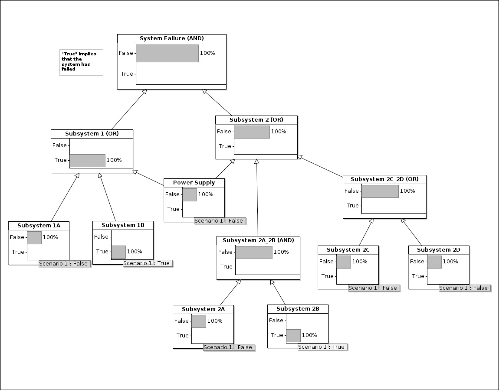
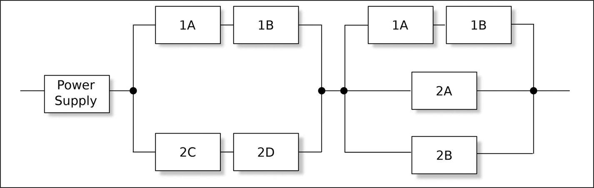
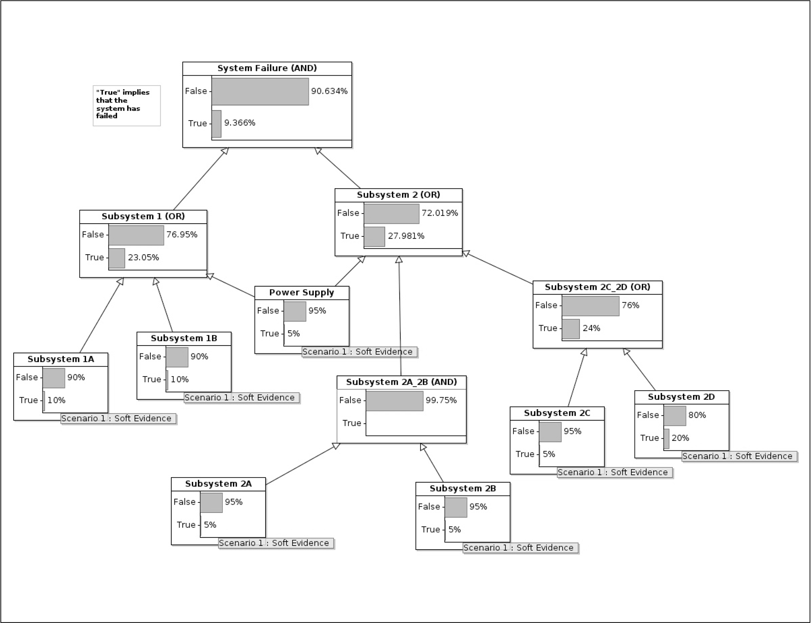
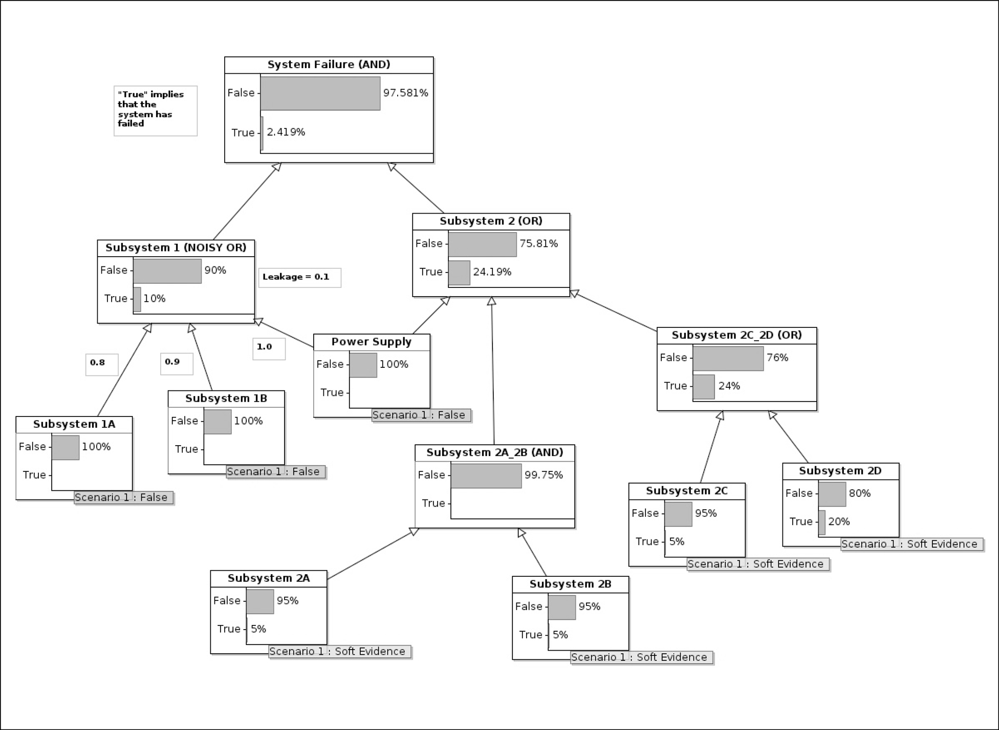
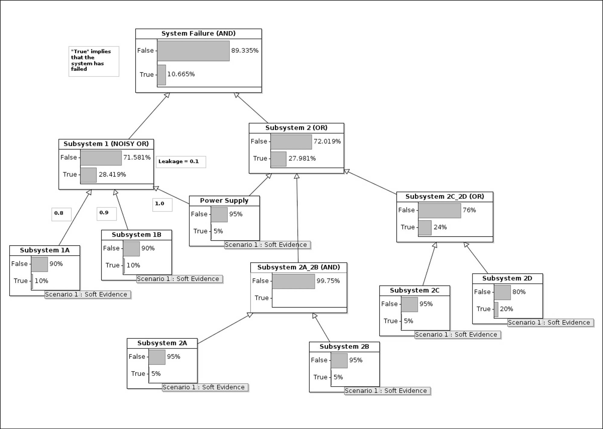
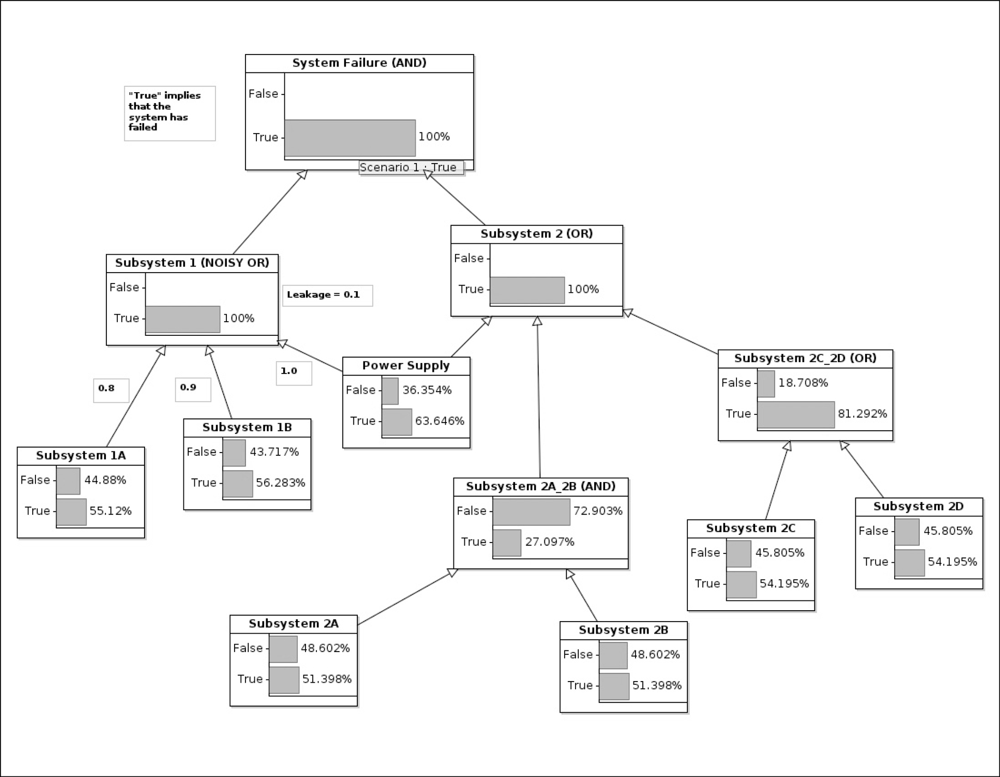

# 15 Fault tree

DOI: [10.1201/9781003598145-15](https://doi.org/10.1201/9781003598145-15)

> *Cây cối lúc nào cũng là một sự giải tỏa, sau khi tiếp xúc với con người.*
>
> David Mitchell

Mặc dù kỹ thuật Markov được mô tả trong [Chương 14](ch14_markov_models.vi.md) có thể thỏa đáng cho *giai đoạn concept* của [Hình 5.1](ch05_development_methodologies.vi.md#fig5_1) ở trang 48, một khi đã chọn được một thiết kế ứng viên, cần có một failure analysis chính xác hơn, và phân tích này được tạo ra trong *chu kỳ thiết kế chi tiết*. Chương này khảo sát việc dùng Fault Tree Analysis (FTA) cho mục đích đó. Ngoài việc mô tả một fault tree Boolean thông thường, chương này còn trình bày kỹ thuật mạnh mẽ và linh hoạt hơn là Bayesian fault tree analysis.

Lưu ý rằng, theo mô tả các thuật ngữ *fault, error* và *failure* được đưa ra trong [Mục 2.1.7](ch02_terminology_of_safety.vi.md#sec2_1_7), một fault tree lẽ ra phải được gọi là “failure tree.” Tuy nhiên, “fault tree” đã là thuật ngữ được dùng từ khi H. A. Watson lần đầu đề xuất ý tưởng này vào năm 1962.

Bất kỳ failure analysis nào của một hệ thống đều cần đầu vào là failure rate của từng thành phần của hệ thống, và câu hỏi đặt ra là làm thế nào để ước lượng failure rate của một thành phần phần mềm. Chủ đề quan trọng này được trình bày trong một chương riêng — [Chương 16](ch16_software_failure_rates.vi.md).

Một số kỹ thuật được mô tả trong [Chương 17](ch17_semi_formal_verification.vi.md), đặc biệt là discrete event simulation và Petri net, bổ sung cho fault tree analysis và cũng có thể được dùng để đánh giá dependability của một hệ thống.

## 15.1 FTA và FMECA

FTA đã được so sánh với Failure Mode, Effect, and Criticality Analysis (FMECA) trong [Mục 7.4](ch07_foundational_analyses.vi.md#sec7_4). Cá nhân tôi thấy cách tiếp cận FTA hữu ích hơn nhiều để biểu diễn failure model của các hệ thống, đặc biệt là các hệ thống dựa vào việc phần mềm tiếp tục hoạt động đúng. Tuy nhiên, tôi biết rằng một số người thích FMECA hơn, và đó chắc chắn là một phương án thay thế chấp nhận được.

## 15.2 FTA trong các tiêu chuẩn

IEC 61508-7 mô tả việc dùng FTA, và kỹ thuật này được nhắc đến trong [phần 2](part2_the_project.vi.md) (phần cứng), nhưng không có trong [phần 3](part3_design_patterns.vi.md).

Cả FTA và FMECA đều được mô tả trong Annex A của ISO 26262-10, nơi đưa ra một phương pháp kết hợp chúng, và trong Annex E của EN 50126-2.

Annex G.3 của ISO 14971 khuyến nghị kỹ thuật FTA cho thiết bị y tế.

## 15.3 Các loại fault tree

Ba mục sau đây minh họa các fault tree với độ tinh vi và linh hoạt tăng dần.

Loại thứ nhất là một fault tree cổ điển, cho phép nhà thiết kế biểu diễn mối quan hệ Boolean (đúng/sai) giữa failure của thành phần và failure của hệ thống: “Nếu X *AND* Y đều hỏng, thì subsystem Z hỏng.”

Khái niệm này được mở rộng trong ví dụ thứ hai để cho phép suy luận thống kê: “nếu X *AND* Y đều hỏng, thì subsystem Z hỏng. X có failure rate là *λx*, và Y có failure rate là *λy*.”

Điều này vẫn chưa đủ linh hoạt để biểu diễn hai tình huống phổ biến:

*Nếu X hoặc Y hỏng, subsystem Z thường, nhưng không phải luôn luôn, sẽ hỏng.*

Cấu trúc này đặc biệt phù hợp với những tình huống có con người tham gia. Ví dụ, có thể hữu ích khi biểu diễn mối quan hệ rằng nếu người vận hành một thiết bị truyền dịch nhập sai liều thuốc AND không nhận ra điều này trước khi thuốc bắt đầu chảy, bệnh nhân có thể tử vong. Nhưng việc nhập sai liều không phải lúc nào cũng chắc chắn làm hại bệnh nhân — một số liều sai (ví dụ, thấp hơn liều đúng 10%) có thể tương đối vô hại. Có thể thuận tiện khi biểu diễn điều kiện rằng việc nhập sai liều gây hại trong 90% trường hợp (con số này thu được qua các thí nghiệm ở nhiều bệnh viện).

*X và Y có thể không phải là những thứ duy nhất góp phần vào failure của subsystem Z.*

Đặc biệt trong những giai đoạn đầu phân tích failure của một hệ thống, có thể có những yếu tố khác chưa được đưa vào, nhưng người ta cảm thấy rằng X và Y có lẽ bao quát *phần lớn* các yếu tố gây ra failure của Z. Tuy nhiên, ngay cả ở cuối dự án, phải là một nhà phân tích rất táo bạo mới dám tuyên bố rằng mọi yếu tố khả dĩ đều đã được nhận diện, đặc biệt với một hệ thống có thể là accidental system (trang 20).

Những điều kiện này được biểu diễn trong ví dụ thứ ba bên dưới bằng cách dùng các so-called *noisy conjunction*.

## 15.4 Ví dụ 1: Fault tree Boolean

Theo truyền thống, một FTA dẫn đến một fault tree Boolean, nơi mỗi node có giá trị hoặc TRUE hoặc FALSE. Như đã mô tả ở trên, có nhiều khái niệm không thể biểu diễn theo cách đơn giản hóa này, và vì vậy tôi thích dùng Bayesian fault tree hơn. Tuy nhiên, hãy khám phá fault tree Boolean trước.

Hãy xét hệ thống được giới thiệu trong [Mục 14.4.1](ch14_markov_models.vi.md#sec14_4_1) và được minh họa trong [Hình 14.1](ch14_markov_models.vi.md#fig14_1). Hệ thống này có 7 subsystem, được gọi là 1A, 1B, 2A, 2B, 2C, 2D và “power supply”. Chúng có thể là các subsystem phần mềm hoặc phần cứng mà không làm thay đổi fault tree.

[Hình 15.1](#fig15_1) minh họa một fault tree gồm 7 node tương ứng với các subsystem và một số cổng AND và OR. Một cổng AND là true (biểu thị failure tại điểm đó) nếu mọi input của nó đều true; một cổng OR là true trừ khi mọi input của nó đều false.

*Hình 15.1: Một fault tree Boolean đơn giản.[⏎](#b15fig15_1)*

Ở cấp trên cùng của [Hình 15.1](#fig15_1), có thể thấy rằng hệ thống hỏng (true) nếu cả subsystem 1 **và** subsystem 2 đều hỏng — có lẽ do một kiểu dự phòng nào đó trong thiết kế. Subsystem 1 hỏng nếu bất kỳ một trong 1A, 1B, **hoặc** power supply hỏng. Và cứ thế.

Trong [Hình 15.1](#fig15_1), tôi đã tạo một “scenario” cho mỗi leaf node, trong đó 1B và 2B đã hỏng (chúng là true) và các thành phần khác vẫn đang hoạt động. Lưu ý rằng hệ thống nói chung vẫn đang hoạt động vì failure của hai subsystem này không đủ để làm sập toàn bộ hệ thống.

Nhận xét này dẫn chúng ta đến khái niệm *minimum cut set*: những tập node nhỏ nhất mà, khi hỏng, sẽ làm sập hệ thống. Trong trường hợp [Hình 15.1](#fig15_1), các minimum cut set là: { power supply }, { 1A, 2C }, { 1A, 2D }, { 1B, 2C }, { 1B, 2D }, { 1A, 2A, 2B } và { 1B, 2A, 2B }. Hiểu biết về các cut set giúp ích rất nhiều cho nhà thiết kế vì nó cho phép tập trung vào các phần tử trọng yếu hơn (ở đây, rõ ràng là power supply, nhưng trong các thiết kế khác, các thành phần trọng yếu có thể khó nhận diện hơn).

Một cách dùng khác của minimum cut set là để tạo ra một dạng canonical[1](#fn15_1) của một thiết kế hệ thống — xem [Hình 15.2](#fig15_2). Với một hình như vậy, bất kỳ tổ hợp failure nào khiến đường đi left-to-right bị cắt đứt hoàn toàn đều dẫn đến failure của hệ thống. Dạng canonical có thể được dùng làm cơ sở cho structure function được mô tả trong [Mục D.4](ch28_appendix_d_notations.vi.md#secD_4).

*Hình 15.2: Ví dụ về dạng canonical.[⏎](#b15fig15_2)*

## 15.5 Ví dụ 2: Fault tree Boolean mở rộng

Fault tree rất đơn giản trong [Hình 15.1](#fig15_1), tự bản thân nó, ít hữu dụng. Nó cung cấp cho chúng ta các minimum cut set, bản thân chúng hữu ích, nhưng ngoài ra không có gì nhiều.

[1](#fn15_115b)Thuật ngữ dạng “canonical” có nghĩa là dạng “chuẩn” hoặc “duy nhất”.

Trong [Hình 15.3](#fig15_3), tôi đã mở rộng fault tree Boolean bằng cách đưa vào xác suất failure trên mỗi *N* giờ hoạt động. *N* thường được chọn là 109 (khoảng 114 077 năm), và failure rate khi đó được đo bằng “FIT”, một failure rate 68 trên 109 giờ được viết là “68 FIT”.

*Hình 15.3: Mở rộng fault tree Boolean đơn giản.[⏎](#b15fig15_3)*

*Hình 15.4: Noisy-OR — minh họa leakage.[⏎](#b15fig15_4)*

Trong [Hình 15.3](#fig15_3), tôi đã dùng một cách rất đơn giản để mã hóa giá trị của mỗi node: khả năng subsystem sẽ hỏng trong 109 giờ hoạt động là bao nhiêu? Ví dụ, các giá trị được nhập cho Subsystem 2A chỉ ra rằng xác suất failure trong 109 giờ đã được đánh giá là 5%. Dĩ nhiên, trong các hệ thống thực, phân phối xác suất có thể phức tạp hơn nhiều, và hầu hết các công cụ FTA đều cho phép các phân phối phức tạp tùy ý, hoặc thậm chí các phân phối được đo thực nghiệm mà không có lời giải closed-form. [Hình 16.3](ch16_software_failure_rates.vi.md#fig16_3) ở trang 195 thể hiện một cây (trong trường hợp đó không phải fault tree) với các phân phối phức tạp hơn.

## 15.6 Ví dụ 3: Bayesian fault tree

[Phụ lục B](ch26_appendix_b_bayesian_belief_networks.vi.md) mô tả các đặc điểm chung của một mạng Bayes và thông tin đó không được lặp lại ở đây. Thay vào đó, mục này mô tả những khía cạnh của mạng Bayes đặc biệt hữu ích để biểu diễn fault tree. Tài liệu tham khảo [[1](#refbib15_1)] trình bày kỹ lưỡng hơn về việc dùng mạng Bayes để biểu diễn các điều kiện failure, đặc biệt là dùng các phân phối failure phức tạp hơn những gì tôi dùng ở đây.

Ưu điểm thứ nhất của một mạng Bayes so với mạng Boolean là việc đưa vào các noisy conjunction được mô tả trong Phụ lục B.6. Chúng được minh họa trong [Hình 15.5](#fig15_5). Ưu điểm thứ hai là có thể khai thác định lý Bayes để suy luận “ngược” bằng cách thêm một quan sát vào một node non-leaf trong cây, như được minh họa trong [Hình 15.6](#fig15_6) và được mô tả trong [Mục 15.7](#sec15_7) bên dưới.

*Hình 15.5: Noisy-OR.[⏎](#b15fig15_5)*

*Hình 15.6: Suy luận từ kết quả đến nguyên nhân.[⏎](#b15fig15_6)*

Tham số leakage gắn với Noisy-OR được minh họa trong [Hình 15.4](#fig15_4), nơi failure của Subsystem 1 giờ được biểu diễn như một Noisy-OR với leakage 0,1. Như có thể thấy, ngay cả khi power supply và các Subsystem 1A và 1B là false 100% (không hỏng), vẫn có 10% khả năng Subsystem 1 đã hỏng.

[Hình 15.5](#fig15_5) minh họa việc tích hợp leakage với các giá trị “mềm” (tức là các giá trị khác 1 (true) và 0 (false)) gắn với xác suất failure của các thành phần của Subsystem 1. Một trọng số 1 được gán cho power supply: một điều kiện Boolean nói rằng failure của power supply *luôn luôn* gây ra failure của Subsystem 1. Nếu mọi trọng số đều là 1 và leakage được đặt là 0, một Noisy-OR trở lại thành một OR Boolean.

Các trọng số 0,8 và 0,9 lần lượt được gán cho Subsystem 1A và 1B. Điều này chỉ ra rằng nếu Subsystem 1A hỏng, ngay cả khi Subsystem 1B và power supply đang hoạt động, Subsystem 1 sẽ hỏng 80% số lần.

So sánh [Hình 15.5](#fig15_5) và [15.3](#fig15_3), có thể thấy rằng việc đưa Noisy-OR vào làm thay đổi một chút các đặc tính failure tổng thể của hệ thống.

## 15.7 Suy luận từ kết quả đến nguyên nhân

Như được mô tả trong [Phụ lục B](ch26_appendix_b_bayesian_belief_networks.vi.md), một trong những thế mạnh của mạng Bayes là khả năng lập luận từ kết quả đến nguyên nhân: *“X đã xảy ra; điều gì có lẽ đã gây ra nó?”*

Điều này được minh họa trong [Hình 15.6](#fig15_6), nơi failure hệ thống top-level đã được đặt là true 100% — hệ thống *đã* hỏng. Thuật toán Bayes khi đó có thể suy luận từ kết quả đó đến các nguyên nhân có thể. Rõ ràng, vì failure hệ thống là một AND Boolean, failure hệ thống là true chỉ ra rằng cả Subsystem 1 lẫn Subsystem 2 đều phải true 100%. Nhưng, bên dưới đó, các xác suất không hoàn toàn hiển nhiên. Tuy nhiên, đúng như dự kiến, nguyên nhân có khả năng nhất của failure hệ thống là failure của power supply.

Suy luận ngược theo cách này có lẽ hữu ích nhất khi failure rate của một phần hệ thống đã được biết từ các thí nghiệm hoặc kinh nghiệm thực địa. Ví dụ, trong [Hình 15.5](#fig15_5), có thể failure rate của Subsystem 1 đã được biết, mặc dù failure rate của các thành phần của nó (power supply và các Subsystem 1A và 1B) và failure rate của toàn bộ hệ thống, cho đến nay, chưa được biết. Việc nhập failure rate của Subsystem 1 sẽ khiến mạng Bayes được tính lại và tạo ra các giá trị cho power supply, các Subsystem 1A và 1B, và hệ thống tổng thể.

## 15.8 Kết hợp các FTA

Lấy các công ty tưởng tượng của chúng ta từ [Chương 4](ch04_representative_companies.vi.md) làm ví dụ, Beta Component Incorporated (BCI) phải giao một thành phần cho Alpha Device Corporation (ADC) để tích hợp vào thiết bị của ADC.

ADC sẽ cần thực hiện một failure analysis cho toàn bộ hệ thống và vì vậy sẽ cần thông tin về các failure mode và tần suất của mọi thành phần bought-in, bao gồm thành phần từ BCI. Đối với các thành phần open-source, thông tin như vậy có thể khó thu thập, và ADC có thể cần thực hiện một khối lượng công việc đáng kể, hoặc đánh giá các failure mode hoặc bảo đảm rằng thiết kế hệ thống tính đến việc các thành phần thường xuyên hỏng.

Đối với các thành phần thương mại, như thành phần từ BCI, ADC có lẽ sẽ yêu cầu, như một phần của các điều khoản thương mại khi mua, rằng một failure model đã được kiểm định phải được đưa vào gói giao hàng. Tùy theo quan hệ thương mại, nhà cung cấp thành phần có thể chỉ được yêu cầu trình bày một phân phối failure đã được kiểm chứng có thể được đưa vào như một node duy nhất trong phân tích của ADC, hoặc có thể được yêu cầu giao một failure analysis đầy đủ.

Nếu thành phần của BCI chiếm ưu thế trong failure analysis của ADC (như có thể xảy ra trong trường hợp một hệ điều hành), thì, để giảm chi phí tích hợp, ADC có thể cân nhắc dùng cùng công cụ với BCI để ghi lại failure model.

## 15.9 Các công cụ FTA

Tôi đã dùng AgenaRisk để tạo các hình trong chương này. Đây là một trong những công cụ thương mại có sẵn cho phân tích Bayes, Netica và Hugin Expert là những công cụ khác. Mặc dù tôi đã dùng cả Netica lẫn AgenaRisk thành công cho FTA và cho việc chuẩn bị lập luận safety case, tôi chưa bao giờ thực hiện một phân tích có hệ thống về các công cụ có sẵn và vì vậy không thể khẳng định rằng đây là những công cụ tốt nhất trên thị trường.

AgenaRisk và Hugin Expert có ưu điểm hơn Netica ở chỗ trình soạn thảo đồ họa của chúng chạy trên Linux cũng như trên các hệ điều hành khác. AgenaRisk cũng thực hiện tối ưu hóa động các mức rời rạc được dùng để mô tả một biến. Điều này được mô tả chi tiết trong tài liệu tham khảo [[2](#refbib15_2)]. Tóm lại, bài toán nó giúp giải quyết là chọn số khoảng rời rạc để chia một phân phối liên tục. Nếu nhà phân tích chọn các khoảng nhỏ, thì phép tính sẽ chính xác hơn, nhưng có thể mất nhiều thời gian để hoàn tất. Chọn ít khoảng hơn, thô hơn, làm giảm thời gian tính toán nhưng cho kết quả kém chính xác hơn. Việc chọn một mức lượng tử hóa tối ưu là khó, và tính năng tối ưu hóa động của AgenaRisk giải thoát nhà phân tích khỏi việc vặt này.

Netica và Hugin Expert có ưu điểm hơn AgenaRisk ở chỗ trình soạn thảo đồ họa của chúng tách biệt khỏi các engine tính toán, cho phép tránh dùng trình soạn thảo đồ họa và xây dựng mô hình bằng cách viết chương trình. Điều này giúp tránh dùng giao diện đồ họa Netica, vốn có nhược điểm là chỉ chạy trên Hệ điều hành Windows của Microsoft. Ngược lại, với AgenaRisk, không có application programming interface (API) nào được công bố; mô hình phải được nhập bằng trình soạn thảo đồ họa.

Đây là một lĩnh vực mà tôi chưa bao giờ tìm thấy một phương án thay thế open-source thực sự tốt cho các công cụ thương mại.

## 15.10 Tóm tắt

Fault tree analysis là một kỹ thuật hữu ích để biểu diễn failure model của một hệ thống software-based. Các noisy conjunction có sẵn với các cách biểu diễn Bayes cho phép biểu diễn những mối quan hệ tinh tế.

Mọi fault tree analysis đều dựa vào việc ước lượng failure rate của các thành phần phần mềm—xem [Chương 16](ch16_software_failure_rates.vi.md).

## Tài liệu tham khảo

[1] D. Marquez, M. Neil, and N. Fenton, “A new Bayesian Network approach to Reliability modelling,” in *5th International Mathematical Methods in Reliability Conference (MMR 07)*, 1–4 July 2007.[⏎](#b15refbib15_1)

[2] N. Fenton and M. Neil, *Risk Assessment and Decision Analysis with Bayesian Networks*. CRC Press, 2013.[⏎](#b15refbib15_2)
