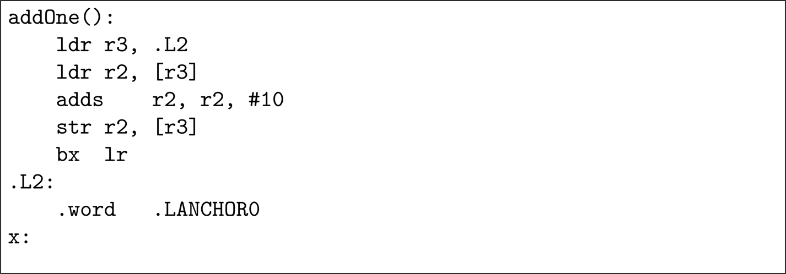
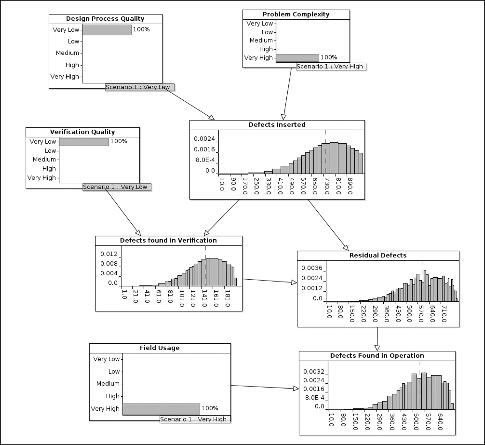
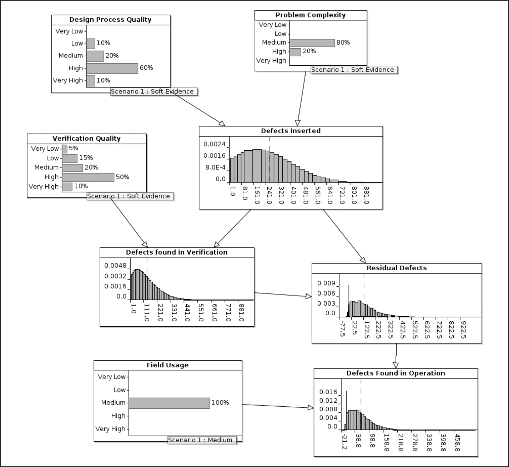
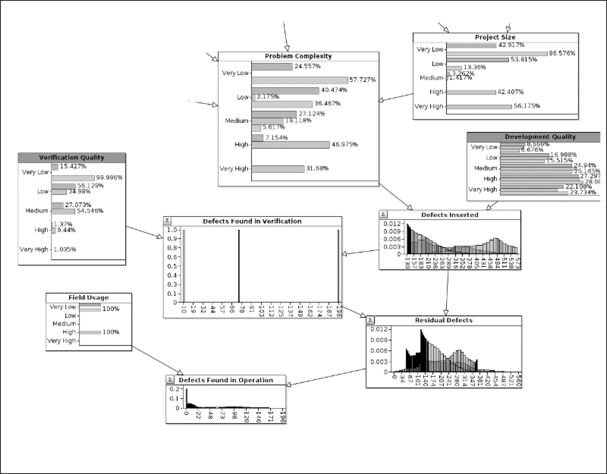

# 16 Failure rate của phần mềm

DOI: [10.1201/9781003598145-16](https://doi.org/10.1201/9781003598145-16)

> *Hãy đo những gì đo được, và làm cho đo được những gì chưa đo được.*
>
> Galileo Galilei

Để thực hiện bất kỳ dạng failure analysis nào, dù là Markov, Fault Tree Analysis (FTA) hay Failure Mode, Effects and Criticality Analysis (FMECA), chúng ta cần một ước lượng về failure rate của các thành phần. Và một trong những thành phần đó là phần mềm.

## 16.1 Tà thuyết nền tảng

Nội dung của chương này bị nhiều người trong thế giới các hệ thống safety-critical coi là tà thuyết. Nhiều tiêu chuẩn functional safety đưa ra giả định rằng, mặc dù các failure phần cứng có thể xảy ra ngẫu nhiên, mọi failure phần mềm đều mang tính hệ thống, biểu thị các vấn đề với thiết kế, chứ không phải các vấn đề với phần hiện thực. Niềm tin này dựa trên nguyên lý rằng phần cứng thì hao mòn, còn phần mềm thì không. Như đã đề cập trong ngụy biện 3 ở trang 79, không phải tiêu chuẩn nào cũng rơi vào cái bẫy này, vì IEC 61513 nói rõ: *“Vì các tác nhân kích hoạt software fault được gặp phải một cách ngẫu nhiên trong quá trình hệ thống hoạt động, nên các software failure cũng xảy ra một cách ngẫu nhiên.”*

IEC 61508 coi failure phần mềm là mang tính hệ thống và điều này được phản ánh trong việc gán systematic capability level thay vì SIL cho phần mềm. Annex D của [phần 7](part7_appendices.vi.md) có tên, *“Statistical evaluation techniques for in service software elements,”* nhưng phụ lục này có một lời cảnh báo tường minh rằng *“Nó nhìn chung không áp dụng được cho phần mềm phức tạp, như hệ điều hành hoặc compiler.”*

ISO/PAS 8800, mặc dù được xuất bản muộn tới tháng Mười Hai năm 2024, coi các failure phần cứng là ngẫu nhiên, nhưng mọi failure phần mềm là mang tính hệ thống.

Quan điểm cho rằng failure phần mềm không thể được coi là ngẫu nhiên hẳn đã bắt nguồn từ một thế giới của phần cứng cơ khí và các chương trình single-threaded chạy trên các bộ xử lý single-core với một chương trình executive run-to-completion đơn giản. Những giả định này không đúng với các chương trình multi-threaded chạy trên các bộ xử lý multicore phức tạp được điều khiển bởi một hệ điều hành re-entrant mà chúng ta có ngày nay. Như Rob Ashmore từng nói, *“Mọi phần mềm chạy trên một bộ vi xử lý hiện đại đều non-deterministic.”*

Chương trình C được liệt kê trong [Hình 7.4](ch07_foundational_analyses.vi.md#fig7_4) ở trang 79 tự nó đã đủ để xua tan niềm tin vào failure phần mềm non-random. Chương trình đó *đôi khi* hỏng với một floating point exception, mặc dù nó không chứa phép toán dấu phẩy động nào! Xác suất failure phụ thuộc vào nhiều yếu tố, bao gồm việc bộ xử lý mà nó đang chạy là multicore hay single-core và những chương trình nào khác đang được thực thi trên bộ xử lý cùng lúc. Không thể dự đoán liệu nó có hỏng trong một lần thực thi cụ thể hay không, nhưng với một môi trường ổn định, chúng ta có thể ước lượng xác suất failure.

Điều này rất giống với failure của một thành phần phần cứng cơ khí — không thể nói liệu một chiếc lò xo có hỏng vào lần được kéo giãn tiếp theo hay không, nhưng với lịch sử của những chiếc lò xo tương tự, có thể đưa ra một ước lượng failure theo thống kê.

> Giai thoại 24.[⏎](#b16aned24) *Tôi từng gửi một bài báo đến một tạp chí, có chứa một phiên bản hơi sửa đổi của chương trình trong [Hình 7.4](ch07_foundational_analyses.vi.md#fig7_4). Người phản biện được giao bài báo đã phản đối rằng tôi đã nhầm và chương trình như được viết không thể hỏng. Tôi đã thuyết phục được biên tập viên rằng tôi đúng, và bài báo đã được xuất bản. Ngay vào ngày tạp chí ra mắt, tôi nhận được một email từ một kỹ sư an toàn làm việc cho một công ty lớn, nói với tôi rằng tôi đã nhầm. Tôi đã thuyết phục được anh ta rằng anh ta sai và biên tập viên gợi ý anh ta gửi một “thư gửi biên tập viên”, mà sau đó tôi có thể bác bỏ. Anh ta đã từ chối làm vậy.*

Sự đồng thuận chung của những người đọc chương trình trong [Hình 7.4](ch07_foundational_analyses.vi.md#fig7_4) là, sau khi các thread đã hoàn tất, giá trị của *x* phải nằm giữa 10 (nếu hai thread liên tục giẫm chân nhau, ghi đè lên những gì thread kia vừa làm) và 20 (nếu hai thread chạy one-after-the-other). Vì vậy việc chia cho $( x - 2 )$ là hoàn toàn an toàn. Điều này được bằng chứng kiểm thử ủng hộ. Tôi vừa chạy chương trình đó 1 000 000 lần và giá trị của *x* ở cuối luôn, đúng như dự kiến, nằm giữa 10 và 20:

|  |  |
|---|---|
| 10 xuất hiện 321 lần | 13 xuất hiện 2 lần |
| 14 xuất hiện 1 lần | 15 xuất hiện 2 lần |
| 16 xuất hiện 6 lần | 17 xuất hiện 5 lần |
| 18 xuất hiện 10 lần | 19 xuất hiện 9 lần |
| 20 xuất hiện 999 644 lần |  |

Nếu chương trình two-threaded cực kỳ đơn giản này có thể được các kỹ sư có uy tín nghiên cứu (“kiểm tra code”) (xem [Giai thoại 24](#aned24)), và được kiểm thử kỹ lưỡng (một triệu lần!) mà không phát hiện ra fault, thì chúng ta có cơ hội nào với một chương trình điển hình hơn chạy trong một thiết bị nhúng safety-critical với hàng chục hay thậm chí hàng trăm thread?

Trong [Mục 18.7](ch18_formal_verification.vi.md#sec18_7) và [18.9](ch18_formal_verification.vi.md#sec18_9), tôi mô tả các công cụ chứng tỏ rằng chương trình này *có thể* hỏng, và tìm ra một chuỗi sự kiện dẫn đến failure đó. Tôi thấy ấn tượng là, mặc dù kiểm thử có thể mất hàng trăm năm để kích hoạt failure, các công cụ được đưa ra trong [Mục 18.7](ch18_formal_verification.vi.md#sec18_7) và [18.9](ch18_formal_verification.vi.md#sec18_9) tìm ra vấn đề trong chưa đầy một giây trên laptop của tôi.

## 16.2 Fault, error và failure

Có thể lập luận rằng chương trình trong [Hình 7.4](ch07_foundational_analyses.vi.md#fig7_4) có chứa một bug. Tôi đồng ý; lập trình viên lẽ ra phải bảo vệ biến toàn cục *x* bằng một mutex. Nhưng mọi chương trình chúng ta xuất xưởng đều chứa Heisenbug và chúng ta nên làm việc với thực tế chứ không phải với một thế giới hoàn hảo nơi chúng ta không bao giờ xuất xưởng bug.

Thuật ngữ “bug” là một từ khác của “fault.” Tôi chấp nhận rằng các *fault* phần mềm mang tính hệ thống (mặc dù, như được minh họa trong [Hình 2.1](ch02_terminology_of_safety.vi.md#fig2_1) ở trang 18, *fault* có thể đã được gây ra bởi một *failure* trong việc đào tạo lập trình viên). Tôi sẽ lập luận, như trong câu trích từ IEC 61513 ở trên, rằng các *error* và, đặc biệt, các *failure* xảy ra một cách ngẫu nhiên.

## 16.3 Bất định epistemic và bất định aleatoric

Có một lập luận khác, hơi khác một chút, có thể được áp dụng cho failure thống kê của phần mềm. Có hai loại bất định:

1. Epistemic Uncertainty (bất định nhận thức). Đây là khi chúng ta không chắc chắn vì chúng ta không biết đủ. Ví dụ, nhiều người sẽ không chắc chắn liệu từ Inuktut “naatsiingujaq” có nghĩa là thứ Bảy hay Chủ nhật. Sự không chắc chắn đó có thể được giảm bằng cách có thêm thông tin: tra một cuốn từ điển Inuktut/Anh.
2. Aleatoric Uncertainty (bất định ngẫu nhiên). Đây là khi chúng ta không chắc chắn vì tính ngẫu nhiên trong tình huống: có thêm thông tin cũng sẽ không giảm được sự không chắc chắn của chúng ta. Ví dụ, nếu tôi tung hai con xúc xắc cân đối trên bàn trước mặt, tổng có ra 7 không?

Đã có lập luận rằng bất định aleatoric không tồn tại. Lý do chúng ta không thể dự đoán liệu hai con xúc xắc có cho tổng là 7 hay không không phải vì chúng, về bản chất, không thể dự đoán, mà đơn giản chỉ vì chúng ta không biết đủ. Nếu chúng ta biết vị trí và vận tốc của mọi phân tử trong xúc xắc, có một mô tả đầy đủ về môi trường của nó (nhiệt độ, hướng tung, đặc tính của mặt bàn nơi chúng rơi xuống, v.v.) và có một máy tính đủ mạnh để thực hiện các phép tính, thì về nguyên tắc chúng ta *có thể* (trong giới hạn của các hiệu ứng lượng tử!) dự đoán liệu chúng có cho tổng là 7 hay không. Tính ngẫu nhiên bề ngoài của xúc xắc là do số lượng trạng thái khổng lồ mà chúng có thể ở trong đó và do đó chúng ta không có khả năng thực hiện phép tính.

Và điều tương tự cũng có thể nói về chương trình trong [Hình 7.4](ch07_foundational_analyses.vi.md#fig7_4): nếu chúng ta biết trạng thái của mọi thread trong môi trường của chương trình và có đủ năng lực tính toán, chúng ta có thể xác định chính xác liệu nó có hỏng trong một lần thực thi cụ thể hay không.

Đáng tiếc là, khi kết hợp với các thư viện và hệ điều hành, dễ dàng chứng tỏ rằng số trạng thái khả dĩ mà chương trình trong [Hình 7.4](ch07_foundational_analyses.vi.md#fig7_4) có thể ở trong đó vượt quá 10100 — nhiều hơn rất nhiều so với số nucleon trong vũ trụ.

Dù cả failure phần mềm lẫn phần cứng thực sự là ngẫu nhiên (aleatoric), hay cả hai đều có thể dự đoán được nhưng có vẻ ngẫu nhiên do sự thiếu hiểu biết của chúng ta (epistemic), lập luận này đặt phần mềm multi-threaded ngày nay vào cùng loại với phần cứng cơ khí, và loại kỹ thuật được dùng trong failure analysis phần cứng trở nên phù hợp với phần mềm.

## 16.4 Ảnh hưởng của compiler và phần cứng

Có thể rút ra thêm một sắc thái nữa từ [Hình 7.4](ch07_foundational_analyses.vi.md#fig7_4) và tôi biết ơn Daniel Kasza đã chỉ ra điều này. Nếu không có từ khóa `volatile` trong khai báo biến toàn cục `x`, compiler được tự do loại bỏ hoàn toàn vòng lặp và “âm thầm” thay nó bằng thứ gì đó như `x = x + 10;`. Ví dụ, nếu chương trình không có từ khóa `volatile` được biên dịch bằng `gcc` cho một bộ xử lý ARM với tùy chọn command-line `-Os`, code assembler được sinh ra như được thể hiện trong [Hình 16.1](#fig16_1).

*Hình 16.1: Code assembler được tối ưu khi bỏ `volatile`[⏎](#b16fig16_1)*

Đồng nghiệp của tôi, Adam Mallory, khi đọc mục này, đã nhận xét rằng *“con người coi code như một tập instruction tuần tự trong khi, thực tế, compiler phân rã và tìm những vùng nó có thể song song hóa hoặc gộp lại mà không thông báo cho người dùng, do đó tạo ra một khoảng cách lớn hơn nhiều giữa những gì con người dự định, những gì được diễn đạt trong ngôn ngữ bậc cao, mã máy được sinh ra và các thao tác cùng thứ tự mà bộ xử lý thực thi.”*

Architecture của bộ xử lý cũng có thể ảnh hưởng đến việc thực thi code do compiler sinh ra. Liệu bộ xử lý mà chương trình trong [Hình 7.4](ch07_foundational_analyses.vi.md#fig7_4) sẽ chạy có bảo đảm rằng toàn bộ số nguyên `x` được nạp và lưu một cách atomic không? Có thể phần cứng bên dưới nạp `x` vào một register thành hai phần, có khả năng cho phép các truy cập (ghi) khác xảy ra giữa hai phần của thao tác nạp.

Điều này sẽ mang lại thêm tính ngẫu nhiên cảm nhận được cho chương trình. Compiler, đặc biệt khi được gọi để tối ưu hóa thời gian hoặc không gian, có thể thay đổi hành vi dự định của một chương trình, và phần cứng mà chương trình chạy trên đó không nhất thiết bảo đảm việc thực thi đúng các instruction do compiler sinh ra.

## 16.5 Đánh giá failure rate

Ngay cả khi chúng ta chấp nhận rằng failure phần mềm trong một sản phẩm đã được kiểm thử và xuất xưởng thường do Heisenbug gây ra và rằng, theo định nghĩa, những failure đó mang tính thống kê, chúng ta vẫn gặp vấn đề dự đoán failure rate của một module phần mềm cụ thể.

### 16.5.1 Failure rate của phần cứng

> Giai thoại 25[⏎](#b16aned25) *Tôi đang làm việc cho một công ty viễn thông thì một kỹ sư dependability phần cứng gợi ý chúng tôi xem xét tỷ lệ trả hàng của một bo mạch đã có mặt ngoài thực địa vài năm, và so sánh failure rate thực tế với failure rate được dự đoán bởi failure analysis đã thực hiện trước khi các bo mạch được xuất xưởng.*
>
> *Chúng tôi phát hiện ra rằng dự đoán đã cực kỳ chính xác: đến vài chữ số thập phân! Điều này chứng tỏ tính hữu ích của việc thực hiện failure analysis phần cứng và biện minh cho thời gian đã bỏ ra cho nó.*
>
> *Sau đó chúng tôi thăm dò sâu hơn và phát hiện ra rằng cả một lô bo mạch đã bị đánh rơi trong một nhà kho và bị một chiếc xe tải cán nát. Điều này đã mở mắt cho tôi về ý nghĩa thực sự của failure rate — failure rate của phần cứng không được tính từ vật lý của các điện trở carbon-film, mà dựa trên lịch sử. Qua nhiều năm, xác suất một thiết bị bị đánh rơi trong nhà kho đã được đưa vào các con số failure, và đó là điều khiến những con số đó chính xác đến vậy.*
>
> *Và một thứ mà các nhóm phần mềm có chính là lịch sử.*

Các công ty phần cứng lớn lưu giữ lịch sử chi tiết về tỷ lệ trả hàng, còn các công ty nhỏ hơn dùng một số bảng có sẵn công khai, ví dụ IEC 61709:2017 và British Handbook of Reliability Data for Electronic Components used in Telecommunication Systems (HRD5) tiêu chuẩn. Các bảng này liệt kê các loại linh kiện (điện trở, tụ điện, cuộn cảm, v.v.) và đưa ra tỷ lệ cho mỗi loại failure (điện trở bị short-circuit, điện trở bị open-circuit, v.v.). Những giá trị như vậy có thể được dùng trong một FMECA ([Mục 7.4.1](ch07_foundational_analyses.vi.md#sec7_4_1)) để ước lượng dependability tổng thể của hệ thống.

### 16.5.2 Failure rate của phần mềm

[Giai thoại 25](#aned25), dựa trên việc dự đoán failure phần cứng, kể lại khoảnh khắc “eureka” của tôi.

Có lẽ ngoại trừ các startup chưa có lịch sử doanh nghiệp, mọi công ty phần mềm đều có những database hữu ích về lịch sử phần mềm của họ. Code repository chứa chi tiết về mọi thay đổi đối với mọi module. Code review repository chứa chi tiết về việc ai đã review các thay đổi đối với module, bao nhiêu thay đổi phải được thực hiện trước khi module được chấp nhận và liệu thay đổi có được chấp nhận vào chiều muộn thứ Sáu, năm phút sau khi được đưa lên để review hay không. Problem database gắn những thay đổi đó với các bản sửa bug hoặc cải tiến sản phẩm.

Điều này cho phép thực hiện một mức phân tích mà các kỹ sư phần cứng chỉ có thể mơ tới: *“Khi Joe viết một module bằng C dài 500-750 dòng non-comment trong subsystem XYZ, và các thay đổi của anh ấy được Ethel phê duyệt trước khi đưa vào repository, thì trong 73% trường hợp, phải thực hiện một thay đổi bug-fix trong vòng 3 tháng để sửa một bug trong module đó.”* Thông tin sẵn có thậm chí còn cho phép xác định xác suất của một lần sửa bug tiếp theo.

Thông tin này không được dùng để chỉ trích Joe vì thiết kế và viết code kém — có thể Joe là người cấp cao nhất trong nhóm và luôn được giao những phần khó nhất của thiết kế để hiện thực. Thay vào đó, thông tin này cho phép chúng ta ước lượng khá chính xác failure rate có khả năng của một đoạn code khác trong subsystem XYZ mà Joe đang viết.

Kiểu data mining trên source code repository và problem report database này giống với kiểu được mô tả trong phần thảo luận về đánh giá fault density trong [Mục 21.3.3](ch21_static_analysis.vi.md#sec21_3_3) và việc cải thiện phân tích code tĩnh được mô tả trong [Mục 21.3.1](ch21_static_analysis.vi.md#sec21_3_1). Cùng một dữ liệu đang được khai thác, bằng các công cụ tương tự, nhưng cho các mục đích khác nhau.

> Ngụy biện 6 *Failure analysis phần cứng không phải lúc nào cũng chính xác như [giai thoại 25](#aned25) ngụ ý. Tài liệu tham khảo [[1](#refbib16_1)] mô tả một thí nghiệm do European Power Supply Manufacturers Association thực hiện. Mười sáu công ty thành viên được yêu cầu ước lượng thời gian trung bình đến khi hỏng của một bộ chuyển đổi nguồn DC-DC đơn giản, mười linh kiện, 1 Watt, bằng phương pháp mô hình hóa failure thông thường của họ.*
>
> *Kết quả dao động từ 95 đến 11 895 năm (tỷ lệ 1:125). Sau một số thảo luận giữa các công ty, kết quả đã được thu hẹp vào khoảng 1 205 đến 11 895 năm (vẫn là tỷ lệ 1:10).*
>
> *Điều này không nhằm chế giễu việc dự đoán failure phần cứng — chúng ta biết rằng nó hữu ích. Bài học là chúng ta có thể làm ít nhất cũng tốt như vậy đối với phần mềm.*

## 16.6 Mô hình hóa các failure

Với thông tin failure cơ bản, có nhiều mô hình sẵn có để ước lượng failure rate của một sản phẩm trong quá trình phát triển và sau khi phát hành, nhiều mô hình có từ những năm 1980. Tài liệu tham khảo [[2](#refbib16_2)] của Ilkka Karanta cung cấp một danh mục hữu ích gồm khoảng hai mươi mô hình. Các giả định đưa ra trong một số mô hình trong số hai mươi mô hình đó rất phi thực tế: ví dụ, việc sửa một bug không bao giờ đưa vào một bug mới và mọi fault (bug) trong code đóng góp như nhau vào failure. Có lẽ mô hình best-known là một trong những mô hình sớm nhất, mô hình Littlewood-Verrall năm 1974 (tài liệu tham khảo [[3](#refbib16_3)]), vốn tránh được các giả định này.

Theo truyền thống, các mô hình như vậy được phân loại thành mô hình dự đoán (prediction) hoặc mô hình ước lượng (estimation). Mô hình dự đoán dựa trên dữ liệu lịch sử và được dùng trước khi dự án bắt đầu để dự đoán số lượng failure, trong khi mô hình ước lượng được xây dựng khi dự án tiến triển và dựa trên dữ liệu đến từ các hoạt động phát triển và kiểm chứng. Tôi tin rằng không có sự phân biệt thực sự giữa hai loại này và một mô hình ước lượng chỉ là sự tinh chỉnh của mô hình dự đoán. Tài liệu tham khảo [[4](#refbib16_4)], của Latha Shanmugam và Lilly Florence, phân loại các loại mô hình này thành:

- “Time-Between Models” dự đoán thời gian giữa các failure.
- “Fault Count Models” dự đoán số failure xảy ra trong một khoảng thời gian cụ thể.
- “Fault Seeding Models”, trong đó bug được cố ý đưa vào chương trình và tỷ lệ giữa bug được gieo và bug không được gieo tìm thấy trong quá trình kiểm chứng cho phép ước lượng số bug trong code. Phương pháp này được mô tả (cho việc đếm cá trong ao) ở trang 291.

Lưu ý rằng chất lượng biên tập của tài liệu tham khảo [[4](#refbib16_4)] không cao và nó nhầm lẫn các thuật ngữ “fault” và “failure” ở nhiều chỗ.

Mọi mô hình được đề xuất đều bao gồm một dạng khớp đường cong (curve fitting) với một phân phối thống kê định trước để xác định số bug (chưa biết) còn lại trong phần mềm và ảnh hưởng của chúng lên failure rate của hệ thống. Như Bev Littlewood chỉ ra trong bài báo kinh điển năm 1980 của ông (tài liệu tham khảo [[5](#refbib16_5)]), không phải mọi bug đều có cùng ảnh hưởng lên failure rate tổng thể và có khả năng những bug được tìm thấy sớm trong công việc kiểm chứng là những bug có failure rate lớn nhất.

Theo thời gian, khi có nhiều điểm dữ liệu hơn, các tham số của đường cong được tinh chỉnh và đường cong ngày càng chính xác. Các tham số đã được tinh chỉnh sau đó có thể đóng vai trò điểm xuất phát cho dự án tiếp theo, qua đó đưa lịch sử vào các dự đoán failure phần mềm như được mô tả trong [giai thoại 25](#aned25) đối với failure phần cứng.

Tài liệu tham khảo [[6](#refbib16_6)] của Norman Fenton *et al.* chỉ ra một khiếm khuyết lớn trong kỹ thuật này khi nó được áp dụng cho số vấn đề được báo cáo từ thực địa. Một nhà cung cấp phần mềm đã cài đặt các metric company-wide để nhận diện code tốt nhất của mình — code mà các nhóm dự án khác có thể học hỏi. Một khi mọi metric đã được thu thập và các dự án tốt nhất được nhận diện nhờ có tỷ lệ báo cáo bug cực kỳ thấp, có người chỉ ra rằng tất cả các sản phẩm “tốt nhất” đều là những sản phẩm thất bại. Vì không ai dùng chúng, tỷ lệ báo cáo bug từ thực địa gần bằng không.

Sau khi nhận diện được khiếm khuyết logic này (phần mềm không được dùng thì không bao giờ tạo ra báo cáo bug), tài liệu tham khảo [[6](#refbib16_6)] tiếp tục đưa ra một cách biểu diễn, dựa trên Bayesian Network (xem [Phụ lục B](ch26_appendix_b_bayesian_belief_networks.vi.md)), trong đó mức độ sử dụng được tính đến. Tôi đã đơn giản hóa một chút mô hình của tài liệu tham khảo [[6](#refbib16_6)] trong [Hình 16.2](#fig16_2), nơi tôi đã cố ý chọn một ví dụ cực đoan: một dự án rất phức tạp với các quy trình thiết kế rất kém, mức kiểm chứng rất thấp và nhiều lượt sử dụng ngoài thực địa. Một ví dụ thực tế hơn được đưa ra trong [Hình 16.3](#fig16_3), nơi có thể thấy rằng số bug được ước lượng đã xuất xưởng thấp hơn nhiều, đường chấm trong mỗi ô biểu thị giá trị trung bình.

*Hình 16.2: Ước lượng các defect phần mềm: Trường hợp cực đoan.[⏎](#b16fig16_2)*

*Hình 16.3: Ước lượng các defect phần mềm: Trường hợp thực tế hơn.[⏎](#b16fig16_3)*

[Hình 16.2](#fig16_2) và [16.3](#fig16_3) dùng các phân phối tinh vi hơn những phân phối đã được áp dụng cho fault tree analysis (FTA) trong [Chương 15](ch15_the_fault_tree.vi.md). Tóm lại, phân tích dựa trên giả định rằng số defect còn sót lại phụ thuộc vào số defect được đưa vào code trong quá trình phát triển, và số defect được tìm thấy và loại bỏ trong quá trình kiểm thử pre-shipment. Số lượng và tần suất defect xuất hiện ngoài thực địa phụ thuộc vào số defect còn sót lại và mức độ sử dụng vận hành, qua đó tránh được vấn đề đã nhận diện ở trên là việc ít được sử dụng sẽ không tạo ra báo cáo bug.

Ban đầu, các xác suất tiên nghiệm (prior) của mạng Bayes (xem [Phụ lục B](ch26_appendix_b_bayesian_belief_networks.vi.md) để biết ý nghĩa của thuật ngữ “prior”) đến từ việc khai thác lịch sử của công ty, như đã mô tả ở trên. Khi dự án tiến triển, số defect đo được tìm thấy trong kiểm thử và mức độ sử dụng vận hành có thể được thêm vào phép tính.

Độ chính xác của số bug field-reported được dự đoán trong tài liệu tham khảo [[6](#refbib16_6)] thật đáng kinh ngạc, nhưng bài báo có câu: *“Như hiện tại, mô hình sẽ ít phù hợp hơn đối với phần mềm safety critical hoặc phần mềm thuật toán cốt lõi, nơi rất ít defect post-release có thể được chấp nhận, và vì vậy rất ít defect sẽ được tìm thấy trong các giai đoạn kiểm thử sau hoặc trong quá trình sử dụng vận hành.”*

Waqar Ahmed và tôi đã quyết định xem liệu việc cải tiến BBN có khiến nó áp dụng được tương tự cho các sản phẩm safety critical hay không. Chúng tôi áp dụng nó cho ba sản phẩm phần mềm đã được chứng nhận theo IEC 61508 và ISO 26262. Trung tâm của BBN được minh họa trong [Hình 16.4](#fig16_4), nơi ba thanh màu khác nhau tương ứng với ba sản phẩm. Các kết quả đáng thất vọng được đưa ra trong tài liệu tham khảo [[7](#refbib16_7)]. Chúng tôi nhận ra rằng số lượng tương đối nhỏ các bug xuất hiện ngoài thực địa đã làm giảm độ chính xác của dự đoán. Công cụ tỏ ra rất hữu ích cho quản lý dự án, nhưng không cho độ chính xác cần thiết để trả lời câu hỏi: *“Với số bug dự kiến sẽ được tìm thấy ngoài thực địa, sản phẩm đã sẵn sàng để xuất xưởng chưa?”*

*Hình 16.4: Ước lượng các defect phần mềm trong ba sản phẩm.[⏎](#b16fig16_4)*

Có thông tin rằng kỹ thuật này đã được các công ty như Siemens (tài liệu tham khảo [[8](#refbib16_8)]) và Philips (tài liệu tham khảo [[9](#refbib16_9)]) sử dụng.

## 16.7 Failure rate 100% của IEC 62304

Như đã đề cập ở trang 38, IEC 62304 có một câu rất khó hiểu: *“Nếu hazard có thể phát sinh từ một failure của hệ thống phần mềm khi không hoạt động như đặc tả, thì xác suất của failure đó phải được giả định là 100 phần trăm.”* Điều này có nghĩa là giả định rằng phần mềm sẽ luôn hỏng phải được đưa vào failure model, nhưng không đưa ra hướng dẫn nào về tần suất hay loại failure. Nên giả định rằng phần mềm hỏng mỗi 100 ms, hay mỗi tuần? Failure kéo dài 100 ms hay cho đến khi người vận hành nhận ra nó?

## 16.8 Các công ty ví dụ

Hãy xem một trong các công ty tiêu biểu được giới thiệu trong [Chương 4](ch04_representative_companies.vi.md), Alpha Device Corporation (ADC), có thể hiện thực chiến lược này trong thực tế như thế nào.

Đây không phải lần đầu ADC chế tạo một thiết bị ô tô, và công ty là người dùng nhiều mô hình COCOMO II[1](#fn16_1) cho việc lập kế hoạch dự án. Điều này đã khiến các kỹ sư của ADC rút ra một số yếu tố từ COCOMO để mở rộng các mô hình Bayes được minh họa trong [Hình 16.2](#fig16_2) và [16.3](#fig16_3) cho khớp chính xác hơn với hoạt động và lịch sử thực tế của ADC.

Ví dụ, node “Design Process Quality” đã được làm cho phụ thuộc vào mức độ áp dụng các phương pháp (semi-)formal cho thiết kế, và “Problem Complexity” bao gồm các tham số COCOMO về việc liệu code sẽ chạy trong môi trường nhúng hay không, nó là kernel-level hay application-level và liệu nó có các yêu cầu real-time hay không. Tương tự, “Defects Inserted” phụ thuộc vào các tham số COCOMO-like như khoảng thời gian mà nhóm đã làm việc cùng nhau, và tỷ lệ code đang được tái sử dụng.

Trong “giai đoạn concept” của dự án (dùng thuật ngữ của ISO 26262), cấu trúc chung của mô hình Bayes đã được ban quản lý dự án và nhóm phát triển chấp nhận. Các prior sau đó được điền từ thông tin lịch sử của các sản phẩm trước.

Một khi dự án chuyển sang các giai đoạn thiết kế và hiện thực, dữ liệu được thu thập từ ngày đầu tiên và được dùng để điều chỉnh các tham số và hình dạng của các phân phối khác nhau, đặc biệt là phân phối liên quan đến “Defects found in Verification”. Nhóm quản lý của ADC, bao gồm các project manager, được cung cấp thông tin này hằng ngày và dùng nó để sớm nhận diện các thay đổi tiến độ tiềm tàng.

Khi việc phát triển sản phẩm gần kết thúc, các dự đoán từ mô hình được dùng để quyết định khi nào nên dừng kiểm chứng: theo thuật ngữ của ISO 29119, khi rủi ro đã được giảm thiểu đủ.

Mô hình đã được tinh chỉnh trở thành một phần không thể tách rời của Failure Analysis của ADC trong quá trình chứng nhận và, một khi sản phẩm được triển khai, mô hình tiếp tục được cập nhật dựa trên các vấn đề được báo cáo từ thực địa và trong quá trình regression testing nội bộ.

Beta Component Incorporated (BCI) đã có thể dùng một mô hình tương tự trong quá trình chuẩn bị hệ điều hành của mình cho ADC, nhưng với một số khác biệt. Hệ điều hành của BCI có lịch sử lâu dài như một sản phẩm chưa được chứng nhận và nhiều dữ liệu đã có sẵn. BCI dự định tiếp tục bán một phiên bản non-certified của hệ điều hành, và vì vậy có hai loại “Field Usage”: một mức cao hơn cho phiên bản non-certified, và một mức thấp hơn cho phiên bản đã được chứng nhận. Điều này dẫn đến các con số “Defects Found in Operation” khác nhau — một cho phiên bản đã được chứng nhận và một cho phiên bản non-certified.

[1](#fn16_116b)Xem [https://en.wikipedia.org/wiki/COCOMO](https://en.wikipedia.org/wiki/COCOMO)

## Tài liệu tham khảo

[1] European Power Supply Manufacturers Association, “Guidelines to understanding reliability prediction,” 2005.[⏎](#b16refbib16_1)

[2] I. Karanta, “Methods and Problems of Software Reliability Estimation,” *Tech. Rep. VTT-WORK-63*, VTT Technical Research Centre of Finland, Vuorimiehentie 3, Espoo, Finland, 2006.[⏎](#b16refbib16_2)

[3] B. Littlewood and J. L. Verrall, “A Bayesian Reliability Growth Model for Computer Software,” *Applied Statistics*, vol. 22, 01 1973.[⏎](#b16refbib16_3)

[4] L. Shanmugam and L. Florence, “An Overview of Software Reliability Models,” *International Journal of Advanced Research in Computer Science and Software Engineering*, vol. 2, October 2012.[⏎](#b16refbib16_4)

[5] B. Littlewood, “What makes a reliable program: few bugs, or a small failure rate?,” in *Proceedings of the May 19-22, 1980, National Computer Conference*, AFIPS ‘80, (New York, NY, USA), pp. 707–713, ACM, 1980.[⏎](#b16refbib16_5)

[6] N. Fenton, M. Neil, and D. Marquez, “Using Bayesian networks to predict software defects and reliability,” *Proceedings of the Institution of Mechanical Engineers, Part O: Journal of Risk and Reliability*, vol. 222, no. 4, pp. 701–712, 2008.[⏎](#b16refbib16_6)

[7] C. Hobbs and W. Ahmed, “Using Bayesian Modelling to Predict Software Defects,” in *Proceedings of the* *Twenty-ninth Safety-Critical Systems Symposium*, pp. 191–205, SCSC, 2021.[⏎](#b16refbib16_7)

[8] H. Wang, F. Peng, C. Zhang, and A. Pietschker, “Software Project Level Estimation Model Framework based on Bayesian Belief Networks,” in *QSIC ‘06: Proceedings of the Sixth International Conference on Quality Software*, (Washington, DC, USA), pp. 209–218, IEEE Computer Society, 2006.[⏎](#b16refbib16_8)

[9] N. E. Fenton, P. Krause, and M. Neil, “Software Measurement: Uncertainty and Causal Modelling,” *IEEE Software*, vol. 19, no. 4, pp. 116–122, 2002.[⏎](#b16refbib16_9)
